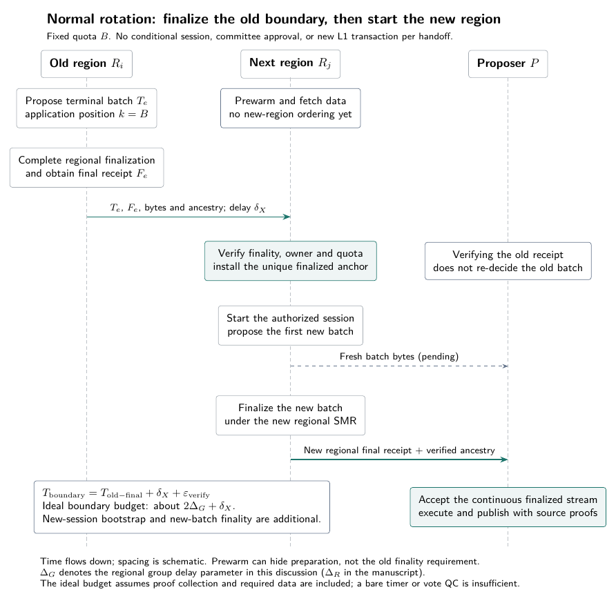
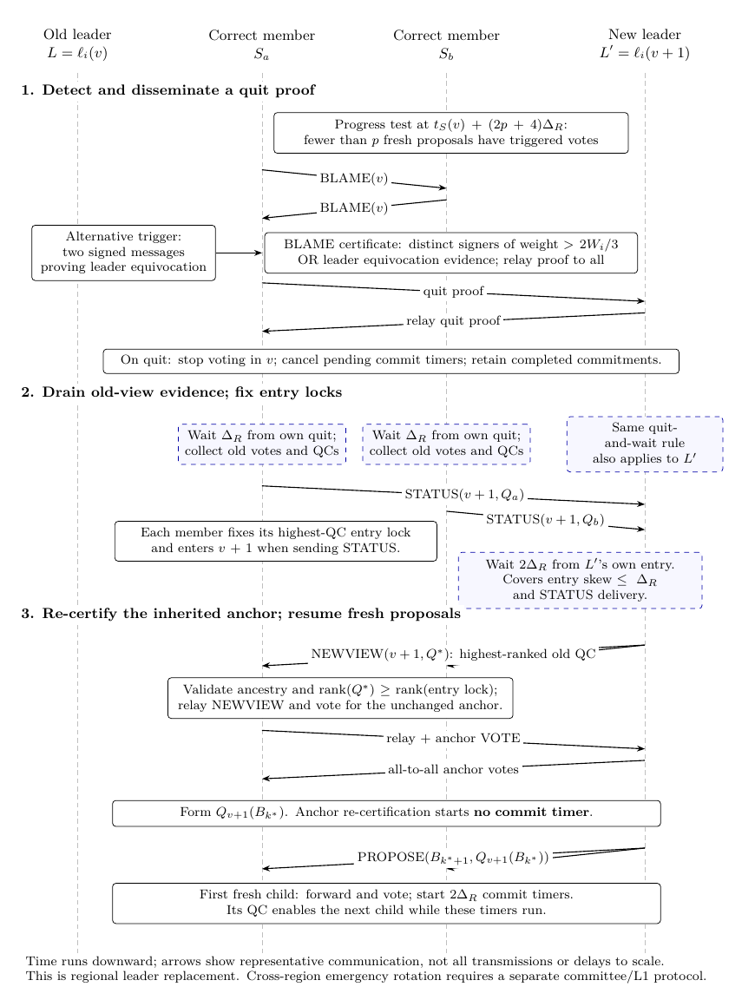

# v3 提案：先确认后交接的跨区轮换与按高度授权的事故恢复

日期：2026-09-28；按本轮用户决定修订。
本文是设计提案，不修改 `main_v2.tex`，不声称已有完整实现或端到端证明。
本轮接受旧区域最终确认及跨区传输的等待；删除此前的条件会话、提前在未 final 父块上投票，以及独立命名的 `StreamFinal` 阶段。
委员会只管理区域状态与事故截止位置，不定期向 L1 认证 stream tip，不签署新区首个 header，也不选择某个候选分支的 hash。

- [v3 拟议大纲与修订计划](v3-outline-and-revision-zh.md)
- [正常轮换通信图](figures/normal-handoff.pdf) / [原生 TikZ](figures/normal-handoff.tex)
- [区域 blame 通信图](figures/blame-pipeline.pdf)
- [版本和验证记录](README.md)

## 1. 当前采用的设计

正常轮换为：**旧 region 的第 B 个 batch finalized → 新 region 收到并验证该 batch 和 final receipt → 新 region 在它之后开始提案**。
新 region 可提前同步已确认历史、预取数据、建立连接和准备资源，但不在未 finalized 的交接父块上启动新的排序会话。
正常轮换依据 L1 已安装的 schedule，不要求委员会逐次签名或逐次等待新 L1 交易。

事故轮换为：**委员会在 L1 授权旧 generation 截止于全局 batch 高度 b* → 接收方凭旧区域的 final receipt 唯一解析该位置 → 新 region 从该已确认 batch 之后开始**。
“这个高度是什么内容”由区域 SMR 的最终决定和密码学证据确定，不由委员会决定。
委员会事件只携带位置、区域状态和控制上下文；batch/hash/finality proof 由 relayer、proposer 或 successor 作为独立 witness 提供。

这减少了委员会对内容和分支的直接裁量，但仍保留停机、恢复和截止位置的权限。
尤其不能把“委员会最后看见的 finalized 高度”直接等同于“所有已 finalized 历史的完整截止位置”。

## 2. 基线、术语和安全范围

### 2.1 本轮起始读取的稿件快照

本轮开始读取的 [main_v2.tex](../../main_v2.tex) 为 694 行，SHA-256：

```text
d201da53bceb0df51f8be46784f9f7b576f8ce1f8bb512526c15e23d30f08e35
```

它已经包含具体 double-head slashing 定义、adjudication 算法和 blame 通信图。
其区域 final receipt 是 post-commit endorsements；raw vote QC 不能代替 final receipt。
本轮只改提案及其图，不覆盖稿件中这些已有内容。
验证时检测到 manuscript 在本轮期间另有变化；以上标识是起始读取快照，不声称它仍是磁盘最新 hash。

本地原生规范快照为 `59797b45b1f59b7c2c147e6f99be39399a1f2b44`。
[blocks.md](../../../megaeth_specs/specs/protocol/blocks.md) 通过 `sequencerAt(block_number)` 确定 mini-block signer；本文的 region/session、父链承诺等是研究协议的扩展接口。

### 2.2 简化后的确认语义

| 状态 | 含义 |
|---|---|
| Pending | 区域正在提案、投票或形成证明，尚未最终确认 |
| Finalized | 在有效授权、已验证继承锚点的区域会话中，由该区域 SMR 最终确认 |
| L1Accepted / L1Finalized | 发布被当前 L1 链上的合约接受 / 所在 L1 历史最终确认 |

final receipt 是区域共识结果的凭证，不是 EVM 交易 receipt。
会话的继承锚点是已确认的前驱 batch，不是执行后的 state root。

现在每个新会话在开始前就验证其锚点，因此不再需要“本地已决定、但上游父块仍未 final”的中间状态。
接收者仍需验证授权、final receipt、数据与连续性；删除状态名称不等于删除这些有效性检查。
排序最终确认也不自动证明执行正确、DA 可用或 L1 已最终确认。

### 2.3 黑盒假设不能随简化消失

区域 SMR 的 safety、liveness、数据保留，委员会阈值诚实，WAN 传输和 L1 最终性须分别声明。
当前 v2 的标准同步 Sync HotStuff 有自己的区域同步前提；委员会不能把违反这些前提后的冲突 final receipts 自动变回安全状态。
下文假设相同有效会话、相同位置的区域 final value 唯一。
若事故模型允许突破区域 safety，须更换适合该模型的黑盒，或明确该执行不在安全定理范围内。

## 3. 编号、权限与确认对象

### 3.1 编号和 schedule

- Region 为 `R_i`，sequencer 为 $S_{i,j}$，权重为 $\omega_{i,j}$，总权重为 $W_i$。
- 委员会为 $\mathcal C$，总权重为 $W_C$；proposer 记为 `P`。
- `g` 为控制 generation，`e` 为该 generation 内的正常 tenure，`v` 为区域本地 view。
- $k\in\{1,\ldots,B\}$ 为 tenure 内的应用 batch 位置，B 是固定配额。
- **b 是全局应用 batch 高度**，跨正常轮换和事故 generation 都不重置。
- **h 是全局 mini-block 高度**；一个 batch 覆盖非空连续范围 $[h_a,h_b]$，所以 b 和 h 不能混用。
- 底层 SMR 物理 log position 独立于 b/k；纯控制条目不增加应用高度。

L1 配置给出固定区域顺序及确定性的 eligible-region 调度规则。
每个 g 激活时固定其可用区域列表 `sched_g` 和首 batch 高度 $b_g$；$r(g,e)$ 为该 tenure 的唯一 owner。
在未被事故截断的范围内：

$$
e=\left\lfloor\frac{b-b_g}{B}\right\rfloor,
\qquad k=1+((b-b_g)\bmod B),
\qquad r=r(g,e).
$$

事故后 $b_{g+1}=b^*+1$。
committee 的状态标签可影响后续 eligible 集合，但不能改写已激活 schedule 对历史位置的分配。
本版不赋予 committee 任意选择新区 producer、任意改 stake snapshot 或任意重排区域列表的权限。
新的区域组来自已经安装的调度/配置规则。

### 3.2 Batch 与 final receipt

令签名域

$$
D=(\text{protocolVersion},\text{chainId},\text{contractAddress},c,g).
$$

c 标识区域配置；委员会控制签名另绑定自己的配置版本 $c_C$。
规范 batch 描述为

$$
X_b=(D,e,r,s,k,b,[h_a,h_b],q_{h_a-1},q_{h_b},
\operatorname{dataRoot},\operatorname{prefixRoot},\operatorname{endFlag}).
$$

其承诺固定交易/mini-block 的顺序、长度、multiplicity 和原始字节。
`F_b` 是正确区域对该 session、位置和确切 batch digest 的 final receipt；与批次数据和必要 ancestry 一起验证。
producer 的原始 authorship view 与后来重认证的 certificate view 分开，不能用后者检查原始 signer。
所有签名绑定类型和上下文，signer 去重，权重取历史配置。

正常 tenure 的 $k=B$ 是 terminal batch。
重复提案、跨 view 重认证和控制消息不消耗新的应用 quota；旧 region 不得在同 tenure 创建应用 batch B+1。
旧区仍可继续末批的确认、恢复及数据服务。

### 3.3 只在已确认锚点上启动 session

正常交接证据为

$$
N_e=(g,e,T_e,F_{T_e},\mathcal A_e),
\qquad T_e=X_{b_g+(e+1)B-1},
$$

其中 $\mathcal A_e$ 证明 T_e 的已授权、连续 ancestry。
接收方验证第 B 个应用 batch、正确 owner、final receipt、完整前缀及下一 owner 后，确定

$$
s_{g,e+1}=H(\texttt{REGION-SESSION},D,e+1,r(g,e+1),H(T_e)).
$$

此处只有一个由已 finalized 锚点决定的正式 session，没有按候选分支派生的条件 sessions。
初始 session 绑定 genesis/config checkpoint；事故后的首 session 绑定 §7 从高度和区域证明解析出的锚点。
同 session 恢复必须还原 vote、lock、commit 和防双签记录，不能以重启为由换一个自选 session nonce。

## 4. 区域 SMR 的最小黑盒接口

| 接口 | 必要语义 |
|---|---|
| `StartSession(s, finalizedAnchor, cfg, quota)` | 启动前验证锚点最终性、授权、数据和连续性；禁止未确认候选锚点 |
| `Propose(s,command)` | 在该有效 session 内提出下一应用 batch |
| `Finalize(s,X)` | 导出可验证的最终确认凭证；同 session 内不可回滚 |
| `VerifyFinal(cfg,s,X,F)` | 验证最终确认语义及内容绑定，不能仅数 raw QC 签名 |
| `Fetch(s,range)` | 返回数据、final receipts 与 ancestry；失败则等待/重试 |
| `Drain(s,B)` | 停止新应用输入后仍能完成末 batch 的确认 |

`Drain` 仍是必要条件，与是否允许提前新区会话无关。
当前 v2 的无限 fresh-proposal deadline 会在固定 quota 后错误地要求 B+1；其末 batch 若在 NEWVIEW 中仅被重认证，又不会启动 commit timer。
实例适配须停止越过剩余应用配额的进度要求，同时保留末批冲突处理、确认及专用 completion 规则。
可使用不含新增 mini-block 的控制后继，或经证明的 close 操作；不得将它们计为额外应用 batch。
这些修改及其证明仍待完成，不能声称当前 v2 原算法已经支持固定 quota 的所有结束情形。

## 5. 正常轮换：等待 finalized 后直接接续

### 5.1 算法 N：`FinalizeThenHandoff`

1. **Prewarm**：successor 提前获得配置、已确认历史、数据副本和连接；可预取未确认字节，但不能据此开始新区排序。
2. **Finish quota**：旧 region 提出 terminal batch，运行 SMR / Drain，取得可由新区验证的 final receipt。
3. **Transfer**：旧 region 或其他持有者发送 `N_e`、batch 内容及缺失 ancestry；peer fetch 可修补遗漏。
4. **Verify and start**：新区检查 quota、owner、final receipt、父链和数据，将 T_e 安装为唯一锚点，并启动正式 session。
5. **Propose next**：新区首 batch 的全局位置是 $b(T_e)+1$，首 mini-block 高度为 $h_b(T_e)+1$，parent 指向 T_e 的最后 mini-block。
6. **Finalize and deliver**：新区使用自己的 SMR 最终确认并交付；P 接受连续、有效的区域 final receipts，不再有条件会话的晋升/丢弃步骤。

旧区末 batch 的完成不等待新区首 batch，避免循环依赖。
正常交接没有新一轮 committee 签名，也没有每次都等待 L1 最终确认的要求。
若只收到 QC 或数据而没有 final receipt，继续等待；不能因 timeout 绕过此门槛。

### 5.2 延迟口径

沿用用户本轮记号，$\Delta_G$ 表示区域 sequencer group 的同步延迟参数；当前稿件相应符号为 $\Delta_R$。
$\delta_X$ 表示跨区传输最终证明及所需数据的实际延迟，$\varepsilon_{\rm verify}$ 为验证时间。
从约定测量起点到旧区可验证最终证明就绪的时间记为 $T_{\rm old-final}$。

$$
T_{\rm boundary-ready}
= T_{\rm old-final}+\delta_X+\varepsilon_{\rm verify}
\ \approx\ 2\Delta_G+\delta_X.
$$

右侧是用户接受的理想交接预算：它要求测量口径已覆盖 final receipt 就绪，验证开销和数据预热也满足预算。
当前 v2 从 ready proposal 计的本地 commitment 为 $\delta_R+2\Delta_R$；若本地 timer 结束后还需收集/转送 post-commit endorsements，则这些工作也必须计入可验证证明到达，不能把裸 timer 当已送达的 final receipt。

“新区 confirm 旧末批”在这里是验证已有最终凭证，不要求再对旧 batch 运行一次共识来重新决定它。
新区 session 的未隐藏 bootstrap 和首批构造可能还有额外时间：

$$
T_{\rm new-propose}=T_{\rm boundary-ready}
+T_{\rm bootstrap,remaining}+T_{\rm construct}.
$$

新区首批自己的最终确认还需本地区域的确认时间；$2\Delta_G+\delta_X$ 不应同时被标成新区首批已 final 的完整延迟。
这些公式是设计预算和测量关系，不是已测实现性能。



### 5.3 为什么可以删除中间阶段

每个 session 开始时，owner 和继承锚点都已验证。
正常归纳中，旧区域的唯一 terminal final value 决定新区唯一锚点；新区 final log 因而延伸旧前缀。
新旧 quorum 不必共享成员；安全连接来自对旧 final evidence 的验证及固定父链，而不是跨区域 quorum 交集。
在这些前提下，本地 final receipt 本身就能沿授权历史被消费，不再出现“本地已 final、但候选 root 尚未取得资格”的状态。

### 5.4 Native signer 边界

如保留当前原生 `sequencerAt(block_number)` 规则，正常 terminal batch 须闭合 EVM block，新区从下一个 EVM block 的 index 0 开始。
第 B 个 batch 的构造必须能在资源限制内完成这一边界；否则需要调整 batch 构造或明确的原生协议扩展。
本地换 leader 也须处理同一个 EVM block 内的 signer 约束。
Registry / verifier 如何理解新增 region/session 授权，仍须单独定义。

## 6. L1 验证 proposer 忠实发布

本版采用委员会仅管理事故的路线。
因此，之前讨论的“committee 定期提交 stream checkpoint，从而替代逐批区域证书”的方案不属于当前协议。
P 仍须提供可验证的区域最终性与授权证据；可以研究 prefix certificates、聚合/递归证明以减少开销，但不能用一个委员会高度声明代替它们。

发布对象至少绑定连续 batch / mini-block 范围、起止 parent、ordered stream commitment、DA commitment、pre/post state roots，以及来源/数据/执行证明。
L1 按以下顺序验证：

1. 从 publication frontier 的下一位置开始，无跳跃、重排或重复。
2. 正常边界验证 `N_e`；事故边界验证已安装的高度事件及独立 regional final witness。
3. 每段属于正确 g/e/region/session，符合 quota 与历史配置；原始 producer 在自己的 authorship view 中合法。
4. 区域 final receipt 覆盖完整内容与顺序；实际提交/DA 编码解码后的数据与此完全相同。
5. DA 满足所选方案的可用性/保留要求；执行证明或争议机制约束同一输入流的 state root。
6. 原子推进 publication frontier、历史授权游标和相应执行状态；pending execution 与已可结算状态须分开。

一个提交可跨多个区域，但需逐段证明；逻辑上逐高度正确不强制实现为每个高度一笔交易。
控制 head 与 publication authority cursor 分开，事故已激活新区时仍允许沿旧配置补交保留后缀。
合约读取当前 L1 链上已安装的控制状态；外部节点另行等相关事件达到 L1 finality 才不可撤回地激活。

## 7. 事故恢复：委员会签截止高度，区域证书确定内容

### 7.1 委员会能够做什么

委员会观察区域 liveness，签署 `FREEZE`、`ROTATE_HEIGHT`、`READMIT`。
阈值例如为总权重 $>2W_C/3$，假设 Byzantine 权重 $<W_C/3$；同一控制 nonce 的互斥动作不得重复签署。
区域 quorum 与委员会 quorum 的安全假设独立。
任何 relayer 都可提交有效委员会证书；relayer 身份不决定事件效力。

其职责不包括给正常 batch 认证、替区域生成 final receipt、选择同高度的某个冲突 hash，或签署新区第一个 header。
“legit”在算法中必须解释成具有有效区域 final receipt、满足授权与继承规则，不能仅是委员会成员觉得内容合理。

### 7.2 高度声明与内容 witness 分离

简化的委员会消息为

$$
E_{\rm rot}=(D_C,\nu,\mathsf{expectedControlHead},g,
\texttt{ROTATE\_HEIGHT},b^*,\mathsf{statusUpdates},\mathsf{deadline}_\nu),
$$

其中 $D_C$ 绑定 chain、contract、协议版本和委员会配置。
`b*` 是全局应用 batch 的截止高度；区域状态更新限于已定义的故障标记，新的 owner 按已安装规则从后继 eligible 区域确定。
消息没有旧 tip hash、候选 branch root 或新区首 header hash 等由委员会挑选的字段。
控制 head 的标识防止 stale/replay，不授权委员会替换区域共识结果。

另由提交者提供

$$
W^*=(X_{b^*},F_{b^*},\mathcal A^*,\mathsf{data/recovery\ evidence}).
$$

L1 verifier 与 successor 分别验证 W*，通过

$$
A^*=\operatorname{ResolveFinalizedBatch}(g,b^*,W^*)
$$

导出该位置的确切 batch digest、末 mini-block 高度/哈希和前缀承诺。
这些 hash 仍是新区 parent link 和 L1 内部状态所必需的；**只签高度不意味着数据结构不再使用 hash**。
区别是内容来自区域的最终性证据，而不是委员会用签名在多个候选中挑出一个。
正常旧数据必须延伸已接受的历史，不能给同一个 b 换一份来源不符的证书。

若 g 尚未产生任何新 final batch，允许 $b^*=b_g-1$ 并重用 g 已认证的起始锚点；不虚构该 generation 的 final receipt。
通常情况要求 $b^*\ge b_g$ 且有该位置的完整 batch final receipt。

### 7.3 “只给高度”成立所需的唯一性

定义

$$
\mathcal V(g,b)=\{X:\operatorname{ValidAuthority}(g,b,X)
\land\exists F\;\operatorname{VerifyFinal}(X,F)=1\}.
$$

在区域 safety 与此前 handoff 正确的前提下，应证明

$$
|\mathcal V(g,b)|\le1.
$$

因而 committee 指定 b* 后，没有第二个合法 final 分支可供它选择。
不同 pending heads 或 raw QCs 不影响这个结论，因为它们不属于该集合。
若找不到该高度的最终证明或数据，新区等待；若发现两个冲突的合法 final receipts，则区域/授权安全前提已经失败，协议停止正常切换，不把选择权交回委员会或“先收到者”。

这是有前提的权限限制，不是用高度解决任意 Byzantine 分叉的新共识机制。

### 7.4 截止高度仍不能丢弃更长的 finalized 历史

假设委员会只看到 batch 100，但旧区已经对外最终确认到 105。
授权新区从 101 开始会回滚 101–105；将事件里的 hash 改成数字 100，不会消除这个冲突。
因此 b* 不能只是委员会当前缓存中的最高值。

恢复前仍需 `ClosedRecoverablePrefix(g,b*,W*)`：

- **有效且唯一**：W* 解析到该位置唯一的区域 finalized batch，扩展既有 L1 / 接收者前缀。
- **完备覆盖**：旧 g 中所有已合法 finalized 的前缀都包含于该 batch 的前缀，不仅是已发布 L1 或恰被观察到的部分。
- **权限闭合**：之后不能再合法导出超出 b* 的旧 g finalized 内容；已包含的历史证据可以迟到并用于补发布。
- **可恢复**：新区和 P 可取得该前缀的字节、证明及必要状态。

FREEZE 须覆盖整个旧 generation，包括故障观察之后可能已正常交接的区域会话。
L1 上冻结不自动阻止隔离节点继续导出，数字 b* 也不证明不存在未见的更高 finalized 后缀。
closed-cut 的具体提供机制仍需选择：旧区恢复后安全关闭，或额外的外部持久化/完整恢复机制；仅等待几十分钟不够。
无法满足时保持冻结，不允许以委员会截止声明撤销既有最终确认。

### 7.5 具体状态机

控制状态与发布状态分开：

$$
\mathsf{Ctl}=(\nu,g,mode,sched_g,regionStatus,c_C,deadline_\nu,pending),
\quad\mathsf{Pub}=(A_{\rm pub},authCursor,publicationNonce).
$$

`mode ∈ {RUNNING,FROZEN}`。
委员会签名的 expected control head 不包含 RUNNING 时持续变化的 publication frontier；FREEZE 在实际执行时原子记录并冻结该 frontier。
每个控制 nonce 有链上预先确定的截止高度；超时后任何人可 `AdvanceExpiredRound`，仅推进 nonce 和新截止时间，保留 mode/权限，不解除冻结也不授权切区。
成功控制事件也推进 nonce；委员会达成同一签署提案和 L1 可用性仍是进展前提。

**算法 E：`RotateAtFinalizedHeight`。**

1. **Observe / Freeze**：委员会报告故障并阈值签署冻结事件；待其 L1 finality，启动整个旧 g 的停止导出与恢复流程。
2. **Close / Collect**：取得闭合、完整的 finalized frontier 和数据。委员会据此声明 b*，不得选一个已知遗漏更高 final 的较小高度。
3. **Attach witness**：任意提交者提供 b* 处的区域 final receipt、ancestry、数据/恢复依据；委员会不签这些数据的选择 hash。
4. **Resolve**：验证器独立解析 A*，检查其覆盖冻结 publication frontier，满足完整 batch 与 native EVM 边界要求。若不满足，拒绝/继续冻结。
5. **Install**：合约验证委员会高度证书及独立 witness，确定新的 eligible successor，原子安装 `g+1`、$b_{g+1}=b^*+1$ 和由 A* 派生的新 session；归档冻结记录，设置 `mode←RUNNING`。
6. **Preserve publication**：保留 frozen frontier 到 A* 的精确历史补发布义务，不覆盖旧 publication authority cursor；旧配置验证通过后顺序补齐，再接纳新区 publication。
7. **Activate**：successor 等事件 L1 finalized，并验证/取得 A* 的内容后，从 b*+1 提出自己的首 batch；该首 header 由新区 producer 签名、由新区 SMR 决定，委员会不事先签它。

合约能验证存在的签名、ancestry、已发布历史；closed-cut 的完备性和停止导出语义仍需相应机制/假设，不能由 b* 或 witness 字段名自动证明。
若事故前最后 final batch 尚在 EVM block 中途，须在最终 close 前完成原生边界（或完成后重新取得 close），或另行定义原生紧急 signer 规则；不能回退 final mini-block 来凑边界。

### 7.6 恢复时间与权限边界

事故时间包括检测、冻结上链、closed-cut/数据恢复、轮换上链和新区启动。
几十分钟至约一小时是有条件运行目标；L1、数据恢复或闭合不进展时不保证该时限。

本设计把具体 batch 内容和新区首 header 的决定留给 sequencer groups。
委员会仍可影响停机、恢复和哪个高度之后移交权限，所以不能据此声称委员会完全不影响 safety/liveness。
减少内容裁量的协议结论，不等同于保证所有安全风险或法律责任消失。

## 8. Region 恢复上线

恢复 region 先作为 observer 同步当前 L1 控制状态和区域 finalized 历史，保存旧防双签记录。
委员会签 `READMIT(region, controlNonce, eligibilityRule)`，不签新区首 header 或替区域确认新的 stream tip。
恢复检查可以附 regional final receipts / sync evidence，由验证器独立核验。

READMIT finalized 后仅恢复 eligible 资格，不恢复旧会话排序权，也不立即替换当前 active region。
当前 generation 的 schedule 不变；新资格在预先定义的安全配置激活边界或下一 generation 生效。
如需不等事故即可重新纳入日常轮换，必须另行固定该正常配置激活边界及规则，不能由节点各自选择生效时刻。
立即换区仍必须执行合法的截止高度事件。

## 9. Slashing 与 blame 的衔接

ORDER 双头比较域保持 `(chain, config, g, region, session, originalView, h, producer)`；同域不同 header digest 构成证据。
batch PROPOSE / VOTE 使用相应 batch/物理位置域；同 session 的冲突 final endorsements 可跨 view 比较。
合法跨 view 重提案、原内容重认证和 relay 不应误罚。
本版没有条件 session，因此删除此前“不同候选 roots 的不同条件会话”所需的特殊比较规则。

委员会控制消息仍做 nonce/domain 分离及 equivocation 检查。
一个过低 cutoff、错误 liveness 判断或未观察到更高 final，并不自动等于可证明的双签；具体追责谓词另行定义。
不以 slashing 代替对已 finalized 历史的保存。



图展示本地 `BLAME → quit → 等 Δ_R → STATUS → 新 leader 等 2Δ_R → NEWVIEW → anchor 重认证 → fresh child`。
BLAME 仅更换区域内部 leader，不授予跨区权限。
固定 quota 适配仍须修改无限 fresh-proposal deadline 和末批 Drain；不能因删除条件会话而忽略这两个问题。

## 10. 需要证明和检查的内容

| 性质 | 必需前提 / 剩余工作 |
|---|---|
| 正常轮换前缀安全 | session 启动前验旧 final；父链绑定；区域 SMR safety |
| 截止高度唯一解析 | 全局 b 与 g 上下文；完整授权历史；同位置区域 final value 唯一 |
| 委员会不决定区块内容 | 委员会消息只声明位置/状态；verifier 独立核验区域 witness；冲突时不任选 |
| 事故不回滚 final 历史 | cutoff 完备性、权限闭合、数据恢复与 L1 最终性 |
| 正常进展 | 末批 Drain、健康 successor、输入/数据服务和可行 EVM 边界 |
| 忠实发布及执行 | 区域证明、exact bytes、DA 和独立 execution verifier |

重点检查轨迹：

1. 旧末批只有 QC，新区不得开始排序；旧 final receipt 到达后可以开始。
2. 正常第 B batch 在 view change 前后都能排空，不要求新应用 batch B+1。
3. 事故声明 b*=100，但存在已 final 105：不得从 101 开新历史。
4. 委员会签同一 b*，不同 relayer 附不同 witness：在安全前提下至多一个可验证内容；冲突 final evidence 暴露时停止。
5. b 与 h、旧 generation 与新 generation 混用：拒绝。
6. 控制 nonce 过期、FREEZE 与 publication 并发：不会授权回滚或永久卡在同一 stale nonce。
7. 事故后旧数据迟到：按保留历史补交；不能继续扩展旧权限范围。
8. P 的数据、顺序或执行 state root 不符：由各自验证层拒绝/进入规定争议流程。

本轮完成设计取舍与接口修订；尚未完成 terminal adapter、closed-cut 机制、配置恢复激活和端到端安全/进展证明。
