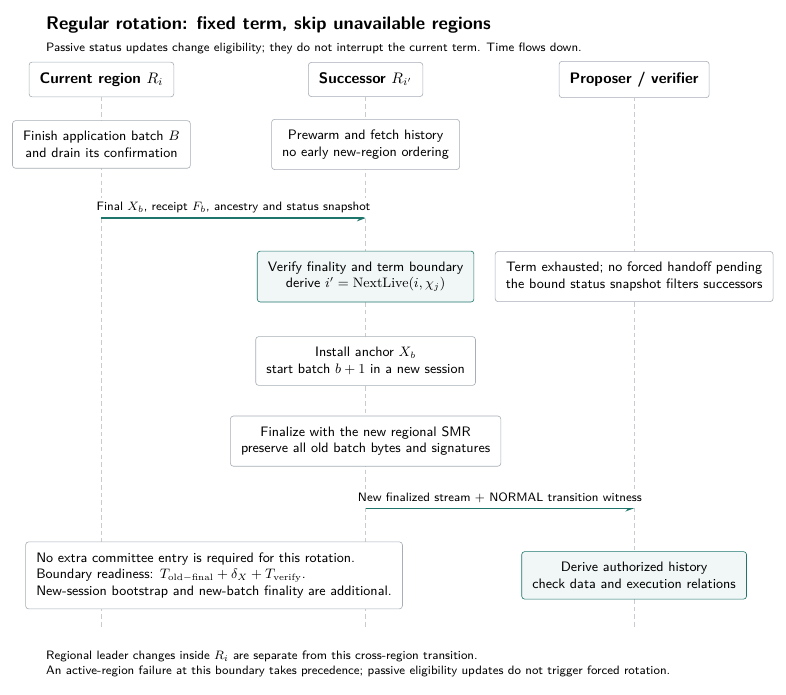
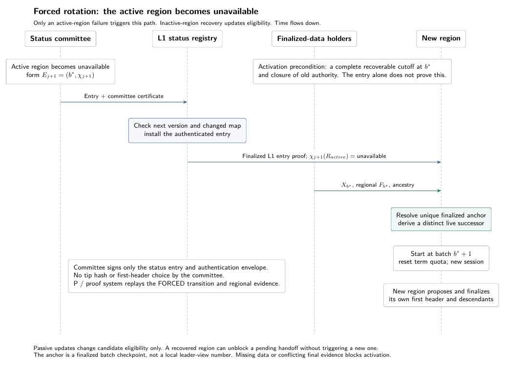

# main_v3 新大纲与修订计划：Status-Aware Regional Rotation

日期：2026-09-28；已纳入“非活动 region 恢复不强制轮换”的最新澄清。
本轮交付大纲、派生关系骨架和两类通信图，不生成论文正文。
基线为最新读取的 [main_v2.tex](../../main_v2.tex)：697 行，SHA-256 `24fcf93848b06cce8df91a321200b4291b3b6b9818938b723254f10d283f1eb6`。

- [正常与强制轮换图，PDF 两页](figures/rotation-pipelines.pdf)
- [正常轮换图源](figures/regular-rotation.tex) / [强制轮换图源](figures/status-change-rotation.tex)
- [来源与验证记录](README.md)

## 1. 本版的确定规则

委员会业务状态只有

$$
E_j=(\beta_j,\chi_j),\qquad
\chi_j:\mathcal R\longrightarrow\{\mathsf{live},\mathsf{unavailable}\}.
$$

$\beta_j$ 是全局应用 batch 高度，$\chi_j$ 是 region-status map。
版本、前序 entry、chain/config 域和签名放在认证封装中，不增加委员会业务字段。
`live` 表示有资格被下一次调度选中，不承诺未来绝不故障。

给定固定 rotation list，发生轮换时从当前 region 之后沿列表寻找下一个 live region，跳过 unlive region。
**status list 是调度过滤器，不是每次变化都会触发换区的开关。**

| 情况 | 更新 status entry | 立即结束当前任期 |
|---|---|---|
| 正常完成 B 个应用 batches | 不需要为了正常轮换新增 entry | 是，按当前有效 status snapshot 找下一个 live region |
| 当前 active region 被标记 unavailable | 是 | 是，触发强制轮换 |
| 非活动 region 恢复 live | 是 | 否，更新未来候选资格 |
| 非活动 region 被标记 unavailable | 是 | 否，在以后选择 successor 时跳过它 |
| 相同 map 重签、仅高度变化、heartbeat | 不构成新的状态变化授权 | 否，不重置 quota |

当前活动区失效是本版强制轮换条件；其他 region 的状态变化只改变可选集合。
如果已有轮换因没有 successor 而等待，某区恢复可以让这次等待中的轮换继续，不等于恢复事件又触发一次新的强制轮换。

新区先取得并验证 finalized anchor，再开始排序。
不采用条件会话、未 final 父块上的新区共识或独立的 StreamFinal 中间阶段。
委员会不签 tip hash、新区首 header 或执行 state root。

## 2. main_v3 拟议目录

建议标题：

> An Authenticated Live Sequencer Stream with Regional Rotation

副标题：

> Regional SMR, Status-Aware Scheduling, and Verifiable Rollup Derivation

保留 v2 区域协议的主体，增加 status committee、跨区轮换和 L1 派生关系。
建议从六节扩为八节；不改成由各区域 crash-only agents 运行外层 CFT 的结构。

### 1. Architecture and Service Goals

保留 sequencer group 负责排序、proposer 负责执行/发布的分工。
替换 unfinished outer CFT 定位，展示三条不同路径：区域内换 leader、满额后的正常跨区轮换、active region 失效后的强制轮换。
架构图中委员会只输出 authenticated status entries；status map 通过 deterministic scheduler 影响 successor。
目标为前缀继承、合法换区、忠实 rollup 和有前提的进展。

### 2. Model, Objects, and Verification Interfaces

#### 2.1 Participants and assumptions

保留 $S_{i,j}$、$\omega_{i,j}$、proposer P、区域成员快照与区域同步前提。
增加委员会、L1 registry、跨区传输、数据保留与恢复假设。
entry 一致性不能替代区域 SMR safety，也不能修复已经出现的冲突 final receipts。

#### 2.2 Indices and anchors

区分全局应用 batch 高度 b、mini-block 高度 h、tenure 内计数 k、跨区任期号 $\tau$、entry 版本 j 和本地 leader view v。
b 跨区域不重置；底层控制条目的物理 log position 与应用 batch 高度分开。

用户所说的 anchor view 定义为 **anchor checkpoint**：指定 finalized batch 及其末 mini-block；不是本地 view 数字。
同一 b 的具体内容由区域 final receipt 确定，不由委员会选 hash。

#### 2.3 Objects and authority context

定义 batch、raw vote QC、post-commit final receipt、status entry/certificate、normal/forced rotation witnesses。
区分原始 authorship view 与 recertification view。
session 绑定启动时的权限与 anchor；被动 status 更新不会修改既有 session ID、投票域或 slashing 域。

#### 2.4 Black-box interface

`StartSession(finalizedAnchor, authority)`、`Finalize`、`VerifyFinal`、`Fetch`、`Drain`。
启动前锚点已确认，因此不需要条件分支的晋升/丢弃接口。

### 3. Regional PoS SMR

保留 v2 的 steady-state pipeline、原生 NEWVIEW、blame、double-head slashing 与 adjudication。
使用最新正文对应图源，不重建一个不同的区域协议。

| 对象 | 最新 v2 阈值 | v3 要求 |
|---|---|---|
| Regional vote QC | $>2W_i/3$ | 保留原语和论证 |
| BLAME certificate | $>W_i/3$ | 不回退到旧稿阈值 |
| CONFIRM final receipt | $>W_i/3$ | 依赖 post-commit 语义，不能用 raw QC 替代 |
| Committee entry certificate | 单独配置，例如 $>2W_C/3$、faulty $<W_C/3$ | 不从区域阈值推导 |

补 fixed-quota terminal adapter：无限 fresh-proposal deadline 不能在 B 后要求 B+1 个应用 batch；末批若只是 NEWVIEW anchor，被重认证但不启动 timer，仍须能完成 finalization。
`Drain` 可使用不计应用 quota 的控制后继或专门 completion 规则；完整算法和证明是 v3 的实质新增工作。

### 4. Regional Status Committee

#### 4.1 State and observations

定义 $E_j=(\beta_j,\chi_j)$、初始 entry 与状态语义。
失联/恢复观察决定是否提出 map 更新；timeout 不自动是恶意行为或 slashing 的证明。
委员会只维护这个 entry 历史，不执行交易、不逐批认证 stream。

#### 4.2 Entry certification and installation

建议认证封装：

$$
\widehat E_j=(D_C,j,\operatorname{prevId}_j,E_j,\Sigma^C_j),
\quad \operatorname{prevId}_j=H(\mathsf{ENTRY},D_C,j-1,E_{j-1}).
$$

$D_C$ 绑定 chain、registry contract 和委员会配置；签名覆盖上述字段。
保护不可伪造、同前序更新唯一、顺序应用和 anti-replay。
L1 安装下一版本；相同 map 的重签不能制造新的 rotation 权限。

委员会签署可抽象为低频 ordered-entry service。
每成员每版本只签一次只帮助 safety，签署协调和重试 liveness 仍需单独前提/算法。
不把 FREEZE、ROTATE、READMIT 三种独立业务命令重新加入 schema。

#### 4.3 Passive update versus forced handoff

**Passive update**：更新不要求当前 active region 退出；只改变后续轮换的候选集合。
当前 region、term counter、已确认前缀、session 和 quota 均保持。
$\beta_j$ 是更新关联的已确认位置/生效依据，不在此路径上强制变成一个新 session 的 anchor。

**Forced handoff**：更新把当前 active region 标为 unavailable。
只有此时，$\beta_j$ 才承担提前结束任期、为新区提供 anchor 的作用；需完整 cutoff、旧权限闭合和数据恢复条件。

因此“entry 的 β 一定导致重新从 β 开始出流”不再是通用规则。
entry 被认证后，还需结合此前派生的 active-region 状态判定其效果。

#### 4.4 Effective status snapshots

正常轮换必须让所有接收者使用同一份 status snapshot，不能各自使用本机恰好看见的最新 map。
建议 terminal batch / handoff evidence 绑定一个已认证 L1 registry snapshot reference；regional final receipt 保护该引用。
NextLive 使用该 snapshot 的 map，P 不得另选较旧或较新的 map 来解释已经确认的交接。

v3 要给出允许的 L1 origin、entry 生效边界、顺序/新鲜度条件以及 stale update 的处理规则。
被动更新不回溯改写已完成的正常轮换；强制更新不得用较早 β 覆盖更长的 finalized 历史。
这些是派生规则的一部分，不能只写一句“取 latest map”。

### 5. Cross-Region Rotation

#### 5.1 Scheduling rule

L1 预置循环列表 $\mathcal L_R$。
`NextLive(r,χ)` 从 r 之后依序检查，跳过 unavailable 项，取第一个符合轮换资格的 successor；不由 committee 或 P 自由指定。
本大纲先按有不同 live successor 的情形定义跨区轮换；没有其他 live region 时等待。
是否允许唯一 live region 满额后续任，作为单区边界策略另行定稿，不将其暗称为跨区轮换。

#### 5.2 Normal rotation

`RegularRotate`：完成 B 个应用 batches，terminal batch finalized，且没有要求从该边界强制退出的更新。
按 terminal evidence 绑定的 status snapshot 派生 NextLive，安装 finalized anchor，进入新任期并重置 quota。
普通轮换不要求新增委员会 entry；任期内可以发生不打断生产的 passive status updates。

图 1：terminal / Drain → final receipt 和 status snapshot reference → successor 验证 → 按列表跳过 unlive → 新区正式排序和 finalization。

#### 5.3 Forced rotation when the active region becomes unavailable

`ForcedRotate`：经认证的 status 更新要求当前 active region 退出，在安全的 $\beta_j$ 处终止任期，不等满 B。
取得该位置的唯一 finalized batch 及原始数据，按新有效 map 派生 NextLive，安装新 session。
首新 batch 为 $\beta_j+1$；首 mini-block 高度由 anchor 的 mini-block 末高度加一得到。
等待 entry 所在 L1 历史 finalized 后外部节点才不可撤回地激活。
新区 producer / SMR 决定自己的首 header；委员会不签该 header。

图 2：active region 失效观察 → 认证 status entry → L1 安装 → 独立 final witness → 解析 anchor / 跳过 unlive → 新区接续。

#### 5.4 Priority and cases

- 同一安全边界上既满 B 又需要 forced rotation：只执行一次 forced transition，不再叠加一次 regular rotation。
- 满 B 时只有非活动 region 的 passive 更新：仍是 regular rotation，使用有效 snapshot 过滤候选。
- 非活动 region 恢复：不切换当前 region，不重置 quota；在下一次需要选择 successor 时重新具备候选资格。
- 已经等待 successor 的轮换：恢复更新可使它继续，不额外触发一次轮换。
- 同一 β 多个 entries：按版本处理每个更新，只有满足 forced guard 的更新才要求结束任期；不能按 entry 数量计算轮换次数。
- 缺 final receipt / bytes 或冲突 final evidence：不任选分支启动。

#### 5.5 Timing and native boundaries

边界可用时间为旧 final receipt 就绪 + 跨区传输 + 验证。
用户接受的理想 $2\Delta_G+\delta_X$ 对应该等待；正文保持 v2 的 $\Delta_R$ 记号并明确起算点及 receipt 收集开销。
新区 bootstrap 和首批自身 finalization 另计；forced path 另有委员会和 L1 等待。
如沿用原生同一 EVM block 的单 sequencer key 规则，normal/forced anchor 都不能无说明地切在 block 中途。

### 6. Delivery and Verifiable Rollup Derivation

#### 6.1 Retrieval

保留 push / poll-fetch，增加 registry snapshots、entries 和 rotation evidence 的补取。
取数失败不授予其他 region 权限。

#### 6.2 Deterministic authority derivation

从初始 checkpoint、认证 entry 历史、status snapshot references 与 regional-final batches，派生每个 batch 的 owner / session。
区分 `ApplyPassiveStatus`、`Continue`、`RegularRotate` 和 `ForcedRotate`；local view change 仍由区域协议处理。

正常换区凭满额 terminal 与 scheduler；强制换区凭把 active region 置为 unavailable 的对应 entry 和区域 anchor witness。
“存在某个 status change”本身不够，因为非活动区恢复等更新根本不授权即时换区。

#### 6.3 Rollup consistency relation

只给公开输入、见证、派生规则与验证关系，见 §3。
本轮不实现具体合约、circuit 或完整 fraud-proof game。

#### 6.4 Fraud proof / validity proof interface

validity proof 证明存在见证满足关系；fraud proof 对所声称的关系或派生 trace 发起挑战。
两种实现都必须覆盖来源、rotation、status snapshot 和数据映射；单独证明 EVM execution 不够。
fraud-proof 路线需规定可挑战数据/证据的可得性，pending root 与争议结束后的状态分开。

### 7. Safety, Progress, and Accountability

保留原区域结果的条件；新增目标：

1. **Entry authenticity and ordered application**。
2. **Unique finalized-anchor resolution**。
3. **Snapshot-consistent NextLive derivation**：接收者不会因看到不同“latest map”而选择不同 region。
4. **Passive-update preservation**：更新非活动区资格不改变当前任期、session 或已 final 前缀。
5. **Normal / forced handoff prefix preservation**，后者显式依赖完整 cutoff、fencing、恢复数据和 L1。
6. **Faithful rollup derivation**：P 不能用 passive 更新伪装 forced rotation，也不能任意选 status snapshot。
7. **Conditional progress**：包含 Drain、可用 successor、委员会/网络/L1 进展和足够服务区间。

slashing 保持正确签名域；主观状态观察不自动是双签证据。

### 8. Complexity and Boundaries

分别计区域稳态、普通交接、低频 status 更新、forced handoff 和 rollup relation 验证。
完整 map 的编码可先取 $O(|\mathcal R|)$；Merkle map / delta encoding 是后续等价优化。
被动状态变化不支付强制交接延迟。
委员会 entry 不替代区域 final receipts；证书压缩是另一项实现选择。

## 3. L1 / proof-system 关系骨架

### 3.1 派生状态与转移

可记派生状态为 $\Gamma=(j,\tau,r,b_{start},k,A,s)$。
j 是已经处理的 registry cursor；s 记录启动时固定的 authority context。
Passive 更新可推进 j，但不更改 s，也不因此开启新的签名比较域。
这属于节点/verifier 运行状态，不增加委员会业务字段。

| 动作 | 主要条件 | 效果 |
|---|---|---|
| ApplyPassiveStatus | 合法 next entry，不要求当前 active region 退出 | 更新资格视图；保持 r、τ、k、A、s |
| Continue | 未满 B；无尚待执行的 forced handoff | 原 region 提出下一应用 batch |
| RegularRotate | 已满 B；terminal finalized；无 forced obligation | 按绑定的有效 snapshot 取 NextLive，新任期从末批后开始 |
| ForcedRotate | 对应 entry 将 active region 标为 unavailable；完整安全 cutoff 成立 | 在 β 处换区，按新有效 map 取 NextLive，重置任期 quota |

已经触发但等待 successor 的 forced obligation 需在控制派生规则中显式保留；后续被动更新改变候选集合，不应被误计为又一次 forced transition。
停机期间是否允许取消既有 failover、或唯一 live region 自身续任，须单独明确；不由“恢复”二字自动推出。

### 3.2 公开输入与见证

公开输入包括 chain/config、前一已接受 checkpoint、batch 范围、ordered-input commitment、DA commitment、pre/post state roots，以及所引用 L1 registry history 的认证承诺。

见证包括 batches、区域 final receipts、producer 授权、完整相关 entries、L1 registry / snapshot proofs、rotation trace、DA 数据和执行见证。
所有生效规则和 snapshot selection 都须在关系中受约束，不能由 P 自选一个有利旧 map。

$$
\begin{aligned}
\mathcal R_{rollup}(y;w)={}&
\mathcal R_{registry}\land\mathcal R_{regional-finality}
\land\mathcal R_{rotation}\\
&\land\mathcal R_{ordered-data}\land\mathcal R_{DA}
\land\mathcal R_{execution}.
\end{aligned}
$$

- **Registry**：entry 属于认证历史，顺序/生效有效，snapshot reference 正确；不遗漏本区间必须处理的更新。
- **Regional finality**：batch 内容、位置和范围由正确区域组的 final receipt 覆盖；按原始 authorship view 验 producer。
- **Rotation**：重放四种动作，检查 NextLive、跳过项、quota、anchor 和 session。Regular 不要求新 entry；forced 必须有使当前区退出的更新。
- **Ordered data**：完整输入保留顺序、重数、长度和边界；DA 编码解码后与该流相同，不能只证明几个叶子 membership。
- **DA**：所选发布/可用性/保留条件，不把一个 hash 当作可用性证明。
- **Execution**：从既有状态执行同一输入，得到所声称结果，或进入明确的 optimistic pending/争议流程。

L1 可以直接验证或接受对该关系的证明；具体 fraud proof / validity proof 留作实现接口。

例如：active A 尚未满额，C 从 unavailable 恢复 live。此 entry 不能为 P 立即从 A 换到 C 提供合法理由。
另一个例子：正常 A 满额后，固定列表是 A→B→C，B unavailable、C live，则正确 successor 为 C；这个正常跳过行为不需要新委员会事件。

### 3.3 安全截止与 proof system 的分界

委员会签 β=100，但已经存在合法 finalized 105 时，不能据此从 101 开新历史。
已有签名、entry 和数据关系可以验证；若没有外部完整记录，proof system 不能凭低处 receipt 证明不存在更高 final suffix。
因此 forced entry 安全安装/激活仍需 closed-cut 机制或明确假设。
Passive eligibility 更新不需要重新截断整条 stream，不能把 forced-cut 的成本强加给每次非活动区恢复。

## 4. 最新 v2 到 v3 的修订映射

定位对应本轮冻结的 697 行版本；实际写稿前再检查最新源。

| v2 位置 | v3 操作 |
|---|---|
| title/abstract，约 17–66 | 改为 regional SMR、status-aware rotation 与 rollup derivation |
| §1，69–96 | 替换 outer CFT；说明委员会 entry 和过滤调度 |
| §2，98–216 | 加 b/h/τ/j、entry、anchor 和验证接口 |
| §3.1–3.2，219–312 | 保留区域 pipeline，扩展 authority context 与 fixed quota |
| §3.3，314–411 | 保留 BLAME >W_i/3 / NEWVIEW / 当前图，补 Drain |
| §3.4，413–492 | 保留 CONFIRM >W_i/3、double-head 和 adjudication |
| 新 §4 | 委员会 entry、passive/forced 效果、状态 snapshot 生效规则 |
| 新 §5 | NextLive、regular/forced handoff、两张 native TikZ pipeline |
| 原 §4，494–532 → 新 §6 | 保留 retrieval，新增权威历史与 rollup 关系 |
| 原 §5，534–629 → 新 §7 | 保留区域结果，新增 entry/snapshot/rotation 组合目标 |
| 原 §6，631–676 → 新 §8 | 分开被动更新、正常轮换、forced 与验证成本 |
| bibliography，约 677–697 | 保留实际依赖的原语；新机制作为本稿提案 |

v2 已有 blame/slashing 不重写成旧版本；旧提案目录的 blame 图仍用旧阈值，正式 v3 应使用最新 manuscript 对应图源。

## 5. 修订顺序

1. 固定二元 entry、b/h 和 passive/forced 区别，以及当前区失效触发条件。
2. 定义固定列表上的 NextLive 和共同 status snapshot 的选择/生效规则。
3. 写委员会认证封装与注册接口，明确观察、签署协调和 anti-replay 前提。
4. 写正常和强制 handoff，验证被动更新不重置 quota/session；同步两张图。
5. 补区域 terminal Drain 的完整算法和证明。
6. 定义公开输入、见证和 rollup 关系，保持 proof-system-neutral。
7. 写组合安全/条件进展与成本，明确 forced-cut 和数据恢复边界。
8. 再从当时最新 v2 创建 main_v3.tex，保留 v2；编译并渲染新正文。

## 6. 本轮交付与验收

本轮交付大纲、修订计划、派生关系骨架及两张图；尚未创建 main_v3.tex，也未声称完成端到端证明或 model checking。

后续重点验收：

- 非活动 region 恢复/下线不强制结束当前任期；正常满额依列表跳过 unlive。
- active region 失效有合法 forced entry 和唯一 finalized anchor。
- 不使用“存在任意状态更新”作为强制换区理由。
- 所有 verifier 用同一被绑定的 status snapshot；passive 更新不重解释过去交接。
- 正常与 forced 在同一边界不重复执行；被动 entry 不凭空增加轮换次数。
- β 较低时不能覆盖更高的 finalized suffix；无 successor / 缺数据时等待。
- 最新区域阈值、authorship view、native signer 边界和 proposer 术语保持一致。
