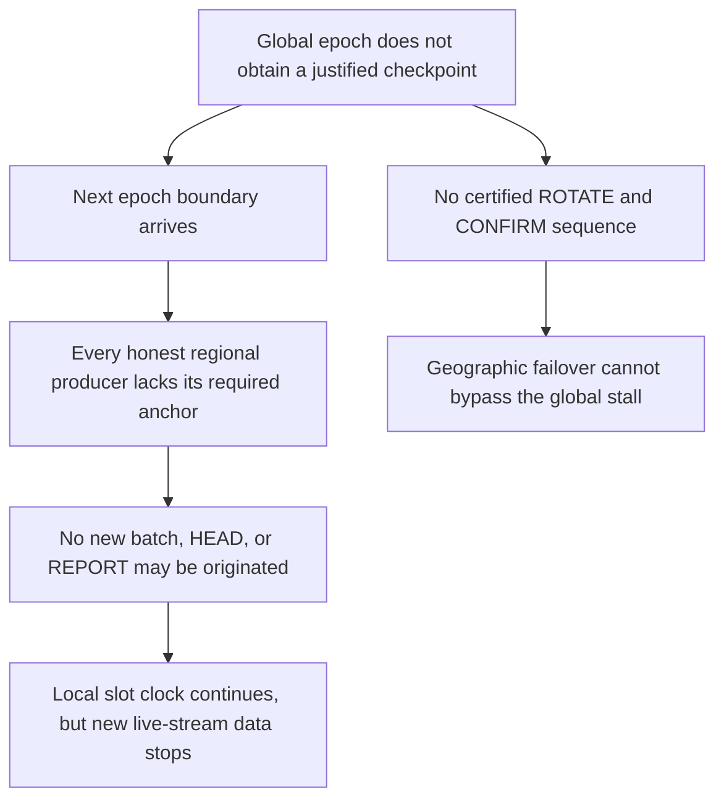

# Liveness and live-stream stall review

**Target:** the working-copy protocol in `formalization/main.tex`, dated 26 September 2026.  
**Review date:** 27 September 2026, Asia/Shanghai.  
**Constraint:** analysis only; no protocol changes.  
**Frozen source SHA-256:** `325ab6a05c0fd903f0f999a1d474218d122a302a54aa9c65a744a5dc989a4223`.

## 1. Main result

**The most consequential deadlock is that one missed global broadcast deadline can permanently stop honest regional batch production, even after the network recovers.** Honest participants can finish an epoch with different report vectors and lock their FFG votes onto different targets. Neither target obtains a quorum. The next epoch requires the missing justified checkpoint, and the regional rules prohibit producing from the stale anchor. Local producer rotation continues to advance the clock but cannot restart production. Section 4 gives the complete execution.

This is a **concrete failure outside the draft's continuous global-synchrony assumption**, not a counterexample to its conditional theorem. The draft explicitly says that recovery from arbitrary global epoch stalls is not specified. That boundary is operationally significant: a short control-network fault can outlive the fault itself.

**I found no permanent-stall counterexample satisfying every stated assumption and parameter condition.** Three independent source reviews, a separate integration review, and bounded executable checks support that scoped conclusion. They do not establish that every possible attack has been enumerated or that an implementation is secure.

Several substantial pauses are possible *inside* the stated model. In particular, a legal, fully healthy depth-one configuration produces one batch every two global epochs; and a minority of voting weight can own nearly all producer turns when the installed schedule contains many small-weight identities. These satisfy the weak promise of eventual height growth while providing a poor continuously live stream.

### Findings at a glance

“Permanent” below means that the specified protocol has no continuation restoring the affected output in the execution described; it does not mean that external intervention or a different protocol could never recover it.

| ID | Trigger | Consequence | Scope |
|---|---|---|---|
| **L1** | One honest AB forwarding multicast misses its deadline at two receivers | Irrevocably split votes; no next checkpoint; new regional batches stop at the next boundary, even after healing | Concrete permanent deadlock after one global timing-premise violation |
| **L2** | An outage leaves at most two thirds of global weight available to vote | The system cannot certify the rotation needed to escape the failed region | Conditional deadlock; global responsive-quorum premise fails |
| **L3** | A legal small speculative-depth limit fills before the next anchor installation | Recurring pauses in new batch production, even with all nodes honest and timely | Allowed behavior inside the model |
| **L4** | Many silent, small-weight identities precede a high-weight honest producer | Long stretches without any new batch despite a responsive honest voting supermajority | Allowed behavior inside the model; duration depends on installed identity count/order |
| **L5** | Tenure is shorter than the time to reach an honest producer | Every rotation resets to a silent first producer; checkpoints advance forever but stream height never does | Concrete permanent starvation with parameters violating the required tenure inequality |
| **L6** | Valid report equivocation induces large complete-body verification/replication work | An undersized global control path misses deadlines and may enter L1 | Concrete amplification; actual stall depends on violating provisioned capacity/delivery assumptions |
| **L7** | Repeated valid, ultimately discarded fork reports consume mandatory retained storage | Finite storage eventually cannot satisfy both retention and continued operation | Conditional resource exhaustion; no finite-storage guarantee is claimed |

Sections 11–12 cover additional availability failures and unsuccessful attempts to obtain a permanent stall within the model. Finalized-prefix safety was checked as a supporting dependency; this review prioritizes liveness.

## 2. What exactly is promised

The active entrypoint is the complete 1,239-line manuscript, with two included TikZ figures. The review uses the frozen [source text](/Users/jin/projects/megaeth_sequenser_rotation/formalization/reviews/attack-audit-2026-09-27/source/main.tex), not a historical review or a deployed Ethereum/MegaETH specification. Source line references below refer to this frozen copy.

The service definition states:

> “Under the global envelope, admitted workload and tenure conditions, and an eventual healthy eligible region, adopted heights and finalized delivery grow. A particular batch, preview or submitted transaction need not survive. An empty transaction list may still form a new mini-block.”

Source: [lines 250–253](/Users/jin/projects/megaeth_sequenser_rotation/formalization/reviews/attack-audit-2026-09-27/source/main.tex:250). The progress theorem strengthens this to growth “without bound” under the same conditions: [lines 907–932](/Users/jin/projects/megaeth_sequenser_rotation/formalization/reviews/attack-audit-2026-09-27/source/main.tex:907).

Four events must be kept separate:

| Event | Meaning | What its continuation does **not** establish |
|---|---|---|
| Slot clock advances | The scheduled slot/producer index changes | That anybody produces a batch |
| A new batch / `SetPreview` becomes available | Complete speculative bytes can be shown | That this branch survives or contains a particular user's transaction |
| Adopted height increases | A justified checkpoint selects a longer stream prefix | That the checkpoint is already finalized |
| `Deliver` appends new entries | A consumer obtains newly finalized bytes | That execution or L1/DA publication has happened |

Here, production and output refer to honest production and accepted current-authority output. A Byzantine producer may still sign stale objects; that does not restore service for correctly synchronized consumers.

Repeated `HOLD`, `CONFIRM`, HEAD messages, announcements, or re-emitting an unchanged preview do not constitute new live-stream data. For the attacks below, a **stream stall** means no new batch becomes available, no new stream positions are adopted, or a consumer cannot append new finalized positions; each finding identifies the affected level.

### Assumptions that carry the liveness proof

Let $V_i$ be region $i$, $w_S>0$ a member's weight, $W_i=\sum_{S\in V_i}w_S$, and $W=\sum_iW_i$. A quorum has **strictly more** than two thirds of the relevant weight. $N=|V|$, $n_i=|V_i|$, and $N_R$ is the number of slots assigned to one producer term.

1. The Byzantine set is fixed; each region has honest weight greater than $2W_i/3$. Honest keys and signing history survive restarts. [174–178](/Users/jin/projects/megaeth_sequenser_rotation/formalization/reviews/attack-audit-2026-09-27/source/main.tex:174).
2. One fixed honest set $H_G$, of weight greater than $2W/3$, stays responsive throughout the analyzed execution. An eventual healthy region also has $\operatorname{wt}(H_G\cap V_i)>2W_i/3$. [180–185](/Users/jin/projects/megaeth_sequenser_rotation/formalization/reviews/attack-audit-2026-09-27/source/main.tex:180).
3. A common clock and complete-object delivery bounds cover retrieval, missing ancestry, queues, verification, and concurrent admitted traffic. Every prescribed honest message must have admission capacity. This is much stronger than bounded latency for short hashes. [157–171](/Users/jin/projects/megaeth_sequenser_rotation/formalization/reviews/attack-audit-2026-09-27/source/main.tex:157), [1192–1195](/Users/jin/projects/megaeth_sequenser_rotation/formalization/reviews/attack-audit-2026-09-27/source/main.tex:1192).
4. Honest holders retain and serve endorsed and accepted report data for the entire configuration, including discarded forks. [187–193](/Users/jin/projects/megaeth_sequenser_rotation/formalization/reviews/attack-audit-2026-09-27/source/main.tex:187), [1112–1116](/Users/jin/projects/megaeth_sequenser_rotation/formalization/reviews/attack-audit-2026-09-27/source/main.tex:1112).
5. The timing, packing, and minimum-tenure conditions hold:

\[
\tau_R>2\Delta_R,\qquad T_G\ge(N+3)\Delta_G,\qquad T_G/\tau_R\in\mathbb N,
\]
\[
L_i=(n_iN_R+1)\tau_R+\Delta_R,\quad L_* =\max_iL_i,\quad
\min\{K_G,N_G\}T_G>L_*+3T_G.
\]

At least one complete legal batch must fit a report. [860–868](/Users/jin/projects/megaeth_sequenser_rotation/formalization/reviews/attack-audit-2026-09-27/source/main.tex:860), [899–905](/Users/jin/projects/megaeth_sequenser_rotation/formalization/reviews/attack-audit-2026-09-27/source/main.tex:899), [950–958](/Users/jin/projects/megaeth_sequenser_rotation/formalization/reviews/attack-audit-2026-09-27/source/main.tex:950).

## 3. Why the regional stream depends on the global control plane

Regional production does not await a per-batch quorum. However, it does require the justified checkpoint due at every global epoch boundary. The draft says:

> “A member missing that boundary's required checkpoint does not originate a new batch, HEAD, or report from a stale anchor.”

Source: [531–539](/Users/jin/projects/megaeth_sequenser_rotation/formalization/reviews/attack-audit-2026-09-27/source/main.tex:531).

Consequently, a healthy active region cannot indefinitely keep streaming through a stalled global epoch. At the next boundary, the missing checkpoint disables every honest scheduled producer. Advancing to another local identity cannot remove this shared prerequisite.

Existing stored data can still be served. Already finalized entries can still be delivered to a catching-up consumer. Those facts do not restart new production.

## 4. L1 — One deadline miss can create an absorbing global deadlock

**Priority:** highest operational concern.  
**Affected output:** eventually all new batches, adoption, and finalized stream growth.  
**Scope:** one global timing-bound violation; all later communication may be timely.

### Setup

Use one region with four equal-weight identities $B,H_1,H_2,H_3$. Only $B$ is Byzantine. The three honest members are responsive and retain their signing histories. The common justified parent is $C_{e-1}$; no rotation is pending or due. Normalize the epoch start to time 0 and write $\Delta=\Delta_G$.

For concreteness, $\tau_R=1$, $\Delta_R=0.1$, $\Delta_G=1$, $T_G=7$, $N_R=1$, and $K_G=N_G=5$ satisfy all displayed numeric inequalities. Choose an early epoch before the age trigger. A quorum requires three distinct signatures.

Let $x$ be a valid origin-signed REPORT by $B$ for this exact parent and epoch. It can have an empty branch and `READY=false`; no malicious batch, invalid signature, or large body is needed. The honest origins' report broadcasts all succeed normally.

### Execution

| Time | Event | Result |
|---|---|---|
| Round 1, by $\Delta$ | $B$ sends the length-one chain for $x$ only to $H_1$ | $H_1$ retains $x$; the other two have no value for this origin |
| At $\Delta$ | $H_1$ appends its signature and multicasts the valid length-two chain | This is prescribed honest forwarding |
| Just after $2\Delta$ | The copies to $H_2,H_3$ become completely verified at $2\Delta+\varepsilon$, with $\varepsilon>0$ | Both reject them: a length-two chain belongs only to round 2 and missed its deadline |
| At $4\Delta$ | AB terminates | $H_1$ returns $x$; $H_2,H_3$ return bottom for $B$'s origin |
| FFG phase | Honest nodes compute and sign their own deterministic targets | $H_1$ signs target $X$; $H_2,H_3$ sign target $Y$; $B$ abstains |
| Before the next epoch | All network delays return to normal | Neither target can obtain three signatures |
| Next boundary | No justified $C_e$ exists | Global epoch $e+1$ and current-authority regional production cannot start |

Only the two copies of **one forwarding multicast** need miss their complete-object deadline. Arbitrarily small lateness suffices; a whole-epoch partition is unnecessary. If those copies instead satisfy the bound, this attack fails.

The two checkpoint targets really are different even if their adopted tip, mode, and other state fields happen to coincide. The checkpoint commits to the report vector:

\[
C_e=(c,e,g_{e-1},\mu,S_e,\mathsf H(\mathbf r_e)).
\]

One vector has $x$ in $B$'s position; the other has bottom. Binding canonical hashing distinguishes them. [336–342](/Users/jin/projects/megaeth_sequenser_rotation/formalization/reviews/attack-audit-2026-09-27/source/main.tex:336).

### Why network recovery does not repair this state

Let $Q_X=\{H_1\}$ and $Q_Y=\{H_2,H_3\}$. With $B$ abstaining, their available weights are 1 and 2, both below the required $>8/3$. Every honest signer has persisted its unique statement for target epoch $e$.

- Receiving the late chain again cannot change the completed AB invocation; it still has the wrong receive deadline. [1192–1204](/Users/jin/projects/megaeth_sequenser_rotation/formalization/reviews/attack-audit-2026-09-27/source/main.tex:1192).
- Merging the two sets of signatures does not create a certificate on one statement. [152–155](/Users/jin/projects/megaeth_sequenser_rotation/formalization/reviews/attack-audit-2026-09-27/source/main.tex:152).
- Asking honest members to switch targets in epoch $e$ violates their persistent one-statement rule. [625–628](/Users/jin/projects/megaeth_sequenser_rotation/formalization/reviews/attack-audit-2026-09-27/source/main.tex:625).
- Epoch $e+1$ requires justified $C_e$; this construction uses adjacent links only. There is no alternative-round, skipped-epoch, or stalled-epoch transition. [556–579](/Users/jin/projects/megaeth_sequenser_rotation/formalization/reviews/attack-audit-2026-09-27/source/main.tex:556).
- A local leader change or regional restart does not supply the missing checkpoint. A fresh global view itself requires finalized authorization.

Thus the split signing state is absorbing under the specified transitions and continued Byzantine abstention. Honest clock advancement and restored message delivery alone cannot release it.

An alternative execution uses **four entirely honest nodes split into two two-member regions**. A temporary backbone partition through the AB/voting phase leaves each region with its own two reports and bottom for the other region. The two groups persist two votes for different targets. Healing does not unlock either group. Both regional networks may remain healthy throughout. This variant needs no Byzantine signer; its transient global partition is outside the same timing premise.

**Verdict:** a demonstrated permanent recovery failure after a transient envelope violation. It does **not** disprove the theorem under uninterrupted synchrony. The manuscript explicitly acknowledges this boundary at [1145–1148](/Users/jin/projects/megaeth_sequenser_rotation/formalization/reviews/attack-audit-2026-09-27/source/main.tex:1145). Importing a recovery result from general Casper FFG would be invalid: this construction restricts itself to adjacent epochs and its own report protocol. The original [Casper FFG paper](https://arxiv.org/html/1710.09437v4) allows more general links and distinguishes safety from the liveness supplied by the proposal mechanism.

## 5. L2 — The failed region can remove the quorum needed for its own replacement

**Priority:** high for geographic failover.  
**Affected output:** rotation, new adoption/finality, and eventually all fresh regional production.  
**Scope:** insufficient responsive global weight.

Consider two entirely honest regions with weights $W_1=0.4W$ and $W_2=0.6W$. Region 1 is active. Both regions initially possess the adopted prefix.

1. Region 1 loses power or connectivity and contributes no global signatures.
2. Every member of region 2 remains responsive, stores the full prefix, and can sign READY.
3. Region 2 has a full **regional** READY quorum, but only $0.6W$ **global** voting weight.
4. No `ROTATE` checkpoint can obtain the required global weight $>2W/3$. Waiting for the no-growth timer cannot change that arithmetic.
5. Region 2 cannot authorize itself. Its healthy producers have no activated view; local failover in region 1 also cannot help.

In general, let $U$ be the offline identities and let $B\setminus U$ be Byzantine identities outside that outage that abstain. Withholding prevents a global certificate whenever

\[
\operatorname{wt}(U)+\operatorname{wt}(B\setminus U)\ \ge\ W/3.
\]

Equality already blocks the draft's **strict** threshold. In the all-honest case, tolerating any one complete regional outage requires that each such region carry strictly less than $W/3$. Per-region honest supermajorities do not imply this availability condition.

**Verdict:** READY is not a substitute for the global certificate. This execution violates the fixed responsive-global-supermajority premise [180–185](/Users/jin/projects/megaeth_sequenser_rotation/formalization/reviews/attack-audit-2026-09-27/source/main.tex:180), but directly limits the operational meaning of “geographic failover.” During the outage, no specified timeout can overcome the missing voting weight. Return of the missing nodes removes the weight obstruction; it does not automatically resolve any split-vote state created in the meantime, as L1 demonstrates.

## 6. L3 — A completely healthy stream can pause for two global epochs

**Priority:** high for interpreting low-latency streaming claims.  
**Affected output:** new batch production and fresh preview data.  
**Scope:** allowed behavior with valid parameters; no adversary or failure is needed.

The speculative depth cap is a production gate. A path at depth $d_R$ “cannot be extended until anchor advancement frees space.” [309–318](/Users/jin/projects/megaeth_sequenser_rotation/formalization/reviews/attack-audit-2026-09-27/source/main.tex:309). An honest producer signs a batch only when its selected path has fewer than $d_R$ batches. [456–461](/Users/jin/projects/megaeth_sequenser_rotation/formalization/reviews/attack-audit-2026-09-27/source/main.tex:456).

Use one region with four equally weighted honest members and:

\[
\Delta_R=0.1\text{ s},\quad \tau_R=1\text{ s},\quad
\Delta_G=1\text{ s},\quad T_G=7\text{ s},\quad N_R=1,
\]
\[
d_R=b_G=b_R=1,\qquad K_G=N_G=5.
\]

Byte bounds admit the one legal batch. All timing and tenure inequalities hold:

\[
1>0.2,\qquad 7=(4+3)\cdot1,\qquad
35>L_*+3T_G=5.1+21=26.1.
\]

Start with an empty speculative tree at genesis.

| Time | Snapshot / anchor event | Production |
|---:|---|---|
| 0 | Epoch 1 snapshot is empty | First producer emits $X$; the depth-one path is full |
| 1–6 | No new anchor | Every subsequent producer finds the selected path full and emits no batch |
| 7 | Epoch 2 reports $X$; its target will adopt $X$ | Production still uses the old anchor; depth remains full |
| 8–13 | $C_2$ is constructed and justified during this interval; even after justification, installation waits until time 14 | No new batch |
| 14 | Install $X$ as the anchor; epoch 3 snapshot is now empty | Emit $Y$; depth fills again |
| 21 | Epoch 4 reports $Y$ | Still no new batch |
| 28 | Install $Y$ | Emit the next batch; the pattern repeats |

Reports are taken **before** production in the new boundary slot, and a target derived in an epoch is not installed until the next boundary. [550–579](/Users/jin/projects/megaeth_sequenser_rotation/formalization/reviews/attack-audit-2026-09-27/source/main.tex:550). Hence the batch times are $0,14,28,42,\ldots$, rather than one per one-second slot. In this example, 13 intervening producer slots in every 14-slot interval emit nothing.

There is one region, so the planned age trigger has no different ready successor. The no-growth counter alternates between 1 and 0 and never reaches 5. Rotation therefore does not disturb the example.

**Verdict:** this is recurring backpressure, not permanent deadlock or a violation of unbounded height growth. It shows that absence of per-batch agreement does not make production independent of global checkpoint pacing. An adversary can consume speculative capacity with valid branches, but a full tree alone cannot establish an infinite stall while healthy global adoption continues.

## 7. L4 — A voting-weight minority can own nearly all silent producer turns

**Priority:** substantial availability/parameter concern.  
**Affected output:** new batches during the silent terms.  
**Scope:** valid fixed configuration; the adversary cannot add identities after configuration is installed.

Producer turns are assigned once per **identity** in the configured list; quorum security is measured by **weight**. [119–136](/Users/jin/projects/megaeth_sequenser_rotation/formalization/reviews/attack-audit-2026-09-27/source/main.tex:119), [412–425](/Users/jin/projects/megaeth_sequenser_rotation/formalization/reviews/attack-audit-2026-09-27/source/main.tex:412).

Put one honest producer $H$ of weight $0.8W$ after 100 Byzantine identities, each of weight $0.002W$, in one region's installed cyclic list. All Byzantine producers are silent. $H$ remains responsive for global agreement and has enough weight to certify checkpoints and READY by itself. There are no new batches while the first 100 terms pass.

For a fully valid numeric example, choose

\[
N=101,\quad N_R=100,\quad \tau_R=0.03\text{ s},\quad
\Delta_R=0.01\text{ s},\quad \Delta_G=0.1\text{ s},\quad T_G=10.5\text{ s},
\]
\[
K_G=N_G=40.
\]

Then $T_G/\tau_R=350$, $T_G\ge104\Delta_G=10.4$, $L_*=303.04$ seconds, and $420>303.04+31.5$, so the required tenure holds. Nevertheless, the initial no-batch interval lasts

\[
100N_R\tau_R=300\text{ seconds}.
\]

Only 20% Byzantine weight is needed for this five-minute silence. Reordering the configured identities or changing their number changes the duration; the attacker cannot freely perform those configuration changes in the frozen model.

**Verdict:** a genuine allowed availability degradation, already covered by the $n_iN_R$-dependent bound. It refutes an informal claim that “more than two thirds honest weight implies a quick honest producer turn.” It does not refute the theorem's eventual progress. Many identities also increase the global $N$-round AB budget, independently of their total stake.

## 8. L5 — Short tenure can reset the schedule before any honest producer gets a turn

**Priority:** high if configurations are not checked against the tenure requirement.  
**Affected output:** all new batches, adopted-height growth, and new finalized entries.  
**Scope:** concrete infinite starvation when the displayed minimum-tenure condition is violated.

Use two regions $V_1=\{B_1,H_1\}$, $V_2=\{B_2,H_2\}$, with local lists $[B_i,H_i]$. In each region $w(B_i)=1$, $w(H_i)=3$. Both honest nodes remain healthy; together their weight 6 exceeds the global quorum threshold $16/3$, and each alone supplies its region's READY quorum. Byzantine producers are always silent.

Choose $\tau_R=1$ s, $\Delta_R=0.1$ s, $\Delta_G=0.1$ s, $T_G=2$ s, $N_R=10$, $N_G=1$, and $K_G=100$. These satisfy the slot, global-epoch, and alignment constraints. Each first Byzantine term lasts ten seconds.

For a region activated in epoch $a$:

1. Epoch $a$: snapshot is empty; the age counter is zero, so `HOLD`.
2. Epoch $a+1$: the planned age trigger is due; the other region is READY, so `ROTATE`.
3. Epoch $a+2$: `CONFIRM` finalizes the rotation.
4. Epoch $a+3$: the other region activates, resets its local list to $B_j$, and repeats.

Each region is active for only $3T_G=6$ seconds, less than its silent first producer's ten-second term. Neither $H_1$ nor $H_2$ ever becomes producer. All global epochs can still be justified and finalized normally. No mini-block is ever created.

The precise violated requirement is

\[
\min\{K_G,N_G\}T_G=2
\quad\not>\quad
L_*+3T_G=(2\cdot10+1)\cdot1+0.1+6=27.1.
\]

**Verdict:** a complete permanent-starvation trace for an inadmissible configuration. The minimum-tenure inequality is a substantive liveness defense; it cannot be treated as optional tuning. This review does not change it or propose an alternative configuration policy.

## 9. L6 — Valid report equivocation can overload the control path

**Priority:** high when sizing actual bandwidth and verification capacity.  
**Affected output:** global checkpoints, then the regional stream through the boundary dependency.  
**Scope:** the amplification is allowed; an actual deadline failure requires insufficient provisioned capacity.

The protocol limits each honest receiver to two retained semantic values **per AB origin**. This does not mean two values per origin across the whole network, and does not bound the number of complete candidate packets verified. The manuscript already accounts for that distinction. [1075–1087](/Users/jin/projects/megaeth_sequenser_rotation/formalization/reviews/attack-audit-2026-09-27/source/main.tex:1075), [1094–1116](/Users/jin/projects/megaeth_sequenser_rotation/formalization/reviews/attack-audit-2026-09-27/source/main.tex:1094).

Let $H$ be the number of responsive honest endpoints and let $f$ Byzantine **active-region** report origins participate. For one Byzantine origin:

1. A scheduled Byzantine producer creates many distinct, valid, whole-batch forks extending the effective parent, using an authorized completed slot. This is detectable equivocation, but does not make otherwise valid report branches inadmissible.
2. The origin sends two distinct valid reports privately to each honest endpoint in round 1, with each endpoint's pair different. These initial offers must fit the configured direct-input admission quotas. Report bodies fit $B_G$; choose forks with distinct payloads so deduplication does not remove their bulk cost.
3. Each honest endpoint retains and forwards its own two values as required. Admission must reserve those honest forwards, even though their underlying origin is Byzantine.
4. The origin ultimately resolves to bottom everywhere. Nevertheless, the intermediate bodies have already been transferred and checked.

The union can contain $2H$ bodies for one origin. If each has payload size $b\le B_G$ and all required copies are verified, aggregate endpoint payload traffic can be $\Theta(H^2b)$ for that origin, and $\Theta(fH^2b)$ across $f$ origins. For $f,H=\Theta(N)$, this is cubic in identity count. This is an attainable scaling example for configurations permitting such batches and admitted traffic, not a claim that every configuration always transfers its maximum byte limit.

The four-member example is already enough to expose the trap: one Byzantine origin can send six distinct bodies to three honest recipients, while its final report-vector entry is just bottom. A validator cannot size its transient work from the final vector alone.

Conflict evidence does not automatically remove the offender from the installed producer schedule or configured quorum weights; the proposal leaves financial penalties and adjudication outside the service. Thus this analysis does not assume that detecting the first equivocation prevents its repetition. [664–682](/Users/jin/projects/megaeth_sequenser_rotation/formalization/reviews/attack-audit-2026-09-27/source/main.tex:664).

If an implementation budgets only for the final vector, the induced work can delay honest forwarding packets or complete witnesses past their AB deadlines. If the misses have the selective pattern in L1, they create its deadlock trigger. An arbitrary single delayed copy need not suffice: another timely honest forward may repair that receiver's view. Extra slot-clock margin does not repair FFG votes once they have split and been persisted.

**Verdict:** concrete valid-traffic amplification, not a contradiction of the manuscript's corrected resource bounds. The model expressly assumes sufficient admission and complete-object service capacity and excludes unlimited Byzantine wire flooding. The unresolved deployment question is whether chosen $J_G,B_G,N,\Delta_G,T_G$ can jointly satisfy that assumption under this schedule. No measurements of a real implementation were available.

## 10. L7 — Discarded forks can exhaust mandatory retained storage

**Priority:** sustained-operation concern.  
**Affected output:** storage-backed verification, repair, or new production once physical capacity is exhausted.  
**Scope:** finite-resource deployment; the abstract model promises retention for the full configuration.

The draft requires retention even for accepted global report bodies that are not selected or whose origin resolves to bottom. Re-rooting the fork-choice tree is explicitly not deletion. [187–193](/Users/jin/projects/megaeth_sequenser_rotation/formalization/reviews/attack-audit-2026-09-27/source/main.tex:187), [1112–1116](/Users/jin/projects/megaeth_sequenser_rotation/formalization/reviews/attack-audit-2026-09-27/source/main.tex:1112), [1132–1136](/Users/jin/projects/megaeth_sequenser_rotation/formalization/reviews/attack-audit-2026-09-27/source/main.tex:1132).

Repeat L6's valid equivocation at infinitely many eligible epochs, using fresh body bytes each time. Honest reports and checkpoints may otherwise continue to advance normally. The adversary's reports are bottom or their forks are unselected; their bytes still consume storage after they become useless for current fork choice.

For a holder admitting at least $b>0$ fresh orphan bytes in each such attack epoch, cumulative extra retained storage after $k$ attack epochs is at least $kb$. A device with $M$ bytes of available extra storage reaches that limit after at most $\lfloor M/b\rfloor+1$ such epochs. With ordinary disk exhaustion, it must stop accepting/persisting some required objects or stop serving old retained objects. Either choice abandons a premise used by progress and repair.

The finite $d_R$ limit does not prevent this: it bounds the eligible path depth, not discarded history. Two candidates per producer slot also is not a lifetime storage cap. Honest canonical history already grows; the attack adds permanently retained *noncanonical* bytes.

**Verdict:** a concrete way to consume any fixed retention allocation with bounded, valid traffic over time. It is not an in-model counterexample because the model expressly makes retention an assumption and does not promise bounded storage. No claim is made that every reasonable storage implementation fails at the same time or with the same failure behavior.

## 11. Other ways liveness can fail, with their exact boundaries

### Readiness can expire before activation

A valid READY quorum establishes past possession, not continued availability. If its useful members disappear before activation, the selected successor can be silent. Finite such episodes do not establish permanent starvation: global epochs can select another successor, and cyclic selection cannot indefinitely skip a continuously ready healthy region. Endless failures are possible if no region ever remains healthy long enough, but that removes the theorem's eventual continuously healthy-region premise. The draft states this distinction at [647–651](/Users/jin/projects/megaeth_sequenser_rotation/formalization/reviews/attack-audit-2026-09-27/source/main.tex:647).

### A consumer can be isolated while consensus still progresses

A consumer whose usable serving paths are all withheld or partitioned cannot retrieve missing bodies. Correct signatures and HEAD announcements cannot reconstruct those bytes. `Deliver` must wait; current-authority preview output also pauses when required control proof or bytes are missing. This can last indefinitely without stopping the validators. It violates the live-consumer path/repair premises, not global consensus safety. Conversely, a Byzantine supplier alone cannot block a consumer forever if configured retries eventually reach a responsive honest holder with the required data and service deadline. [501–527](/Users/jin/projects/megaeth_sequenser_rotation/formalization/reviews/attack-audit-2026-09-27/source/main.tex:501), [842–857](/Users/jin/projects/megaeth_sequenser_rotation/formalization/reviews/attack-audit-2026-09-27/source/main.tex:842), [960–979](/Users/jin/projects/megaeth_sequenser_rotation/formalization/reviews/attack-audit-2026-09-27/source/main.tex:960).

### Clock skew, verification overload, and body retrieval failure can instantiate L1

The AB deadline is a deadline for complete verification. Timely receipt of a hash, an incomplete witness, or a packet still in a verification queue does not suffice. Unmodeled clock skew can also make nodes disagree about a round's deadline. These are different physical causes of a failed premise; they are not additional proofs of an attack under the common-clock, complete-object envelope. The fixed deadline/signing interaction in L1 explains why the consequence may persist after the physical cause disappears.

### Height growth can conceal total transaction-inclusion failure

Every producer may keep emitting new mini-blocks with empty transaction lists, so adopted height and `Deliver` continue forever while a submitted transaction never appears. This execution does not even require Byzantine producers: the honest production rule permits empty lists and specifies no mandatory transaction-inclusion rule. Thus the formal liveness result concerns new **stream positions**, not eventual service of every client's transaction. [250–253](/Users/jin/projects/megaeth_sequenser_rotation/formalization/reviews/attack-audit-2026-09-27/source/main.tex:250), [456–461](/Users/jin/projects/megaeth_sequenser_rotation/formalization/reviews/attack-audit-2026-09-27/source/main.tex:456).

A related adversarial behavior is releasing valid historical-slot batches slowly to reset the no-growth counter. A signature authenticates the producer assigned to a slot, not the actual signing time. Every adopted release still increases the metric the theorem promises; the separate age timer is not reset by that growth. This does not yield a permanent height stall, though it reinforces the distinction between useful current transaction service and the stated progress metric.

## 12. Attempts that did not produce an in-model permanent stall

| Attempt | Why the stated rules defeat the claimed permanent stall |
|---|---|
| Keep regional heads split with LMD balancing or selective release | Global AB supplies a common report vector; global selection needs some nonempty valid report, not converged regional heads |
| Zero Byzantine HEAD weight through equivocation, or replace an old vote with an unavailable tip | LMD descends through eligible zero-weight children; destroying support does not erase complete candidates |
| Withhold every Byzantine producer batch | Clock rotation eventually reaches a responsive honest identity in a healthy region; its maximum wait depends on identity count and term length |
| Fill every honest selected path to $d_R$ | Stops new production temporarily, but the full path supplies reportable data; adoption frees depth under the healthy global premises |
| Make all honest reports truncate to empty | Disallowed: a nonempty selected path must yield a nonempty fitting prefix, and one legal batch must fit |
| Pre-send a future-slot batch so an honest snapshot has no legal older prefix | The report tree is filtered to completed slots before LMD; future-slot HEAD records contribute zero |
| Send many equivocations so cap-two receivers disagree forever | Honest forwarding continues after cap-two; under timely complete delivery every receiver obtains either the common sole value or ambiguity |
| Toggle unhealthy regions' READY reports to skip one continuously ready region | At each switch, distance along the finite cyclic list to that region strictly decreases until it is selected |
| Repeatedly replace a newly activated healthy region before progress | The minimum-tenure inequality excludes this; L5 demonstrates what happens when it is removed |
| Have a READY signer withhold all inherited data | Honest global holders also retain adopted data; a healthy successor has responsive quorum members holding that prefix |
| Use a READY proof for an old tip while rotating to an unserved new tip | ROTATE adopts no new range; its retained tip is exactly the parent to which READY was bound |
| Require a failed predecessor to release the local or global role | Neither transition has that dependency |
| Replay an old activation, checkpoint, report, or same-height body | Exact configuration/view/epoch/parent domains and extending-anchor checks reject its use as fresh authority or the requested branch |

This is a record of examined candidates, not a proof of universal absence of attacks. The regional-head concern is independently motivated by the literature: [Ebb-and-Flow Protocols](https://arxiv.org/abs/2009.04987) identifies a synchronous-model attack against Gasper. That does not automatically transfer to this proposal, whose extra common-report agreement is central to its progress argument. The [Gasper paper](https://arxiv.org/abs/2003.03052) also states safety and liveness under distinct assumptions. No Ethereum-specific recovery, fork-choice, or clock rule is silently imported into this audit.

## 13. Proof assessment and validation record

### Liveness dependency check

The proof strategy is coherent under the stated premises:

1. Complete-object synchronous AB makes every responsive honest node derive one report vector and one target.
2. Responsive honest global weight exceeds the certificate threshold, so every epoch has a justified target and a finalized parent.
3. With a fixed anchor, a healthy region eventually has some complete eligible extension. Changed HEAD weights cannot make a nonempty tree select its root.
4. A subsequent cutoff-filtered honest report contains a nonempty prefix; absent rotation, common selection adopts some extension.
5. If adopted heights were eventually constant, READY and cyclic selection would reach a continuously healthy region. Sufficient tenure then contradicts continued constant height.
6. Retained data and a live consumer's repair path provide delivery of finalized entries.

No Critical Error establishing a false in-model liveness theorem was found. The deadlocks above identify the consequences of missing premises or implementation capacity, plus allowed pauses that a weak eventual-growth theorem does not exclude. In particular, L1 breaks step 1 once and leaves the protocol unable to restart step 2; it does not challenge quorum-intersection safety.

### Evidence produced

- Three independent first-pass reports: [liveness](/Users/jin/projects/megaeth_sequenser_rotation/formalization/reviews/attack-audit-2026-09-27/working/liveness.md), [handoff and consumers](/Users/jin/projects/megaeth_sequenser_rotation/formalization/reviews/attack-audit-2026-09-27/working/handoff.md), and [broadcast and safety](/Users/jin/projects/megaeth_sequenser_rotation/formalization/reviews/attack-audit-2026-09-27/working/safety.md). The coordinating review separately examined resource exhaustion and the interaction among these layers. Later targeted cross-checks were shared; they are not represented as blind discoveries.
- A [bounded AB checker](/Users/jin/projects/megaeth_sequenser_rotation/formalization/reviews/attack-audit-2026-09-27/working/safety_ab_model.py) checked **332,288** semantic injection/forwarding schedules across four small configurations; all satisfied agreement under its timely-delivery premise. [Recorded results](/Users/jin/projects/megaeth_sequenser_rotation/formalization/reviews/attack-audit-2026-09-27/working/safety_ab_results.json).
- [Executable liveness traces](/Users/jin/projects/megaeth_sequenser_rotation/formalization/reviews/attack-audit-2026-09-27/working/liveness_traces.py) reproduce the missed-deadline vote split, healthy depth-one stalls, weighted-identity silence, regional-outage quorum arithmetic, and 21 epochs of the repeating premature-rotation starvation cycle. [Recorded results](/Users/jin/projects/megaeth_sequenser_rotation/formalization/reviews/attack-audit-2026-09-27/working/liveness_trace_results.json).
- Targeted skeptical reviews checked the synthesized report's [liveness traces](/Users/jin/projects/megaeth_sequenser_rotation/formalization/reviews/attack-audit-2026-09-27/working/final-liveness-review.md), [scope labels](/Users/jin/projects/megaeth_sequenser_rotation/formalization/reviews/attack-audit-2026-09-27/working/final-scope-review.md), and [resource construction](/Users/jin/projects/megaeth_sequenser_rotation/formalization/reviews/attack-audit-2026-09-27/working/cross-check.md). The final report incorporates their timing, formatting, and causality corrections.

These programs encode small abstractions of selected rules. They are not a distributed implementation, a parser/signature audit, a proof assistant development, a throughput benchmark, or an exhaustive state-space analysis of the complete protocol. In particular, the missed-deadline trace deliberately disables a premise that the successful AB checker assumes.

The most important distinction for evaluating this design is therefore: **unbounded height growth under uninterrupted global service is supported by the reviewed argument; continued regional streaming through a transient global control failure, or automatic recovery afterward, is not provided by the specified protocol.**
