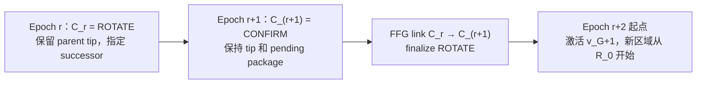

# main_v1 的跨区域轮换、区域宕机与 virtual-SMR/CFT 抽象

日期：2026-09-28。读取入口：[main_v1.tex](../main_v1.tex)，SHA-256 `f918927188fe07fd5962e0b2b65abde65565e727f1dbb811b2e49db8386cb13e`。本文解释当前算法，并单独讨论用户提出的“每区域 BFT SMR → 一个 non-Byzantine virtual agent → 跨区域 CFT”构想；不修改协议，不作为该构想的组合正确性证明。

## 1. 当前实现的两层含义

当前 active region 内运行顺序的 regional broadcast/completion，形成带证书的结果链。全局层由**全部 N 个 sequencer 身份**参加，并非 m 个 region 各作为一个投票人。全局正常 epoch 也运行报告一致性和 FFG，绝非只在故障时启动。

| 层次 | 决定什么 | 当前参与者 | 证书阈值 |
|---|---|---|---|
| Regional | 本次 batch / GAP，以及后继 local leader | active region V_i | >2W_i/3 |
| Global | 采纳的 stream prefix、region authority、轮换和激活 | 所有 sequencer V | >2W/3 |
| Candidate readiness | 区域 j 是否已持有交接数据并准备接任 | V_j 的 report origins | >2W_j/3 |

READY 不是 global activation quorum；二者必须同时满足。当前 global 协议还要求完整对象在 `Δ_G` 内完成传输、取回、验证和队列处理。

源码：110–118、159–189、795–844 行。

## 2. 状态与两种提交

只需抓住：

- `v_G`（源码宏 `\gv`）：global view / authority generation；跨区域切换或同区域重新激活时增加。
- `i`：当前 active region。
- `v_L`：区域内部 leader 的 view；换区域或重新激活后归零。
- `(h,q,R)`：global 已采纳的 stream tip、prefix digest 和 regional outcome cursor。
- `z_G`：连续没有新 adopted mini-block 的 global epoch 数。
- `p`：空，或等待最终确认/激活的 rotation package。

需要区分三个位置：regional certified tip、globally adopted tip、globally finalized tip。全局切换保留所有**已 adopted** 的数据，因此它也保留 finalized 数据；不能把“只保留 finalized tip”当作当前规则。

对 P：regional certificate 产生 `Preview`；覆盖范围的 global finality 产生 `Deliver`。前者在同一 global view 内不受 local leader change 影响，但在 global view change 时可以截断未被保留的后缀。后者是跨区域也 append-only 的输出。

源码：193–248、434–467、525–545、941–950 行。

## 3. 每个 global epoch 平时做什么

全局 epoch e 覆盖 `[(e-1)T_G,eT_G)`，以共同 parent checkpoint `C_{e-1}` 及其 justification 为起点。

1. 应用已到激活边界、且已有 finality proof 的旧 ROTATE。
2. 每个 sequencer 签一个 report。它包含本地已知的、从当前 cursor 出发的连续 regional extension，以及 READY。扩展受 `b_G,B_G` 限制，不跳过中间结果，不截断一个 certified batch。
3. 对所有 N 个 report origins 并行运行 authenticated broadcast；在 `NΔ_G` 后取得共同 report vector。没有有效唯一 report 的 origin 输出 bottom。
4. 所有 responsive honest 成员根据同一个 parent 和 vector 执行同一个确定性状态转换，得到相同 `C_e`。
5. 成员检查并保留 target 的完整 adopted data，再签相邻 FFG link `C_{e-1}→C_e`。全局 >2/3 权重形成证书，justify `C_e` 并 finalize parent。
6. 配置 `T_G≥(N+3)Δ_G`，预留证书传播和下一个共同边界的时间。

因此，当前由 report agreement 解决报告不一致、确定唯一目标；FFG 提供后续 justification/finality/activation。FFG 没有独立承担从不一致候选中自动选链的任务。

源码：803–844、898–923 行。

## 4. 如何触发和选择 rotation

在没有 pending rotation 时，先从 report vector 找到最长合法连续扩展，候选新高度记为 `h+`。

- 若 `h+>h`，候选 no-progress counter 为 0；否则为 `z_G+1`。
- 计划轮换：`e-e_{v_G}≥N_G`。
- 故障恢复：候选 counter 达到 `K_G`。

这里 no-progress 指没有新 mini-block 被全局采纳。只有 GAP、游标前移但高度不变，仍算 no-progress；空交易 mini-block 若高度增长，则算进展。宕机前残留数据晚到并被采纳会重置 counter，所以不是从物理断电时刻简单计 `K_GT_G`。

READY(S,j) 声明：S 已持有并保留**当前 parent 的整个 adopted prefix 和证据**，可以在本区域 j 从此 prefix 开始下一 global view。该声明绑定 parent、epoch、next global view、region 和 tip，每个 parent 重新收集。

区域 j 的 READY 权重超过 `2W_j/3` 才 eligible。到期时：

1. 有其他 ready region：从配置的 cyclic region list 中，选当前 region 之后第一个 ready region。
2. 没有其他 ready region，且 failure guard 已触发，当前 region 自己 ready：选自己，进行 fresh-global-view recovery。
3. 没有 eligible successor：不产生 ROTATE。当前 view 可继续存在；若旧区域已经停摆，仍需等待 readiness 恢复。

计划到期本身不会触发“同区域重启”；源码把它限制在 no-progress recovery 分支。

源码：483–509、846–891 行。

## 5. ROTATE、CONFIRM、Activate 是三个不同动作

ROTATE checkpoint `C_r` 保存一个 pending package：

`(v_G+1, successor region, initial leader, retained h/q/R, selection epoch, READY references, reason)`。

它保留的是**parent 的 adopted tip**。即使本轮 reports 还提供了新扩展，ROTATE 也不同时采纳它，因为 READY 对应 parent 的精确前缀。新扩展仍只是 preview。

CONFIRM 期间不采纳新 regional data。ROTATE 最终确认后，统一在 `r+2` epoch 的起点，也就是 `(r+1)T_G` 激活：更新 region、global view 和初始 leader，建立继承 retained tip 的 `R_0`，清空 pending，重置计数器。缺少 proof 或数据的节点不能开始服务。

普通切换不需要再次提交 L1 交易：原始配置已经委托这条带证书的授权链。L1 membership 与 weights 在该配置内保持不变。

源码：137–140、854–879、913–933 行。

## 6. 四种故障不能混为一谈

### 6.1 一个 local leader 宕机，区域 quorum 仍可用

区域实例仍能通过 completion 得出 certified bottom/GAP。每个 completed bottom 增加 `z_R`；连续 `K_R` 次，或到 `N_R` 的计划边界，切换下一个 local leader。global view 不变，保留 regional certified prefix。

因此，如果区域已 certified 到 110，local replacement 从 110 接着做。区域内 responsive honest 成员已有这些决定的数据，不需要从头复制整个历史。

### 6.2 区域 quorum 不足或当前实例拿不到 outcome certificate

当前串行 regional 协议无法启动下一实例；因为下一实例依赖前一个 `RC_u`。不能单凭 timeout 伪造 GAP，也不能清空 sign-once history 后重跑。

全局层无需等待这个实例完成。它根据 adopted tip 停止增长触发 rotation，建立 fresh global view，使用新的实例域恢复服务。

### 6.3 整个区域宕机

只要剩余 global responsive honest weight 仍 `>2W/3`，报告协议和 FFG 可以继续。它们不需要故障区域 ACK 才能授权 replacement；失联 report origins 由 AB 输出 bottom。

新区域必须获得 retained adopted prefix。全局成员在 endorsement 前保留完整 adopted data，READY 成员也必须先拿到这些数据。旧区域独占、尚未 adopted 的 preview 不享有跨区域保留保证。

### 6.4 原区域恢复，或者新选区域在 READY 后又故障

原区域恢复时先恢复持久签名记录并取回有效公共状态，不补签过期实例。若旧实例已无法完成，则用同样的 global rotation 机制重新激活，必要时 region identity 不变、global view 增加。

READY 仅证明签名时的持有和准备状态。如果 successor 激活后仍不可用，全局 epoch 继续运行，重新检测 no-progress 并寻找后继；READY 不是未来在线的承诺证明。

源码：760–793、927–950、1157–1191 行。

## 7. 旧区域隔离后继续发送数据怎么办

源码允许旧区域向尚未知晓切换的 P 继续展示旧 view 的 signed preview。它没有声称能物理制止旧区域发送消息。

隔离旧 authority 的机制是：

- global adopted data 必须属于 effective global view；
- 新 `R_0` 和后续签名绑定新 global view/activation；
- P 根据可验证的 finalized activation 更新 authority；
- P 保留 delivered prefix，截断超出 retained tip 的 preview；
- 追赶状态时按顺序处理所有遗漏的 activation，不接受旧证明倒退 authority。

这是一种通过证据和 generation fencing 控制接受行为的设计。P 的私有 timeout 或未经证明的 redirect 没有授权新 producer 的能力。

源码：709–730、935–939 行。

## 8. 一个具体的 stream 例子

假设 region A 已 locally certified 到 110，而 global adopted tip 是 100。P 看见 101–110 的 regional preview。

1. A 整体不可用，且后续没有可被采纳的新旧区域数据。
2. no-progress counter 达到 `K_G`；B 对 parent tip 100 有 regional READY quorum。
3. `C_r=ROTATE(A→B, retained=100)`，随后 `C_{r+1}=CONFIRM` finalize `C_r`。
4. B 在 epoch `r+2` 从 `(v_G+1,R_0,tip=100)` 启动。
5. P 保留已 Deliver 的前缀，删除未保留的 preview 101–110；B 可以在这些位置生成新内容，签名属于新 global view。

如果故障前 global 已 adopted 到 110，则 handoff 必须保留 110，即使对应 checkpoint 在宕机时尚未 finalized。

此例直接来自源码 941–950 行的规则，说明 regional commit 不等于当前接口中的 global commit。

## 9. 当前到底容忍几个 region crash

没有按 region 个数给出的 `f_region`；判断标准是 global responsive honest weight。

在所有剩余节点都诚实的简化例子中：

| 区域分布与故障 | 剩余权重 | 当前 global >2/3 quorum |
|---|---:|---|
| 三个等权区域，一个整体宕机 | 2W/3 | 不满足严格阈值 |
| 四个等权区域，一个整体宕机 | 3W/4 | 可满足，还需 timing、data、READY 等条件 |
| 一个占 0.4W 的区域整体宕机 | 0.6W | 不满足 |

其余区域仍有 Byzantine 或 unavailable 节点时，可用诚实权重还会进一步减少。READY quorum 存在不能补足 global quorum。

无全局 quorum、无可取回数据、跨区域同步/完整对象边界不成立、或无持续健康 successor 时，正文不提供有限恢复保证。并且需要 minimum tenure 让新区域有时间启动、同步和上报：

`min{K_G,N_G} T_G > L_start + L_sync + 2T_G`。

冷启动、旧尾部晚到、report 对齐、ROTATE/CONFIRM 等均另收费。源码的 failure-to-first-preview 保守界是：

`L_G ≤ L_tail + T_G + K_G T_G + T_ready + 2T_G + L_R(q) + A_P + F_P`。

它以 next chosen region 健康为条件，并允许 readiness 与 detection 重叠但不扣除重叠。若目标是新的 finalized Deliver，还需加 successor range 的 global delivery 阶段。不能将该式简化成无条件的“两轮接管”。

源码：177–189、1238–1249、1308–1333、1423–1431 行。

## 10. 与用户提出的 BFT-SMR / CFT 分层如何对应

直接的已有文献包括 Steward（站点内 BFT、站点间 Paxos-like CFT）和 Nysiad（通用 crash-to-Byzantine protocol transformation）。本节的候选接口及其限制可结合后续的[SMR 协议封装文献与接口笔记](smr-protocol-wrapping-literature-2026-09-28.md)阅读。

可以把候选架构写成：每个区域 `A_i` 是一个用 BFT SMR 实现的、可 crash/recover 的逻辑进程；上层 Raft-like 协议的成员是 `A_1,...,A_m`。

但要证明的是“区域对外执行上层进程的全部合法状态转换”，不仅是“区域内部对交易排序达成一致”。必要的接口契约至少包括：

1. **上层状态由内层 SMR 复制。** `currentTerm`、`votedFor`、outer log 及上层状态转换必须在区域内正确持久化/线性化，区域不能因换 local leader 或重启而在同一 term 为两个候选投票。`commitIndex` 等运行状态也需在 SMR 状态中保持一致或安全恢复；不要把它误写成原始 Raft 必须独立落盘的字段。
2. **外发消息有正确来源。** 区域级 VoteGranted、AppendEntries 成功 ACK 等消息必须证明对应转换已合法发生。某个可能 Byzantine 的 local leader 的个人签名不能代表整个区域。重放、重复发送和不同 recipient 的消息必须保留外层协议的 term/index/recipient 语义。
3. **完整持久状态先于 ACK。** 已发出的区域存储 ACK 不能仅表示一个节点临时缓存了 hash；它需要对应外层协议所要求的持久复制及可恢复数据。
4. **内层故障只破坏 availability，不破坏正确性。** 同步 SMR 的假设失效时，不能自动推导区域仅会静默；需要选定协议的安全 envelope，证明区域故障映射到允许的 crash/omission，而不是产出互相冲突的合法外发证据。单纯说“超时就停机”不构成该证明。
5. **外层 commit 才产生全局不可回滚输出。** 内层 SMR 提交一条“追加 outer-log entry”的操作，只表示某个 outer follower 稳定记录了它，不等于该 entry 已获跨区域提交。多数区域复制、leader election 的日志限制和 epoch fencing 仍有工作要做。

Raft 本身在回复 RPC 前持久化 `currentTerm/votedFor/log`，通过多数派、投票时的日志新旧检查及提交规则保证 Leader Completeness，并允许 crash 后从 stable storage 恢复。这些是需要由区域虚拟进程实现的义务。[Raft 原论文，Figure 2 与 §5.4](https://raft.github.io/raft.pdf)。以上封装建议是本笔记的组合分析，不是该论文已经证明的 BFT-region 编译器。

| 事项 | 当前 main_v1 | 候选 virtual-region CFT |
|---|---|---|
| 外层参与者 | N 个 sequencer | m 个逻辑区域进程 |
| 外层容错 | 逐 sequencer Byzantine＋global availability envelope | 虚拟进程 crash/recovery，前提是内层封装成立 |
| 外层 quorum | >2/3 总 sequencer 权重 | 普通 Raft 为 region 数量多数；加权 CFT 需另定义 quorum |
| authority 切换 | READY＋ROTATE＋CONFIRM＋定时 Activate | term / election / log-completeness / fencing 或等价规则 |
| 旧尾部的处理 | 未 adopted preview 可丢；adopted prefix 必须保留 | outer-uncommitted entries 可被替换；outer-committed prefix 必须保留 |
| P 的永久输出 | finalized global checkpoint 覆盖 | 可验证的 outer commit，需另定义导出证据 |

这条抽象可使三等权区域在一个 region crash 后仍靠另外两个区域继续外层协议，但这是**改变协议和故障模型**，不是当前正文的等价重命名。

如果外层 CFT 只管理“哪个区域生产”，而新 stream entries 始终只存于当前区域，整个区域不可用后仍无法同时保证丢失尾部的即时恢复与永久不可回滚。要么跨区域复制/可恢复数据先于全局确认，要么等待旧数据恢复，要么将这段输出明确保留为 preview。此前用户要求的 P 不可回滚确认必须与这个 commit boundary 对齐。
