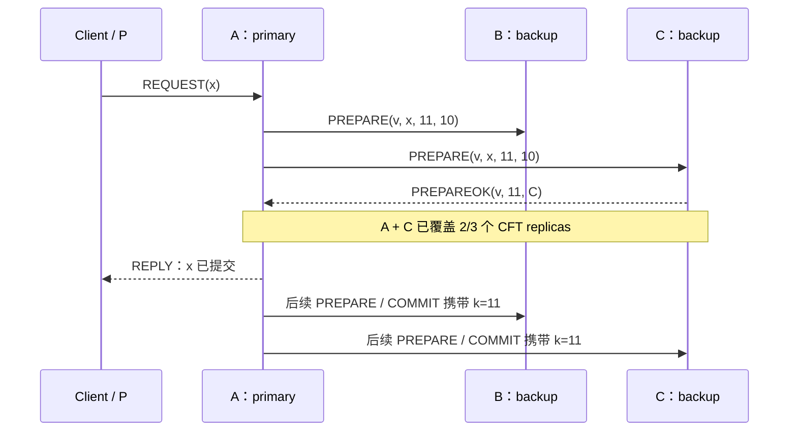

# Viewstamped Replication Revisited：面向 region-level CFT 的详解

日期：2026-09-28。文献：Barbara Liskov and James Cowling, *Viewstamped Replication Revisited*, MIT-CSAIL-TR-2012-021, 2012。[MIT 文献记录](https://dspace.mit.edu/entities/publication/80846d94-fcd3-40e6-87fb-8d91fe99a5d1)，[论文全文](https://codewisdom.io/static/papers/viewstamped-replication.pdf)。重点：§4.1、§4.2、§4.3、§7、§8。

本文接受每个 region 已实现 crash-only virtual entity 的假设。原始 VRR 机制与 L1 接入建议分别说明；不是对新组合协议的证明认证，未修改现有协议源码。

## 1. 角色和三个编号

外层有 `m=2g+1` 个逻辑区域，最多 `g` 个不可用，普通 quorum 为 `g+1`。用 A、B、C、`g=1` 作为贯穿例子。一个 region 内的 sequencer/BFT 成员不是外层的独立 replica。

- **view-number v**：本轮 primary 任期，切换 primary 时增加。
- **op-number n**：已放入本地日志的最高操作编号；换 view 时不会把全局日志位置重新从 1 编起。
- **commit-number k**：本地已知已提交的日志前缀末尾，`k≤n`。

论文在固定配置中使用 round-robin primary。这里采用从零编号的等价记法：`primary(v)=configuration[v mod m]`，故 view 0/1/2 分别由 A/B/C 担任 primary。

轮到 B 不要求 B 的日志已经是最新的。B 的身份由 view 决定；B 能否开始服务取决于是否成功恢复并安装新 view。这是与 Raft 日志新旧投票限制的重要差别。[Ongaro 博士论文 §11.2.2](https://ongardie.net/var/blurbs/pubs/dissertation.pdf)。

## 2. 每个 replica 的状态

| 状态 | 用途 |
|---|---|
| configuration、replica index | 共同成员表及 primary 映射 |
| view-number | 防止把旧任期消息混进新任期 |
| status | `normal`、`view-change`、`recovering` |
| log、op-number | 已记录的连续请求前缀 |
| commit-number | 已知提交的连续前缀 |
| client-table | 记录 client 的最新 request-number 和回复，用于去重 |
| last-normal-view | view change 报告中用于比较日志新旧；区别于刚增加但尚未安装的 view |

只有 `normal` replica 参与正常请求处理。处理新 view 的数据前须取得相应状态；不是看到一个更大的 view 数字就可以直接 ACK。正常 PREPARE 按日志位置处理，缺失前缀时先补齐。

## 3. 正常复制：一次 quorum 复制后 primary 可以回复

设三者都在 view 0，A 是 primary，现有日志已提交到位置 10。新请求 x 到达 A：

1. A 检查 client/request-number，避免把重试执行两次；将 x 记录到位置 11。
2. A 向备份发送 `PREPARE(v=0, request=x, n=11, k=10)`。
3. 备份先取得位置 1–10，记录位置 11，再回复 `PREPAREOK(v=0,n=11,id)`。
4. A 收到 `g` 个不同备份的 PREPAREOK，加上自己的记录共 `g+1` 份，并在先前操作已提交/执行后，提交、应用 x 并回复客户端。
5. A 通过后续 PREPARE 携带的 k，或空闲时的 COMMIT 消息，通知备份提交进度。

原文 COMMIT 是 primary 的提交进度通知，不是另一轮必须收 quorum 的 COMMIT 投票。原始 CFT 客户端可以信任合法 primary 的回复，因为该逻辑进程只会按协议执行或 crash。

图中无需等待 B；B 可能慢或 crash。将 P 画为请求发起者仅用于展示原始 client API；本项目也可以让 P 只消费排序结果。

忽略虚拟实体内部处理，从 primary 发送 PREPARE 起，正常路径是一轮区域间往返，再把结果发给 P。这里的备份是其他 region，因此不是区域内延迟；内层 BFT 的处理/复制时间仍需加入。

## 4. 两个“是否提交”不能混淆

在 A 回复 P 后、备份收到 k=11 前，状态可能是：

| Replica | op-number | commit-number | 位置 11 |
|---|---:|---:|---|
| A | 11 | 11 | x，A 已确认给 P |
| B | 10 | 10 | 暂时缺失 |
| C | 11 | 10 | 已记录 x，但不知道 A 是否已提交 |

C 的 `k=10` 不意味着 x 可以丢弃。C 无法区分“我的 ACK 到达 A，A 已回复 P”和“我的 ACK 丢失，A 尚未确认”。因此恢复协议必须考虑完整日志，而非只复制 k 以内的条目。

## 5. 原始 view change 的三个消息层次

A 不再及时发送消息时，备份可以怀疑它失败；误判不会自动损害安全。view 1 的 primary 已确定是 B。

### 5.1 STARTVIEWCHANGE：让足够多 replica 进入交接状态

节点增加 v、设置 `status=view-change`，广播 STARTVIEWCHANGE。收到更高 view 的合法转换消息也可促使节点向前推进。节点在交接状态停止处理旧 view 的正常 PREPARE。

同一新 view 的 STARTVIEWCHANGE 达到 `g+1` 个不同参与者（含自身）后，节点向指定 primary B 发 DOVIEWCHANGE。

### 5.2 DOVIEWCHANGE：将状态交给预定接班人

报告包含 `(v, log, v_last_normal, n, k, replica_id)`。新 primary 收集 `g+1` 份报告，包括自己的状态。

日志选择依次比较：

1. 最大 `v_last_normal`；
2. 在该 normal view 的报告中选择最大 n。

因此不是无条件选择最长日志，也不是取 k 最大的报告。刚进入 view-change 的 v 在这些报告中相同，不能拿它来比较旧日志的新旧。

### 5.3 STARTVIEW：安装选定日志

新 primary 安装选定日志，n 取日志末尾，k 取收集到的最大 commit-number，发送 STARTVIEW。接收者安装日志和 view，恢复正常处理。选中日志里 k 以后的条目尚未被新 primary 确认提交时，备份重新回复 PREPAREOK，由新 primary 按正常条件推进提交。

原始 VRR 对固定配置使用的规则见论文 §4.2；其状态恢复规则不可简单替换成“拿最高 tip 后开始新块”。

## 6. 继续三区域例子：A 已回复 P，但 B 完全落后

沿用上面的状态，A crash。B、C 完成 view 1 的 STARTVIEWCHANGE：

- B 报告旧 normal view 0、n=10、k=10。
- C 报告旧 normal view 0、n=11、k=10，含 x。
- B 选择 C 的日志，得到位置 11 的 x；它从报告中只能确定 k=10。
- B 发 STARTVIEW，并与 C 重新确认位置 11，之后才能按顺序推进新请求。

P 先前看到的 x 不会被替换。B 不需要知道 A 在 crash 前是否真的把回复发送给 P；恢复过程保留了这个可能已对外生效的结果。

如果 A 只在自己记录了 y，其他成员均未知，则 A 未满足向 P 回复的 quorum 条件。在 A crash 后，B、C 可能不保留 y，客户端可重试。这就是未提交尾部与最终确认的区别。

## 7. 为什么旧 primary 无法与新 primary 分叉

旧 view 的提交需要一个写 quorum `Q_old`，新 view 的恢复采用 `Q_new`。对于 `m=2g+1` 和大小 `g+1` 的 quorum：

\[
|Q_{\mathrm{old}}\cap Q_{\mathrm{new}}|
\ge 2(g+1)-(2g+1)=1.
\]

恢复规则将交集所保存的历史带入新 view。与此同时，进入 view-change 的成员不再接受旧 view 的新 PREPARE，使旧 primary 无法绕过恢复集合追加冲突历史。

两个条件缺一不可：只复制日志而继续给旧 primary ACK，旧 primary 可能在状态报告后提交未被新 primary 看见的条目；只提高 view 而不恢复日志，则会遗忘既有确认。

旧 primary 可能稍后才收到之前的 ACK，并迟到地获知提交。那不是允许回滚的理由：如果旧值此前已经达到 quorum，恢复规则必须已经保留它。fencing 不撤销旧提交。

## 8. crash 后不能带着失忆状态重新投票

VRR 专门有 recovery 子协议。原文允许不在正常路径逐条写磁盘，借助复制的状态提供持久性；这个性质依赖其故障/恢复模型，不提供“所有副本同时丢失内存后仍能恢复”的保证。

原文恢复节点先进入 `recovering`，不能正常 ACK，也不能参加 view change。它使用 fresh nonce 请求状态，取得 quorum 的当前回复，其中须包含回复集合中最高 view 的 primary；完成恢复后才重新加入。旧恢复消息不能用于本次重启。

对于本项目，区域内部换 sequencer 或重启时，必须保留或安全恢复这个外层 VR 状态。所需状态包括 accepted log、view/status、提交和去重进度；一个 region 的内部新 leader 不能把它当成空白 CFT 节点继续 ACK。

工程对照：[TigerBeetle VSR internals](https://github.com/tigerbeetle/tigerbeetle/blob/main/docs/internals/vsr.md) 实际使用 WAL 与显式 repair。它体现了安全加入/恢复的重要性，但具体消息与持久化实现不同于原文，不能混作同一算法。

## 9. 在本项目中接入 L1

原文的职责划分可对应为：

| VRR | 本项目 |
|---|---|
| 一个 replica | 一个 crash-only region entity |
| primary | 本任期的 active region |
| configuration | L1 授权的区域集合 |
| view number | 外层轮换 view |
| log entry | 有位置、父摘要、内容及证据的排序记录 |
| primary assignment | L1 指定的共同 schedule |
| client reply | 给 P 的合法 outer-commit 输出 |

以下是适配建议，而不是原文的 L1 功能：把 `primary(v)` 设为 L1 最终确认配置中的 `Schedule(c,v)`，在预定任期到期时触发相同的安全 view change。若没有故障，新 primary 可提前同步，减少切换时的数据传输；仍保留交接时的状态检查与旧 view fencing。

原文按超时启动 view change；计划轮换是新增触发条件。next primary 故障时须有规则授权跳过到下一 view。计划时间到来本身不能证明新 primary 已取得正确日志。若每次轮换都等 L1 新交易，则 L1 finality 进入切换路径；若 L1 只装入规则，可由外层协议按规则离链执行轮换。

固定 region 集合时，轮换 primary 属于 view change。改变外层成员集合属于 reconfiguration；VRR §7 为此另设 epoch。不要把每次换 active region 都当成增删 replica。

## 10. 给 P 的可验证输出

原始 VRR 的 client 收到合法 primary 回复即可接受，因为 primary 是 crash-only。它没有自动提供 blockchain 风格、可转移验证的 threshold commit certificate。

在既定 region wrapper 下，可以让区域 SMR 仅在合法 outer-commit 状态转换完成后导出区域证书，例如绑定 `(configuration, view, slot, digest, prefix)`。这是对合法逻辑输出的认证；区域内部只确认“我存下了 x”不能被称为“外层已经提交 x”。若 P 要自己检查跨区域 quorum，则需另外设计 ACK 证据的格式、持久性、去重与祖先证明。

VRR 的安全继承可以解决跨 active-region 切换后的外层 committed prefix 保留。但为此，stream entry 必须进入外层复制协议。只轮换生产授权、不跨区域保存相关状态，无法获得同样的数据恢复保证。

## 11. 本稿范围下的实际意义

VRR 提供的是完整的 normal replication＋deterministic primary＋state recovery 框架。对本项目，最有价值的改变是：L1 可以固定下一任区域，而恢复协议负责让它变得足够新；旧的 outer commit 在后续轮换中继续保留。

成本也明确：正常外层写入有一个 quorum 往返，view change 有额外控制和日志迁移，且每个 region 的逻辑步骤还有内部 SMR 成本。它改善了外层协议和授权规则的匹配，不会消除跨区域复制延迟。
