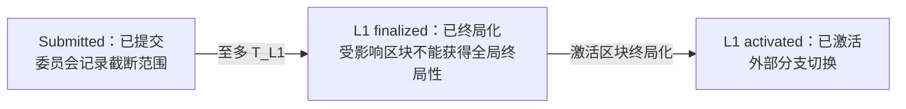

# Sync HotStuff RR v4.4：第 5—9 节中文翻译与说明

本文对应 [英文 v4.4 源稿](/Users/jin/projects/megaeth_sequenser_rotation/formalization/sync_hotstuff_rr_v4_4.tex)，完整翻译第 5—9 节。第 1—4 节不在本译文范围内。正文沿用英文的节号、定义号和协议号；正文后的“补充说明”用于解释设计，不增加协议规则。

本稿的关键改动是：外部观察者在**完整验证区块的区域终局性并向多签监测服务转发完整证据时**记录 \(s_u(B)\)，随后开始全局终局性的等待。区域 BFT 和 FINAL 消息格式保持不变。新增的 \(T_{\rm mon}\) 是完整证据被多签接收、其历史区域证据被验证的服务时间上界；普通跨区域骨干网络仍只要求最终送达。同一时刻最多有一个从 Submitted 到 activation 尚未处理完毕的 Force。多签不发送 KEEP，也不需要为每个区块额外发送监测确认或全局证书。

第 3 节还明确了原有回执的**覆盖作用**：同一会话开启下，后代 DATA 区块的合法 FINAL 回执，加上完整验证的祖先链，也能证明其 DATA 祖先已经提交。不需要给每个祖先额外收集一份直接签名回执。基础依据 \(Q_r^0\) 包含准确的继承锚点及其直接或覆盖提交证据；即使证据来自更高的旧会话区块，被该依据确认的锚点也不会向上移动。相关解释见补充说明 H。

为阅读后文，先统一几个术语：

| 英文／符号 | 中文含义 |
|---|---|
| regional commitment | 区域内部提交；由原区域 BFT 引擎执行 |
| regional receipt，\(\mathcal F_r(B)\) | 区域提交回执；针对同一区块的匹配 FINAL 签名，总权重严格大于 \(F_{i_r}\)，并满足第 3 节的完整验证要求 |
| direct / covering commitment evidence | 直接／覆盖提交证据；前者是针对该块的合法回执，后者是同一会话开启下某个 DATA 后代的合法回执及完整验证的祖先链 |
| regional finality | 区域终局性；除提交回执外，还要验证该位置确实属于所声称的区域与会话、历史连续，且未被已激活 Force 删除 |
| global finality | 全局终局性；观察者完成规定等待和 L1 检查后，纳入不可回滚前缀的状态 |
| session opening | 会话开启身份；用于区分不同边界开启的会话，不能只用数字会话编号 \(r\) 区分 |
| boundary witness | 边界见证；验证区域交接所需的锚点、回执、接任区域及 L1 证据 |
| retained anchor | 保留锚点；交接后继续延伸的 DATA 区块 |
| protected prefix，\(G_{\rm msig}\) | 多签内部保护的连续前缀；不是额外的对外终局性层次，也不是 KEEP 证书 |
| global prefix，\(G_u\) | 观察者 \(u\) 已确认的不可回滚前缀，\(G_u\) 表示其末端检查点 |
| \(s_u(B)\) | 观察者 \(u\) 首次完整验证 \(B\) 的区域终局性并转发完整证据的时刻 |
| \(m(B)\) | 多签首次完整验证 \(B\) 的时刻 |
| \(T_{\rm mon}\) | 从正确观察者完整验证并转发，到多签收到并验证其历史区域证据的时间上界 |
| \(T_{\rm msig}\) | 多签从首次完整验证起，决定是否提交删除该块的 Force 的期限 |
| \(T_{\rm L1}\) | 有效 Force 经 L1 服务提交后，终局化并对正确观察者可用的时间上界，包含入块与终局化 |
| \(W\) | 观察者的总等待时长，\(W=T_{\rm mon}+T_{\rm msig}+T_{\rm L1}\) |
| Submitted / L1 finalized / L1 activated | 已提交／已在 L1 终局化／已在 L1 激活；三者分别触发不同处理 |
| outstanding Force | 已提交、尚未激活完毕的 Force |
| DATA / DRAIN | 承载应用批次的区块／只用于收尾提交、不进入外部 DATA 链的区块 |

以下为正文翻译。

## 5. 区域终局性与全局终局性

### 5.1 区域终局性

观察者从创世区块或一个受信任的全局检查点 \(G_u\) 开始。该检查点包含或认证其会话开启身份、轮换位置、投票配置，以及已经处理的 L1 历史。观察者使用当前已终局化的 L1 记录继续延伸这段历史。

**定义 5.1：区域终局性。** 在观察者的当前快照中，一个 DATA 区块 \(B\) 具有区域终局性，当且仅当以下条件全部成立：

1. 从 \(G_u\) 开始，根据正常轮换规则及已激活的 Force，\(B\) 所在位置被分配给它所声称的区域 \(i_r\) 和会话开启身份。
2. 提案的视图 \((r,g,t)\)、领导者、锚点和签名上下文，在该会话的历史授权下均合法。
3. \(B\) 具有合法的区域提交证据：即满足第 3 节“有效区域回执”定义的直接回执，或者满足“回执覆盖”规则的覆盖回执。
4. 从 \(G_u\) 到 \(B\) 的 DATA 历史构成合法、连续的延伸。每个 DATA 区块都具有来自它自身会话开启的直接或覆盖提交证据。没有任何已激活的 Force 删除这段历史的任何部分。

**先推导负责该位置的区域，再检查该区域的回执。** 一个区域拥有合法回执，并不意味着它有权生产本来属于另一区域的区块。当前的 live/off 状态表也不能替代保留区块所依据的历史授权。

区域终局性是相对于当前外部分支定义的。后续 Force 可能删除这部分输出。其原来的区域提交记录和回执仍然是关于旧引擎的有效证据。一个已经在 L1 终局化、但尚未激活的 Force，不会立即改变该分支；它按照下面的规则影响全局终局性。

### 5.2 全局终局性

一份**完整的区域终局性证据包**，包含从可信检查点开始验证整条路径所需的区块、回执、应用历史、边界见证，以及已终局化的 L1 证明。已经验证的数据可以缓存。同一会话开启下，一份合法后代回执，加上完整验证的祖先链，可以覆盖其中的 DATA 祖先。仅有哈希，不能补足缺失的区块数据或另一个会话的证据。

令 \(s_u(B)\) 表示观察者 \(u\) 首次完整验证 \(B\) 的区域终局性、并向多签监测服务发送其完整证据包的时刻。先处理祖先，再处理子块，并对每个新验证的 DATA 区块执行这一操作。每个时刻只设置一次。不同的签名者集合、证书编码、重复证据包及后续恢复，都不重置该时刻。如果节点丢失了自己的计时记录，就从一次新的转发重新等待。它不能从区块的 L1 引用还原一个更早的起始时间。

定义

\[
W=T_{\rm mon}+T_{\rm msig}+T_{\rm L1}.
\]

这三项分别覆盖完整监测、多签的决策期，以及 L1 终局化。具体时间界采用第 2 节“有界监测与 Force 终局化”假设。

**定义 5.2：观察者处的全局终局性。** 在全局时钟时刻 \(z\)，观察者 \(u\) 可以把 DATA 区块 \(B\) 追加到自己的全局前缀，当且仅当：

1. \(B\) 在当前已终局化的 L1 快照下具有区域终局性；
2. 它之前的所有 DATA 区块已经进入 \(u\) 的全局前缀；
3. \(z\ge s_u(B)+W\)；以及
4. 没有任何适用且已经在 L1 终局化的 Force 删除 \(B\)，无论是直接删除，还是通过替换其某个祖先的正常交接边界而删除。这也包括已经终局化但尚未激活的 Force。

如果等待截止与 L1 终局化发生在同一时刻，先处理已终局化的 Force，再检查上述条件。

只有连续的 DATA 前缀可以成为全局前缀。DRAIN 没有自身独立的外部终局性。正常交接和区域内部生产不等待这次晋升。

这是观察者自己已经验证并持久保存的状态。不同观察者可以在不同时间确认同一个区块。晋升不产生新的全局证书、KEEP 消息或 L1 交易。新观察者必须从自己明确信任的检查点开始，或者验证所需历史并完成自己的等待期。仅凭一个区块及其区域回执，不能证明第三方对它作出的全局终局性声明。

### 5.3 为什么不能用区块原来的时间戳作为等待起点

DATA 区块中的 L1 引用在提案时就已经固定。该区块可能先获得 QC，经历多次被中断的恢复，很久之后才提交。最终可能由一个 DRAIN 将它提交，而其原有引用保持不变。因此，这个旧时间戳无法提供一个“提交证据可用之后”的完整决策窗口。

本稿保留 L1 引用在授权和轮换中的用途。外部等待从 \(s_u(B)\) 开始，即完整验证回执并转发之后。旧提案或 QC 不会启动该等待。晚到的回执不能使一个区块立即获得全局终局性。这一改动作用于外部观察者，不改变区域提案计时器、锁或 FINAL 的格式。

## 6. 跨区域轮换

### 6.1 锚点、接任区域选择与边界身份

令 \(\mathsf{NextLive}(i,\chi)\) 表示在循环列表 \(\mathcal L_R\) 中，从 \(i\) 之后开始遇到的第一个其他 live 区域。最多搜索一圈。如果不存在，结果为 \(\bot\)，交接等待。

正常交接继承 \(A_{r+1,0,0}=T_r\)。强制交接继承目标会话分支上高度为 \(h_*\) 的 DATA 区块。如果 \(h_*=h(A_{r,0,0})\)，则复用 \(A_{r,0,0}\) 及其原有直接或覆盖提交证据。定义用于开始选择的 L1 高度为

\[
\lambda_0=
\begin{cases}
\lambda(T_r),&\text{正常交接},\\
\max\{\lambda_a,\lambda(A_{r+1,0,0})\},&\text{强制交接}.
\end{cases}
\]

选择高度 \(\lambda_s\) 是不小于 \(\lambda_0\)、且存在另一个 live 区域的最小已终局化 L1 高度。使用在该高度生效的状态表，令

\[
i_{r+1}=\mathsf{NextLive}(i_r,\chi(\lambda_s)),
\qquad
\lambda^{\rm open}_{r+1}=\lambda_s.
\]

如果尚未有这样的高度终局化，就保留锚点并等待。一旦选定接任者，后来的普通状态更新不会重新选择这一边界的接任者。适用的已激活 Force 可以替换正常交接边界。

一个边界见证包含：REGULAR 或 FORCE 模式、前一会话的开启身份、保留锚点及其提交证据、接任区域、\(\lambda_s\)，以及所需 L1 证明。FORCE 见证还标识已激活的那条指令。进入新会话之前，必须已经能够取得接任者的已终局化授权。创世情形使用合成的见证和回执。

规范的边界身份由前一会话的开启身份、模式、锚点哈希、接任区域、选择高度，以及存在时的 Force 身份共同确定。签名者集合和编码方式不会改变它。区域签名已经绑定这一开启上下文。一个外部区块由其**会话开启身份和区块哈希共同标识**。保护前缀和全局前缀保留这种来源信息；另一个开启身份下相同的高度或哈希，不能被当作原来的同一个区块。

### 6.2 正常交接与强制交接

**协议 3：区域轮换。** 每个节点在已激活 L1 Force 所选定的分支上运行该处理程序。

1. **正常完成。** 收到合法的终端回执 \(\mathcal F_r(T_r)\) 时：
   - 验证其区域来源经过授权，并且在 \(A_{r,0,0}\) 之后恰有 \(\mathit{TB}_r\) 个 DATA 区块。
   - 应用当前已激活的 Force。如果它们删除这个正常交接边界，则仅把回执保留为旧区域证据。
   - 否则，按照第 6.1 节选择接任区域，形成 REGULAR 见证，并传送其完整证据包。

   不等待 \(T_r\) 获得全局终局性。一个已提交，或者已经终局化但尚未激活的 Force，都不停止这条正常路径。

2. **Force 激活。** 收到协议 5 的通知时：
   - 保留目标会话截至 \(h_*\) 的 DATA 前缀。删除其更高区块，以及被替换的正常交接边界的所有后代。这包括在通知期内已经启动的正常接任会话。
   - 保留原有保护前缀和全局前缀，并保留完全相同的区块来源身份。合法 Force 不能删除它们。
   - 获取保留锚点、它的原有提交证据，以及缺失的应用历史。如果本地尚未取得，则等待。
   - 选择接任区域，形成 FORCE 见证，传送其完整证据包，并在 Ready 时启动新的会话开启。

   旧区域引擎保留各自的日志和协议状态。本处理程序不取消它们的提交计时器，也不产生退出证明。

3. **跟踪分支。** 使用会话开启身份路由消息和保存回执。新的 Force 开启可以复用数字会话编号，但绝不复用旧开启下的锁、投票、进入时钟或观察者等待时间。

### 6.3 Ready 与共同的启动过程

**定义 6.1：Ready。** 被选中接任区域的成员 \(v\)，在完整验证当前适用的边界见证、锚点与缺失的应用历史，以及匹配的已终局化授权后，达到 Ready。正常见证证明终端回执和配额；强制见证则证明已激活的指令和保留锚点。

单独的提案、QC、已提交 Force 或状态表，都不能授予进入权限。达到 Ready 时，将完整证据包转发给全部接任成员。各接收者完成完整验证的时刻，就是它自己的 Ready 事件。重复见证不重置状态。已经进入后来被丢弃的旧分支，不会阻止节点进入具有相同数字会话编号的新开启。

**协议 4：启动被选中的区域。** 副本 \(v\in V_{i_{r+1}}\) 针对一个已经验证的会话开启，执行以下步骤。这里 \(\Delta=\Delta_{i_{r+1}}\)。

1. **进入。** 在 Ready 时，安装 \(A_{r+1,0,0}\)、\(\mathsf{AUTH}_{r+1,0}\)、\(\mathit{TB}_{r+1}\) 及 \(\lambda_s\)。将进入锁设为 \(Q^0_{r+1}\)。以未冻结状态进入 \((r+1,0,0)\)，只记录一次进入时间，并启动进度检查。向初始领导者发送包含该锁和边界见证的 STATUS。处理为此开启缓存的证明。
2. **选择锚点。** 初始领导者从自己的进入时刻起等待 \(2\Delta\)。如果该视图仍为当前视图且未被冻结，则发送 NEWVIEW，准确选择 \(A_{r+1,0,0}\) 为锚点，以 \(Q^0_{r+1}\) 和边界见证作为依据。
3. **认证并生产。** 成员执行协议 2“退出与恢复”中的 ANCHOR 投票步骤。获得 ANCHOR QC 后，领导者从 DATA 高度 \(h(A_{r+1,0,0})+1\)、物理位置 1 开始运行协议 1“稳态”。后续区域内部故障仍使用同一恢复协议。

令 \(e\) 为第一个正确成员的 Ready 时刻。完整证据包的转发使所有正确成员最迟在 \(e+\Delta\) 进入。若初始化领导者正确且没有退出，NEWVIEW 最迟在 \(e+3\Delta\) 发出，ANCHOR QC 最迟在 \(e+5\Delta\) 到达领导者，第一份 DATA 提案最迟在 \(e+6\Delta\) 到达所有正确成员。这满足第一次进度检查的要求。Ready 之前的传输仍遵循骨干网络最终送达的规则。

## 7. L1 Force 处理程序

### 7.1 多签内部的保护前缀

多签委员会维护一个保护检查点 \(G_{\rm msig}\)，初始值为共同信任的检查点。它保存完整且已经验证的前缀及其分支来源身份。这是内部状态，不是 KEEP 证书，也不是向客户端公开的额外终局性层次。

收到完整区域终局性证据包后，从可信检查点开始，在所提供的历史 L1 快照下，按父块优先的顺序验证整条缺失路径。对每个新验证的 DATA 区块只登记一次 \(m(B)\)。如果某个区块在证据包传输途中已被 Force 删除，其历史证据仍然可以验证，但该区块仅被归档，绝不获得保护。路径上的祖先登记时间不晚于其后代。重复证据包或不同回执编码都不重启截止时间。监测时间界给出：对于每个转发并验证了该区块的正确观察者，都有

\[
m(B)\le s_u(B)+T_{\rm mon}.
\]

如果委员会此前已观察到它，\(m(B)\) 可以更早。

在 \(m(B)+T_{\rm msig}\) 时，如果 \(B\) 仍在保留分支上，委员会将下一个连续前缀保护至 \(B\)，除非其已经提交的 Force 将删除它。已经受保护的区块保持受保护状态。被已激活 Force 删除的区块保持归档状态。委员会不会保护只有 QC 的区块、数据缺失的区块或尚未提交的候选。每个被保护的区块都具有直接或覆盖提交证据，以及使其能够作为保留锚点的所需历史。

保护推进和 Force 的实际提交由同一个协调一致的状态机处理。在时刻 \(s\) 提交之前，先推进所有截止时间严格早于 \(s\) 的保护。如果时间相等，先处理及时的 Force 提交，再处理该时刻到期的保护。后台处理延迟绝不延长截止时间。即使签名此前已经收集完成，也必须在实际提交时重新检查保护前缀。

尚未激活完毕的 Force 覆盖整个将被删除的子树，包括被替换的正常交接边界将来产生的后代。该子树中的回执不会进入 \(G_{\rm msig}\)。保留前缀的回执继续处理。激活之后，被删除的区块保持归档状态，不能因一次状态更新而重新获得保护。

### 7.2 Force 指令及其三个阶段

一条指令绑定以下字段：链、目标会话开启身份及编号 \(r\)、保留的 DATA 高度 \(h_*\)、状态表，以及激活 L1 高度 \(\lambda_a\)。它的身份是这些规范字段的哈希，而不是交易哈希，也不取决于多签编码方式。重试保持同一身份和同一效果。

**表 6：Force 的阶段及其效果。**

| 阶段 | 事件 | 效果 |
|---|---|---|
| **Submitted：已提交** | 已签名指令实际交给具有时间界的 L1 提交服务。 | 委员会记录待执行的删除范围，并停止保护该子树。仅完成签名不算提交。 |
| **L1 finalized：已在 L1 终局化** | 指令出现在已终局化的 L1 记录中。 | 所有观察者阻止将被删除子树中的区块获得全局终局性。生产授权尚未改变。 |
| **L1 activated：已在 L1 激活** | L1 区块 \(\lambda_a\) 终局化。 | 应用状态表，并执行外部硬分叉及区域轮换。 |

激活时间戳为

\[
\theta_a=\operatorname{Timestamp}_{\rm L1}(\lambda_a).
\]

它标识激活区块。硬分叉在该区块终局化时执行，不是在本地墙上时钟第一次到达 \(\theta_a\) 时执行。

从 Submitted 到激活完成之间，最多只能有一个尚未处理完毕的 Force。委员会保持其内容固定，并按需重发。它不能使用可取消或可替换的待处理 Force 来推迟保护。激活之后，可以针对产生的新分支上、端点尚未被 Force 固定的会话开启提交下一个 Force。每个准确标识的目标开启最多被 Force 处理一次。后来把该区域恢复为 live，也不会恢复其被删除的后缀。这一限制使异常 Force 指令顺序执行。正常交接仍在 L1 之外运行，普通状态更新也可以继续。

### 7.3 处理规则

**协议 5：提交、终局化并激活 Force。** 委员会执行第 1 步；L1 观察节点执行第 2、3 步。

1. **提交。** 决定替换一个不可用区域时：
   - 完成所有已经严格超过截止时刻的保护推进。要求当前没有尚未处理完毕的 Force。准确标识当前保留分支上的目标会话开启。如果该目标的端点已经被先前的 Force 固定，则拒绝该目标。
   - 在目标会话当前保留的前缀上，选择具有直接或覆盖提交证据且数据可用的 DATA 锚点，满足
     \[
     h(A_{r,0,0})\le h_*\le H_r.
     \]
     验证锚点在当前分支上的区域历史。此 Force 保留的完整历史必须延伸 \(G_{\rm msig}\)，包括其会话开启身份，以及全部已受保护的正常接任会话。
   - 如果已受保护的输出已经越过目标会话的正常交接边界，则不能替换该边界。过时的故障报告可以将旧区域标为 off，以影响之后的选择；但不能删除这段已受保护的输出。
   - 使锚点、提交证据及所需历史在故障区域之外保持可用。一个已经知道且符合条件的锚点就足够；无需证明它是全局最高的已提交区块。
   - 按配置的通知期选择有限的激活高度。在将来的状态表中将目标区域标为 off。原子地提交授权交易并记录其删除范围。随后处理在同一时刻到期的保护。

   如果已有尚未处理完毕的 Force，就保留新的故障报告。待其激活后，再根据当时的分支重新评估这些报告。

2. **L1 终局化。** 读到已终局化的 Force 记录时：
   - 验证授权、指令身份、目标开启、L1 证明及激活字段。使用共同的已终局化 L1 历史。
   - 记录其将来的删除范围：目标会话中高于 \(h_*\) 的 DATA，以及被替换的正常交接边界的全部后代。即使 \(h_*=H_r\)，这一规则也适用。
   - 立即阻止该子树获得全局终局性。为即将到来的交接缓存或获取保留锚点。普通区域 BFT 和正常交接继续执行，直到激活。

3. **L1 激活。** 激活 L1 区块终局化后，应用状态更新，并调用协议 3 的强制交接路径。指令只应用一次。已应用指令或其重试不会再次造成硬分叉、重置计时器或否决新分支。验证旧分支证据时，保留其历史截断效果。

如果一个观察节点首次看见指令时，其激活高度已经终局化，就在同一次更新中依次处理终局化和激活，不等待另一条消息。按照本协议产生的合法历史，不会在同一目标或将来要被删除的目标上出现相互竞争且尚未激活完毕的 Force。格式错误或未授权的记录被拒绝。已经归档的指令只在它原来的分支上下文中解释。

L1 记录不认证委员会私下记录的回执接收验证时间。委员会的保护规则是诚实服务假设的一部分。观察者依赖该规则及规定的时间界；他们既不需要委员会确认，也不需要看到委员会向内存池提交的交易。

## 8. 外部观察者

每个观察者维护两个前缀：当前的区域输出，以及以 \(G_u\) 为末端的不可回滚全局前缀。它还保存当前已终局化的 L1 证明、边界历史及首次转发时间。它绝不能仅凭区块较旧的 L1 引用就得出“不存在 Force”的结论。

**协议 6：验证输出并推进全局终局性。** 观察者 \(u\) 执行以下步骤。在同一时刻，第 1 步先于第 3 步执行。

1. **更新 L1。** 读取并验证当前已终局化的记录。运行协议 5，包括任何已经到达激活条件的操作。保存每个待处理 Force 的准确删除范围。如果无法取得已终局化快照，就推迟全局晋升。
2. **接受并转发区域输出。** 收到新的区块证据时：
   - 从可信检查点开始补齐缺失路径。验证区域终局性，包括推导出的区域与会话开启身份。先处理 DATA 祖先，再处理子块。请求缺失的数据或回执。
   - 将当前分支上的合法区块追加到区域输出。对每个此前未转发的区块，在完成完整验证和转发时设置 \(s_u(B)\)，并向委员会监测服务发送其完整证据包。
   - 可以批量发送或去重，但不能使传输超出监测时间界。重复消息保留原始时间。被已终局化但尚未激活 Force 覆盖的区块，仍可能具有区域终局性；其待执行删除会阻止全局晋升。
3. **晋升下一个 DATA 区块。** 从 \(G_u\) 之后紧接的区块开始，使用当前已终局化快照应用定义 5.2。如果下一个区块缺少证据、尚未等待 \(W\)，或被适用且已终局化的 Force 覆盖，则在此停止晋升。否则，将它追加到全局前缀，然后继续按顺序处理。
4. **维护前缀。** Force 激活时，只丢弃受影响的区域后缀及其旧的正常接任后代，并归档它们的证据。合法 Force 保留 \(G_u\)。如果某项指令声称要删除 \(G_u\)，将其视为违反所假设的控制服务，而不回滚全局前缀。

计时器或区块记录的键是会话开启身份与区块哈希，不是单独的数字高度。强制分支上的新区块开始新的等待。同一个被保留区块保持其原有等待。持久化防止重放消息重启等待；无法恢复本地计时状态的节点，应保守地重新等待。

### 8.1 请求与保留数据

请求通过应用的准入检查后，才视为可接受请求。每个节点按首次收到的顺序将它排队。重复送达不改变队列位置。正确领导者跳过已经在其提案祖先链中的请求，包括继承的区域前缀，并用最早收到、尚未包含且能够放入的请求填满批次。

请求只有被纳入全局前缀后，才最终从待处理队列中移除。被丢弃区域后缀中的请求仍处于待处理状态，可以在新分支上重新提议。仅区域提交或正常交接，不会将它移除。保留恢复和检查点验证所需的区块数据及回执；全局晋升不意味着可以删除它们唯一可用的副本。

## 9. 示例与保证

### 9.1 正常轮换与晚完成的 DRAIN

令 \(h(A_{r,0,0})=100\)、\(\mathit{TB}_r=10\)、\(K=4\)。各任期依次生产 DATA 101—104、105—108，以及 109—110。DATA 110 的终端回执允许正常轮换到被选中的区域，由后者从 DATA 111 开始生产。这次交接不插入全局等待。

现在假设 DATA 110 已有 QC，但它的计时器被 Quit 取消。恢复从 110 开始并产生 DRAIN。DRAIN 将 110 提交后，副本发送针对 110 的 FINAL。其原有 L1 引用保持不变。

如果一个观察者在时刻 100 首次验证并转发该回执，就设置 \(s_u(110)=100\)，即使该区块中的 L1 时间戳是 0。它等待到 \(100+W\)。若有 Force 在 95 提交、105 终局化，观察者将在该等待期间看到它；只要其截断点低于 110，就会阻止 110 获得全局终局性。无需从时刻 0 起保护一个尚未提交的 QC。

### 9.2 在委员会截止时间之前提交的 Force

假设一个正确观察者在时刻 100 验证并转发 DATA 107。令 \(T_{\rm mon}=2\)、\(T_{\rm msig}=5\)、\(T_{\rm L1}=3\)，于是 \(W=10\)。委员会最迟在 102 验证它，最迟在 107 作出决策。在 107 提交的 Force 最迟在 110 终局化。到 110 时，观察者先处理这条记录，再作全局终局性检查。如果该 Force 只保留至 DATA 106，观察者就不能晋升 107，即使激活安排在 115。激活时，107 及其旧后代被删除。新区域可以在新的会话开启下生产另一个 107；观察者对它开始新的等待。

如果在委员会实际截止时间前没有提交 Force，委员会的保护前缀就推进至 107。后续 Force 必须保留它。如果 107 的前驱均已全局终局化，且当前 L1 历史通过检查，观察者就可以在 110 晋升 107。两种情况下，委员会都不发送 KEEP 消息。

**图 1：一条 Force 的三个阶段。**

图注：全局等待期覆盖监测、决策窗口及 Force 的 L1 终局化。一条已经终局化的指令，在外部硬分叉激活之前就阻止相关区块晋升。

### 9.3 条件性保护论证

假设每个会话开启内的区域安全性和回执有效性成立，委员会遵守规定的诚实行为规则，并满足监测和 L1 时间界。考虑一个正确观察者准备晋升为全局终局的下一个区块 \(B\)。其完整转发保证

\[
m(B)+T_{\rm msig}+T_{\rm L1}
\le s_u(B)+W.
\]

同一次转发会使所需祖先的登记时间不晚于 \(B\)。如果到委员会截止时，某个 Force 已经删除了 \(B\)，当前区域终局性验证就会拒绝它。否则，要么尚未激活完毕的 Force 将删除 \(B\)，要么委员会保护截至 \(B\) 的连续且已验证前缀。

在存在待处理 Force 的情况下，该指令已在截止时间前提交。因此，它最迟在观察者等待结束时已经在 L1 终局化，并阻止晋升。在后一种情况下，之后的每个 Force 都保留 \(B\) 及其来源身份。

同一时刻发生的提交先于保护推进，同一时刻发生的 L1 终局化先于观察者晋升。因此，两个截止点都不存在空隙。唯一尚未激活完毕的 Force 具有固定且不可撤销的效果；一个将被忽略或取消的占位指令，不能延长保护截止时间。

从可信检查点开始作归纳，可得任何被接受的 Force 都不能删除正确观察者的全局前缀。在各次 Force 之间，区域安全性和确定性的轮换提供共同的保留分支。这一论证以这些性质成立为条件；它不是对按权重计算的区域 BFT 的一份新证明。

### 9.4 进度条件与限制

区域引擎和正常交接保留原有的进度条件。如果完整区域证据持续到达、监测满足其时间界，且一个工作分支持续足够长时间不被截断、使等待 \(W\) 能完成，则全局前缀可以增长。观察者不必在同一时间确认。由于骨干网络的延迟没有固定上界，从区域提交到每个观察者确认之间，仍不存在固定的端到端时间界。

Force 恢复还需要最终激活、可用的保留锚点、live 接任区域，以及该区域的授权。\(T_{\rm L1}\) 的界截止于 Force 终局化；它不保证任意选择的将来激活高度能在这一时间内到达。仅有一个 live 区域不足以维持无限次配额轮换，因为 NextLive 排除当前区域。反复故障也可能阻止稳定的全局前缀延伸。这些是进度条件，不是撤销已有全局前缀的理由。

### 英文原稿所列参考文献

1. **Sync HotStuff RR v3.3: Proposal Timers and Terminal-QC Handoff.** 规范草稿，2026 年 10 月 12 日，文件 `sync_hotstuff_rr_v3_3.tex`。
2. I. Abraham、D. Malkhi、K. Nayak、L. Ren、M. Yin，*Sync HotStuff: Simple and Practical Synchronous State Machine Replication*，IEEE Symposium on Security and Privacy，2020 年，第 106—118 页。[已发表论文](https://conferences.computer.org/sp/pdfs/sp/2020/349700a106.pdf)。

---

## 补充说明：如何理解这套设计

以下内容用于解释上面的规范，不增加新的强制规则。

### A. 三个问题分别由谁回答

可以把验证分成三个问题：

1. **这个位置是否轮到该区域？** 从可信检查点重放正常轮换和已激活 Force，推导合法区域和会话开启身份。这是区域终局性首先要检查的内容。
2. **该区域是否真的提交了这个区块？** 检查原来的区域 FINAL 回执、固定成员与权重，以及完整历史。区域回执不能代替第一步的授权判断。
3. **以后还能否通过 Force 删除它？** 观察者转发完整证据后，等待监测、决策和 L1 终局化所需的总时间，再检查当前已终局化 L1 历史。只有通过这一步，才进入全局前缀。

例如，当前规则把高度 107 所在位置分配给区域 B。区域 C 即使出具一份密码学上合法、签名权重足够的回执，也不能使自己生产的 107 获得区域终局性。错误发生在“区域与会话授权”这一步。

### B. 为什么新增多签内部的保护前缀

仅说“观察者等一段时间，如果没看到 Force 就确认”还不能约束未来的多签行为。多签必须有明确的截止规则：看到完整区域提交证据后，它有 \(T_{\rm msig}\) 决定是否提交会删掉该块的 Force；如果没有，就把相应连续前缀记为受保护，未来的 Force 不能删掉它。

\(G_{\rm msig}\) 保存的是这种不可追溯干预的承诺。它不需要广播，也不需要 L1 确认。观察者之所以可以依赖它，是因为模型明确假设多签诚实、协调一致、持久保存状态，并在规定时间内完成监测和决策。观察者不需要知道多签究竟在第几秒保护了该块，只需等待足以覆盖最迟情形的 \(W\)。

这也说明为什么“没有 KEEP”仍然需要监测服务：去掉的是逐块对外确认，不是多签接收证据和维护自身状态的工作。

### C. 为什么 Submitted 阶段就影响多签，但还不改变外部分支

多签自己知道何时实际提交了一条 Force，因此可以立即阻止待删子树进入内部保护前缀。外部观察者不必监听多签的交易池；它只依赖时间界，等待这条有效交易至多经过 \(T_{\rm L1}\) 后出现在已终局化 L1 记录中。

三个阶段因此分别作用于：

| 阶段 | 决定什么 |
|---|---|
| Submitted | 多签停止保护这条指令要删除的子树 |
| L1 finalized | 观察者已经确定它将被删除，因而阻止 GF 晋升 |
| L1 activated | 外部实际切到新分支，并启动强制交接 |

在 finalized 与 activated 之间，旧区域仍可生产、提交、正常交接。这些输出可能继续具有当前分支上的区域终局性，但受影响的块不能获得全局终局性。激活后，规定的整个旧子树一起被删除。

### D. 一个完整时间例子

沿用第 9.2 节的数值：观察者在 100 完整验证并转发 107；监测上界为 2，决策期为 5，L1 上界为 3。

\[
W=2+5+3=10,\qquad s_u(107)+W=110.
\]

- **最晚收到的情形：** 多签在 102 验证，实际决策截止为 107。
- **要删除 107：** 最迟在 107 实际提交 Force，最迟在 110 终局化。110 时先处理该记录，因此不会误把 107 晋升为 GF。激活可以稍晚，例如 115。
- **不删除 107：** 多签在实际截止时推进保护，后来即使区域离线，也只能选择保留 107 的强制交接方式。
- **更早验证的情形：** 如果多签在 101 就完成验证，它的截止时间就是 106，不能拖到 107 才重新决定删除 107。观察者仍保守地等待到 110。

协议没有额外的 \(\varepsilon\)。恰好同时发生时，由明文规定的顺序处理：及时提交先于保护；L1 终局化先于观察者晋升。

### E. DATA 110 已经很旧，为什么还要重新等

原 L1 引用只告诉我们该提案引用了哪个 L1 区块，不证明它何时被区域提交，也不证明多签何时取得完整回执。DATA 110 可能很早就获得 QC，后来一直卡在恢复中，直到很久之后某个 DRAIN 才把它提交。

若以原 L1 时间戳开始计时，那么第一次拿到 FINAL 回执时，窗口可能早已“结束”。这会把“尚未有区域提交证据的过去时间”算进挑战期。

因此 v4.4 把起点放在 \(s_u(B)\)。旧 DATA、QC、恢复次数、DRAIN 都不能把这个起点提前。DRAIN 仍然只负责推动原 DATA 的区域提交：不进入外部 DATA 链，不获得自己的 GF，也不修改原 DATA 的内容或回执格式。

### F. 为什么必须保存会话开启身份

假设旧分支有会话 \(r+1\)，其中产生了 DATA 107。Force 激活后，新分支也可以从数值上的会话 \(r+1\) 开始，并生产新的 DATA 107。两者的数字编号相同，但所属会话开启身份不同。

因此不能按“高度 107 已经等待过”来直接接纳新块，也不能把旧分支的锁、投票或进入时间搬过去。新分支的新块有自己的验证和等待。反过来，如果 Force 保留了旧分支的某个原始区块，该块身份未变，它已经开始的等待也不重置。

同理，若全局前缀已经跨过旧会话的正常交接边界，Force 就不能再替换那个边界。即使保留了旧会话的全部 DATA，替换边界仍会删除其正常接任后代；这些后代可能已经受保护。

### G. 安全性与活性各自依赖什么

条件性保护论证的核心是：观察者等待结束前，多签要么已提交删除该块的 Force，且它必然及时在 L1 中可见；要么已经保护该块，未来不能再删除它。

这项论证仍依赖原区域 BFT 的安全性、历史回执有效性、确定性的轮换、诚实协调的多签，以及明示的监测和 L1 时间界。它没有重新证明按权重计算的区域共识。

活性还要求真实进展：数据最终到达、监测服务有足够处理能力、Force 最终激活、存在 live 接任区域和可用授权，而且至少有一条工作分支保持足够长时间不被再次截断。缺少这些条件时，系统可以停止新增 GF；已经确认的全局前缀仍然保持不回滚。

普通骨干网络没有固定时延上界，因此文中的 \(W\) 是**从某个观察者完整验证并转发开始**的等待，不是从区域首次提交开始、对所有观察者统一承诺的端到端确认上界。

### H. 一个后代回执怎样证明祖先已经提交

假设 DATA 106 和 DATA 110 属于同一个会话开启，且已经完整验证 106 是 110 的祖先。一份合法 \(\mathcal F_r(110)\) 含有总权重严格大于 \(F_{i_r}\) 的匹配 FINAL 签名，因此至少有一个正确签名者已经提交 110。根据原区域提交规则，提交 110 也会提交其尚未提交的祖先，所以这份回执同时证明 106 已经提交。

它并不声称这些签名直接签在 106 上。验证者仍需取得并验证 110 到 106 的完整祖先链；一串未经验证的哈希不够。这种覆盖也不能跨越会话开启：后一个区域的回执不能替代前一个区域的提交证据，更不能替代区域轮换授权检查。

如果 Force 保留 106、删除 107—110，\(\mathcal F_r(110)\) 仍可作为 106 的历史区域提交证据，但不会把 110 重新带回外部链。接任会话的基础依据 \(Q^0\) 所确认的仍然准确地是锚点 106；110 只用于证明 106 已提交，不能让 NEWVIEW 改为从 110 开始。

这一规则使用已有 FINAL 格式和原有“提交后代同时提交祖先”的含义，不增加一轮投票，也不要求为每个祖先额外生成一个直接回执。观察者仍按祖先到子块的顺序，为每个被证据覆盖并完整验证的 DATA 区块设置自己的等待起点。
