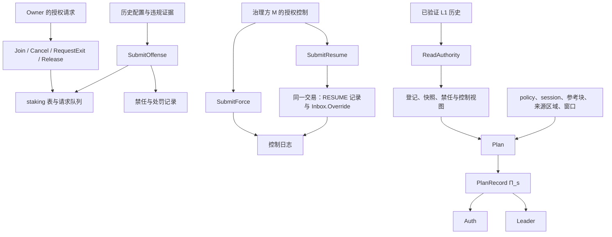

# 模块 01：L1 Authority（v10 工作稿 v0.1）

日期：2026-11-09。上一版：[v9 v0.1](../formalization_v9/01_l1_authority_zh_v0_1.md)。总览与共享模型见 [00 arch](00_arch_zh_v0_1.md)；来源为 [arch v0.2 §4.1](../formalization_v8/arch_zh_v0_2.md)。

本版相对 v9 的改动：§3.10 RESUME 治理规程的下界改为含时钟偏差的精确式；合约接口不变。

## 1. 定位与直觉

L1 Authority 是部署在 L1 上的合约及其配套纯函数。它回答三个问题：

- **谁有资格参与共识。** 维护 position（质押登记），按固定规则生成快照，处理违规证据与罚没。
- **某段职责由谁承担。** `Plan` 根据分支 policy、选区参考 block 和来源区域，冻结一份 session 职责安排 $\Pi_s$：负责区域、委员会、权重、故障上界、可提议者、leader 规则和生产窗口。
- **治理方怎样改变生产安排。** 记录 Force（换区或换 policy）与 RESUME（从派生链恢复）两类控制记录；RESUME 在同一交易内调用 Batch Inbox 的 `Override`。

Authority 只记录事实、执行可在合约内判定的检查。控制记录的激活时刻由收录它的 L1 block 唯一确定（§3.1）；激活后作用于哪条分支、选用哪个 anchor，由 GFR 在公开重放中决定（[09 §3–§4](09_finality_rules_zh_v0_1.md)）。

## 2. 最小假设

**本模块依赖的模型条目。**

- L1 safety 与 fixed-pace（[00 §1.2](00_arch_zh_v0_1.md)）：finalized 前缀互为前缀、不回退；合约调用在前缀内原子执行。因此任何读取者在同一 L1 height 读到相同的登记、快照、禁任集合和控制日志。
- 签名方案 EUF-CMA 与 hash 的 binding（[00 §1.1](00_arch_zh_v0_1.md)）：owner 授权、possession 证明、治理签名不可伪造。
- PKI setting、position 与快照定义（[00 §2.1–§2.2](00_arch_zh_v0_1.md)）。
- 治理方 $\mathsf M$ 的公钥在配置中给定（[00 §2.5](00_arch_zh_v0_1.md)）。$\mathsf M$ 诚实且按规程发出控制只用于恢复活性；Authority 的检查本身不依赖 $\mathsf M$ 诚实。

**对其他模块的假设。**

- `SubmitOffense` 使用 Session Program 公开的 `CheckEvidence`（[02 §3.11](02_session_program_zh_v0_1.md)）判定违规；Authority 不另定义 conflict relation。
- `SubmitResume` 依赖 Batch Inbox 的 `Override` 在同一交易内成功（[07 §3.5](07_batch_inbox_zh_v0_1.md)），两者原子提交。

**上游输入与下游输出。** 编号对应 [00 §4.4](00_arch_zh_v0_1.md) 的接口连接表。

| 方向 | 对方模块与接口 | 交换对象 | 连接 |
| --- | --- | --- | --- |
| 输入 | Owner、治理方 $\mathsf M$ | 授权请求、Force／RESUME 记录与签名 | — |
| 输入 | Publisher.`SubmitEvidence` | descriptor $\nu$、被指控 pid、完整证据 ev | W28 |
| 输入 | Batch Inbox 合约状态 | `SubmitResume` 在合约内直接读取 InboxState.cursor（[07 §3.2](07_batch_inbox_zh_v0_1.md)） | — |
| 输出 | Manager.`PrepareCandidate`、Program.`Create`、GFR 选区 | PlanRecord $\Pi_s$ | W1 |
| 输出 | Program 配置 | AuthorizationView、$\mathrm{Leader}_s(v)$ | W2 |
| 输出 | L1 日志 → GFR.`AdvanceGlobal` | ControlEntry（Force／RESUME） | W3、W4 |
| 输出 | Inbox.`Override` | 目标 Cursor | W4 |
| 输出 | Plan 验证、Manager、GFR | AuthorityRead | W6 |

## 3. 接口

### 3.1 状态

Authority 在 L1 上维护：

- **staking 表**：以 pid 为键，条目字段采用 [00 §2.1](00_arch_zh_v0_1.md) 的 region、pk、owner、stake、status；另保存已占用公钥、下一个不复用的 pid 和入队／退出请求。
- **快照** $\mathcal C_e$ 及其 cutoff、activation；读取与编号采用 [00 §2.2](00_arch_zh_v0_1.md)。
- **禁任与违规记录**：禁任公钥集合和已处理违规证据记录。记 $\mathsf{Ban}(\ell)$ 为处理完 L1 height $\ell$ 后的禁任集合。
- **控制状态**：控制日志、已使用的最大控制序号、请求结果表，以及其管理的 Inbox 地址。

公开固定的质押规则 $\mathcal P_{\rm stake}$ 指定注册准入、快照纳入、退出排队、罚没计算和资金释放条件。它接收登记及队列状态、L1 位置和经授权的请求，返回新状态与调用结果。本文使用这份规则，不重新定义经济参数。

**分支 policy。** 选区读取使用分支 policy

$$
\mathcal P_\beta=(S_\beta,\mathcal L_\beta,\lambda_\beta).
$$

$S_\beta:\mathcal R\to\{0,1\}$ 指定区域开关，$\mathcal L_\beta$ 是各区域恰好出现一次的循环排列，$\lambda_\beta$ 是授权读取的最低 L1 height（L1 floor）。Policy 在分支 $\beta$ 内固定，只由 Force 或 RESUME 替换。

**控制记录。** 控制记录有两类，共用严格递增的非负整数序号 $c$：

- **Force 记录** $U=(c,\beta_{\rm target},\mathcal P_{\rm new})$：控制序号、目标分支和新 policy。直观上，它要求“在激活时刻关闭分支 $\beta_{\rm target}$，从当时的全局链末端按新 policy 换区”。
- **RESUME 记录** $(c,\mathcal P_{\rm new},h_{\rm res})$：控制序号、新 policy 和目标 L2 height。直观上，它要求“在激活时刻让全局链对齐到派生链在 $h_{\rm res}$ 处的前缀，并从那里重新开出生产”。

**激活时刻。** 给定公告提前量 $M_a>0$（协议配置参数）。收录于 L1 block $\ell$ 的控制记录，无论是 Force 还是 RESUME，其激活时刻为

$$
\mathrm{act}:=\mathit{ts}_{\rm L1}(\ell)+M_a .
$$

激活时刻由收录 block 唯一确定，治理方不能另行指定。这里使用收录 block 的 timestamp 而不是“finalized 的时刻”：后者不是所有读取者都能一致计算的公开值；finalized 所需的时间由 $M_a$ 的预算覆盖（[09 §3.5](09_finality_rules_zh_v0_1.md)）。GFR 以激活时刻为时间键排序全部控制记录；由于 $\mathit{ts}_{\rm L1}$ 严格递增，这等于按 L1 位置排序（[09 §3.3](09_finality_rules_zh_v0_1.md)）。

### 3.2 数据结构

以下记录按字段定义逻辑内容，字段名也用于接口。实际存储可以采用完整记录或可验证引用，执行接口前仍需取得实际使用的对象。列表保留顺序，映射按键查找。记录一旦用于签名或 hash，就使用协议固定的规范编码；集合和映射也按该编码规定的键序排列。相同输入可以重算的字段，仍须核对一致，不能由提交者任意填写。

**质押登记与请求。** [00 §2.1](00_arch_zh_v0_1.md) 的 position 就是 staking 表的一条 entry：

```text
Positions[pid] = {
    region, pk, owner, stake, status
}
StakingRequest = {
    req, kind, pid, L1_position
}
OffenseRecord = {
    offense_id, pid, params, evidence, result, L1_position
}
```

Positions 的键 pid 为唯一、不复用的非负整数；五个字段的类型和含义采用 [00 §2.1](00_arch_zh_v0_1.md)。StakingRequest 的 req 是通用请求标识（[00 §4.2](00_arch_zh_v0_1.md)），kind 取 JOIN 或 EXIT，pid 指向相应登记，L1_position 是 [00 §1.2](00_arch_zh_v0_1.md) 的位置 $p$。每个区域的请求队列保存有序 StakingRequest；队列处理条件由 $\mathcal P_{\rm stake}$ 给出。请求结果表以 req 为键，保存规范请求内容与已产生的输出，供重试核对。

OffenseRecord 保存已处理违规。Offense_id 是 $\mathcal P_{\rm stake}$ 对同一次处罚行为使用的规范标识比特串；同一次违规的不同证明使用同一标识，不能仅靠请求编号或证明字节 hash 去重。其余字段分别保存被指控登记、核对采用的历史实例配置、证据、已产生的处罚结果和处理位置。$\mathsf{Ban}$ 是已生效禁任公钥的有限集合，历史读取按 L1 位置取得相应版本。

**快照条目。** 快照 $\mathcal C_e$ 中的 entry 为 `SnapshotEntry{region, pk, weight}`，以 pid 为键。Region 和 pk 来自对应质押登记，weight 是该版本中冻结的正整数。快照的 cutoff 与 activation 是两个 L1 heights，含义采用 [00 §2.2](00_arch_zh_v0_1.md)；当前 Positions 与历史快照分别维护。

**Policy 与窗口。** 数学记号 $\mathcal P_\beta$ 对应下列记录：

```text
Policy = {
    enabled_regions, region_order, L1_floor
}
Window = {
    h_min, h_max
}
```

Enabled_regions 是 $\mathcal R$ 的子集，$S_\beta(i)=1$ 当且仅当 $i$ 在其中；region_order 是 $\mathcal R$ 的循环排列，对应 $\mathcal L_\beta$；L1_floor 是非负整数，对应 $\lambda_\beta$。Window 两个字段为 L2 heights，分别对应 $h_{\min,s}$ 和 $h_{\max,s}$，满足 [00 §2.2](00_arch_zh_v0_1.md) 的窗口约束。

**选区参考。** 输入 Ref 用来选择授权历史，记录为 `BlockRef{h, os, block_id}`。h 为 L2 height，os 为 L1-origin height，block_id 为 [00 §3.2](00_arch_zh_v0_1.md) 的连接标识 $\mathrm{id}(\cdot)$；这些字段必须从已验证的来源 block 取得。Ref 在 Plan 中按这份记录绑定，完整 block 和验证材料由读取方另行保存。Ref 的取值由 GFR 的交接边界确定：regular handoff 取前驱 session 的初始 anchor，后继实例实际采用的 anchor 由 GFR 另行选定（[09 §4.3](09_finality_rules_zh_v0_1.md)）；Force 与 RESUME 取新分支的起始 anchor（[09 §4.4、§4.6](09_finality_rules_zh_v0_1.md)）。RESUME 同时将新分支的 L1 floor 设为恢复 anchor 的实际 origin，因此首个 session 按该 origin 查询快照和禁任集合。

**规则参数与协议配置。** 公开协议配置具有唯一版本／内容标识 config_ref；它是按协议编码的非空比特串，指向完整的规则、参数及规范编码，同一标识下的配置不可改写。配置中的 `RuleSpec{rule_id, version, params}` 描述一条公开确定规则：rule_id 与 version 唯一指定算法，params 是该算法格式规定的固定参数字节。取不到配置或不能解析参数时，不能将它当作已验证规则。

`ProtocolConfig` 是 [00 §4.2](00_arch_zh_v0_1.md) 所说“公开协议配置”的具名内容，包含链标识、规则和 verifier 版本、规范编码规则、合约地址表、质押规则、故障权重规则、leader 规则，以及 BFT 的大小和时间参数。故障权重规则按所选区域与委员会计算 $F_s$，并核对 $3F_s<W_s$；leader 规则对给定委员会、可提议者和 view 返回一个可提议 replica。本文不额外选择某个故障比例或随机 leader 算法。

**Plan 记录。** $\Pi_s$ 是 `Plan` 为 session $s$ 返回的固定记录：

```text
PlanRecord = {
    session, policy, reference_block, source_region, window,
    L1_reference_height, snapshot_id, banned_keys,
    region, committee, total_weight, fault_bound,
    eligible_proposers, leader_rule, config_ref
}
CommitteeEntry = {
    pid, pk, weight
}
AuthorizationView = {
    committee, total_weight, fault_bound,
    eligible_proposers, leader_rule, window, config_ref
}
```

PlanRecord 的字段分别定义为：

- session、policy、reference_block、source_region、window 是本次调用的五项选择输入。Session 为 $(\beta,r)$；source_region 为区域标识，genesis 无前驱时取 $\bot$。
- L1_reference_height 为 $\ell_s:=\max\{\mathit{Ref}.\mathit{os},\lambda_\beta\}$；snapshot_id 为 $e_s:=\mathsf{SnapshotAt}(\ell_s)$；banned_keys 为该高度的冻结集合 $\mathsf{Ban}(\ell_s)$。这三项是本次计算采用的历史依据。
- region 为选中的区域 $i_s$。Committee 是按 pid 索引的 CommitteeEntry 表，恰好包含 $\mathcal C_{e_s}$ 中 region 等于 $i_s$ 的 entries；公钥和正权重逐项来自该快照。每个 entry 的 pid 对应 replica $m$ 的 $m.\mathit{pid}$，从而确定 $V_s$ 和 $w_s(m)$。
- total_weight 为 $W_s$，必须等于 committee 权重之和；fault_bound 为 $F_s$，按 config_ref 指定的故障权重规则取得。它描述采用的故障上界，不记录敌手实际控制的身份。
- eligible_proposers 是 committee 中 pk 不属于 banned_keys 的 pid 集合，不得为空。被禁任者仍保留冻结投票权重，但不进入提议者集合。
- leader_rule 为 RuleSpec，其 params 由公开规则根据 session、选择输入和 config_ref 确定；它与 committee、eligible_proposers 共同确定 $\mathrm{Leader}_s(v)$。Config_ref 同时绑定其余计算所用的公开配置版本。

AuthorizationView 的各字段直接取自 PlanRecord 的同名字段，是 Program 构造 ProgramConfig 时使用的授权视图（[02 §3.2](02_session_program_zh_v0_1.md)）。快照内容可从 snapshot_id 与指定 L1 历史重建；PlanRecord 不另外复制 owner 或当前 stake。

**已验证 Plan。** 读取方验证收到的 Plan 时，从记录中的选择输入、指定 L1 历史与公开配置重新执行 `Plan`，逐字段核对结果。后文的“已验证 Plan”至少包含这项重算与配置核对。将它作为某次生产职责使用时，消费端还要检查这些选择输入是否对应本次安排（由 GFR 的 Boundary 给出，[09 §4.7](09_finality_rules_zh_v0_1.md)）。常规后继可以提前计算 Plan，不等待最终 anchor；Plan 内容有效与候选 descriptor 已被 GFR 选中是两项分别检查的事实。

**控制日志与读取结果。**

```text
ControlEntry = {
    body, L1_position
}
AuthorityRead = {
    as_of, query, value, read_evidence
}
```

ControlEntry 保存一条已接纳的控制项：body 为 §3.1 的 Force 或 RESUME 记录，其 c、policy、目标分支／目标 height 均来自通过合约检查的调用；L1_position 为收录它的 L1 位置，对应的 L1 timestamp 从 L1 历史读取，并按 §3.1 确定激活时刻。序号和 body 在收录后不修改。下文的输出事件 `ExitRequested`、`ForceRecorded`、`ResumeRecorded` 中的 L1_position 字段含义相同；它是 L1 记录位置，与 [00 §2.1](00_arch_zh_v0_1.md) 的 position（质押登记）不是同一概念。

`ReadAuthority` 的 query 取 `POSITION{pid}`、`SNAPSHOT{snapshot_id}`、`BANS` 或 `CONTROLS`。AuthorityRead 的 as_of 为查询的 L1 height；value 为该高度处的 position、快照、禁任集合或控制日志前缀，已证明相应记录不存在时为 $\bot$；read_evidence 说明该值来自哪份已验证 L1 历史。

**RESUME 使用的 Inbox 记录。** `SubmitResume` 构造 Override 的目标时使用 Batch Inbox 的 Cursor 与 CursorRead，定义见 [07 §3.2](07_batch_inbox_zh_v0_1.md)。Cursor 的 source 字段为 `RESUME(control_seq)` 时，指向本模块以唯一控制序号标识的 RESUME 记录。

### 3.3 接口概览

质押写接口为 Join、Cancel、RequestExit、SubmitOffense、Release；治理写接口为 SubmitForce、SubmitResume；历史读取为 ReadAuthority；Plan、Auth、Leader 根据已取得的配置计算区域职责与授权。



| 接口 | 主要输入 | 主要输出 | 用途 |
| --- | --- | --- | --- |
| `Join` | 区域、公钥、owner、质押金额与授权 | `Joined(pid)`、新记录 | 注册 position |
| `Cancel` | pid、owner 授权 | `Cancelled(pid, refund)` | 取消尚未纳入快照的登记 |
| `RequestExit` | pid、owner 授权 | `ExitRequested(pid, L1_position)` | 登记退出请求 |
| `SubmitOffense` | 历史配置、pid、证据 | `Slashed(pid, amount, stakeAfter)` | 验证并处理违规 |
| `Release` | pid、owner 授权 | `Released(pid, amount)` | 满足条件后释放资金 |
| `SubmitForce` | Force 记录（序号、目标分支、新 policy）、治理签名 | `ForceRecorded(c, L1_position)` | 记录强制切换意图 |
| `SubmitResume` | 序号、policy、目标 height、治理签名 | `ResumeRecorded(c, L1_position)` 与 `CursorSet` | 原子记录恢复并推进 Inbox |
| `ReadAuthority` | L1 height、查询项 | AuthorityRead | 读取确定的授权历史 |
| `Plan` | policy、session、参考块、来源区域、窗口 | PlanRecord $\Pi_s$，或 $\bot$ | 冻结一次区域职责安排 |
| `Auth` | $\Pi_s$ | AuthorizationView | 读取冻结授权 |
| `Leader` | $\Pi_s$、view $v$ | $\mathrm{Leader}_s(v)$ | 计算指定 view 的提议者 |

### 3.4 Join(i, pk, owner, b, auth)

**输入。** 通用请求标识 req；区域 $i\in\mathcal R$、共识公钥 pk、owner 的 L1 账户、转入的质押金额 $b\ge0$；auth 包含 owner 授权和公钥对应私钥的 possession 证明。本次 L1 执行位置由合约环境提供。

**输出。** 成功返回 `Joined(pid)` 及新 position 记录；不满足准入条件时返回 REJECT。

**处理。** 检查授权、资金、区域与公钥唯一性，以及 $\mathcal P_{\rm stake}$ 的注册条件；分配新 pid，记录五个字段，status 置为 Pending，并加入相应请求队列。重复请求不分配第二个 pid。

### 3.5 Cancel(pid, auth)

**输入。** req、待取消的 pid、owner 对取消操作的授权；从 staking 表和快照历史读取该 position 的状态。

**输出。** 成功返回 `Cancelled(pid, refund)`，refund 为按质押规则退还的金额；其他情形返回 REJECT。

**处理。** 只处理尚未进入任何快照的 Pending position。按 $\mathcal P_{\rm stake}$ 取消排队并退款，更新 stake 和 status，解除公钥占用。已经承担快照职责的 position 走退出和释放接口。

### 3.6 RequestExit(pid, auth)

**输入。** req、Active position 的 pid、owner 授权；读取当前登记与退出队列。

**输出。** 成功返回 `ExitRequested(pid, L1_position)`，L1_position 为记录退出请求的 L1 位置；其他情形返回 REJECT。

**处理。** 将 status 置为 Exiting 并记录退出请求。何时从后续快照移除、何时置为 Retired，由 $\mathcal P_{\rm stake}$ 决定；本调用不修改旧快照权重，也不释放资金。

### 3.7 SubmitOffense(params, pid, ev)

**输入。** req；被指控 position 的 pid；ev 为所用 BFT 版本的完整违规证据；params 为该证据所属 program 的 descriptor $\nu$（Plan、anchor 与 cid，[02 §3.2](02_session_program_zh_v0_1.md)）。$\nu$ 的 Plan 通过 config_ref 绑定 verifier 版本，使验证者能够重算 cid 并取得历史公钥及权重。通常由 Publisher.`SubmitEvidence` 调用（[04 §3.7](04_publisher_zh_v0_1.md)）。

**输出。** 成功返回 `Slashed(pid, amount, stakeAfter)`：amount 为处罚金额，stakeAfter 为处罚后的剩余质押。同一违规已经处理时返回原处理结果；证据或配置不符时返回 REJECT。

**处理。** 调用 $\mathsf{CheckEvidence}(\nu,\mathit{ev})$（[02 §3.11](02_session_program_zh_v0_1.md)），并核对被指控公钥属于 pid。验证通过后，由 $\mathcal P_{\rm stake}$ 计算处罚，更新当前 stake、禁任状态和 OffenseRecord；旧快照不改写。

### 3.8 Release(pid, auth)

**输入。** req、Retired position 的 pid、owner 授权；读取当前剩余 stake、退役记录和质押规则要求的 L1 历史。

**输出。** 成功返回 `Released(pid, amount)`；尚未满足释放条件或授权无效时返回 REJECT。

**处理。** 按 $\mathcal P_{\rm stake}$ 检查资金释放条件，退还允许释放的剩余 escrow，更新 stake 和 Released 状态并解除公钥占用。Program 停止不是本接口的资金释放依据。

### 3.9 SubmitForce(U, sig)

**输入。** req、完整 Force 记录 $U=(c,\beta_{\rm target},\mathcal P_{\rm new})$、治理方 $\mathsf M$ 的签名 sig；读取当前控制序号及收录本调用的 L1 height $\ell_U$。

**输出。** 成功返回 `ForceRecorded(c, L1_position)`，并写入控制日志；检查失败返回 REJECT。

**处理。** 验证治理签名、控制序号和 policy 格式。成功后更新控制序号和日志。这条记录的激活时刻为 $\mathrm{act}(U)=\mathit{ts}_{\rm L1}(\ell_U)+M_a$（§3.1）。Force 和 RESUME 何时可作为下一事件处理，取决于 [09 §3.4](09_finality_rules_zh_v0_1.md) 的公共输入覆盖条件：处理键 $x$ 前，Espresso 前缀须覆盖 $x$，L1 finalized 前缀须完整覆盖 $x-M_a$，并提供该转移所需的验证材料。因此处理到 $\mathrm{act}(U)$ 时，输入已包含本条控制记录；$M_a$ 的公告预算只保证正常服务下控制日志覆盖及时就绪（[09 §3.5](09_finality_rules_zh_v0_1.md)）。本接口只记录控制意图；激活后它是否有效、从哪个 anchor 开出新分支，由 GFR 处理（[09 §4.4](09_finality_rules_zh_v0_1.md)）。

### 3.10 SubmitResume(c, policy, h_res, sig)

**输入。** req、新控制序号 $c$、新 policy、目标 L2 height $h_{\rm res}$ 和治理签名；合约读取 Inbox 当前 cursor 及本次 L1 执行位置。

**输出。** 成功返回 `ResumeRecorded(c, L1_position)`，同一交易内同时产生 Inbox 的 `CursorSet`；任一检查或内部调用失败则 REJECT，整个交易回滚。

**处理。** 验证治理授权、序号和 policy，要求 $h_{\rm res}$ 严格高于 Inbox 当前 cursor 的 height。Authority 构造目标 Cursor：height 为 $h_{\rm res}$，frames_digest 为零值（清空未完成 channel），origin 按既有 override 格式确定且不超过收录本调用的 L1 height，source 为 `RESUME(c)`。随后以 admin 身份调用 Inbox.`Override`（[07 §3.5](07_batch_inbox_zh_v0_1.md)），并记录与其绑定的 RESUME ControlEntry。Inbox 的 cursor 在本交易中立即改变；GFR 侧的对齐在激活时刻 $\mathit{ts}_{\rm L1}(L)+M_a$ 进行（§3.1，[09 §4.6](09_finality_rules_zh_v0_1.md)），$L$ 为收录本调用的 L1 block。

**治理规程（链外）。** 合约只执行上述授权、格式和目标单调性检查。$\mathsf M$ 按以下规程决定是否以及如何发出 RESUME；这些条件用于恢复活性，不由合约判定：

- 已进入紧急状态：派生链 $D$ 已经越过或偏离当前生产分支，例如 Inbox cursor 已超过原生窗口停滞。
- Espresso 已恢复 live；若故障在批次层，Batcher 与 Certifier 也已恢复。
- $h_{\rm res}$ 高于当时全局链末端、Inbox 已接纳 height 和派生末端。
- 以 $L$ 记收录 RESUME 的 L1 block，$T_{\rm prep}$ 为状态准备预算、$\epsilon>0$ 为余量，选取

$$
\mathit{ts}_{\rm L1}(L)+T_{\rm prep}\le\mathit{ts}^*(h_{\rm res})\le\mathit{ts}_{\rm L1}(L)+T_{\rm drift}-\epsilon.
$$

下界留出 L1 finalized、GFR 处理和状态准备的时间。令 $T_{\rm ready}$ 为激活之后完成 GFR 处理与状态准备所需的时间，〔待确认 G2〕其中含取得越过激活时刻的 Espresso watermark 的等待。下界须满足

$$
T_{\rm prep}\ge M_a,\qquad
M_a+T_{\rm ready}+\delta_G\le T_{\rm prep}+b_{\rm L2}.
$$

前一条使 $h_{\rm res}$ 的 slot 不早于激活时刻。后一条使新 session 开始前准备已经完成：新 session 的首个 height 为 $h_{\rm res}+1$，其中本地时钟最快的 honest replica 在真实时刻 $\mathit{ts}^*(h_{\rm res}+1)-\delta_G=\mathit{ts}^*(h_{\rm res})+b_{\rm L2}-\delta_G$ 就开始（[00 §2.3](00_arch_zh_v0_1.md)）。$\delta_{\rm L1}$ 不进入下界：由 [09 §3.5](09_finality_rules_zh_v0_1.md) 的公告预算，$L$ 在激活时刻之前已 finalized。上界使恢复 anchor 满足 [00 §3.4](00_arch_zh_v0_1.md) 的 drift 前提。新 policy 排除仍有故障的区域。

### 3.11 ReadAuthority(ℓ, query)

**输入。** 已 finalized 的 L1 height $\ell$；query 指定读取某个 pid 的登记、某份快照、禁任集合或控制日志前缀；读取方提供或取得对应的已验证 L1 历史。

**输出。** AuthorityRead，其中 value 可以是经验证的 $\bot$；历史不足返回 WAIT。

**处理。** 返回处理完 height $\ell$ 后的状态。快照按固定 cutoff 历史计算，读取不等待额外发布交易。调用不改变 Authority 状态。

### 3.12 Plan(policy, s, Ref, sourceRegion, window)

**输入。** 分支 policy、逻辑 session $s=(\beta,r)$、选区参考 block Ref（BlockRef）、来源区域 sourceRegion（genesis 时为 $\bot$），以及固定 physical window（Window）。同时读取公开配置，以及足以计算下式的已验证 L1 历史和快照：

$$
\ell_s:=\max\{\mathit{Ref}.\mathit{os},\lambda_\beta\},
\qquad e_s:=\mathsf{SnapshotAt}(\ell_s).
$$

**输出。** PlanRecord $\Pi_s$，各字段按 §3.2 填入；没有合格区域时返回 $\bot$，不构造 region 为 $\bot$ 的成功记录；缺少历史时返回 WAIT；输入格式或窗口无效时返回 REJECT。

**处理。** 冻结 $\mathsf{Ban}(\ell_s)$。从 sourceRegion 之后开始沿 $\mathcal L_\beta$ 循环；sourceRegion 为 $\bot$ 时从排列首项开始。选择第一个启用、且在 $\mathcal C_{e_s}$ 中存在未禁任提议者的区域。委员会包含该区域快照中的全部身份与正权重；禁任不删除冻结投票权重。故障权重上界和 leader 规则使用公开配置，在冻结的可提议者集合上确定 $\mathrm{Leader}_s$，不随后来在线人数变化重算。

`Plan` 是纯函数：相同选择输入、相同 L1 历史和相同配置得到相同结果。因此 GFR、Manager 和 Program 可以各自计算并逐字段核对同一份 $\Pi_s$。

### 3.13 Auth(Π_s)

**输入。** 已验证的完整 Plan $\Pi_s$。

**输出。** AuthorizationView。

**处理。** 读取 Plan 中的授权字段，不按当前 staking 表或当前禁任集合重新选区。

### 3.14 Leader(Π_s, v)

**输入。** 已验证的 Plan，以及正整数 view $v$。

**输出。** 该 view 的 leader replica $\mathrm{Leader}_s(v)\in V_s$。

**处理。** 执行 Plan 中绑定的 leader_rule。本查询不改变 BFT view，也不启动一次 proposal。
