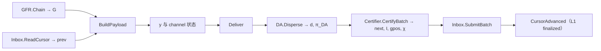

# 模块 05：Batcher（v10 工作稿 v0.1）

日期：2026-11-09。上一版：[v9 v0.1](../formalization_v9/05_batcher_zh_v0_1.md)。总览与共享模型见 [00 arch](00_arch_zh_v0_1.md)；来源为 [arch v0.2 §4.7](../formalization_v8/arch_zh_v0_2.md) 与 [Part 0 v0.8 §2.8](../formalization_v6/part0_model_goals_zh_v0_8.md)。

## 1. 定位与直觉

Batcher 把全局链 $G$ 中尚未被 L1 接纳的内容送到 L1。一次交付分四步：

1. **编码**：把连续 heights 写成原生 BlockRecord，组成 channel 并切分为 frames，得到提交字节 $y$。
2. **DA**：把 $y$ 交给 DA，取得 commitment $d$ 和证书 $\pi_{\rm DA}$。
3. **认证**：请 Certifier 核对 $y$ 与 $G$、当前 cursor 和 DA 的对应，取得签名 $\chi$。
4. **提交**：把 cursor 转换与签名提交给 Batch Inbox。

Batcher 是不受信任的角色：内容是否与 $G$ 一致由 Certifier 核对，连续性由 Inbox 检查。Batcher 的行为只影响交付何时完成。

## 2. 最小假设

**本模块依赖的模型条目。**

- 链映射与执行（[00 §3.3](00_arch_zh_v0_1.md)）：BlockRecord 的交易列表取 $\mathsf{Apply}$ 实际执行的 $\mathit{Kept}_h$，不含 DEP。
- 原生 sequencing window（[00 §3.4](00_arch_zh_v0_1.md) 末尾的 $\mathrm{ddl}$ 与 $W_{\rm seq}$）：每个 height 的批次必须在其原生截止位置前被接纳，派生才会原样采用。

**A-DELIVER（交付预算，仅用于活性）。** 存在 $T_{\rm batch}$，使得：若在 $[\tau,\tau+T_{\rm batch}]$ 上 Certifier 在线、DA 可用、L1 正常推进，且有诚实的注册 Batcher 承担提交，则在 $\tau$ 进入 $G$ 的 block，其批次在 $\tau+T_{\rm batch}$ 之前被 Inbox 接纳。$T_{\rm batch}$ 覆盖排队、接手、完成 channel、DA 认证、Certifier 响应与 L1 纳入。这一条不能仅由存在诚实 Batcher 推出：恶意的 primary Batcher 可以反复开 channel 再放弃，拖住接手者。

**对其他模块的假设。**

- 本地 GFR 重放给出的 $G$ 与公开规则一致（[09 §4.8](09_finality_rules_zh_v0_1.md)）。
- Certifier 按 [06](06_certifier_zh_v0_1.md) 的规则签名；Inbox 按 [07](07_batch_inbox_zh_v0_1.md) 的规则检查连续性。
- DA 满足 DA-S1 与 DA-L1（[08 §4](08_da_zh_v0_1.md)）。

**上游输入与下游输出。**

| 方向 | 对方模块与接口 | 交换对象 | 连接 |
| --- | --- | --- | --- |
| 输入 | GFR.`Chain` | $(G,\mathrm{src}_G,pc)$ | W15 |
| 输入 | Inbox.`ReadCursor` | CursorRead | W20 |
| 输入 | DA.`Disperse` | $(d,\pi_{\rm DA})$ | W17 |
| 输入 | Certifier.`CertifyBatch` | CertifiedResult | W18 |
| 输入 | Derivation.`DeriveAtResume`（本地 GFR 的 resumeReader） | ResumeCut | W23 |
| 输入 | Inbox.`SubmitBatch` 的结果 | CursorAdvanced | W19 |
| 输出 | DA.`Disperse` | 提交字节 $y$ | W16 |
| 输出 | Certifier.`CertifyBatch` | CertificationRequest | W27 |
| 输出 | Inbox.`SubmitBatch` | BatchSubmission 的七项参数 | W18 |

## 3. 接口

### 3.1 状态

Batcher 维护本地 GFR 状态 $\mathcal X$（ReplayState，[09 §4.1、§4.7](09_finality_rules_zh_v0_1.md)；处理 RESUME 时以 Derivation.`DeriveAtResume` 为 resumeReader）、从 L1 读到的 Inbox cursor（CursorRead，[07 §3.2](07_batch_inbox_zh_v0_1.md)）、channel 构造状态、待交付 payload，以及每个交付任务的 DA、认证和 L1 提交进度。

Cursor 是 Inbox 的接纳进度记录。记其 height 为 $h_{\rm cur}$：Inbox 已经完成接纳的最高 L2 height。Batcher 只持有读取副本，不能自行修改合约中的 cursor；cursor 也不是一条 block chain。

### 3.2 数据结构

**高度区间。** `HeightRange = EMPTY | {first, last}`；非空时 first、last 为 L2 heights，且 first $\le$ last。

**原生记录与分片。** 下列记录沿用原生编码版本，字段的字节布局由该版本给出：

```text
BlockRecord = {
    block_number, epoch_num, transactions
}
Frame = {
    channel_id, number, frame_data, is_last
}
SubmissionPayload = {
    derivation_version, frames
}
```

BlockRecord 是一个 L2 height 的原生批次记录：block_number 为 L2 height；epoch_num 为该 block 的 L1-origin height（名字中的 epoch 不指质押快照）；transactions 属于 $\mathcal T^*$，取按 $G$ 前缀执行 Apply 得到的 $\mathit{Kept}_h$，不包含 DEP。普通交易为空时仍有一份记录。

Frame 是 channel 的传输分片：channel_id 是原生编码规定的 channel 标识，number 为从 0 开始的分片序号，frame_data 为分片字节，is_last 标记最后一个分片。该结构与[原生 certifier 的 frame 解码](../megaeth_specs/specs/block-certification/certifier.md#verification-procedure)一致。

SubmissionPayload 是提交字节 $y$ 的解析形式：derivation_version 指定原生解码版本；frames 是同一 channel 中连续编号的一份或多份新 Frame，不重复包含 prev.frames_digest 已绑定的前缀。$y$ 是这一结构的完整编码；取得 DA commitment 后不能再改分组或字节。

**Channel 构造状态。**

```text
ChannelBuilderState = {
    channel_id, records, encoding_options, encoder_state,
    encoded_channel, frames, next_frame, closed
}
```

Records 是 block_number 连续的有序 BlockRecord 列表；encoding_options 保存原生版本允许的压缩等构造选项；encoder_state 为原生编码器状态；encoded_channel 为当前已产生的 channel 字节。Frames 是已生成分片，next_frame 指向下一份待交付 frame，closed 表示该 channel 是否已结束。闭合后的完整字节解码必须得到 records；编码器内部状态不构成对链内容的另一份选择。

**交付任务。**

```text
BatchDeliveryTask = {
    job_id, prev, payload, source_range, channel_id, phase,
    DA_result, certified_result, L1_result
}
```

Prev 是构造时采用的 Cursor；payload 是固定的 $y$；source_range 是本次编码的 HeightRange，与 channel_id 一起说明本地来源。Job_id 以 prev 和 $y$ 的规范内容区分任务；同一任务重试复用原记录，重建不同 $y$ 时建立新任务。

Phase 依次取 BUILT、DA_READY、CERTIFIED、ACCEPTED。DA_result 为 $\bot$ 或 `{d, π_DA}`；certified_result 为 $\bot$ 或 CertifiedResult（[06 §3.2](06_certifier_zh_v0_1.md)）；L1_result 为 $\bot$ 或 `{L1_position, transaction_ref, event}`，其中 L1_position 为 finalized 接纳位置，transaction_ref 标识对应 L1 交易，event 为 CursorAdvanced（[07 §3.2](07_batch_inbox_zh_v0_1.md)）。等待状态保留已完成阶段；prev 失效后按新的 cursor 重建。

### 3.3 接口概览



| 接口 | 主要输入 | 主要输出 | 用途 |
| --- | --- | --- | --- |
| `BuildPayload` | 连续区间 $J$、prev | `Built(y, channelState)` | 编码尚待交付的 block records |
| `Deliver` | $y$、prev、channel 信息 | `Accepted(prev, next, d, L1_position)` | 完成 DA、认证与 L1 提交 |

### 3.4 BuildPayload(J, prev)

**输入。** 待编码的非空连续 L2 height 区间 $J$（与 Certifier 输出的完成范围 $I$ 区分）、已验证的当前 cursor prev；读取本地 GFR 状态、来源数据、原生执行状态和 channel 构造状态。

**输出。** `Built(y, channelState)`：$y$ 为一个或多个连续 frame 的完整字节，channelState 为更新后的 ChannelBuilderState；来源或执行数据不足时返回 WAIT；区间或 cursor 不符时返回 REJECT。

**处理。** 只编码 $G$ 中高于 $h_{\rm cur}$、且未由恢复派生覆盖的 heights。从已验证的父状态逐高度执行 $G$（[00 §3.3](00_arch_zh_v0_1.md) 的 VP3 递推），记 $\mathit{Kept}_h$ 为 Apply 在 height $h$ 返回的实际执行普通交易列表。对每个 $h\in J$ 写入

```text
BlockRecord{
    block_number = h,
    epoch_num    = G[h].os,
    transactions = Kept_h
}
```

Padding height 也写入一份交易列表为空的记录。记录不携带可由 L1 重建的 DEP，也不保留被 Apply 丢弃的普通交易或原稀疏 physical parent 连接。生成本地 payload 不推进 Inbox cursor。

### 3.5 Deliver(y, prev, channelInfo)

**输入。** BuildPayload 生成的 $y$、采用的 prev 及其 channel 信息 channelInfo（channel_id 与本次 frames 的编号范围）；读取本地交付任务、注册 Batcher 权限和来源。

**输出。** `Accepted(prev, next, d, L1_position)`，表示 Inbox 提交已在所列 L1 位置 finalized；服务或数据暂不可用时返回 WAIT 并保留已完成进度；cursor 已被他人推进或提交无效时返回 REJECT。

**处理。**

1. 调用 DA.`Disperse(y)`（[08 §3.4](08_da_zh_v0_1.md)），取得 $(d,\pi_{\rm DA})$，phase 置为 DA_READY。
2. 以 CertificationRequest 调用 Certifier.`CertifyBatch(prev, y, d, π_DA)`（[06 §3.4](06_certifier_zh_v0_1.md)），取得 `Certified(next, I, gpos, χ)`，phase 置为 CERTIFIED。
3. 调用 Inbox.`SubmitBatch(prev, next, d, π_DA, I, gpos, χ)`（[07 §3.4](07_batch_inbox_zh_v0_1.md)）；L1 finalized 后记录 L1_result，phase 置为 ACCEPTED。

重试复用已完成的步骤。prev 失效（其他提交已推进 cursor，或 RESUME 已 override）时，从新的 cursor 重新构造，不覆盖其他已接纳提交。

## 4. 性质

BAT-1 至 BAT-3 是安全性质，描述按本规格运行的 Batcher 产生什么；系统的接纳安全不依赖 Batcher 诚实，而由 CERT-1 与 Inbox 的检查保证。BAT-4 是活性性质。

**BAT-1 — Record fidelity（safety）。** 对 Batcher 构造的每份 $y$ 和其中每个闭合 BlockRecord，若 block_number 为 $h$，则 epoch_num $=G[h].\mathit{os}$，transactions $=\mathit{Kept}_h$，其中 $G$ 与 $\mathit{Kept}_h$ 取自同一个本地 GFR 处理位置。Records 的 block_number 从 $h_{\rm cur}+1$ 起连续，不含 DEP。

*直觉：* Batcher 编码的是“$G$ 在原生格式下的样子”；派生在同一父状态上加回 DEP 并执行，就得到相同的原生 blocks。

**BAT-2 — No cursor authority（safety）。** Batcher 的任何操作都不直接修改 Inbox cursor；cursor 只在 Inbox 接纳一份带有效 Certifier 签名的提交时改变。

**BAT-3 — Idempotent retry（safety）。** 同一 (prev, $y$) 的重试复用同一 BatchDeliveryTask 与已完成阶段，不产生第二份不同的 DA commitment 或认证请求；prev 失效后建立的新任务以新的 cursor 为 prev，不重新提交已接纳或已被 RESUME 覆盖的 heights。

**BAT-4 — Timely delivery（liveness）。** 在 A-DELIVER 的条件下，在 $\tau$ 进入 $G$ 的 block 不晚于 $\tau+T_{\rm batch}$ 被 Inbox 接纳。若同时满足

$$
W_{\rm exp}+M_a+T_{\rm batch}+T_{\rm drift}\le W_{\rm seq},
$$

则在正常服务下，每个按时进入 $G$ 的 block 都在其原生截止位置前被接纳，派生原样采用它（[09 §3.5](09_finality_rules_zh_v0_1.md) 的预算条件）。依赖：A-DELIVER、CERT-5、DA-L1、L1 的 $T_{\rm L1}$。
