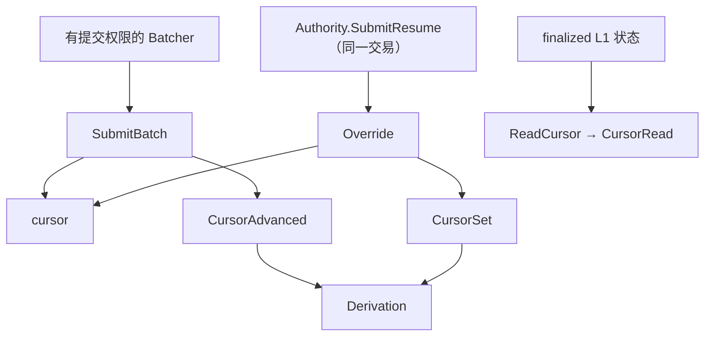

# 模块 07：Batch Inbox（v10 工作稿 v0.1）

日期：2026-11-09。上一版：[v9 v0.1](../formalization_v9/07_batch_inbox_zh_v0_1.md)。总览与共享模型见 [00 arch](00_arch_zh_v0_1.md)；来源为 [arch v0.2 §4.1 Inbox 记录、§4.8](../formalization_v8/arch_zh_v0_2.md)。

## 1. 定位与直觉

Batch Inbox 是 L1 上的合约，维护唯一的接纳进度 **cursor**：L1 已经接纳到哪个 L2 height、该进度采用哪个 L1 origin、是否有尚未完成的 channel。Cursor 只能通过两种方式改变：

- **SubmitBatch**：注册 Batcher 提交一份带 Certifier 签名的 cursor 转换，起点必须等于当前 cursor。
- **Override**：只在 Authority 处理 RESUME 的同一交易内调用，把 cursor 直接推进到恢复目标 $h_{\rm res}$，并清空未完成 channel。

Inbox 不执行 L2 交易，也不读取 Espresso 或 DA。它记录的接纳事件是 Derivation 的输入；读取者再据此物化接纳视图 $G'$。

## 2. 最小假设

**本模块依赖的模型条目。**

- L1 safety 与原子执行（[00 §1.2](00_arch_zh_v0_1.md)）：cursor 的更新与事件在同一调用中原子完成；所有读取者在同一 L1 height 读到同一 cursor。
- 签名验证（[00 §1.1](00_arch_zh_v0_1.md)）：合约用 $pk_{\mathsf C}$ 验证 Certifier 签名。
- 请求标识与幂等语义（[00 §4.2](00_arch_zh_v0_1.md)）。

**对其他模块的假设。**

- 有效 Certifier 签名满足 CERT-1、CERT-2（[06 §4](06_certifier_zh_v0_1.md)）。合约本身只能检查签名和连续性；内容与 $G$ 的对应依赖 $\mathsf C$ 可信。
- Override 只由 Authority 在 `SubmitResume` 的同一交易内调用（[01 §3.10](01_l1_authority_zh_v0_1.md)）。
- 合约验证 DA 证书的方式采用既有 Inbox 规则；DA 内容与 commitment 的绑定由 Certifier 核对。

**上游输入与下游输出。**

| 方向 | 对方模块与接口 | 交换对象 | 连接 |
| --- | --- | --- | --- |
| 输入 | Batcher.`Deliver` | BatchSubmission（含 CertifiedResult 的字段） | W18 |
| 输入 | Authority.`SubmitResume` | 目标 Cursor | W4 |
| 输出 | Derivation.`Derive`／`DeriveAtResume` | CursorAdvanced、CursorSet 事件 | W5、W19 |
| 输出 | Batcher、Certifier | CursorRead | W20 |
| 输出 | Batcher 交付任务、Certifier | CursorAdvanced | W19 |
| 输出 | Authority.`SubmitResume`（合约内读取） | InboxState.cursor | — |
| 输入 | GFR.`Chain`（读取者物化 $G'$） | $(G,\mathrm{src}_G,pc)$ | W15 |

## 3. 接口

### 3.1 状态

Inbox 合约维护 cursor、写入 cursor 的 L1 位置、注册 Batcher 及其原生提交／接手权限、Certifier 公钥、请求结果和接纳事件。Admin 固定为 Authority。只有成功的 SubmitBatch 或 RESUME 交易内的 Override 修改 cursor。

### 3.2 数据结构

**Cursor 与读取结果。**

```text
Cursor = {
    height, origin, frames_digest, source
}
CursorRead = {
    cursor, written_at, as_of, read_evidence
}
```

Height 是最后完成接纳的 L2 height；origin 是该接纳进度采用的 L1-origin height，均为非负整数。Frames_digest 为原生 channel 规则计算的摘要字节，零值表示没有未完成 channel。Source 是带标记的来源引用：

- `GLOBAL(gpos)`：指向用于认证的 GFR 处理位置 gpos，类型为 ReplayPosition（[09 §4.7](09_finality_rules_zh_v0_1.md)）；
- `RESUME(control_seq)`：指向 Authority 以唯一控制序号标识的 RESUME 记录（[01 §3.2](01_l1_authority_zh_v0_1.md)）；
- `GENESIS`：指向初始配置。

CursorRead 是读取结果：written_at 为写入该 cursor 的 L1 位置，as_of 为查询的 finalized L1 height，read_evidence 为核对该值的 L1 读取依据。**Written_at 是接纳之后的历史元数据，不放进待签名的 cursor，也不要求 Certifier 预知未来的 L1 收录位置。** RESUME 调用在交易内用已确定的 control_seq 绑定记录；finalized 后再从 ControlEntry 取得其精确 L1 位置。Source 与 written_at 因而是两个不同字段。

Cursor 由 Inbox 修改；Authority、Batcher 和 Certifier 持有其读取副本。本稿用这些逻辑字段定义签名与接口对象，具体原生传输编码由采用的 Inbox 版本给出。

**提交与权限。**

```text
BatchSubmission = {
    prev, next, commitment, DA_certificate,
    completed_range, gpos, signature
}
BatcherPermissions = {
    primary, alternatives, exclusive_window
}
InboxState = {
    cursor, cursor_written_at, permissions,
    certifier_pk, admin, request_results, acceptance_log
}
```

BatchSubmission 对应 SubmitBatch 的七项内容参数：completed_range 为 $I$，signature 为 $\chi$。这些字段连同配置中的 chain 与 Inbox 地址重建完整 BatchAttestation（[06 §3.2](06_certifier_zh_v0_1.md)）。

BatcherPermissions 的 primary 为当前主 Batcher 的 L1 账户，alternatives 为备选账户集合，exclusive_window 为原生权限规则使用的 L1 block 数参数；准入判断沿用既有 Inbox 规则。

InboxState 的 cursor 是唯一当前接纳记录，cursor_written_at 为写入它的 finalized L1 位置；certifier_pk 为 $pk_{\mathsf C}$；admin 为 Authority；request_results 为请求去重表。

**接纳事件。** Acceptance_log 按 L1 顺序保存两类事件：

```text
CursorAdvanced = {
    prev, next, commitment, L1_position, transaction_ref
}
CursorSet = {
    old, next, L1_position, resume_position
}
```

CursorAdvanced 的前三项为合约事件内容，L1_position 与 transaction_ref 为其已验证 L1 收据元数据；完整 BatchSubmission 从对应交易取得。CursorSet 的 old／next 为事件内容，L1_position 为事件位置，resume_position 为同一交易中 RESUME 控制记录的位置。收据元数据不改写原生事件字节格式。Derivation 据此构造 AcceptedBatchInput 与 OverrideInput（[09 §5.2](09_finality_rules_zh_v0_1.md)）。

**接纳视图。** 合约外的读取者维护

```text
AcceptedView = {
    cursor_read, virtual_prefix, missing_sources
}
```

Virtual_prefix 是已经按接纳来源核对的连续 virtual 前缀，即 §3.7 的 $G'$ 的已物化部分；missing_sources 保存尚需取得的 GFR 来源或恢复切面引用。完整时其末端 height 等于 cursor_read.cursor.height；来源未齐时不以 cursor height 宣称已经取得未知 blocks。

### 3.3 接口概览



| 接口 | 主要输入 | 主要输出 | 用途 |
| --- | --- | --- | --- |
| `SubmitBatch` | prev、next、$d$、$\pi_{\rm DA}$、$I$、gpos、$\chi$ | CursorAdvanced 及 L1 位置 | 接纳权限、签名和连续性检查通过的提交 |
| `Override` | 目标 cursor（Authority 同交易调用） | CursorSet(old, next) | 推进到恢复目标并清空未完成 channel |
| `ReadCursor` | finalized L1 height | CursorRead | 读取确定的接纳进度 |

### 3.4 SubmitBatch(prev, next, d, π_DA, I, gpos, χ)

**输入。** req、起始与后继 cursor、DA commitment 与证书、完成的高度范围 $I$、来源 GFR 位置 gpos、Certifier 签名 $\chi$；caller 必须具有当前提交权限。签名覆盖的每个字段都显式包含在提交中。

**输出。** 成功产生 CursorAdvanced 及 finalized L1 位置；检查失败返回 REJECT。

**处理。** 核对提交权限、prev 等于当前 cursor、DA 证书、Certifier 公钥和由七项参数重建的完整签名消息。通过后原子更新 cursor 与 cursor_written_at，并记录事件。部分 frame 按原生 cursor 规则只更新 frames_digest，不增加 cursor.height。

### 3.5 Override(next)

**输入。** 同交易执行上下文、目标 cursor next；caller 必须是 Authority。Next.height 为该 RESUME 的目标 $h_{\rm res}$，frames_digest 为零值，origin 与 source 采用该控制记录的原生 override 编码。

**输出。** CursorSet(old, next) 及其 L1 位置；调用者、目标或控制绑定不符时返回 REJECT。

**处理。** 检查这是 SubmitResume 的同交易内部调用，要求 next.height 严格大于当前 cursor.height，清除未完成 channel 并更新 cursor。调用与 RESUME 记录共同成功或共同回滚。本接口不读取 Espresso，也不计算恢复 anchor；被跳过的 heights 由 Derivation 按 override 规则填充（[09 §5.4](09_finality_rules_zh_v0_1.md)）。

### 3.6 ReadCursor(ℓ)

**输入。** 已 finalized 的 L1 height $\ell$ 及其可验证的状态读取材料。

**输出。** CursorRead：处理完该 height 后的 cursor、写入它的 L1 位置及读取依据；缺少历史时返回 WAIT。

**处理。** 只读取得确定历史位置的接纳进度。返回值不表示读取者已取得或执行对应的完整 virtual chain。

### 3.7 读取者的接纳视图 $G'$

读取者根据 finalized 接纳记录物化**已接纳 virtual chain**

$$
G'=(G'[h^0],\ldots,G'[h_{G'}]),\qquad G'[h]\in\mathsf{VB}.
$$

$G'$ 是接纳记录认证的源 virtual-chain 视图，不是合约逐块执行出来的链。它按以下规则更新：

- **初始**：$G'$ 为 genesis 前缀。
- **CursorAdvanced 且 channel 闭合**：取证书 gpos 处 GFR 的全局链 $G_{\mathit{gpos}}$ 中对应 $I$ 的 virtual blocks，接到当前 $G'$ 后面。由于 $G$ 在两次 RESUME 之间只追加不撤销（[09 §7](09_finality_rules_zh_v0_1.md)），只要读取者当前的 GFR 位置与 gpos 之间没有处理新的 RESUME，就可以直接从 GFR.`Chain` 返回的当前 $G$ 读取 $G[I]$。部分 frame 不使 $G'$ 增长。
- **CursorSet（目标 $h_{\rm res}$）**：把 $G'$ 置为该 RESUME 对应派生切面 $D_L$（[09 §5.1](09_finality_rules_zh_v0_1.md)）到 $h_{\rm res}$ 的前缀，即 ResumeCut.derived_prefix（[09 §5.2](09_finality_rules_zh_v0_1.md)）；历史 L1 事件保留，旧接纳内容可留在历史缓存中。

完整物化时 $h_{G'}=\mathit{cursor}.\mathit{height}$。来源数据尚未取得时，本地只报告已取得的前缀。Derivation 直接使用 L1 与 DA，不等待 $G'$ 先物化。在两次 CursorSet 之间，$G'\preceq G$ 由 CERT-4 保证。
