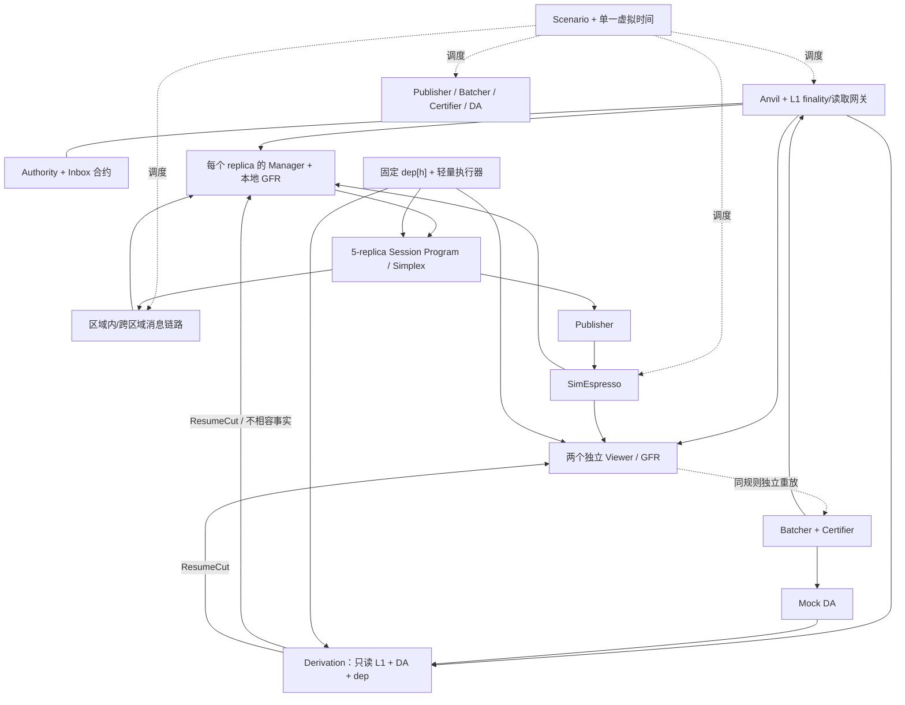

# Sequencer Rotation v10：PoC 技术架构与实施设计

日期：2026-11-14。状态：实施设计，尚未实现或执行验证。

本设计以当前工作区的 `formalization_v10` 为协议来源。目标是在小规模、可控制、可重放的环境中实现 leader/session rotation 和 GFR，观察它们在正常、延迟、崩溃和恢复场景下的行为。本文中的 PoC 简化与默认配置不反向修改 v10；实验结论必须注明所用配置及覆盖范围。

用户已确认：**确定性主测试使用 Espresso 日志模型，官方 Espresso dev-node 用于单独的兼容测试。** 本项目不纳入 TLA、形式化证明、生产部署或性能排名。

## 1. 选型结论与范围

采用 **Rust 协议核心 + Commonware 确定性运行环境 + Foundry/Anvil 真实合约执行 + Espresso 有序日志模型**。每地区默认 5 个等权 replica，每 session 的固定生产窗口为 10 个 L2 heights；通过已有 regional BFT simulator 的适配接口运行一个 Simplex 后端。Publisher、跨区链路、Batcher、Certifier、DA 都是可注入延迟与 crash/restart 的组件。

GFR、Manager、Merge、简化 Derivation 是实际执行的协议逻辑。L1 Authority 和 Inbox 是实际 Solidity 合约。被 mock 的是外部链的共识/可见性、服务运行状态和输入来源；不能把所有服务的输出直接赋成预期答案。

### 1.1 本轮实现与明确排除

| 部分 | PoC 实现 | 不在本轮范围 |
| --- | --- | --- |
| Authority | 注册/锁定 stake、历史授权、快照、Plan、ban/slash 流程、Force、RESUME | 奖励、委托、复利、完整退出经济学、代理升级 |
| Inbox | 实际权限、签名、prev cursor 检查；原子 Override | 生产 channel 压缩、复杂 Batcher 接手制度 |
| Regional BFT | 5 replica、一个后端、小 payload、真实决定证明与应用接口 | 多 BFT 性能对比、纠删码/大块优化、生产网络 |
| Manager / GFR | v10 候选生命周期与公共重放规则 | 新的轮转协议或更强的 finality 承诺 |
| Deposits / 执行 | 固定 `dep[h]`，确定性的轻量状态执行器 | L1 deposit 合约、真实用户交易、完整 MegaEVM |
| Batcher / Certifier | 正确运行或崩溃；实际生成和校验提交 | 恶意 Batcher、恶意 Certifier、TEE、经济攻击 |
| DA | 不可变 commitment 存储；可暂停写入/读取 | 真实 DA 网络、纠删码、保留期经济学 |
| Derivation | 从 finalized L1 接纳事实与 DA 独立构造 D；窗口回退、Override、历史 ResumeCut | 完整 OP/MegaETH 节点、原生争议/结算机制 |
| 验证 | 用例、随机调度、独立重放检查、可复现实验 | 形式化证明、全状态空间正确性声明 |

所有默认选择均属于 `poc-v1` 配置。例如等权、固定 stake、round-robin 和单 frame batch 是本 PoC 的实现选择，不是声称 v10 只允许这些选择。

### 1.2 三个必须保留的区分

1. **区域最终决定 R、公共全局链 G、L1 接纳视图 G′、派生链 D 是不同对象。** Inbox cursor 不能代替已物化的链；D 已派生也不表示已完成原生结算。
2. **10-height window 不等于强制产出 10 个 physical blocks。** 健康场景可以逐高度生产；超时/失败 view 可以导致 physical gaps。Merge 只在有决定后继覆盖时展开中间 padding，不能靠时钟自动把 G 补满。
3. **统一时间服务不等于所有节点共享状态。** 节点只看自己收到的日志、消息和时钟读数；GFR 不能读取模拟器的全局内部状态。

依据：[00 架构](00_arch_zh_v0_1.md)、[02 Session Program](02_session_program_zh_v0_1.md)、[09 最终性规则](09_finality_rules_zh_v0_1.md)、[11 全局链性质](11_global_chain_safety_liveness_zh_v0_1.md)。

## 2. 技术栈及选择理由

| 层 | 选择 | 用法与边界 |
| --- | --- | --- |
| 协议核心 | Rust | 纯状态转换；显式输入；不调用系统时间、RPC 或随机数 |
| 主调度器 | Commonware deterministic runtime，外加场景事件队列 | 复用已有 simulator 的执行模型；整个实验只允许一个虚拟时间源 |
| Regional BFT | 当前仓库锁定的 Commonware Simplex | 首个后端；适配 5 节点、Plan leader 和 v10 应用守卫 |
| 合约工具链 | Foundry：Forge、Anvil、Cast | Forge 做合约测试；Anvil 手动出块；Cast 用于诊断 |
| 合约基础组件 | OpenZeppelin Contracts 5.x | ERC20、SafeERC20、AccessControl、签名与历史 checkpoint 工具 |
| Rust/EVM 连接 | Alloy | 生成 ABI 类型，调用合约、读取历史状态/交易/收据 |
| Espresso 主测试 | Rust `SimEspresso` | 建模 finalized 有序日志、timestamp、watermark 与本地可见性 |
| Espresso 兼容测试 | 官方 `espresso-dev-node`，固定镜像 digest | 校验 namespace、提交、读取、编码和顺序适配 |
| 场景与输出 | TOML + JSONL + JSON | 输入可审查，原始轨迹可重放；JSON 不作为签名编码 |
| 随机测试 | proptest + 固定 seed | 生成/缩减事件序列；缩减后重新检查场景前提 |
| 独立 checker | 小型 Python 程序 | 读取公开输入与 trace，独立实现关键断言，不导入 Rust 转移函数 |

主测试第一版直接使用 Anvil，**不同时维护第二套 revm 集成路径**。若后续 RPC 开销成为瓶颈，再在同一 `L1Execution` 接口下引入内嵌 EVM，并用相同交易向量核对两者。这是后续优化，不是开工依赖。

本地现有 `regional_BFT_sim/Cargo.toml` 固定 Rust 1.95.0 与 Commonware 2026.10.0；这是当前仓库的兼容基础，不代表建议追逐最新版本。新增 Foundry、solc、Alloy、OpenZeppelin 必须先做编译/ABI 小样，再将 release、Git commit 或镜像 digest 固定。不得把 `main`、`latest` 或一个未解析的版本范围作为正式实验依赖。[S1–S4]

## 3. 整体架构与数据所有权



图中的 Batcher/Certifier 使用自己的 GFR 状态，不调用某个 viewer 的私有状态作为权威答案。

| 状态 | 唯一权威来源 | 消费者的本地副本 |
| --- | --- | --- |
| 当前 stake、ban、控制序号、Inbox cursor | Anvil 执行后的合约状态 | finalized L1 网关读取结果 |
| 快照与 Plan 输入 | 指定历史 L1 状态 + 固定配置 | Manager、Program、GFR 各自重算 |
| Espresso 公开顺序 | `SimEspresso` 的 finalized 前缀 | 每个读取者自己的已取得前缀 |
| 区域决定 | 对应 cid 的 BFT 证据与完整链 | Manager、Publisher、GFR 缓存 |
| G / G′ / D | 各自规则对公共历史的重放结果 | 每个读取者独立维护 |
| 故障脚本、全局消息队列、真实虚拟时刻 | 场景驱动器 | 协议组件不可直接读取故障脚本 |

同一公共位置的状态一致性，通过独立读取者比较检查；不能通过让所有读取者引用同一个可变 `G` 对象来“保证”。

一致性验收分为五层：同输入的合约执行结果一致；同历史的 Plan/Leader 一致；两个公共日志各自前缀一致；同 replay position 的 GFR 状态一致；在及时交付等前提下相应 G/D 范围一致。统一时钟只是可复现条件之一，不能直接推出这五项结论。

## 4. L1：Foundry 与 staking 的复用方案

### 4.1 采用 OpenZeppelin 组件，自建小型 Position Registry

推荐 **ERC20 托管 + 不可转让的 position 登记 + 独立历史快照**。已有 staking 代码提供参考，但其经济语义不能直接代替 v10 授权规则。

| 候选 | 已提供的能力 | 本 PoC 的决定 |
| --- | --- | --- |
| OpenZeppelin ERC20 + SafeERC20 | 标准 token 与可靠的转账调用包装 | 采用；测试 token 不含 fee-on-transfer/rebase |
| OpenZeppelin AccessControl、ECDSA/EIP712、Checkpoints | 权限、typed-data 验证、历史数值查找 | 按需采用；快照集合与生效规则仍自行实现 |
| ERC-900 | 简单 stake/unstake 与可选历史接口 | 可参考接口；它不规定区域、leader、罚没或责任窗口，且页面状态为 Stagnant |
| ERC4626 | 资产与可转让 vault shares 的兑换 | 不采用；PoC 不需要 share 价格或赎回语义 |
| ERC20Votes | token 投票权、委托与历史 checkpoint | 不直接作为委员会授权；owner 地址、共识 key、pid 与 frozen weight 不等同 |
| Synthetix StakingRewards | staking token 与奖励分配 | 参考托管/记账思路，不复制奖励状态机；所查实现是旧 Solidity 版本 |

这些组件减少通用实现工作，但不构成自定义 staking/slash 组合已通过审计的证据。[S4–S8]

### 4.2 合约拆分

第一版用两个主要合约，避免过多跨合约状态：

```text
MockStakeToken     测试用 ERC20；仅初始化/fixture 允许铸造
RotationAuthority  position、历史快照/ban、控制记录、slash 账本
BatchInbox         cursor、certifier key、submitter 权限、Override
PlanLib            Plan/Leader 的 Solidity 参考计算库
IOffenseVerifier   证据验证边界
```

`RotationAuthority` 为 Inbox 唯一 admin。`SubmitResume` 与内部 `Inbox.Override` 必须在同一 EVM transaction 成功或回滚。Force 只记控制意图，不在合约里自行选择 G 的 anchor。

### 4.3 PoC staking 配置

- 每 region 预置 5 个独立 pid；每 pid 锁定同一固定单位 `S0` 的测试 token，snapshot weight 为 1。P0 不支持委托、部分增资或运行中的任意权重变化。
- pid 永不复用；region、共识公钥和 owner 固定；owner 地址与 BFT 公钥分开编码。
- P0 不开放生产式退出/释放，测试资金锁定到该次实验结束。完整退出责任期不属于此 PoC 的完成条件。
- 预定义 snapshot 的 cutoff/activation；`SnapshotAt(ℓ)` 必须从 cutoff 处历史记录计算，不依赖一个可能迟到的“发布快照”交易。初始实例使用已准备好的 genesis snapshot。
- 合约可通过 checkpoint 查询历史 stake/status/ban；对小规模 pid 表确定性枚举，生成快照。缓存是优化，不能改变逻辑生效时间。
- PoC 处罚取 `amount=min(S0,current_stake)`，转入固定测试 treasury，并对该 key 在本次实验中永久 ban；这是测试经济配置，不是生产处罚建议。Slash 更新 escrow、ban、offense 记录；旧 snapshot 和已冻结 Plan 不变。禁任 key 不能成为新 Plan 的 proposer，但不从旧快照投票集合删除。
- 正常运行 profile 使用固定的初始委员会快照；snapshot cutoff/activation 与更换成员通过专门的历史授权用例测试。动态变权后的真实 BFT 组合不作为这版等权 PoC 的结论。
- 同一次 offense 用规范 `offense_id` 去重，不以 req id 或证明字节 hash 代替。
- 同一请求标识与相同内容重试返回原结果；同标识换内容拒绝。

**Slashing 范围。** 核心 PoC 必须测试实际合约的处罚、去重与历史授权效果。若采用的 BFT 原生证据尚无 EVM verifier，P0 使用明确命名的 `FixtureOffenseVerifier`：仅接受测试初始化时绑定的 descriptor/pid/offense 证据向量，其他输入拒绝。此模式只验证 Authority 对证据验证结果的处理，不能宣称已经实现 native Simplex 违规证据的链上验证。不得使用恒返回 true 的 verifier，也不得把普通超时或 crash 自动当作可罚没违规。替换真实 verifier 是单独可验收的扩展。

### 4.4 Plan 与 Leader

Plan 的选择规则沿用 [01 §3.12](01_l1_authority_zh_v0_1.md)：

\[
\ell_s=\max\{\mathrm{Ref}.os,\lambda_\beta\},\qquad
e_s=\mathrm{SnapshotAt}(\ell_s).
\]

从 source region 后按 policy 循环选取启用且有未禁任 proposer 的区域；没有候选返回 `NONE`，缺历史返回 `WAIT`，格式错误返回 `REJECT`，三者不可合并。

PoC leader 规则：对 frozen eligible pids 按 pid 升序排列为 `E`，使用

\[
\mathrm{Leader}(\Pi_s,v)=E[(v-1)\bmod |E|],\qquad v\ge1.
\]

此规则不因当前在线人数变化而重算。适配器负责把 pid 映射到引擎 participant 索引，不能假设公钥排序等于 pid 排序，也不能直接使用可能带 shuffle/不同 view 起点的默认 elector。Rust 与 Solidity 的 Plan/Leader 应对同一输入产生逐字段相同的结果；**每个 view 无需 L1 交易**。

### 4.5 Anvil 的使用方式

Anvil 以 manual mining 模式运行，关闭自动/interval mining。只有场景驱动器可设置下一 block 的 timestamp、提交出块指令和推进链；协议 actor 没有这些管理 RPC 的权限。[S1、S2]

```text
TxIntent → 驱动器排序/分配 nonce → 提交 Anvil → Mine(L)
         → 校验 block/receipt/log → Finalize(L) → DeliverTo(reader,L)
```

- 每轮出块前收齐本轮已排定的交易；固定 nonce、gas 参数、mempool 排序，避免并发 RPC 决定交易顺序。
- 冷启动固定 genesis、chain id、部署账号/nonce、编译产物和所有会进入 block hash 的环境字段。重复启动小样必须核对 headers/receipts；若所锁定 Anvil 版本仍生成不可控字段，先修正适配或限定比较对象，不能提前承诺字节级重放一致。
- 收据里的 `(block, transactionIndex, logIndex)` 才是 L1 position。合约不能预知完整日志位置；由网关从实际收据绑定 RESUME 和 CursorSet。
- **EVM 执行、被收录、被模型认定 finalized、被某个节点读到，分别记录。**
- Anvil 自带的 `latest/safe/finalized` 标签不作为本实验的 Ethereum consensus finality 来源；由只增不退的 `L1FinalityGateway` 暴露实验 finalized 前缀。
- 历史查询固定 block hash/height；读取 `latest` 再声称是历史快照属于错误。
- P0 不模拟 finalized reorg；未纳入的交易可延迟，finality 可暂停。合约执行回滚仍真实发生。
- 不能依靠回滚 Anvil 状态来实现协议内 RESUME；RESUME 只使用合约交易和链外 GFR/Derivation 规则。

## 5. Espresso：两种运行模式

Espresso 的官方集成文档明确把执行环境交给应用；这里不存在一个需替代 L2 执行器的“Espresso EVM”。官方 dev-node 提供本地 Espresso 网络与 API，可连接指定 L1 RPC；未指定时可以自行启动 Anvil。[S9、S10]

### 5.1 确定性模式：`SimEspresso`

提供最小接口：

```text
submit(namespace, publication_id, bytes) → submission_id
produce(timestamp, ordered_submission_ids) → proposed_block
finalize(proposed_block) → J_q
read_finalized(reader, from_q) → CompletePrefix | WAIT
```

`J_q={q,parent_hash,timestamp,ordered_publications}`。同一 q 内容不可改写；finalized 前缀不回退；timestamp 不递减，允许多个 q 同键；日志顺序固定。对象可以分多个 publication 发布，但完整 block 的消息列表不能伪装成已读齐。

分别控制：接收提交、提出 block、finalize、向各读者交付的延迟。停止 finalize 与阻止某个 viewer 下载是两个故障。无 publication 时仍可产生空 block 推进 watermark。

主测试假设 Espresso safety 正常，故障以停顿/延迟为主。时间键冻结或跳变作为单列的假设边界测试，不混入正常时限结论。

此处 L1 finalized 网关和 SimEspresso finalized 前缀是明确的测试信任边界。模型内部检查哈希连接、顺序、前缀不回退与对象完整性，但不实现 Ethereum 共识证明或 HotShot light-client proof。官方 dev-node 兼容模式也应声明采用可信本地 API；若没有验证其 finality proof，就不能将 API 读取称为独立验证了 Espresso 共识安全。

### 5.2 官方 dev-node 兼容模式

- 固定镜像 digest、协议版本、namespace、配置与 API 版本。
- 明确指定测试 L1 RPC，避免 dev-node 静默启动第二条 L1。
- 使用同一个 `EspressoSource` 适配接口；核对 publication 编码、读取顺序、重复提交、本地重连和日志完整性。
- 本次查阅的官方 dev-node 文档未确认外部虚拟时钟/逐步执行能力，因此**不将原生 dev-node 的墙钟运行纳入统一虚拟时间实验**。
- 录制官方服务输出后可以离线确定性重放；重放验证的是这段输入上的 PoC 规则，不证明 dev-node 本身可确定性调度。
- 兼容模式不承诺重跑得到相同 block 划分或全局 hash，不用于验证毫秒级时序预算。

若将来要求 dev-node 本体也完全接受统一虚拟时钟，应作为独立工作评估其计时器/共识改造，不在当前 PoC 中隐藏这项成本。

## 6. 单一虚拟时钟与事件调度

### 6.1 时间接口

用整数微秒 `ProtocolTime(u64)`，所有加减与单位转换检查溢出。配置给出 Unix epoch 基点，使 Anvil timestamp 可表示。L1 header timestamp 是整数秒；只允许可精确映射到秒的 L1 出块事件，禁止隐式截断改变边界。

```text
SimClock.now()                 // 仅驱动器读取真实虚拟时间
NodeClock.read(node)           // 节点可见 C_m
NodeClock.schedule_at(node,x)  // 本地协议时刻到达 x 的事件
L1Clock.timestamp(slot)        // 驱动器映射为 EVM 秒数
EspressoClock.timestamp(q)    // 模型生成公开时间键
```

默认所有节点 `C_m(τ)=τ`。可选偏差测试使用 `C_m(τ)=τ+offset_m` 且 `|offset_m|≤δ_G`；同节点 Manager 和 Program 共用同一实例。第一版只做常数偏移，不必实现完整 slew 服务。L1/Espresso 时间键来自同一个仿真时间坐标，但仍按各自规则生成，不能把它们与读取者的本地时刻混为一谈。

协议模块不得调用 `SystemTime::now`、真实 `sleep` 或独立 Tokio 时间源。HTTP/Docker 适配可以用墙钟处理工具超时；超时记为基础设施失败，不自动折算成协议中的崩溃或延迟。

### 6.2 调度顺序与 GFR 顺序分开

调度器按 `(deliver_at, tie_break, event_id)` 取事件。`tie_break` 来自固定 seed 或显式脚本，并保存到 trace。相同时刻的接收、关闭与崩溃可以有不同合法排列，因此应测试多个排列。

GFR 则始终独立按 v10 的公开全序重放：

```text
(time_key, kind_rank, public_index)
kind_rank: L1 control < Expire < SessionEnd < Espresso
```

模拟器的事件顺序不能覆盖协议的同键优先级。零延迟内部事件用递增 `event_id`/微步处理，设置最大微步数检测无限循环。

外部 Anvil 调用采用“提交计划 → 完成 RPC → 检查结果 → 继续虚拟事件”的屏障。等待 RPC 的墙钟耗时不推进虚拟时间。Commonware executor 与场景队列必须共用时钟所有权；禁止嵌套启动两个自行前进的 deterministic runner。

### 6.3 建议的快速测试参数

这些是待实现验证的测试配置，不是部署参数或已测量性能。

| 参数 | 初始值 |
| --- | --- |
| 地区数 / 每区 replica | 3 / 5，等权 |
| `TB` / `b_L2` / `b_L1` | 10 heights / 1 s / 2 s |
| L1 finalization/可读预算 `T_L1` | 2 s |
| 正常 replica offset / 偏差测试 `δ_G` | 0 / 10 ms |
| `δ_L1` / `Δ_ts` / `T_E` | 0 / 1 s / 1 s |
| `T_dep` / `T_drift` / `M_a` | 5 s / 12 s / 6 s |
| 正常区域内 / 跨区传输 | 20 ms / 100 ms |
| `T_build` / 成功 view 的 `T_fin` 预算 | 20 ms / 200 ms |
| `T_vc` / `T_win` | 400 ms / 100 ms |
| `T_pub` / `T_grace` / `W_exp` | 200 ms / 3 s / 30 s |
| 正常完整批次交付 `T_batch` | 6 s，留出编码/认证、等待 L1 block 和 finalization/读取时间 |
| 原生窗口 `sequence_window_size` | 40 L1 blocks |
| 保守比较预算 `W_seq` | 76 s，实施时与离散边界核对 |
| `T_ready` / `T_prep` / `ε` | 3 s / 10 s / 1 s；ready 预算含激活后的 watermark 等待 |

这些值满足若干静态预算，例如：

\[
6\ge2+2+1+0,\quad
3>0.2+1+1+0.01,\quad
30+6+6+12+0=54\le76.
\]

同时检查 `T_dep≥T_L1+δ_L1+δ_G`、`T_dep+b_L1≤T_drift`、`T_win≥T_build+Δ_region+2δ_G`、`2δ_G+T_build+T_fin<b_L2` 与 RESUME 准备预算。引擎实际是否兑现 `T_fin/T_vc`，必须由运行监视器检查，不能由配置赋值视为成立。

例如恢复预算为 `6+3+0.01≤10+1`，且 `10≤12−1`。`W_seq=76 s` 是从本测试的 80 s 名义 L1 窗口预留 4 s 得到的比较预算；是否足以覆盖实际 inclusion/读取边界由 P19 和参数检查器确认，不能替代逐批次的离散窗口检查。

初始化先完成 L1/合约 warm-up，选定具有合法 origin 和已执行状态的 genesis/checkpoint，使 scheduled-origin 集合非空。不能把上述短参数直接套到旧文档的小时级例子上。

## 7. Deposits、Block Builder 与轻量执行

### 7.1 `dep[h]` 的精确定义

PoC 的 `DepositFixture` 提供不可变映射 `h → ordered deposit transactions`，运行开始时绑定 fixture hash。所有生产、GFR Merge 和 D 使用同一映射。空列表 `[]` 与数据尚未可读的 `WAIT` 分开。

这里把用户输入的 `dep[h]` 解释为用户 deposits；L1 attributes 仍由本次 block 的 metadata 生成，P0 没有升级 system transactions：

\[
\mathrm{DEP}_{\rm poc}(h,os)=\mathrm{Attr}(h,ts^*(h),os)\Vert dep[h].
\]

测试可以为 fixture 输入设置可读屏障；节点不能因为在同一进程里就偷读未交付输入。默认所有 dep fixture 可读，origin 所需 L1 header 仍必须 finalized。

**抽象边界：** v10 的 deposits 依赖实际 origin 轨迹；用户要求的按 h 直接输入将这部分映射外置。因此 PoC 可以检查强制前缀执行、遗漏、重复及 G/D 重放一致性，但不验证真实 deposit 合约、L1 receipts 提取或不同 origin 轨迹下的 deposit 归属。恢复后同一 h 使用相同 fixture，不声称这等同于一般原生 deposit 语义。

### 7.2 轻量执行器

采用小型账户状态：`balance[account]`、`nonce[account]` 和 block context。Deposit 按固定顺序增加余额；普通交易采用确定性的 nonce/余额检查。按 `Apply` 顺序过滤不满足条件的普通交易，保存 `Kept`，不需要完整 EVM。

状态 root 使用固定规范编码的 hash；virtual/physical block 的 `root` 是执行前状态 root，输出的执行后 root 单独保存。链比较使用包含实际 parent、metadata、`DEP || Kept` 与执行后 root 的 PoC block hash，不仅比较 height 或原始 payload hash。

Builder 采用固定 seed 的少量交易；健康案例中须包含非空且会改变状态的普通交易。若全部块为空，就可能掩盖 G 与 D 在 fallback 后的差异。

Physical block 至少绑定 `cid,parent,height,timestamp,origin,pre_state_root,transactions`。`cid`、Plan hash、签名 domain、配置版本分别明确；不能仅靠 session number 隔离签名。

区域 origin schedule 与 `Virt` 沿用 [00 §3.4](00_arch_zh_v0_1.md)。D 的 origin 由派生规则确定，不能强行覆盖为区域 schedule。

## 8. Session Manager 与 Regional BFT 适配

### 8.1 一个后端、一个运行环境

使用现有 simulator 的 Simplex/full-body 路径，关闭 coded delivery、跨后端批量验证和性能实验包装。核心接口不依赖 benchmark CLI 或 15 节点固定数组。

本地检查发现现有部分路径仍使用 `COMMITTEE_SIZE=15`；“已有 Simplex5 测试 profile”不能证明所有启动/验证路径已支持 5 replica。适配任务必须覆盖创建、participant 索引、证书解码与 trace checker，且保留已有 15 节点实验配置。

默认 `n=5,f=1`，所用 Commonware `N3f1` profile 的 quorum 为 `n-f=4`。这是该后端的配置；不能机械套 `2f+1=3`。本地锁定源码的 `Faults::quorum` 和 `N3f1` 定义是核对依据。[L1]

### 8.2 适配接口

以下是逻辑接口，不要求每项成为独立网络服务：

```text
RegionalBftFactory.create(ProgramConfig, NodeRuntime) → ProgramHandle
ProgramHandle.enter(anchor_state)
ProgramHandle.pause() / resume() / close(reason)
ProgramHandle.on_message(authenticated_message)
ProgramEvent = Final(cid, block, proof) | Evidence(cid, evidence)
FinalVerifier.check(descriptor, block, proof) → bool
Application.build(parent, local_time) → Proposal | WAIT
Application.accept(parent, proposal, first_receive_time)
    → ACCEPT | WAIT_TIME | WAIT_INPUT | REJECT
```

Pause 不是销毁；resume 不能重建空白 BFT 状态。若上游引擎没有直接支持 pause/终止签名的接口，需要在 adapter 的调度、消息与签名出口实现，并做专门验收；不能把“停止 poll”假定为全部签名已停止。

### 8.3 必须保留的行为

- 一个 Manager 在同一 logical session 最多调度一个候选；较高 anchor 未准备好时，不销毁仍可能被选中的原实例。
- Selected descriptor 决定最终 anchor；Plan 有效不等于该候选已获选。
- `WAIT` 重试保留首次接收时间。历史 `CheckFINAL` 不重跑当前时刻的 `Accept`。
- 停止守卫在签名出口再次检查；不能只在 proposal 接收时检查一次。
- Terminated 标记先持久化，再 Close；Preparing/Paused 的实例也必须被关闭。
- Close 不删除已形成的 Final、Evidence 或 Publisher 任务。
- 初版 regional replica 可 crash/restart，保留日志与 vote/close 状态；丢盘恢复另列为未覆盖。
- Manager 的 D 判死需要共同 height 上真实 PoC block hash 不同；仅看到 `h_D>h_G` 不足以 Kill。

本 PoC 的主故障矩阵以 crash、延迟和有限分区为主，不把完整 Byzantine 攻击库作为首个交付条件。GFR verifier 的错误证书/错误 cid 等负例仍需覆盖。

## 9. 跨区通信与 Publisher

### 9.1 可控制的异步消息链路

区域内 BFT 消息与跨区 finalized-result 消息使用独立 link profile：

```text
send(src,dst,kind,message_id,bytes)
  → enqueue(deliver_at, sequence, retransmission_policy)
```

跨区可分别控制 proof、目标正文、祖先正文与 state material 的延迟。允许重排和重复；接收端按身份和内容去重。默认模型为可靠最终送达：分区期间排队，恢复后按配置的 drain 速率交付，不瞬间清空 backlog。若某场景永久丢弃消息，标记为不同交付假设。

接收端崩溃时不“自动消费”队列。恢复后先恢复本地日志与终止状态，再处理消息。一个 region 能提前从跨区链路准备候选，不等于该结果已经通过 Espresso 公开并进入 G。

### 9.2 Publisher 的服务状态与责任

状态取 `UP`、`DOWN`、`RECOVERING`；延迟是独立参数，不需要再发明一种模糊的“慢”状态。

每个区域的 Publisher 有持久任务队列，任务保存完整结果键、已公开对象和提交状态。允许多个提交者重复发布同一结果；q_avail 按公共对象计算，不由任务的首次提交时间计算。

故障点至少覆盖：结果交付前、入队后、提交 Espresso 后但回执前、证明已公开但正文未齐。重启重试保留同一对象身份；重复发布不改变已存在的公开位置。

`RegionalFinal`、`PublisherReceived`、`EspressoSubmitted`、`EspressoFinalized`、`ViewerRead`、`GlobalAccepted` 分别计时。只有相应前提成立时才检查 `T_pub`；Publisher 崩溃期间不能继续宣称该界有效。

## 10. GFR 实现与独立读取者

### 10.1 纯核心

```text
advance_global(state, public_inputs, resume_cuts)
  → {new_state, completed_events, lifecycle_events, status}

status = READY | WAIT(next_position, missing) | REJECT(reason)
```

此函数不拉网络、不读时钟、不修改 Inbox、不调用治理脚本。外部同步器负责取得缺失输入后再次调用。每个公共事件原子提交状态、Rec 与 pc；WAIT 不能留下半次 RESUME 或半次接纳。

### 10.2 必须逐项照实现的边界

| 规则 | 实现要求 |
| --- | --- |
| 日志覆盖 | 键 x 需要 Espresso watermark 覆盖 x，以及 finalized L1 完整覆盖 x−M_a；另核对本次转移所需材料 |
| 公开完整性 | q_avail 来自至少一份有效最终证明与 anchor 后完整 physical chain 正文的最早公共前缀 |
| 两种缺失 | 公共日志尚未公开正文：候选暂不合格；日志已公开但本地缺材料：相应事件 WAIT，不永久跳过 |
| 接纳位置 | q_avail 的公开键与实际接纳键 x 分别保存；缓存候选获选不会改写 q_avail |
| 整段及时性 | 对新增的每个 virtual height 检查 Expire，包括 padding |
| 同键 | L1 controls → Expire → SessionEnd → Espresso；截止等号不接纳 |
| 常规交接 | 接满 h_max 立即交接；否则 SessionEnd 使用最后已接纳 physical block/初始 anchor |
| 后继 Plan | regular 使用前驱初始 anchor 选委员会；最终生产 anchor 是另一项输入 |
| Force | 检查 target branch 与当前 Tail；保留已有 G，HALT 不被 Force 唤醒 |
| Expire | 只针对下一缺失 height；使分支 HALT，不在 G 生成 deposit-only |
| RESUME | 用具体 L1 position 的 ResumeCut 替换 G；D 自身不回退；过低目标可对齐后仍 HALT |
| 同 block 重复交接 | 接满窗口后，在同一 Espresso block 内继续处理新 NEXT 的合格缓存结果 |

两个独立 viewer 使用不同下载/重试调度。比较相同 replay position 的状态摘要，比较字段含 G、branch、Tail、descriptor 和公开出处；下载缓存大小不属于公共状态。

GFR 的 generic rule tests 可使用明确标记的证据 fixture；主端到端测试必须通过真实 `FinalVerifier`。两种结果在报告中分别统计。

## 11. Crash-only Batcher、Certifier、DA 与 D

### 11.1 先明确 D 是什么

**D 是从 finalized L1 输入派生的 L2 链，不是另一条 L1。** PoC 中由一个 Rust `DerivationEngine` 实现；L1 仍是同一个 Anvil 环境。

Batcher/Certifier 的 crash-only 假设表示：运行时遵守协议、不会签发与自身正确 GFR 视图不符的内容；但它们仍可能延迟、使用已过时但原本正确的 cursor、在交易发送后丢失回执，或错过原生窗口。因此：

- crash-only 不推出 D 总是等于 G；
- 健康、及时交付、相同父状态与原生兼容时，对应范围可相同；
- 延迟超过窗口后 D 可以生成 deposit-only，与原 G 分歧；
- RESUME 改写 G 去对齐 D 的指定历史前缀，不能把 D 改回旧 G。

### 11.2 最小 batch profile

采用 `PocBatchV1`：每次 1–2 个连续 virtual heights，一个完整闭合 channel、一个 frame，不压缩，不跨多笔交易拼接。因而 `frames_digest=0` 始终表示没有未完成 channel。该简化不覆盖生产多 frame/channel 协议；仍保留 cursor、范围、commitment 与 gpos 字段。

```text
BlockRecord = {height, timestamp, origin, kept_transactions}
BatchPayload = {codec_version, ordered_records}
BatchAttestation = {
  chain_id, inbox_address, prev_cursor, next_cursor,
  commitment, da_certificate_hash, completed_range, gpos
}
```

批次存的是执行后的 `Kept`，不复制 DEP，不把整条 G 的 block 对象直接赋给 D。

### 11.3 正常交付路径

1. Batcher 从自己的 GFR 与 finalized Inbox cursor 选择下一连续范围，固定 payload 与来源 gpos。
2. Mock DA 保存不可变 payload，返回 `commitment=Hash(payload)` 与测试 DA receipt。
3. Certifier 从自己的已验证输入检查 cursor、范围、gpos、内容和 commitment；检查已处理不晚于该 cursor 写入位置的最后一条 RESUME。缺输入 WAIT。
4. Certifier 以独立测试 key 对完整 attestation 签名。采用 EIP-712 时，Rust/Solidity 共享字节测试向量。
5. Batcher 发送 Inbox transaction。Inbox 检查 submitter、prev、签名与 DA receipt 后更新 cursor；其本身不执行 GFR、D 或原生 sequencing-window 判断。
6. L1 网关发布 finalized `CursorAdvanced`；D 读取相应 DA 字节并独立解码、执行。

Batcher 与 Certifier 可以同进程，但保持两个角色状态和独立 crash 开关；这样可以区分“没有生成签名”和“签名已生成但没有提交”。

### 11.4 Crash/restart 与幂等

任务阶段：`CREATED → DA_READY → CERTIFIED → SUBMITTED → INCLUDED → FINALIZED`。每一步记录内容身份和重试结果。

发送后 crash 不能撤回已经进入 L1 的 transaction。恢复先查询收据及 finalized cursor，再决定等待或重新构建。若 RESUME 已推进 cursor，旧 attestation 不再可用，不能修改其 prev 后继续复用签名。

Mock DA 在崩溃后保留已确认持久数据；服务离线只让 Retrieve 返回 WAIT。已被 Inbox 接纳的数据必须能在恢复后取回，不能因清空进程内 map 就悄悄丢失。永久丢盘不在主 crash-only profile 中。

### 11.5 D 的输入、状态与主循环

D 只依赖：**finalized L1、实际 Inbox 接纳/Override 事件、按 commitment 取得的 payload、固定 dep fixture 与派生配置**。不读 Espresso、G、Publisher 状态或当前 leader。

```text
DerivationState = {
  processed_l1_position, buffered_records, channel_state,
  derived_head, derived_blocks, execution_state,
  current_epoch, epoch_has_output, resume_cuts
}
```

P0 采用 `PocDerivationV1`：保留本地原生规范的 certified selection、窗口边界、origin 连续性、deposit-only 与 Override 规则；替换的是 wire codec、deposits 来源和执行器。它是明确的功能子集，不是完整 MegaETH derivation 兼容实现。原生参考页面自身标明未完成/部分规则未激活，应锁定所用文件内容，不能把其 moving HEAD 当作部署行为。[L2]

处理规则：

| 情况 | D 的处理 |
| --- | --- |
| 失败 L1 transaction / 无真实 CursorAdvanced | 不产生 accepted batch |
| 已接纳 payload 可取回 | 解码；保存实际 L1 inclusion position；按规则处理下一 height |
| 已接纳 payload 尚未取回 | 停在相应位置 WAIT；不能因 wall-clock timeout 改成空块 |
| 可用的正确批次 | 在实际 D parent 上构造并执行；普通交易来自 record，DEP 来自 fixture |
| 合法批次晚到或高度已过去 | 按窗口/高度规则丢弃，不改写已输出 D |
| 没有可采用批次，原生窗口完整结束 | 构造下一 deposit-only block，执行后再检查后续 height |
| 必须的 L1 header/fixture 缺失 | WAIT；不能用猜测 origin 或空 DEP 继续 |
| CursorSet | 先解决此前输入，再执行有序 override 与 reset |

**窗口必须按 L1 inclusion 和完整公共前缀判断。** 所钉住的 OP Batch Queue 规则以 `record.origin + sequence_window_size < inclusion_block_number` 判迟到；等号仍需按该规则处理。完整缓冲到当前 epoch 的窗口末 block 且没有可采用批次后，才按该版本的空 batch 规则推进。不能从概览的半开区间文字自行改写代码，也不能用 D 本地下载完成时间重新判迟到。[S11]

单 frame profile 中完整 payload 所属 inclusion block 就是成功接纳交易的 block；本地 Retrieve 延迟不改变这个公共归属。缺已接纳数据时禁止跨过它宣告窗口已完整处理。

空 batch 的 origin 依据实际 D parent、下一 canonical L1 header、是否已有该 epoch 的输出决定：不足 next-origin 输入就等待；时间未到 next origin 时保留当前 origin；否则依所钉住规则推进，并保留每 epoch 输出条件。不得用当前 G 的 origin 替代。具体边界用固定测试向量检查，见 [S11] 的 Batch Queue。

即使 batcher 是诚实的，D parent 已因先前回退改变后，旧 G 的后续 record 仍可能不满足 origin/执行条件。需保留本地原生规范的相应同高度替代分支；不以“没有恶意服务”为由删掉这些可达路径。轻量执行器的普通交易过滤与块级无效分开；P0 不模拟 EVM execution-engine 错误或所有升级分支。[L2]

### 11.6 Override 与历史 ResumeCut

处理 `CursorSet` 的顺序固定：

1. 根据实际收据把它绑定到同交易的具体 `p_res`，不能只用 L1 height 或最新 control_seq。
2. 先解决它之前已经接纳的完整批次；必需数据缺失仍 WAIT，不能越过。
3. 重置未完成 channel 状态。P0 单 frame 下这一状态为空，但仍记录 reset。
4. 若 D head 小于 `h_res`，从实际 parent 逐高度立即填 deposit-only 到 `h_res`，不等待普通窗口到期。
5. 每个 fill 的 origin：设实际 parent origin 为 e、待构造的下一块时间为 `t=parent.timestamp+b_L2`，若 e+1 不超过该 CursorSet 所在 L1 block L 且其 timestamp≤t，则取 e+1，否则取 e。缺所需 canonical header 就等待。不能采用治理方 cursor 声称的 origin 作为派生依据。[L2、L3]
6. 若 D 已达到/超过目标，不回退 D。保存本事件切面中至 `h_res` 的前缀、anchor 与执行后状态。
7. 记录 `ResumeCut[p_res]`；GFR 稍后在激活键处理 RESUME 时读取该历史切面。此时 D 可能已经继续增长。

历史查询不得回退正在推进的 D。一个 L1 block 有多条 RESUME 时，每条按各自 position 生成不同切面；较后输入不能污染较前切面。

### 11.7 一个必须出现的端到端用例

先让 G 含有非空普通交易，再让 Batcher 崩溃而 L1 继续推进。窗口结束后 D 输出某些 deposit-only blocks，与旧 G 产生实际 hash 分歧。恢复服务并提交合法 RESUME，依次观察：

```text
Inbox cursor 原子前进
→ D 按 CursorSet 形成 ResumeCut
→ Espresso watermark 覆盖激活键
→ GFR 采用该切面并关闭旧分支
→ 新 Plan / Manager ready
→ 新区域 Final
→ 新块经 Espresso 进入 G
```

每一步独立计时。“G 已对齐”不等于“新 session 已准备好”，也不等于“恢复后第一块已经进入 G”。

## 12. 编码、持久性与模块接口约定

- 公共 ID 与签名使用固定版本的规范编码；集合有固定顺序；整数位宽/端序明确。JSON 仅用于配置和展示。
- `height`、`view`、`session=(branch,index)`、`pid`、`L1Position`、`ReplayPosition` 用不同 Rust 类型，避免互换。
- `WAIT`、`REJECT`、`NONE`、`READY` 含义独立；不能把缺数据写成验证 false。
- 给每个实例/服务分配独立存储命名空间。模拟 crash 清除易失状态、停止运行；重启只能用自己的持久状态和重新获取的公共输入。
- Final、sign-once、Terminated 和 Publisher/Batcher 任务日志的持久边界写进 trace。对这些边界前后分别注入 crash。
- 合约、GFR 和 D 每个原子步骤有 before/after 状态摘要及 source position；不能仅记录最后一条链。
- 完成实验后保留原始输入、payload、证书与日志；checker 不依赖内存中已经被清除的对象。

## 13. 验证方案与验收矩阵

### 13.1 四类检查

1. **合约行为测试：** Forge 单测及 invariant campaigns，覆盖权限、token 托管、历史授权、幂等、原子 RESUME/Override。FixtureOffenseVerifier 模式单独标注。
2. **规则向量：** 小型手写公共历史，人工确定关键事件顺序/anchor/q_avail，运行 GFR 与 D。
3. **端到端确定性测试：** 真实 Anvil 合约 + 5-replica BFT + 可控服务，重复 seed 应得到相同协议输出与轨迹摘要。
4. **独立 trace checker：** 从规范和配置检查公开重放、历史授权、deadline、链连接、关闭后签名与 claim 前提；不调用被测核心的状态转移函数。

同一套 Rust 逻辑驱动两个 viewer，只能发现到达顺序/缓存依赖，不能排除双方共同实现错误；独立规则向量与 checker 用来补这一点。checker 依赖的 native BFT verifier 及其版本也必须记录，不夸大其独立性。

### 13.2 最小验收集合

| 编号 | 场景 | 必须观察的结果 |
| --- | --- | --- |
| P01 | 正常 3 地区轮转至少 6 sessions | Plan/leader 正确；跨区 anchor 连续；正常范围 G/D hash 一致 |
| P02 | 初始 leader crash；恢复 | 在配置前提成立时换 view 并生产；没有重置签名历史 |
| P03 | 一个 replica crash / 两个 crash | 前者按 profile 检查进展；后者不强加四票无法满足时的活性 |
| P04 | 前驱末高度未产出 | SessionEnd 沿用最后已接纳 physical anchor，后继窗口不移动 |
| P05 | 跨区结果延迟/重排；候选切换 | 提前准备与公开选定分开；Paused 恢复原实例 |
| P06 | Force 与旧结果同键 | 控制优先；已有 G 保留；旧分支无越权扩展 |
| P07 | Expire/SessionEnd/Espresso 同键 | 严格执行规定优先级与等号边界 |
| P08 | 证明先公开、祖先正文后公开 | q_avail 取真正完整的公共位置，不能以本地缓存替代 |
| P09 | 公共输入已存在但某 viewer 迟读 | WAIT 后在原 replay position 处理；同位置状态一致 |
| P10 | 候选先公开后获选 | q_avail 保留原值；接纳用当前键逐高度检查 Expire |
| P11 | Publisher crash/retry/重复发布 | 已有决定不消失；迟公开可能被拒绝；重复不改写 q_avail |
| P12 | Espresso finalize 停止，L1 继续 | G 等 watermark；D 可回退补块；Manager 可依据真实 D 不相容关闭 |
| P13 | Batcher 或 Certifier crash | G 可继续；D 到期 fallback；恢复后旧 cursor 签名不能越过 Override |
| P14 | 已接纳 DA 数据暂时不可读 | D/ResumeCut WAIT，不将不可读当作未提交 |
| P15 | 正常 RESUME | Inbox 原子推进；G 使用指定历史 D 切面；恢复后第一块可核验 |
| P16 | 同 L1 block 两条 RESUME；低目标 | 切面互不混淆；已过期安排可对齐后 HALT；不插回旧定时器 |
| P17 | slash/ban 后重算新 Plan | 老 Plan/快照不变；新查询按正确历史禁任；offense 幂等 |
| P18 | offset 两端与 WAIT 时 Close | 首次接收时间不变；停止后无新签名；已有 proof 可继续验证 |
| P19 | deadline 最后可用 block 与下一 block | inclusion 边界决定是否可采用；本地下载时间不改判定 |
| P20 | 中途恢复 viewer/checkpoint | 与 genesis 重放在同位置得到同状态，不使用未验证 checkpoint |

负例另覆盖错误 cid、错签名域、重复签名者、篡改正文/commitment；它们测试拒绝行为，不需要模拟一个恶意 Batcher 服务。

### 13.3 Claim 与结果解释

| 检查项 | 适用范围 |
| --- | --- |
| G-S1 | 同一规则/配置与公共执行，在同一 replay position 比较 G/职责；不要求下载进度相同 |
| G-S2 | 无 RESUME 的区间内 G 只追加 |
| G-S3 | 从 genesis 起没有 RESUME 的执行中，整条新增前缀及时性 |
| 跨 RESUME | 使用同一 ResumeCut 一致切换；不要求旧 G 后缀不可撤销 |
| G/D 一致 | 同一原生父状态、所选 PoC 执行/派生 profile、兼容且及时交付的范围 |
| 活性 | 明确的 online quorum、leader 机会、输入就绪、网络与服务预算、足够剩余窗口 |

结果取 `PASS`、`FAIL`、`INCONCLUSIVE`，并另列未覆盖/假设不成立原因。有限运行在截止时未出块不自动等于反例；若所有约定前提持续成立且已越过适用的有界进展期限，才报告该断言失败。没有统一期限的恢复情形，报告停在哪个阶段及缺少哪个前提。

随机场景不能把“前提失效”静默过滤到没有覆盖。每个 claim 统计触发次数、满足前提次数、成功/失败次数；缩减反例后重新检查这些前提。

## 14. 建议目录与实施顺序

新代码建议放在本仓库 `poc/`，规范留在 `formalization_v10/`；regional simulator 作为受版本约束的后端来源。第一版无需新建独立 Git 仓库。

```text
poc/
  contracts/              # Foundry：Authority、Inbox、token、verifier fixture
  crates/
    types/                # 公共对象、编码、hash 与版本
    core/                 # Plan、Merge、GFR、Manager、Derivation
    sim/                  # 时钟、链路、SimEspresso、服务故障
    adapters/             # Anvil/Alloy、regional BFT、官方 Espresso
    runner/               # 场景入口与 artifact 输出
  scenarios/              # healthy / boundary / crash / recovery
  fixtures/               # dep、交易、证据、手写公共历史
  verification/           # 独立 checker 与期望向量
  artifacts/              # 每次运行独立目录
  toolchain.lock.json     # 工具、依赖、镜像、编码与规范内容标识
```

避免将现有 BFT 实验全套 runner 搬入核心；抽出或包装窄接口，并保持旧实验可运行。对固定 15 节点等适配改动应单独核验，不能把旧 benchmark 通过记录当作新适配已验证。

| 阶段 | 交付与退出条件 |
| --- | --- |
| A：接口与兼容小样 | 手动 Anvil 出块/历史读取可控；5 replica 启动和证书验证；单一时钟接入；固定编码/依赖 |
| B：首条正常路径 | Authority/Inbox + Plan + Manager/BFT + Publisher + SimEspresso + 两 viewer；完成多 session 轮转 |
| C：D 与恢复闭环 | dep/执行、crash-only batch 服务、DA、窗口 fallback、历史 ResumeCut；跑通 P13/P15 |
| D：边界与故障 | 完成 P01–P20、独立 checker、固定 seed 重放、随机缩减 |
| E：官方 Espresso 兼容 | 使用 dev-node 跑提交/读取/重连与录制回放；与主确定性报告分开 |

官方兼容小样可尽早检查 API，但不应阻塞核心 GFR/恢复闭环。没有必要为本 PoC 引入 Kubernetes、数据库集群、网页前端或真实云节点。CLI 的状态表和可选 HTML 时间线足以观察行为。

## 15. 每次运行的证据与项目完成标准

每次运行生成：

```text
manifest.json       # 配置、seed、源码/规范内容 hash、工具和镜像版本
scenario.toml       # 实际生效场景，不只保存默认值
public/             # L1 交易/收据/headers、Espresso 日志、DA payload
trace.jsonl         # 消息、时钟、服务状态、决定、接纳、派生、关闭
check-report.json   # 每个断言的前提、覆盖、位置和结果
summary.md          # 人可读的链头、分歧点、恢复阶段与未覆盖范围
```

状态展示至少区分 `R final`、`G accepted`、`Inbox accepted`、`D derived`；不统一标作 finalized。恢复曲线分别显示 control included/finalized、ResumeCut ready、G aligned、Manager ready、first new G block。

PoC 完成需同时满足：

1. 真实合约运行，5-replica 后端已适配，核心轮转与 GFR 未被脚本硬编码。
2. crash-only batch 服务能触发 D fallback/分歧，并通过真实 SubmitResume/Override 恢复。
3. 两 viewer 在同一公开位置一致；独立 checker 核验关键断言。
4. 至少一套正常与一套完整故障恢复实验可按相同输入重复得到相同协议输出。
5. 明确报告 fixture slashing、dep[h]、轻量执行、单 frame 与原生派生子集的覆盖限制。
6. 官方 Espresso 兼容结果有单独记录；没有把墙钟 dev-node 结果冒充虚拟时钟实验。

完成这些工作后，可陈述“此版本 PoC 在所列前提和案例下通过实现检查”。一般性的协议安全性、活性和真实部署兼容性不由这些测试自动建立。

## 16. 依据与核实状态

外部资料于 2026-11-14 查阅。下列 moving 文档用于技术选型；实施时另固定实际版本。本文没有启动 Anvil/dev-node、运行新 BFT profile 或完成工具兼容测试。

### 本地协议与代码

- v10：[Authority](01_l1_authority_zh_v0_1.md)、[Session Program](02_session_program_zh_v0_1.md)、[Manager](03_session_manager_zh_v0_1.md)、[Publisher](04_publisher_zh_v0_1.md)、[Batcher](05_batcher_zh_v0_1.md)、[Certifier](06_certifier_zh_v0_1.md)、[Inbox](07_batch_inbox_zh_v0_1.md)、[DA](08_da_zh_v0_1.md)、[GFR/Derivation](09_finality_rules_zh_v0_1.md)、[Claims](11_global_chain_safety_liveness_zh_v0_1.md)。
- **L1**：[regional_BFT_sim 环境与范围](/Users/jin/projects/regional_BFT_sim/README.md)、[固定依赖](/Users/jin/projects/regional_BFT_sim/Cargo.toml)、[当前 Simplex adapter](/Users/jin/projects/regional_BFT_sim/src/backends/simplex.rs)。本地 Commonware 2026.10.0 的 `simplex/elector.rs` 支持自定义 elector；`commonware-utils/src/faults.rs` 定义 N3f1 的 quorum。具体 5 节点 v10 接入尚待实现。
- **L2**：[本地原生 Derivation](../megaeth_specs/specs/rollup/derivation.md)：Batcher Transaction Selection、Same-Height Deposit-Only Substitution、Emergency Cursor Overrides。该来源明确标注不完整，不能据此宣称生产规则已全部实现。
- **L3**：[Activation Deposit-Only Fill](../megaeth_specs/specs/block-certification/activation.md#activation-deposit-only-fill)：Override 所引用的逐高度 origin 选择与输入等待规则。

### 官方外部来源

- **S1** [Foundry：Mining and Transaction Pool](https://www.getfoundry.sh/anvil/mining)：manual mining 与交易池模式。
- **S2** [Foundry：Anvil RPC](https://www.getfoundry.sh/anvil/rpc-methods)：时间、出块和状态管理接口。
- **S3** [Alloy Anvil RPC 类型](https://github.com/alloy-rs/alloy/blob/main/crates/rpc-types-anvil/src/lib.rs)：Rust 侧 Anvil 请求类型；[Foundry invariant testing](https://www.getfoundry.sh/guides/invariant-testing)：合约序列测试。
- **S4** [OpenZeppelin ERC20/SafeERC20/ERC20Votes](https://docs.openzeppelin.com/contracts/5.x/api/token/erc20)：token、转账包装、委托与历史投票权。
- **S5** [OpenZeppelin Checkpoints v5.6.1](https://github.com/OpenZeppelin/openzeppelin-contracts/blob/v5.6.1/contracts/utils/structs/Checkpoints.sol)：`upperLookup`/`upperLookupRecent` 的历史读取；[AccessControl](https://docs.openzeppelin.com/contracts/5.x/access-control)：角色权限。v5.6.1 是已查阅的源码样本，最终组合版本由编译小样固定。
- **S6** [ERC-900](https://eips.ethereum.org/EIPS/eip-900)：简单 staking 接口与 Stagnant 状态。
- **S7** [OpenZeppelin ERC4626 实现](https://github.com/OpenZeppelin/openzeppelin-contracts/blob/master/contracts/token/ERC20/extensions/ERC4626.sol)：资产/share 模型。
- **S8** [Synthetix StakingRewards](https://github.com/Synthetixio/synthetix/blob/develop/contracts/StakingRewards.sol)：奖励型 staking 实现，所查源使用 Solidity 0.5.16。
- **S9** [Espresso：Integrate a Chain](https://docs.espressosys.com/network/developer/rollup-developers)：Espresso 与应用执行环境的职责划分。
- **S10** [Espresso dev-node](https://github.com/EspressoSystems/espresso-network/blob/main/doc/espresso-dev-node.md)：本地网络、官方镜像与指定 L1 RPC 的参数；文档未确认统一虚拟时钟接口。
- **S11** [钉住版本的 OP derivation](https://github.com/ethereum-optimism/specs/blob/42b446f5891dd5a232cfc346201a613c1bba3f50/specs/protocol/derivation.md#batch-queue)：Batch Queue 的有效性次序、窗口边界与空 batch 生成。本地 MegaETH deltas 优先于该 baseline；PoC 简化另按本文声明。
