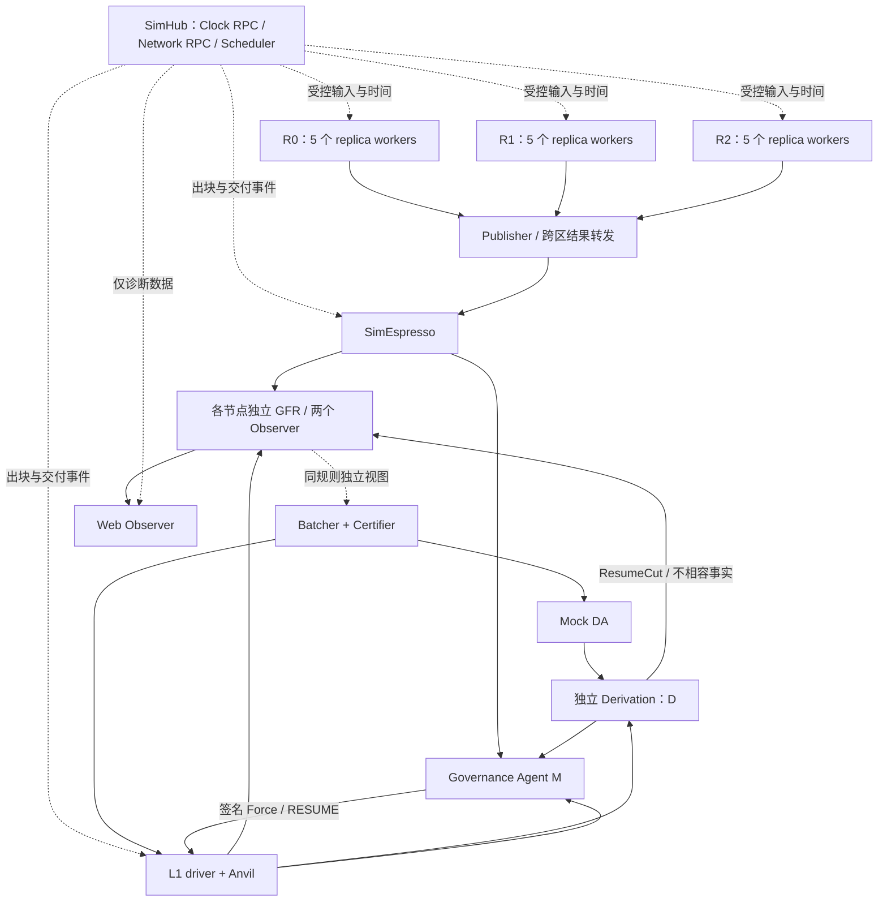

# Sequencer Rotation PoC v2：RPC 时钟、单机 15 节点与三类交接

日期：2026-11-14。状态：设计稿，尚未实现或执行本文验收。

本版替代 [PoC v1 设计](poc_design_zh.md) 作为下一阶段实施依据，保留旧文档供对照。协议语义以当前 `formalization_v10` 为来源；本版明确列出的 mock 和策略属于实验配置，不反向修改协议规范。

**第一阶段的目标是：在一台服务器上运行 3 个地区、每区 5 个等权 replica、两条外部链的本地环境、可信治理方和 Web Observer，重点验证 regular、Force、RESUME 三类 handoff。** 第一阶段不实现 staking/slashing，不做 TLA 或形式化证明。

本次已确认的解释：

- 通信接口指 **Commonware**，不是 Camunda。
- replica 时钟误差要求为 `|C_m(τ)−τ|≤1 ms`；取时 RPC 延迟是单独的模拟变量。
- Espresso 使用确定性日志模型做主测试；官方 dev-node 单独做兼容测试。

## 1. 相比 v1 的实质变化

| 项目 | v2 决定 |
| --- | --- |
| Staking | 从第一阶段移除；保留可替换的授权接口 |
| 委员会/leader | 公开的确定性 `Schedule(β,r,v)`，固定 3×5 等权身份 |
| 签名 | 原生 BLS aggregate/multisignature，保留 signer 身份；不做 threshold key generation |
| 全局时间 | 实际 RPC 服务；协议时间、RPC 延迟、OS 墙钟明确分离 |
| replica 启动 | 每个节点独立 Create/Ready/Enter/开始 view；不通过全员启动屏障掩盖偏差 |
| 治理组织 | 单个可信 Governance Agent，预配置公钥，自动执行明确的 Force/RESUME 策略 |
| 系统拓扑 | 完整系统以 15 个独立 replica worker 进程为验收目标；进程内模式用于快速规则测试 |
| 通信 | 使用 Commonware 接口接入统一消息路由器；所有协议消息经可控链路 |
| Observer | Web 页面为第一阶段组成部分，展示时间、职责、链分歧及交接原因 |
| 验收重心 | 可重放的三类交接、时间边界、错时进入、故障与恢复 |

## 2. 总体技术选型与单机拓扑

### 2.1 技术栈

| 层 | 选型 | 具体用途 |
| --- | --- | --- |
| 核心状态机 | Rust | Manager、Plan 接口、GFR、Merge、轻量执行、Derivation |
| 区域共识 | 当前锁定的 Commonware Simplex | 5 节点、full-body、小 payload、原生证书 |
| 时钟/通信 RPC | Rust tonic + protobuf | 取时、timer、受控事件交付、消息提交、运行控制 |
| 仿真调度 | `SimHub` 的单一离散事件调度器 | 唯一推进虚拟时间；控制 RPC/链路/服务故障 |
| Commonware 适配 | `SimRuntime` + `SimSender/SimReceiver` | 将 Clock、timers、消息和受控任务执行接入 SimHub |
| L1 | Foundry Anvil，manual mining | 真实 EVM 执行，独立模拟 finalized/可见性 |
| L1 合约 | Solidity + Forge | 最小 ControlAuthority 与 BatchInbox；不含 staking |
| Rust/EVM | Alloy | ABI、交易、收据、历史读取 |
| Espresso | `SimEspresso` | 有序 publication、finalization、timestamp、watermark |
| Web 服务 | Rust axum + SSE | 只读快照、增量事件与历史 trace 查询 |
| Web 页面 | TypeScript + React/Vite | 15 节点面板、链时间线、交接与时钟视图 |
| 数据/检查 | TOML、JSONL、独立 Python checker | 固定场景、完整轨迹、独立结果检查 |

Commonware 当前本地锁定版本为 2026.10.0，Rust 为 1.95.0。其余工具先做编译与接口小样，再锁定兼容 release/commit/镜像 digest；不使用浮动 `main/latest` 作为实验依据。tonic 提供 gRPC 实现，axum 提供 SSE 响应接口；这不意味着已验证它们与本工程的组合。[S1–S4]

### 2.2 单机运行布局

```text
单台服务器
├─ sim-hub                 一个时间权威；Clock RPC + Network RPC + 场景调度
├─ replica-worker × 15     R0: n0..n4；R1: n5..n9；R2: n10..n14
│  └─ 每个 worker：独立 Manager / BFT 实例 / GFR / cache / journal
├─ anvil                   EVM；由唯一 L1 driver 手动出块
├─ l1-driver               交易队列、finality 模型、各读者可见前缀
├─ espresso-sim            有序日志模型；时钟/调度接入 sim-hub
├─ service-host            独立角色状态：Publisher、Batcher、Certifier、DA
├─ governance-agent        可信组织 M；自己的公共视图与签名 key
└─ observer-server         两个独立验证读取者 + Web API + 静态页面
```

这些角色可以复用二进制；例如 service-host 内的角色可作为独立 actor，但必须有独立的状态、故障开关和收件箱。15 个 replica worker 不共享可变的协议状态或 BFT 锁；全局故障脚本只对 sim-hub 可见。

完整进程模式不是 15 份各自快进的 simulator。所有 worker 的时间和输入都由同一个 SimHub 控制。另提供进程内测试后端，以相同消息、时钟和状态机接口快速执行规则向量；其测试通过不代替 15 进程联调验收。



图中诊断数据可以供 Web 显示，但不能进入治理判断、GFR 或 BFT 的验证路径。Web 同时显示“实际调度故障”和“治理方目前观察”，防止用全知信息冒充协议观察。

## 3. 模块化：把授权、调度与共识分离

### 3.1 授权接口

```text
AuthorizationProvider.resolve(boundary, verified_public_inputs)
  → PlanRecord | WAIT(missing) | NONE | REJECT

PlanRecord = {
  session=(beta,r), region,
  committee=[{pid, identity_key, vote_key, weight}],
  eligible_proposers, leader_rule, window,
  reference_block, config_ref, authorization_ref
}

Leader(plan,v) → pid
FinalVerifier.check(descriptor,block,proof) → bool
```

Manager/BFT/GFR 都依赖上述接口，不直接读取 token balance 或 staking contract。以后以 `L1StakingProvider` 替换 `StaticScheduleProvider`，消费端无需改变“冻结 Plan → 验证 descriptor → 运行/验证”的流程。动态变权是否被 BFT 后端支持，仍需单独验收，不能由接口兼容推出。

### 3.2 第一阶段公开 schedule

固定地区 `R={0,1,2}`，每区局部身份 `j∈{0,1,2,3,4}`，全局 `pid=5i+j`。对 `β,r≥0` 和 `v≥1`，默认规则为：

\[
i(\beta,r)=(\beta+r)\bmod3,
\qquad j(v)=(v-1)\bmod5,
\]

\[
\mathrm{Schedule}(\beta,r,v)
=\bigl(i(\beta,r),\;5i(\beta,r)+j(v)\bigr).
\]

所有身份、公钥、等权 `weight=1`、规则版本和 genesis 在实验前公开并绑定 `config_ref`。离线节点不从委员会临时剔除；不因为谁先启动就让谁当 leader。

`region` 对同一 session 不随 view 改变。示例：`Schedule(0,0,1)=(0,0)`，`Schedule(0,0,2)=(0,1)`，`Schedule(0,1,1)=(1,5)`。

**与 v10 的关系。** 第一阶段用此公式替代 stake/snapshot/policy 驱动的选区计算。保留 v10 的 Boundary、窗口、anchor、cid 与公共交接顺序；不声称已验证完整 `Plan(policy,Ref,sourceRegion,...)` 的选区语义。特别是 Force 的新 r 可能因激活前是否已有贡献而不同，mock provider 在实际新 `(β,r)` 上计算公式，不能在请求时猜定新 r。真实 staking provider 将恢复 v10 的选区读取规则。

第一阶段控制记录只允许引用公开 `static-schedule-v1`；治理方不能绕过公式任意指定 leader。Force/RESUME 场景须为可能被选中的地区配置足够可用节点。以后若要按故障自动排除地区，必须显式扩展授权 policy，而不是暗改公共 schedule。

### 3.3 等权 BFT 与聚合签名

- 默认每委员会 `n=5,f=1`。采用当前 Commonware `N3f1` profile，quorum 为 `n−f=4`，不是直接取 `2f+1=3`。[L1]
- 复用当前 `bls12381_multisig::Scheme<PublicKey,MinSig>`。每节点有独立 BLS vote key；不引入 DKG 或 threshold shares。
- 注册 key 时验证 proof of possession；证书保留 signer 集合/bitmap，验证身份唯一、至少 4 个不同合法 signer，以及所签 subject/domain。
- aggregate signature 不能仅凭“签名有效”推断 quorum；同一 signer 不得重复计数。
- 绑定 chain/config/cid/view/message kind 等原生签名上下文；不得把其他 session 的聚合签名拿来复用。
- pid 排序与上游 participant 公钥排序显式映射。自定义 elector 实现本节公式，不能假定默认 RoundRobin 的 shuffle/view 起点一致。

以后若启用非等权 stake，aggregate 验证仍需对真实 signer 集合求权重，并检查后端的加权 quorum/投票规则；这是独立扩展。当前 5 等权 PoC 不覆盖它。

## 4. 时间设计：RPC 服务是时间权威

### 4.1 五种量不可混用

| 量 | 含义 | 由谁使用 |
| --- | --- | --- |
| `τ` | 仿真的真实虚拟时间 | SimHub、审计监视器 |
| `C_m(τ)` | replica m 的协议时钟 | 同节点 Manager、BFT、Builder |
| `d_rpc` | 取时请求/响应的模拟传输与处理延迟 | Clock RPC 场景 |
| `θ_q` | Espresso block 的公开排序时间键 | GFR、治理观察 |
| `wall_elapsed` | 服务器真实运行耗时 | 性能诊断、基础设施 watchdog |

时间统一使用整数微秒，转换到 EVM 的 L1 timestamp 时使用整数秒并显式检查取整边界。`δ_G=1000 μs`，所以任意两台正常 replica 的读数差可达 `2δ_G=2000 μs`。**1 ms 不是 replica 之间两两差的上限，也不是 cid 启动时差的上限。**

### 4.2 Clock RPC 接口

```text
ClockService.Register(run_id,node_id) → clock_domain
ClockService.Sample(node_id,request_id) → ClockSample
ClockService.Subscribe(node_id) → stream<ClockView / TimerFired / ClockUnsafe>
ClockService.ArmTimer(node_id,timer_id,local_deadline)
ClockService.CancelTimer(node_id,timer_id)

ClockSample = {
  run_id, clock_domain, sequence,
  as_of_tick, node_time_at_as_of, uncertainty_us,
  lease_end_tick, rate_profile_ref
}
```

`Advance/Step/SetFault` 属于独立 admin 接口，只给场景驱动器；replica、治理方和 Web 页面不能自行推进时间。时钟服务不依赖 L1/Espresso 推进，避免“链停了所以时间也停了”的循环。

`Sample` 是带采样位置的历史读数，不保证响应抵达时仍等于当前读数。不得把 RPC 返回的旧 timestamp 直接当成接收瞬间的时间。请求/响应序号与 `run_id` 用于拒绝旧运行或乱序回复。

### 4.3 同步读取与异步 RPC 的桥接

本地 Commonware `Clock::current()` 是同步接口，`sleep/sleep_until` 返回 future。[L2] 因此选用 **RPC 校准/租约 + 本地受控 ClockView**：

1. worker 初次通过 Clock RPC 取得有效 ClockSample，未取得前不进入共识。
2. `SimRuntime` 根据样本、已授权的虚拟 tick 和指定 oscillator profile 计算当前 NodeClock；算法只获得 `C_m`，不获得故障脚本或其他节点状态。
3. 在一个受控执行步内虚拟时间固定，`Clock::current()` 同步读本步 ClockView；下一步更新时间必须来自 SimHub 的授权事件。
4. `sleep_until(local_deadline)` 在 SimHub 注册本地时钟到达事件，不调用真实 `tokio::time::sleep`。恢复/续租后仍检查相同 deadline，不能重置 view timeout。
5. RPC 更新尚未收到时，可在租约允许的 holdover 区间使用模型的本地 oscillator；过期后禁止继续生成新签名。

执行 grant 只允许推进已校准的本地 oscillator，**不能充当一次免费的重新校准或延长租约**。只有按 Clock RPC 路径实际交付并通过序号/有效期检查的样本可以续租。否则每次调度附带的 ClockView 都会绕过所注入的取时故障，使 RPC 延迟测试失去意义。

这里的 tick 推进与 oscillator 是仿真运行时内部能力。它使我们能够直接实现一个满足声明误差的虚拟时钟服务；**它不是声称实现了可在真实网络中保证 1 ms 的 NTP/PTP 同步算法**。RPC 的实际墙钟延迟不会被拿来反推虚拟时钟。

### 4.4 误差、租约与连续性

正常基线直接定义：

\[
C_m(\tau)=\tau+\epsilon_m,\qquad |\epsilon_m|\le1000\,\mu s.
\]

`ε_m` 在一次运行的正常区间内固定，ClockView 在任意被查询位置均投影这一函数；任务间的时间跳转是离散事件执行方式，不是给协议定义了会阶跃的物理时钟。Manager 与 BFT 必须使用同一个 NodeClock。

如测试速率偏差，以分段连续的 slew profile 定义 C_m，约束单调和 `|C_m−τ|≤1 ms`。不通过 `max(last,new_sample)` 裁剪来掩盖一次真实后跳；该做法未必满足 v10 的连续性/误差前提。

若校准不确定性为 u、holdover rate error 上界为 ρ、距离校准的虚拟时间为 a，必须保持 `u+ρa≤1 ms`。若采用不补偿回复传输的实现，还必须把响应年龄计入误差预算；低 RTT 本身不能证明低 offset。主基线用精确的仿真 rate=1、固定 ε；非零 rate 与时钟失效单独作为扩展场景。

运行监视器在每次读钟/签名及分段端点检查真实误差。检测到租约失效或时钟不可信时，产生 `ClockUnsafe`，Manager 终止当前 cid，并禁止进入新实例，恢复后只能参加后续合法配置的实例；已 Terminated 的 cid 不复活。未被节点发现的时钟错误属于故障权重/前提失效，不能继续当作正常 replica。

建议初始 Clock RPC 模拟单向延迟为 50–250 μs，可另测 1–10 ms 延迟、丢回复和断连；这些改变同步就绪/续租时机，不自动改变配置的 ε。租约长度与刷新周期也写入配置，例如 100 ms / 20 ms；只有满足当前误差预算时才允许 holdover。

### 4.5 Espresso 时间戳单列建模

Espresso 从同一时间 RPC 的零偏移参考域获取基础时刻；通过独立 `TimestampPolicy` 生成 θ，不借用任一 replica 的 ε。

| profile | θ 的行为 | 预期检查 |
| --- | --- | --- |
| 正常 | 非递减，满足配置 E-TS；可以按秒量化 | 正常 GFR 与时间预算 |
| 有界 lag/lead | 相对产生时刻滞后/超前，但在 E-TS 界内 | watermark、公告与 grace 边界 |
| 同键多个 block | q 增加，θ 不变 | 按 q 排序；不得误判日志分叉 |
| 冻结时间键 | finalized q 继续增加，θ 长时间不变 | 高于 θ 的控制/定时器不能处理 |
| 前跳/过度滞后 | 保持非递减，但超出 E-TS | 保留排序检查，时限结论标为前提不成立 |
| 倒退 | 违反 E-S 的时间单调性 | 输入适配器报告无效源；不作为正常协议安全结论 |

`proposed_at`、`finalized_at`、`θ_q`、`reader_received_at` 四项分别记录。修改 θ 不得追溯改写已经 finalized 的 block。

## 5. 多进程与确定性：不能让 OS 决定协议时间

### 5.1 受控事件循环

SimHub 持有唯一的 `(virtual_time,tie_break,event_id)` 优先队列。worker 的 gRPC/磁盘适配可以使用 Tokio，但共识任务只在获得授权后运行：

```text
SimHub 选择下一事件
→ Grant(worker, event_id, clock_view, input)
→ worker 的受控 executor 按固定顺序运行到本步静止点
→ Ack(event_id, outbound_messages, timer_updates, durable_effects)
→ SimHub 提交输出并排定后续事件
→ 所有本步输出确定后才前进虚拟时间
```

一份 Ack 必须包含本步全部可观察输出；后台任务不能在 Ack 后绕过授权发送共识消息。等待 Clock RPC、网络输入或 timer 的 future 被登记为等待，不能阻塞整个实验直到墙钟超时。随机数使用分角色固定 seed，容器启动顺序不决定随机序列。

需要计入协议时间的 Build、验证、状态准备和签名处理开销，以显式 `WorkStarted/WorkCompleted` 事件建模；不以执行代码的墙钟耗时替代，也不全部默认瞬间完成。异步工作完成后，在实际签名出口再次读取 NodeClock 和 Terminated 守卫，防止“开始验证时没过期、完成时已经停止”仍产生新签名。

初版可以顺序 grant，速度让位于可重放性。相同虚拟时刻的不同合法事件排列由场景/seed 决定；checker 不能依赖某个随手选的 tie-break。

真实 RPC/CPU 较慢时，仿真等待它完成，虚拟时间不暗中增加。若 worker 发生未脚本化的 panic、失联或无限忙循环，报告基础设施失败并停止该次实验；不要悄悄把它记成协议 crash。需要测试 crash 时，由显式 fault event 停止 worker，并定义持久状态保留策略。

### 5.2 对 Commonware 的复用边界

复用 Simplex、证书验证和公开 runtime/p2p traits。Commonware 的模拟网络在配合其 deterministic runtime 时支持可复现链路行为；它不是开箱即用的“15 个外部进程共享远端时钟”系统。[S1、S2]

本版需要实现/验证受控 runtime 与 RPC 桥接，不能声称换掉 `Clock::current` 就已完成：task spawning、timer、select 唤醒、随机源、storage/journal、限流器用钟都必须走同一适配边界。不得启动 15 个自行快进的 `deterministic::Runner` 再把时间拼接起来。

**首个技术 gate：** 2 个 worker 的 Clock RPC、timer、消息和可恢复 journal 小样，在不同人为墙钟停顿下重复运行仍产生相同虚拟轨迹。gate 未过前不开展三类 handoff 结果统计。进程内 Commonware 测试可以先验证 BFT 应用接口，但不代替此 gate。

### 5.3 模拟通信接口

通过 `SimSender/SimReceiver` 适配锁定版本的 Commonware p2p trait。所有数据路径使用相同 envelope：

```text
Envelope = {
  run_id, src, dst, channel, message_id, cid?,
  sent_at, payload_hash, payload_bytes, attempt
}
```

channel 分开配置：区域内 votes/resolver、跨区 final/proof/body/state、Publisher→Espresso、公共日志→各读者、Batcher/Certifier/DA、治理交易、Clock RPC。

`LinkProfile` 至少给出 latency/jitter、online intervals、queue bound、overflow 行为，以及是否可靠重试。默认 intra-region link 保序；不同 link 或不同 channel 可以交错。Commonware 当前模拟网络的单链路交付有序，不能把随机 latency 误称为已覆盖同链路任意重排。[L3]

跨区结果转发采用持久 outbox、message id 与 ACK 重试，提供恢复后的最终送达；分区恢复以配置的 drain 速率处理 backlog。Commonware 的发送接口对 offline recipient 可能丢消息，`accepted` 也不代表已送达，因此可靠性必须由这一层显式实现。[L3]

投票消息沿用 BFT 原有重传/恢复机制；不额外承诺每个 raw vote 永久保留。关闭 cid 不删除已经形成的 Final 或 Publisher 发布任务。注入重复和乱序时保持消息身份，不能把同一内容每次重试都变成新“决定”。

## 6. cid 的错时启动与活性计时

### 6.1 分别记录六个时刻

对每个 `(node,cid)` 保存：

```text
descriptor_received_at
anchor_state_ready_at
clock_ready_at
entered_at
view_started_at[v]
closed_at / stopped_signing_at
```

`process_started_at` 只是操作系统信息，不能代替 Enter。Create 只分配实例；Ready 表示材料齐备；Enter 可以早于生产窗口开始，首次 proposal 仍要等待 NotBefore。重复 Enter 不重置 view/锁/签名历史。

同一 cid 的不同 replicas 独立经历日志获取、跨区传输、状态准备、RPC 校准和启动延迟。不能要求“5 个节点都 Ready 才给所有节点统一 start”，因为那会消除本来要检查的错时进入问题。

### 6.2 活性从共同参与区间起算

设固定集合 U 在某个区间内持续在线、时钟正常、调度同一 cid，且 `|U|≥4`。`τ_lc` 取这些 replicas 都已 Enter/恢复并取得所需材料的时刻；不是第一个 replica Enter 的时刻。

一般使用 v10 的同步预算：

\[
\tau_{\rm sync}=\max\{\tau_{\rm lc}+T_{\rm sync},\tau_s^{\rm start}\}.
\]

并要求声明区间结束不晚于 `τ_s_stop−δ_G`。只有规范中“全部 active replicas 在窗口前就绪”等条件成立时，才使用同步开始的特殊计时。精确定义见 [02 §4.6–4.8](02_session_program_zh_v0_1.md)。

`2δ_G=2 ms` 只控制时钟因素；它不限制状态下载或 Enter 相差几秒。3 个 Ready 节点与另外 2 个仍在下载，不满足四票进展前提。候选切换导致 3/2 分散在不同 cid 时，也不能把 5 个在线节点合并为一个 active quorum。

必须覆盖：先到节点已进入高 view，后到节点才初次 Enter；等待 proposal 的输入期间 Close；Paused 恢复原状态；晚到节点在 stop 之后不进入；一个节点属于后继 region 但尚未获选时只运行允许的候选。

### 6.3 10-height window

默认 `TB=10`，健康场景每 height 一个 physical block；失败 view 或晚启动可以造成 physical gap。窗口是公共规则给定的绝对 height 区间，不能给每个迟到 replica 重新发放“从现在开始 10 块”。Merge 只能展开已决定后继覆盖的 padding，不能凭钟补齐 G。

## 7. 第一阶段 L1：保留控制，不实现 staking

Anvil 中部署：

```text
ControlAuthority  // 固定治理 signer；Force/RESUME；control_seq/req 去重
BatchInbox        // 固定 certifier/submitter；cursor；SubmitBatch/Override
```

删除第一阶段的 token、position、slash verifier、退出队列和 Solidity PlanLib 依赖。授权数据由公开 `StaticScheduleProvider` 提供；以后可在 ControlAuthority 旁接入真实 staking provider。

治理 key 采用 EVM 易于验证的 secp256k1/EIP-712 身份，与 BFT 的 BLS key、Certifier key 分开。签名绑定 chain id、合约地址、控制类型、序号、目标 branch/height、配置/policy 内容和请求身份，不能跨链/合约/控制类型复用。

Force/RESUME 激活键仍为 `ts_L1(including_block)+M_a`；合约只执行授权、序号、格式与 cursor 条件，不判断“是否真的故障”。`SubmitResume` 与 Inbox.Override 在同交易原子执行；任何失败都回滚。

只允许 L1 driver 调用 Anvil 出块/改时间接口。EVM execution、inclusion、模拟 finalized、读者取得收据分别记录；L1 finalized 前缀不回退。GFR 不能读取未经网关允许的 `latest`，也不把 Anvil 标签当成真实 Ethereum 共识证明。

L1 driver 同样通过 Clock RPC 获取零偏移参考域，并按固定 slot 映射生成整数秒 header timestamp；模拟 finalized/读者交付是随后独立事件。Anvil 不自行读取墙钟决定出块。Clock 服务提供统一时间基础，L1 timestamp policy 和 Espresso timestamp policy 各自独立，不能用改 Anvil 时间来校正 replica 的时钟。

## 8. Governance Agent：可信组织的可执行策略

### 8.1 身份、观察与责任

用单一可信代理 M 模拟组织/委员会，实验 genesis 固定 `pk_M`，只有 M 持有测试 `sk_M`。M 不做另一个 BFT，也不通过多数心跳临时成为权威。

M 自己维护 GFR、D 和 finalized Inbox 视图；只读取公共日志、合法状态材料与显式服务探针。不能读取场景中的 `crash(node)=true` 或未来计划事件来决定何时控制。

新增的触发阈值是 **PoC 治理策略**；v10 规定控制处理语义，但没有规定一个完美故障检测器。没有及时观察到结果只能构成可审查的控制理由，不能证明区域作恶，更不能自动触发 slash。

状态机：

```text
OBSERVING → SUSPECTED → CONTROL_SUBMITTED → INCLUDED
          → FINALIZED → GFR_APPLIED → RECOVERY_OBSERVED → OBSERVING
```

默认至多一条在途控制；记录 reason、观察位置、当前 cid、G/D heads、阈值、请求与交易 hash。用固定 poll interval 和 control_seq 去重，不因同一缺口每 poll 一次就发新交易。

`在途` 从发送开始，到交易明确失败或相应公共控制已被 GFR 处理为止。`CONTROL_NOOP`、`ACTIVATED_BUT_HALTED` 也属于处理终点，释放在途标记；“已经激活但还没有恢复出块”另用 recovery monitor 跟踪，不能永久占住控制槽位。该 monitor 到期或出现新的已验证分歧时重新评估 Force/RESUME；重试必须用新序号并重新检查规程。已提交但尚未获得明确结果的交易不得假定丢失后直接叠加另一条控制。

### 8.2 观察前提

发起自动控制前，M 必须具备：

1. 完整读取到所用的 Espresso 前缀和所需 finalized L1 前缀；本地 GFR 没有因缺验证材料停在更早事件。
2. 自身时钟正常；若时钟不可信，不用本地 timeout 断言某 region 超时。
3. 对“Espresso 正在推进”的观察同时检查 finalized q 与时间 watermark。q 增长但 θ 冻结不能当作足够的控制进度。
4. 治理动作的目标来自当前观察，原因记录与公共位置绑定；发送前重新核对 branch、Tail 和 pending transaction。

健康探针只提供过去/当前的观测。未来持续 live、提交时间界和准备时间界是该实验的条件，不能由三个成功 heartbeat 推导出来。

### 8.3 何时 Force：公开结果停滞策略

第一阶段选定 `PublicationStallPolicy`。对 M 当前选定的 cid，记：

- `x_begin = max(该 session 的窗口开始键, SessionAssigned 的公开键)`；
- `x_progress` 为该 cid 最近一次让 G 新增内容的接纳键；尚无贡献时取 `x_begin`；
- `x_obs` 为 M 已完整处理的 Espresso 事件键；
- `T_stall` 为配置的无进展阈值，例如 2 s。

只有同时满足以下条件才进入 Force 提交：

```text
Tail = NEXT(current_cid)
当前 session 已到生产窗口，尚未由公共规则关闭
公共输入与自身重放就绪
Espresso finalized 前缀及 watermark 正常前进
x_obs - x_progress >= T_stall
没有待处理控制
没有已验证的 G/D 不相容或必须 RESUME 的紧急状态
Force 的预计激活/准备/发布仍赶在当前下一缺失 height 的 Expire 前
```

观察对象是**当前选定职责的可接纳公开结果**。只有无效签名、未选中的 cid、缺正文的 publication 或重复旧 block，不重置进度计时。若只是 M 自己缺已公开数据，先 WAIT；若 Espresso 整体不前进，报告 ordering stalled，不能据此认定当前 region 坏了。

这个策略可由 replica 故障、跨区路径或 Publisher 崩溃触发。策略只尝试替换生产路径，不区分哪一个内部角色应受责。正常 BFT 的 view change/state preparation 预算必须计入 T_stall 的选择；取太小会增加无必要的 Force，作为误触发用例统计。

**PENDING。** 无合格 Plan 的 PENDING 不是“某 leader 未上传”。P0 固定五人 schedule 通常不会产生它；若测试配置专门制造 PENDING，应单列 `NoEligiblePlan` 控制策略，不能套上述进度计时。

### 8.4 Force 的竞态与可用性

M 签署 `Force(c,beta_target,static_policy)`，通过正常 L1 transaction 提交。只有 GFR 处理该控制时才决定 anchor、新 r 和新窗口。

- 激活时目标 branch 已不再当前，或 Tail 已 HALT：按 v10 记录无效控制。
- 激活前已有新结果：Force anchor 使用激活前公共重放的最新 G，而不是签名时的 G head。
- 激活前已经发生 regular handoff、但 branch 未变：v10 的 Force 仍可能有效，并切换新的 session。**不能为了消除误触发而偷偷新增“目标 cid 不同就忽略”的规则。**
- 合约已收录的 Force 不能因 M 后来改变判断而从公共日志撤回；“一条在途控制”和发送前复查降低频率，不消除这一竞态。
- 若新 schedule 恰好选择不可用 region，不保证恢复；P0 正常 Force 案例事先保证可能的目标 region 可用。自动择优/禁区需要未来的 policy provider。

时间可行性按保守预算检查：设当前下一缺失高度为 h，预计控制激活上界为 `a_max`，则首个新结果的接纳上界需满足

\[
a_{\max}+T_{\rm init}+b_{\rm L2}+T_{\rm produce}+T_{\rm pack}+T_{\rm pub}+T_E+\Delta_{\rm ts}
<ts^*(h)+W_{\rm exp}.
\]

这里各预算必须覆盖实际路径；若没有足够的服务/启动保证，记为 best-effort Force，不宣称恢复时限。公开规则给新窗口的公式仍为：

\[
h_{\min}=\max\{A.h+1,\operatorname{slot}(act+T_{\rm init})+1\},\quad
h_{\max}=h_{\min}+TB-1.
\]

治理策略可在无法赶上时不发无意义控制；若请求确实被提交，则依协议处理实际结果，不能删掉失败轨迹。

### 8.5 何时 RESUME：分歧或过期后的恢复

主要触发是已验证的不相容：

\[
\exists h\le\min(h_G,h_D):\quad
\operatorname{NativeHash}(G[h])\ne\operatorname{NativeHash}(D[h]).
\]

比较实际执行后的 PoC native block，不比较原始 proposal payload。**D 只是落后于 G 不触发 RESUME；D 更高本身也不等于已有共同高度冲突。**

另一种触发是 G 已 HALT、D 已按原生规则越过被冻结生产前缀，符合 v10 的紧急恢复规程。该类原因记为 `HALTED_D_ADVANCED`，与 `HASH_DIVERGENCE` 分开。HALT 时不得用 Force 替代 RESUME；D 尚未满足紧急规程时继续等待。

提交前还需：

- Espresso 恢复到足以提供所需 watermark 的运行状态；
- Batcher、Certifier、DA 与 L1 的必需路径已恢复；否则先记录 `RECOVERY_INPUTS_NOT_READY`；
- 新 anchor/state 的准备路径及预定目标 region 具备本次恢复所声明的条件；
- 目标高度高于提交时观察到的 G、D 与 Inbox cursor，并为收录前推进留出预算；
- 没有未决控制，且 M 已复查所用历史和输入。

服务恢复只使 RESUME 可被尝试；不能直接在内存里执行 `G=D`，也不能以最新 D head 代替恢复目标。

### 8.6 RESUME 目标高度与收录不确定性

控制激活时间由实际 L1 收录 block 决定，M 不能预知一个任意延迟交易的最终 timestamp。正常恢复场景应给出有限提交/收录预算，得到预计收录 timestamp 区间 `[t_L_min,t_L_max]`。

取 `H_guard` 为按当前已知 heads 和收录前最大推进预算形成的高度上界。选择最小满足下式的 h：

\[
h>H_{\rm guard},\qquad
t_{L,\max}+T_{\rm prep}\le ts^*(h)
\le t_{L,\min}+T_{\rm drift}-\epsilon.
\]

若不存在这样的整数高度，不提交该次 RESUME；报告预算不可满足，待缩小收录区间/恢复输入后重算，不能让测试脚本直接指定“刚好成功”的未来结果。并检查：

\[
T_{\rm prep}\ge M_a,\qquad
M_a+T_{\rm ready}+\delta_G\le T_{\rm prep}+b_{\rm L2}.
\]

`T_ready` 含 watermark、重放、DA/派生和状态准备的剩余时间。最终实际 inclusion 后检查这些前提是否兑现。若交易超出预算才被收录，合约没有自动因此无效；GFR 仍按实际记录处理，必要时对齐后 HALT，再由后续 RESUME 恢复。目标过低、被其他公开进度超过等负例必须保留，不能把不满足治理规程的执行混入正常恢复时限结论。

## 9. 三类 handoff 的状态转换契约

### 9.1 Regular

两种触发：当前 session 的 h_max physical block 被 GFR 接纳；或公共前缀覆盖 SessionEnd 并轮到该事件。

1. 取最后已接纳 physical block；没有新块时沿用初始 anchor。
2. 同 branch 的 r 增一，窗口从前驱固定 h_max+1 开始，长度仍为 TB。
3. StaticScheduleProvider 得到后继 region/committee；生产 anchor 与预先算出的授权分开。
4. 每个后继节点独立获取材料/Enter。已预备的候选可以早运行，GFR 最终只选匹配 anchor 的 cid。
5. G 保留；没有接满时也不移动窗口来追求“产满 10 块”。

正常测试必须分别走接满窗口和 SessionEnd 两条路径；错时进入测试不把后继五个节点同时唤醒。

### 9.2 Force

1. M 按 §8.3 观察后发控制；L1 真实执行、finalize、传播。
2. GFR 等待覆盖 act 的 Espresso watermark 和完整 L1 控制前缀。
3. 核对目标 branch/Tail；有效时关闭旧 branch 的所有 cid，包括 Preparing/Paused 后继。
4. 保留旧 G，取激活前重放的 G head 为 A；新 branch 增一，r 及窗口沿 v10 §4.4。
5. 按实际新 `(β,r)` 计算 mock schedule；异步准备、Enter、生产、发布。

Force 的成功完成点为新 branch 的第一个合格结果进入 G，不能把 `ForceRecorded` 或 `SessionAssigned` 当作成功恢复。

### 9.3 RESUME

1. M 按 §8.5–8.6 发 RESUME；ControlAuthority 与 Inbox.Override 原子完成。
2. D 按 L1 顺序处理此前接纳输入及本条 CursorSet，形成绑定具体 `p_res=(block,tx,log)` 的 ResumeCut。
3. GFR 等待 act 的公共输入；原子替换 `G←D_cut[h0:h_res]`，关闭旧 branch，D 自身不回退。
4. 新 `(β+1,0)`，新窗口 `[h_res+1,h_res+TB]`，使用派生 anchor 的实际 origin/state。
5. 已过期的安排按 v10 置 HALT；可启动时各节点独立准备，直至首个新结果进入 G。

两个 viewer 若一个已经处理 RESUME、一个尚未处理，其 G 可以不前缀可比；在相同 replay position 比较才是 G-S1。历史 ResumeCut 不得随 D 后续增长改变。

## 10. GFR、两条链与简化 D 的不变边界

### 10.1 GFR 核心

GFR 是纯状态机：只读公共输入，返回完成事件、生命周期事件、状态和 `WAIT/READY/REJECT`，不读本地时钟触发交接。RPC 时钟用于节点行为和治理观察，不取代 GFR 的公共事件顺序：

```text
时间键 → L1 controls → Expire → SessionEnd → Espresso → 同类索引
```

仍需实现完整 q_avail（有效最终证明 + 必需 physical 正文）、公开键与接纳键分离、整段 virtual heights 的 Expire 检查，以及本地缺输入时在原位置 WAIT。公开历史尚未包含正文的候选暂不合格；已经公开但本地没读到是另一种缺失，不能永久跳过。

### 10.2 dep 与轻量执行

固定 `dep[h]` fixture，hash 绑定到配置；L1 attributes 仍按本次 metadata 构造。采用小型 nonce/balance 状态机，按顺序执行强制前缀并过滤普通交易得到 Kept。physical/virtual 的 root 是执行前 root；比较 G/D 使用实际 parent、metadata、DEP、Kept 与执行后 root 形成的 PoC native hash。

直接按 h 输入 deposits 是明确的抽象，不能据此验证真实 L1 deposits 按 origin 的分配。健康和恢复测试都必须包含会改变状态的普通交易，避免空块使分歧检测失去意义。

### 10.3 crash-only 批次服务与 D

沿用单完整 frame、每批 1–2 个连续 heights；Batcher/Certifier 正确运行或崩溃，不模拟恶意内容。角色分开控制，保留实际 attestation 签名、prev cursor 检查和 DA commitment。

D 是 L2 派生链，只读取 finalized L1、实际 Inbox 接纳事件、DA payload、dep fixture 和派生配置。它不读 Espresso/G/leader，不能直接把 G block 复制为 D block。

- 正常且及时的 batch：在实际 D parent 上独立派生/执行。
- 已接纳但数据尚不可读：WAIT；不能当作空内容。
- 没有可用批次且原生窗口完整结束：按所钉住派生规则产生 deposit-only。
- 晚到批次：按实际 L1 inclusion 判定；本地下载延迟不重新定义窗口。
- CursorSet：先处理此前输入，再 reset/fill；D 已达到目标时不回退。
- 每条 RESUME 单独保存位置绑定的 ResumeCut；同 L1 block 多条控制不能共用一个“该 block 的最终 D”。

crash-only 保证角色不故意提交错误内容，不保证及时交付，也不保证 D 永远等于 G。既有回退改变 parent 后，诚实旧 batch 仍可能走 origin/执行替代分支。原生派生子集和窗口规则沿 [v1 §11](poc_design_zh.md) 所列固定来源；不扩展到生产完整 EVM 或原生结算。

## 11. Web Observer：观察协议位置，而不只看区块高度

### 11.1 页面内容

| 面板 | 必须展示 |
| --- | --- |
| 15 节点 | region/pid、进程与协议状态、cid/view、leader、Ready/Enter/Close 时刻 |
| 时钟 | 虚拟 τ、各 C_m−τ、两两最大差、RPC 请求/回复年龄、租约状态 |
| 两条外部链 | L1 included/finalized/已读位置；Espresso q、θ、finalize/已读位置 |
| 四层链 | R、G、G′、D 的 head；公共 replay position；共同前缀与分歧 height |
| Handoff | cause、旧/新 branch/session、anchor、固定窗口、各节点 ready 分布 |
| 治理 | M 的观察证据、suspected/pending/activated、为什么 Force/RESUME/WAIT |
| 通信 | 各 channel 的延迟、backlog、丢弃/重试、结果正文完整度 |
| 验证 | claim 前提、PASS/FAIL/INCONCLUSIVE、反例/trace 链接 |

UI 上 `Regional Final`、`G Accepted`、`Inbox Accepted`、`D Derived` 分开标记。浏览器只显示服务给出的虚拟时间，不用 `Date.now()` 计算协议超时。

### 11.2 独立读取与只读前端

observer-server 运行 A/B 两个独立读取者，使用不同日志下载调度，各自维护 GFR/D。Web 显示 A/B 在相同 position 的比较；不能让它们共享同一个可变 G 对象。

使用 HTTP snapshot + SSE 增量流，事件带单调 trace id，支持断线续读/按历史位置查看。慢浏览器可以丢展示帧并重新取快照，但不得对仿真施加背压改变时间。第一阶段 Web 只读；场景 pause/step/fault 通过受控 CLI/admin RPC，操作写入场景轨迹。

## 12. 参数、场景与验收

### 12.1 初始参数

以下是待校准的虚拟测试参数，不是对实际引擎/服务器的性能承诺。

| 参数 | 初值/约束 |
| --- | --- |
| 地区/replica/TB | 3 / 每区 5 / 10 heights |
| replica 误差 `δ_G` | 1 ms；每节点分别取 `−1 ms…+1 ms` |
| L2/L1 block interval | 1 s / 2 s |
| 区域内/跨区正常延迟 | 20 ms / 100 ms；分别配置，不含启动/状态准备 |
| Clock RPC 单向模拟延迟 | 50–250 μs；另测更高延迟及断连 |
| `T_L1 / Δ_ts / T_E / M_a` | 2 s / 1 s / 1 s / 6 s |
| `T_pub / T_pack / T_grace` | 200 ms / 单列组装预算 / 3 s；实际满足 PUB 前提时使用 |
| `T_init / T_stall / W_exp` | 3 s / 2 s / 30 s |
| `T_dep / T_drift` | 5 s / 15 s |
| `T_ready / T_prep / ε` | 3 s / 10 s / 1 s |
| 正常 RESUME 收录 timestamp 区间宽度 | 最多 2 s；超过时重评估目标可行性 |
| `T_batch / sequence_window_size` | 6 s / 40 个 L1 blocks |
| `T_sync / T_fin / T_next / T_vc` | 从 5 节点适配实测/配置核验；不得借第一个 Enter 起算 |

静态检查至少包括：

\[
M_a\ge T_{\rm L1}+b_{\rm L1}+\Delta_{\rm ts}+\delta_{\rm L1},
\quad T_{\rm grace}>T_{\rm pub}+T_E+\Delta_{\rm ts}+\delta_G.
\]

正常 L1 timestamp 误差基线取零。上表给 `6≥2+2+1`、`3>0.2+1+1+0.001`，恢复准备给 `6+3+0.001≤10+1`。收录区间宽度 2 s 时，目标时间区间剩余宽度为 `15−1−10−2=2 s`，仍须检查存在合法整数 height 和 `h>H_guard`。

Force 的准备余量还须覆盖 watermark 等待、重放和 state preparation：至少检查 `T_init≥Δ_ts+T_E+T_replay+T_state+δ_G`，不能把 3 s 全部当作可用于下载的时间。测试可以故意违反该预算；输出应说明早启动条件失效。

不把固定 10-height window 压缩成 10 个 view。正常每 view/height 的关系、错误 leader 的等待和晚进入同步由实际 BFT 决定。

### 12.2 第一阶段验收矩阵

| ID | 场景 | 核心断言 |
| --- | --- | --- |
| I1 | 2 worker RPC/timer/消息小样，插入不同墙钟停顿 | 虚拟 trace 一致；无独立自推进时钟 |
| I2 | 15 workers，同配置重复执行 | 稳定身份与输出；所有消息经过路由器 |
| C1 | ε 取 ±1 ms，取时 RPC 延迟分别改变 | 误差不与 latency 混算；同节点两模块同钟 |
| C2 | 租约过期、乱序回复、恢复 | 无陈旧时间冒充当前；不复活 Terminated cid |
| C3 | Espresso 正常/同键/冻结/超界 | 公共排序与时限前提正确区分 |
| S1 | 同 cid Enter 分散为 0/20/100/500/1500 ms | 活性从共同参与区间计时；早到节点可先运行 |
| S2 | 3 节点早到、2 节点晚到；3/2 候选分裂 | 不凭总在线数宣称 quorum；后到者同步原 view 进度 |
| R1 | 接满 h_max 的 regular | anchor/窗口正确，多轮地区轮转 |
| R2 | 缺末块，通过 SessionEnd regular | 不等候不存在的末块；不移动后继固定窗口 |
| F1 | 当前地区或其 Publisher 停止，Espresso 继续 | M 由公开进度触发；真实控制交易后换 branch |
| F2 | M 自己落后，或 Espresso 整体停滞 | 不把不可见误判为 region 未发布 |
| F3 | Force 与旧结果/SessionEnd 同键 | 控制优先；G 保留；正确激活 anchor |
| F4 | Force 在途时 regular 或 Expire 已发生 | 按 branch/Tail 规则处理，不新增 cid 失效规则 |
| U1 | Batcher crash→D fallback→共同高度冲突 | M 观察真实 hash 分歧，待服务恢复后 RESUME |
| U2 | G HALT 且 D 越过；D 仅落后或仅更高的对照 | 精确区分紧急规程与普通 lag |
| U3 | RESUME 目标计算、实际收录延迟、低目标 | 预算检查；超界案例保留；可对齐后 HALT |
| U4 | 同 L1 block 多 RESUME；DA 暂时不可读 | 历史切面独立；缺输入 WAIT，无半次替换 |
| G1 | 两 viewer 不同下载/回复顺序 | 同 replay position 状态一致 |
| G2 | proof 先到、body 后到、候选先公开后获选 | q_avail 与接纳键不混淆；逐高度 Expire |
| W1 | 浏览器慢/断连/重连 | 仿真不受影响；可恢复到相同 trace position |

### 12.3 三类成功终点与报告

- **Regular success：** 正确后继 cid 的首个新结果进入 G。
- **Force success：** 控制经 GFR 激活后，新 branch 的首个新结果进入 G。
- **RESUME success：** G 对齐指定切面，且恢复分支的首个新结果进入 G。

每种情况分开报告 detect、submit、include、finalize、activate、quorum-ready、first-regional-final、first-global-accept。某阶段成功不替代整个终点。

输出 `PASS/FAIL/INCONCLUSIVE`，同时记录 claim 前提是否成立、观察区间与缺失输入。长期静止但没有有界进展前提的执行不是自动反例；已有适用时限且超时才判该断言失败。G-S2 仅在无 RESUME 区间使用；G-S3 仅在从 genesis 无 RESUME 的执行使用；D/G 一致性保留及时交付与父状态等条件。

## 13. 实施阶段、接口 gate 与交付物

### 13.1 顺序

1. **运行基础。** 固定 protobuf/身份/编码，实现 RPC Clock、SimHub、两个 worker、受控 executor、timers 与消息桥；通过 I1。
2. **15 节点与 regular。** 固定 StaticScheduleProvider、BLS multisig、5-node Simplex adapter；接入轻量执行、Publisher、SimEspresso、GFR，完成 R1/R2/S1/S2。Web 从此阶段开始展示。
3. **组织与 Force。** Foundry ControlAuthority/Inbox、M 的观察策略、在途控制状态机、Force 全流程与竞态。
4. **D 与 RESUME。** crash-only batch 服务、DA、派生窗口、历史 ResumeCut、M 的目标选择，完成 U1–U4。
5. **时间与综合验证。** 误差/启动/通信/时间键交叉场景，独立 checker、固定 seed 重放与最小失败轨迹。
6. **独立兼容项。** 官方 Espresso dev-node 录制/回放与 API 检查。真实 staking 作为后续 provider，不阻塞上述完成。

15 节点 BFT 旧 benchmark 与当前 3×5 的独立委员会不是同一配置。现有代码部分路径固定 `COMMITTEE_SIZE=15`，必须参数化/隔离创建、证书解码、成员映射和 checker；不能仅把某个配置字段改成 5 就认定适配完成。

### 13.2 目录建议

```text
poc/
  contracts/                 # ControlAuthority / Inbox；P0 无 staking
  proto/                     # clock / runtime / network / control
  crates/
    types/                   # 公共对象、编码、hash
    authorization/           # StaticScheduleProvider，后续 staking adapter
    core/                    # Manager / GFR / Merge / Derivation
    sim-hub/                 # 唯一时间与事件调度；RPC endpoints
    sim-runtime/             # Commonware runtime/p2p bridge
    replica-worker/          # 独立节点进程
    chain-adapters/          # Anvil / SimEspresso / 官方 Espresso
    services/                # Publisher / batch / cert / DA
    governance/              # trusted M 与控制策略
    observer/                # A/B readers + HTTP/SSE
  web/                       # Web Observer
  scenarios/                 # 三类交接、时间与故障矩阵
  verification/              # 独立 checker / 手写输入向量
  artifacts/                 # manifest / trace / reports
```

一个命令启动本机系统、一个命令运行场景、一个命令离线检查。启动工具可以使用 Docker Compose 管理 Anvil/辅助服务，但 Docker 不是虚拟时钟或协议故障模型。先完成正确性闭环，再优化同时运行数量和仿真速度。

### 13.3 最小证据包

保存源代码/规范内容 hash、工具版本、genesis、公钥表、schedule id、clock profiles、所有 link/service/startup 参数、seed、公共日志、实际证书/正文、控制签名、每个 worker 的 Enter/view/Close、治理观察记录及 Web 可加载 trace。

独立 checker 从原始输入核对事件顺序、Plan/leader、签名上下文、每次读钟误差、开始条件、G/D 连接和各类 handoff。不能只比较两个调用同一实现的 viewer 的最终 head；它们可能共享同一种实现错误。

项目完成的核心展示应是三个可重放场景：**正常轮转；公开生产停滞后的 Force；批次服务 crash 导致 D/G 分歧后的 RESUME。** 三者均在单机完整 15-worker 系统上运行，Web 可以追溯每次交接为何发生、何时激活，以及各 replica 实际何时进入新 cid。

## 14. 来源与实现状态

本稿只完成设计与本地源码/官方文档核对；没有启动上述多进程系统，也没有运行 1 ms 误差或恢复时限测试。

### 本地来源

- [v10 Authority](01_l1_authority_zh_v0_1.md)：Force/RESUME 合约边界和治理规程。
- [v10 Session Program](02_session_program_zh_v0_1.md)：Create/Enter/Close、Accept、共同参与区间和 BFT-5/6/7。
- [v10 Manager](03_session_manager_zh_v0_1.md)：候选调度、永久关闭及 D 不相容判断。
- [v10 GFR](09_finality_rules_zh_v0_1.md)：事件全序、Force anchor/window、RESUME 与低目标处理。
- [v10 全局链性质](11_global_chain_safety_liveness_zh_v0_1.md)：安全性质范围与恢复条件。
- **L1**：[现有签名方案](/Users/jin/projects/regional_BFT_sim/src/checker.rs)、[现有 Simplex adapter](/Users/jin/projects/regional_BFT_sim/src/backends/simplex.rs)、[固定环境](/Users/jin/projects/regional_BFT_sim/Cargo.toml)。本地 Commonware 2026.10.0 `commonware-utils/src/faults.rs` 给出 `N3f1: f=(n−1)/3, quorum=n−f`。
- **L2**：本地 Commonware 2026.10.0 `commonware-runtime/src/lib.rs` 的 Clock trait：同步 current、异步 sleep/sleep_until；不能直接在 current 中插入阻塞网络请求。
- **L3**：本地 Commonware 2026.10.0 `commonware-p2p/src/lib.rs` 与 `src/simulated/mod.rs`：发送反馈/离线处理与模拟链路顺序语义。

### 官方资料（2026-11-14 查阅）

- **S1** [Commonware simulated p2p](https://docs.rs/commonware-p2p/latest/commonware_p2p/simulated/index.html)：可配链路、与 deterministic runtime 的确定性配合。工程以本地锁定版本为准。
- **S2** [Commonware Clock](https://docs.rs/commonware-runtime/latest/commonware_runtime/trait.Clock.html)：Clock 接口；[deterministic runtime 的外部进程说明](https://commonware.xyz/code/v2026.7.0/runtime/src/deterministic.rs)：外部 futures 的非确定性需要额外处理。该链接为较早版本示例，不作为当前桥接已实现的证据。
- **S3** [tonic](https://github.com/hyperium/tonic)：Rust gRPC client/server；固定 release，不跟随 master。
- **S4** [axum SSE](https://docs.rs/axum/latest/axum/response/sse/index.html)：Observer 增量流接口。
- 其他 L1、Espresso、原生派生和工具来源见 [v1 资料索引](poc_design_zh.md#16-依据与核实状态)；其中 staking 部分已从本版第一阶段移除。
