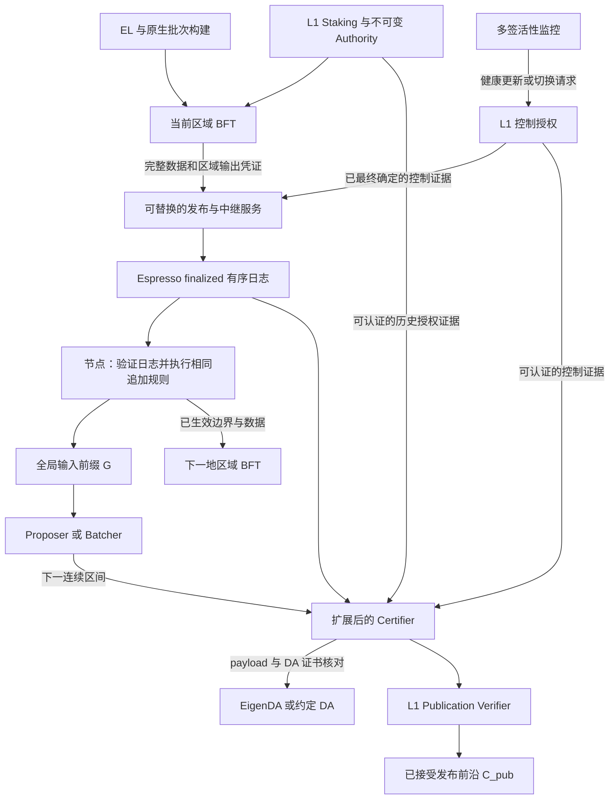
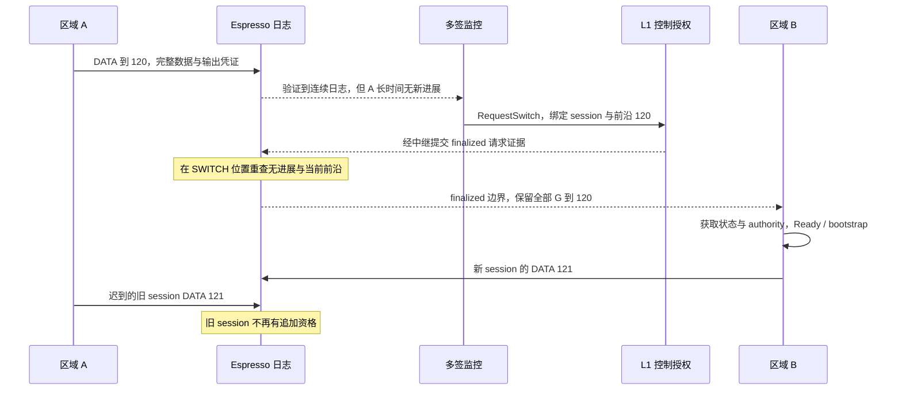

# Architecture v3 设想：由 Espresso 提供全局确认的区域排序与轮换

**后续修订：**最新方案见[修订计划 v3](espresso_revision_plan_v3_zh.md)、[Architecture v3 提纲](arch_v3_outline_zh.md)和 [Part II v2 提纲](sync_hotstuff_rr_part2_v2_outline_zh.md)；中间讨论见 [修订计划 v2](arch_v3_espresso_revision_v2_zh.md)。
新计划以“正常交接不等待 Espresso 全局确认”为基础，替代本文第 6 节中等待 Espresso 边界的默认建议，并引入 Espresso timestamp 驱动的两类 Force；本文保留作为前一轮方案记录。

**日期：2026-10-17。**
本文基于当前 [arch_v2.tex][V2]、[Part II 源码][P2T] 与 [28 页 Part II PDF][P2P]，以及前一篇学习笔记核对的 [MegaETH specification PR #8][PR]（提交 `aedc2826663b134ee25d26bea17e70c6d23d321c`）。
“现有设计”指这些材料；“v3 建议”是本文提出的新设计选择，不表示原规范或 Espresso 已实现。
本文先给出推荐架构和正常流程，再讨论强制轮换、验证复用和需要补齐的接口。

## 1. 我的判断与推荐方案

**你的方向可以显著简化 Part II：让 Espresso 固定唯一的全局历史，多签只判断是否需要换一个区域继续工作。**
这样，过去依靠多签保护前缀、观察者等待计时、Force 删除范围和通知窗口共同实现的全局不可回滚性，可以改为依靠一条外部最终确定的有序日志，以及一套确定性的追加规则。

我推荐的第一版是：

> **区域 BFT 产生输出；Espresso 记录完整输出和轮换标记；节点与 certifier 用同一套小型状态机解释日志；多签只能请求从当前全局末尾向后切换；L1 继续负责成员授权和最终发布验证。**

具体采用以下组合：

| 设计点 | 推荐 |
| --- | --- |
| Espresso 的职责 | 采用你偏好的方案 a：把它作为外部可信的有序、不可回滚、可获取的数据日志，不要求其验证者执行区域 Sync HotStuff |
| 区域输出的来源 | 在日志中携带完整数据与简短区域输出凭证；由 MegaETH 的适配层核对权限和凭证 |
| Global confirmation | 从 Espresso finalized 日志中确定性得到的连续、合法 DATA 前缀，不再等待多签保护窗口 |
| 正常轮换 | 保留 quota、terminal receipt、`NextLive`、`Ready` 和新区域 bootstrap；把生效边界固定进 Espresso |
| 强制轮换 | Espresso 在推进、但当前 session 的有效输出持续缺失时，多签请求切换；切换点由日志当前位置确定 |
| 多签权限 | 可以报告健康状态、请求更换服务区域；不能选择更旧的 anchor、删历史、改全局 cursor 或更换信任根 |
| L1 验证 | 复用现有 certifier 的 Espresso 证明、TEE 与 DA 绑定机制；新增区域授权与轮换日志解释逻辑 |

**真正需要坚持的一条规则是：任何切换都必须完整继承切换记录之前的全局前缀。**
不能让多签先观察到某个旧高度，再把那个高度当成稍后强制切换时仍可使用的回滚点。

这份方案里的“不能 fork”指不能删除或替换已经获得全局确认的内容。
区域内已提交、但尚未获得全局确认的输出，仍可能在切换后被放弃。
如果连这类尚未发布的区域输出也要求绝不丢失，那么在旧区域失联时，新区域就必须等待它们被发现和取回，无法同时承诺及时强制接管。

## 2. 旧架构的复杂性来自哪里

### 2.1 多签目前不只是监控活性

当前 Part II 的区域 BFT 提供 regional receipt，但区域确认仍可能被后续 Force 从外部分支中移除。
多签维护内部受保护前缀 `G_msig`，并保证任何后续 Force 的删除范围不与它相交。
外部观察者只有等待

```text
T_wait = T_mon + T_msig + T_L1
```

并检查相关 finalized Force 后，才能提升自己的 global prefix。
所以，多签的正确行为和监控、L1 最终化的时间界，不只是故障恢复条件，也是当前全局安全论证的组成部分。[Part II §5、§7、§9.4][P2T]

当前 Force 还可以替换旧 session 的正常边界，删除它之后已经开始工作的 successor sessions。
因此，规范需要 session 分支、删除范围 `Del(F)`、不同观察者的首次完整验证时间，以及 Submitted / L1-finalized / L1-activated 三阶段之间的竞争处理。
这些机制是在保护一个“仍允许被外部控制切换的区域输出流”。[Part II §6–8][P2T]

### 2.2 v3 把全局历史的确定权交给 Espresso

新的划分是：

- **区域层：**谁提出、怎样在区域内达成一致、输出什么。
- **Espresso 层：**哪份输出及哪个轮换事件先进入唯一的已确定日志。
- **多签：**是否请求停止等待当前区域，安排其他区域继续。
- **适配与验证层：**哪些日志记录满足本链的授权、连续性和轮换规则。

于是，多签错误地报告故障，最多导致不必要切换或活性损害；它不能让一份已经全局确认的数据消失。
这个权限收缩需要由规则和验证路径落实，不能只靠一句“多签不会 fork”。

| 当前机制 | v3 中的处理 |
| --- | --- |
| `s_u(B)`、`mu(B)` 与观察者等待 | 删除；完整验证 finalized 日志后直接确定相应输入前缀 |
| `G_msig` 及保护 deadline | 删除；多签不再维护任何决定安全性的私有前缀 |
| `Del(F)` 与阻止未来 global promotion | 删除；不允许删除已经接受的全局 DATA |
| Force 自选 `h_*` | 删除；保留点只能是切换前的当前全局末尾 |
| Force 替换已生效的正常边界 | 禁止；已经写入全局历史的边界不再被替换 |
| 区域 FINAL、quota、DRAIN、局部恢复 | 原则上保留，仍负责区域服务自身的正确运行 |
| Session ID | 保留，用于隔离旧消息、重复控制及新 session；不再需要回滚已确认 session 索引 |
| `G` 与 `C_pub` 两个前沿 | 保留；全局输入确认可以领先于实际 DA 发布与执行验证 |

## 3. “Espresso 只记录数据”应该怎样理解

### 3.1 三个实际可区分的方案

这里把你的方案 b 理解为：外部确认路径还负责验证区域 BFT 的提交证据或完整共识过程。
如果 b 还包含“只存证明或 hash，不存完整数据”，它又会额外引入独立的数据获取依赖。

| 方案 | Espresso 保存什么 | 外部适配层检查什么 | 对区域 BFT 的依赖 |
| --- | --- | --- | --- |
| A0：仅授权 publisher 输出 | 完整数据及 publisher 签名 | Publisher 权限、顺序、接续 | 不能仅凭这一点证明 BFT 确实提交了它 |
| **A1：记录区域结果，推荐** | 完整数据、简短输出凭证、轮换记录 | 区域授权、凭证签名、前缀连续性、轮换规则 | 依赖区域故障上界及诚实成员只为合法已提交结果出具凭证 |
| B：外部验证区域过程 | 数据及更完整区域证据，或另行绑定的数据引用 | Admission、QC、恢复链、term/generation 历史等 | 外部验证成本更高；也不能凭密码学证明所有本地时间与网络假设 |

**A1 仍然是“Espresso 只记录”，因为 Espresso 验证者把这些对象当作普通数据。**
签名和轮换合法性的解释发生在 MegaETH 节点与 certifier 内，不需要修改 Espresso 的共识。
这与“完全不检查写入者身份和输出来源”有明显区别。

### 3.2 为什么推荐保留一张简短区域输出凭证

如果只验证某个 publisher key，持有该 key 的人就可能在区域 BFT 尚未提交时发布数据。
Espresso 仍可为这份数据确定唯一顺序，但“全局输出是区域 BFT 的结果”这一设计关系已经不再成立。
这等于增加一个有独立内容决定权的 publisher。

当前 Part II 的 FINAL 凭证正好提供了另一条路径：固定快照中的不同成员，对同一内容提供总权重 `> F_i` 的签名，且实际 Byzantine 权重不超过 `F_i`。
于是凭证至少包含一个正确签名者；正确成员只在区域提交并完成所需验证后发送 FINAL。[Part II §2.2、§3.3][P2T]

v3 可以把区域引擎封装为下面这个服务契约：

```text
RegionalOutput(session, payload, output_certificate)

承诺：这个 payload 是该 session 按区域规则提交的合法输出，
      并绑定其高度、父输出、原生执行上下文及历史 authority。
```

外部只验证这份契约的认证证据，不再重放区域内部的每次 quit、NEWVIEW 和 term 切换。
这项精简依赖明确的区域正确性假设，不是 Espresso 替我们验证了区域算法。

可以沿用现有 FINAL 的签名内容及其到 payload 的 hash 绑定，也可以设计单独的 `EXPORT_FINAL` 签名域。
如果沿用 FINAL，必须完整说明简化后的外部检查如何仍绑定现有 block hash、session ID 和实际数据。
当前 valid receipt 定义还要求完整 ancestry 与 admission 验证，所以不能仅删除那些检查，却继续声称使用原定义而无需修改接口。[Part II §3.3–3.4][P2T]

## 4. 新的模块架构



这里的两处 L1 职责不同：

- **Authority / 控制授权：**提供谁可服务、谁可请求切换的公共依据。
- **Publication Verifier：**确保后续发布的数据恰好对应 Espresso 全局前缀中的下一个完整区间。

Espresso 的全局确认无需等待 `C_pub` 追上。
L1 上保存的已验证 Espresso 前沿，也可以只是链下全局前缀的一个滞后镜像。
发布交易推进这个镜像，是登记已有的全局确认，不是重新赋予多签一项全局确认权。

### 4.1 多签的权限要在接口上收缩

建议多签只拥有：

```text
ReportHealth(region, observation)
SetFutureStatus(status_map, activation_rule)
RequestSwitch(target_session, expected_frontier, request_nonce, diagnosis)
```

不应拥有：

```text
SetGlobalHead / SetGlobalCursor
DeleteRange / ReplaceAcceptedBoundary
ChooseOldRetainedAnchor
SetEspressoTrustAnchor
AuthorizeArbitraryCertifierProgram
```

最后两项尤其重要：PR #8 的管理员能授权镜像，并具有 emergency cursor override 能力。
如果同一多签仍能更换验证程序或设置任意 quorum 锚点，那么即使删除名为 `ForceFork` 的函数，它仍可能绕过全局前缀约束。[PR #8 Batch Inbox][S4]

升级治理可以继续存在，但它属于单独的系统信任假设；不能把一个可任意升级验证逻辑的角色同时描述成“只能管理活性”。

### 4.2 发布者不能成为新的单点

区域输出一旦形成有效凭证，应允许任何中继者把相同数据提交给 Espresso。
提交者身份与产生内容的区域身份分离：中继者没有更改内容或选择任意 session 的权限。
重复提交通过规范化记录 ID 去重。

这与 PR #8 当前单独的 `PUBLISHER_KEYS` 机制不同，需要改动记录授权规则。
否则某个发布 key 的持有者沉默，即便区域 BFT 工作正常，也可能使全局日志停止；当前 PR 确实没有完整的沉默 publisher 替换机制。[PR #8 Block Records][S2]

## 5. 全局日志的最小状态机

### 5.1 外部 Espresso 服务的抽象

把它建模为提供 finalized 日志前缀的外部服务：

```text
E[0], E[1], ..., E[k]
```

其中位置应包含 Espresso block height、namespace transaction index 和 envelope 内记录位置，不能只使用一个粗略的区块高度。
同一 Espresso 区块内仍可能同时出现 DATA 和 SWITCH，二者的先后必须唯一。

采用以下明确假设：

1. 正确观察者验证到的 finalized Espresso 历史具有前缀一致性。
2. 每个位置的完整 namespace 内容及顺序可以验证，不能隐藏更早记录。
3. 必要数据、证明和历史快照能够获取并保留。
4. 在所需活性条件下，合法提交最终有机会被包含。

第 1–2 项支持顺序安全，第 3–4 项支持数据恢复与推进。
“Espresso 是可信外部实体”可以封装其内部共识，但不能把这些性质混成一个无条件的服务可用性承诺。

### 5.2 三种记录

| 记录 | 内容与作用 |
| --- | --- |
| `DATA` | 当前 session 的下一段连续区域输出，包含完整 payload、父前沿和输出凭证 |
| `REGULAR` | 终端输出与 quota 的正常交接边界；绑定 successor 和历史选择依据 |
| `SWITCH` | 已授权的强制切换请求及证据；只有在日志解释时条件仍成立才生效 |

L1 authority、健康历史和控制记录可以作为记录中的可验证证据，或从已经认证的缓存解析。
必要证据必须是确定的，不能依赖“当前 RPC 返回的最新状态”。
不完整的 namespace 下载不能被解释成没有记录；缺失的必要证据不能用本地超时直接替代为“不存在”。

初版宜要求 record 自带完整 payload 和规定的有界证明对象，历史缓存只能替代已经认证的同一对象。
收到完整、已证明的 namespace 字节后发现某个 record 缺少必填字段，是可确定的格式无效；下载过程中缺页，则是尚未完成验证。
不要允许任意写入者放一个无法解析的外部链接，就把所有观察者永久卡在“等待依赖”状态。

### 5.3 状态与关键变量

```text
RotationState {
    global_data_height, global_data_digest
    session_index, session_id, active_region
    session_base, session_quota, phase
    authority_ref, boundary_history_digest
    espresso_scan_position, espresso_quorum_anchor
    session_open_espresso_height, last_progress_espresso_height
    processed_control_ids
}
```

其中 `phase` 至少区分生产中和等待 quota 后交接。
`G = (global_data_height, global_data_digest)` 表示输入前缀；完整检查点还必须认证 session、边界和 authority 等上下文。
DATA 高度、原生 mini-block 编号、EVM 区块号和 Espresso 高度继续保持不同索引。

### 5.4 DATA 的接受规则

一条 DATA 只有满足以下条件，才向全局前缀追加：

1. 属于状态机当前允许服务的 session 和 region。
2. 绑定该 session 的固定历史 authority，输出凭证满足约定的认证规则。
3. 从 `G` 的下一位置开始，父 hash、顺序和完整数据对应，不能跳高度或省略中间输出。
4. 不超过本 session 的 quota，满足原生适配层规定的外部输出格式。
5. 不是已经接受的输出的重复项。

格式错误、旧 session 的迟到数据、未授权数据和不接续的候选项不会修改全局前缀。
它们仍是 Espresso 原始日志里的字节，但不是本链接受的全局输出。

一个 export bundle 若包含多个 DATA，先完成整包结构、连续性及凭证验证，再按规定原子接受，避免不同实现对错误后缀保留不同前缀。
在 quota 达到终点后，状态转为等待交接，不再接受本 session 的后续 DATA；只有成功的边界转换才能重开生产。
被顺序跳过但仍可能合法的候选输出，需要中继在依赖已接受后重投，不能让不同节点各自回扫并改变既往解释结果。

因此，“全局确认由 Espresso 提供”的准确语义是：

```text
G_k = ReplayValidRecords(E[0..k], trusted_initial_state)
```

Espresso 提供唯一不可回滚的输入顺序，确定性规则将它解释为唯一的链历史。
这不增加一轮全球投票，也不恢复多签的确认职责。

### 5.5 三个前沿

| 前沿 | 意义 | 是否可因切换丢失 |
| --- | --- | --- |
| `R` | 区域已提交、尚待外部确认的输出 | 尚未进入 G 的后缀可以不再被采用 |
| `G` | Espresso 日志确定的合法全局输入前缀 | 不可以 |
| `C_pub` | 已通过 DA 对应与执行验证的发布前缀 | 保留现有发布接受规则；应对应 G 的连续前缀 |

正常情况下，`C_pub` 落后于 `G`，区域也可能在 `G` 之后继续产生候选输出。
Force 的锚点必须基于 `G`，不能基于更旧的 `C_pub`。
否则，“尚未完成 DA 发布”会被错误地转化成“可以删除已经全局确认的数据”。

## 6. 正常跨区域轮换：保留主体，明确生效点

### 6.1 可以保留的部分

现有正常轮换的主体很适合继续使用：

- 每个 session 固定 snapshot 和 DATA quota。
- 在 terminal DATA `T_r` 获得 FINAL receipt 后结束本区域生产。
- 按固定循环顺序和可验证的历史状态计算 `NextLive`。
- Successor 验证完整 anchor、状态和 authority 后达到 `Ready`。
- 后续 NEWVIEW、ANCHOR QC 与区域内 `(g,t)` 恢复继续使用 Part I / Part II 的引擎。
- 不需要为每次正常轮换新增一笔 L1 交易。[Part II §6][P2T]

### 6.2 推荐的简单版本：Espresso 固定边界后正式进入

流程如下：

1. 区域 A 提交其 quota 内的最后一段输出 `T_r`，形成 terminal receipt。
2. 中继向 Espresso 提交尚缺的 DATA，并提交 `REGULAR` 边界。
3. 解释日志时，必须先完整接受到 `T_r`，确认 quota 正确，再处理该边界。
4. `REGULAR` 选择 successor B，并以当前 `G = T_r` 为新 session 的 anchor。
5. B 验证 Espresso 边界、原生状态与 authority 后进入 `Ready`，启动新 session。

边界和最后一段 DATA 可以放在同一 envelope 中原子解释，没必要人为增加第二次 Espresso 共识等待。
它们仍有确定的内部顺序：先数据，后切换。
如果终端数据还没被接受，单独出现的边界不能跳过中间内容。

**这保留了原正常轮换的大部分结构，但改变了“仅有 regional receipt 即可正式进入”的条件。**
新版本正式进入需要一个 Espresso 已固定的边界。
代价是交接增加对 Espresso 的等待；收益是外部不再维护跨多个区域的可撤销 session 分支。

### 6.3 如果希望保留原来的提前开工

可以增加一个性能优化层：B 收到区域 terminal receipt 后先取状态、准备并运行一个 tentative session。
但其输出必须等 A 的终端数据和正确边界在 Espresso 中按序得到接受，才有资格获得全局确认。
如果前面先出现有效 SWITCH，这条 tentative continuation 就失去资格。

这并不影响 `G` 的不可回滚性，却会保留部分 provisional branch、资源浪费与消息隔离问题。
因此建议把它放在后续优化中，先写清楚等待 Espresso 边界的基础协议。
不要一边保留“无需等待的正式交接”，一边删除所有推测分支处理规则。

### 6.4 `NextLive` 能保留到什么程度

第一版可以继续使用原来的历史选择方法：正常轮换从 `lambda(T_r)` 起，取第一个存在其他 live region 的 finalized L1 高度 `lambda_s`，再按循环顺序选择 successor。
边界携带证明该最早选择的历史证据；各节点不用“收到边界时的最新 live map”自行决定。[Part II §6.1][P2T]

要保留两点限制：

1. 原设计已指出，leader 选择较旧的 `lambda(T_r)` 可能影响选择结果；引入 Espresso 不会自动修复这一政策问题。
2. 只有一个 live region 时，原 `NextLive` 排除当前区域，仍会停在 quota 边界。

后续可以改为在 Espresso 边界绑定一个明确的已认证 L1 控制快照，或者允许同一区域续任。
那是另外的轮换政策修改，不是全局确认替换所必需的步骤。

## 7. 强制轮换：从“截断历史”改为“关闭当前服务期”

### 7.1 新 Force 的语义

推荐将新的操作命名为 `Switch` 或 `CloseSession`，避免继续沿用旧 Force 的任意截断含义。
名字并不重要，关键是它只做两件事：

1. 结束当前 session 接受新全局输出的资格。
2. 让另一个有资格的区域从当前全局末尾继续。

若 SWITCH 在 Espresso 日志位置 `p` 生效，它的 anchor 唯一地定义为：

```text
anchor(SWITCH at p) = G obtained after processing every position before p
```

多签不提供可自由选择的 `h_*`。
请求中的 `expected_frontier` 只是防止过时操作的比较条件，不能用来覆盖状态机当时的实际前沿。
如果提交请求后全局前沿已经前进，旧请求就过时。

### 7.2 “没有 Espresso 数据”的可验证含义

建议将触发条件写成：

> Espresso 已最终确定的历史继续推进，但当前 session 在一个规定窗口内，没有产生新的、通过本链规则接受的 DATA 进展。

定义 `K_E` 为以 Espresso finalized 区块数计的超时阈值。
对当前 session，保存：

```text
e_open = 本 session 边界所在的 Espresso 高度
e_last = 最近一次接受该 session 有效 DATA 的 Espresso 高度
e_ref  = max(e_open, e_last)

NoProgress(session, p) :=
    session 仍是当前 session
    且 height_E(p) - e_ref >= K_E
```

没有输出时以 `e_open` 起算，避免新 session 一启动就继承旧 session 的过期计时。
候选记录、格式错误数据、重复项和普通 heartbeat 都不重置这个时钟。
有效空 DATA 是否计作进展应明文规定；沿用当前引擎时，它消耗 quota，可计作区域协议进展，但不证明用户交易未遭审查。

这证明的是有限窗口内的一个具体事实，不是“该区域永远无法再输出”。
即使之后迟到数据出现，也按它与 SWITCH 的日志顺序处理。

`K_E` 是初版建议的协议参数，不是 Espresso 已提供的参数，也不是固定秒数。
如果以后要用墙钟时间，应定义可认证的时间来源和偏差假设；不要以不同节点的本地超时直接决定不同全局结果。

### 7.3 缺失证明实际需要什么

需要一个可信起点，以及从该起点到观察截止点的完整、连续 Espresso namespace 历史与证明。
重放其中的 DATA、REGULAR 和 SWITCH 后，才能得到“当前 session 没有进展”的结论。

因此应区分：

| 观察 | 是否支持协议级 NoProgress |
| --- | --- |
| 本地 RPC 超时或返回空列表 | 否 |
| 缺了某个必要 Espresso 区块或 namespace 证明 | 否；验证尚未完成 |
| 验证到 namespace 确实不存在或只含无效/无关记录 | 可以作为完整扫描的一部分 |
| 从已认证检查点扫描完整窗口，状态机未接受新 DATA | 是 |
| 区域有输出，某个 publisher 没有转发 | 日志可能确实无进展，但不能由此认定区域副本作恶 |

一个“旧前沿的 inclusion proof”不足以证明它仍是截止点的最后前沿。
必须排除中间已有进展；这正是 PR #8 的 namespace 完整性验证可复用的地方。[PR #8 Certifier][S3]

### 7.4 推荐的 L1 + Espresso 控制流程

为了尽量沿用现有 L1 管理模块，第一版可以保留 L1 对多签请求的授权，但把**真正改变服务区域的时刻**放在 Espresso 日志里。

```text
监控发现没有进展
    → 多签在 L1 授权 SwitchRequested
    → 请求达到约定的 L1 最终化 / not-before 条件
    → 任意中继把请求及证明提交 Espresso
    → finalized 日志中的 SWITCH 再检查当前状态
    → 成功后从当前 G 开启 successor session
```

L1 请求可以包含：

```text
SwitchRequested {
    chain_id, target_session_id
    expected_global_height, expected_global_digest
    request_nonce
    status / successor-selection context
    not_before_L1_height
    diagnostic_reference
}
```

健康状态更新仍可按照 L1 历史影响未来的 `NextLive` 选择。
但 L1 请求被提交、被 finalized 或达到 not-before，都不单独让节点切换当前全局分支。
它们只使对应请求有资格被 Espresso 日志中的状态机执行。

如果后续希望减少 Force 的 L1 延迟，可以把已授权多签对请求的签名直接写入 Espresso，再异步登记 L1。
这需要另行定义多签成员授权和签名域；不是当前推荐基础版的隐含行为。

### 7.5 在 SWITCH 位置重新检查

到日志位置 `p` 时，验证器检查：

1. 请求授权有效，绑定本链，适用的 L1 依据已 finalized。
2. `target_session_id` 正是当前 session。
3. 请求的 `expected_frontier` 与处理 `p` 之前的当前 `G` 相同。
4. `NoProgress(current_session, p)` 在这个位置仍成立。
5. 确定的历史选择规则能得到有资格的 successor，且其 authority 已可验证。
6. 同一请求此前没有成功生效。

通过后，保留 `G` 的所有数据和 provenance，关闭当前 session，以该 `G` 建立新边界。
新 session index 前进一次，session ID 绑定旧 ID、切换类型、anchor digest、successor、authority/选择上下文和请求的规范化 ID。
签名者组合、重复交易或重试编码不产生不同 session。

请求尚未到 not-before、超时窗口尚未满足或 successor 尚不可得时，不生效，也不冻结生产或重置进展计时；可按规则补齐证据后重投。
如果 session 或前沿已经改变，请求永久过时，重投也不能恢复旧目标。
已成功生效的请求完全幂等。
无效或伪造的请求不能通过占用某个 ID 来阻止未来合法请求。

多个针对同一 session 的有效请求不再需要靠多签内部“只有一个 outstanding Force”来保证安全。
Espresso 将它们排序；第一个成功切换后，其余请求因目标 session 不匹配而失效。
可以保留单 outstanding 的运营习惯以减少开销，但它不应再是不可分叉性的必要假设。

### 7.6 为什么一定要把切换效果也写进 Espresso

如果 DATA 的生效顺序看 Espresso，而 SWITCH 的生效顺序直接看另一条链上的事件，就会遇到两个时序问题：

- 某节点先看到 L1 Force，停止接收 A 的输出。
- 另一节点先看到 Espresso 上 A 的新 DATA，把它提升为 global。

除非额外规定可认证、不会回溯改变历史的两条链之间的顺序，否则这个设计又需要等待窗口或撤销规则。
把切换效果放在同一个 Espresso 序列中，能直接回答哪条 DATA 在切换之前、哪条在之后。

L1 仍是授权来源，Espresso 是操作先后及实际生效的来源。
所有节点用同一 finalized 日志和其中绑定的历史证据重放，不能以看到 L1 事件的本地时间修改之前的接受结果。

## 8. 用竞争例子检查强制轮换

### 8.1 数据先到：过时的请求不切换

观察时 `G = 120`，当前区域 A 没有进展，多签请求切换并绑定 120。
在 SWITCH 被纳入前，日志先接受了 A 的有效 DATA 121。

```text
... DATA 120(A)
... DATA 121(A)
... SWITCH(expected_tip = 120, target = A-session)
```

SWITCH 到来时，前沿和进展时钟已经变化，因此它不生效。
不能用请求携带的旧 120 抹掉已经确认的 121。

### 8.2 切换先到：保留旧区域全部全局输出

```text
... DATA 120(A)
... 无有效进展，满足 K_E
... SWITCH(A-session → B-session, anchor = current G = 120)
... DATA 121(A-session)    // 旧 session，忽略
... DATA 121(B-session)    // 正确接续且凭证有效，接受
```

A 的区域引擎可能早已提交自己的 121，甚至产生了更多后缀。
那些输出没有进入全局前缀，因此不能在切换后绕过 session 检查。
B 也不能重写 120；它只能从 121 继续。



### 8.3 正常边界先到：旧 session 的故障报告不影响 successor

假设 A 的 quota 到 120，`REGULAR(A → B)` 已经在 Espresso 生效，但 B 还没产生 DATA。
此时 `G` 可能仍然是 120。
一个针对 A 的 SWITCH 即使 expected tip 仍匹配，也必须因 session ID 已变化而失效。
这说明只比较数据高度不够，必须同时比较 session 与边界上下文。

如果 B 之后也没有进展，需要针对 B 发出一个新请求，并从 B 的开场位置计算窗口。

### 8.4 没有输出的 session 也能结束

新区域 B 开始后一直没有 DATA，不能因此永远无法形成可切换 anchor。
它继承的全局 anchor 120 仍有效；超时后可以从同一个 120 打开 C 的新 session。
DATA 高度不变，但 session index、session ID 和边界链前进，旧 B 的签名不能冒充 C。

### 8.5 全局前沿领先发布前沿

如果 `G = 130`、`C_pub = 115`，强制切换必须保留到 130。
新 proposer 或 batcher 仍须先发布 116–130，再发布新区段；不能因为旧区域失联就跳过这些已全局确认的数据。
这要求数据和必要执行状态在旧区域之外可恢复。

## 9. 哪些故障应该换区域，哪些不应该

| 情况 | 建议处理 | 是否需要切换区域 |
| --- | --- | --- |
| 区域不再产生有效输出 | 无进展窗口后请求 SWITCH | 是，若存在可用 successor |
| 区域正常，某个 Espresso 中继失联 | 换中继、重投已签输出 | 通常不需要 |
| BFT 一直产生记录，但都不满足全局接续规则 | 记录无有效进展；诊断来源或实现错误 | 可以切换，但不能仅凭超时罚没 |
| 全局前缀正常增长，proposer 不发布 | 启用替代 proposer / batcher，继续旧发布前沿 | 不应重置区域全局历史 |
| EigenDA 分发或取回失败 | 恢复 DA 或等待；保留 G | 换区域不能修复既有 DA 缺口 |
| 某节点拿不到 Espresso 数据 | 恢复该节点获取路径，暂不作完整性判断 | 单凭本地失败不能触发协议结论 |
| Espresso 整体停止 finalizing | 全局确认和全局切换一起等待恢复 | 不能靠同一日志完成有效切换 |
| Espresso 停止包含本链 DATA，却仍包含控制 | 可触发切换，但新区域可能同样受影响 | 恢复依赖 Espresso 的包含活性 |

这里没有声称“缺少 Espresso 输出”必然说明旧区域有故障。
它可以是**换服务者的条件**，但不是完整的**故障归责证明**。
如果需要惩罚，应另外定义可归责证据；现有设计中 timeout BLAME 也不自动构成可罚没的 equivocation。[Architecture v2，staking 与 monitor 部分][V2]

### 9.1 Espresso 停摆不能被悄悄降级成旧 Force fork

在本架构里，Espresso 是所有区域共同依赖的全局排序服务。
它停止后，`K_E` 不再增长，新的 SWITCH 也无法获得 finality。
区域可以在资源允许时继续产生 provisional output，但不能把这些输出宣布为新的全局历史。

如果希望 Espresso 停摆时切换到 L1 或其他最终性服务，需要另写一套“全局确认服务迁移协议”：明确旧日志的不可变终点、新服务的激活证明，以及如何防止旧服务恢复后又确认另一条延伸。
这不是普通跨区域轮换，也不应交给多签任意选择一个旧 cursor 完成。
第一版将这项迁移留在架构之外，能维持单一且清楚的最终性假设。

### 9.2 活性监控可以有更丰富的政策，但不会增强最终性

“窗口内零进展”只检测停止，不保证吞吐量、交易公平性或抗审查。
区域可能间歇输出空 DATA，从而一直不满足零进展条件。
需要时可以增加低吞吐、用户请求积压等健康指标，但指标的观测和归责要单独定义。
无论采用哪种切换理由，保留整个当前 `G` 的规则都相同。

## 10. 现有 certifier 能复用到哪里

### 10.1 可以复用的是验证结构和部分实现，不是原规则原样套用

PR #8 已经把 Espresso 验证组织成三个核心接口：

```text
verify_finalized(header, proof, quorum)
resolve_quorum(quorum, quorum_steps)
verify_namespace(payload, proof, header)
```

它也已有持续 cursor、frame 前缀绑定、EigenDA 证书核验、payload 对应检查、TEE key 注册及镜像授权等结构。
这些正是 v3 不需要重新设计的基础部分。[PR #8 Certifier][S3]

| 现有组件 | 在 v3 中如何使用 | 是否有新增工作 |
| --- | --- | --- |
| Espresso finality 和 quorum 演进验证 | 验证原始日志及其信任链 | 复用；仍需固定 network/profile、版本与初始可信锚点 |
| Namespace 完整性 | 验证完整数据顺序与无进展窗口 | 复用机制，扩展检查对象 |
| 原 block-record 扫描 | 原来按单一 publisher 与 L2 高度 first-valid-wins | 替换成 session、区域授权、DATA 和切换记录的解释规则 |
| Cursor | 原来包含 Espresso 位置、L2 高度、origin、frames 与 quorum | 扩展成认证整个 rotation state；不能只多加一个 region 字段 |
| L1 历史依据 | 原 core 不验证完整区域 authority / 控制历史 | 新增可认证历史事实接口及必要证明验证 |
| Channel / payload 与 DA 绑定 | 保证发布的是刚刚认证的字节 | 可复用，但输入要适配 DATA / mini-block / EVM 层次 |
| TEE attestation 和 key 注册 | 证明授权程序完成了具体检查 | 可复用结构；新程序 measurement 与治理权限需要重新界定 |
| 原 emergency cursor override | 管理员可设置新的扫描位置 | 不能照搬为多签权限，必须去掉或严格限制为可证明的同一前缀推进 |
| 执行正确性 | 原 core 不执行 MegaETH | 继续使用独立执行检查 / proof / sound dispute 接口 |

“既有 certifier 能验证 Espresso”成立。
“既有 certifier 无需修改就能验证我们新的区域轮换”不成立。
最主要的新代码不是 Espresso 共识，而是下述纯状态转换函数。

### 10.2 推荐的验证接口

```text
VerifyAndReplay(
    previous_rotation_checkpoint,
    complete_espresso_interval_and_proofs,
    authenticated_authority_and_control_evidence
) -> next_rotation_checkpoint, accepted_output_ranges

VerifyPublication(
    previous_publication_checkpoint,
    certified_rotation_checkpoint,
    exact_next_output_range,
    native_encoding_and_execution_evidence,
    da_payload_and_certificate
) -> next_publication_checkpoint
```

两项检查可以运行在同一个 certifier 程序中，但必须保留不同语义。
第一项确认来源和全局顺序，第二项确认发布的是准确的下一段内容，并满足原生执行与 DA 要求。

Core 仍然可以是纯函数：host 提供 L1、Espresso 和区域证据，core 验证后处理，不自己访问网络。
新增的 L1 验证不能以“host 说这是 finalized”代替，必须明确可信锚点和认证方法。
同一套解析与状态转换规则应被完整节点直接运行，避免一套在节点、一套在 TEE 中各自解释 session 边界。

### 10.3 Attestation 需要绑定整个状态转换

至少需要把以下关系绑定进签名或证明的公共输入：

```text
chain / protocol version / destination contract
previous and next rotation checkpoint
verified Espresso scan interval and quorum provenance
global DATA frontier and prefix commitment
active session, boundary context and authority commitment
exact publication interval and native input commitment
DA commitment / certificate / verification evidence
```

字段布局可以继续使用确定的编码和 domain separation，但不能只证明“这几条 DATA 出现在某些 Espresso 区块里”。
必须证明它们是在正确状态下被接受的完整下一段，以及中间没有遗漏改变权限或切换 session 的记录。

若 L1 验证器尚未登记链下已经确认的全部 G，proposer 可以在发布时一并提交前沿推进证明。
合约检查前置 checkpoint 与自身状态衔接，再检查发布区间；它不能接受由调用者随意声明的另一条全局历史。

### 10.4 复用后的信任关系

完整节点直接验证 Espresso 证据和状态机，依赖的是相应密码学、可信起点及协议规则。
L1 为节约验证成本而接受 TEE attestation，则额外依赖授权程序正确、硬件执行与密钥保护、注册验证，以及 sealing 策略等条件。
这些假设并没有因为把多签移出全局确认而消失。[PR #8 Certifier][S3] [PR #8 Full Node][S5]

不过，它们与旧多签保护窗口的性质不同：外部全局日志不再依赖多签私有观察时间，也不再等待其潜在 Force 的传播。
多签可以阻碍或滥用切换，但在固定验证逻辑下不能让两个冲突前缀都成为合格的全局输出。

## 11. 必须明确的两条端到端边界

### 11.1 输入最终性与执行结果最终性

新全局前缀首先确定的是有序输入及其被绑定的上下文。
Espresso 共识本身不执行 MegaETH，也不会自动保证一个收据、state root 或 EVM block hash 正确。

当前 arch_v2 的 DATA envelope 还绑定 native headers、交易、receipts 和 boundaries，并要求发布时重算执行结果相符。
区域正确输出契约因而需要覆盖应用有效性，而不只是“对某个任意 hash 达成了 BFT 一致”。[Architecture v2，Native compatibility、EL 与 Publication acceptance][V2]

建议在 v3 明确区分：

| 对外说法 | 需要的条件 |
| --- | --- |
| 全局输入前缀不可回滚 | Espresso 前缀一致、完整验证、确定性的追加与切换规则 |
| 区域凭证保证该输入有效 | 正确 historical snapshot、区域故障上界、诚实签名者按输出契约检查 |
| 当前执行结果也不可逆 | 正确父状态、固定执行规则，以及所有相关 L1 执行输入已最终确定等额外条件 |
| 最终能完成发布与提现 | 还要 DA、proposer、执行证明 / 争议流程持续推进 |

Part II 的 finalized L1 authority 引用，不应被自动当成“所有 native execution 的 L1 依赖都 finalized”。
Registry 读取和 EVM 使用的 deposits、origin 及系统输入需要分别核对。
如果允许后者来自尚未 finalized 的 L1 历史，就只能给执行结果条件性保证，即使 Espresso 上的输入列表不变。

### 11.2 PR #8 的 deposit-only fallback 不能直接继承成强全局确认

当前 PR 的基础声明是：一个高度如果完成派生，内容是选中记录的普通内容，或者是 deposit-only。
错过 sequencing window 或执行失败，都可能使原普通内容不进入最终派生；已接受但无法取回的数据又可能使派生等待。[PR #8 Overview][S1]

这与 arch_v2 的“准确发布 G 的下一完整区间”不是同一强度。
如果 v3 宣称全局确认后普通内容一定保留，却继续允许 derivation 因迟到而自行丢掉它，就会出现上下层语义冲突。

有两个明确选择：

| 路线 | 意义 | 代价 |
| --- | --- | --- |
| 延续 PR 的较弱语义 | Espresso 全局日志不可回滚，但实际执行链仍可出现规定的 deposit-only 替代 | 更接近现有集成；不能把全局日志确认宣传成普通交易必然保留 |
| **延续 arch_v2 的忠实发布语义，推荐目标** | 一旦进入 G，后续只能按序发布和执行，不能以提交迟到为由覆盖它 | 必须配套修改过期 / 空块派生规则，数据或执行问题可能使发布停滞 |

采用第二条时，派生层在不知道某高度是否已有 Espresso 承诺的情况下，不能仅凭自己的超时认定它可以被空内容填补。
它要么等待可认证的全局日志输入，要么使用由同一日志规则明确决定的空输出；控制事件也不能把未知区间当成可跳过的区间。
恢复发布仍从 `C_pub + 1` 开始，而不是从最近一个便于工作的区块开始。

这项改动会影响 L1 deposits 在服务中断时何时可继续派生，需要在 rollup adapter 中完整规定。
第一版可以优先保证不改写 G，接受在外部服务失败时等待；不能同时声称无条件保持普通内容、保留所有原有超时替代，又无需新增假设。

应用无效输入的问题也不能靠无 Fork 的 SWITCH 修复。
如果一份错误输入已经进入不可回滚的 G，更换区域不会使它变为可执行。
必须在接受规则、区域输出有效性假设或执行证明接口中解决；否则只能得到顺序安全而没有端到端推进。

### 11.3 Mini-block / DATA / EVM block 的边界

当前设计里，一个 DATA 承载一批 mini-block；PR #8 的 block record 则对应一个完整 L2 EVM block。
不能把这两个编号直接对应，也不能把区域切换自动解释为允许更换一个尚未完成的 EVM block 的原生签名 key。[Architecture v2，Objects、EL adapter][V2]

尤其是：强制切换必须继承 G 的末尾；如果这个末尾在一个未完成 EVM block 中间，不能为了更方便重启而退回上一个完整 EVM block。
那会删除已经全局确认的内容。

有两种实现 profile：

1. **先采用可完整恢复的输出端点。**
   区域内部仍可按原 DATA 粒度工作，但向 G 追加的 export bundle 结束于完整 EVM block 或另一个已定义的可恢复原生检查点。
   G 可以一次接受多个连续 DATA；session quota 终点也要满足同一接续要求。
   最简单的试验版本使用完整 EVM block 边界，代价是确认粒度变粗，以及终端打包可能需要等待或调整 quota 的定义。
2. **保留任意 mini-block 边界的快速确认。**
   必须定义 partial-EVM continuation、原生签名 authority、执行状态转移，以及新区域如何获得继续所需的数据和签名能力。
   如果这些条件不成立，协议只能等待；不能回滚已确认 mini-block 来绕过它。

建议架构主文保留抽象的 `RecoverableNativeCheckpoint` 接口，第一轮实现明确选定一个 profile。
不要把“新的 BFT session 已经 Ready”直接等同于“新的原生出块者已经能合法签下一段”。

## 12. 新的 Part II 可以如何组织

新的 Part II 可以更集中于“把多个区域服务接到一条全局日志”，不再把外部 fork 与保护计时作为中心。

| 新章节 | 主要内容 |
| --- | --- |
| 1. 服务模型与保证 | 区域输出服务、外部 Espresso 日志、全局输入与执行结果的区分 |
| 2. Authority、session 与输出契约 | 固定 snapshot、quota、session ID、简短输出凭证 |
| 3. 全局日志与确定性解释 | DATA / REGULAR / SWITCH，状态变量，完整性和去重 |
| 4. 正常轮换 | Terminal output、NextLive、Espresso 边界、Ready / bootstrap |
| 5. 无进展检测与强制切换 | 有限窗口、请求授权、日志中的生效点、过时请求处理 |
| 6. 验证与发布接口 | 全局 checkpoint、certifier、准确下一范围、DA 和执行接口 |
| 7. 性质与失败处理 | 前缀保持、权限隔离、活性条件、外部服务停摆 |

对应的主要协议可以只写四个：

```text
Protocol A: Produce and export regional output
Protocol B: Replay Espresso records and advance global state
Protocol C: Request and apply a progress-preserving session switch
Protocol D: Bootstrap the successor from the confirmed checkpoint
```

其中 “progress-preserving” 指保留已经获得的全部全局输入进度，不是保证未来一定继续推进。
如需避免歧义，正式标题可直接写 “Switch sessions without truncating the global prefix”。

### 12.1 对现有 Part II 的逐项改动

| 当前内容 | 建议 |
| --- | --- |
| §2 的区域同步、固定 stake 和 L1 authority 假设 | 保留所需部分 |
| §2 的 honest committee protected-prefix 假设 | 删除，改为控制请求认证及活性政策假设 |
| §2 的 `T_mon` 与 `T_L1` 组合安全时间界 | 从全局安全条件中删除；必要时作为故障恢复性能条件 |
| §3–4 的区域引擎、FINAL、DRAIN、Completion | 移为区域接口及必要 delta，避免全文重复 Part I；简短输出凭证的语义需要明确 |
| §5 的 global waiting period | 用 Espresso finalized 日志接受规则替换 |
| §6 的 regular / forced fork choice | 用不可撤销边界的追加状态机替换，保留正常选择与 bootstrap 主体 |
| §7 的 protected prefix 与 Force 三阶段 | 删除；改写为授权请求、日志生效、successor Ready |
| §8 的 observer relay / timer | 改为验证外部日志、完整重放、输出 checkpoint |
| §9.4 的 deadline 分情况安全论证 | 改为共同日志与前缀保持转换的论证 |

新版本仍需讲清楚授权来源、数据可用性和原生执行接续；这些并不会被 Espresso 自动代替。

### 12.2 旧区域引擎是否还必须跑到 Completion

当前 Force 不改变旧 engine 的内部状态，旧 engine 可能继续运行到终端 Completion；这是当前退休与退出设计的一项困难。[Part II §3.4、§9.6][P2T] [Architecture v2，Retirement clearance][V2]

v3 可以新增一个有明确证据的 `ExternallyClosed` 状态：

```text
收到并验证 Espresso 中已经生效的本 session 关闭边界
    → 不再为该 session 产生或投票新输出
    → 保留已有日志、签名与必要历史
    → 继续履行规定的数据服务和责任保留义务
```

这不是伪造一个区域 quit proof，也不撤销旧区域的本地提交。
它改变的是服务契约：关闭后该 session 已经没有可被外部接受的新工作，因此无需为了完成一个废弃 quota 无限运行。

这是一项需要单独写入并检查的区域引擎扩展，不能声称原 Part I 已自然允许。
它有望简化 retirement clearance，但提款仍须确认没有未来 authority、没有未完成数据职责，并满足 liability window。
关闭事件本身不等于立即可提款。

## 13. 简化后的安全结构与活性条件

### 13.1 最应保持的四个不变量

1. **全局前缀单调。**任何合法转换只追加 DATA 或改变后续服务状态，不删除已接受 DATA。
2. **单一当前授权。**同一解释状态只有一个 active session；旧 session 的迟到输出不会重新获得资格。
3. **切换完整继承。**每个新 session 的 anchor 精确等于其边界之前的全局末尾。
4. **发布连续对应。**任何发布接受只推进 G 中从 `C_pub + 1` 开始的完整连续区间。

在两个观察者使用同一可信起点、验证同一 Espresso finalized 历史并运行确定性规则时，它们重放相同前缀得到相同状态。
观察者可以因网络或处理速度不同而落后，但不能选择两个不兼容的全局前缀。
DATA 转换只追加，REGULAR 和 SWITCH 转换不修改已有数据，于是多签不能通过合法切换撤销已经全局确认的输入。

这是新设计应采用的论证结构；正式写作仍需把记录有效性、完整重放和原生映射定义完，才能形成完整证明。
它不构成对现有区域 BFT 的重新证明。

### 13.2 各个信任假设负责什么

| 假设或组件 | 负责的性质 |
| --- | --- |
| Espresso 的 finalized 前缀一致性与可验证完整历史 | 所有观察者使用同一条全局输入顺序 |
| 确定性解释与不可回退规则 | 从同一日志得到相同的追加历史 |
| 区域输出契约及固定 snapshot 的故障界 | 被认证为区域结果的数据满足区域与应用职责 |
| L1 最终化与 authority 认证 | 历史成员、权限和控制请求的来源明确 |
| TEE 与获授权程序 | L1 接受的简洁 attestation 真实代表规定检查 |
| 多签服务、健康区域、发布者和网络 | 有机会及时切换并继续生产 |
| DA、状态恢复和 native signing continuation | 已确认内容可被实际重建、执行和发布 |

即使某个区域产生冲突候选，Espresso 的有序日志加确定性选择仍可以让所有观察者采用同一份内容。
这不意味着那份内容执行正确；“同意同一内容”和“内容满足应用契约”仍有不同的依赖。

### 13.3 仍然可能停在哪里

新方案不再需要多签满足某个 deadline 来防止已经确认的数据被回滚。
但及时服务仍需要：

- Espresso 持续 finalizing，并给本链 DATA 和控制记录包含机会。
- 至少有可用区域和可验证的未来 authority。
- 无进展请求获得授权、L1 最终化和 Espresso 包含。
- 多签不给健康区域持续施加破坏性的配置或切换政策。
- 接班区域能取回完整 G 的数据、执行状态和合法签名能力。
- 至少一个 proposer / batcher 能完成准确发布。

因此安全性可以不依赖多签的健康判断正确，但活性仍可能被其阻断。
区域内同步参数 `Delta_i` 仍属于区域引擎；删除外部等待窗口不等于删除区域时序假设。

### 13.4 正式化前应覆盖的情景

| 情景 | 预期结果 |
| --- | --- |
| SWITCH 前刚接受一条新 DATA | 旧 expected frontier 失配，切换无效 |
| SWITCH 后旧区域输出到达 | 原始日志保留字节，应用忽略旧 session 输出 |
| REGULAR 与 SWITCH 竞争同一边界 | 先成功生效的记录决定 session；后者按新状态重查 |
| 两个 SWITCH 同时针对相同 session | 至多一个能成功；其余目标失配 |
| 零输出 session 连续失败 | 数据前缀不变，session 与边界身份前进 |
| 同一 Espresso block 中先 DATA 后 SWITCH | 按精确记录顺序重查，不能只比较区块高度 |
| 中继提供缺页的 namespace 历史 | 验证不完成，不生成缺失或切换结论 |
| L1 请求已 finalized，但迟迟未进入 Espresso | 不改变既有 global 接受规则 |
| 数据已全局确认但 DA 发布落后 | 保留数据；接管发布从旧 `C_pub` 连续补齐 |
| G 的末尾是不可接续的 partial EVM block | 禁止向旧边界回滚；暴露 adapter 的未满足条件 |
| Espresso 停摆 | 不产生新的全局确认，也不自行切换到另一条最终性历史 |

## 14. 我建议先固定的设计决定

第一轮可以把以下选择作为 v3 草案的明确默认值，然后再讨论性能优化：

| 决定 | 建议默认值 | 后续可扩展项 |
| --- | --- | --- |
| 采用哪种 Espresso 集成 | A1：完整结果日志，应用层检查简短区域凭证 | 更完整的区域证据验证 |
| 正常切换何时正式生效 | Espresso 固定 REGULAR 边界时 | Receipt 后提前进行 tentative execution |
| 多签能指定保留高度吗 | 不能；只能比较预期前沿，实际 anchor 取当前 G | 无任意回退扩展 |
| 强制切换触发 | 当前 session 在完整 finalized 日志中缺乏有效进展 | 更丰富但独立的 SLA 政策 |
| 控制请求如何授权 | 沿用 L1 授权，Espresso 排序生效 | 已授权多签直接向 Espresso 签发控制记录 |
| 谁可转发区域结果 | 任意中继，结果权限由输出凭证决定 | 运营限流与费用策略 |
| G 的端到端含义 | 保留 arch_v2 的忠实发布目标，明确区分输入与执行结果 | 若采用 PR 的弱语义，单独标明普通内容可能被替代 |
| 原生切换端点 | 先选可恢复 checkpoint 的明确 profile | 支持任意 mini-block 边界的完整 continuation |
| 原有 admin cursor override | 不授予活性多签，不允许跳过已全局确认数据 | 证明保持同一前缀的检查点压缩 |
| 旧引擎何时停止 | 单独定义带 Espresso 关闭证据的服务终止规则 | 完善与 staking retirement 的组合 |

最先值得写出的不是新的长篇 Force 安全证明，而是一个很小、完整的 `Replay` 规范：
**输入是什么、每类记录怎样改变状态、什么永远不能改变，以及同一份数据如何绑定到最终发布。**
把这些边界固定后，Part II 的主要复杂度就会集中在可审查的接口上，而不是多套时钟和可撤销分支之间的协调。

## 资料定位与阅读基准

| 资料 | 本文使用的位置 |
| --- | --- |
| [Architecture v2][V2] | Objects、Monitor / Force、EL adapter、Publication Verifier、Retirement clearance |
| [Part II 源码][P2T] | §2 假设、§3 输出凭证、§5 全局等待、§6 轮换、§7 Force、§8 观察者、§9 限制 |
| [Part II PDF][P2P] | 2026-10-13 版本，共 28 页；重点核对第 23 页正常轮换图、第 24–25 页 Force 与第 26 页观察者时间线 |
| [Espresso 中文学习笔记][NOTE] | PR #8 的 selected / certified / canonical、TEE、DA 与条件性保证 |
| [PR #8 Overview][S1] | 普通内容或 deposit-only 的保证，确认与实际派生的区别 |
| [PR #8 Block Records][S2] | 完整数据、publisher 授权、记录选择 |
| [PR #8 Certifier][S3] | Espresso finality / quorum / namespace、cursor、TEE 与 DA 绑定 |
| [PR #8 Batch Inbox][S4] | 提交资格、注册与管理员 override 的权限边界 |
| [PR #8 Full Node][S5] | 正确父状态、L1 依赖、独立验证与条件性结果 |

PR 引用固定在上述提交；该规范版本尚未激活，本备忘录也没有把其设计视为现有部署的验证结果。
本地设计按本次实际读取的源文件和 PDF 为准，没有直接沿用旧版本摘要。

[V2]: arch_v2.tex
[P2T]: sync_hotstuff_rr_part2_rotation.tex
[P2P]: sync_hotstuff_rr_part2_rotation.pdf
[NOTE]: ../learning/zh-CN/14_espresso_fast_confirmation.md
[PR]: https://github.com/megaeth-labs/specification/pull/8
[S1]: https://github.com/megaeth-labs/specification/blob/aedc2826663b134ee25d26bea17e70c6d23d321c/specs/block-certification/overview.md
[S2]: https://github.com/megaeth-labs/specification/blob/aedc2826663b134ee25d26bea17e70c6d23d321c/specs/block-certification/block-records.md
[S3]: https://github.com/megaeth-labs/specification/blob/aedc2826663b134ee25d26bea17e70c6d23d321c/specs/block-certification/certifier.md
[S4]: https://github.com/megaeth-labs/specification/blob/aedc2826663b134ee25d26bea17e70c6d23d321c/specs/block-certification/batch-inbox.md
[S5]: https://github.com/megaeth-labs/specification/blob/aedc2826663b134ee25d26bea17e70c6d23d321c/specs/block-certification/full-node.md
