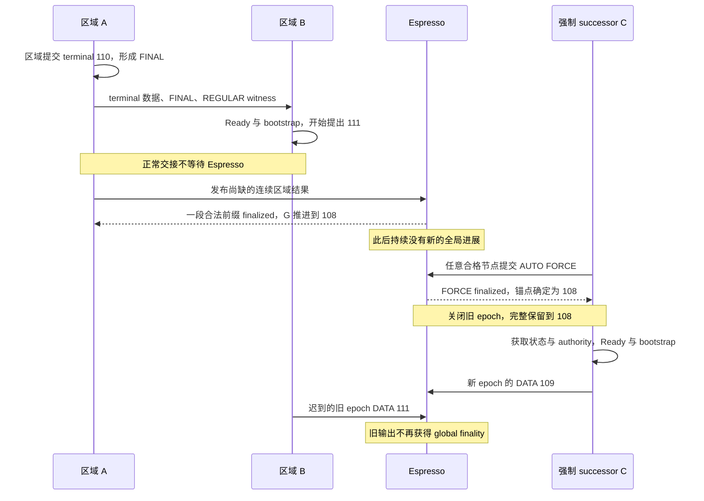

# Espresso 版区域轮换：修订计划 v2

**后续修订：**最新的 Espresso timestamp、自动 block-missing Force、L1 多签控制及三模块架构，见[修订计划 v3](espresso_revision_plan_v3_zh.md)、[Architecture v3 提纲](arch_v3_outline_zh.md)和 [Part II v2 提纲](sync_hotstuff_rr_part2_v2_outline_zh.md)。
本文件保留为上一轮讨论记录；其中必须发布显式 FORCE tag 的默认路径已由新提纲中的确定性事件解释替代。

**日期：2026-10-17。**
本计划按本轮讨论重新确定 Architecture v3 与 Part II 的方向，基于当前 [arch_v2.tex][ARCH] 和 [Part II][PART2]。
相对于[上一份 Espresso 架构设想][PREV]，最重要的修改是：**正常跨区域轮换不等待 Espresso 全局确认；只有强制重开分支需要等待 FORCE 标记最终确定。**
本文是修订方案与设计推演，不直接改写现有 TeX 协议。

## 1. 推荐采用的四条规则

你的方案可以作为新版本的主线，建议明确写成以下四条。

1. **全局最终性。**合法区域输出以完整、连续且当时仍获授权的形式进入 Espresso finalized 历史后，立即成为全局最终输出，不再等待多签、额外计时或 L1 发布。
2. **多签权限。**多签管理区域参与资格、隔离和恢复，也可请求强制切换；所有操作只能影响之后的服务，不能删除或替换既有全局前缀。
3. **正常轮换。**Successor 拿到前一区域 terminal FINAL、确定的交接规则、所需状态和 authority 后即可启动；不必等待 terminal block 上 Espresso。
4. **强制轮换。**有效 FORCE 在 Espresso 中 finalized 时，固定其之前的全局末尾，关闭旧生产分支的后续发布资格；新 session 在该完整前缀上 Ready 后开始生产。

这四条可以同时实现，但要接受一个明确结果：

> 正常生产可以领先于全局确认，因此必须保留一段可被放弃的区域已提交后缀。
> Force 只能放弃这段尚未全局确认的后缀，不能触碰已经全局确认的部分。

这比上一份“正式正常交接等待 Espresso 边界”的基础方案更符合你的性能目标。
代价是不能再删除所有 provisional branch 和 session 隔离逻辑；可以删除的是多签保护计时与对全局前缀的回滚权。

## 2. 全局最终性规则需要补上的三个限定

### 2.1 “被 Espresso finalized”必须指合格的输出记录

“regional finalized + Espresso finalized ⇒ globally finalized”是正确的简述。
但不能把任意写入 Espresso 的字节都当作合格输出，否则它会和“FORCE 之后旧区域输出不能再全局确认”直接冲突。

例如，旧区域在 FORCE 之后仍能提交一份签名有效的旧 FINAL；Espresso 可以记录这段字节，MegaETH 却必须拒绝把它加入全局历史。
因此，更准确的定义是：

```text
一个 B 获得 global finality，当且仅当：

  1. B 具有合法的区域提交凭证与完整数据；
  2. 在其 Espresso 记录位置之前，B 所属分支仍有发布资格；
  3. 它与必要祖先、正常交接凭证一起，构成当前 G 的连续扩展；
  4. 承载这次合法扩展的 Espresso 记录已经 finalized。
```

资格、session、祖先和顺序检查是“这是不是本链输出”的定义，不是额外的一轮共识。
通过后立即确认，不再有旧 Part II 的 `T_wait`。

### 2.2 祖先必须一起得到保护

假设 A 的终端块是 110，B 已根据区域 FINAL 开始生产 111。
如果 Espresso 先出现 111 的记录，而 101–110 尚未成为连续、可验证的全局前缀，就不能只把 111 单独宣布为全局最终。
否则 FORCE 保留到 100 后，111 的父历史会消失。

建议发布接口支持一个完整 export bundle：

```text
EXPORT {
    branch_epoch,
    expected_global_base,
    consecutive_DATA_blocks,
    regional_receipts,
    regular_boundary_witnesses,
    required_authority_and_native_context
}
```

例如 B 的 publisher 可以一次提交 101–111，包括 A 的终端凭证和 A→B 的正常边界。
该记录 finalized 后，101–111 一起进入 G。
区域 B 的一张 receipt 不能代替区域 A 的提交证据；跨 session 的来源验证仍须保留。[现有 receipt coverage 规则][PART2]

第一版可以要求 `expected_global_base` 精确匹配当前 G，并对整包进行原子验证和接受。
过时、缺祖先或不接续的包不推进 G，publisher 根据新前沿重新打包。
不能让一个早先未被接受的记录，因后来出现别的材料而被回溯性地解释成早已全局确认。

### 2.3 Force 的先后顺序以 Espresso 位置为准

记录位置至少需要精确到 Espresso block、namespace transaction 和 envelope 内位置。
同一个 Espresso block 中，也可能先有 EXPORT、后有 FORCE，或者顺序相反。

- EXPORT 在有效 FORCE 之前：先按旧分支规则验证；接受的输出保留。
- EXPORT 在有效 FORCE 之后：必须满足新分支规则；旧分支的新输出不再被接受。

既不按 proposer 的发送时间判断，也不按某节点先收到哪个网络消息判断。
如果 Espresso 一次向观察者交付一个包含 FORCE 的 finalized 区间，观察者先顺序处理前面的数据，再处理 FORCE。

## 3. 两条进度线：生产进度与全局进度

这是正常轮换不等待 global finality 后，必须新增的明确区分。

| 进度 | 意义 | 由什么推动 |
| --- | --- | --- |
| 区域生产分支 `R` | 区域已经提交、经正常交接继续扩展的历史 | 区域 FINAL、terminal receipt、Ready / bootstrap |
| 全局前缀 `G` | 已被 Espresso finalized 且通过接受规则的连续输出 | 合法 EXPORT |
| 发布前缀 `C_pub` | 已完成规定 DA 对应与执行验证的发布区间 | Publication Verifier |

可能出现：

```text
区域生产：A 已完成 → B 已完成 → C 正在生产
全局确认：G 仍位于 A 的 session 中
DA 发布：C_pub 又落后于 G
```

因此，“G 所在区域”“Espresso 最近得知的生产区域”“区域网络上正在工作的区域”可能不同。
不能继续用一个 `active_region` 同时表达三件事。

正常交接期间，后一区域的提交仍是区域层面的可靠结果；它尚未得到全局不可撤销性。
如果其祖先尚未进入 G，就可能随 FORCE 被放弃。
客户端的不可回滚承诺应对应 G，而不是“已经轮到下一区域”这一事实。

## 4. 正常轮换的新规则

### 4.1 保留原 Part II 的快速路径

区域 A 在 session `sigma_r` 中运行到固定 quota 终点 `T_r`。
取得 terminal FINAL 后：

1. 验证 T_r、完整所需状态、quota、区域 authority 和正常交接依据。
2. 按已经确定的选择规则计算 successor B。
3. 构造 `REGULAR` witness，继承 `anchor = T_r`。
4. B 的成员各自达到 Ready，启动新 session 的 bootstrap。
5. B 可以提出、投票并区域提交后续 DATA，同时 publisher 继续把 A、B 的连续结果发布到 Espresso。

**这条路径不等待 T_r 或 REGULAR witness 在 Espresso finalized，也不需要每次正常交接新增 L1 交易。**
这是对当前 Part II §6 快速交接原则的保留。[Part II 正常交接与 Ready][PART2]

区域内的 leader term、generation recovery、FINAL 与 terminal DRAIN 原则上保留。
外部 global finality 的变化不需要重写其全部内部机制。

### 4.2 Session ID 在交接前就必须可计算

正常 session ID 不能依赖它将来被纳入 Espresso 的位置，否则 successor 必须等那个位置确定才能签名。
建议使用交接时已经确定的字段：

```text
regular_session_id = H(
    chain_id,
    branch_epoch,
    predecessor_session_id,
    REGULAR,
    terminal_block_hash,
    successor_region,
    authority_ref,
    selection_plan_ref
)
```

不同 FINAL signer set 和 certificate 编码不改变 session ID。
所有区域消息、输出凭证和发布包都绑定这个 ID 及 `branch_epoch`。

### 4.3 正常 successor 不能在发布时被重新选择

如果 B 已按合法 terminal witness 开始生产，后来提交 Espresso 时又根据一张更新的 live map 重新选出 C，正常交接会失去确定性。
所以必须把用于选择 successor 的控制快照或计划固定在 witness 中。

这里有一个真实取舍：

| 方案 | 优点 | 代价 |
| --- | --- | --- |
| **每个 branch epoch 使用已冻结的 rotation plan，建议作为首个完整模型** | 所有正常交接都可提前确定，无需等待新的全局控制位置 | 需要立即改变排班时，通过新的已确认控制边界启用新计划 |
| 每个正常边界使用确定的历史 selection snapshot | 更接近当前 `lambda(T_r)` 规则，状态更新更细 | 必须定义唯一选取方法、更新生效范围和旧 witness 的效力，不能让 leader 随意挑旧快照 |

本文后面的核心流程采用第一种，避免把这项政策选择隐藏在“读取最新状态”里。
`Plan_epoch` 可以保留固定循环顺序、`NextLive` 和预先 finalized 的 authority 分配，不代表每次正常交接必须重新配置。

多签对待命区域的普通健康报告可以进入待生效配置。
如果要求立即禁止该区域参与当前生产计划，应使用 finalized 的 FORCE / RECONFIG 边界启用新计划，而不是悄悄改写既有 witness。
这会放弃尚未确认的生产后缀，是第一版为保持规则清楚付出的控制变更成本。

后续若希望频繁调整待命区域而不重开分支，可以增加有明确未来生效点的计划更新；必须处理已经提前打开的 successor sessions。

## 5. FORCE 的范围：关闭旧 branch epoch

### 5.1 为什么只封禁“旧区域”还不够

考虑以下情况：

```text
G = A 的 DATA 100
A 区域提交到 110，并正常交给 B
B 已区域提交 111–115
FORCE finalized 时，101–115 都还没有进入 G
```

如果 FORCE 只禁止 A 之后再发布，B 的 111–115 仍可能被提交。
但它们依赖已经放弃的 A 的 101–110，不能继续接在新分支的 100 后面。

所以，FORCE 必须同时阻止旧后缀及依赖它的正常 successor sessions 之后进入全局历史。
它影响的是一条尚未全局确认的生产分支，不只是一个地理区域的发送权限。

### 5.2 建议新增 branch epoch

这里的 epoch 不是 staking epoch、Espresso validator epoch，也不是区域内部的 recovery generation。
它表示两次强制重开之间的一条生产分支，记为 `epsilon`。

- 普通 leader 轮换：不改变 epsilon。
- 区域内 recovery：不改变 epsilon。
- 正常跨区域轮换：不改变 epsilon。
- FORCE 成功生效：关闭 epsilon，建立新 epsilon。

因此，所有正常 session 可以自由向前生产，但都带着同一个可被关闭的分支标识。
FORCE 之后，旧 epsilon 的新输出一律不能再追加到 G；已经在 G 中的旧 epsilon 数据保持原样。

这比在每次发布时重新计算复杂的递归 `Del(F)` 更容易实现。
但它仍保留一个重要事实：旧分支可能有多级正常后继，这些尚未确认的后缀需要被归档和停止继续发布。

### 5.3 FORCE 的记录和锚点

建议的记录形状是：

```text
FORCE {
    chain_id,
    target_branch_epoch,
    trigger_kind,                 // AUTO_STALL 或 ADMIN
    request_id,
    trigger_evidence,
    next_plan_ref
}
```

记录里不允许有任意选择的 retained height 或 retained hash。
它在位置 p 合法生效时，锚点自动定义为：

```text
A_force = G after processing all Espresso records strictly before p
```

这是 **FORCE 之前最后一块被本链规则接受的全局 DATA**，不是最后一条原始 namespace 交易，也不是 `C_pub` 的末尾。
其原始 session、region 和历史凭证都保留，不把旧数据重新归属于新 session。

### 5.4 FORCE 的生效步骤

在完整验证包含该 FORCE 的 finalized Espresso 历史后：

1. 检查目标 epsilon 仍有效，并验证自动触发条件或管理授权。
2. 完整保留当前 G，关闭旧 epsilon 的后续追加资格。
3. 按新的已认证计划确定 successor；建立新 epsilon 和新 session 身份。
4. 向 successor 提供 A_force、完整状态及所需 authority。
5. Successor 达到 Ready 后，执行区域 bootstrap，并从 `h(A_force)+1` 提出新的 DATA。

FORCE 被签名、提交，或者只是被尚未 finalized 的 Espresso 区块包含，都不等于上述切换已经生效。
在它最终确定之前，旧分支仍可以区域生产、正常交接，并让排在 FORCE 前面的合法输出获得 global finality。

FORCE 一旦 finalized 就确定切换，不再等待另一个独立 L1 activation height。
如果管理授权采用 L1 证据，应把“授权已经 finalized”作为 FORCE 有效性的前提；不能在 Espresso FORCE 之后再设置一个可能改变锚点的生效阶段。

若暂时没有 successor 或尚缺可恢复状态，进入等待；不回滚 G，也不让旧 epsilon 重新获得发布资格。
之后以可验证的恢复/选择记录打开新 session，不能让各节点在本地自行挑选不同区域。

## 6. 自动触发与多签触发使用同一种切换效果

### 6.1 自动 FORCE：没有新的全局交付

我建议基础触发器先检查整个当前 epsilon 的交付进展：

```text
AutoStall = Espresso 持续 finalized，
            但 G 在规定窗口内没有前进。
```

这比直接宣称“当前区域已经 offline”更准确，因为停滞可能来自区域 BFT、发布者、缺失前缀、状态获取或 Espresso 对本链的包含延迟。
它提供的是安全地尝试另一条生产服务路径的依据，不是故障归责证明。

以 Espresso 区块高度计时，可设置：

- `K_start`：新 epsilon 开启后，等待第一段有效全局交付的窗口。
- `K_publish`：已经有交付后，等待 G 再次前进的窗口。

完整重放已验证的日志后，依据 `e_open` 或最近一次实际推进 G 的 `e_progress` 计算期限。
有效空 DATA 是否算进展须明文定义；沿用当前 DATA quota 规则时可以计入，但它不能证明抗审查。
重复项、仅有 heartbeat、正常交接通知和无效记录都不能重置这个全局交付时钟。

任何节点都可以自动构造并提交 AUTO_STALL 类型的 FORCE；不需要多签批准。
“自动”在这里表示授权和触发条件由协议检查，并不假设 Espresso 验证者运行我们的应用合约。
及时提交与包含仍需要至少一个工作的提交者及 Espresso 活性。

若以后希望完全不依赖额外提交者，也可把超时边界定义为某个 finalized Espresso 区块末尾的隐式事件。
那是另一种编码方式；本轮采用你提出的显式 FORCE tag，避免混用两个生效位置。

### 6.2 AUTO 请求在 tag 位置重新检查

AUTO FORCE 的证据应绑定它观察到的 `epsilon` 和 `progress_version`，例如 `(epsilon, h(G), digest(G))`。
在 FORCE 的实际日志位置 p 重新检查：

1. 目标 epsilon 仍是当前 epsilon。
2. 被观察的进展版本仍与此刻匹配。
3. 当前位置的完整 finalized 历史确实满足无进展窗口。

若 FORCE 前先接受了新数据，旧 AUTO 请求失效，不能用过期的停滞观察制造切换。
区域在网络外生成了更多结果，但没有形成新的合格全局交付，不会让该请求自动失效。

`next_plan_ref` 也不是任意调用者选择 successor 的权利。
AUTO 的新计划和选择结果必须按已认证 authority、按序处理的管理状态及固定选择政策确定；传入的引用只是这些输入的证明。
ADMIN 可以携带管理权限明确允许的新配置，但仍不能指定一个更旧的数据 anchor。

### 6.3 多签 FORCE：即使仍在输出也可以隔离

多签可以因安全或运营风险请求 ADMIN FORCE，不必满足零进展窗口。
例如区域仍有输出，但存在密钥泄露或同步性破坏的严重疑虑。

ADMIN FORCE 与 AUTO FORCE 的触发条件不同，执行结果相同：

```text
保留 p 之前的完整 G
关闭旧 epsilon
按合法新计划打开新 epsilon
```

因此，新数据在 ADMIN FORCE 前到达时，应先保留这些已接受数据，再切换；不必像 AUTO 一样因出现进展就自动取消管理命令。
如果管理请求仅针对早已结束的 session，协议可以把它降为未来隔离或判为过时；是否请求关闭整个当前 epsilon，必须在指令类型和权限中明确。

管理动作不能重新设置历史 authority、修改旧 receipt 的权重分母，或更换 Espresso 信任根来绕过前缀保护。
能够任意升级验证逻辑的治理权应作为另一项系统假设，不属于“只管理活性”的多签接口。

## 7. 当前生产区域与其他区域的活性

### 7.1 不再把全局 cursor 所在区域叫作 current leader region

不等待 global finality 的正常路径意味着：某区域已经结束生产，但 Espresso 还没收到它的数据。
自动控制不能仅从 G 的 owner 推出现在是谁在生产。

建议区分：

- `producer_head_local`：区域网络通过有效 terminal witness 得知的生产分支末端。
- `producer_head_E`：Espresso 已记录的最新可验证交接通知所指向的 session。
- `owner(G)`：全局最后一块 DATA 的原始生产区域。

三者可能暂时不同。
如果需要按当前生产区域监控，可增加小型 `HANDOFF_NOTICE`：包含正常边界、terminal header / receipt、计划引用和 successor，但不必等待全部 DATA payload 发布。
节点核对通知的授权和接续关系；通知只能推进已经证明的同一生产分支，不能凭一个自报的 session index 声称自己成为 leader。

**B 不等待这个通知 finalized 才开始生产。**
通知提供公共观测，不为生产增加一道新的确认门槛。
它是控制元数据，不是完整 DATA export，因此不能使缺失的普通数据获得 global finality。

`producer_head_E` 仍可能落后于区域网络，只能表示最新已被共同验证的生产分配，不能证明某节点已经实际 Ready。
通知可以辅助 successor 选择和运维诊断，但不重置全局无进展时钟，避免靠连续通知掩盖永远不发布 DATA 的问题。

### 7.2 “当前区域超时”可以作为第二个检测器

在有上述公共交接记录后，还可以对已知 session 设置从启动到首次交付、以及两次交付之间的期限。
这适合更快发现当前服务者不工作，却不能完全区分“区域没提交”与“前序发布缺口让它暂时无法全局交付”。
因此推荐先以 epsilon 的全局无进展触发器作为协议基础，再将 per-region 超时用于诊断、临时暂停或进一步的明确策略。
不要在缺少公开交接信息时给某个区域分配一个所有人都应认可的 deadline。

强制 successor 的选择也需要一个明确的轮换游标。
它可以来自最新已认证的生产分配及新计划，但不能直接把 `owner(G)` 当作被判失败的区域。
如果公共信息落后导致选区不理想，可能损害恢复效率；不会授权删除 G。

### 7.3 其他区域不因没有正式输出而自动 offline

待命区域没有当前 DATA 生产义务。
推荐保留以下分离：

| 信息 | 作用 |
| --- | --- |
| Staking / authority 资格 | 决定区域是否有服务资格 |
| 多签 quarantine | 明确禁止使用该区域，优先于自动恢复 |
| 自动 cooldown | 某次服务失败后的临时暂停，不代表永久故障 |
| READY / heartbeat | 提供近期就绪线索，不证明未来活性或 Byzantine 上界 |
| 接班后的真实输出 | 验证这次服务是否持续推进 |

AUTO 发现的是服务路径没有交付，不应自动认定某个旧 block proposer 有罪，更不能只凭这项事实进行 equivocation slashing。
独立 publisher 或其他区域副本补发的有效结果，仍计作原生产区域的输出。

冻结计划的基础版中，这些健康状态影响下一次合法计划建立。
要求立即排除当前计划内某区域时，用明确的控制边界切换计划；若以后加入更细的计划更新，需要保留已经打开 session 的确定性。

## 8. 竞争情形：哪些内容保留，哪些失去资格

以下数字均是 DATA 高度，不是 Espresso 区块高度。

### 情形 A：正常交接领先于全局确认

```text
G = 100
A 区域提交到 110，B 基于 FINAL(110) 开始生产
B 区域提交 111
Espresso 接受完整 EXPORT(101..111)
G = 111
```

B 的启动没有等待 global finality。
101–111 在合法发布包 finalized 时成为连续全局前缀，没有额外等待期。

### 情形 B：FORCE 先于尚未发布的正常后缀

```text
G = 100
epsilon 0：A 已提交到 110，B 已提交到 115

Espresso 顺序：
    FORCE(epsilon 0 → epsilon 1)
    EXPORT(A:101..110, epsilon 0)   // 不再接受
    EXPORT(B:111..115, epsilon 0)   // 同样不再接受
    EXPORT(C:101..103, epsilon 1)   // 若凭证和接续有效则接受
```

新 C 从 100 开始，不必寻找旧区域私下可能已经提交的最高块。
A、B 的旧区域提交证据仍是历史事实，但不能再为旧分支追加全局输出。
未进入 G 的用户请求保留或重新进入待处理队列；已经进入 G 的请求不能重复执行。

### 情形 C：一些旧分支结果排在 FORCE 之前

```text
原 G = 100
EXPORT(A:101..110, B:111..112, epsilon 0)
ADMIN_FORCE(epsilon 0 → epsilon 1)
```

FORCE 锚点必须是 B 的 112，不再是发出请求时看到的 100，也不一定属于最初报告故障的区域。
新 session 从 113 继续。
若这是一份绑定旧进展版本的 AUTO FORCE，则 EXPORT 的成功先使该 AUTO 请求过时，这次不切换。

### 情形 D：普通交接已发生，但两边都不知道 FORCE 已经在路上

FORCE 尚未 finalized 时，A→B 仍可沿正常快速路径推进。
一旦节点完整验证到有效 FORCE，就把尚未全局确认的旧 epsilon 后缀隔离。
先前已经启动的 B 不能继续使用旧 session 身份发布；即使 successor 仍选中 B，也要从 FORCE 锚点以新身份重开。

新 session 不能借用旧 session 的锁、投票或 commit timers。
它可以复用经过验证的执行缓存，但需要与保留前缀一致。

### 情形 E：FORCE 前后没有新 DATA

某新区域始终没有输出时，下一次 Force 可以仍以同一个 G 为 anchor。
数据高度不变，branch epoch 和 session 身份仍改变。
因此，旧 FORCE 重放不能靠“高度恰好仍相同”再次关闭一个新 session。
所有请求必须绑定目标 epsilon，成功生效后幂等。

### 情形 F：同一区块内发生竞争

```text
Espresso block e：
  position 0: EXPORT(旧 epsilon 的合法连续数据)
  position 1: FORCE
  position 2: EXPORT(旧 epsilon 的更多数据)
```

位置 0 的内容先被保留；有效 FORCE 在位置 1 关闭旧 epsilon；位置 2 的新内容不进入 G。
若 FORCE 是 AUTO，位置 0 的进展还可能使它失效；随后按未切换状态继续解释位置 2。
这要求验证器真正重放记录顺序，不能只检查若干 inclusion proofs 或粗略的 Espresso 高度。

## 9. 一条时间线说明正常与强制路径的区别



图中的 C 只是一个提交 FORCE 的例子；提交者不因此获得 successor 权利。
Successor 仍由协议计划和合法控制状态确定。

## 10. 最小状态与验证接口

可以把公共状态整理为：

```text
GlobalRotationState {
    current_branch_epoch,
    current_plan_ref,
    global_height, global_prefix_digest,
    confirmed_session_context,
    observed_producer_head,       // 若采用交接通知
    control_state_commitment,
    epoch_open_E_height, last_global_progress_E_height,
    espresso_position, quorum_anchor,
    applied_control_ids
}
```

区域副本另外维护尚未确认的生产分支、各 session 的引擎状态与 pending requests。
这部分状态可以领先公共确认状态，不能拿来直接替代 `global_height`。

核心接口建议如下：

```text
ValidateRegionalOutput(B, receipt, authority, context)
ValidateRegularWitness(W, plan, terminal_receipt)
ApplyExport(public_state, export_bundle)
ApplyForce(public_state, force_record)
VerifyEspressoPrefix(previous_checkpoint, blocks_and_proofs)
VerifyNextPublication(publication_checkpoint, global_range, DA, execution)
```

`ApplyExport` 只追加当前 epsilon 的合法连续扩展。
`ApplyForce` 不接受 caller 指定的旧 anchor，只使用处理到该位置时已经存在的 G。
两者都以完整认证的 Espresso 顺序为输入。

在 replay 验证中：

- 完整 record 本身缺必填字段，可以确定为无效。
- 下载尚不完整或 namespace 完整性未验证，不能确定其内容，必须继续获取。
- 不允许任意外部引用成为永久阻塞点；初版应让记录自带规定的有界证据，缓存仅替代已经认证的对象。

### 10.1 Certifier 复用边界

继续复用 PR #8 的 Espresso finality、quorum 演进、namespace 完整性和 DA 绑定机制。
新开发部分是上面的分支、正常 witness、FORCE 与 source authorization 状态机。[PR #8 Certifier][CERT]

正常 witness 必须能在数据全局确认之前构造，因此不能直接把原 PR 的单一 publisher / 按高度扫描逻辑视为完整的区域轮换验证器。
TEE 只替 L1 执行规定检查，不赋予 publisher、多签或 host 改写 G 的权利。
完整节点应直接运行同一套可重放规则。

任何检查点优化都只能证明自己是同一 Espresso 历史的正确推进；不能照搬一个允许管理者任意跳过未发布 G 的 cursor override。

### 10.2 Staking authority 与 session 索引

FORCE 后，新的 session 可能从比旧生产末端更低的 DATA 高度开始。
因此不能用一个 numeric session index 代替完整身份，也不能复用旧 session 的锁或投票。

可以使用 `(branch_epoch, session_index)` 作为新的索引空间，或保留当前 numeric index 并以完整 session ID 消歧。
无论选择哪种，新 session 都要绑定一份已经确定的 authority，旧 session 的历史权重不被重新解释。
新的计划如何引用已有 `AUTH_{r,g}` 或新的预分配范围，属于此次需要明确的 Staking 接口修改；不允许由当前墙钟 epoch 隐式替换快照。

## 11. 四个关键性质与保证边界

### 11.1 全局前缀单调

对完整验证的 Espresso 前缀进行确定性解释：

```text
S_p = Apply(S_previous, record_at_p)
G_p = global prefix contained in S_p
```

合法 EXPORT 只追加，正常控制元数据不删除 DATA，合法 FORCE 只重开之后的生产身份。
因此，已经属于 G 的 DATA 永不因为轮换而被删除。

多签的错误判断可能打断健康生产、丢失尚未全局确认的工作或阻断未来服务，但合法管理调用不能移除 G。
这项性质来自接受规则，而不再来自多签对私有 `G_msig` 的诚实承诺。

### 11.2 Global finality 不再需要观察者计时

观察者只要从可信起点完整验证到一个合格 EXPORT 的 finalized 位置，就可确认其输出。
无需等待可能在未来出现的 FORCE，因为未来 FORCE 必须保留当前 G。

一个更早的 FORCE 如果已经存在，就必定位于待验证记录之前的 Espresso 历史中；完整扫描和 namespace 完整性检查防止它被隐藏。
这正是新版本可以删除“必须先读取所有最新 L1 Force，再测试等待期”的原因。
不同观察者可以发现结果的时间不同，但不再为同一块各自重新等待一个 `T_wait`。

### 11.3 正常生产没有被 global confirmation 串行化

区域 receipt 和 Ready 足以启动正常 successor。
Espresso 延迟会扩大 `R` 与 `G` 之间的距离，而不会直接阻止每次正常交接。

这个差距可以用可选 backpressure 限制，例如最多允许若干未确认 DATA 或 session。
限制用于控制存储和潜在丢弃成本，不应被写成“每一次正常交接都必须等 G”。
如果为了资源安全启用限制，应明确达到限制时确实会暂停进一步生产。

### 11.4 这仍然不是无条件的执行与提现保证

这里确定的 global finality 是 DATA 内容、顺序和 provenance 不再被跨区域轮换改写。
若 DATA 承诺中包含 native receipts、执行上下文或结果，其正确性仍由区域输出有效性契约及执行验证承担。
Espresso 不替代 MegaETH 执行，也不修复已经违反区域 BFT 假设而产生的错误输出。

多签发现同步性或 Byzantine 上界风险后可以阻止后续服务，但不能通过事后隔离把已经确认的错误输入变为正确输入。
若要求执行结果本身永久不变，还需要正确父状态和所有相关 L1 执行依赖已经最终确定等条件。

PR #8 当前还允许规定情形下的 deposit-only 替代；这比 arch_v2 的忠实发布 G 更弱。
如果正式采用本文的强前缀语义，rollup adapter 不能再因迟到而自行覆盖已经进入 G 的普通内容，需要单独修订相应派生规则。[Architecture v2 Publication acceptance][ARCH] [PR #8 保证范围][OVERVIEW]

## 12. 仍需解决的活性与原生接口问题

### 12.1 超时不是对区域作恶的证明

自动 FORCE 说明该分支没有完成约定的全局交付，不说明某个 proposer 没有尝试提交。
Publisher 备份应当有机会在超时前补发；接手发布的身份不改变输出的区域来源。
发布奖励、服务保证金和 slashing 应继续与这个触发条件分开设计。

### 12.2 窗口必须容纳一次真实恢复

从 terminal receipt 到 successor Ready 的状态传输，目前仍只受 eventual backbone 假设约束。
如果使用固定的有限窗口，活性还需要至少一个正确服务路径最终能在窗口内完成：

```text
区域提交 → 凭证与数据传播 → 主/备发布 → Espresso 接受
```

否则，每个健康区域都可能在真正准备好之前被切走。
可以选择明确的最终时延界，或者设计公开、确定性的窗口放宽政策；不能把“网络最终会送达”直接当作固定恢复 deadline 的保证。

### 12.3 Espresso 停摆时，FORCE 也不能 finalized

该情况下保留 G，等待外部最终性服务恢复。
多签可以形成管理意图，但不能在没有 Espresso 确认的情况下凭自身权限制造另一条全局历史。
切换到其他最终性服务需要独立迁移协议，不属于本轮区域轮换。

### 12.4 最新 G 必须能成为合法的原生执行接续点

DATA 高度不等于 native mini-block 编号或 EVM block 高度。
如果 G 末尾位于未完成的 EVM block 中，新区域必须具备合法的 partial-EVM continuation、状态和签名权限。

如果当前 adapter 不支持这种接续，需要选择适当 export 粒度，使 G 的可见端点落在可恢复 checkpoint。
这个限制可以影响确认粒度，但不能在 FORCE 时再退回一个更旧的 EVM 边界。
否则就违背了“保留 FORCE 前最新全局块”。

### 12.5 旧区域引擎与数据保留

关闭 epsilon 首先撤销的是外部追加资格，不应被误写成一个区域 quit proof。
初版可以保持旧引擎的本地提交事实和证据不变，同时禁止其继续向公共分支追加。

如需让旧 engine 提前停止，另写一个以 finalized FORCE 作为证据的 `ExternallyClosed` 服务终止规则，并检查它与区域恢复职责的关系。
停止投票、停止发布、允许删除数据、允许提款是不同动作。
特别是，正常 Completion 不能让旧区域在 successor 或 publisher 尚未取得材料前删除唯一的数据副本。

## 13. Part II 的具体修订清单

| 当前部分 | 本轮修改 |
| --- | --- |
| Overview | 改为区域生产与 Espresso 全局确认两条进度线；明确正常交接不等待 global |
| L1 / control model | 保留历史 authority；把实际切换顺序移到 Espresso FORCE；区分自动触发与管理授权 |
| 区域 definitions | 添加 branch epoch 的身份绑定；保留固定 snapshot、quota 与 receipt 契约 |
| Steady / recovery | 以尽量小的 delta 保留内部引擎；单独规定输出导出与被关闭后的服务职责 |
| Regional / global finality | Regional finality 保持其提交事实；global 改为合法连续 EXPORT 的 Espresso finalization |
| Regular handoff | 保留 terminal receipt → Ready → bootstrap，删除新的 Espresso 等待门槛 |
| Successor selection | 固定 witness 的计划引用；首个模型使用 epoch 内冻结计划，禁止提交时重新选区 |
| Force handler | 删除自选 `h_*`、`G_msig`、保护 deadline 和额外 L1 activation；改为日志位置处保留 G 并关闭 epsilon |
| Observer | 删除首次 relay 时间、`T_wait`、待删范围的 promotion veto；改为完整日志重放与前缀检查 |
| Request queue | 只在进入 G 后最终移除；被放弃的区域后缀请求仍可重新考虑 |
| Safety argument | 由 deadline 分情况证明改为确定性日志解释、前缀保持与分支隔离论证 |
| Liveness | 加入发布服务、自动 FORCE 提交、Espresso 包含、可用 successor 和状态恢复条件 |

旧 `Del(F)` 的“删除外部分支”语义应退出 global finality 规则。
本地仍可以计算哪些 provisional descendants 需要归档，但这只用于资源和请求管理，不赋予删除 G 的权限。

## 14. Architecture 与实现的修订顺序

建议按以下顺序把讨论收敛成正式版本。

1. **固定语义和类型。**定义 DATA export、REGULAR witness、HANDOFF_NOTICE、FORCE、branch epoch 和 G；明确原始日志记录与被接受输出的区别。
2. **固定正常交接规则。**明确 terminal receipt 所绑定的 selection plan，并证明正常 session ID 无需等待 Espresso 位置即可计算。
3. **写最小 replay 规则。**先只实现 EXPORT 追加和 FORCE 关闭，逐一处理旧 epoch、缺祖先、重复项和竞争顺序。
4. **加入自动活性检测。**先做 G 无进展；按需要加入公共生产交接通知和更细的 per-region 检测。
5. **收缩多签接口。**保留健康配置和 ADMIN FORCE；去掉能够选择旧 anchor、任意设置 cursor 或重解释历史的日常权限。
6. **接入 publisher 与 certifier。**区域结果可由多个中继发布；复用 Espresso 证明验证，新增本文的分支与控制状态机。
7. **核对原生发布接口。**解决 latest-G 接续、准确区间、DA、执行有效性和过期派生规则之间的对应。
8. **重写性质与边界。**分别陈述输入前缀安全、区域输出正确性、控制权限和有条件的活性，不把它们合成一个无条件承诺。

## 15. 正式化前的检查场景

| 场景 | 必须得到的结果 |
| --- | --- |
| B 在 A 的 terminal block 全局确认前启动 | 允许；B 的全局发布仍须补齐完整祖先 |
| B 的记录先于缺失父记录被 Espresso 包含 | 不能单独成为合格全局输出；按规则补齐或重投 |
| AUTO FORCE 前刚接受新的 EXPORT | 旧无进展请求失效 |
| ADMIN FORCE 前刚接受新的 EXPORT | 保留新进展后切换，不能退回请求时的旧前沿 |
| FORCE 前已有正常 successor 的全局块 | 完整保留这些块，以它们中的末尾作为新 anchor |
| FORCE 后出现旧正常 successor 的迟到记录 | 旧 epsilon 失效，即使它的 region 不等于最初故障区域也不能接回 |
| 两个 FORCE 指向同一 epsilon | 第一个有效生效，后者目标过时 |
| 新 epsilon 无输出，G 高度没有变化 | 可再次恢复，但必须使用新的目标身份与期限 |
| 多签停用一个待命区域 | 按明确的配置生效规则影响计划，不重解释旧 witness |
| 仅有一处 RPC 缺数据 | 不产生有效的无进展证明 |
| G 高于 C_pub | FORCE 保留 G；后续发布从 C_pub 继续补齐 |
| 最新 G 在 partial EVM block 内 | 精确恢复该状态或等待；不能偷偷回退 |

本文建议把第 1 节四条规则作为新版的固定设计目标。
最重要的配套决定是：正常路径允许未确认后缀，而 FORCE 以 Espresso 顺序为边界，对旧 branch epoch 的未来输出统一停止接受。
这样可以同时保留正常轮换的速度，以及全局确认之后不可被管理委员会推翻的性质。

## 来源与版本定位

- [Architecture v2][ARCH]：模块边界、DATA / native 索引、publication checkpoint 和执行接续要求。
- [当前 Part II][PART2]：§3.3 FINAL 与 receipt coverage，§5 原 global waiting rule，§6 正常交接与 Ready，§7 原 Force 语义。
- [上一轮 Espresso 架构设想][PREV]：记录其方案比较；其中等待 Espresso 的正常交接默认方案由本文替代。
- [PR #8 Certifier][CERT]：复用 Espresso finality、quorum、namespace 与 DA 绑定验证机制；本文的新控制逻辑并非该 PR 已有功能。
- [PR #8 Overview][OVERVIEW]：核对其条件性确认与 deposit-only 保证范围。

[ARCH]: arch_v2.tex
[PART2]: sync_hotstuff_rr_part2_rotation.tex
[PREV]: arch_v3_espresso_brainstorm_zh.md
[CERT]: https://github.com/megaeth-labs/specification/blob/aedc2826663b134ee25d26bea17e70c6d23d321c/specs/block-certification/certifier.md
[OVERVIEW]: https://github.com/megaeth-labs/specification/blob/aedc2826663b134ee25d26bea17e70c6d23d321c/specs/block-certification/overview.md
