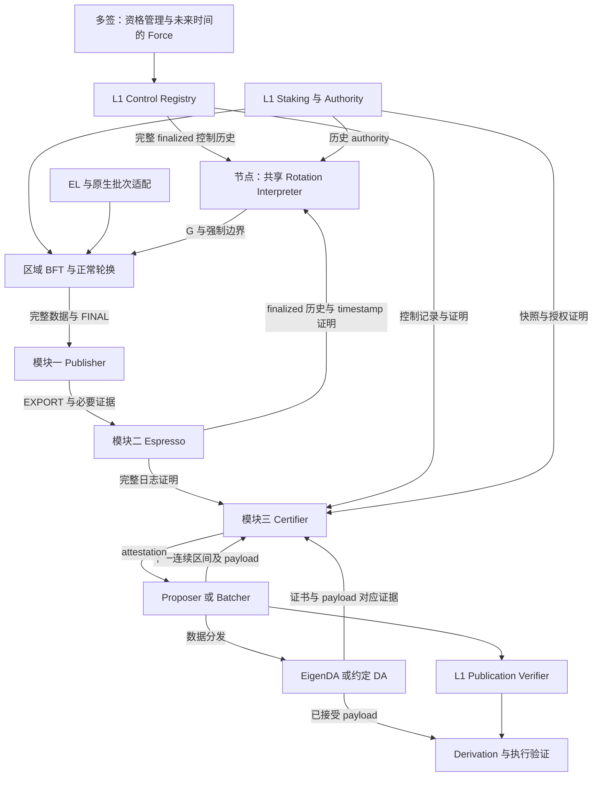

# Architecture v3 提纲：L1 控制、Espresso 时间与三模块发布验证

**日期：2026-10-17。**
设计判断与默认规则见[修订计划 v3][PLAN]；轮换的状态与事件语义见 [Part II v2 提纲][PART2V2]。
本文给出后续 `arch_v3.tex` 应表达的模块架构和接口，尚不是实现或完整形式化规范。

## 1. 架构目标

区域 BFT 继续提供快速的区域提交与正常跨区域交接。
新增三个明确模块：

1. **Publisher：**把区域提交结果及完整凭证持续送入 Espresso。
2. **Espresso：**提供带认证 timestamp 的 finalized 有序数据日志。
3. **Certifier：**验证 L1 控制、Espresso 历史与轮换规则，并把全局前缀绑定到准确的 DA 发布。

多签仍只写 L1。
Block-missing Force 由节点和 certifier 共享的确定性解释规则导出，不需要多签授权。
多签 Force 与资格变更提前发布在 L1，并按 Espresso timestamp 生效。

正常交接不等待 terminal DATA 的 global finality；全局确认不等待 Espresso 状态回传到 L1。
两种 Force 都保留已经获得全局确认的整个 G。

## 2. 总体图



Rotation Interpreter 是节点与 certifier 共用的协议逻辑，不是新的投票机构。
它从已经认证的输入导出自动 Force、管理事件与 global prefix。
Espresso 不执行该程序，也不需要部署本链的智能合约。

## 3. 共同对象与三个进度前沿

| 对象 | 含义 |
| --- | --- |
| `authority_ref` | 一个 session 使用的不可变成员、权重、参数和 leader schedule 依据 |
| `branch_epoch` | 两次强制重开之间的生产分支身份，区别于 staking epoch 和 Espresso validator epoch |
| `session_id` | 一个区域生产回合的完整身份，绑定 branch epoch、anchor、选择依据与 authority |
| `RegionalBundle` | 完整 DATA、区域 FINAL 或覆盖凭证、祖先与正常交接 witness |
| `selection_ref` | 正常 handoff 绑定的已认证 Espresso 历史参考点 |
| `ControlRecord` | L1 上授权的管理操作，包含 `activate_at` 和唯一控制序号 |
| `DerivedForce` | Interpreter 导出的 AUTO 或已生效 MSIG 边界，绑定原因、目标身份、触发区块与 G |
| `GlobalCheckpoint` | 全局输入前缀及解释它所需的轮换、窗口、控制和证明状态 |
| `PublicationCheckpoint` | 已接受发布到哪个连续区间，以及对应执行验证状态 |

三个前沿分别是：

```text
R      区域生产分支：可能已经正常轮换到后续多个 session
G      全局输入前缀：Espresso finalized 并经解释规则接受
C_pub  已接受发布前缀：准确对应 G 的一个连续前缀
```

生产 session 与 export session 必须分别命名。
前者负责当前区域网络中的新生产；后者负责 G 的下一个待交付 DATA。
自动 block-missing 检测默认作用于 export session。

DATA 高度、native mini-block 编号、EVM block 编号、Espresso 高度和 Espresso timestamp 不得混用。

## 4. 模块一：Publisher

### 4.1 职责

Publisher 获取、验证并传播区域提交材料，构造连续的 EXPORT，并跟踪其是否真正进入 G。
它不决定区域共识结果，也不决定 global finality。

默认可以由区域运营者运行 primary publisher，但提交资格应由输出凭证决定。
其他区域副本、successor 和外部服务可以发布同一份合法结果，不需要 primary 的额外许可。

一个 FINAL 凭证存在，不等于备份已经取得完整凭证和 payload。
正确成员应继续传播 FINAL；持有完整 receipt 的节点继续 relay；正常 Completion 不结束未完成的数据保留和转交职责。

### 4.2 输入与输出

```text
ReceiveRegionalBundle(bundle)
FetchMissingHistory(anchor, target)
BuildExport(expected_G, consecutive_range, evidence)
SubmitExport(export)
TrackAcceptedExport(output_id)
RepublishFrom(new_G)
```

EXPORT 至少绑定：

```text
chain_id, branch_epoch
expected_global_base
ordered_DATA_payloads
regional_commitment_evidence
session_and_regular_boundary_witnesses
authority_and_native_context
```

若需要跨过多个正常 session，必须提供每个 session 自己的提交来源证据。
同一 session 的 terminal receipt 可以覆盖其合法 DATA 祖先；后一 session 的 receipt 不能代替前一 session 的 receipt。

### 4.3 重试、备份和计奖边界

输出身份不依赖签名者集合或 envelope 编码，重复发布不产生重复 DATA 进度。
只有进入全局前缀的输出才能算成功交付；仅获得提交 API 回应或原始 inclusion 不够。
过时的 expected base、缺失前缀或无效 session 需要重新打包，不能回溯改变以前的扫描结果。

首发优先级、成功服务费与发布 SLA 可以单独设计。
Block-missing 是恢复触发条件，不直接等于可罚没证据。

## 5. 模块二：Espresso

### 5.1 服务契约

Espresso 提供：

- 前缀一致的 finalized 历史。
- 确定的区块、namespace transaction 和 record 顺序。
- 可认证的 timestamp。
- Finality、quorum 演进、namespace 完整内容或真实缺席的证据。
- 在明确的数据保留和活性条件下可获取的记录与证明。

它处理的是本链发布的数据，不负责解释区域 quota、活性 bitmap、Force 或 native execution。
服务条件与具体网络/profile 必须固定；不能从一个 API 字段推导未规定的时钟或延迟上界。

### 5.2 Timestamp 的用途

Timestamp 是共同控制时间轴：

- 管理记录的 `activate_at`。
- 启动窗口和后续交付窗口。
- 自动 cooldown 到期。
- 派生事件的触发位置。

真实的记录排序仍由 Espresso 高度和区块内位置确定。
同一个 timestamp 可以对应多个区块，不能据此把它们视为同时、无序或可回溯合并。

### 5.3 无需显式 AUTO tag

当第一块 finalized Espresso 区块的 timestamp 跨过一个失败窗口的截止点时，Interpreter 在该区块开头导出 AUTO Force。
这项状态转换不依赖 keeper 再提交一笔交易。
如需提供审计索引，可以生成派生事件或证据对象，但该对象只是同一规则的结果，不是第二次授权。

## 6. 模块三：Certifier

### 6.1 内部职责划分

```text
VerifyL1Control       验证 authority、控制历史及其版本
VerifyEspresso       验证 finalized 历史、quorum 与 namespace 完整性
ReplayRotation       导出活性状态、两类 Force、session 和 G
VerifyPublication    绑定准确的下一连续区间、DA 与执行接口
Attest               对具体输入输出关系签名或出具证明
```

PR #8 的 Espresso 验证、TEE 注册、cursor 和 DA 绑定提供可复用结构。[PR #8 Certifier][CERT]
新增的是 L1 管理记录的时间生效规则、区域输出授权、窗口检测及跨区域状态转换。
既有代码不能不加修改就验证本轮设计。

### 6.2 纯函数与 host 边界

Host 获取 L1、Espresso、区域和 DA 材料，但不能自行声称某个数据源“最新”“完整”或“已经超时”。
Core 依据已绑定的可信起点和证明处理输入，不从 host 的本地收包时间推断全局事件。

```text
VerifyAndReplay(
    previous_global_checkpoint,
    espresso_interval_and_complete_namespace_proofs,
    finalized_L1_control_context,
    regional_output_evidence
) -> next_global_checkpoint
```

```text
VerifyAndBindPublication(
    previous_publication_checkpoint,
    verified_global_checkpoint,
    exact_next_range,
    DA_payload_and_certificate,
    native_execution_evidence
) -> next_publication_checkpoint, attestation
```

### 6.3 控制历史完整性和新鲜度

L1 合约宜提供递增 `control_seq` 和控制历史承诺。
Certifier 的输出绑定其读取的完整控制前缀；不能只证明几条有利事件存在，遗漏中间 Force。

对于链上接受，初版可采取保守规则：attestation 使用的控制版本/承诺必须匹配合约要求的当前版本，否则刷新材料后重做。
后续可以优化为只要求覆盖处理区间内适用的所有控制，但需要完整性证明。
若保守规则暂时使发布等待新控制最终化，这只影响 C_pub 的推进，不能反过来删除 G。

链下完整节点另外依赖本轮 `T_L1` 服务契约，在提升 G 前具有足以覆盖相应 Espresso 时间的完整 finalized 控制视图。
“这份历史证明是真的”和“没有遗漏已经适用的控制”是不同检查。
TEE 能正确执行程序，并不能让过时输入自动成为完整输入。

### 6.4 Attestation 的绑定范围

至少绑定：

```text
chain / protocol version / destination contract
previous and next global checkpoints
Espresso verified interval, positions and quorum provenance
L1 control checkpoint, sequence and history commitment
branch epoch, export session, window and liveness-state commitments
exact DATA range and native input commitment
DA evidence and the applicable execution-verification result
```

程序升级、key 注册和 measurement 撤销仍有单独的治理与 TEE 信任条件。
日常活性多签不应拥有任意改写 G、重设 Espresso 信任锚点或授权任意验证程序的权限。

## 7. L1 上保留的模块

| 模块 | v3 职责 |
| --- | --- |
| Staking Service | Join / exit、不可变快照、责任和资金保留 |
| Authority / Schedule | 提前确定可使用的区域成员、leader schedule 和 quota |
| Control Registry | 记录多签资格更新和未来 Espresso 时间的 Force；提供顺序与历史承诺 |
| Publication Verifier | 检查 certifier 证明和控制版本，接受准确的下一个发布区间 |

多签只调用 Control Registry。
自动 Force 不需要每次写 L1；后续全局 checkpoint / publication 接受可以把派生状态带到 L1。
合约中的镜像可以落后于链下 G，不构成接班锚点的替代定义。

## 8. 两条运行路径

### 8.1 正常生产与全局确认

```text
区域提交 terminal DATA
    ├─ 交给正常 successor：Ready → bootstrap → 继续生产
    └─ Publisher 发布连续结果：Espresso finalized → Interpreter 接受 → G 前进
```

两条路径可以并行。
Successor 仍需要完整的正常边界、authority 和可执行状态；不等待 predecessor 的 global confirmation。

### 8.2 异常切换

```text
完整 finalized Espresso 区块跨过控制时间或失败窗口 deadline
    → Interpreter 处理到期事件
    → 保留当前 G，关闭旧 branch epoch
    → 根据有效资格选择 successor
    → successor 获取锚点与状态，Ready 后启动
```

新 session 的启动预算从实际触发区块 timestamp 开始。
强制 successor 不依赖 G 已上传到公共 Ethereum Light Client；它直接验证 Espresso 与 L1 控制证据。

## 9. 原生执行、DA 与发布

原 arch v2 的“准确下一区间”要求保留：不得跳过、重排或重复 G 中的 DATA。
Publisher 向 Espresso 的发布与 proposer 向 rollup DA 的发布是两个不同职责。
Espresso 数据可获取不自动替代约定的 rollup DA 证书和保留义务。

新区域必须能从 G 的精确末尾合法接续 native execution / signing。
如果末尾处于未完成 EVM block 内，必须支持 partial-EVM continuation，或者预先选择能提供可恢复端点的 export profile。
不能在 Force 时为了方便退回更旧的原生区块边界。

如果正式保证 G 的普通内容永久保留，不能直接沿用 PR #8 中所有可能丢弃普通内容的 deposit-only fallback；需要独立修订派生接口。[PR #8 保证范围][OVERVIEW]
区域正确输出假设和执行验证仍然必要，Espresso 只固定顺序并不会修复无效输入。

## 10. 架构层应明确的信任与活性条件

| 条件 | 用途 |
| --- | --- |
| L1 最终化与 `T_L1` 公告服务 | 管理操作在 Espresso 生效点前可被正确参与者验证 |
| 诚实、非追溯的管理服务 | 不安排会撤销既有全局判断的迟到控制 |
| Espresso finality、完整性与时钟 profile | 确定唯一日志和统一事件边界 |
| 区域固定快照及故障上界 | 使区域凭证的输出契约成立 |
| TEE / verifier integrity | 使 L1 接受的简洁证明代表规定检查 |
| 发布和数据获取服务 | 让合法区域结果及时进入 G，并使接班锚点可恢复 |
| 可用 successor 与充分窗口 | 使自动恢复最终得到实际进展 |

自动超时可以误判服务路径，却不能删除 G；这种误判主要影响活性。
迟到的管理指令若被追溯执行则可能影响安全，所以它被明确排除在模型许可的控制行为之外。
不能以不同节点的本地“看到晚了”作为各自忽略控制的规则。

[PLAN]: espresso_revision_plan_v3_zh.md
[PART2V2]: sync_hotstuff_rr_part2_v2_outline_zh.md
[CERT]: https://github.com/megaeth-labs/specification/blob/aedc2826663b134ee25d26bea17e70c6d23d321c/specs/block-certification/certifier.md
[OVERVIEW]: https://github.com/megaeth-labs/specification/blob/aedc2826663b134ee25d26bea17e70c6d23d321c/specs/block-certification/overview.md
