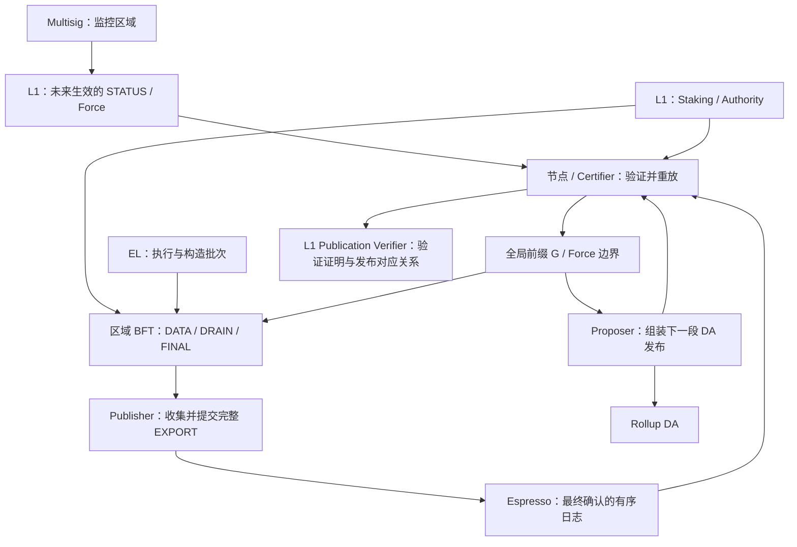

# Sequencer Rotation Architecture v3：中文阅读版

对应：[英文正文](arch_v3.tex) · [英文 PDF](arch_v3.pdf) · [Part II v2 中文阅读版](sync_hotstuff_rr_part2_rotation_v2_zh.md)

本文按英文正文的章节顺序重述，保留设计边界、关键公式和假设。为便于快速理解，压缩了接口编码和重复说明；它是阅读稿，不替代英文协议中的完整验证条件。

## 先看主线

区域 BFT 负责产生有区域提交证据的 DATA。Publisher 把完整结果提交给 Espresso。Espresso 对这些数据提供统一、不可逆的顺序。节点和 Certifier 同时验证 Espresso 历史、L1 控制历史以及区域证据，决定哪些 DATA 真正进入全局前缀 $G$。

**常规轮转跟着区域 FINAL 走；全局确认跟着 Espresso 的已接受输出走；Force 在 Espresso 时间边界关闭旧分支，并完整保留 $G$。**

这里的“已接受”很重要：Espresso 把一段字节记入链，并不自动说明它具有合法的区域证据、正确的前驱和当前 epoch 的输出权限。

## 1. 架构与当前重点

新增模块有三个：

| 模块 | 负责什么 | 权限边界 |
|---|---|---|
| Publisher | 获取区域数据和 FINAL，构造连续 EXPORT，提交、重试、跟踪是否被接受 | 不能修改区域结果，也不能自行授予 finality |
| Espresso | 提供最终确认的有序日志、认证时间和完整历史证据 | 不执行我们的轮转合约，不验证我们的区域 BFT 规则 |
| Certifier | 执行与完整节点一致的验证和重放，将已确认区间绑定到 DA 发布 | 不能独立选择分支或忽略 L1 控制 |

原有区域 BFT、固定投票快照、DATA/DRAIN 和常规轮转保留。L1 继续维护 Staking、Authority、控制记录和 Publication Verifier。Multisig 只向 L1 提交控制。

本版的重点是明确这些模块怎样共同工作。Espresso 的具体证明格式、时间保证、数据保留能力仍需由部署采用的服务版本落实。

## 2. 共享对象与模块边界

### 三条进度线

| 对象 | 含义 | 允许出现的状态 |
|---|---|---|
| $R$ | 当前区域生产分支 | 可以已经跨过多个常规 session，跑在全局确认之前 |
| $G$ | 连续的全局确认 DATA 前缀 | 只能追加；任何 Force 都必须保留它 |
| $C_{\rm pub}$ | 已被 L1 Publication Verifier 接受的发布前缀 | 可以落后于 $G$，但后续发布不能跳过积压内容 |

例如：A 已完成 101–110，B 已生产到 115，但 Espresso 只接受到 108，而 DA 发布只接受到 105。这三个进度并不矛盾。

因此还必须区分：

- **production session**：正在生产最新区域数据的 session。
- **export session**：负责补齐 $G$ 之后下一个 DATA 的 session。

Block-missing Force 监测的是后者。上例中不能因为 B 已经开始生产，就忽略 A 尚未进入 $G$ 的 109–110。

### 身份、证据与状态

| 对象 | 中文理解 |
|---|---|
| $\mathrm{AUTH}_{r,g}$ | L1 发布的、按 session index 和 recovery generation 编号的不可变授权 |
| $\beta$ | branch epoch；一次 Force 到下一次 Force 之间的外部分支身份 |
| $\sigma_r$ | 完整 session 身份，绑定 epoch、边界、anchor、选区和 authority |
| Regional bundle | DATA、FINAL、祖先链、常规轮转 witness 和历史 authority |
| EXPORT | 指定当前 DATA base，并尝试追加一段完整连续 DATA 的记录 |
| $S$ | 完整重放状态：包含 $G$、epoch、窗口、控制队列、等待边界和历史游标 |

**$G$ 与 $S$ 不相同。** Espresso 空块可以推进窗口和控制状态，却不改变 $G$。因此 EXPORT 的 expected base 绑定 DATA 前缀及其来源，而不是整个不断变化的 $S$。

Authority 按数字 $r$ 索引，session 身份则与分支绑定。Force 可以复用被丢弃的投机分支曾用过的数字 $r$，但不能改写这个数字已经绑定的 authority；新的 $\beta$ 和 $\sigma_r$ 隔离其投票和锁状态。

Genesis 或可信 checkpoint 必须给出初始证据、L1/Espresso 参考和重放状态。新建 genesis 的合成边界从区域循环表的开头选择第一个合格区域，并初始化 session 0 的参考下界。

原生 mini-block 编码保持不变。BFT 身份、L1 reference 和 Espresso selection reference 放在外层签名上下文中，并绑定原生数据。

## 3. Staking Service 与 Authority

### 3.1 加入、托管与退出

Staking 把公开的质押申请转为不可变投票快照，并保留历史服务责任。存入资金不代表马上获得投票权。

| 阶段 | 含义 |
|---|---|
| Pending join | 申请已排队，但尚无投票权；被预留前可以取消 |
| Reserved | 冻结计划已选中该 position；等待激活期间不能取回资金 |
| Assigned / active | 已有 finalized authority 使用该快照；有效边界实际开启 session 后履职 |
| Exit queued | 申请不再接受未来任务；已有快照和数据服务责任仍然有效 |
| Retired / cooling | 通过退休清算，进入证据责任与数据保留期 |
| Claimable | 责任期结束后提取剩余资金；未裁决的有效索赔仍可冻结相关部分 |

主要接口是 `Join`、`Cancel`、`RequestExit`、`Report`、`Claim`。公开队列、固定截止点和进出预算使选择可复现。不能用维持区域最低 stake 的理由无限阻止退出。

### 3.2 冻结计划与未来授权

`Prepare(e)` 冻结加入、退出和余额选择；`Activate` 把计划绑定到尚未分配的未来 session indices。

$\mathrm{AUTH}_{r,0}$ 固定成员、密钥、权重、$F_i$、$\Delta_i$、$K$、DATA quota 和 export-window 参数。对 $g>0$，恢复只读取新的 leader schedule，不改变本 session 的投票快照和 quota。

授权可以提前覆盖一段 indices，因此常规轮转不需要逐次等待新的 L1 交易。不过，不能无限预分配给旧快照，否则新成员加入和旧成员退出都会失去实际机会。

**Authority 提供授权；边界 witness 和 Ready 决定何时真正进入 session。**

### 3.3 退休清算与提款

Force 不等于退休。清算需要证明：

1. 未来 authority 不会再给该 position 分配新任务。
2. 已分配 indices 的责任已经结束，包括 Force 可能复用旧 index 开启的 session。
3. 已开启的区域 engine 已满足允许的停止条件，必要历史已保留或转移。

本版 Force 不直接终止旧区域 engine，所以尚不能据此声称“固定时间内一定可以提款”。退休清算仍是待完成的接口。

Slashing 可以扣减资金，但不能改变历史证书的投票权重分母。单纯 timeout、BLAME 或健康报告也不自动构成可罚没的 equivocation。

## 4. Multisig 监控与 L1 Liveness / Force Control

### 4.1 Multisig 的权限

委员会诊断区域健康，可以把某区域从未来选区中移除，也可以提交 Force。即使区域仍在输出，委员会也可以基于其他健康风险隔离它。

但它不能：

- 删除已经进入 $G$ 的 DATA。
- 指定一个更早的 retained anchor。
- 改写历史投票权重。
- 让已关闭 epoch 重新获得输出权限。

本版仍假设委员会是诚实、协调一致的控制服务。取消它对全局确认的逐块参与，不等于取消其余信任假设。

### 4.2 控制在何时生效

控制记录写在 L1，但其 activation time 是 Espresso timestamp。

设 Espresso 区块 $J_q$ 的认证时间为 $\theta_q$，则阈值 $d$ 的生效位置为：

$$
q(d)=\min\{q:\theta_q\ge d\}.
$$

控制在这个区块的 payload **之前**生效。基本顺序是：

1. 到期的独立 STATUS / CLEAR。
2. 第一个匹配当前 epoch 的 MSIG Force。
3. 若没有匹配的 MSIG Force，再检查 AUTO Force。
4. 按 namespace 顺序处理 EXPORT。

控制按 $(\theta_a,c)$ 排序，其中 $c$ 是 L1 控制序号。序号越大，不代表生效时间越晚。已经读取但未到期的记录留在 pending queue。

### 4.3 如何保证所有诚实节点提前知道

$T_{\rm L1}$ 表示实际提交到所有正确在线参与者拿到 finalized、完整、可验证记录的总时间，包括 inclusion、finality、传播、获取和验证。

若 Espresso 时间最多领先其真实 finalization time $\epsilon_E$，在真实时间 $s$ 提交控制时可选择：\n
$$
\theta_a>s+T_{\rm L1}+\epsilon_E+\eta,\qquad\eta>0.
$$

这样，控制在对应 Espresso 边界最终确认之前已经可见。这个结论依赖模型中的服务上界，不能仅凭平均出块时间推出。

### 4.4 OFF、Force 与 cooldown 的区别

| 操作 | 生效结果 |
|---|---|
| OFF / ON | 改变之后选区使用的 eligibility；不撤销已经由历史 snapshot 确定的常规 witness |
| MSIG Force | 关闭匹配的 epoch，保留 $G$，应用绑定的配置 |
| 过期的 MSIG Force | 不关闭新 epoch，也不应用附带配置 |
| AUTO Force | export window 失败时自动派生，关闭 epoch，并给负责交付的区域加 cooldown |
| CLEAR | 显式清除自动 cooldown |

ON 不自动清除 cooldown。Idle region 没有当前 DATA duty，不能因沉默而触发同一种缺块判断。

若要停止已经获得生产权限的分支，委员会应使用 Force；单纯 OFF 不会追溯撤销既有常规选区结果。

## 5. EL、区域 BFT 与 Backbone

### 5.1 EL 与 batch builder

EL 检查执行、交易顺序、receipt、gas 和原生边界。全局确认的是满足既定应用有效性条件的数据；Espresso finality 本身不能证明执行正确。

有效的空 DATA 仍消耗 quota，也可以计入交付窗口。但这种进度指标不能证明没有审查交易。

Force 必须从精确的 $G$ 继续。如果 $G$ 恰好停在一个 EVM block 内部，native adapter 必须支持合法续接，或者 export profile 必须预先限制可确认的端点。不能事后把 $G$ 向下取整来绕过签名或状态恢复问题。

### 5.2 区域 BFT 与常规轮转

区域 receipt 需要固定快照中总权重 $>F_i$ 的 FINAL，且假设 $F_i<W_i/2$。Proposal QC 不等于 FINAL。

原有结构保留：

- DATA 消耗本 session 的 quota。
- terminal QC 在未达到 session endpoint 时可以切换本区域 leader term。
- recovery 改变 generation，保留快照和 quota。
- recovery-only DRAIN 为 quota endpoint 提供提交 timer，不增加 DATA。
- Completion 只有在持有 terminal DATA 的区域 receipt 后执行；之后仍需服务历史数据。

常规交接继承 $T_r$。其签名 Espresso reference 给出历史选区起点，确定最早合格的其他区域。新成员在验证 witness、状态和 authority 后达到 Ready。

**这个流程不等 $T_r$ 进入 $G$，也不等新的 L1 交易。**

Force 则保留触发块 payload 前的整个 $G$，关闭旧 epoch 及其投机的常规后继。选区起点取被关闭的 export duty 所属区域，不能随意取 $G$ 最后一个块的生产区域。

如果已经处于 Waiting，则沿用保存的 source region、predecessor index 和 session ID；重复 Force 不会给一个尚未开启的 session 额外加一。

### 5.3 Backbone 与保留数据

Backbone 传输完整 batch、FINAL、receipt 和 witness。一般跨区域传输仍只假设最终送达；要满足固定 export window，还需要额外的及时交付条件。

Backup publisher 必须实际拿到 payload 和足够的 FINAL。仅知道某处有一张 receipt 不够。Completion、Force 或全局确认均不允许删除系统中唯一可恢复的数据副本。

## 6. Publisher：把区域结果提交给 Espresso

区域可以运行 primary publisher；副本、后继区域或外部服务也可以提交同一合法结果，无需 primary 授权。

一个 EXPORT 至少绑定：chain、版本、epoch、expected DATA base、一段连续 DATA、区域 receipts、常规边界 witness、历史 authority 和 native context。

例如 $G=100$，A 负责 101–110，B 已有 111。Publisher 可以一次提交 101–111，但必须同时提供 A、B 的区域证据和交接 witness。不能只提交 111 来跳过缺口。

接受是原子的：整个包通过才追加其声明的完整区间。错误 epoch、错误 base 或不连续的包不会推进 $G$，也不会重置窗口。被原位置拒绝的记录不会在补齐祖先后自动回到过去生效，必须重新提交。

Publisher 要跟踪“被接受进入 $G$”，不能只跟踪提交 API 成功或 Espresso inclusion。竞争提交者可能先改变 $G$，这时需要重建包。

Reward、费用和替换机制可以另行设计。奖励本身不保证 publisher 在线、拿得到数据或能获得 inclusion。窗口失败也不能直接归罪并 slash 原 leader。

## 7. Espresso：最终日志与共同时间

Espresso 提供最终确认的 header、顺序、认证 timestamp，以及完整 namespace 内容或经过认证的空缺证据。

Timestamp 只要求按模型非递减；实际全序还使用 Espresso height 和块内位置。因此相同 timestamp 的两个块仍有先后顺序。

部署必须确定 finality proof、validator/quorum 更新、namespace completeness、数据可用性、保留期和 clock profile。仅有一个 API timestamp 字段不够。

AUTO 与 MSIG Force 都由解释器从历史派生，无需 Espresso 智能合约或专门的 Force transaction。Espresso 停止 finalization 时，$G$ 也停止前进；恢复后的时间跳跃可能触发窗口失败，但这不能证明一定是区域作恶。

## 8. Certifier 与 Publication Verifier

### 8.1 状态与接口

Certifier 验证输入后更新完整状态：

$$
\mathrm{VerifyAndReplay}(S_0,\text{Espresso history},\text{L1 context},\text{regional evidence})\to S_1.
$$

然后将下一段发布与已确认输入绑定。L1 上的 `VerifyAndAccept` 检查证明或 attestation，并推进 $C_{\rm pub}$。

Host 可以获取数据，但不能自行声明数据完整、某块 global 或某 deadline 已过。Certifier 的核心验证逻辑不使用 host 的本地观察时间裁定 Force。

现有 certifier 的 Espresso 验证、cursor、TEE 注册和 DA 绑定结构可以复用；区域 receipts、L1 timed control 和跨区域 replay 是新增检查。

### 8.2 共享的全局确认与缺块窗口

当 export duty 在公开时间 $\theta_0$ 开始时，启动窗口为：

$$
[\theta_0,\theta_0+W_{\rm start}),\qquad
m=\min(m_{\rm start},R),
$$

其中 $R$ 是窗口开始时剩余 quota。之后使用长度为 $W_{\rm run}$ 的固定窗口，目标为 $\min(q_{\min},R)$。

只统计实际新增到 $G$ 的 DATA。DRAIN、QC、heartbeat、重复提交不计数。某窗口的超额输出不储存为无限未来信用。完成 terminal DATA 后取消该 session 的窗口。

Deadline 检查在 crossing block 的 payload 之前执行；时间恰等于 deadline 的 DATA 已经迟到。

有 successor 就从规范的 duty opening time 开始计时；无候选则进入 Waiting，不运行 DATA timer。缺失证据则暂停重放，之后从原位置恢复，不能把本地获取时间当作新的开始时间。

### 8.3 跨链证据与 attestation

Certifier 需要同时验证：

1. L1 authority 与完整适用控制历史。
2. Espresso finality、quorum 来源、header 顺序和完整 namespace。
3. 两类 Force、选区和每段 DATA 的区域证据。
4. DATA 与原生输入、DA bytes、执行结果的对应关系。

一个事件的 inclusion proof 不证明没有其他控制。Attestation 必须绑定前后状态、两条链的上下文、协议版本、目标合约和发布区间。TEE 方案还要绑定批准的程序和注册密钥。

### 8.4 发布接受条件

若 $C_{\rm pub}$ 已发布到 $a$，下一次只能发布完整的 $a+1,\ldots,b$：这些 DATA 必须属于 $G$，不能遗漏、重排、重复，DA 内容必须对应，执行状态必须连续。

$C_{\rm pub}$ 推进不创造新的 global finality。Force 也不能让 proposer 跳过旧 epoch 已进入 $G$、但尚未发布的数据。

Espresso 可用性不替代 rollup DA。任何在 fallback 时丢弃已全局确认普通内容的 derivation 路径，都与本版的前缀承诺冲突，不能不加修改地沿用。

## 9. Proposer $P$

Proposer 获取全局 batches、准备 DA、取得 certifier 证明并提交下一段发布。它可以提前准备投机数据，但最终接受必须对应验证过的全局区间。

同一运营者可以兼任 Publisher 与 Proposer，但前者向 Espresso 提交区域结果，后者把已确认输入发布到 rollup DA / L1。

Proposer 替换后从 $C_{\rm pub}$ 继续。验证器能阻止不忠实的发布，却不能替代失联的 proposer、缺失的执行状态或不可用的 DA 服务。

## 10. 模块索引与后续工作

| 模块 | 下一步要落实的内容 |
|---|---|
| Regional BFT | 保留 DATA/DRAIN 与 timers，绑定新的 reference 和 session 身份 |
| Staking / Authority | 参数冻结、未来快照和 retirement clearance |
| L1 Control | 提前公告、完整历史、未来 activation 与权限 |
| Publisher | 完整数据获取、backup、重试和接受状态跟踪 |
| Espresso | 固定可验证的 finality、时间与 namespace 服务规格 |
| Certifier | 共享重放核心、控制完整性和 attestation 绑定 |
| EL / Backbone / Proposer | 精确状态续接、保留数据和连续发布 |

阅读时需要始终区分：区域 commitment、全局前缀 $G$、L1 发布前缀 $C_{\rm pub}$。这三者分开后，常规轮转可以继续快速生产，而 Force 仍能以同一个、不可回滚的全局 anchor 重新启动。
