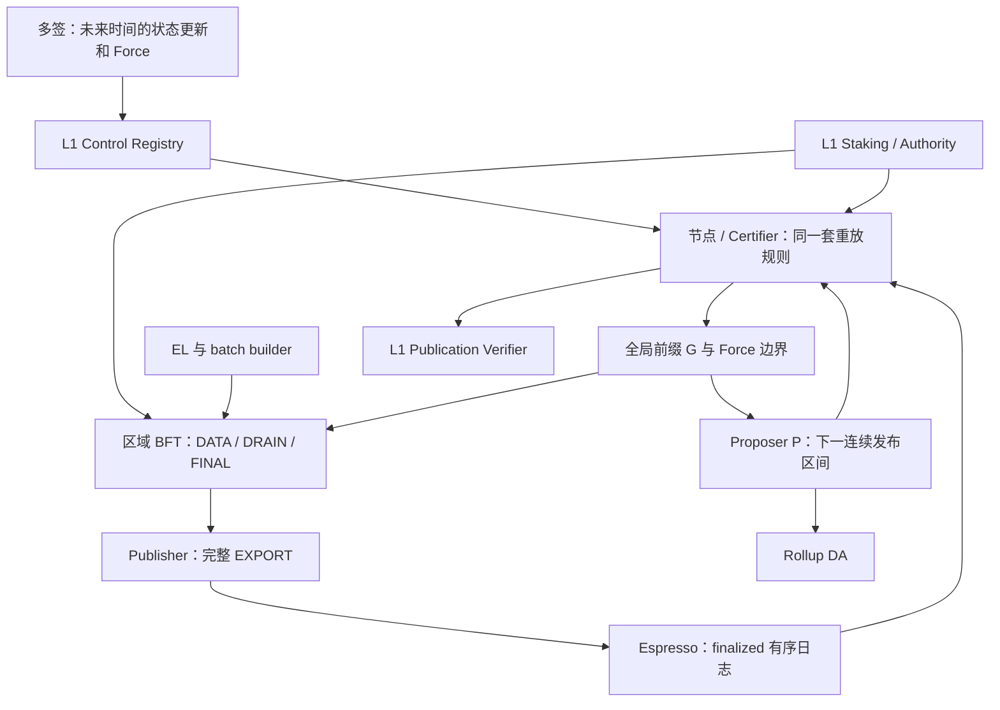

# Sequencer Rotation Architecture v4：中文正文

对应：[英文正文](arch_v4.tex) · [英文 PDF](arch_v4.pdf) · [Part II v3 中文正文](sync_hotstuff_rr_part2_rotation_v3_zh.md)

本文按英文版的章节顺序说明架构、模块接口和保证边界。本轮统一符号并简化解释：完整 view 写成 $(\beta,r,g,t)$，session 写成 $(\beta,r)$。两类 Force 的规则、旧分支检查和优先级保持不变。

## 1. 架构与当前重点

系统要完成两件事：由各区域轮流产生 mini-block batches；由 proposer $P$ 把已经全局确认的数据按顺序发布，不能漏块、重排或插入额外内容。

三个模块分工如下：

| 模块 | 职责 | 权限边界 |
|---|---|---|
| Publisher | 收集完整区域结果和 FINAL，提交、重试并跟踪 EXPORT | 没有决定内容或 finality 的权限 |
| Espresso | 记录并最终确认提交顺序，提供可验证的 timestamp 和历史证据 | 将我们的记录视为数据，不运行区域轮换合约 |
| Certifier | 与完整节点执行相同的重放规则，验证 L1、Espresso 和区域证据，并绑定 DA 发布 | 不能独立选分支或跳过控制记录 |

L1 继续维护 Staking、Authority / Schedule、Liveness / Force Control 和 Publication Verifier。多签只向 L1 提交控制；控制在预先指定的 Espresso timestamp 生效。节点还会在当前 export session 的交付窗口失败时派生 AUTO Force。

区域结果只有在完整、连续且合法的 EXPORT 从 Espresso finalized 历史中被接受后，才进入全局前缀 $G$。不再逐块等待多签保护，也不等 Espresso 状态上传到 L1。正常 successor 可以先依据区域 terminal FINAL 开始生产；forced successor 则等待最终确认的 Espresso 切换边界，从该边界之前的完整 $G$ 接续。



本版保留区域 DATA/DRAIN、固定投票快照、常规轮转和 staking 接口。后续工作是落实共享解释器、完整跨链输入和发布验证关系。Espresso 的证明、时钟和数据服务条件仍需由具体部署版本提供；这里的模块契约不是实现审计或对外部服务的无条件安全证明。

## 2. 共享对象与模块边界

一个 DATA 块 $B_h$ 包含一个有序 mini-block batch。DATA height、native mini-block number、EVM block number、Espresso height 和 Espresso timestamp 是不同的量。DRAIN 是区域共识内部记账，不带应用 batch。

### 完整 view 与 session

完整 view 为：

$$
(\beta,r,g,t).
$$

| 字段 | 含义 | 什么时候改变 |
|---|---|---|
| $\beta$ | 分支版本，从 0 开始 | 每次实际执行 Force 加一；常规轮转不改变它 |
| $r$ | 当前分支中的 session index | 常规交接加一；Force 从捕获的 export index 计算后继 |
| $g$ | 一个 session 内的恢复编号 | 区域恢复时增加 |
| $t$ | 当前恢复阶段内的 leader term | 本区域正常 leader 轮转时增加 |

一个 session 直接用 $(\beta,r)$ 标识。它的边界证据确定服务区域、anchor 和 authority。新 session 从 $g=t=0$ 开始。恢复改变 $g$，并从 $t=0$ 开始。

具体数字例子见 [Part II v3 中文版第 9.3 节](sync_hotstuff_rr_part2_rotation_v3_zh.md)：包括正常 Force、常规交接后再 Force、生产领先全局确认，以及旧 MSIG 作废时四个字段保持不变。

每条签名绑定 chain、protocol domain、session $(\beta,r)$、投票配置、服务区域和消息类型。View 消息还绑定 $(g,t)$ 和 L1 authority reference $\mathrm{AUTH}_{r,g}$。FINAL 保留 session 与 DATA 上下文，不绑定 $g,t$，因此同一块的 FINAL 仍可跨 recovery 聚合。实现可以把上下文编码成 hash，但不另设一个需要读者跟踪的 session hash 身份。

### 共享对象

| 对象 | 含义 |
|---|---|
| Snapshot $S_e$ | 不可变成员、密钥、权重和区域协议参数；$e$ 是 staking 配置编号 |
| $\mathrm{AUTH}_{r,g}$ | 按数字 $(r,g)$ 索引的 L1 authority；generation 0 固定快照和 quota，后续 generation 只换 leader schedule |
| Regional bundle | DATA、FINAL、祖先链、正常边界 witness 和历史 authority |
| Selection reference | terminal DATA 签名绑定的 finalized Espresso header，用于确定选区起点 |
| EXPORT | 当前分支版本、预期 DATA frontier / digest、一段完整连续 DATA 及其证据 |
| Control record | L1 授权的操作、唯一序号、历史承诺和未来 activation timestamp |
| Forced boundary | AUTO / MSIG 原因、触发 Espresso 区块、完整保留的 $G$、后继和 authority |
| $G$ | 连续全局 DATA 前缀、承诺及原有来源身份 |
| $S$ | 完整重放状态：包括 $G$、分支版本、export duty 或等待边界、窗口、资格、控制与游标 |
| $C_{\rm pub}$ | L1 已接受的发布前缀及执行状态，允许落后于 $G$ |
| Publication claim $y$ | 上次 checkpoint、准确的下一区间、输入承诺、DA 承诺和执行状态转换 |

### 三条进度线

区域生产分支 $R$ 可以跨过多个正常 session，领先于 $G$；$C_{\rm pub}$ 又可以落后于 $G$。例如 A 已完成 101–110，B 已生产 111–115，Espresso 只接受到 108，而 DA 发布只接受到 105。

这里，production session 是正在生产最新数据的 session；export session 是负责 $G$ 后下一个 DATA 的 session。缺块检测针对 export session。不能因为 B 已开始生产，就跳过 A 尚未交付的 109–110。

**$G$ 与 $S$ 不相同。** Espresso 空块可以推进时间、控制和窗口，却不改变 DATA 前缀。因此 EXPORT 的 expected base 绑定 $G$ 的 DATA frontier、digest 和来源，不绑定整个 $S$。

### Genesis、authority 与原生数据

可信 genesis 提供合成 anchor 证据、L1 / Espresso 参考和信任起点。初始等待上下文是 $(i_b,\beta_b,r_b)=(\bot,\bot,-1)$，从区域循环表开头选择 session 0。第一个 session 是当前版本的 $(\beta,0)$，通常为 $(0,0)$；如果 genesis Waiting 中先发生 Force，$\beta$ 会在首次选区前增加。选区高度 $q_s$ 设置 $q^{\rm open}_{\beta,0}=q_s$。L1 下界 $\lambda^{\rm open}_{\beta,0}$ 是 genesis 的 L1 reference 与初始 authority 发布高度的最大值。

Authority 仍按数字 $(r,g)$ 索引。Force 可以复用被放弃的投机 session 曾使用过的 $r$，但不能重新绑定该 index 的 authority。不同的 $(\beta,r)$ 隔离 votes、locks、receipts 和重放状态。$L(\beta,r,g,t)$ 根据该 session 的服务区域和 $\mathrm{AUTH}_{r,g}$ 选出 leader。

Native mini-block 编码保持不变。外层 DATA envelope 绑定前驱、完整 BFT 上下文、L1 reference、Espresso reference，以及准确的原生 headers、交易、receipts 和边界。沿用的 native baseline 是 `59797b45` 的 [blocks.md](../megaeth_specs/specs/protocol/blocks.md) 和 [state-sync.md](../megaeth_specs/specs/protocol/state-sync.md)。EVM block 内的 native signing authority 与 BFT leader 不同；EL adapter 必须在准确的交接 anchor 上提供合法执行和签名接续。

### 假设边界

Part II 继续分别陈述区域通信、L1、跨区域 backbone 和应用有效性假设，再补充 Espresso 与发布服务条件。$T_{\rm L1}$ 已包括实际提交到所有正确参与者获得完整、finalized、可验证控制的全过程，包括 certifier；不另加 announcement delay。

诚实且非追溯的控制、完整控制视图、Espresso 前缀安全与时钟条件仍然必要。固定窗口的活性需要比 eventual backbone 更强的及时交付条件。Certifier 正确运行与原生执行正确性是不同假设。

## 3. Staking Service 与 Authority

### 3.1 加入、托管与退出

Staking 把公开、由 stake 支持的申请转成不可变投票快照，保留历史责任，并在责任结束后释放资金。存入资金不代表立即获得投票权。

主要接口为：

```text
Join(region, public_key, owner, bond) -> position
Cancel(position)
RequestExit(position)
Report(evidence)
Claim(position)
```

初始 profile 使用一种抵押 token、固定 region identifiers 和整份 position 的加入/退出。Delegation、部分提款和区域迁移属于扩展；相关调用检查密钥持有和提款 owner 授权。

| 阶段 | 含义 |
|---|---|
| Pending join | 按 finalized L1 顺序排队，无投票和 leader 权利；被预留前可取消 |
| Reserved | 冻结计划已选中该 position；等待激活期间资金不能退回 |
| Assigned / active | authority 使用其快照；有效边界打开对应 session 时履职 |
| Exit queued | 不再申请未来任务；已有快照、参与和数据责任仍有效 |
| Retired / cooling | 清算已证明不会再产生新任务，已有服务责任结束；保留数据和证据责任 |
| Claimable | 责任期后提取剩余资金；及时提出但未解决的索赔继续占用相关资金 |

公开队列和固定 cutoff 使选择可复现。加入和退出分别有 stake / count 预算；每份允许的整份 position 都必须放得进相应预算。取消申请不能留下永久障碍，罚没后的强制移除另行计账。在配置持续推进时，合格申请应得到处理，不能为了维持区域 stake floor 永久阻止退出。

### 3.2 冻结计划与未来授权

`Prepare(e)` 冻结 cutoff 时的加入、退出和余额选择。`Activate(plan, indices)` 将可公开验证的冻结计划绑定到尚未分配的未来 indices。可以一次分配一个区间，从而避免每次常规交接都写 L1。如果使用随机性，先冻结计划，再取得规定的随机输入，不能任意重试。

$\mathrm{AUTH}_{r,0}$ 使用固定的 $S_{e(r)}$，其中包含成员、密钥、权重、$F_i$、$\Delta_i$、$K$；authority 还固定 $\mathrm{TB}_r$ 和 export-window 参数。对 $g>0$，只读取新的 leader schedule。已经分配的 index 不能改绑。

Relayer 不能任意挑选有利的激活区间或跳过队列。后续 schedule 可以排除已暴露的 equivocator，但历史投票仍按原快照计量，已 finalized 的 schedule 不能追溯改写。

Authority 服务必须让成员及时获得未来规则，也必须留出实际由新快照服务的机会。无限预分配给旧快照会破坏加入和退出。缺少必要 authority 时等待；零成员区域不可被选中。固定循环顺序和“选择其他 eligible region”的 `NextLive` 保留，不引入 staking 草案中的 region shuffle 或同区域续任。

### 3.3 退休清算与提款

`Retired(position, clearance)` 只有在以下三点成立后才能产生：

1. 未来 authority 不会再给该 position 分配新任务。
2. 已分配 indices 的共识和签名责任结束，包括 Force 仍可能复用旧 index 开启的 session。
3. 已打开 engine 达到允许的停止条件，必要历史已经保留或转移。

清算绑定历史 authority 和 session $(\beta,r)$。新分支版本、region OFF 或 Force 生效本身都不等于清算。本版旧 engine 仍按 Completion 停止，没有通用提前停止规则，因此不声称固定时间内必能提款。

清算后按责任和保留政策计算释放时间。及时接受但未裁决的索赔继续冻结相关资金。Slashing 扣减剩余 bond，不能改变历史 quorum 分母，也不能对同一笔资金按多个历史服务重复追偿。Equivocation 证据绑定原 position、authority 和 $(\beta,r)$；timeout BLAME 或健康报告本身不是 equivocation。

这些接口保留 staking v2 的队列、预留和 escrow，替换其 `Close / Advance` 与每次轮转的耦合。常规交接仍不逐次写 L1，Force 也不替旧 engine 执行关闭。Staking 和 churn 本身不能证明每个服务区域都满足 $F_i<W_i/2$。

## 4. Multisig 监控与 L1 Liveness / Force Control

### 4.1 链下监控

委员会诊断健康情况，向 L1 提交未来资格变化或 Force。模型仍把它视为诚实、协调一致的控制服务。它不再靠延迟全局确认来维护私有 protected prefix；其成员治理和具体诊断政策仍是独立问题。

接口为 `ObserveBundle`、`ReportHealth`、`SubmitControl`。即使某区域仍输出，委员会也可因风险隔离它。但委员会不能删除 $G$、选择更旧 anchor、改变历史权重或复活已关闭分支。交付超时只是服务失败，不自动证明作恶。

### 4.2 L1 控制接口与生效顺序

常规交接不会改变 $\beta$，所以不会取消已公告的 MSIG Force。若 A 正常交接给 B，目标版本仍相同，这条 Force 到期后仍会执行；只有另一次 Force 已改变版本时，它才作废。

记录绑定 chain、protocol version、control sequence、前一个控制承诺、操作和 activation timestamp $\theta_a$。主要接口为：

```text
SetStatus(region, allowed, theta_a)
Force(target_beta, theta_a, configuration)
ReadControl(checkpoint) -> sequence, history commitment, records
```

L1 记录授权。实际生效由节点和 certifier 的解释器执行。设 Espresso header $J_q$ 的时间为 $\theta_q$，则：

$$
\operatorname{cross}(d)=\min\{q:\theta_q\ge d\}.
$$

阈值 $d$ 的操作在该区块开头、EXPORT 之前生效。统一顺序是：

1. 到期的独立 STATUS / CLEAR。
2. 第一个匹配本区块开始时分支版本的 MSIG Force。
3. 若没有匹配的 MSIG Force，再检查 AUTO。
4. 按 namespace 顺序处理 EXPORT。

同类控制按 $(\theta_a,c)$ 排序，$c$ 为 L1 控制序号。序号增加不要求 activation time 同时增加；未到期记录留在 pending queue。

**保留旧分支检查。** 每条 MSIG Force 指定要关闭的 `target_beta`。到生效点时先检查它是否仍是本区块开始时的当前版本。一个边界最多实际关闭一次；过期 Force 及其附带配置均无效。独立 STATUS / CLEAR 仍按自己的规则生效。

例如，多签安排稍后关闭版本 4，但在其生效前，AUTO 已关闭 4 并开启 5。后来这条 MSIG Force 仍只针对 4，不能再次关闭 5，也不能借它应用附带配置。这个检查避免针对同一次旧故障的两个反应连续切换 replacement branch。

### 4.3 提前可见性的时间假设

$T_{\rm L1}$ 包括实际提交、inclusion、finality、传播、获取和验证。若 Espresso 时间满足 $\theta_q\le t_{E\text{-}final}(q)+\epsilon_E$，在真实时间 $s$ 提交的控制可保守选择：

$$
\theta_a>s+T_{\rm L1}+\epsilon_E+\text{margin}.
$$

这样控制在生效边界 finalized 前已经完整可验证。这是服务假设和调度义务，不是从 Ethereum 的平均 finality 推出的无条件保证。缺少适用控制视图的节点等待，不能用各自收到消息的时间重新安排或忽略控制。

### 4.4 各种状态变化的范围

| 操作 | 结果 |
|---|---|
| OFF / ON | 改变之后的选区资格，不撤销历史 snapshot 已经确定的正常 witness |
| 匹配的 MSIG Force | 关闭目标版本，保留 $G$，原子应用附带配置 |
| 过期的 MSIG Force | 不关闭新版本，也不应用附带配置 |
| AUTO Force | export window 失败时关闭版本，并对 export region 加 cooldown |
| Cooldown 到期 | 自动限制结束，但仍需 governance 许可和合法 authority |

Governance permission、cooldown 和 authority eligibility 分开保存。ON 不自动清除 cooldown；需要时使用明确的 CLEAR。Ready hint 只是信息，不证明未来服务。待命区域没有当前 DATA duty，不因沉默触发缺块 Force。要终止已打开生产分支，应使用 Force，不能让普通 OFF 追溯生效。

## 5. EL、区域 BFT 与 Backbone

### 5.1 EL 与 batch builder

`Build(parent, requests)` 构造有序 batch；`ValidBatch` 验证准确 bytes、顺序、重复次数、mini-block 边界、native positions 和上下文。Receipts 与 gas 必须匹配执行。

区域有效性契约需要保证可发布的执行接续。若直到 publication 才发现全局内容无效，整个发布流可能停住，因为 $P$ 不能跳过 $G$ 中的输入。Espresso 不替代执行验证。

有效空 DATA 消耗 quota 并计入窗口，但不生成 native EVM block，也不证明抗审查。请求在全局包含之前保持待处理；被 Force 放弃后缀中的请求按 admission 和队列规则重新考虑。

EL adapter 负责 leader / region 改变时的 EVM assembly 和签名接续。若 Force 的 $G$ 末尾位于 EVM block 内部，必须支持准确的 partial continuation，或预先使用可恢复端点的 export profile。不能为方便而把 $G$ 回退到更早 EVM 边界；finality 和 attestation 也不能生成缺失的签名密钥。

### 5.2 区域 BFT 与跨区域组合

接口为 `Open((beta,r), witness, authority)`、`Propose`、`RegionalOutput`、`Boundary` 和 `BranchChanged`。

区域 receipt 含固定快照中权重 $>F_i$ 的 FINAL，且假设 $F_i<W_i/2$。同一 session 的 covering receipt 可以证明其 DATA 祖先；后一 session 的 receipt 不能替代前一 session 的证据。Proposal QC 不等于 FINAL。外部验证还要检查区域和 session 的分配合法。

DATA/DRAIN 结构不变。Endpoint 为：

$$
H_{\beta,r}=h(A_{\beta,r,0,0})+\mathrm{TB}_r.
$$

未到 endpoint 时，terminal QC 可以转入下一个 leader term，并保留 commit timers。Recovery 改变 generation，等待相应 authority，保留原快照和 quota。Recovery-only DRAIN 可以使 terminal DATA 完成提交；它不携带 batch，不增加 DATA 进度，并复制 $T_{\beta,r}$ 的 L1 和 Espresso references。只有持有 terminal regional receipt，replica 才执行 Completion，停止生产、投票和未完成 timer；数据服务继续。

正常 witness 继承 $T_{\beta,r}$ 及其 receipt。签名字段
$\xi(T_{\beta,r})=(q,H(J_q))$ 绑定 finalized Espresso header，其时间为 $\vartheta(T_{\beta,r})=\theta_q$。从此参考点起，依据历史资格和 $\mathrm{AUTH}_{r+1,0}$ 找到最早合格的其他区域。

References 沿 DATA 历史不倒退，满足 session 的下界，并严格早于承载该 EXPORT 的 Espresso 区块。Witness 一旦确定，不因较新的状态重新选区。选区位置给出 $q^{\rm open}_{\rm next}=q_s$；独立的 L1 下界是 anchor 的 L1 reference 与下一 initial authority 发布高度的最大值。

成员验证 witness、完整状态和 authority 后达到自己的 Ready。**正常 session $(\beta,r+1)$ 不等 terminal DATA 的 global finality，不等 publication，也不等一笔新的 L1 交易。** 这里使用历史资格，不能声称它一定是物理交接时刻最新的健康状态。

两类 Force 都精确保留触发 Espresso 区块 payload 前的 $G$，关闭旧 $\beta$ 的后续追加资格，包括已经提前生产的正常 successor。若有 export duty，循环选区从其捕获的区域之后开始，$r_{\rm next}=r_{\rm export}+1$。新 session 为 $(\beta+1,r_{\rm next})$，可能复用被放弃的数字 index，但读取该 index 原有的 authority。

每个等待边界保存 source region $i_b$ 和 predecessor session $(\beta_b,r_b)$，下一 index 为 $r_b+1$。正常 terminal 边界保存已完成 session 的信息。Waiting 中再次 Force 沿用这个上下文，不为尚未打开的 session 额外增加 index；它保留 $G$、增加当前 $\beta$，并从新触发高度重新搜索后继。

Forced successor 验证 finalized trigger、完整控制、anchor 和状态后才开始。新版本的 DATA 不能在打开它的同一个 Espresso 区块中被接受。没有其他 eligible region 就等待。Force 不改变旧 engine 的本地 commitment 或停止规则；提前停止需要另行修改协议。

### 5.3 Backbone 与数据保留

`Publish`、`Fetch` 和 `Relay` 传输完整 batches、FINAL、receipts、witnesses 和必要状态。普通 backbone 仍只保证 eventual delivery；要满足固定窗口，完整结果还必须及时到达工作中的 publisher 和 Espresso。

Backup publisher 需要 payload 和足够 FINAL，不能只知道某处已有 receipt。正确成员广播 FINAL，并继续 relay 完整 receipt 和依赖。Native state sync 可以补充证据路径。传输不授予 finality，也不替代 rollup DA。Completion 和 Force 后仍需履行恢复、发布和退休有关的数据责任。

## 6. Publisher：区域结果到 Espresso

Publisher 传送完整结果，并跟踪它是否真正进入 $G$。区域可以运行 primary worker，但副本、successor 或外部服务也可提交同一合法结果，不需要 primary 授权。

主要接口为 `Receive`、`FetchMissing`、`BuildExport`、`Submit` 和 `Track`。EXPORT 绑定 chain、protocol version、$\beta$、预期 DATA frontier / digest、连续 DATA、receipts、正常边界、authority 和 native context。跨多个 session 时必须提供各 session 自己的证据，不能跳过当前缺口。

完整包在临时状态中检查，全部通过后原子接受。格式错误、base 过期或分支错误的记录不改变 $G$ 或窗口。必要来源证据缺失时等待，不把缺失当成空日志。原位置被拒绝的记录不会后来回到过去生效；补齐后需要在新位置重投。

输出标识绑定 DATA 内容和来源，不按 signer set 或编码重复计数。API 成功和原始 inclusion 不是接受成功。若别的 publisher 或 Force 改变了状态，worker 从已验证的新 DATA base 重建包。

首发策略、服务费和替换机制可单独设计。备份必须实际获得材料、提交机会和费用。奖励本身不是活性假设；缺块窗口失败不能直接证明 proposer、leader 或 publisher 应受罚没。

## 7. Espresso：finalized 日志与共同时间

Espresso 提供前缀一致的 finalized 历史，以及认证位置和 timestamp。它排序 namespace bytes，不解释区域 authority、quota、状态、Force 或原生执行。

接口包括 `SubmitNamespace`、`FetchFinalized` 和从可信 anchor 出发的 `VerifyHistory`。具体 profile 必须固定 finality evidence、quorum 演进、完整 namespace 或真实缺席证明、可用性、保留期和 timestamp 语义。

Timestamp 非递减；真正的全序由高度和块内位置给出。相同 timestamp 不合并区块，也不能重新打开已检查的 deadline。提前公告需要时钟领先上界或等价的直接假设；计时器活性还要求时间继续增长。仅有 timestamp API 字段不够。

AUTO 和 MSIG Force 都是完整输入的确定性结果，不需要 Espresso 合约或系统交易。可以发布 audit event，但它不产生第二次授权。Espresso 停摆会停止新的 global confirmation；恢复后的时间跳跃可以触发窗口失败，但不能据此识别故障责任。

## 8. Certifier 与 Publication Verifier

### 8.1 状态与接口

完整 checkpoint $S$ 保存 $G$、分支版本、export session、quota、窗口、资格历史、cooldown、完整控制、pending controls、等待边界和 Espresso 游标 / 信任起点。它与 $C_{\rm pub}$ 和执行状态 $z_{\rm pub}$ 分开。L1 镜像可以落后于节点已经验证的 $G$。

```text
VerifyAndReplay(S0, Espresso interval, L1 context, regional evidence) -> S1
BindPublication(C_pub, S1, claim, evidence) -> C_next, attestation
VerifyAndAccept(claim, attestation) -> C_next
```

前两个在 certifier 内执行，最后一个在 L1 执行。Host 负责获取材料，但不能自行声明完整、global 或已超时。验证核心从可信 checkpoint 检查输入，不用 host 的本地观察时间决定公共边界。

[PR #8 certifier 草案](https://github.com/megaeth-labs/specification/blob/aedc2826663b134ee25d26bea17e70c6d23d321c/specs/block-certification/certifier.md) 的 Espresso 验证、cursor、TEE 注册和 DA 绑定提供复用结构。区域 receipts、L1 timed control、窗口和跨区域 replay 是新增检查；原草案不是本架构的现成实现。

### 8.2 共享全局确认与缺块窗口

每个完整 finalized Espresso 区块先执行控制和自动事件，再按 namespace 顺序处理 EXPORT。分支开放、base 匹配、DATA 连续、区域证据和全部上下文合法时，包中的 DATA 立即进入 $G$，没有额外逐块等待。

Export duty 在公开时间 $\theta_0$ 打开时，启动窗口为：

$$
[\theta_0,\theta_0+W_{\rm start}),\qquad
m=\min(m_{\rm start},\text{remaining quota}).
$$

之后使用长度 $W_{\rm run}$、目标 $\min(q_{\min},\text{remaining quota at opening})$ 的固定窗口。对应 authority 固定这些正参数、quota 和 $C_{\rm auto}$。只统计新进入 $G$ 的 DATA；QC、DRAIN、duplicates 和 heartbeat 不计入。窗口超额输出不预付后续窗口。

首次跨过 deadline 的区块先检查旧窗，再处理 payload。成功则推进到下一个固定窗口，失败则 AUTO。时间一次跨过多个 deadline 时依次结算，遇到第一个失败即关闭一次。立即可选的 forced successor 从触发时间获得启动预算；Waiting 后从首次合格的规范位置起算，不倒推到旧 deadline。

完成 quota 后取消旧窗口，export duty 转到正常 successor。已经证明没有候选时进入 Waiting，不运行 timer；缺失证据则暂停原位置，后来获取材料不会生成一个新的开始时间。

共同 Force 函数保留 $G$、关闭旧 $\beta$、取消其窗口并选择 successor。实际 Force 将 $\beta$ 加一并记录原因、trigger 和 anchor；可以先有新版本，再等待 session 打开。MSIG 的旧版本匹配检查仍执行；匹配 MSIG 优先于同边界旧 duty 的 AUTO。普通状态更新不撤销历史正常 witness。

这些规则在所述输入和服务假设下给出相同前缀。后来才发现一个本应已经生效的遗漏控制，属于完整性或提前公告前提失效，不能把它变成回滚 $G$ 或按本地时间忽略指令的规则。

### 8.3 跨链证据与 attestation

Certifier 同时验证：

1. Finalized L1 authority 和完整所需控制，包括 sequence、历史承诺和 future pending records。
2. Espresso finality、validator / quorum 来源、有序 headers、完整 namespace 或真实缺席。
3. 确定性状态生效、两类 Force、选区以及每段 DATA 的区域证据。
4. DATA 区间、native input、DA bytes 与适用执行结果的对应关系。

一个有利事件的 inclusion proof 不证明其他控制不存在；旧但有效的 L1 checkpoint 也不自动足以解释较新的 Espresso 区间。新节点或离线节点先同步，再确认新数据。

Attestation 绑定 chain、protocol version、目标合约、前后 $S$、publication checkpoints、Espresso 区间与信任来源、L1 sequence / commitment、派生状态、精确 DATA 范围、native input、DA 和执行结果。TEE profile 还绑定批准的程序和注册密钥。升级、撤销和信任起点变更有独立治理假设；日常多签活性权限不包含任意修改这些内容。

保守的 L1 接受规则可要求 attested control commitment 与 registry 当前要求一致；变化后刷新材料和证明再提交。更精细的规则可以证明完整覆盖当前区间的全部适用控制。两者都必须拒绝遗漏，等待只影响 $C_{\rm pub}$，不删除既有 $G$。

Forced successor 直接验证 Espresso 和 L1 证据，不等公共 Ethereum Light Client 或 Publication Verifier 追上该 anchor。L1 接受、结算和提款最终性属于后续阶段。

### 8.4 发布接受条件

设已接受 frontier 为 $a$，claim 为：

$$
y=(C_{\rm prev},[a+1,b],C_{\rm in},C_{\rm DA},z_{\rm pre},z_{\rm post}).
$$

输入承诺绑定准确的 headers、交易顺序和重复次数、mini-block boundaries 与执行上下文。L1 仅在以下条件成立时接受：

1. 上一个 checkpoint 和执行状态分别等于当前 $C_{\rm pub}$、$z_{\rm pub}$。
2. 证明绑定 $G$ 中准确的下一区间 $a+1,\ldots,b$，无遗漏、插入、重排或重放。
3. DA commitment 解码后正好是同一输入，并满足所选 DA 的可用性和保留要求。
4. 执行验证确认状态转换，并检查 receipts、gas 和 native assembly。

高度比较或若干独立叶子证明不够。接受后推进 $C_{\rm pub}$ 和执行状态，不为尚未确认的内容创造 global finality。System transactions 必须已承诺或由 adapter 确定性导出；$P$ 不能自行插入用户交易。未决或有争议的执行 claim 不推进 frontier。

Espresso availability 不替代 rollup DA。若某条 fallback derivation 路径会删除已经进入 $G$ 的普通内容，它就与本架构的承诺冲突，需要先修改该路径或明确修改承诺。Publication delay 或 Force 都不能抹掉旧的 global backlog。

## 9. Proposer $P$

$P$ 获取 global batches，准备执行和 DA，获得 certifier 证据，再提交下一完整区间。它可以提前处理区域投机结果，但最终接受必须满足全局范围与全部发布检查。

同一运营者可以同时运行 Publisher 与 $P$，但接口不同：前者向 Espresso 提交区域结果；后者把已接受输入发布到 rollup DA 和 L1。Force 后仍要先发布旧 session 中已进入 $G$ 的 backlog。替换 proposer 从 $C_{\rm pub}$ 继续。

即使 $P$ 恶意，验证器也应只接受忠实发布。实际 eventual publication 还需要可用 proposer 或替换路径、执行 / 签名能力、certifier 和 DA。验证器不能使一个缺席的服务开始交付。

## 10. 模块索引与后续工作

| 模块 | 主要契约 | 后续工作 |
|---|---|---|
| Regional BFT | Part I、Part II v3、第 5 节 | 保留 DATA/DRAIN、FINAL、Completion、Ready，绑定完整上下文 |
| Staking / Authority | 第 3 节 | 固定未来快照和窗口参数，完成 retirement clearance 与提款责任 |
| Monitor / L1 control | Part II v3 时间模型、第 4 节 | 未来时间调度、完整历史和明确权限 |
| Publisher | 第 6 节 | 完整材料获取、backup、重试、接受跟踪和保留 |
| Espresso | 第 7 节 | 固定 finality、namespace、quorum、availability 和 timestamp profile |
| Certifier / L1 verifier | 第 8 节 | 共享 replay、完整跨链上下文和精确范围 / DA 验证 |
| EL / Backbone / Proposer | 第 5、9 节 | 恢复精确原生状态，保留数据，连续发布 |

整合顺序是保留区域引擎，实现一个共享解释器，接入完整 L1 / Espresso 证据，再绑定忠实发布。窗口预算必须覆盖区域恢复、备份发布、Espresso inclusion 和状态获取；eventual transport 本身不提供固定时间进展。没有其他 eligible region 时仍等待，同区域续任属于独立扩展。

Staking lifecycle 仍是单独问题。Force 不关闭旧 engine，也不自动解除其数据责任，因此不证明 retirement clearance。新的最终性服务改变 global confirmation 规则，不改变区域 Byzantine 上界或历史签名 authority。
