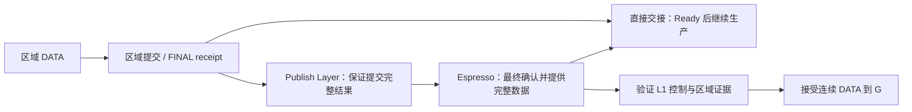

# Sync HotStuff RR Part II v3.1：跨区域轮转中文阅读版

对应：[英文正文](sync_hotstuff_rr_part2_rotation_v3_1.tex) · [英文 PDF](sync_hotstuff_rr_part2_rotation_v3_1.pdf) · [Arch v4 中文阅读版](arch_v4_zh.md)

本文对应英文正式稿 v3.1。保留原有协议章节，末尾新增 Publish Layer 实现说明。区域 DATA/DRAIN、四元组 view、常规轮转、两类 Force 及其优先级不变。Arch v4 提供架构背景；发布服务和数据获取方式以本稿的新定义为准。完整消息格式和逐项验证条件以英文正式稿为准。

## 先记住一套编号

完整 view 统一写成：

$$
(\beta,r,g,t).
$$

| 编号 | 直白含义 | 何时改变 |
|---|---|---|
| $\beta$ | 当前生产分支的版本号 | 一次 Force **实际执行**后加一 |
| $r$ | 某个地区的一次生产轮次编号；不是地区编号 | 常规跨地区交接时加一 |
| $g$ | 这一生产轮次内的恢复编号 | 区域内 recovery 时加一 |
| $t$ | 这次恢复阶段内的 leader 轮次 | 区域内正常换 leader 时加一 |

**Session 就是 $(\beta,r)$。** 实现可以编码或哈希这些字段，但正文只用这套编号。

例如：

```text
(7,20,0,0)  A 开始生产
     ↓ 区域内换 leader
(7,20,0,1)
     ↓ 区域内 recovery
(7,20,1,0)
     ↓ 常规交接给 B
(7,21,0,0)
```

这里每一步的含义都写在编号上。常规交接改变 session，但不改变 $\beta$。

**本次保留原有 Force 检查。** MSIG 指令仍指定目标 $\beta$；若其他 Force 已改变它，这条指令就作废。先检查匹配的 MSIG，再检查 AUTO。MSIG 仍不是无条件到点执行。

还要区分三个进度：区域已经生产的分支 $R$、已经全局确认的数据 $G$、已经被 L1 接受的发布数据 $C_{\rm pub}$。它们可以先后推进，不必同步。这里的 Publish Layer 负责向 Espresso 提交结果；$C_{\rm pub}$ 则属于后面的 rollup DA 发布阶段。

## 1. Overview：变化发生在哪里

每个区域运行原有 Part I BFT engine。一个 session $(\beta,r)$
就是一个区域的一次生产轮次，其中包含多个 leader term 和必要的 recovery。
常规交接进入 $(\beta,r+1,0,0)$；有效 Force 进入新的分支版本。

v3.1 把原有独立 Backbone 换成两项明确服务：

1. **Publish Layer：** 完整区域结果可用后，在 $T_{\rm pub}$ 内保证有效提交给 Espresso。
2. **Espresso：** 提交后在 $T_E$ 内完成最终确认，并使持续在线的正确参与者能获取记录和证明。

Publish Layer 是现有 leader、副本或 data verifier 共同实现的发布能力，不是一组必须独立部署的新节点，也不增加共识轮次。正文先使用这项服务假设，第 10 节再讲 leader 优先、其他人代发和手续费代付。



节点可以有一条领先于 $G$ 的生产分支 $R$。Force 关闭整个旧版本 $\beta$，包括其投机的常规后继，但保留旧分支已经进入 $G$ 的所有 DATA。

外部 Force 不调用旧区域 engine 的 Quit 或 Completion，也不取消它的 commit timers。

| 事件 | 新 view |
|---|---|
| 同一区域正常换 leader | $(\beta,r,g,t+1)$ |
| 区域内 recovery | $(\beta,r,g+1,0)$ |
| 常规跨区域交接 | $(\beta,r+1,0,0)$ |
| 有效 Force | $(\beta+1,r_c+1,0,0)$ |

Force 行中的 $r_c$ 是**还欠 $G$ 下一块数据的轮次**，也叫 export session 的轮次编号。它可能落后于当前正在生产的轮次。后面第 6 节说明等待状态下怎样保留这个编号。

例如 A 的 session $(7,20)$ 已生产到 110，B 的 $(7,21)$ 已接班生产到 115，但 $G$ 只到 108。正在生产的是 B；欠下一块 109 的仍然是 A。因此 Force 从 A 的交付位置重新选区，而不是从某个节点看到的最新生产位置选区。

## 2. Model and assumptions：模型与假设

### 2.1 L1 control state

L1 提供两组信息：

| 信息 | 作用 |
|---|---|
| $\mathrm{AUTH}_{r,0}$ | 固定区域快照、leader schedule、DATA quota 和 export-window 参数 |
| $\mathrm{AUTH}_{r,g}$，$g>0$ | 恢复 generation 的 leader schedule；不重置快照或 quota |
| STATUS | 在未来 Espresso 时间改变指定区域的 live/off 状态 |
| CLEAR | 在未来 Espresso 时间清除指定 cooldown |
| MSIG FORCE | 指定目标分支版本、未来 activation time 和可选附带配置；不指定 retained DATA height |

Authority 一经分配不可改绑。Force 重用数字 $r$ 时，读取该 index 原有 authority，以新的 $(\beta,r)$ 区分 engine。

每个控制有 L1 序号 $c$ 和 Espresso 激活时间 $\theta_a$。**读取控制不等于激活控制。** 节点保存完整控制前缀，并保留尚未到期的 pending records。

设 Espresso 区块为 $J_q$，时间为 $\theta_q$：

$$
q(d)=\min\{q:\theta_q\ge d\}.
$$

阈值 $d$ 在 $J_{q(d)}$ 的 payload 之前触发。同一 timestamp 下，height 和块内位置仍给出确定顺序。

区域是否可选由三部分共同决定：governance flag 为 ON、自动 cooldown 已过、指定 authority 下该区域具有正权重。解释器把控制和超时处理之后、EXPORT 处理之前的结果记为历史 snapshot $\chi_E(q)$。

OFF 不撤销已经基于历史 snapshot 确定的常规交接证明；ON 不自动清除 cooldown；任何状态更新都不能改写旧证书的权重。

Genesis checkpoint 指定合成 anchor、L1/Espresso reference、初始分支版本和控制上下文。初始版本 $\beta=0$。合成边界保存 $(i_b,\beta_b,r_b)=(\bot,\bot,-1)$，从整个区域表选择第一个合格区域，开启当前版本的 session $(\beta,0)$，通常是 $(0,0)$。如果首次选区前已经发生 Force，就使用增加后的 $\beta$；初始 reference 下界也属于这个实际开启的 session。

### 2.2 数据怎样送达：Publish Layer

Publish Layer 是由现有参与者实现的一层发布服务，不要求另外部署一组专职 Publisher，也不重新执行共识。

它接收的**完整区域结果**包括：DATA、直接或覆盖它的 FINAL receipt，以及验证所需的祖先、交接证明和来源证据。正确副本一旦拿齐，就交给这层服务。只有一个 QC、一个 hash，或者只有 receipt 却缺 payload，都不算完整输入。

数据有两条获取路径：

| 路径 | 用途 |
|---|---|
| 当前区域直接发给下一地区 | 允许下一地区在 terminal DATA 尚未进入 Espresso 时就完成 Ready |
| Publish Layer → Espresso → 其他参与者 | 完整结果发布后，其他地区、Certifier 和 Proposer 可以从共同的历史中获取它 |

直接发送成功，常规交接不等 Espresso；直接发送不可用，就等待结果发布后从 Espresso 获取。这次交接会更慢，但不需要另外假设一个独立 Backbone 一定把数据送到所有人。

Espresso 提供已最终确认的记录和证据，节点仍检查其中的区域结果及轮转规则。L1 继续提供自己的 authority 和控制证明。执行状态可以直接传输，或从已验证的数据历史重建；**能下载区块不等于已经恢复好执行状态**。拿齐状态仍是 Ready 的条件。

### 2.3 Stake and faults

区域 $i$ 中成员权重满足：

$$
\omega_{i,v}>0,\qquad W_i=\sum_{v\in V_i}\omega_{i,v},\qquad F_i<W_i/2.
$$

Byzantine 总权重最多为 $F_i$。证书需要不同成员的匹配签名，合计权重 **严格大于 $F_i$**。在此假设下，每张证书至少含一个正确签名者，正确成员也能独立凑齐证书。

成员和权重在整个 session 内固定，包括 recovery。Slashing、OFF 或后来的快照不能改变历史证书的验证分母。$F_i$ 还覆盖历史证书仍被接受期间累积失陷的相关密钥。

这沿用原有同步 BFT 模型，不能把 Espresso inclusion 当作放弃区域有效性假设的理由。

### 2.4 假设：区域共识、发布服务和两条链

| 假设 | 具体内容 |
|---|---|
| Finalized L1 records | 最终确认的 authority 和完整控制前缀共同、可认证、不可改写 |
| 区域同步通信与全局时钟 | 区域内正确节点间完整消息及依赖的延迟不超过 $\Delta_i$；保留原有共同真实时钟 |
| Bounded publication service | 完整区域结果可用后，Publish Layer 在 $T_{\rm pub}$ 内把它有效提交给 Espresso |
| Honest multisignature committee | 委员会诚实、协调，只提交授权且提前公告的未来控制 |
| Bounded L1 finalization and visibility | 实际提交后至多 $T_{\rm L1}$，所有正确在线参与者获得 finalized、完整、可验证的控制 |
| Espresso history and time | 最终历史兼容、可验证并保留可取回；timestamp 非递减，且满足最大领先界 |
| Bounded Espresso finalization and visibility | 合规记录有效提交后至多 $T_E$，被 Espresso 最终确认，持续在线并跟上历史的正确参与者能够获取记录及最终性和包含证明 |

**发布服务保证。** 假设正确参与者在真实时间 $s$ 已经拿到完整区域结果，并使其对 Publish Layer 可用。服务保证在 $s+T_{\rm pub}$ 之前完成有效提交，不依赖原 leader 独自配合。至少有一条可工作的提交路径和所需费用资源；输入大小与负载满足事先约定的服务范围。已经记录到 Espresso 的相同结果，已经满足这项数据送达保证；为推进 $G$ 而重新构造 EXPORT 的重试另行处理。

这个时钟不从“leader 开始提案”或“一个副本刚刚 commit”开始，而从**完整数据和 receipt 已经可用**开始。形成 FINAL receipt 仍由区域协议负责。有效提交也不是本地调用一次发送函数，而是完整记录已经按 Espresso 的入口规则交到其提交接口。

**Espresso 确认与可见性保证。** 假设记录在真实时间 $s_E$ 有效提交。至迟到 $s_E+T_E$，它进入 finalized 区块，持续在线并跟上历史的正确参与者都能获取完整 payload、验证 inclusion 和 finality。$T_E$ 包括 inclusion、finalization、传播、获取及 Espresso 证据验证，而不只是看见一个 header hash。

另外，每个新 finalized 区块及其完整相关 namespace，在最终确认后至多 $T_E$ 对这些参与者可获取、可验证；即使这个块没有本链记录也一样。这样，节点能验证“这个区间没有新的本链数据”，而不能把本地下载失败当作缺块证据。

**长期获取保证。** 重放所需的历史和证据仍须保留、可取回。已经进入 $G$ 的 DATA 不依赖原生产地区持续在线。可以由保存认证 Espresso 历史的归档服务提供这项能力；finality certificate 本身不等于永久存储。重新上线的节点要补齐历史或从授权 checkpoint 开始，不能假设任意长历史都在同一个常数时间内同步完。

**两段时间怎样连接。** 对一份新近可用的完整结果：

$$
s_{\rm submit}\le s+T_{\rm pub},\qquad
s_{\rm visible}\le s+T_{\rm pub}+T_E.
$$

这里保证的是**所提交结果及 Espresso 证据已经可获取**。它不包含形成区域结果之前的时间，不保证新地区已经恢复执行状态，也不保证过期或无效 EXPORT 已被接受进 $G$。例如 expected base 过期、版本关闭或缺少前驱，都可能要求重试或使结果不能继续追加。

$T_{\rm pub},T_E$ 用真实时间计量；交付窗口使用 Espresso timestamp。选择窗口长度时，还要考虑时钟对应关系、区域生产、Ready 和重试的预算，不能直接把窗口长度等同于这两个上界之和。

**L1 提前公告规则不变。** $T_{\rm L1}$ 已包括 inclusion、finality、传播、获取和验证，不重复增加一个公告延迟。若 Espresso 块首次 finalized 的真实时间是 $t_E(q)$，仍假设：

$$
\theta_q\le t_E(q)+\epsilon_E.
$$

委员会在真实时间 $s$ 提交控制时选择：

$$
\theta_a>s+T_{\rm L1}+\epsilon_E+\eta,\qquad\eta>0.
$$

这样，在 Espresso 首次跨过该阈值并 finalized 之前，控制已对正确在线参与者可验证。新增的 $T_E$ 不替代 timestamp 的领先界，也不改变这个提前公告条件。


### 2.5 Conditions for progress

前缀安全与持续进展分别陈述。持续进展需要：正确 leader 反复获得实际进入的生产机会；暴露的 equivocator 最终被持续排除；完整区域结果能形成；发布路径与 Espresso 满足服务上界；authority 和执行状态可获取；最终有其他合格地区；委员会给健康地区足够的服务时间。

还要有一段持续的服务时间，让携带下一段所需 DATA 的 EXPORT 真正被接受进 $G$。一次记录已上 Espresso，不代表它没有 stale base 或其他接受问题。新上界不包含区域恢复和状态恢复，也不自动约束一连串重试。窗口仍需与这些过程及 Espresso 时钟条件相匹配。

## 3. Regional engine：保留的定义与数据结构

### 3.1 Blocks、positions 与两种 reference

外层块可写为：

$$
B=(\beta,r,k,h,\mathrm{type},x,H(B_{\rm parent}),\rho,\xi).
$$

| 字段 | 含义 |
|---|---|
| $h$ | DATA height，只统计 DATA |
| $k$ | 本 session 的 physical position，统计 DATA 和 DRAIN |
| $x$ | DATA 携带的请求 batch；DRAIN 不携带 batch |
| $\rho$ | finalized L1 block reference，含 L1 height $\lambda(B)$ |
| $\xi$ | 签名绑定的 finalized Espresso reference，包含 height 和 header hash |

$A_{\beta,r,g,t}$ 是某 view 第一个 fresh position 之前的 anchor。$A_{\beta,r,0,0}$ 是跨区域继承的 DATA；recovery anchor 则由恢复过程选择。

DATA 的 $h$ 增加一。DRAIN 的 $k$ 增加，但 $h$ 不变。

两种 reference 分开约束：L1 height 沿 DATA ancestry 不下降，首个 DATA 满足 $\lambda\ge\lambda_{\beta,r}^{\rm open}$；Espresso reference height 也不下降，首个 DATA 满足 $q\ge q_{\beta,r}^{\rm open}$。DRAIN 复制 $T_{\beta,r}$ 的两个 reference。

Reference 是提案时签名的历史上下文。一个块可能在很久以后才因 recovery / DRAIN 提交，因此 reference timestamp 不等于区域 commit time，也不是 global finality time。

**$\xi$ 的作用：先约定用哪一份地区状态选接班人。**

设区域顺序为 A → B → C。Espresso 第 500 块时 B、C 都合格；一条提前公告的 L1 控制在第 505 块把 B 设为 OFF。A 的 terminal DATA 110 签名绑定：

$$
\xi(110)=(500,H(J_{500})).
$$

这意味着常规交接从第 500 块对应的历史地区状态开始选。一个节点在 Espresso 第 503 块时收到 110 的区域 receipt，另一个节点到第 506 块才收到。如果各自按“我现在看到的最新状态”选，前者可能选 B，后者可能选 C。

有了同一个 $\xi$，只要分支没有被 Force 关闭，两者都从 500 开始选，因此都选 B。这个历史状态由 L1 控制按 Espresso 位置生效后计算，不是由 Espresso 执行状态管理合约。

**110 自己不必先上 Espresso。** 被引用的 $J_{500}$ 早已 finalized；下一地区拿到 110 的区域 receipt 和完整交接材料，就可以验证该选择。因此直接发送仍可实现不等待 Espresso 的常规交接。

代价也要说明：第 505 块的 OFF 不追溯更改已绑定的历史选择。$\xi$ 保证大家选择一致，不保证参考状态最新；需要关闭已授权分支时仍使用 Force。即使增加有界可见性，不同节点也可能在不同时刻收到 receipt，所以仍需固定共同参考点。

本次只澄清用途，保留 DATA 的 $\xi$ 字段、DRAIN 复制规则及原有验证条件。

### 3.2 Session quota、term positions 与 DRAIN

Session $(\beta,r)$ 的固定终点为：

$$
H_{\beta,r}=h(A_{\beta,r,0,0})+\mathrm{TB}_r.
$$

高度 $H_{\beta,r}$ 的 DATA 是 $T_{\beta,r}$。Recovery 不改变 $H_{\beta,r}$。Quota 统计 proposal ancestry 中的 DATA，无论这些 DATA 是否已经提交；它不以当前 $G$ 为计数基础。

若 recovery generation 的 anchor 低于 $H_{\beta,r}$，它是 DATA generation。每个 term 最多产生：

$$
m_{\beta,r,g,t}=\min\{K,H_{\beta,r}-h(A_{\beta,r,g,t})\}
$$

个 fresh DATA。最后一个位置的 QC 是 terminal QC。若它还低于 $H_{\beta,r}$，则允许进入下一 term；达到 $H_{\beta,r}$ 后不再开启下一 term。

**DRAIN 仅用于 recovery 从 quota endpoint 开始的情况。** 当 $g>0$ 且 $h(A_{\beta,r,g,0})=H_{\beta,r}$ 时：

- 这一 generation 只有 $t=0,j=0$ 的一个 fresh DRAIN。
- DRAIN 不携带请求，不增加 DATA height，不消耗 quota。
- 它以本 generation 的 ANCHOR QC 为 justification。
- ANCHOR vote 不启动 commit timer；DRAIN vote 启动原有 timer，使包括 $T_{\beta,r}$ 在内的祖先得到提交。

正常 DATA generation 到达 endpoint 后不会顺手附加 DRAIN。它等待 $T_{\beta,r}$ 的 timer，或在 Quit 后恢复。连续被打断的 recovery 可以产生多个 DRAIN，因此整个历史中的 DRAIN 数量不被 quota 限制。

例：anchor 100、quota 10、$K=4$，三个正常 term 分别生产 101–104、105–108、109–110。从 107 恢复继续生产 108–110；从已认证的 110 恢复则进入 drain generation。终点始终是 110。

### 3.3 Certificates 与 FINAL

| 证据 | 证明什么 |
|---|---|
| Proposal QC | 足够权重已对某 proposal 投票；不是区域提交证明 |
| ANCHOR QC | 新 generation 的 opening anchor 被重新认证；不启动 timer |
| BLAME proof | 满足条件的超时抱怨，可作为 Quit 的一种依据 |
| FINAL receipt $\mathcal F_{\beta,r}(B)$ | 足够权重对 session $(\beta,r)$ 的 DATA 提交作出的匹配声明 |

所有签名都绑定 chain、协议、$(\beta,r)$、固定配置、服务区域和消息类型。View 消息另外绑定 $(g,t)$ 与 $\mathrm{AUTH}_{r,g}$。FINAL 只增加 DATA 字段，不绑定 $g,t$。因此 FINAL 不随 recovery generation 或 term 改变。来自不同 generation 的、针对同一 DATA 的有效 FINAL 可以汇总。

同一 session 中，较高 DATA 的 receipt 可通过完整 ancestry 覆盖较低 DATA。后一 session 的 receipt 不能代替前一 session 的证据。

DRAIN 被提交时，为被它提交的 terminal DATA $T_{\beta,r}$ 产生 FINAL，不为 DRAIN 自身建立全局 DATA。新 session 继承 anchor 不等于重新为旧 session 签发 receipt。

### 3.4 Admission、validation 与 engine state

每个消息按 session 编号 $(\beta,r)$ 路由。签名绑定 chain、协议和 session；view 消息还绑定 $(g,t)$ 与 $\mathrm{AUTH}_{r,g}$。验证包括授权、是否允许进入该 view、块类型、quota、两种 position、祖先、证书和两个 reference。

引擎区分 active、frozen 和 complete。旧 generation 的材料归档，未来 generation 的材料缓冲。缺依赖就获取并等待，不能把缺数据直接当成无效或缺块。

处理顺序保留原版原则：先检查携带的 Quit evidence，再处理依赖和有效性，再按祖先顺序处理附带 proposals / terminal QCs，最后处理消息本身。消息与 timer 同时到达时，先处理消息。

## 4. Regional protocols：区域协议不换一套

### 4.1 Steady state

**Protocol 1：提案、投票、提交、term rotation、Completion。**

1. 当前 leader 按顺序提案，遵守 DATA quota 或 drain-generation 规则。重发必须保持同一 proposal，不能在同一位置签两个不同块。
2. Replica 完整验证后，对首次合法投票记录时间 $\tau_v(P)$，转发并投票。
3. 投票启动原有 $2\Delta$ commit timer。到期且未取消则提交该块和未提交祖先，并为本 session 新提交的 DATA 广播 FINAL。
4. 低于 $H_{\beta,r}$ 的 terminal QC 可以开启下一 term；它不取消已有 commit timers。QC 本身也不启动 commit timer。
5. 取得 $\mathcal F_{\beta,r}(T_{\beta,r})$ 才执行 Completion：停止本 session 的提案、投票、恢复和进度检查，取消未到期 timer，但继续提供数据。

只有 Quit 或 Completion 可以取消这里的 commit timer。外部 Force 不可以。

### 4.2 Quit 与 recovery

**Protocol 2：Blame、Quit、Status、NEWVIEW、ANCHOR vote。**

对 term 中第 $p$ 个进度要求，在：

$$
e_v(\beta,r,g,t)+(2p+4)\Delta
$$

检查。如果 view 仍有效、尚未完成、投票位置少于 $p$，且未发过该 term 的 BLAME，则广播 BLAME。首个检查在进入 term 时就安排，不能让沉默 leader 无限推迟启动。

合法 Quit proof 可以是：足够权重的匹配 BLAME；同一合法位置上的 leader equivocation；或同一 generation 上选择不同 opening 的两个合法 NEWVIEW。越过 quota 的 DATA、错误 generation 中的 DRAIN，本来就无效，不能被当作该双签条件中的合法 proposal。

Quit 后冻结 generation，取消其未到期 timers，但保留已提交数据并继续收集证据。等待至少 $a_v+\Delta$ 且下一 authority finalized 后，进入 $g+1$。

进入时固定 entry lock $Q_v$。新 leader 在自身进入后等待 $2\Delta$，选择已知最高 rank 的 QC 作为 $Q^*$ 并广播 NEWVIEW。Replica 验证后，只有在 $\operatorname{rank}(Q^*)\ge\operatorname{rank}(Q_v)$ 等条件成立时才作 ANCHOR vote。

取得 ANCHOR QC 后开始 DATA 或 DRAIN。区域 commitment 与 Completion 都不等待发布回执。区域内 proposal、投票、FINAL 和计时规则保留；拿齐完整结果的副本将其交给 Publish Layer，也可直接发送给后继地区。

## 5. Regional and global finality

### 5.1 Regional finality

区域 finality 仍按区域 commitment 规则定义，并与具体 production branch 绑定。若未确认分支以后被 Force 关闭，其 receipt 仍然是区域提交证据，但不再意味着它可以追加到全局链。

“某个正确 replica 已提交”“外部观察者拿到完整 receipt”“所有正确 replicas 最终提交”是不同条件。后者还涉及区域 liveness 和后续恢复；不能把一张 proposal QC 当作这三件事都已经发生。

新的发布上界针对完整结果，不覆盖每一条区域内部 BLAME 或 Quit 消息。所以外部观察者不能因为暂时没看到 Quit，就用 receipt 到达时间推断所有副本已经完成提交。 Espresso 证据能证明结果已经公开可获取；若还要约束每个副本执行本地 commit 的时刻，需要明确在线和 receipt 处理条件。本协议用 Espresso 的接受结果保护全局前缀，不依赖一个外部的“所有副本已经 commit”测试。

### 5.2 Published records：EXPORT 的接受

Publish Layer 构造并提交 EXPORT；发送者可以是原 leader、其他副本或外部 data verifier。EXPORT 可以包含跨多个常规 session 的连续 DATA，但必须包含各 session 的完整证据。发送者的签名不能代替区域 FINAL。具体谁优先发、怎样代付费用，留到第 10 节说明。

解释器在处理该 Espresso 块的控制和超时后检查：

1. Expected base 与当前 $G$ 的前缀及来源一致。
2. Epoch 仍开放；每个 DATA 属于合法边界链指定的 session。
3. 从 $h(G)+1$ 连续开始，parent/hash 对应，不遗漏、不重复。
4. 每个块的区域 commitment、应用有效性、authority 和 quota 检查通过。
5. 所用 Espresso selection reference 严格早于承载 EXPORT 的 Espresso 块，不能自我证明。
6. Force 新建的 分支版本 不能在触发 Force 的同一个 Espresso 块里接受 DATA。

整个 EXPORT 要么全部接受，要么全部拒绝。一个无效记录不会部分推进 $G$。之前因缺祖先而被拒绝的候选必须重新提交，不能事后在原位置补确认。

**发布成功和进入 $G$ 是两件事。** $T_{\rm pub}+T_E$ 保证所提交结果及其 Espresso 证据可获取，不保证过期 EXPORT 被接受。一份 EXPORT 即使没有推进 $G$，其中经过独立验证的区域 receipt 和数据仍可作为交接或历史证据。

**Terminal DATA 可以先进入 $G$，即使当时没有下一合格区域。** 这时保留它并进入 Waiting，不分配 export duty，也不运行其 DATA window。

已证明无候选与缺验证材料不同：后者暂停重放，之后从同一规范位置恢复。

### 5.3 Global finality

观察者认证并重放 Espresso 的 finalized prefix，当某个合法 EXPORT 把 $B$ 加入 $G$ 时，便把 $B$ 视为 globally final。

这一步之后没有额外 committee wait，也不要求先把 Espresso checkpoint 登记到 L1。

之后的 Force 保留完整 $G$ 及其 block/session provenance。旧分支版本的字节仍可能被 Espresso 原样记入日志，但解释器不再接受它们成为本链输出。

### 5.4 Reference 不是 commit clock

$\rho$ 和 $\xi$ 在提案时固定，区域提交可能因 recovery 很晚才发生。窗口从解释器分配 export duty 的公开时间开始，统计最终接受进入 $G$ 的新增 DATA。

区域内部的 $2\Delta$ timer 仍使用原有同步时间模型。

## 6. Cross-region rotation

### 6.1 Anchor、选区与边界身份

$\mathrm{NextLive}(i,M)$ 按固定循环表，从 $i$ 后面寻找第一个合格的**其他区域**。找不到就返回 $\bot$；本协议没有同区域自动续期。Genesis 的合成起点单独扫描整个表。

常规交接继承 $T_{\beta,r}$；Force 继承触发块 payload 之前的完整 $G$。

| 边界 | 搜索起点 $q_0$ | 区域循环搜索的 source |
|---|---|---|
| REGULAR | $\xi(T_{\beta,r})$ 中的 Espresso height | 完成 quota 的区域 |
| FORCE | 触发 Force 的 Espresso height | 被关闭 export duty 的区域；Waiting 时沿用存储的 context |

在已验证的历史内，选择：

$$
q_s=\min\{q\ge q_0:\mathrm{NextLive}(i_{\rm source},\chi_E(q))\ne\bot\}.
$$

找到的最早位置确定 successor。后续历史只增加更晚的候选位置，不改变既定最小值。缺 history 或 authority 不能被当成“该位置没有候选”。

常规选择使用历史 reference，所以不用等待 $T_{\beta,r}$ 自己被 Espresso 发布。后来的 OFF 不重选这份交接证明。需要关闭整条已授权分支时用 Force。

边界同时设置：

$$
q_{\rm next}^{\rm open}=q_s,
$$

$$
\lambda_{\rm next}^{\rm open}
=\max\{\text{anchor 的 L1 reference height},\text{下一 initial authority 的 L1 publication height}\}.
$$

这两个下界分别约束 Espresso reference 和 L1 reference，不能混为同一个时间。

### 6.2 Regular 与 Force

**Protocol 3：跟踪生产分支并轮转。**

常规路径：拿到 $\mathcal F_{\beta,r}(T_{\beta,r})$，检查 quota、authority 和 reference，形成 REGULAR 交接证明，把完整状态转给选定区域。没有候选就等待。未来已经公告、但尚未激活的 Force 不阻止这条路径。

Force 路径：验证边界，完整保留 $G$，关闭旧分支版本，归档其未确认后缀及投机后继，保留待处理请求，从精确 anchor 获取状态后开启新 session。

初始 $\beta=0$，每次真正执行 Force 就加一。常规交接和作废的指令不改变它。

新 session 直接使用 $(\beta,r)$ 命名。交接证明仍检查 anchor、前驱、选中地区、选区位置和 authority；强制交接还要验证 cause 与最终确认的触发块。每个已开启的 $(\beta,r)$ 只能绑定一份确定的交接证明。

旧 $G$ 中的块和 receipt 保留原来的 $(\beta_{\rm old},r_{\rm old})$，不会被重新标成新版本。新区域继承旧 anchor，只是从它后面开始工作。

**Waiting 的特殊情况：** 每个待决边界保存原地区 $i_b$ 和原 session $(\beta_b,r_b)$，下一 numeric index 是 $r_b+1$。有 export duty 时 Force 捕获该 duty 的 context；无 duty 时沿用待决 context。重复 Force 会替换边界和分支版本，但不会增加一个根本没有开启的 session index。

旧 engine 仍保有自己的日志和 timers。外部分支关闭不等于获得了区域 Quit proof。

### 6.3 Ready 与共同 bootstrap

Selected member 验证完整 boundary、anchor、应用状态和 finalized authority 后达到 Ready。强制边界还需要 finalized Espresso trigger 与完整 replay evidence。

**Protocol 4：** 成员安装 anchor、authority、quota、reference 下界和 entry lock，发送 STATUS。初始 leader 在自身 Ready 后等待 $2\Delta$，发送选择精确 anchor 的 NEWVIEW。取得 ANCHOR QC 后从 $h(anchor)+1$ 开始 DATA。

设第一个正确成员 Ready 的时间为 $e$。在正确 initializer 且无 Quit 的条件下：

| 时点上界 | 事件 |
|---|---|
| $e+\Delta$ | 所有正确成员进入 |
| $e+3\Delta$ | NEWVIEW 发出 |
| $e+5\Delta$ | Leader 获得 ANCHOR QC |
| $e+6\Delta$ | 首个 DATA proposal 到达所有正确成员 |

这些上界从 Ready 计，不从 Force 触发时计。Ready 之前可直接获取数据，也可等待发布后从 Espresso 获取。直接路径成功时不等 Espresso；备用路径依赖 $T_{\rm pub}$ 和 $T_E$。两条路径都要拿齐交接证据和可用执行状态，不能把下载完成直接当作 Ready。

公开 export window 则使用规范的 duty opening time：已可选的常规后继用前驱 terminal 被 EXPORT 接受的时间；立即可选的强制后继用触发块时间；经历 Waiting 的后继用首次合格选择块的时间。不能使用本地 fetch 完成时间。

## 7. Force handler：两类 Force 的统一执行

### 7.1 Export duty 与缺块窗口

窗口参数由该 session 的 initial authority 固定。设窗口开启时剩余 quota 为 $R$。

启动窗口：

$$
[\theta_0,\theta_0+W_{\rm start}),\qquad m=\min(m_{\rm start},R).
$$

随后是连续固定窗口，长度 $W_{\rm run}$，目标 $\min(q_{\min},R)$。$R$ 按各窗口开始时确定。

只有新增进入 $G$ 的本 session DATA 计数。有效空 DATA 也计数；DRAIN、heartbeat、QC、重复记录和缺口后面的未来 DATA 不计数。

在首次跨越 deadline 的块前检查计数，成功则进入下一固定窗口，失败则触发 AUTO。超额输出不会变成无限未来信用。Terminal DATA 在 deadline 前被接受，则取消本 session 余下检查。

所有窗口都是左闭右开。恰好在 deadline 的 DATA 已迟到。

### 7.2 Scheduled control 与两类 Force

MSIG Force 是提前写在 L1 的授权记录，绑定目标 $\beta$、未来 $\theta_a$、控制序号和配置。L1 finalization 使其被知晓；真正关闭分支发生在 Espresso crossing block。

例如指令是“在 Espresso 时间 120，若当前仍是版本 7，就执行 Force”。如果 120 之前发生了常规交接，版本仍然是 7，指令仍会执行。如果先发生了 AUTO，版本已变成 8，这条旧指令作废，附带配置也不执行。单独的 STATUS 不受这个条件影响。

AUTO Force 由失败窗口及完整历史直接派生。它不需要 multisig 交易，也不需要额外 Espresso transaction。

**Protocol 5：处理每个 Espresso 块时，先处理控制和超时，再读取块内 EXPORT。**

1. **STATUS / CLEAR。** 按 $(\theta_a,c)$ 应用到期且未应用的独立控制。
2. **MSIG。** 只执行第一个目标版本匹配的到期 Force，保存当前待交付 session；若处于 Waiting，则沿用已保存的地区和 session，应用该记录附带配置并关闭当前分支。其他到期 Force 按 stale 处理，不应用其附带配置。
3. **AUTO。** 若没有匹配的 MSIG 且存在 export duty，结算到期窗口。第一个失败触发关闭，并令该 export region 的 cooldown 到 $\theta+C_{\rm auto}$。
4. **保留与重开。** 原封不动保留 $G$，归档未确认旧后缀，记录触发原因和原地区、session，将 $\beta$ 加一。新版本 DATA 不在当前触发块中接受。
5. **选区或等待。** 记录 $\chi_E(q)$，解析新边界或既有 Waiting 边界。分配 duty 后才开始新的 startup window；无候选则继续等待。
6. **处理 payload。** 然后才按顺序验证 EXPORT。

因此，同一边界上的优先级是：独立状态变更 → 匹配的 MSIG Force → 否则 AUTO → EXPORT。

若 timestamp 一次跳过多个 deadline，只结算到第一个失败。新 successor 的启动预算从实际选区时间开始，不能把旧 deadline 套到它身上造成一次跳跃连续淘汰所有区域。

### 7.3 控制完整性

一个 L1 控制事件的 inclusion proof 不够。节点和 Certifier 要知道这个区间所有适用控制，保留未激活的队列，并在确认新的 Espresso interval 前刷新完整上下文。

缺证明就暂停。不能凭本地“还没看到 Force”继续确认，也不能以后按本地到达时间补执行它。

若已确认后才发现漏掉了本应适用的控制，说明完整性或提前公告假设被破坏；本协议不把它解释为可以回滚 $G$ 的合法操作。

## 8. External observer：节点怎样得到同一个结果

**Protocol 6：认证、重放、接受、持久化。**

1. 验证所需 L1 控制前缀，以及 Espresso 的连续 finalized headers 和完整 namespace。
2. 对每个块执行同一控制和超时检查，派生 STATUS、Force、窗口与选区变化。
3. 按规范顺序，在临时状态中验证每个 EXPORT；整包通过才一次性提交全部变化。
4. 保存完整 $S$ 和游标，向外公开新增的 $G$；投机输出单独展示。

Expected base 绑定 $G$，Certifier 的状态转换证明则绑定整个 $S_0\to S_1$。两种承诺不能互换。

请求只有进入 $G$ 后才从 pending queue 最终移除。在被 Force 丢弃的区域后缀中的请求仍需保留，允许新分支重新提出。区域 commitment 或常规交接不代表可以永久删除请求。

完整结果在 Espresso 最终确认记录前要保留，供 Publish Layer 和直接读取者使用；最终确认后其他地区可从认证的 Espresso 历史中获取。归档和 checkpoint 规则必须保留所需历史，不能删除唯一副本。

Proposer 从 $C_{\rm pub}$ 后的完整区间发布。Force 后仍先处理旧的 global backlog。缺已确认数据或 native continuation 时等待，不能制造替代内容或把 anchor 向后退。

## 9. Examples and guarantees

### 9.1 常规轮转与晚到 DRAIN

A 的 anchor 是 100，quota 是 10。A 的 FINAL(110) 允许 B 在 Ready 后生产 111，即使 $G$ 还停在 100。

如果 110 只有 QC，timer 因 Quit 取消，从 110 开始的 recovery 使用 DRAIN 完成提交，再为 110 形成 FINAL。B 仍继承 DATA 110，不继承 DRAIN 作为新 DATA。

Publish Layer 可以把 A 的 101–110 与 B 的 111 一起完整导出。单独一个 111 的 receipt 不能跳过 A 的缺失区间。

### 9.2 完整走一次 MSIG Force

设区域顺序为 A → B → C。A 的 session $(7,20)$ 生产 101–110；拿到 terminal FINAL 后，B 的 $(7,21)$ 已开始生产到 115。但 Espresso 只接受到 108，所以欠交付下一块的仍是 A。

委员会提前向 L1 提交：

```text
目标版本：7
生效时间：Espresso timestamp 120
附带配置：OFF(A)
```

公告满足第 2 节的完整可见性上界。执行过程是：

1. 到 120 之前，A、B 仍可生产，合法旧版本 EXPORT 仍可推进 $G$。
2. Espresso 最终确认第一个 timestamp ≥120 的块。节点与 Certifier 先确认当前版本仍是 7，再执行这条指令。
3. 假设此时 $G=108$。完整保留 108，关闭版本 7。此后旧 A:109–110 和旧 B:111–115 不能再进入 $G$，即使它们已有区域 FINAL。
4. 应用 OFF(A)。从欠交付的 A 后面寻找下一合格区域；若 B 合格，选择 B。
5. 版本加一，确定 B 的新 session 为 $(8,21)$，完整 entry view 是 $(8,21,0,0)$。旧 B 的 $(7,21)$ 与它是两个 engine。至此才处理触发块的 EXPORT：旧版本输出已失去权限，新版本输出也不能在这个触发块中接受。
6. B 验证边界、108 的证据和状态后达到 Ready。走原有 STATUS → 等待 $2\Delta$ → NEWVIEW → ANCHOR QC，再提案新的 DATA 109。
7. 新输出最早在后面的 Espresso 块接受，不能在触发这次 Force 的同一个块中接受。

```text
旧版本 7：... → 108 → A:109 → A:110 → B:111 → ... → B:115
                保留   └── 尚未 global，不能继续追加 ──┘

新版本 8：... → 108 → B':109 → B':110 → ...
```

这里 $B'$ 是 B 地区的新 engine，不是旧 B engine 直接续跑。若 $\mathrm{TB}_{21}=10$，旧 B 从 110 后开始，终点是 120；新 B 从 108 后开始，终点是 118。相同 authority index 不代表相同 anchor 或终点。

**两个变体必须看清：**

- 如果 AUTO 已在 120 之前把版本 7 换成 8，MSIG 不再执行，附带的 OFF(A) 也不执行。若 OFF(A) 必须独立生效，应提交独立 STATUS。
- 如果只是 A 正常交接给 B，而且 B 已成为欠交付的轮次，版本仍是 7。MSIG 仍会执行，保留届时更新的 $G$，从 B 后面选下一地区。

所以旧版本检查只会让“已被另一次 Force 处理过”的指令作废，不会让常规交接取消它。这是本次明确保留的规则。

### 9.3 Force 后四个字段怎么变：四个具体例子

完整 view 是 $(\beta,r,g,t)$，依次表示分支版本、区域生产轮次、恢复编号和 leader 轮次。

**一次真正执行的 Force，让 $\beta$ 加一；新 session 的 $g,t$ 都从 0 开始。新 $r$ 取还欠全局链下一块数据的轮次编号加一，不一定取最新生产轮次加一。**

以下假设区域顺序为 A → B → C，下一地区可用，并完成 Ready 和正常启动流程。MSIG 已满足提前公告条件。前三例既适用于有效 MSIG Force，也适用于 AUTO Force。

**例子 1：A 正在生产，也正是 A 的数据还没有交齐。**

A 当前 view 是 $(7,20,2,3)$。它负责 DATA 101–110，但全局只确认到 108，下一块欠交付的是 A 的 109。Force 选中 B 后：

$$
(7,20,2,3)\xrightarrow{\mathrm{Force}}(8,21,0,0).
$$

| 字段 | 变化 | 原因 |
|---|---|---|
| $\beta$ | $7\to8$ | Force 开启新版本 |
| $r$ | $20\to21$ | 从欠交付的轮次 20 后面开启新轮次 |
| $g$ | $2\to0$ | 新 session 的恢复编号从零开始 |
| $t$ | $3\to0$ | 新 session 的 leader 轮次从零开始 |

B 启动后从 DATA 109 开始。已经全局确认的 108 及其之前的数据完整保留。

**例子 2：A 已正常交接给 B，而且全局确认也已经推进到 B。**

先发生常规交接：

$$
(7,20,0,2)\xrightarrow{\mathrm{regular}}(7,21,0,0).
$$

B 随后正常换了一次 leader，变成 $(7,21,0,1)$。假设全局已经确认到 B 的 DATA 113，下一块欠交付的是 B 的 114，因此负责交付的轮次是 21。

此时 Force 选中 C：

$$
(7,21,0,1)\xrightarrow{\mathrm{Force}}(8,22,0,0).
$$

C 从 DATA 114 开始。此前的常规交接没有改变 $\beta$，所以针对版本 7 的 MSIG Force 仍然有效。

**例子 3：生产已经跑到 C，但全局确认还卡在 A。**

| 区域 | Session | 区域生产情况 |
|---|---|---|
| A | $(7,20)$ | 已区域提交 101–110 |
| B | $(7,21)$ | 已区域提交 111–120 |
| C | $(7,22)$ | 正在生产 121 之后的数据，当前 view 为 $(7,22,1,2)$ |

但是全局只确认到 108，下一块需要的仍是 A 的 109。因此欠交付的轮次是 **20**。

Force 从 A 后面选区。如果 B 可用，新 B 的 entry view 是：

$$
(8,21,0,0),\qquad\text{不是 }(8,23,0,0).
$$

这里用的是欠交付轮次 $20+1$，不是最新生产轮次 $22+1$。

```text
旧版本 7：... → 108 → A:109–110 → B:111–120 → C:121…
                保留   └── 尚未全局确认，关闭后不能再追加 ──┘

新版本 8：... → 108 → 新 B:109 → 新 B:110 → …
```

虽然数字 $r$ 从最新生产的 22 回到 21，**全局确认的数据没有倒退**。旧 B 的 $(7,21)$ 和新 B 的 $(8,21)$ 是两个独立 engine。

**例子 4：旧 MSIG 到期，但此前 AUTO 已经执行过。**

委员会原先提交：“在 Espresso 时间 120，如果当前仍是版本 7，就执行 Force。”

但在时间 115，AUTO 已经执行：

$$
(7,20,2,3)\xrightarrow{\mathrm{AUTO}}(8,21,0,0).
$$

到首次跨过时间 120 时，假设新区域已运行到 $(8,21,1,2)$。旧指令的目标是 7，当前版本却是 8，所以旧指令作废。在没有其他状态变化的情况下：

$$
(8,21,1,2)\xrightarrow{\text{旧 MSIG 作废}}(8,21,1,2).
$$

**四个字段都不改变。** 它不再增加 $\beta,r$，也不重置 $g,t$，附带配置也不执行。独立 STATUS 仍按自己的规则生效。

**如果没有可用的下一地区怎么办？**

Force 仍然增加 $\beta$ 并保留 $G$，但先进入 Waiting，不代表新区域已经开始生产。

例如关闭 $(7,20)$ 后，系统处于版本 8 并等待。之后选中地区并达到 Ready，才进入 $(8,21,0,0)$。如果等待期间又执行了一次有效 Force，版本变成 9，但上一轮次编号仍保留为 20；最终进入的是 $(9,21,0,0)$，不会凭空变成 $(9,22,0,0)$。

### 9.4 AUTO、相同 timestamp 与时间跳跃

假设启动窗口 $[0,4)$ 需要 1 个 DATA，随后窗口 $[4,8)$ 需要 2 个 DATA，且剩余 quota 足够。

- 时间 1 接受 1 个 DATA，启动窗口达标。
- 时间 5 只再接受 1 个 DATA。
- 首个 timestamp 为 8 的块到来时，第二窗口失败。
- 即使这个块含有更多旧分支版本 DATA，它们也不能修复已失败窗口。

若下一块直接从时间 5 跳到 30，同样检测到首个失败窗口。立即选中的新区域从 30 开始启动预算；不会从旧 deadline 8 开始计时。后续另一个 timestamp 同为 30 的块不重复执行已应用事件。

### 9.5 条件性的前缀安全论证

在前述历史、公告、区域有效性和验证假设下，从同一可信 checkpoint 出发：

1. 两个正确观察者认证兼容的历史，使用相同的控制排序、选区、窗口和 payload 顺序，因此重放同一前缀得到同一状态。较慢者可以等待，但不能自行换解释。
2. EXPORT 只追加连续 DATA；STATUS、Waiting 和窗口转换不删除 DATA；Force 完整保留 $G$。所以每步都保留之前的全局前缀。
3. 关闭的分支版本不能被 ON、重复 Force 或迟到 receipt 重新打开。新 session 的 $(\beta,r)$ 隔离旧消息。

这是按状态转换作出的条件论证，不是宣称 Espresso 可以替代所有区域安全和应用有效性条件。

### 9.6 进展条件与限制

AUTO 观察到的是“规定窗口内下一段 global output 没有及时交付”。可能原因包括没有及时形成完整 receipt、状态恢复延迟、发布路径故障或 Espresso 服务中断。若违反了所写的服务上界，就是对应活性前提没有成立；Force 观察本身不能确定故障责任。它是恢复信号，不自动构成 proposer slash 的证据。

没有其他合格区域时，协议 Waiting；本协议未加入同区域续期。反复 Force 或过短窗口也不能保证有效进展。窗口需覆盖实际区域恢复、发布、inclusion 与状态获取的服务预算。

### 9.7 尚待落实的设计

- 固定 Espresso 证明、namespace completeness、timestamp 与 clock lead 规格。
- 完成 L1 control commitment 和 Certifier 的完整版本接受规则。
- 根据服务预算选择窗口与 cooldown 参数。
- 落实所有允许 global anchor 的 native / partial-EVM 续接。
- 若希望 Force 后旧 engine 提前停止，需单独定义合法停止协议。
- 完成 staking retirement，并验证 Publish Layer 实现确实满足服务上界，避免把交付 timeout 等同于可归责双签。

快速回读时，可以先看第 5 节的“什么进入 $G$”，再看第 6 节的“从哪里继续”，最后看第 7 节的“什么时候关闭旧分支”。这三处决定新版本的主要行为。

## 10. Publish Layer 怎样实现

前面的轮转协议只使用发布服务假设。这里说明一种实现方式：**原 leader 优先发，其他人可以代发，手续费可以由别人承担。** 它不增加共识轮次，也不给某个 Publisher 独占发布权。

这部分是实现方案，不是已经证明满足 $T_{\rm pub}$。具体部署要保证下面的数据、提交和费用路径确实可用。

### 10.1 原 leader 优先，其他人可以代发

原出块 leader 拿到完整最终确认结果后，尽快构造并提交 EXPORT。其他副本仍收集 FINAL、保留数据，并把完整结果交给发布服务。区域 commitment 和 Completion 都不等待“发布成功”的回执。

其他副本或外部 data verifier 拿到相同完整结果后，也可以提交，不需要原 leader 批准。实现可以给 leader 一个短的优先机会，但等待、获取数据和重试的总时间必须放在 $T_{\rm pub}$ 的预算里。

Leader 私下说“我已经发了”不能无限阻止别人代发。服务要跟踪实际提交和 Espresso 证据。谁最先成功不是共识规则，也不影响结果有效性。

代发者必须提交原 DATA 和原 FINAL，不能替换内容、改 session 编号，也不能代替区域节点签出 FINAL。

### 10.2 手续费代付

代发者可以不持币、不自己垫手续费。它可以使用有资金的 relay、预充值提交账户，或其他能向 Espresso 提交的赞助路径。

**发布者不用自己付钱，不代表系统没有费用。** 为了满足发布上界，即使原 leader 不可用，合格结果也必须能使用至少一条有资金且可工作的路径。一条路径拒绝或失败时，可以换另一条。

赞助路径只负责支付和提交，不获得修改区域结果的权力。具体代付方式留给实现；这里不假设 Espresso 运行我们的应用智能合约。

### 10.3 重复提交、重试与全局接受

同一结果可能被多人放进不同的 EXPORT。DATA 的原生产 session $(\beta,r)$ 和 block hash 标识这份输出；发送者、receipt 编码和 signer set 不会创造第二份输出。只有被接受的连续新区间才推进 $G$ 和窗口计数。

提交之后还要检查是否进入 $G$：

- 如果另一个发送者已经推进 $G$，根据新的 base 重建尚未接受的连续后缀。
- 已经进入 $G$ 的 DATA 不必再次推进。
- 因缺少前驱被拒绝的候选，需要在前驱补齐后重新提交，不能回到过去补接受。
- 分支已经关闭，重试也不能恢复其追加权限；记录最多作为原区域的历史证据保留。

$T_{\rm pub}+T_E$ 保证一次提交的数据送达并可见，不自动给反复 stale-base 重试提供总时间上界。因此持续进展仍需要一段稳定服务时间，使下一段所需数据在 deadline 前被实际接受。区域生产和状态恢复也要满足对应预算。

### 10.4 数据保留与激励

Espresso 最终确认记录前，持有完整结果的人保留 payload 和证据，供备用发送者获取。最终确认后，认证的 Espresso 历史成为共同的数据获取路径；直接发送仍可加快常规交接和状态恢复。退休、归档和 checkpoint 规则必须保留所需数据，不能删除唯一副本。

奖励与费用报销可以支持这项服务，但重复 DATA 不能重复计算全局进度。交付窗口失败本身也不能证明原 leader、代发者或赞助者双签；本稿不据此直接推出 slashing 规则。
