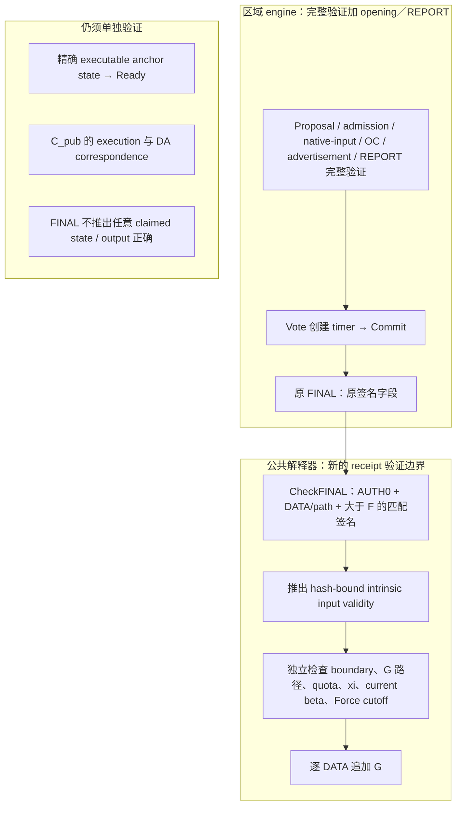
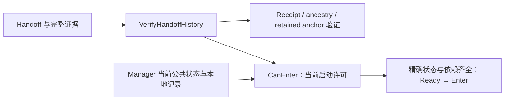
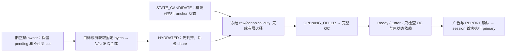

# Sync HotStuff RR Part II v3.11：跨成员请求接力中文阅读版

对应：[英文正文](sync_hotstuff_rr_part2_rotation_v3_11.tex) · [英文 PDF](sync_hotstuff_rr_part2_rotation_v3_11.pdf) · [Arch v4 中文阅读版](arch_v4_zh.md)

本阅读版对照 v3.11 英文正文及其 [request](sections/rotation_v3_11_requests.tex)、[ownership／hydration](sections/rotation_v3_10_ownership.tex)、[opening selection](sections/rotation_v3_11_input_selection.tex)、[ReadyBundle](sections/rotation_v3_11_ready_bundle.tex)、[public import](sections/rotation_v3_10_public_requests.tex)、[source retention／SOURCESTEP](sections/rotation_v3_11_source_step.tex)、[retirement](sections/rotation_v3_11_retirement.tex) 和 [liveness](sections/rotation_v3_11_liveness.tex) 片段。未修改的 ownership／hydration 与 public import 片段继续使用 v3.10 文件。本文保留既有中文全文的章节结构和未改内容；第 2 节的模型与假设，包括标题，逐字节保留。

v3.11 沿用同一物理地区内、旧 AUTH 成员到新 AUTH 成员的请求接力，并补上 OC 的持久首次持有转发。旧正确 owner 在生产 worker 退出后继续保留 pending 请求并提供数据服务。新成员从已知、有限的 AUTH 历史查找这些 owner，获取固定有限 cut，再把完整请求字节实际发送给目标 roster 的所有成员。`HYDRATED` 证明这项传输已经发生；它不证明请求在任意 parent 后可执行。

新成员在 Ready 前取得精确 opening anchor 的可执行状态，并实际完成一次有限选择。所得 opening certificate 简称 **OC**：它包含权重严格大于 $F_i$ 的签名 offer，以及至多一个被选请求的完整 body。Ready 检查 OC 和原完整 anchor state，不另外等待一套 HYDRATED 签名、私有请求池扫描或自己重复的 hydration。每个 session 的第一份 own-session DATA 必须先执行非空 OC 选出的请求；后继 DATA 沿用普通 FIFO。Recovery 回到 opening anchor 时重新施加同一规则。

正确成员第一次验证任意一份完整合法 OC 时，先持久保存该精确证书和向全体 target 的未完成 multicast，再允许取消冗余 preparation 或通知 Ready。它实际继续发送，Closed、stale handoff、worker cancellation 和 Terminated 都不阻止这项节点级数据职责。转发已合法 OC 只需 selected body，不索取其他 signed keys 对应的 bodies；它不等待 Ready，也不创造新的 BFT 动作。

每个 term 的首块仍附带 `INPUT_REPORT`，但 REPORT 不再扫描私有 pool。尚无 own-session DATA 时，它确认 initializer 的签名 `INPUT_ADVERTISE` 及其精确 OC；已有时，它确认完整 ancestry 已履行首块义务。原 NEWVIEW forwarding、ANCHOR vote 与 Quit evidence inspection 独立执行。节点不能因为所附合法 OC 不同于本地 OC 而拒绝它。

2026-10-19，模型作者确认原区域通信界**“覆盖同一地区的新旧正确成员”**。本稿采用这项原模型含义；[确认与范围记录](revisions/v3_10_scope_zh.md)保存原回答。第 2 节不改写，不新增跨地区通信界，也不把已故障或任意离线机器算作正确服务节点。结束 BFT worker 不结束仍未履行的节点级请求职责。

模型作者还确认：**“sent to a region means that every party in the region will receive it.”** 即发送给一个 region，表示该地区每个成员最终都会收到。证明只用其中一位正确成员实际收到并认证完整请求这一事实；原故障界保证 serving snapshot 中存在正确成员。这里不给该 receipt 一个 deadline，也不推断所有未来 roster 在 preparation 开始时已知请求。这个说明解释原 ingress 句子，第 2 节仍不改动；修订缘由见 [v3.11 变更说明](reviews/v3_11/change_summary_zh.md)。

公开 DATA 的持久导入循环继续保留，包括被拒绝记录和 closed branch。它不替代直接请求接力，也不阻塞 SOURCESTEP 或 P6。Publish Layer 仍运输原接口要求的**整个完整结果 $R_0$**。OC、advertisement 与 REPORT 是新增区域 sidecars；只删除这些新增 sidecars 后，原公开记录格式和原对象保持不变。它们没有获得 bare-request publication 服务。

v3.7 的完整 raw namespace 与验证材料保留、v3.6 的逐 DATA durable commit 与 strict Force cutoff、v3.5 的 stable retry、有限 health policy、owed selection、六种 phase 和四模块结构继续保留。窗口、MSIG/AUTO 顺序、旧 beta 匹配、regular DATA/DRAIN 与公共追加权限不变。

本稿给出从原请求 ingress、持续地区服务、有限 exceptional slots，到无限多个覆盖请求的 session 首块机会，再到有限势函数下降的完整候选论证。准备工作可能耗时很长；本稿不给 archive、native reconstruction、整个 pool 或所有未来 roster 一个统一时限。准备完成后的普通 term 首块 $4\Delta$、term zero 首块 $6\Delta$，仍限于原完整消息与 native-validation 接口及其实际输入／负载范围。

**当前状态：v3.11 已完成三份新的独立审查。** [v3.10 独立活性审查](reviews/v3_10/fresh_progress.md)发现 CE-OC：选择性收到 OC 的成员可取消自己的 selection，却没有明确责任转发该证书。本版增加下述持久 first-possession relay，并把形成证明分为“已有正确持有者”和“尚无正确持有者”两种情况。本版另依用户确认补齐原 ingress 的 recipient 含义，并修正指标公式排版。三份审查在原模型、作者确认的含义与明确的抽象接口范围内，均未发现 Critical Error 或 Justification Gap；完整安全与活性链的范围见[本版审查结论](reviews/v3_11/verdict_zh.md)。总目标仍按逐项交付审计核对。

## 先记住一套编号

完整 view 统一写成：

$$
(\beta,r,g,t).
$$

| 编号 | 直白含义 | 何时改变 |
|---|---|---|
| $\beta$ | 当前生产分支的版本号 | 一次 Force **实际执行**后加一 |
| $r$ | 不可改绑的 authority slot；不是地区编号 | REGULAR 加一；Force 在当前 duty 有正 accepted DATA 时加一，零输出时保留 |
| $g$ | 当前 pair 内的恢复编号 | 区域内 recovery 时加一；新 pair 从零开始 |
| $t$ | 当前 generation 内的 leader 轮次 | 区域内正常换 leader 时加一；新 generation 从零开始 |

**Session 就是 $(\beta,r)$。** 不同物理地区可以先后使用同一个数字 $r$，但只有固定 handoff 选中的地区能进入指定 pair。新的 $\beta$ 隔离 locks、votes、entry times 和 timers，不重新生成该 slot 的 leader schedule。

例如：

~~~text
(7,20,0,0)  A 开始生产
     ↓ 区域内换 leader
(7,20,0,1)
     ↓ 区域内 recovery
(7,20,1,0)
     ↓ 常规交接给 B
(7,21,0,0)
~~~

REGULAR 改变 session，不改变 $\beta$。同地区续期也创建新 pair。Force 的 target slot 由**当前 export duty 的累计 accepted DATA 数**决定，不能从最新生产 session 或 retained anchor 的生产者反推。

MSIG 指令仍指定目标 $\beta$；若其他 Force 已改变它，这条指令就作废。先检查匹配的 MSIG，再检查 AUTO。一次失败窗口在未达到本 duty 的容忍数时，只累计 miss，不执行 Force。

还要区分三个进度：区域已经生产的分支 $R$、已经全局确认的数据 $G$、已经被 L1 接受的发布数据 $C_{\rm pub}$。它们可以先后推进，不必同步。这里的 Publish Layer 负责向 Espresso 提交结果；$C_{\rm pub}$ 属于后面的 rollup DA 发布阶段。

## 1. Overview：变化发生在哪里

每个正确区域节点运行 Session Manager，并为每个已经进入的 $(\beta,r)$ 保留独立区域 BFT engine。Manager 可以同时管理旧 Active 程序、新 Waiting 准备任务及正在移交责任的 Completed 程序。常规交接进入 $(\beta,r+1,0,0)$；有效 Force 增加 $\beta$，按当前 duty 的 accepted count 确定新 target slot。

本稿沿用 v3.1 的两项服务：

1. **Publish Layer：** 完整区域结果可用后，在 $T_{\rm pub}$ 内保证有效提交给 Espresso。
2. **Espresso：** 提交后在 $T_E$ 内完成最终确认，并使持续在线的正确参与者能获取记录和证明。

Publish Layer 是现有 leader、副本或 data verifier 共同实现的发布能力，不要求新增一组专职节点，也不增加共识轮次。正文先使用这项服务假设，第 10 节再讲 leader 优先、其他人代发和手续费代付。

~~~mermaid
flowchart LR
    D[区域 DATA] --> F[区域提交 / FINAL receipt]
    F --> N[直接交接：Ready 后继续生产]
    F --> P[Publish Layer：保证提交完整结果]
    P --> E[Espresso：最终确认并提供完整数据]
    E --> N
    E --> V[验证 L1 控制与区域证据]
    V --> G[接受连续 DATA 到 G]
~~~

节点可以有一条领先于 $G$ 的生产分支 $R$。Force 关闭整个旧版本 $\beta$，包括其投机的常规后继，但保留旧分支已经进入 $G$ 的所有 DATA。

有效 Force 先由公共解释器关闭旧版本的追加权限。每个正确区域节点的 Manager 持久保存完整关闭证据，并对已知旧 session snapshot 执行关闭传播，不区分 Waiting、Ready、Active、Frozen、Completed、Terminated，也不要求 worker 存在。已进入程序按第 6.8 节收尾；关闭不是 Quit 或 Completion，不直接取消已经启动的 commit timers。新 pair 的准备和启动不等待旧程序完成退役。

四个模块分别负责公开窗口检测、Multisig 健康政策、每个节点的并发程序管理，以及精确 Ready/激活检查。公共状态仍只有 Protocol 6/5 一条验证与更新路径，Handler 使用它的结果。共享 PublicStore 持久保存来源和验证材料；Protocol 6 在 prelude 后执行 Flat 与公共 CheckFINAL，并逐 DATA 提交。Terminal 后继解析单独继续。ReadyBundle 仍携带精确可执行状态；共享 preparation 与 AuthCache 只重用材料，不把旧 pair 的 locks、votes 或 timers 带入新 pair。

[四模块图](figures/cross_region_rotation_arch_revision/architecture_zh-1.png) · [候选变化与 Ready 图](figures/cross_region_rotation_v3_5/candidate_ready.png)

| 事件 | 新 view |
|---|---|
| 同一区域正常换 leader | $(\beta,r,g,t+1)$ |
| 区域内 recovery | $(\beta,r,g+1,0)$ |
| 常规交接，包括同地区续期 | $(\beta,r+1,0,0)$ |
| 当前 duty 零 accepted DATA 时的有效 Force | $(\beta+1,r_c,0,0)$ |
| 当前 duty 有正 accepted DATA 时的有效 Force | $(\beta+1,r_c+1,0,0)$ |
| 尚未分配 duty 时再次有效 Force | 增加 $\beta$，保留 pending boundary 已存 target slot，未来 Enter 时 $g=t=0$ |

$r_c$ 是**还欠 $G$ 下一块 DATA 的 export duty 的 slot**，可能落后于当前生产位置。公共状态未分配 duty 时没有窗口；某份已选程序仍 Waiting，则窗口可能已经运行。二者不能混同。

例如 A 的 $(7,20)$ 从 100 生产到 110，B 的 $(7,21)$ 已接班生产到 115，但 $G$ 只到 108。正在生产的是 B；欠 109 的仍是 A，且 A 已有正 accepted count，因此 Force target 是 slot 21。若 $G$ 仍为 A 的 opening anchor 100，A 的 count 为零，Force 则重试 slot 20。

## 2. Model and assumptions：模型与假设

### 2.1 L1 control state

L1 提供两组信息：

| 信息 | 作用 |
|---|---|
| $\mathrm{AUTH}_{r,0}$ | 固定区域快照、leader schedule、DATA quota 和 export-window 参数 |
| $\mathrm{AUTH}_{r,g}$，$g>0$ | 恢复 generation 的 leader schedule；不重置快照或 quota |
| STATUS | 在未来 Espresso 时间改变指定区域的 live/off 状态 |
| CLEAR | 在未来 Espresso 时间清除指定 cooldown |
| MSIG FORCE | 指定目标分支版本、未来 activation time 和可选附带配置；不指定 retained DATA height |

Authority 一经分配不可改绑。Force 重用数字 $r$ 时，读取该 index 原有 authority，以新的 $(\beta,r)$ 区分 engine。

每个控制有 L1 序号 $c$ 和 Espresso 激活时间 $\theta_a$。**读取控制不等于激活控制。** 节点保存完整控制前缀，并保留尚未到期的 pending records。

设 Espresso 区块为 $J_q$，时间为 $\theta_q$：

$$
q(d)=\min\{q:\theta_q\ge d\}.
$$

阈值 $d$ 在 $J_{q(d)}$ 的 payload 之前触发。同一 timestamp 下，height 和块内位置仍给出确定顺序。

区域是否可选由三部分共同决定：governance flag 为 ON、自动 cooldown 已过、指定 authority 下该区域具有正权重。解释器把控制和超时处理之后、EXPORT 处理之前的结果记为历史 snapshot $\chi_E(q)$。

OFF 不撤销已经基于历史 snapshot 确定的常规交接证明；ON 不自动清除 cooldown；任何状态更新都不能改写旧证书的权重。

Genesis checkpoint 指定合成 anchor、L1/Espresso reference、初始分支版本和控制上下文。初始版本 $\beta=0$。合成边界保存 $(i_b,\beta_b,r_b)=(\bot,\bot,-1)$，从整个区域表选择第一个合格区域，开启当前版本的 session $(\beta,0)$，通常是 $(0,0)$。如果首次选区前已经发生 Force，就使用增加后的 $\beta$；初始 reference 下界也属于这个实际开启的 session。

### 2.2 数据怎样送达：Publish Layer

Publish Layer 是由现有参与者实现的一层发布服务，不要求另外部署一组专职 Publisher，也不重新执行共识。

它接收的**完整区域结果**包括：DATA、直接或覆盖它的 FINAL receipt，以及验证所需的祖先、交接证明和来源证据。正确副本一旦拿齐，就交给这层服务。只有一个 QC、一个 hash，或者只有 receipt 却缺 payload，都不算完整输入。

数据有两条获取路径：

| 路径 | 用途 |
|---|---|
| 当前区域直接发给下一地区 | 允许下一地区在 terminal DATA 尚未进入 Espresso 时就完成 Ready |
| Publish Layer → Espresso → 其他参与者 | 完整结果发布后，其他地区、Certifier 和 Proposer 可以从共同的历史中获取它 |

直接发送成功，常规交接不等 Espresso；直接发送不可用，就等待结果发布后从 Espresso 获取。这次交接会更慢，但不需要另外假设一个独立 Backbone 一定把数据送到所有人。

Espresso 提供已最终确认的记录和证据，节点仍检查其中的区域结果及轮转规则。L1 继续提供自己的 authority 和控制证明。执行状态可以直接传输，或从已验证的数据历史重建；**能下载区块不等于已经恢复好执行状态**。拿齐状态仍是 Ready 的条件。

### 2.3 Stake and faults

区域 $i$ 中成员权重满足：

$$
\omega_{i,v}>0,\qquad W_i=\sum_{v\in V_i}\omega_{i,v},\qquad F_i<W_i/2.
$$

Byzantine 总权重最多为 $F_i$。证书需要不同成员的匹配签名，合计权重 **严格大于 $F_i$**。在此假设下，每张证书至少含一个正确签名者，正确成员也能独立凑齐证书。

成员和权重在整个 session 内固定，包括 recovery。Slashing、OFF 或后来的快照不能改变历史证书的验证分母。$F_i$ 还覆盖历史证书仍被接受期间累积失陷的相关密钥。

这沿用原有同步 BFT 模型，不能把 Espresso inclusion 当作放弃区域有效性假设的理由。

### 2.4 假设：区域共识、发布服务和两条链

| 假设 | 具体内容 |
|---|---|
| Finalized L1 records | 最终确认的 authority 和完整控制前缀共同、可认证、不可改写 |
| 区域同步通信与全局时钟 | 区域内正确节点间完整消息及依赖的延迟不超过 $\Delta_i$；保留原有共同真实时钟 |
| Bounded publication service | 完整区域结果可用后，Publish Layer 在 $T_{\rm pub}$ 内把它有效提交给 Espresso |
| Honest multisignature committee | 委员会诚实、协调，只提交授权且提前公告的未来控制 |
| Bounded L1 finalization and visibility | 实际提交后至多 $T_{\rm L1}$，所有正确在线参与者获得 finalized、完整、可验证的控制 |
| Espresso history and time | 最终历史兼容、可验证并保留可取回；timestamp 非递减，且满足最大领先界 |
| Bounded Espresso finalization and visibility | 合规记录有效提交后至多 $T_E$，被 Espresso 最终确认，持续在线并跟上历史的正确参与者能够获取记录及最终性和包含证明 |

**发布服务保证。** 假设正确参与者在真实时间 $s$ 已经拿到完整区域结果，并使其对 Publish Layer 可用。服务保证在 $s+T_{\rm pub}$ 之前完成有效提交，不依赖原 leader 独自配合。至少有一条可工作的提交路径和所需费用资源；输入大小与负载满足事先约定的服务范围。已经记录到 Espresso 的相同结果，已经满足这项数据送达保证；为推进 $G$ 而重新构造 EXPORT 的重试另行处理。

这个时钟不从“leader 开始提案”或“一个副本刚刚 commit”开始，而从**完整数据和 receipt 已经可用**开始。形成 FINAL receipt 仍由区域协议负责。有效提交也不是本地调用一次发送函数，而是完整记录已经按 Espresso 的入口规则交到其提交接口。

**Espresso 确认与可见性保证。** 假设记录在真实时间 $s_E$ 有效提交。至迟到 $s_E+T_E$，它进入 finalized 区块，持续在线并跟上历史的正确参与者都能获取完整 payload、验证 inclusion 和 finality。$T_E$ 包括 inclusion、finalization、传播、获取及 Espresso 证据验证，而不只是看见一个 header hash。

另外，每个新 finalized 区块及其完整相关 namespace，在最终确认后至多 $T_E$ 对这些参与者可获取、可验证；即使这个块没有本链记录也一样。这样，节点能验证“这个区间没有新的本链数据”，而不能把本地下载失败当作缺块证据。

**长期获取保证。** 重放所需的历史和证据仍须保留、可取回。已经进入 $G$ 的 DATA 不依赖原生产地区持续在线。可以由保存认证 Espresso 历史的归档服务提供这项能力；finality certificate 本身不等于永久存储。重新上线的节点要补齐历史或从授权 checkpoint 开始，不能假设任意长历史都在同一个常数时间内同步完。

**两段时间怎样连接。** 对一份新近可用的完整结果：

$$
s_{\rm submit}\le s+T_{\rm pub},\qquad
s_{\rm visible}\le s+T_{\rm pub}+T_E.
$$

这里保证的是**所提交结果及 Espresso 证据已经可获取**。它不包含形成区域结果之前的时间，不保证新地区已经恢复执行状态，也不保证过期或无效 EXPORT 已被接受进 $G$。例如 expected base 过期、版本关闭或缺少前驱，都可能要求重试或使结果不能继续追加。

$T_{\rm pub},T_E$ 用真实时间计量；交付窗口使用 Espresso timestamp。选择窗口长度时，还要考虑时钟对应关系、区域生产、Ready 和重试的预算，不能直接把窗口长度等同于这两个上界之和。

**L1 提前公告规则不变。** $T_{\rm L1}$ 已包括 inclusion、finality、传播、获取和验证，不重复增加一个公告延迟。若 Espresso 块首次 finalized 的真实时间是 $t_E(q)$，仍假设：

$$
\theta_q\le t_E(q)+\epsilon_E.
$$

委员会在真实时间 $s$ 提交控制时选择：

$$
\theta_a>s+T_{\rm L1}+\epsilon_E+\eta,\qquad\eta>0.
$$

这样，在 Espresso 首次跨过该阈值并 finalized 之前，控制已对正确在线参与者可验证。新增的 $T_E$ 不替代 timestamp 的领先界，也不改变这个提前公告条件。


### 2.5 Conditions for progress

前缀安全与持续进展分别陈述。持续进展需要：正确 leader 反复获得实际进入的生产机会；暴露的 equivocator 最终被持续排除；完整区域结果能形成；发布路径与 Espresso 满足服务上界；authority 和执行状态可获取；最终有其他合格地区；委员会给健康地区足够的服务时间。

还要有一段持续的服务时间，让携带下一段所需 DATA 的 EXPORT 真正被接受进 $G$。一次记录已上 Espresso，不代表它没有 stale base 或其他接受问题。新上界不包含区域恢复和状态恢复，也不自动约束一连串重试。窗口仍需与这些过程及 Espresso 时钟条件相匹配。

## 3. Regional engine：保留的定义与数据结构

### 3.1 Blocks、positions 与两种 reference

外层块可写为：

$$
B=(\beta,r,k,h,\mathrm{type},x,H(B_{\rm parent}),\rho,\xi).
$$

| 字段 | 含义 |
|---|---|
| $h$ | DATA height，只统计 DATA |
| $k$ | 本 session 的 physical position，统计 DATA 和 DRAIN |
| $x$ | DATA 携带的请求 batch；DRAIN 不携带 batch |
| $\rho$ | finalized L1 block reference，含 L1 height $\lambda(B)$ |
| $\xi$ | 签名绑定的 finalized Espresso reference，包含 height 和 header hash |

$A_{\beta,r,g,t}$ 是某 view 第一个 fresh position 之前的 anchor。$A_{\beta,r,0,0}$ 是跨区域继承的 DATA；recovery anchor 则由恢复过程选择。

DATA 的 $h$ 增加一。DRAIN 的 $k$ 增加，但 $h$ 不变。

两种 reference 分开约束：L1 height 沿 DATA ancestry 不下降，首个 DATA 满足 $\lambda\ge\lambda_{\beta,r}^{\rm open}$；Espresso reference height 也不下降，首个 DATA 满足 $q\ge q_{\beta,r}^{\rm open}$。Terminal DATA 没有额外更严格的 reference 检查。DRAIN 仍复制 $T_{\beta,r}$ 的两个 reference。

区域完整验证仍直接或从 validated cache 认证两类 referenced history。公共 CheckFINAL 推出 hash-bound 区域 reference 的 intrinsic validity；全局接受另外认证必要 Espresso context，并检查它严格早于 containing EXPORT block，不能在同一记录中自我证明。这里不把区域曾检查的任意 $\rho$ proof sidecar 重新列为公共 kernel 的必需 fetch。

Reference 是提案时签名的历史上下文。一个块可能在很久以后才因 recovery / DRAIN 提交，因此 reference timestamp 不等于区域 commit time，也不是 global finality time。

**$\xi$ 的作用：先约定用哪一份地区状态选接班人。**

设区域顺序为 A → B → C，A 本 session 的 opening reference 小于 500。Espresso 第 500 块时 B、C 都合格；一条提前公告的 L1 控制在第 505 块把 B 设为 OFF。A 的 terminal DATA 110 签名绑定：

$$
\xi(110)=(500,H(J_{500})).
$$

这意味着常规交接从第 500 块对应的历史地区状态开始选。一个节点在 Espresso 第 503 块时收到 110 的区域 receipt，另一个节点到第 506 块才收到。如果各自按“我现在看到的最新状态”选，前者可能选 B，后者可能选 C。

有了同一个 $\xi$，只要分支没有被 Force 关闭，两者都从 500 开始选，因此都选 B。这个历史状态由 L1 控制按 Espresso 位置生效后计算，不是由 Espresso 执行状态管理合约。

**110 自己不必先上 Espresso。** 被引用的 $J_{500}$ 早已 finalized；下一地区拿到 110 的区域 receipt 和完整交接材料，就可以验证该选择。因此直接发送仍可实现不等待 Espresso 的常规交接。

代价也要说明：第 505 块的 OFF 不追溯更改已绑定的历史选择。$\xi$ 保证大家选择一致，不保证参考状态最新；需要关闭已授权分支时仍使用 Force。即使增加有界可见性，不同节点也可能在不同时刻收到 receipt，所以仍需固定共同参考点。

本版保留 $\xi$ 和 DRAIN 复制规则。下一次 REGULAR 搜索从以下下界开始：

$$
q_0^{\rm regular}
=\max\{\operatorname{height}(\xi(T_{\beta,r})),q^{\rm open}_{\beta,r}+1\}.
$$

严格推进发生在**完成当前 session 之后的后继选区**，不要求当前 Ready 先等待更晚 header。更晚的 finalized header 已可用时，直接交接仍无需等待 terminal DATA 自身发布；尚不存在时，当前 session 仍可用已知 opening header 形成完整 terminal result，再由其 publication 提供一个更晚 block。这里没有按接收时间定义的新 freshness 规则。

### 3.2 Session quota、term positions 与 DRAIN

Session $(\beta,r)$ 的固定终点为：

$$
H_{\beta,r}=h(A_{\beta,r,0,0})+\mathrm{TB}_r.
$$

高度 $H_{\beta,r}$ 的 DATA 是 $T_{\beta,r}$。Recovery 不改变 $H_{\beta,r}$。Quota 统计 proposal ancestry 中的 DATA，无论这些 DATA 是否已经提交；它不以当前 $G$ 为计数基础。

若 recovery generation 的 anchor 低于 $H_{\beta,r}$，它是 DATA generation。每个 term 最多产生：

$$
m_{\beta,r,g,t}=\min\{K,H_{\beta,r}-h(A_{\beta,r,g,t})\}
$$

个 fresh DATA。最后一个位置的 QC 是 terminal QC。若它还低于 $H_{\beta,r}$，则允许进入下一 term；达到 $H_{\beta,r}$ 后不再开启下一 term。

**DRAIN 仅用于 recovery 从 quota endpoint 开始的情况。** 当 $g>0$ 且 $h(A_{\beta,r,g,0})=H_{\beta,r}$ 时：

- 这一 generation 只有 $t=0,j=0$ 的一个 fresh DRAIN。
- DRAIN 不携带请求，不增加 DATA height，不消耗 quota。
- 它以本 generation 的 ANCHOR QC 为 justification。
- ANCHOR vote 不启动 commit timer；DRAIN vote 启动原有 timer，使包括 $T_{\beta,r}$ 在内的祖先得到提交。

正常 DATA generation 到达 endpoint 后不会顺手附加 DRAIN。它等待 $T_{\beta,r}$ 的 timer，或在 Quit 后恢复。连续被打断的 recovery 可以产生多个 DRAIN，因此整个历史中的 DRAIN 数量不被 quota 限制。

例：anchor 100、quota 10、$K=4$，三个正常 term 分别生产 101–104、105–108、109–110。从 107 恢复继续生产 108–110；从已认证的 110 恢复则进入 drain generation。终点始终是 110。

### 3.3 Certificates 与 FINAL

| 证据 | 证明什么 |
|---|---|
| Proposal QC | 足够权重已对某 proposal 投票；不是区域提交证明 |
| ANCHOR QC | 新 generation 的 opening anchor 被重新认证；不启动 timer |
| BLAME proof | 满足条件的超时抱怨，可作为 Quit 的一种依据 |
| FINAL receipt $\mathcal F_{\beta,r}(B)$ | 足够权重对 session $(\beta,r)$ 的 DATA 提交作出的匹配声明 |

所有签名都绑定 chain、协议、$(\beta,r)$、固定配置、服务区域和消息类型。View 消息另外绑定 $(g,t)$ 与 $\mathrm{AUTH}_{r,g}$。FINAL 只增加 DATA 字段，不绑定 $g,t$。因此 FINAL 不随 recovery generation 或 term 改变。来自不同 generation 的、针对同一 DATA 的有效 FINAL 可以汇总。

同一 session 中，较高 DATA 的 receipt 可通过完整 ancestry 覆盖较低 DATA。后一 session 的 receipt 不能代替前一 session 的证据。

DRAIN 被提交时，为被它提交的 terminal DATA $T_{\beta,r}$ 产生 FINAL，不为 DRAIN 自身建立全局 DATA。新 session 继承 anchor 不等于重新为旧 session 签发 receipt。

正确副本把新提交 DATA 的 FINAL 签名同时发给固定区域成员和 publication collector。既有参与者按固定快照聚合匹配签名。正确持有者首次获得本 session 的完整有效 receipt 时，必须把 receipt、DATA 和全部必要验证依赖 multicast 给该 session 的固定成员，并交回原 session、Manager 和 Publish Layer。按 session 与 DATA hash 去重；待发送动作持久保留至派发。Completion 使用的 receipt、Completed 程序或归档持有者也遵守这条规则。

单个 FINAL 签名不构成完整区域结果，也不启动 $T_{\rm pub}$ 的完整结果交付保证。区域 receipt multicast 只转发已有签名，不新增共识或证书；其 $\Delta$ 界从实际完整发送开始，不限制 receipt 首次形成的时间。

#### 公共 FINAL 验证核与区域完整验证

本 session 的 Vote、recovery 和 receipt-driven Completion 使用原 full-evidence 规则，并检查 first-own-session DATA 的 OC 义务、term-first advertisement／REPORT 及其完整 ancestry 证据。另一生产者的 historical anchor receipt 可用下面的外部 kernel；Ready 仍完整验证目标 boundary、authority、精确 executable state，目标 session 的 fresh admission 也完整检查。CheckFINAL 利用原正确 FINAL signer 的行为，不新设 attestor、quorum 或故障阈值。

令 $C$ 包含真实 session 的 authenticated incoming boundary 与不可变 $\mathsf{AUTH}_{r,0}$，据此确定 chain/protocol domain、$(\beta,r)$、region、fixed configuration、anchor 与 quota。发布者不能选择另一 context。定义

$$
\mathsf{RawFINAL}_C(D,\Sigma)
$$

表示所供 DATA $D$ 的 hash／height 与声明一致，$\Sigma$ 是来自该固定快照、不同 signers 的匹配有效 FINAL 签名，权重之和 $>F_i$。验证完整签名 domain、message type、pair、region 和 configuration。这是密码学与类型检查，**不先假定 receipt 定义中完整区域有效性条件已成立**，也不含 proposal generation／term 或附带 admission witness 的有效性。

公共 kernel 包含：

| 必需对象 | 公共检查 |
|---|---|
| 根 DATA 与 hash-linked ancestry 的实际字节 | 重算 hash；确定 direct root 到候选 DATA、再到精确 incoming anchor 的同 session 路径；physical parent path 经过 DRAIN 时也保留相应 DRAIN bodies |
| 匹配 FINAL 签名集 | 同一 domain、chain、pair、configuration、region、DATA hash/height；signers 不重复，验签通过，总权重 $>F_i$ |
| Canonical incoming boundary 与 $\mathsf{AUTH}_{r,0}$ | 使用真实被选 snapshot、成员权重和固定 quota；不能让发布者另选配置 |
| 必要的 source 与 Espresso context | 执行原 current-duty、reference、opening/cutoff 和公共追加检查 |

命名这项操作为：

$$
\mathsf{CheckFINAL}(C,B,K),\qquad K=(D,\Sigma,\pi).
$$

$C$ 已认证，$B$ 为所供 candidate DATA，$\pi$ 是 direct-receipt root $D$ 返回 $B$ 的实际 hash-linked path；$D=B$ 时，路径就是该 singleton DATA。操作检查 RawFINAL、$\pi$ 上 DATA／DRAIN body 的类型、hash、parent links、positions、终点与 $B$ 的精确相等，以及 $C$ 下的 same-session coverage 和 quota。通过返回 true，检查失败返回 false，必需 kernel object 缺失则返回 incomplete。

Caller 对 incomplete 使用规范 missing-object 规则；这不是获取 optional sidecar 的指令。Kernel 所需 bytes 必须已给出或按其既定公开对象解析。Publisher 自选的 generation、term 或 admission path 不是输入。$B$ 到当前 $G$ 的精确延伸、current beta、公共 Espresso reference 与 Force cutoff 仍由 caller 独立检查。

公共核不要求发布者附加完整 PROPOSE、recovery leader $\mathsf{AUTH}_{r,g}$、任意 QC／admission 路径或 $\rho$／native sidecar。它们可保留供区域或归档诊断，但不能因未到齐而阻塞 CheckFINAL，也不能凭一份坏 sidecar 否决另一份有效 kernel。区域执行本身需要这些对象时，完整验证和等待规则照常适用。新增 OC、advertisement 与 REPORT sidecars 也不是公共 kernel 的必需对象；它在实际区域 Vote、own-session recovery／Completion 与证据保留路径中仍须齐全。

**引理：公共 FINAL kernel 的 soundness。** 在原固定快照故障界、证书接受生命周期内的密钥累计失陷界、密码学与 sound validation interfaces 下，保留原区域完整验证和本版 opening／REPORT 检查，以及原 FINAL 产生规则。若 $C$ 是真实 incoming context，且 $\mathsf{RawFINAL}_C(D,\Sigma)$ 成立，则某个正确副本在 timer event 中直接或作为 ancestor 提交了精确 $D$，此前已完整验证包含它的真实 proposal 与 historical witness。因此 $D$ 及真实同 session hash-linked ancestors 具有原 historical admission、其真实历史 witness 下的 first-own-session OC 与 term-first advertisement／REPORT 有效性与 native input validity，包括区域 $\rho,\xi$ 条件。

**证明。** 证书接受生命周期内的密钥失陷前提与不可伪造性，使该正确 signer 必须实际发送过这个 FINAL；这里使用 raw threshold，不先调用“有效 receipt”的定义。正确节点只在 Vote 创建的 timer 提交 DATA 或其 DATA ancestors 后产生新的 FINAL；DRAIN timer 为 terminal DATA ancestor 产生 FINAL。创建 timer 前，正确 Vote 已完整验证本 session 的 proposal、admission、authority、parent/quota、两种 reference、应用输入、first-own-session OC 义务及所有必需 term-first advertisement／REPORT；来自另一生产者的 inherited anchor 可使用上述更早事件已建立的 historical-kernel 结论，但不替代本副本精确 native state 和 own-session 验证。由已有 receipt 得到的 commitment，包括 Completion，不产生新 FINAL，因此这条推导不会循环依赖“另一张 receipt 已说它有效”。对 inherited anchors 的依赖，从 trusted checkpoint 按更早执行事件归纳：被继承生产者的 FINAL 签名在新 Vote 之前已经存在，其 timer origin 因此属于更早归纳情形。尚未全局接受的 REGULAR anchor 也由此覆盖，不预设它已经进入 $G$，也不预设正在证明的 kernel acceptance 已 sound。Hash binding 将结论传给当前提供的精确 DATA 字节和真实 hash-linked ancestry；它不验证发布者后来提供的另一条 proposal/admission sidecar。证毕。

引理证明的是 DATA 的内在有效性，不是 freshness 或当前全局追加权限。旧版本的正确 FINAL 仍可能有效，但 strict cutoff 禁止它再追加。公共解释器仍检查 canonical boundary、当前 beta、原 producing pair/region/configuration、精确 $G$ 路径、连续 height、quota 和 Espresso strict-precedence。完整适用 L1 control history 仍是独立公共义务，FINAL 不证明 observer 的 control view 完备。竞争 commitments 的一致性来自另行证明的区域安全；单凭 $>F_i$ 算术阈值不是 quorum-intersection 的 agreement 证明。

实际 DATA 字节仍必需。Threshold signature 不等于 data availability，不能用“某个正确 signer 曾经见过它”替代缺失 payload。所用引用也仍须属于共同的公开来源含义；一份后来私下取得的 witness 不能改写旧 record 当时的 public completeness。

同一个 CheckFINAL 可供另一 session 的 handoff verifier 验证 historical anchor 或 REGULAR terminal receipt 的 intrinsic validity。该 verifier 仍认证 producer 的 fixed AUTH0、实际 DATA/path、quota 和 canonical boundary／selection；target 的 exact state、authority、boundary 与 fresh admission 继续完整检查。本 session 的 Completion 和 evidence／receipt relay 仍执行完整区域规则，包括适用的 OC、advertisement 与 REPORT sidecars。



这条公共验证路径复用原 FINAL，不增加 FINAL 投票轮次或 certificate fields；OC、advertisement 与首块 REPORT 是独立的区域验证证据。图中的区域 engine 仍是四模块下方的既有 runtime；共享证据保留与公共 CheckFINAL 不改变四模块编号。

**Native 与发布边界。** 引理只覆盖正确 Vote 实际检查、且由签名 DATA hash 绑定的输入谓词。未绑定的执行输出、state snapshot、partial-EVM continuation 或 DA 对应证明没有自动获得认证。Ready 仍须独立恢复并验证精确可执行 state；$C_{\rm pub}$ 的 faithful publication、native execution 和 DA 接口继续单独检查。它们不被塞进逻辑 CommitNextDATA 之前，也不因 CheckFINAL 而省略。

### 3.4 Admission、validation 与 engine state

每个消息按 session 编号 $(\beta,r)$ 路由。签名绑定 chain、协议和 session；view 消息还绑定 $(g,t)$ 与 $\mathrm{AUTH}_{r,g}$。区域 Vote、recovery 和 own-session evidence／receipt processing 保留完整验证，包括授权、admission、块类型、quota、两种 position、祖先、证书和两个 reference；第一份 own-session DATA 还须履行精确 opening 下的 OC 义务；每个 term 的 DATA 首位置及必需 own-session ancestors 须通过第 8.2 节的 advertisement／REPORT 规则。三类 sidecars 都是完整区域依赖。Ready 仍验证完整 target admission、exact state 和 boundary inputs；它继承的外部 anchor receipt 可用公共 CheckFINAL 建立原生产者的 intrinsic validity。

区域 core 保留 Active、Frozen、Completed 三种含义：Active 已进入且没有合法 Quit 冻结；Frozen 有合法 Quit proof；Completed 已取得 terminal receipt 并执行 Completion。完整程序生命周期还包含 Waiting、Ready、Terminated，由第 6 节统一定义。Force 本身不把 Active 改名为 Frozen，也不伪造 Completion。

进行完整远程 regional-history 验证者没有该远程 session 的本地 admission event；它仍用 boundary、recovery entry proof chain 与 earlier terminal QCs 作为 admission witness。公共 CheckFINAL 是另一明确程序，不将这个完整过程变成跟随发布者 sidecar 的必需步骤。

消息、锁、votes、timer 和异步任务按完整 session pair 路由。旧 generation 的材料归档，未来 generation 的材料缓冲。缺依赖就获取并等待，不能把缺数据直接当成无效或缺块。已进入程序的精确初始 anchor 不因 $G$ 推进而改变。

处理顺序保留原版原则：先检查携带的 Quit evidence，再处理依赖和有效性，再按祖先顺序处理附带 proposals / terminal QCs，最后处理消息本身。REPORT 缺失、无效或 wrapper 损坏不能遮住其中原本可验证的 Quit evidence。消息与 timer 同时到达时，先处理消息。

## 4. Regional protocols：正常 core 与显式退役入口

### 4.1 Steady state

以下为仍获准运行的 session 的正常规则。新 BFT 动作同时检查 Manager 的持久 `Closed[beta]` 与本程序状态：只要版本已记录关闭，即使 membership 未齐、per-session `close_requested` 或 $c_v$ 尚未设置，也不能 Enter、投票、签发新 INPUT_ADVERTISE／INPUT_REPORT 或启动新 timer。已有 timers、证据和 commitments 按第 6.8 节继续处理。节点级请求传输、HYDRATED 与 opening-offer 准备使用独立的 authority／anchor context，跨 worker closure 继续；它们不进入旧 pair，不签 BFT vote。

**Protocol 1：提案、投票、提交、term rotation、Completion。**

1. 当前 leader 按顺序提案，遵守 DATA quota 或 drain-generation 规则。每个 DATA term 的 $j=0$ 都先收集精确 view／parent 下、权重 $>F_i$ 的 REPORT。若这是第一份 own-session DATA，报告确认 initializer 广告中的同一 OC；非空 OC 选出的请求必须作为第一条 primary，然后按本地 FIFO 填充。若 ancestry 已含本 session 首块，报告确认 `DISCHARGED`，使用普通 FIFO。DRAIN 不创建新报告或 primary。附上适用的 OC、advertisement、REPORT 与完整历史。重发保持同一 proposal。
2. Replica 完整验证 proposal、祖先和所需 OC／advertisement／REPORT 后，对首次合法投票记录时间 $\tau_v(P)$，转发完整区域包并投票。验证者只检查所附 OC、initializer 广告、匹配 REPORT、选中请求与 ancestry，不比较自己的 pending queue 或本地 OC；改变同一 proposal 的 sidecar signer set 不产生第二份 vote 或 timer。
3. 投票启动原有 $2\Delta$ commit timer。到期且未取消则提交该块和未提交祖先，并为本 session 新提交的 DATA 向固定区域成员及 publication collector 发送 FINAL。
4. 低于 $H_{\beta,r}$ 的 terminal QC 可以开启下一 term；它不取消已有 commit timers。普通 DATA term 的 entry handler 在验证该 QC 与精确首块 parent 后执行独立 REPORT 发送动作。QC 本身也不启动 commit timer。
5. 取得 $\mathcal F_{\beta,r}(T_{\beta,r})$ 才执行 Completion：首次取得时先 multicast 完整已验证 terminal receipt 及依赖给固定区域成员，并持久记录发送动作；提交 terminal DATA 与其未提交祖先，再停止本 session 的提案、投票、恢复和进度检查，取消未到期 timer，但继续提供数据。

只有真实 Quit 或 Completion 可以取消这里已经启动的 commit timer。Force 关闭本身不取消 timer；退役 gate 阻止新的区域工作，收尾期间继续处理既有 timer、有效证据、FINAL 和 receipts。Core 向 Manager 报告 term、Quit、recovery 和 Completion 变化，不能借此改写公共 $G$。

### 4.2 Quit 与 recovery

**Protocol 2：Blame、Quit、Status、NEWVIEW、ANCHOR vote。**

对 term 中第 $p$ 个进度要求，在：

$$
e_v(\beta,r,g,t)+(2p+4)\Delta
$$

检查。如果 view 仍有效、尚未完成、投票位置少于 $p$，且未发过该 term 的 BLAME，则广播 BLAME。首个检查在进入 term 时就安排，不能让沉默 leader 无限推迟启动。

合法 Quit proof 可以是：足够权重的匹配 BLAME；同一合法位置上的 leader equivocation；或同一 generation 上选择不同 opening 的两个合法 NEWVIEW。越过 quota 的 DATA、错误 generation 中的 DRAIN，本来就无效，不能被当作该双签条件中的合法 proposal。

Quit 后冻结 generation，取消其未到期 timers，但保留已提交数据并继续收集证据。对 Manager 尚未记录该版本关闭、且本程序没有 close request 的程序，等待至少 $a_v+\Delta$ 且下一 authority finalized 后，进入 $g+1$。已知关闭后仍处理真实 Quit，但不能因为晚到 authority 或缓冲 recovery 回调重新开启 generation。

进入时固定 entry lock $Q_v$。新 leader 在自身进入后等待 $2\Delta$，选择已知最高 rank 的 QC 作为 $Q^*$ 并广播 NEWVIEW。若返回 session opening，附上匹配 OC 和签名 advertisement；若保留后继，附上原 first-DATA witness。Replica 验证后，只有在 $\operatorname{rank}(Q^*)\ge\operatorname{rank}(Q_v)$ 等条件成立时才作 ANCHOR vote。进入 term zero 还不足以发送 REPORT：必须等该 NEWVIEW 完整验证、精确 opening 已知后，独立执行 REPORT trigger。原 NEWVIEW forwarding 和 ANCHOR vote 立即进行，不等 REPORT 或报告证书；同包中的坏 OC、advertisement 或 REPORT 不能压制合法 ANCHOR vote、原 NEWVIEW forwarding 或 Quit evidence。

取得 ANCHOR QC 后，在本 session 仍获准执行新动作时开始 DATA 或 DRAIN；首块 DATA 还要求已取得有效 REPORT witness，DRAIN 不增加这项要求。区域 commitment 与 Completion 都不等待发布回执。除 opening-input 与 term-first REPORT 的提案和完整验证要求外，正常运行中的投票、FINAL 和计时规则保留；完整 receipt 由既有参与者聚合并回送源 engine，拿齐完整结果的副本将其交给 Publish Layer，也可直接发送给后继地区。

初始 session 在 Protocol 4 Enter 时完成 Ready → Active 并记录 $e_v(\beta,r,0,0)$。STATUS、初始 $2\Delta$ 等待、NEWVIEW 和 ANCHOR QC 都已在 Active 内；进度检查不能延后到 ANCHOR QC 后才启动。

## 5. Regional and global finality

### 5.1 Regional finality

本节关于 commit window 的进展结论，只针对所述区间内没有发生 `RequestClose` 的正常运行 session。关闭中的程序改用第 6.8 节规则；它可能保留一份本地 commitment，却没有形成完整 receipt。这是结论的适用范围，不是对所有执行新增“永不关闭”的假设。

区域 finality 仍按区域 commitment 规则定义，并与具体 production branch 绑定。若未确认分支以后被 Force 关闭，其 receipt 仍然是区域提交证据，但不再意味着它可以追加到全局链。

“某个正确 replica 已提交”“外部观察者拿到完整 receipt”“所有正确 replicas 最终提交”是不同条件。后者还涉及区域 liveness 和后续恢复；不能把一张 proposal QC 当作这三件事都已经发生。

新的发布上界针对完整结果，不覆盖每一条区域内部 BLAME 或 Quit 消息。所以外部观察者不能因为暂时没看到 Quit，就用 receipt 到达时间推断所有副本已经完成提交。 Espresso 证据能证明结果已经公开可获取；若还要约束每个副本执行本地 commit 的时刻，需要明确在线和 receipt 处理条件。本协议用 Espresso 的接受结果保护全局前缀，不依赖一个外部的“所有副本已经 commit”测试。

### 5.2 Published records：从完整结果推导下一块 DATA

Publish Layer 仍通过既有 reader 接口交付原完整逻辑区域结果 $R_0$；新增 OC、advertisement 与 REPORT sidecars 只加入区域完整包 $R_+$，见第 8.3 节。发送者可以是原 leader、副本或外部 data verifier；发送者不提供新的区域 commitment。公共接受从逻辑 DATA／evidence 内容中提取 CheckFINAL 所需的实际 DATA、同 session FINAL 与 ancestry，并独立核对 canonical boundary、固定 authority 及全局追加条件。区域完整结果的原完整验证语义不因这个公共核而缩减。

**运输包不是接受事务。** 外层 chain/routing label、beta、expected base、建议 interval 和 batching order 是发送者提示。它们不能重新标记已签名对象，也不能使一份独立完整的有效结果失效。签名中的 chain/protocol domain、$(\beta,r)$、hash 和原 producing identity 仍有约束力；另一条链的已签名结果不能因外层提示而变成本链结果。

第 2 节的保证仍只负责运输，不保证所携带结果通过本链的接受规则。候选若有不相容的 signed ancestry、版本已关闭或缺必要前驱，仍不能追加。本版沿用对发送者 base hint 的解释，不修改两项送达保证，也不从可见性直接推出接受。只有 hash、缺 payload 或缺必要 ancestry 的材料，仍不算完整结果。

#### 原逻辑载体与 Flat 映射

沿用原 exporter 的逻辑元组：

$$
E=(c_E,\beta_E,b_E,I_E,W_E).
$$

$I_E$ 是 DATA-list value，$W_E$ 是 evidence value。二者是结构化协议对象，不表示旧实现已有两段固定字节数组或 length-framing 格式。对象沿用 DATA/DRAIN、signed proposal/vote、QC、FINAL、ancestry／parent links、admission witness、incoming boundary、source proof、authority 和 native context 等既有构造。字段名和 list position 给出 occurrence path；共享对象可以表示为有限图。规范化不得重新序列化已签名内容而改变 hash。

先按原语义定义“记录携带结果”：原完整结果 $R_0$ 的 DATA、direct receipt root 与原有效性检查所用的有限 witness graph，存在于 $I_E,W_E$ 的结构中；source references 保持原接口的含义。新增 input-selection sidecars 不是这份原公开载体的新字段或必需边。这个定义不依赖新 normalizer 是否找得到它。错误外层 hint、无效的结构化 sibling 与真正缺失对象是三种不同情况。

$\mathsf{Flat}(E,\mathcal H)$ 是逻辑 tuple 与原 authenticated source context 的**图表示**：

1. 按固定 field/list 顺序保留 $I_E,W_E$ 的每个 DATA／evidence 字段，包括 ancestry、boundary 和 admission witness。
2. 每个 typed object 保留原内容、真实 dependency edges 与 occurrence path；不相信 publisher index。
3. 共享内容保留全部入边和 occurrence paths；同 DATA 的不同 proof 分开，不把坏 proof 与好 proof 合并。
4. References 保留原 authenticated source denotation。图中保留 unresolved typed edge，不把“表示这个引用”变成“处理记录前必须取得其 target”。
5. 外层 chain／beta／base／interval hints、无效 sibling 或 enclosing proof 不改变这些逻辑对象是否被表示。真正 missing edge／cycle 不虚构一个完整 witness。

**实际 inventory 是增量的。** 只遍历已经提供的 inline structure 与已保留认证对象，每个实际对象访问一次。未解析 reference 先保留为 typed edge，不为完成遍历而等待它。然后提取 CheckFINAL 所需的 DATA bodies、FINAL signatures、hash path 与 fixed incoming context；只通过原 public-input／retained-history 接口解析这份必需 projection。

Optional recovery authority、区域 L1-reference proof 和 native sidecar 不在 projection 中，不得先取它们才能发现邻近 kernels。Inline child 即使所在父 proof 无效，也仍须被 inventory。这个区分依赖原对象含义：AUTH record 表示其既定 authority fields，不是藏着区域 DATA／FINAL 的新载体；native sidecar 也不代替缺少的 DATA 或 signatures。Retained Espresso evidence 中的 kernel 在那里读取，不先验证一个 optional AUTH 或 native claim。若具体压缩方式把 DATA／FINAL 藏在一个新 resolver 后面，其兼容与访问合同须另证。

**引理：完整逻辑结果子图被保留。** 对原逻辑 EXPORT $E$ 及其原 authenticated context $\mathcal H$，Flat 保留原 DATA／evidence 字段表示的每个完整 regional-result subgraph，references 保持原 denotation，因此也保留其 public FINAL kernel。改 hints 或加无关坏逻辑对象不移除该子图；normalization 不制造 payload、receipt、authority 或 append permission。

**证明。** 固定原逻辑字段中完整结果的有限 validation witness，按其 object structure 对**图含义**归纳。叶子保留原内容；compound object 的每个 child 都保持表示，不依赖 hints 或 sibling validity，故归纳保留其 children 和真实 edges。共享对象保留内容与额外 occurrence edges。Reference 在映射前后表示同一认证对象；保留 unresolved edge 已足以证明这项表示性质，不要求在本次 traversal 先获取它。故原 witness 的每个对象与边仍被表示，direct receipt、DATA bodies 和 covering path，特别是 public kernel，均保留。签名内容、authority 和 provenance 不变；没有规则补不存在的 leaf，或以外层 hint 决定 membership。证毕。

这是表示保留结论，不是接受 trace 与旧 all-or-nothing EXPORT 相同的结论。实际发现 kernel 的依赖和时间由 retention／public-kernel 规则另证；有限图本身不证明任意计算在 $\Delta_i$ 内完成。

#### 引用的公开含义与结果核 completeness

保留原 source identity 和 authenticated content semantics：L1 finalized block hash／height 与 registry proof、不可变 $\mathsf{AUTH}_{r,g}$ 及其发布证据、Espresso header 与 namespace occurrence。**L1 对象不必先出现在旧 Espresso record 中。**

Content reference 可以匹配 record 内对象，或由既有公开来源接口认证、已保留的 dictionary 对象。精确 occurrence position 可以帮助定位；唯一对象已由旧含义确定时，不能仅因缺一个重复的 position 字段而拒绝。Proof 排序所需 occurrence 可从实际认证记录中确定一个规范代表。

Dictionary 包括所有已取得且认证的 prior raw Espresso records，即使当时不能追加；也包括 authorized L1 interface 已供给的认证对象。Checkpoint 只能提供其 trust/authentication contract 明确建立的对象，private checkpoint 不能扩展这个范围。Signed Espresso reference 仍须早于 containing block；这条时间规则不能误写成“每个 L1 proof 都须先被 Espresso 包含”。

Public completeness 由 record 与这些共同来源含义确定。Private cache 只优化存储，不创造 authority；缓存里有但无公开出处的材料不能补齐旧记录。公开对象缺在本地缓存时应等待取回，不能把它变成语义无效。对区域点对点消息，原“接收方能在区域 complete-message 界内解析引用”的规则仍有效。

公共结果核是 direct FINAL root、匹配 signatures 与实际 DATA/hash-linked ancestry，以及独立 global gates 所需的真实 context。按规范身份

$$
\operatorname{id}(B)=(\text{chain},\beta(B),r(B),H(B))
$$

去重 DATA，不按 outer wrapper、sender 或 signer set 去重有效性判断。后一个 session 的 receipt 不覆盖前一个 session。Publisher-selected PROPOSE、AUTH recovery、$\rho$ 或 native sidecar 不属于公共 CheckFINAL 的必需 dependency closure。它们不能诱使公共解释器为了一个 alternate proof 分支取得任意新 L1 对象。

#### Codec 与服务接口范围

逻辑 Flat 证明不固定 legacy 字节编码。具体实现必须证明每个所支持 codec 忠实恢复同一逻辑值，例如

$$
\operatorname{decode}(\operatorname{encode}(E))=E,
$$

并在 hints 或无关逻辑对象无效时仍保留独立完整子图。若支持多个旧 codec，每个都须单独证明；未给定的 codec、private-only resolver 或损坏字节的隔离能力没有自动获得兼容认证。

原服务 reader 接口必须实际交付记录及认证 namespace evidence。另一个 namespace 中无人能定位的真实结果，不因 finality 就有有界 discovery；若原有服务路径已将那条记录与认证证明交给本解释器，则 namespace 名称本身也不使逻辑结果无效。任意 opaque 字节不自动是原逻辑 EXPORT，但一个有明确可逆旧 codec 的完整 tuple，不能仅因新 decoder 不支持就被叫作“不完整结果”来消除兼容义务。

#### DeriveNextDATA：确定当前连续下一块

令 $p=(q,n,j)$ 标识 Espresso block、namespace transaction 和 record；先执行 block prelude，再按这个顺序处理记录。每个记录内，只从独立完整 closures 查找高度为 $h(G)+1$ 的 DATA，并按以下元组排序候选 proof：

$$
(\beta(B),r(B),H(B),H(D),\operatorname{pos}(\pi)).
$$

$D$ 是提供 coverage 的 direct-receipt root；$\operatorname{pos}(\pi)$ 是逻辑 EXPORT／source 表示中的规范 occurrence path，hash 使用固定 byte order。相同 normalized proof objects 去重。更低 DATA 只作证据，更高 DATA 不能跳跃接受。每接受一块，就重新计算下一高度。这是输入大小范围内的有限确定性扫描；发送者的建议顺序不改变 ancestry。

对当前下一块 $B$，依次检查：

1. 已签名 chain/protocol domain 正确，实际 producing pair 的版本仍有追加权限；从其固定 incoming boundary 导出地区与 session。
2. $h(B)=h(G)+1$，完整认证路径与当前 $G$ 的 hash、positions、原 provenance 精确相容，没有跳过祖先。
3. 本 session 的 direct／covering CheckFINAL 通过，按 honest-FINAL 引理取得 hash-bound intrinsic regional validity；仍独立核对实际 parent/hash path、height、quota 和公共 reference 条件。不为公共核另取发布者提供的 admission、recovery AUTH、$\rho$ 或 native sidecar。
4. 相关 Espresso references 严格早于 containing block；Force 新版本的 DATA 不在其 triggering block 内接受。

真正的 base 由当前 $G$ 决定。解释器不是把发送者虚假的 base 当真，而是不以该提示决定追加。与 $G$ 重叠的记录可提供尚未接受的连续后缀；已接受祖先只作为证据，不再次计数。

同一下一高度若有多个证明，要分别验证它们。一个无效 proof 或 wrapper 不能提前把 DATA identity 标为“已消费”并挡住有效证明。当前 fixed duty/boundary 与区域安全保证：所有能通过完整检查的下一 DATA 必有同一身份。规范排序只让重放可重复，不能代替这项唯一性。

#### CommitNextDATA：逐块永久提交

验证 $B$ 后，在一个原子事务中：

1. 将原内容及 producing identity 不变的 $B$ 追加到 $G$。
2. 对其原 session 和生产地区分别增加一次 accepted count；若生产地区仍在当前 owed 集中，清偿该 debt。
3. 非 terminal 时保留当前 duty/window，更新 accepted count。
4. Terminal 时取消已完成 duty 的窗口，保留完成计数，安装以 $B$ 为 anchor 的 pending REGULAR boundary：版本不变，source context 固定，target slot 为 $r+1$，并保存原 signed reference 与历史选区下界。
5. 持久保存这份 DATA-commit state，并在检查更晚 DATA 或 successor operation 之前立即使新增 accepted prefix 可见。该 block 已保存的 pre-payload $\chi_E(q)$ 与 $\mathcal O_E(q)$ 不变。

**第 4、5 步不等待 successor authority。** Terminal result 的有效性依赖自己的 authority 和 incoming boundary，不依赖尚未生产任何 DATA 的后继。此时 owed 集是原集合减去生产地区，不作投机 refill。

原子性现在以每块 accepted DATA 为单位，而不是发送者选择的整个 batch。实现可合并已经完整验证的序列，但必须得到相同的 committed prefixes；后面坏对象或未解析 boundary 不能回滚前面的块，也不能推迟其 finality。

#### ResolveBoundary：后继解析单独继续

只有 terminal 已提交之后，才执行后继解析：取得 $\mathsf{AUTH}_{r+1,0}$，运行 PrepareOwed，认证历史选择，并在能确定时分配 successor duty。缺 authority 时保留 pending boundary；不能撤销 terminal DATA、重新开启前驱窗口、把缺证据当成零权重，或凭空分配后继。

已有投机 REGULAR handoff 时，验证并使用它原来固定的历史选择。延迟取得证据后，从同一规范转换恰执行一次；不能使用本地取得时间作为新的 opening time。原公开窗口约定不变：后继在 terminal 接受时已可选，则用该接受 block 的 timestamp；原来无候选，则用首个合格 selection block。Pending successor 没有 DATA window。

最小实现可在 successor evidence 缺失的 boundary 处暂停后续 canonical replay。若证据齐全且已证明当前没有候选，则保持 unassigned 并继续读取后续来源历史。两种情况都没有 DATA window，已经提交的 $G$ 仍然永久且可见。若另要越过它处理后面的独立 controls，必须另行规定并证明等价性，本稿不假定这种乱序执行。

#### 逐步 cursor 与证据保留

持久 cursor 标识规范子位置：

$$
\zeta=(q,n,j,\nu,\mathit{stage}),
\qquad
\mathit{stage}\in\{\mathsf{prelude},\mathsf{scan},\mathsf{resolve},\mathsf{done}\}.
$$

其中 $q$ 是 Espresso block，$n$ 是 namespace transaction，$j$ 是其中的 record，$\nu$ 是该 record 已提交的 DATA 数。Prelude 使用 $n=j=\nu=0$ 作为 sentinel。四个 stage 依次表示 prelude、next-DATA scan、pending boundary resolution、record complete。Pending boundary 在后续扫描中仍保存原 canonical resolution position。每次 DATA commit 还绑定 normalized record commitment 与所产生的 pending-boundary state；下一高度规则和 cursor 决定恢复位置，不依赖 private cache。较大的 validation index 仅属辅助状态。

即使某个 EXPORT 或 Espresso block 的后续操作尚未完成，刚提交的 DATA 也已全局最终确认。只在“整块处理完毕”时才公开 $G$ 的接口不满足本规则。重启后在同一子位置恢复，不重复 credit、不重置 window。

每条 source record 只在自己的规范位置解释。被拒绝的候选不会因后来的公共状态变化而回到原位置补接受。已认证对象可以留在公共证据索引中，由后面的新 record 显式引用；接受位置属于这条新 record。保留证据不授权重开已关闭版本。

**运输与接受边界。** 原服务交付完整原结果 $R_0$。原必需依赖一到齐就 offer，不等待无关的缺失 input-selection sidecar。公共 kernel 只使用其中充分的一部分证据，不能把服务输入改成 kernel-only、hash、bare request 或 READY。Flat 保留原 DATA／evidence 字段中的完整结果子图，包括错误 hint 包装中的早先结果；不需要修正包。这个结论不把运输变成接受，也不证明未知 codec 或 private resolver 自动兼容。真实缺失 DATA、未解析的必需公共引用、不相容 $G$ 路径、关闭版本或 source-position 违规仍会阻止追加。服务 reader 接口之外的任意未知记录没有新的有界 discovery 承诺。

### 5.3 Global finality

**公共结果与完整本地状态。** 完整 $S$ 保存 $G$、当前版本与关闭集合、duty/windows/misses、owed ledger、资格、公共 boundary、pending ResolveBoundary、canonical subposition、pending controls 和来源验证游标。同一已完成子位置下，各正确节点的已生效公共结果一致；未来尚未生效的 L1 队列、额外缓存、读取进度和本地 preparation 仍可不同。

观察者认证 finalized source prefix，在其中某次 CommitNextDATA 将 $B$ 追加并持久公开时，就将 $B$ 视为 globally final。它不等待该 record 的后续结果、successor authority 或整个 Espresso block 处理完成，也不等待额外 committee timer 或 L1 checkpoint 登记。

Certifier 的前后状态证明必须绑定这份完整 state 和精确 subposition，包括 pending boundary，不能只绑定 DATA tip，或只给一个看似“处理到第 $q$ 块”的粗略位置。同一 header 下不同合法 subpositions 可拥有不同长度的 accepted prefix；它们仍前缀可比。

Force 仍保留其 canonical prelude 之前已经提交的完整 $G$ 及 provenance。旧版本字节可以被 Espresso 保存为证据，但不能再追加为新 DATA。全局接受不检查原生产程序当前是否 Active；Completed／Terminated 结果也只有通过相同公共权限与连续性检查才可追加。反过来，旧程序仍 Active 收尾也不会重获关闭版本的权限。

### 5.4 Reference 不是 commit clock

$\rho$ 和 $\xi$ 在提案时固定，区域提交可能因 recovery 很晚才发生。窗口从解释器分配 export duty 的公开时间开始，统计最终接受进入 $G$ 的新增 DATA。

区域内部的 $2\Delta$ timer 仍使用原有同步时间模型。

## 6. Cross-region rotation：四模块与并发程序

### 6.1 Four-module cross-region architecture

每个正确区域副本独立运行一个 **Session Manager**。它观察 finalized L1 和 Espresso 历史，接收区域结果，并管理以 $(\beta,r)$ 命名的独立程序。Manager 是各副本执行的本地逻辑，不是新增的受信任区域控制器。

一个区域可以同时运行旧 session、准备可能的后继，并把更早 session 的数据责任移交给存储和发布服务。完整区域 view 仍是 $(\beta,r,g,t)$，不增加另一套 session 编号。

| 模块与执行者 | 输入 | 输出与权限边界 |
|---|---|---|
| Soft Force Detector；任何验证节点 | 完整已验证 Espresso 历史、export duty、固定窗口与实际接受计数 | 可重算的窗口失败条件；不自行改变 $\beta$ |
| Multisig Health Controller；既有 committee | 区域健康、同步和交付观测 | 未来生效的 L1 MSIG、STATUS、CLEAR；不选择保留高度 |
| Cross-region Handler；每个正确区域副本 | 已验证公共更新、区域 receipt、本地任务事件 | 准备、激活、请求收尾、责任移交；不再次执行 Force |
| Ready and Activation Gate；每份 session 程序 | 已固定交接、精确 anchor、执行状态、authority | 继续 Waiting，或通过 Protocol 4 原子进入；预取不授予投票权 |

Soft 检测和 Multisig 健康管理是两个并列的干预来源。区域副本、外部 observer、Certifier 或其他需要核对进展的节点都可调用同一 Soft 检测算法，不需要 Multisig 权限。Handler 管理候选和正式交接，每份 session 的启动检查负责验证其精确起点。

原始 Espresso 历史和完整 L1 control/authority 上下文先经过 Protocol 6/5 验证重放，才能导出 $G$、资格、Force 结果和 export duty。这是共同公共验证接口，不是第五个生命周期模块。Handler 使用它的结果；Soft 检测提供可重算条件，不能独立更新公共状态。


候选预热和正式交接缺材料时，由 Handler 发起 Fetch/Restore；完成回调先回到 Handler，再按目标与 anchor 核对。只有已固定交接进入 Ready gate。

健康的非活跃地区仍持续观察两条公共流，可以在被选中前准备数据和 authority。公共重放游标、投机程序和存储任务是不同对象。一个本地程序处于什么 phase，不能代替 EXPORT 能否进入 $G$ 的公共验证。

### 6.2 Soft detection and multisig health control

Soft Force Detector 从一个已验证 replay checkpoint 和后续完整 Espresso 历史开始，重建当前 export duty，并按第 7 节结算固定窗口。它返回以下三种结果之一：

- 尚无失败；
- 失败窗口描述、首次越过 deadline 的 header 和支持历史；
- 缺少证据，需要继续获取。

失败描述绑定 chain、当前 branch version、export-session pair、窗口起点、deadline、target、accepted count、连续 miss 数及固定容忍数 $M=1+\beta$。未达到 $M$ 的一次 miss 不授权 Force。缺少 namespace 或 control 证明不能被解释成 count 为零。

只有实际追加到 $G$ 的 DATA 计数。重复 DATA、DRAIN、proposal QC、被拒绝的 DATA candidate 都不计数。错误外层提示或无关坏 batch 对象不会抹去已经接受 DATA 的 credit。被观察的 export session 可能比最新生产 session 落后多个常规轮次。轮询只用于取得新历史；轮询频率和本地收取时间不决定是否失败。任何接收者都要对照自己的已认证前缀重算外部提供的失败描述。

Protocol 5 仍是唯一的 Force 状态转换入口，顺序不变：

$$
\text{独立 STATUS/CLEAR}
\longrightarrow \text{首个目标版本匹配的 MSIG}
\longrightarrow \text{否则检查 AUTO}
\longrightarrow \text{EXPORT payload}.
$$

已经算出的 Soft 条件不能越过同一 prelude 中匹配的 Hard Force。

#### 多签健康控制政策

既有 honest, coordinated committee 执行以下签发算法。它限制 committee **以后签发哪些控制**；不能仅由“committee 诚实”推出这些限制。健康报告与运营报告可以请求干预，但下面的结论不要求它们准确，也不要求它们在有界时间内送达。包括 emergency 在内的任何报告都不能绕过有限额度。

算法不改动已签发控制的 target、activation time 或优先级。每条已提交 MSIG 仍在既有 first crossing 进入 Protocol 5：第一条匹配 entry branch version 的 due MSIG 优先于 AUTO，其余 due records 按原规则消费。普通 regional handoff 不使 target 过期。controller 不等待 quota 完成再执行匹配的 MSIG，不回滚 accepted DATA，也不选择更旧的 retained anchor。

#### 状态与额度

controller 单调推进一个已验证的 replay cursor；签发 journal 在重启和服务实例替换后继续保留。用 `κ` 标识其观察到的 accepted tip，绑定 chain、DATA height、block hash 和 provenance。

每个 `κ` 有三个初始为 0 的持久位：

| 状态 | 每个 key 的额度 |
|---|---|
| `f[κ]` | 至多一条 MSIG |
| `ℓ[κ]` | 至多一份针对单一区域的健康租期 |
| `c[κ]` | 至多一条可选 CLEAR |

令 `d_i` 为 controller 已重放的 G 中，由区域 i 生产并已接受的 DATA 数量。另设 `u_i[d_i]`，在该区域的每个 accepted-count 下至多允许一份健康租期。全部位初始为 0；扣款将它永久置为 1。

journal 将每次 reservation 绑定到精确操作，记录签名释放、实际提交、finalization、canonical processing，以及各区域尚未结束的租期。**所有签发路径先持久化扣款，再释放签名。** target 变 stale、提交失败或结果未知、阈值已过、操作被放弃，都不退款。重试复用同一精确记录与控制身份，不能新签一条替代记录。若原操作可能从未实际提交，重试还须满足首次提交的 advance-announcement 条件。

只有新观察到的 accepted tip 提供新的 `κ`；只有区域 i 的新 DATA 被接受才推进 `d_i`。Force、recovery、cooldown、Ready、raw publication 和 receipt formation 都不做这两件事。重新读取旧历史不能回退 cursor 或清空持久位。其他区域的 accepted DATA 尤其不能补充 `u_i`。缺少完整 control 或 namespace evidence 时，暂停新签发决策。

#### Controller 的三个动作

受健康管理的区域初始 governance flag 为 ON。本模块只发出下面三类健康控制，每次都遵守既有授权和 advance-announcement 规则。额度耗尽后，运营请求保持未签名状态，没有公共控制效力。

**H1：中断一个 branch。** 在已验证 cursor 上，若 `f[κ]=0`，先预留该额度，绑定此处观察到的 β，提交一条未来 MSIG，且 **attached configuration 为空**。activation timestamp 根据实际提交时刻选择。target 后来变 stale 时，既不 retarget，也不退款。需要排除某区域时，另走健康租期流程。

**H2：为 OFF 设置有限租期。** 对区域 i，要求 `ℓ[κ]=u_i[d_i]=0`，且 i 没有 outstanding lease。先预留这两个额度，然后：

1. 先提交独立的 `STATUS ON(i)`，其 activation threshold `θ_on` 为有限未来值；等待这条精确记录 finalized 且可获取。
2. 在准备实际提交 OFF 的时刻 `s_off`，选择满足以下条件的 `θ_off`：

   $$
   s_{\mathrm{off}}+T_{\mathrm{L1}}+\epsilon_E+\eta
   <\theta_{\mathrm{off}}<\theta_{\mathrm{on}}.
   $$

3. 如果已无这样的 future gap，在释放 OFF 签名前放弃 OFF；已排队 ON 保留，已用额度不退。否则，提交独立的 `STATUS OFF(i)`，将激活阈值设为 `θ_off`。同一租期不签发第二条 OFF。
4. 已签发记录全部 canonical processed、任何未签发 OFF 已确定放弃之前，不为 i 开始下一租期。结果不明的提交继续视作 pending。

**H3：可选地提前 clear cooldown。** 默认等待 AUTO cooldown 自然到期。如果要提前清除，要求 `c[κ]=0`，先扣款，再提交一条针对该区域、已授权的未来 CLEAR。恢复报告或 ON 不清除 cooldown，不补充额度，也不重开已关闭 branch。

租期 ON 表示撤销临时排除，**不表示已证明恢复或未来 synchrony**。它在 OFF 能提交之前已经被安排，因此恢复不依赖日后的 recovery report 或尚未签发的 controller 承诺。

提交顺序与激活顺序可以不同。如果一个 Espresso timestamp jump 同时跨过两个 threshold，两条独立 STATUS 在同一 prelude 中依次 OFF、ON，最终为 ON；该租期可能根本没有有效隔离区间。

新 MSIG 使用空 attached configuration 有实际作用。假设一条 MSIG 附带 OFF，另有 threshold 更晚的独立 ON；timestamp jump 可使二者第一次在同一 block 到期。Protocol 5 先处理所有独立 STATUS，之后 MSIG attached OFF 反而覆盖 ON。新政策避免生成这个组合，但不重新解释已有的旧记录。

#### 行政范围与已有系统的迁移

明确的永久行政移除与健康租期分开，并把该区域移出 managed-region 服务声明的范围。安排该永久 OFF 之前，先停止该区域的新租期并处理其 pending health controls；已签发 ON 仍保留原效力。若允许在模块之外无限签发 administrative 或 emergency 控制，就不能再使用本模块的有限干预保证，不能把旁路当成不计数的良性例外。

下面的恢复命题针对从 genesis 开始运行本政策、具有 clean journal 且 managed flags 初始 ON 的执行。若在已有系统中启用，须单独盘点有限 legacy backlog，包括 reserved、released 和 submitted 操作；每条已签发记录保持原语义。尚未耗尽的旧 MSIG 数量加入下面的次数上界。

旧 OFF 未必有恢复 ON；明确处理这些历史状态之前，不声称恢复命题成立。尤其对旧 MSIG attached OFF，纠正 ON 应在观察到其实际 canonical processing 后再提交，不能只给 ON 选一个更晚 threshold。这里不假定 legacy cleanup 或 controller catch-up 的有界完成时间。

#### 命题：固定 accepted prefix 下控制次数有限

设从时刻 `s_0` 起，真实 accepted prefix 固定为 `G*`。令 `h*=h(G*)`，controller 在 `s_0` 已观察到的 accepted height 为 `h_0≤h*`。此后每一类 MSIG、health lease、CLEAR 的新 reservation 均不超过

$$
h^*-h_0+1.
$$

如果已有 `N_0` 个先前预留的 MSIG 操作仍可能引起 Force，**包括尚未释放签名的预留操作**，则 `s_0` 之后 effective MSIG Force 的次数至多为

$$
N_0+h^*-h_0+1.
$$

**证明。** 单调 cursor 只能访问 G* 祖先链中高度 `h_0,…,h*` 的 accepted tips。每个 key 的每类额度各有一个。更旧 key 上的 reservation 已在先前 journal 中；其中仍未结束的 MSIG 计入 `N_0`。每条已签发 MSIG 在 Protocol 5 下至多生效一次；stale record 和 exact retry 不增加次数。

这个计数包含迟到观察已接受 DATA 的情形。如果 controller 在 `s_0` 已跟上 G*，最多还可预留一条新 MSIG，而不是每次 β 改变后都获得新额度。

#### 命题：有限健康排除之后恢复 ON

考虑一个从 genesis 起始终受本政策管理的区域，并使用既有 progress 条件中 Espresso timestamps 持续增长的要求。如果 G 最终停止增长，该区域的 governance flag 最终永久为 ON。即使其他区域继续推进 G，只要该区域自己的 accepted DATA 总数有限，同一结论仍成立。

**证明。** 在固定 G 的尾段，由前一命题及有限的先前 journal，lease reservation 总数有限。另一路证明是：若区域 i 的 accepted DATA 有限，其已观察 `d_i` 只取有限多个值；每个值只允许一份租期，与其他区域的进度无关。

每条已签发 OFF 之前，都已有一条 finalized 的独立 ON，且 ON 的有限 threshold 更晚。增长的 Espresso timestamps 最终跨过它。即使二者 first crossing 相同，执行结果仍为 ON。同一区域的下一份租期不与这次 processing 重叠；新 MSIG 又没有 attached status changes。因此有限份租期中的最后一条 OFF 最终被撤销。OFF 释放前被放弃的租期不妨碍恢复。如果从未签发 OFF，初始状态已经是 ON。

这两个命题只说明控制政策的性质。ON 仍须结合 cooldown 和 authority 检查才决定 eligibility。AUTO 仍可能持续打断工作；全局增长也可能无限补充 MSIG 额度。这里没有证明 timely receipt formation、每个区域获得 useful service，或请求最终被接受。它们为固定 G 的反证路径提供有限 committee interference，不把冻结的服务条件强化成 recurring successful intervals，也不假设准确的 failure oracle。

### 6.3 Cross-region Handler

Manager 串行处理会修改本地控制状态的事件。下载和状态恢复可以并行。它不必只预测一个未来，可以保留多个有用途的准备任务；每份任务都写明候选 session 和 anchor。只有正式交接才确定唯一可启动目标。

| 输入事件 | 验证与路由 |
|---|---|
| `L1Finalized` | 认证完整 control prefix 和 authority；把未来控制放入队列，不提前激活 |
| `EspressoFinalized` | 认证完整有序历史；使用 Protocol 6/5 产生的状态转换 |
| `RegionalFinalized` | 验证 DATA、完整 FINAL receipt 和必要 ancestry；路由给原生产 pair，并交给 Publish Layer |
| `MaterialAvailable` | 核对目标 pair、anchor 原生产 pair、height、hash、所请求对象和验证结果；只更新相匹配的准备任务或固定交接 |
| `NativeParentPrepared` | native interface 已实际提供精确 parent 和可保留的 read context；记录第 8.1 节的固定 candidate-check 工作，不在此扫描候选 |
| `InputPrepared` | 核对 authority、精确 anchor context 和完整 OC；先持久登记首次持有的 OC relay，再通知 entry。附接有效准备，不替换 fixed handoff，也不要求等于另一份合法本地 OC |
| `CoreEvent` | 接收指定本地 engine 的事件；记录 view、Quit、恢复、Completion 或退役进度 |

即使某个版本当前没有本地程序，Manager 也持久保存 $\mathsf{Closed}_v[\beta]$ 及完整已认证证据字节。这是公共来源证明，不是新 committee certificate。删除 worker 或程序运行资源不能删除这张 map，也不能删除 pending control-routing 责任。

Dispatcher 在处理旧 session 的完整 proposal、ReadyBundle、authority packet 或归档消息前检查 `Closed`。如果关闭阻止 entry 或新动作，就使用 packet 的已验证历史 membership context，按第 6.8 节形成并发送完整关闭包。缺 context 时保留 pending obligation，后来的 packet 补齐后再触发。这个回复发生在拒绝 entry、丢弃 duplicate 或返回 Terminated/tombstone 之前；不能静默丢包。它不签 BFT vote，也不重新创建已退役 engine。

**单个 FINAL 签名不是 `RegionalFinalized` 事件。** 既有参与者收集匹配签名，形成满足 receipt 定义的完整证书。正确持有者把完整结果交给 Manager 和已经进入的源 engine，向固定区域成员 multicast 完整 receipt 与依赖，并提交给 Publish Layer。源 engine 执行原有 receipt 和 Completion 规则。尚未进入的程序只缓存结果，不能通过 receipt 回调创建 engine 或跳过交接验证。聚合不是新增共识轮次；$T_{\rm pub}$ 仍从完整结果可用时开始。

节点级 request owner 独立于 BFT worker 接收 native-preparation 与 source-store 通知。`NativeParentPrepared` 必须对应实际已经可用、在检查完成前保持有效的精确 read context；如果需要构造 snapshot，必须先真正完成，不能把后来还会变动的 engine-state pointer 当成它。公开导入通知只记录固定检查工作，不等待扫描，也不阻塞 P6 或 Ready。独立的 request-handoff 与 opening-choice 流程则是 Ready 前的准备；另一正确成员提供的完整合法 OC 可以直接满足输入条件，不等待自己的重复获取或扫描。旧回调可以提供材料，但不能替换 session anchor 或授权 entry。

输出动作如下：

| 输出 | 接收方与内容 |
|---|---|
| `Prepare/Fetch` | 数据或状态任务；绑定目标与精确材料 |
| `Activate` | 指定 session 的 Protocol 4；执行一次初始 Enter |
| `RequestClose` | 每个已知旧 session 的持久 control record；完整关闭包与首次 per-session close event，不依赖 phase |
| `OfferResult` | Publish Layer；保留原 DATA、receipt 字段 |
| `Persist/Release` | 存储和资源管理；持久记录状态并移交责任 |

回调提供的是材料，不是激活命令。一个晚到结果可以对存储有用，却不匹配程序当前的准备目标。

#### PublicStore：保留字节，不只保留索引

Source reader、公共 interpreter、区域 engines、Manager 和 publication workers 共享节点级 PublicStore。它的生命周期长于 session；对象按完整 chain/protocol domain、source identity 与 commitment 标识。Index、cursor 或 archive URL 都不是已经保留的内容。

| Store component | 持久保存的内容与职责 |
|---|---|
| Raw Espresso source | 每个已取得的完整相关 namespace，包括无效或被拒绝 records；header、finality/linkage、认证 absence 和规范 source order |
| Object dictionary | 实际 bytes、content commitment、authenticated source identity 与 occurrence path；只有 index 不算保留对象 |
| L1 source objects | 每个已取得的 finalized AUTH、control、header、registry/completeness proof 及认证输入；保留 pending 与已生效 controls |
| Regional witnesses | 正确区域动作实际使用的 full validation bundles、committed DATA 和 receipt dependencies；持有不等于其在 EXPORT 中公开 |
| Prepared anchors | 按 anchor、configuration、region、native format 区分的精确 executable continuation 及 validated provenance |
| Request handoff | receipt/raw journals、不可变 cuts、target registrations、transfer cursors、hydration evidence、exact-anchor selection jobs／OC 和首次持有 OC 的 relay flags／cursors；这些对象不因保留就成为公共对象 |
| Replay state | Verified checkpoint、准确 $\zeta$、pending boundary、独立 source-availability cursor 和 typed pending fetches |

必须分开“本地持有”“已认证”“区域有效”和“在 record 位置具有公开含义”。私有 ValidatedBundle 可以供给一份本已合法公开引用的精确字节，不能凭空创造该公开出处或改写旧 record completeness。

每次 complete Espresso source input 到达时，先保存**整个 raw namespace**及来源证明，再推进 source-availability cursor、发送依赖该输入的 packet、拒绝 record 或释放 buffer。同时为独立请求导入 journal 持久记录 retained root 与固定 dictionary cut；后来实际取得某个 exact public target 时，也记录相同的 enqueue obligation。这里记录的只是 descriptor，不在该 handler 内扫描或验证请求。是否进入 $G$ 不决定是否保留 raw bytes。每次取得 finalized L1 对象也先存完整 bytes／proof，再记录 cache hit 或推进 fetch cursor；不因 namespace 中出现任意 L1 名字而提前取得所有这些对象。

正确区域节点在成功完整验证时保存实际 witness，包括所需 OC、advertisement 与 REPORT sidecars；后续 proposal／FINAL／receipt bundle 从它形成。只有满足原接收方可在区域 complete-message 界内解析的引用才能替代 bytes；不能因为发送者自己 cache hit，就猜接收者也有材料。

Beta 更换、closure、Completion、Terminated 或 publication-worker exit 只移除 consumer；node-level objects、pending sends 与 retention duties 留下或先持久移交。Restart 恢复 store、请求导入和请求接力的 ownership／cursors、已保留 hydration、opening choices、未完成的首次持有 OC relays，以及准确 replay subposition。丢失必需 bytes 的节点先重新 hydration，不能仅因 index 尚在就继续声称已满足 prepared timing。

Source-availability cursor 和 interpreter cursor 不同：raw 输入可已保留，而 P6 仍暂停在某个 boundary。请求导入另有自己的 journals／cursors；source cursor 或 P6 cursor 已推进，不表示导入扫描或候选检查已经完成。各 cursor 都不能越过自己声称已经完成的 durable 写入。

#### 固定有限 hydration 与删除边界

选定固定 authenticated source cut $q_0$，补齐从授权来源起点至该 cut 仍可被未来合法引用的完整 raw history、starting checkpoint 的对象与 source proofs、精确 replay／anchor provenance、当前 slot 的有限 authority prefix 与可执行 anchor state。由于旧 rejected raw records 仍能被引用，通常不能只保留 accepted ancestry。

Hydration 期间继续保留 $q_0$ 之后的新输入。Beta 改变不重启任务，也不把固定 cut 改成一个不断后移的目标。固定有限区间只有有限个、每个大小有限的已准入输入，eventual retrieval 的有限完成时间取最大值得到 finite hydration time；这没有赋予 archive、L1 AUTH 或 native restoration 一个统一数值时限。

当前规则不提供公开可引用 raw bytes 的通用删除 horizon。Checkpoint 可压缩 replay computation，不能仅因推进 $G$ 或 session 退役而抹去旧 evidence。允许相同不可变内容去重、在同样抽象访问合同下无损压缩、重建 parsed index；但须保留至少一份 dependency-complete logical copy 及全部必要 source-occurrence 映射。只保留 commitment 或一个 eventual archive pointer，不满足 prepared store。

删除必须证明该对象不再被任何未来合法 record、checkpoint、boundary、anchor、receipt、pending validation、live／retired engine 或承诺发送的完整消息使用。本稿没有有限 storage bound；存储性能也不会仅因操作被命名为“retain”就自动获得常数界。

#### 完整源输入与有序回放

每个正确区域成员在 session 更换后保留 authenticated source cursors、已验证 interpreter checkpoint 和 public dependency index。新的源输入一旦可用，就触发下面的 handler，而不是仅加入一个另行调度的 replay 队列。该 handler 使用既有 complete-message processing 界和原子本地状态机步骤，不改变 P5、P6 的 canonical order。

#### 共同的 public-kernel completeness 与依赖顺序

Flat 使用第 5.2 节的原逻辑 source denotations。Public dictionary 保存已认证 raw Espresso 对象和通过自己的来源接口取得的 L1 对象；不要求一个 L1 proof 先出现在 Espresso。Sender index、外层 hints 或 private cache 不改变语义。缺本地副本是 retrieval wait，真正缺失必需对象是 incomplete kernel；两者不能混同。

先核对 root 的类型、signed domain、hash、当前 beta、fixed duty/pair/region/configuration、height/quota 与实际路径，再用已准备的 $\mathsf{AUTH}_{r,0}$ 验证 RawFINAL。Foreign／closed／wrong-duty 或签名不足的 root 不触发 recovery AUTH fetch；其内部独立 root 仍可被 Flat 发现。

Surviving root 用 honest-FINAL 引理取得 intrinsic regional validity。公共核只核对它实际需要的 DATA／DRAIN path bytes 及独立 global gates；发布者选的 PROPOSE、QC、admission、$\mathsf{AUTH}_{r,g'}$、$\rho$ 或 native sidecar 不决定 kernel dependencies。可选归档验证不阻塞当前 replay。原 current engine 的完整、真实 Quit proof 仍按原 evidence-first 规则处理；缺 admission 的虚假 proof 不能冒充真实 Quit。

Namespace／适用 controls 不完整，或 canonical prelude／incoming boundary 真正需要的对象尚缺时，保留准确等待位置。不得把这类缺失改成零权重或空候选。Terminal DATA 的 public kernel commit 先于 successor ResolveBoundary；不得在 packet 准备或 whole-record 预检时提前要求 $\mathsf{AUTH}_{r+1,0}$。

#### 区域 SOURCESTEP 消息

$\mathsf{SOURCESTEP}$ 是发送给固定区域 snapshot 的 authenticated message，字段如下。

| 字段 | 必需内容 |
|---|---|
| Domain and routing | chain/protocol domain、encoding version、sender identity、接收 snapshot 的 immutable authority identity。routing 本身不选择 session。 |
| Source position | Espresso height $q$、完整 header $J_q$、finality/linkage evidence、完整相关 namespace bytes 或 authenticated absence，以及 canonical record order。 |
| Control context | 完整适用 finalized L1 control context，包括 pending records 与 completeness evidence；当前 boundary 所需且已经可用的 authority objects。 |
| Predecessor basis | 前一个 source position，以及 authorized 或 already verified replay checkpoint 的 identifier。接收者自行推导后续 interpreter states，不信任发送者提供的新 checkpoint。 |
| Dependencies | 对当前 source/prelude 与当前 DATA 操作尚未解析的必要公共引用，提供完整 bytes 和 source evidence；normalized index 由实际对象推导。各 result closure 独立检查 completeness，不提前要求后续 successor 解析才会使用的 authority。 |

每个正确成员取得并认证 complete raw source envelope 后，先保存完整 raw namespace 与 source evidence，记录请求导入 descriptor，再在同一 availability event 向已安装区域 snapshot 发送 source packet，**不先等待 P6 replay、候选 sidecar、native preparation 或请求导入 worker**。这里不执行 import scan，也不等待 candidate-check backlog。它无需预先知道 replay 将选中哪个 region。Packet 携带已经可用的 controls 和 fixed-boundary evidence；库存遍历只处理真实逻辑对象，不追逐 payload 任意外部名字。真正缺失的 canonical boundary authority 仍是显式 wait；raw relay 已发生不表示每一个未来操作都 dependency-complete。相同 packet 按 source position 和 commitment 去重，但不能因此省掉第一次 correct relay。

#### 接收、推进 ready prefix 与激活

接收者认证 packet 的 source evidence，按位置保存输入，并从持续维护的 checkpoint 与 canonical subposition 按序处理 ready operations。乱序 packet 暂存；当前步骤缺失的 predecessor 或真实依赖到达时，在同一个 ordered handler 中从原子位置继续，不再等新的 polling tick 或 replay queue。保存 record bytes 不等于已验证其中全部结果，也不要求先验证未来 successor 操作才能提交当前 DATA。

对于每个 ready block，handler 先执行 P5 prelude，再按 namespace order 解析实际 typed objects，并按 result-completeness 与当前 append checks 推导 DATA。每次 CommitNextDATA 都先持久记录 DATA、counts、owed credit、pending boundary 和精确子位置，再立即公开该 prefix；之后才尝试 ResolveBoundary。后继 authority 缺失时可暂停后续 replay，但不隐藏或回滚已经提交的 terminal DATA。本地接收时间不能替换 canonical opening timestamp。

额外 dependency 到达时，先认证并存其完整 typed bytes／proof，只满足相同身份的 PendingFetches，再从原 canonical operation 续跑，不重做前面的 commits。同一事件把已验证 transition 交给 Session Manager。Manager 固定由此得到的 handoff，检查当前 activation predicate；若精确 executable anchor state、匹配的有效 OC 和其余 Ready dependencies 已准备完成，就按 Protocol 4 原子执行 Ready 与 initial Enter。每个 pair 的 durable entry flag 只测试并设置一次。Manager 不重跑 Force，也不自行增加 beta。重复输入不能重置 window、复用旧 locks/votes、重置 entry time 或二次进入同一 pair。新的 forced version 仍不能在 triggering block 内 export。

发生 closure 时，原子持久保存 authenticated version-wide $\mathsf{Closed}$ gate 及其 durable control-routing obligations。每个 initial entry、fresh core action 和 delayed callback 都按自己的 beta 查询该 gate，与 program phase 无关。关闭旧版的入口与新 pair 的合法 entry，不需要等待扫描 old workers、archive copy 或 retirement 完成。

按 version 索引的 control records 保存所有已知 snapshots 的义务；缺少 snapshot context 的义务保持 pending。这种组织方式**不能推迟 retirement contract 已要求的 complete-close handler 或 multicast**。任何完整 old-session context 到达时，包括 Waiting、Completed 或 Terminated record，其 receive handler 都必须先验证 context、完成并 relay closure，再作普通响应，并遵守既有区域 complete-message 界。原来的 per-session $c_v$、$4\Delta$ drain 规则与 evidence duties 不变。仅记录 Closed gate 不启动 drain clock，也不授权提前退出。

#### 准备完成尾部的保留归纳与时间界

令 $\mathsf{EComplete}(q)$ 表示一个 prepared regional member 的 store 已有截至 $q$ 的所有合法可引用 raw Espresso 内容、认证来源以及 checkpoint 指定对象。固定 cut hydration 建立 base；每次新 namespace 在 source cursor 前完整插入，所有旧引用从归纳 store 查找、inline 对象来自新输入，absent／future 引用按真实来源判定。Beta、worker exit 与 checkpoint compaction 都不删除这些内容，因此 invariant 继续成立。

考虑 $G=G^*$、slot $r=r^*$ 固定，且 public-byte hydration、所需有限 authority prefix、fixed-anchor executable state 与 provenance、request hydration 和 OC 都完成并持续保留的尾部。收到完整 ReadyBundle 可提供合法 OC，不要求接收者重做私有选择。只对满足原区域完整消息合同、持续在线并跟随历史的正确成员 cohort 计时。

设打开 region $i$ retry 的 $J_q$ 首次 finalized 实时为 $a$。所有 predecessors 不晚于 $a$ finalized。固定 cut 以前的 raw 对象已 hydrated；之后的完整输入在各自原 availability event 存下。因此最迟 $a+T_E$，需要的 Espresso-source bytes 已在 prepared store 中，不再把旧对象查询转交一个无界 archive。适用 controls 使用原提前公告与保留规则，当前 $\mathsf{AUTH}_{r^*,0}$ 和 boundary 已准备。

立即 raw-source relay 加原区域 complete-message processing，至迟 $a+T_E+\Delta_i$ 使当前操作完成，并将已可执行 anchor 附接到新 pair；没有 closure 禁止时，

$$
e(\beta,r,0,0)\le a+T_E+\Delta_i.
$$

公共 kernel 不等待 publisher-selected recovery AUTH、$\rho$ 或 native sidecar，故这些任意分支不会重新产生外部获取依赖。首个 terminal commit 也不依赖 successor AUTH。旧 Espresso exact reference 若合法却在本地缺 bytes，意味着 hydration／retention invariant 尚未满足，应重新准备，不能再向 $T_E$ 借一次 archive 时限。

此界只覆盖 stated regional cohort 的完整消息操作、已保留验证输入和 logical state attachment。任意外部 observer 的 CPU／native replay、归档读取、未取得的 L1 object、returning node 的旧 backlog 和物理 storage import 都没有新增时限。保持有限逻辑索引或把步骤叫作一个 handler，不足以证明这些工作有界。原 packet 中必需 bytes 须实际发送或满足既有 bounded-reference 条件，不能猜测接收者缓存。

**Protocol 3：处理跨区域事件与管理程序。** 每个正确区域副本独立执行：

1. **验证事件。** 按完整 context 路由公共输入、区域结果和本地回调，先执行适用的 Manager closure receive handler，再进行普通处理。保留 pending requests 与源证据。材料或 session 与请求不匹配的完成回调不能满足请求，但其中可验证的旧 session context 仍可触发关闭传播。
2. **使用公共重放结果。** 对新公共历史运行或使用 Protocol 6，包括规范顺序中的 Protocol 5，读取结果中的 $\beta$、$G$、资格 snapshot、duty 和 boundary。本 Handler 不独立增加 $\beta$、选择另一 cutoff 或改写 $G$。
3. **核对正式交接。** 对尚未关闭版本的有效 terminal receipt 导出 REGULAR boundary；接收公共重放确定的 Force boundary；按第 6.5 节验证。为本地区的正式目标准备材料，并向被选成员发送完整交接。未来 Force 不阻止当前普通交接。
4. **核对候选。** 根据当前 export context、$G$、合格地区和已知未来控制重算可能目标。只更新尚未固定的准备计划；目标 pair 改变时使用另一份程序记录。暂停过时的投机工作，保留不依赖 beta 的请求接力与 exact-anchor input 工作；只有已验证事实确定目标不可能成立，或固定交接已分配给其他地区时，才取消未进入程序。释放准备资源前必须把关闭记录、pending relay 与晚到消息责任交给持久 owner。
5. **处理关闭与区域结果。** 把每份已验证 closure 保存到持久 `Closed[beta]`，不论 phase 都禁止旧版本 initial entry 和新动作。对该版本本地区的每个已知 fixed snapshot，包括未进入和已归档程序，执行完整 closure relay 与幂等 `RequestClose`。Snapshot 未知时保存 pending relay；任何后来的旧 session packet 补齐 context，都在普通处理前触发 control response。保留签名路由、历史证据和发布责任；terminal receipt 仍交给已进入的源 engine 执行原 Completion。
6. **检查并进入。** 对本地区已有固定交接的 Waiting 程序检查 Ready。在同一个本地事件内，最终复核公共有效性和持久 entry flag，记录 Ready，并原子调用 Protocol 4 Enter。检查失败则继续 Waiting 或执行有依据的取消，不能留下半初始化 engine。
7. **持久化并派发。** 在对外暴露动作前，持久记录状态、进入和退出记录以及必要输出动作。异步任务携带完整目标和 anchor context。重复事件可以继续未完成动作，但不能创建第二次逻辑进入。

公共解释器只有一条更新路径：Protocol 5 定义控制、窗口和 Force 转换；Protocol 6 认证并执行这些转换，并从 EXPORT 接受 DATA；Protocol 3 使用结果；Protocol 1/2 只推进指定 session 的区域 core。把它们放在同一个进程中实现，也不改变这项权限划分。

### 6.4 Session lifecycle

[六状态生命周期图](figures/cross_region_rotation_arch_revision/architecture_zh-3.png)

Manager 为每份本地程序维护：

```text
Program[(beta, r)] = {
    phase,
    preparing_plan,
    fixed_handoff,
    anchor_block,
    execution_state,
    authority_and_bounds,
    core_state,
    pending_fetches,
    entered,
    close_requested,
    closure_evidence,
    c_v,
    d_v,
    publication_and_retention_handles
}
```

Manager 的 branch-wide `Closed[beta]` 独立于这份程序记录。$c_v$ 是针对该 fixed session snapshot 首次完整处理并 multicast complete close bundle 的时间；如果仅得知 Espresso closure、membership context 尚未齐全，先保存 Closed 和 pending relay，不设置 $c_v$。适用程序的 $d_v=c_v+4\Delta$ 从这个完整 per-session event 计算，不能从更早的观察时间提前计时。具体条件见第 6.8 节。六个 phase 描述本地程序，不描述全局 finality。

| Phase | 含义 |
|---|---|
| **Waiting** | 准备候选或正式交接，可以获取数据、恢复状态和缓存证据；尚未进入区域 engine、签区域 vote，或启动区域 commit/progress timer |
| **Ready** | 已固定交接、精确 anchor 状态、完整合法 OC 和全部依赖通过检查；同一个串行事件紧接着执行 Enter，不额外引入调度等待 |
| **Active** | 已进入尚未 Frozen 的 generation；包括初始 STATUS、$2\Delta$ 等待、NEWVIEW、ANCHOR 认证与后续生产；收到关闭请求时仅受明确退役合同约束 |
| **Frozen** | 当前 generation 有合法 Quit proof；沿用原有 evidence、receipt 和 recovery 规则；Force 本身不会产生此 phase |
| **Completed** | 已进入的 engine 取得合法 terminal receipt 并执行原 Completion，停止生产并按原规则取消 timer；数据交付和保留责任可能仍在 |
| **Terminated** | 生产程序退出，不再处理 BFT timer 或发出 BFT 签名；Manager/control owner、持久存储和发布服务继续承担关闭传播与历史责任，退出记录阻止重新启动但不能成为静默丢弃旧消息的理由 |

正常转换是 Waiting → Ready → Active；合法 Quit 导致 Active → Frozen；原恢复准入使 Frozen → Active，同时推进 $g$、令 $t=0$；terminal Completion 使 Active/Frozen → Completed。

Waiting/Ready 在目标确定失效时可以取消，但只在持久 control owner 接管完整关闭证据、待补齐 context、relays/replies 和晚到消息路由后，才能释放准备 worker。首次得知关闭时已经 Completed 的程序，在相同责任移交后可以退出。首次得知关闭时为 Active/Frozen 的程序必须先完成 per-session RequestClose，再满足 $d_v=c_v+4\Delta$ 等条件；即使收尾中取得 terminal receipt 转为 Completed，也保留既定 drain threshold。真实 Quit 或 Completion 仍可改变 core phase，不增加第七个状态。

尚未固定的 `preparing_plan` 可以随着 $G$、源 duty 或候选资格改变。固定交接的目标 pair、地区、初始 anchor、source context、选择位置、authority、reference bounds 都不可替换。后来的 OFF 尤其不能改写历史上已经固定的常规选区。

锁、votes、view entry time 和 timers 只属于一个 pair。进程崩溃后恢复同一持久逻辑记录；派发 callback 或 signature 前还须恢复 Closed、per-session close times、pending relays 和 owners。不能清除 votes 或重做初始 Enter。存储和任务引用绑定完整 pair 与 anchor 身份，不需要另一套协议级 session ID。

节点级 full-byte PublicStore 与准备 consumer 独立；beta 改变、$G$ 推进、checkpoint compaction 和 worker exit 都不能删除其仍可引用 raw history，或只留下 eventual archive pointer。

多个地区可以同时为同一未来 pair 保存未授权的 Waiting 准备记录，只有固定交接选中的地区可以进入。暂时失去候选资格可以仅暂停任务；如果以后仍可能被选中，不必立即 Terminated。退出记录在释放运行资源后仍然保存。

**跨 retry 保留共享准备。** Manager 按 anchor 原 producing pair/hash、native-state format、configuration 和 region 保存共享 preparation。取消某份程序只移除这个 consumer，不丢弃相同 anchor 已验证的可执行状态或仍有用的未完成任务。这里不共享共识签名、locks 或 timers。请求 owner 另行保留 journal cuts、target rosters、transfer cursors 与已完成 hydration；opening-choice 按完整 $K$ 缓存，不含目标 beta。相同 region、authority、精确 anchor 与 native domain 的 Force 重试复用实际状态、job cursor、offer 和 OC；anchor 改变则是另一项工作。节点还按同一个 $K$ 保留 `OCRelay[K]`、被选中的完整转发副本与未完成 dispatch cursor；关闭 worker 不取消这些发送，也不让 Ready 成为它们的触发条件。

Manager 还持久保存 $\mathsf{AuthCache}[r,g]$，并为 active slot 运行顺序后台 fetch：取得并验证下一不可变 recovery authority 后保存并推进 cursor。Beta 改变不重置 cursor，不丢弃已取得的 future authority，也不取消固定 slot 的任务。正确区域成员转发完整 authority evidence；slot 持续固定时，每个有限所需 authority prefix 最终到齐。这个 cursor 只获取证据，不进入 generation，也不替换 leader。新 pair 仍从 $g=t=0$ 开始，只能用自己 pair 内的 admission 和 Quit proof recovery。

旧程序仍 Active 时可能已经无权推进 $G$；Completed/Terminated 程序的既有结果也可能继续被接受，只要版本和区间仍满足公共接受规则。生命周期 phase 不创造或撤销这项权限。

### 6.5 Handoff records、anchor 与 Ready

$\mathsf{NextLive}(i,\chi)$ 按固定环 $\mathcal L_R$，先搜索 $i$ 之后的其他 eligible regions；没有 eligible alternative 且 $i$ 自身 eligible 时返回 $i$，否则返回 $\bot$。每次使用指定 target authority，资格仍要求 governance ON、cooldown 已到期和该 authority 下正权重。Genesis 的 synthetic source $\bot$ 从列表首项开始。

只有 Force 使用 $\mathsf{NextOwed}(i,\chi,\mathcal O)$，把同样搜索限制在当前 owed 集中。REGULAR 使用不受 owed 过滤的 NextLive。同物理地区可以续期，但新 pair 的 locks、votes 和 timers 全部独立。AUTO 只有在 owed 集中存在另一个 eligible Force candidate 时才新施加 cooldown；不清除旧 cooldown，也不覆盖 OFF。

#### Force 的 target slot

已分配 export duty 时，令其 source context 为 $(i_b,\beta_b,r_b)$，$a_b$ 为该 duty 已进入 $G$ 的累计 DATA 数。它不是区域已生产数量，也不是 raw publications 数量。Target 为：

$$
r'=
\begin{cases}
r_b,&a_b=0,\\
r_b+1,&a_b>0.
\end{cases}
$$

零输出使用同一不可变 authority namespace 重试；正输出之后打开新 slot。两种情况都进入新版本 $\beta+1$，新 engine 初始 $g=t=0$。Retained anchor 精确等于触发 block 的 payload 前 $G$，保留原 producing pair、height、hash 和 commitment evidence。

未分配 boundary 同时保存 source context 和**已经算出的 target slot**。后续 Force 改变 beta 和 cause，但保留这个 target，不能重新一律计算成 $r_b+1$。普通 boundary 保存 source $(i_b,\beta_b,r_b)$ 和 target $r_b+1$；genesis 保存 $(\bot,\bot,-1)$ 和 target 0。这样，分配前多次 Force 不会凭空创造空 session。

REGULAR 仍从 $T_{\beta,r}$ 精确打开 $(\beta,r+1)$。Zero-output retry 可在另一物理地区复用数字 $r$，但不能改绑 $\mathsf{AUTH}_{r,g}$。对固定 region 和 $(r,g,t)$，leader 不依赖 beta；snapshot 和 quota 仍由原记录固定。旧 Quit、vote、lock 或 timer 不成为新 engine 的状态。

#### 历史选区

REGULAR 使用：

$$
q_0=\max\{\operatorname{height}(\xi(T_{\beta,r})),q^{\rm open}_{\beta,r}+1\}.
$$

Force 的 $q_0$ 是 triggering Espresso height。从 $q_0$ 开始取相应 selector 第一次返回 region 的已验证历史位置 $q_s$：REGULAR 使用 $\mathsf{NextLive}(i_b,\chi_E(q))$；Force 使用 $\mathsf{NextOwed}(i_b,\chi_E(q),\mathcal O_E(q))$。两个 pre-payload snapshots 都是不可改写的 replay 结果。$q_s$ 固定目标地区与 opening reference 下界。真正缺 source 或 designated-authority evidence 时等待，不能跳过候选或虚构空集合。

Terminal DATA 自身无需先全局确认才能普通交接。任何达到下界的 finalized header 都可用，包括空 block 或无关 records。若尚无更晚 header，当前 session 仍能用 opening header 形成并交付 terminal result，其 publication 会提供更晚 block。当前 Ready 不等这个未来 header。

若 terminal result 的 containing block 是第一个可能 selection position，terminal DATA 可以进入 $G$，后继也可在该位置被选中。但后继 DATA 不能在**同一 Espresso block** 内追加，也不能接在同一份 EXPORT 中：其最低 reference 等于 containing block，违反 reference 必须严格早于 containing block 的规则。若后继已在更早 finalized 位置选出，多 session EXPORT 仍可行。投机 REGULAR 不更新公共 owed ledger。

一份带类型的 `Handoff` 包含：

| 字段 | 类型和意义 |
|---|---|
| Domain、kind | chain/protocol domain；REGULAR、MSIG、AUTO 之一 |
| Source context | 前驱 pair $(\beta_b,r_b)$ 和源地区 $i_b$；已分配时包含 accepted count，未分配时包含保存的 target slot |
| Target | 目标 pair $(\beta',r')$、retry／new-slot 原因和被选地区 $i_{\rm next}$ |
| Anchor | 原 producing pair、DATA height、hash、完整 DATA 或引用、原 direct/covering commitment evidence |
| Authority | finalized $\mathsf{AUTH}_{r',0}$、固定配置、quota 与 publication-height proof |
| Selection、bounds | $q_0,q_s$、已认证 eligibility snapshot；Force 还含 owed snapshot；$q^{\rm open}_{\beta',r'}$、$\lambda^{\rm open}_{\beta',r'}$ |
| Cause、evidence | 类型对应的原因；可信或已验证 replay checkpoint、必要完整 L1/Espresso 历史与区域证明 |

引用可以指向已验证缓存，也可以指向尚待获取的对象。只有引用本身不能使程序 Ready。

`VerifyHandoffHistory(C, history, packet)` 接受获授权 checkpoint、必要历史和 handoff packet，返回历史固定字段、invalid 或 needs evidence。它只认证该边界当时确定了什么，不要求版本现在仍开放，也不授予启动许可。当前准入另由 `CanEnter` 检查，两者都不修改公共 replay。

1. 检查 domain、字段类型、source 与 target。从 checkpoint 认证并重放 cause、historical selection 和 incoming boundaries 所需历史；检查完整适用 controls，不能只证明某条 control inclusion。生产 session 的历史 receipt 可用 CheckFINAL 建立 intrinsic input validity，不取得其可选 recovery-admission 路径；仍认证每个 fixed initial snapshot 和实际 DATA ancestry。Target executable state 与 fresh regional admission 单独完整验证。
2. 对 REGULAR，验证前驱自身固定边界、初始 authority、精确 quota，以及 $h(T_{\beta_b,r_b})=h(A_{\beta_b,r_b,0,0})+\mathrm{TB}_{r_b}$；验证 terminal FINAL kernel、实际 ancestry 和签名 $\xi$，包括独立 historical source／boundary 检查与原 reference 下界。要求 $\beta'=\beta_b$、$r'=r_b+1$，anchor 为 terminal DATA。递归验证前驱 boundary 时仍使用历史模式，当前关闭不能抹去原证据。
3. 对 MSIG，验证 authorized finalized L1 record、control sequence 和首次 crossing header $J_{q(\theta_a)}$。重放完整 prelude，确认它是首个 target 与当时 entry version 匹配的到期 Force。仅在匹配时处理附带配置。过期或同一 prelude 已消耗的其他指令不产生第二个边界。
4. 对 AUTO，从完整历史重放基础窗口、连续 miss 数及固定 $M=1+\beta$，验证触发 prelude 是首次达到 $M$ 的 crossing，且没有更高优先级的匹配 MSIG。用指定 target authority 和 owed snapshot 重算是否存在 eligible alternative 及有条件 cooldown。小于 $M$ 的单次 miss、报警或本地 timeout 不构成 Force 证明。
5. 对两种 Force，从唯一 replay transition 取得 captured source context、旧/新版本、retained prefix 与 boundary。要求 $\beta'=\beta_{\rm entry}+1$，$r'$ 符合上述 retry-slot 规则，anchor 等于 payload 前 $G$，包括 provenance。验证 duty 的 zero／positive accepted count，不从 anchor 的生产者反推。没有已分配 duty 时验证所存 context 和中间 Force，不虚构空 export session。后来的 Force 会取代此边界的未来启动权限，但不使其历史原因、原选区或 retained anchor 失效。
6. 从 $q_0$ 和必要完整 snapshots 重算首个合格 $q_s$，REGULAR 用不受 owed 过滤的 NextLive，Force 用 NextOwed；核对地区与指定不可变 target authority。设置 $q^{\rm open}_{\beta',r'}=q_s$，令 $\lambda^{\rm open}_{\beta',r'}$ 为 anchor 的 L1 reference height 与初始 authority publication height 的最大值。用原 direct／same-session covering evidence 与公共 CheckFINAL 验证 anchor 的 intrinsic validity，并核对完整 block、实际 ancestry 和独立边界；不把它重标成 target pair。
7. 比较导出的固定字段与 packet 及已有记录。相同重复包使用同一记录；同 pair 的固定字段冲突则拒绝，不能替换已安装 handoff。这里记录历史事实，不表示目标仍可 Enter。

**当前能否进入。** `CanEnter(S, packet)` 接受 Manager 当前 verified public state $S$ 和已通过历史验证的 packet，要求目标 version 是 current 且 open、Manager 尚未记录该版本的 Closed、packet 仍是适用的 fixed boundary、当前副本所属地区被选中、本地没有 prior initial entry、close request 或 Terminated record。Ready 再检查精确 anchor state 和全部依赖。对已经进入的相同记录，可以继续提供服务，但不能再 Enter。

所有初始进入路径都要通过这两个检查。Receipt、ancestry 和 retained-anchor 验证只使用历史验证；全局 EXPORT 另外检查当前 append permission。例如版本 7 被 Force 关闭后，保留 DATA 108 的原 $(7,20)$ boundary 和 receipt 仍是有效历史。`CanEnter` 拒绝重开 $(7,20)$，若当前 duty 已有正 accepted DATA，新的 $(8,21)$ Force packet 可以继承同一 DATA；零输出时则按重试规则确定 target slot。缓存命中和缺失使用相同历史规则，不能依赖某个以前缓存的通过结论。



Force 发生但没有合格后继时，cause、anchor、source context 和新 version 仍已固定，公共解释器保存该 pending boundary。但此时没有完整的已选中交接包，程序不能 Ready；要等首个历史合格位置确定 target region。此间另一次 Force 可以替代 pending boundary，同时沿用保存的 source context 和 target slot。

genesis 合成边界按初始 checkpoint 和第 2 节的规则验证，不冒充不存在的 REGULAR、MSIG 或 AUTO 原因。

**Ready 的定义。** 本地 Waiting 程序 $(\beta,r)$ 当且仅当以下条件全部满足时 Ready：

1. 历史交接验证确定该 pair，且选中的就是本副本所属地区；或认证的 genesis 规则得出同样结果。独立当前启动检查 `CanEnter` 也通过。
2. 精确 anchor 的原 producing pair、height、hash、完整 DATA 与 commitment evidence 已验证。
3. 从这个 anchor 后面继续执行所需的 native state 已恢复，并验证它对应同一个 anchor。
4. 已有针对同一精确 anchor、region、authority 与 native domain 的完整合法 OC；所选 body 通过原输入检查。完整接收的证书足够，不另等私有 whole-pool scan 或 HYDRATED 签名集。
5. 匹配的 finalized authority、固定 quota、两种 reference lower bound、opening Espresso header 和全部验证依赖齐全。不要求 opening 之后的 header。
6. Manager 已处理的公共历史没有关闭或替代这次交接。
7. 持久记录从未执行初始 Enter，也没有 Terminated tombstone。

状态恢复使用既有 native validation interface。缓存 DATA 110 的状态不能使 anchor 固定为 112 的程序 Ready；未来 Force 公告仍只允许 Waiting/preparation。以下完整区域消息接口明确 relay 的内容及接收者能推出的结论，包含 finalized opening header 及其验证依赖，不要求更晚 header。

#### 完整区域 ReadyBundle 消息

下面明确第 6 节 Ready relay 的消息接口，沿用 Ready 和 Protocol 4 的状态转换。它传输完整可执行状态和一份预备 OC，并说明现有 $\Delta$ 到底能覆盖哪些步骤。这是待独立审查的协议消息合同，不是新的 READY certificate，也不改变公共 export duty 的开启时间。

固定目标 $(\beta,r)$，令 $A=A_{\beta,r,0,0}$、$\Delta=\Delta_{i_{\beta,r}}$。`READYBUNDLE` 是通过已认证区域通道发送的消息，包含以下带类型字段。全部必要对象以完整字节出现在规范化 dependency set 中，每份对象保存一次。URL、state root、未解析 hash 或“以后再下载”的承诺不能代替对象。

| 字段 | 必需内容 |
|---|---|
| Domain 与 target | chain/protocol domain、编码及 native-state format 标识、目标 $(\beta,r)$、选中 region、sender 身份 |
| 固定 handoff | 完整交接包，包括 cause、predecessor/source context、selection 和 fixed target |
| 精确 anchor | $A$ 的原 producing pair、height、hash、完整 DATA、原 direct/covering commitment evidence 和必要 ancestry |
| 可执行状态 $S_A$ | **已经构造完成的完整 application-state 对象**；包含从 $A$ 后面继续执行所需的所有 state、code 和 continuation metadata；若支持 partial execution，包含精确继续位置。它不导入发送方的区域 locks、votes 或 entry timers |
| 状态证据 $\Pi_A$ | 把这一个 $S_A$ 绑定到这一个 $A$ 的 native validation evidence，以及全部证明输入和依赖；使用既有 sound application-validation interface，发送方声明或裸 state hash 不够 |
| Authority 与 bounds | finalized $\mathsf{AUTH}_{r,0}$、固定配置和 quota、$Q^0_{\beta,r}$、$q^{\rm open}_{\beta,r}$、$\lambda^{\rm open}_{\beta,r}$，以及验证继承历史所需的全部 authority evidence |
| 公共证据 | 获授权 replay checkpoint，以及验证 handoff、references 和所提供授权 context 所需的完整 finalized L1 control/authority 与 Espresso header/namespace 历史；包含 checkpoint 自身的信任／授权依赖与 finalized opening header，不要求更晚 header |
| Prepared opening input | 精确 $K$ 下通过 `CheckOC` 的完整 OC；含签名 offer keys 和至多一个所选 authenticated request body。不含 pending-pool pointer、私有 selection job、第二套 HYDRATED 签名或历史 owner directory |
| Dependency set | 上述对象的全部传递验证依赖字节；接收者无需另外获取对象、重放应用执行来重建 $S_A$，或等待新 authority，才能处理这个 bundle |

Native interface 决定怎样用 $\Pi_A$ 验证 $A$ 处状态。如果 block format 没有直接承诺 state root，bundle 必须携带该接口要求的 execution evidence 与已认证起始状态；本合同不会凭空补出这种 commitment。一个尚需恢复或转换的序列化快照，还不是这里要求的直接可执行对象。接收者独立验证 packet，不信任发送方决定 handoff 授权或状态正确性。

**发送与接收事件。** 每个被选正确成员先构造完整 bundle，再首次 Ready/Enter。历史搜集、跨区域下载、状态重建、request hydration、有限选择和 bundle formation 都发生在这个事件之前；既有模型没有给这些步骤固定时间界。

`STATE_CANDIDATE` 在 OC／Ready 之前独立分发完整精确状态，因此不需要等待第一份 ReadyBundle 才能做选择。首次事件中，成员安装自己的已验证状态并附接合法 OC，执行一次初始 Enter，并把完整 bundle 发给被选地区固定快照内的所有成员。每个正确成员都在自己的首次事件这样做，因此最早正确 entrant 必然发送，无需知道自己是否最早。不能把 bundle 构造或异步派发推迟到已经记录的 entry time 之后。

接收方通过串行 Session Manager 处理：

1. 认证 domain、sender、target，按原 evidence-first 规则检查证据。验证历史 handoff、精确 anchor、必要 authority、references 和 native-state evidence，再核对精确 $K$ 与 `CheckOC`。不查询私有 pool、queue minimum 或未完成 selection job。缺材料或无效材料不能授权 Enter。接收方已有兼容缓存时可减少重复验证，但发送方不能假定未知接收者已缓存某对象而省略必要字节。
2. 对照接收方已处理公共状态执行既有 live-activation 检查。目标已关闭或被替代、固定 handoff 冲突、有 close request 或 exit record，都阻止初始 Enter。消息不能替换 fixed anchor，也不能越过更新的已验证关闭。如果目标已关闭，先使用该完整 packet 的已验证历史 snapshot 调用不依赖 phase 的 Manager closure relay，再拒绝 entry。Terminated 记录及重启后也必须如此，不需要重建 worker。如果同一 pair 已经进入，完成适用的关闭回复后保留有用证据，不重置状态或 entry time。
3. 对尚未进入且有效的目标，验证并接纳收到的 $S_A$，附接完整合法 OC，检查 Ready 的其余条件，在**同一个消息处理事件**中执行现有 Ready/Enter。派发签名前原子记录 durable entry flag、固定状态关联和 entry time，并按上述规则转发完整 bundle。该事件与 Enter 之间不存在独立 Ready 队列、另行下载任务、重复私有选择或 Ready 后的状态安装 job。可取消冗余任务，但全部已承诺存储、服务与 relay 仍有 owner。

附接的 OC 是后续发送缓存，不是唯一共识选择。合法 NEWVIEW／proposal 可使用同一 $K$ 的另一份合法 OC；验证者不能以本地附件不同为由否决。所选请求可另行进入 pending，但 REPORT 不等待该私有插入或重建索引。

这里“接纳”的逻辑含义是：**已验证的接收对象本身成为新程序可直接使用的 application state**；程序在这个对象上继续执行，不先从它重建另一份 database。这是表示和消息处理合同，不是在宣称任意 database import、disk copy 或 native-runtime initialization 都不耗时。必需安装工作尚未完成时，接收者不能报告 Ready。

**精确时间结论。** 设 $e$ 为本 pair 最早正确初始 Enter 时间。发送规则使完整正确成员间 bundle 在 $e$ 时发送。假定讨论的区间内，fixed handoff 持续可激活，且没有关闭或其他有效准入禁止介入。

如果验证、接纳和原子 Enter 转换就是既有区域网络假设覆盖的**完整消息处理操作**，则：

$$
e_v(\beta,r,0,0)\le e+\Delta
\qquad\text{对每个被选正确成员 }v.
$$

理由是最早正确发送者已经提供完整可执行对象和所有验证依赖；原有 delivery-and-processing 界使每个正确接收者在 $e+\Delta$ 前结束该 handler。它的最后一步是通过 guard 后 Enter，或者它更早已经 Enter。这个论证没有剩余的状态重建步骤。

这支持的是上述**抽象消息解释**，没有额外假设一个 state-installation 服务界。原网络前提写明覆盖完整验证依赖的交付与处理，却不会仅因把外部 native import 或 storage 操作叫作“安装”，就自动给它时间界。如果有工作落在有界消息验证之后，令 $u_v\ge0$ 表示其实际剩余延迟；当 Enter 最终完成且持续获授权时，只能分解为：

$$
e_v(\beta,r,0,0)\le e+\Delta+u_v.
$$

冻结模型没有给 $u_v$ 统一上界。把一段工作命名为“单个事件”不能证明 $u_v=0$。在这种实现中，$e+\Delta$ 以及依赖它的后续 bootstrap 界仍未获得支持。

因此，只有当 native state 确实作为完整 validation dependency 由所建模 handler 直接接纳并执行时，ReadyBundle 才在抽象协议层补齐原先缺失的接口。具体 native adapter 必须证明自己符合这份合同；状态证明 sound 不等于安装时限已证明。未完成该义务前，不能保留无条件的 native-installation 结论。这里也不为 packet 之外的任意历史 catch-up 或首个成员构造 packet 的时间给出上界。

ReadyBundle 只是区域内传输已有状态和证据。它不新增 READY 签名 quorum、Espresso transaction、publisher guarantee 或公共 activation certificate，不开启或重置 export window。公共时钟与独立 live-activation 检查仍由现有 Protocol 5/6 和 Ready/Enter 规则决定。

#### 实际输入大小与处理范围

令目标 roster 有 $n$ 个成员。OC 的实际输入是一份 $K$、至多 $n$ 份普通签名及 signed keys、不同 signer 表示，以及至多一条 selected body。一个明确编码可使用一次 typed $K$、$n$-bit signer bitmap、按认证 roster 排序的 entries 和带长度前缀的 selected body。Entry 带 EMPTY/nonempty tag、非空 key 的 canonical length／digest，以及签名；每个 signed preimage 绑定 type、domain、$K$ 与 entry。Bitmap 和 count 必须匹配，不假设 signature aggregation。

若 hash width 为 $h_0$、签名长度为 $s_v$、长度编码占 $\ell(L)$、framing 为 $c_{frame}$，这项编码有

$$
\begin{aligned}
bytes(OC)={}&c_{frame}+c(K)+\lceil n/8\rceil\\
&+\sum_{v\in S}\bigl[s_v+1+\mathbf 1_{k_v\ne EMPTY}(\ell(L_v)+h_0)\bigr]\\
&+\mathbf 1_{k(OC)\ne EMPTY}(\ell(L_{selected})+L_{selected}).
\end{aligned}
$$

这里的 indicator 表示非空时才计入相应 bytes。规范 dependency references 也要计真实 index bytes，且完整 referents 仍在同一 packet。请求单独 fit DATA，不证明一份已满的旧 ReadyBundle 还能放下它和这些签名。

Ready 新增处理包括：解析并绑定 $K$、至多 $n$ 次不同 signer 验证和计权、所附 keys 的 minimum，以及一条 selected body 的认证、canonicalization、admission、fit、ancestry exclusion 与 durable attachment。它不扫描 journal、查询 owner directory、重建 signer cut 或搜索实时 pool。原 native state 验证和接纳仍是实际工作。

Opening NEWVIEW 带一个 OC 和一份 initializer advertisement；opening REPORT 带 $RC$、mode、certificate digest、selected key 和一份签名。Descendant REPORT 带 $RC$、DISCHARGED、EMPTY 和签名。Leader 对同一已验证广告检查至多 $n$ 份 REPORT。第一份 proposal 带一个 OC、一份 advertisement 和一套 REPORT signatures；selected body 已是 batch 第一项，规范依赖集中只编码一次。完整后继／recovery history 同样保留必需 sidecars，每 normalized dependency set 一份。

因此新增 active validation footprint 至多是 $n$ 份 offer signatures、一份 advertisement signature、$n$ 份 REPORT signatures，以及一次 selected-body check 和普通 batch checks。它不是每位 reporter 各带一个不同 OC。具体实现须证明以下**实际完整**大小满足原 packet limits：

| 原限制 | 必须容纳的内容 |
|---|---|
| $B_{Ready}$ | 原 Ready dependencies + OC |
| $B_{Newview}$ | 原 NEWVIEW dependencies + OC + advertisement |
| $B_{Report}$ | 修改后的完整 REPORT |
| $B_{Proposal}$ | 原 proposal dependencies + $W_R$ |
| $B_{History}$ | 原 history dependencies + 必需 sidecars |

相应 handlers、durable attachment、multicast／collection 的实际 aggregate load 也必须在原 admitted processing/load profile 内。原文没有数值 codec、capacity 或 benchmark 来证明这些部署不等式。有限大小不自动提供 saturated envelope 的余量；分别可准入的多个 packets 也不自动在同一个 $\Delta$ 结束。Ready 前分片证明 eventual preparation，不证明 timed first-Ready 或 REPORT 界。本文只在这些具体依赖由原 complete-handler abstraction 准入时使用计时，不宣称新增 availability、latency 或 native-import 服务。

### 6.6 Activation and bootstrap

**Protocol 4：进入并启动被选 session。** 对固定目标 $(\beta,r)$，副本 $v\in V_{i_{\beta,r}}$ 执行，令 $\Delta=\Delta_{i_{\beta,r}}$。

1. **Enter。** 在 Ready 事件中原子复核 Manager 没有该版本的 Closed 及其他 entry guards，再检查并设置持久 initial-entry flag。安装 $A_{\beta,r,0,0}$、$\mathsf{AUTH}_{r,0}$、$\mathrm{TB}_r$、一份合法 OC 和两种 opening reference bound。设置 entry lock 为 $Q^0_{\beta,r}$，以 unfrozen 状态进入 $(\beta,r,0,0)$，完成 Ready → Active，只记录一次 $e_v(\beta,r,0,0)$ 并启动原 progress checks。向初始 leader 发送带 lock 和固定交接的 STATUS，处理该 session 的缓冲证明。在发出签名前持久化进入记录。
2. **声明已固定的 anchor。** 初始 leader 从自己的 entry 等待 $2\Delta$。如果 view 仍 current、unfrozen，且退役合同允许此动作，则发送 NEWVIEW，精确选择 $A_{\beta,r,0,0}$，附带 $Q^0_{\beta,r}$、固定交接、完整 OC 与自己的签名 input advertisement。
3. **认证与生产。** 成员执行 Protocol 2 原 ANCHOR-vote 步骤，并在完整 NEWVIEW 处理时独立发送首块 REPORT。得到 ANCHOR QC 及首块所需 REPORT 后，leader 在 DATA height $h(A_{\beta,r,0,0})+1$、physical position 1 启动 Protocol 1。本地失败继续使用原恢复规则。除非 Quit、Completion 或明确退役转换介入，所有这些 bootstrap 动作都在 Active 内发生。

令 $e=\min_v e_v(\beta,r,0,0)$，其中取所有正确成员。在上述完整 handler 时间合同成立、handoff 持续可激活且 bootstrap 未被打断的条件下，所有正确成员在 $e+\Delta$ 前进入。若 initializer 正确且没有 Quit，NEWVIEW 在 $e+3\Delta$ 前发出，ANCHOR QC 与足够正确权重的 REPORT 在 $e+5\Delta$ 前到达 leader，第一份 DATA 在 $e+6\Delta$ 前到达所有正确成员并被投票。

这些界从首次实际 Enter 开始，不从公共 assignment 或候选创建开始。如果 native installation 仍在有界消息处理之外，这些界尚未建立，额外耗时不能默默计入 $\Delta$。两种实现都不能据此重置公共 deadline。

公共 export clock 独立于程序 phase。普通后继已经可选时，window 从包含相应交接的 EXPORT timestamp 开始；Force 立即选中后继时，从触发块 timestamp 开始；此前没有分配 duty 时，从首个合格 selection block 开始。被选程序仍 Waiting 时，公共窗口可能已经运行。下载完成、Ready、进程重启和重复交接都不能重置 deadline。只有尚未分配 duty 时才没有 DATA window。缺少证据会把 replay 暂停在规范位置，不会创造更晚的公共 opening time。

### 6.7 Concurrent candidates and races

[旧 B 与 Force 后继并行的中文时间线](figures/cross_region_rotation_arch_revision/architecture_zh-2.png) · [最新架构修订提纲](sync_hotstuff_rr_part2_v3_2_revision_outline_zh.md)

设 A 的 session 为 $(7,20)$，terminal DATA 是 110；B 已在 $(7,21)$ 生产，而 $G$ 只到 108。一条未来 MSIG 针对版本 7。B 可以保留旧 Active 程序，同时为候选 $(8,21)$ 预取 108。若 $G$ 推进到 109，准备目标可以改为 109，但旧 Active 程序的初始 anchor 仍是 110。

如果 Force 最终选中 B 并保留 109，之后就只补齐这个固定 anchor 的材料。B 可以在旧 $(7,21)$ 按退役合同收尾期间进入 $(8,21,0,0)$，两个程序不共享锁、votes、entry time 或 timers。

如果 A 的 terminal 110 在 Force 前进入 $G$，export context 转到 B 的 $(7,21)$，但 **B 的 accepted count 仍为零**。候选地区改从 B 后面搜索，target slot 仍为 21。设顺序为 A、B、C、D，且相关地区仍 owed：先候选 C 的 $(8,21)$；若 OFF(C) 在 Force 选区前生效，可改为 D 的 $(8,21)$。

只有 B 的 DATA 进入 $G$ 后，positive-output 规则才把 target slot 改为 22。若 Force 最终保留 B 的 112，正式目标是 D 的 $(8,22)$，anchor 原 producing pair 仍为 $(7,21)$。D 验证 112 的精确状态及 authority 22 后，才能开始 DATA 113。此前为 $(8,21)$ 或 109 做过准备不会授予进入权。OFF 不能改写已固定的 REGULAR 交接。

terminal receipt 先到时，节点可以准备或启动旧版本常规后继；随后验证 Force，就保存 branch-wide Closed，对已知 snapshot 传播完整关闭，取消失效的未进入目标或请求已进入程序退役。未进入程序的取消不能删掉持久 control owner。Force 先到时，晚到 receipt 作为区域证据保存，并在补齐旧 snapshot 时触发 closure reply，不能复活已关闭目标。节点可以短暂持有不同的投机程序，但对相同已验证公共历史重放到同一 canonical subposition，必须得到相同公共状态和 Force boundary；完整 block prefix 是其中的一个完成位置。

每份 fetch 回调保留原 target 和 anchor 身份。为 $(7,21)$ 的 110 请求的回包不能使从 108 开始的 $(8,21)$ Ready。旧候选回包可以缓存并在其他用途下重新验证，但不能覆盖 fixed anchor。重复 receipts、交接包和回调不能再次 initial Enter。

AUTO 已提前切换后，过期 MSIG 不会关闭新版本，也不会应用其附带配置。Manager 丢弃的是过期的准备依据，不能因此使另一份已经固定的交接失效。

[候选变化与 Ready 检查图](figures/cross_region_rotation_v3_5/candidate_ready.png)

### 6.8 Graceful close and termination

#### 关闭与退出规则

固定一个 session $(\beta,r)$，令 $\Delta=\Delta_{i_{\beta,r}}$，使用该 session 不变的 voting snapshot。关闭是 **Session Manager 的义务**，不依赖某份程序是否存在或已经 Enter。Manager 持久保存已认证的 $\mathsf{Closed}_v[\beta]$ 及其完整来源证据，不能只保留 hash 或未来 retrieval promise。区域 control owner 为下述 receive handler 保留完整证据字节；正在进行的 storage copy 不能暂停该 owner。这个 branch-wide record 立即禁止旧 $\beta$ 的所有 initial entry 与新 core 动作。它独立于六个程序 phase，也不同于下面定义的 per-session complete-close event。

对于已知 fixed session snapshot 中自己所属的每个 session，manager 都保留 control record，包括 Waiting、Ready、Completed、Terminated 或没有 worker 的情况。记录包含历史 fixed boundary、source region、不变 authority 与 membership、`close_requested`、首次完整关闭时间 $c_v$（若已发生），以及待完成的 relay。Active/Frozen 程序在收尾时保持原 core phase；只有真实 Quit 或 terminal Completion 才改变该 phase。Force 不是 quit proof，也不是 terminal receipt。

**完整 receipt 的传播。** 以下义务同时适用于正常运行与退役期间。正确区域成员或其本地 manager/collector 第一次持有本 session 的完整有效 receipt 时，必须把 receipt 及全部 validation dependencies（含所需 OC、advertisement 与 REPORT sidecars）multicast 给该 session 的固定成员。特别地，terminal receipt 的 multicast 不得晚于本地 Completion。按 session 与 DATA hash 去重可以抑制重复 encoding 或 signer set，不能抑制首次完整转发。Completed/Terminated 后，由持久责任方继续承担已发起的转发与交付责任。

接收者即使处于 Frozen 或 closing，也要独立于 receipt 的 generation 处理本 session 的 terminal receipt，并在同一时刻的 timer 之前执行 Completion。尚未 Enter 的程序缓存它；Terminated 程序归档但不重启。该规则只转发已有签名，不增加 vote 或 certificate。既有区域 complete-message 的 $\Delta$ 界适用于实际转发，不约束 receipt 首次形成的时间。

**Manager closure 与 RequestClose。** 以下 handler 由 manager 或持久 control owner 执行，不只由已经 Enter 的 engine 执行。

1. **记录公共关闭。** 验证完整证据，确认某个 authenticated finalized Espresso block 的规范 prelude 已关闭 $\beta$。保存 triggering header、从已验证 checkpoint 开始所需的完整 control/namespace 历史，以及 closure 和 retained-prefix 上下文。检查既有 MSIG/AUTO 规则；pending MSIG、OFF、未 finalized header 或单独 timestamp 都不够。原子保存 $\mathsf{Closed}_v[\beta]$、禁止该版本的新动作，并通知该版本全部本地 control records，不区分 phase。这是接收既定关闭结果，不再次执行 Force 或选择 anchor。
2. **对每个已知 snapshot 传播。** 对本区域每个已知 fixed session $(\beta,r)$，把保存的 closure proof 与该 session 不变 authority、membership 和历史 admission context 合并，形成 **complete close bundle**。其他成员无需已有程序、当前 entry permission 或未提供的 cache，即可验证关闭与精确 recipient snapshot。首次完整处理时，原子执行 RequestClose：设置 `close_requested`，以当前时间记录 $c_v$，并向固定成员 multicast bundle。Waiting、Ready、Active、Frozen、Completed、Terminated 全部适用。接收者验证 bundle、保存 Closed 并执行相同幂等操作，不创建 worker 或进入 engine。重复 bundle 不重置 $c_v$。
3. **保留尚未解决的传播义务。** 如果 fixed snapshot 或其依赖尚未知，保留已认证 Closed 与 pending relay obligation。Entry gate 已经关闭，但尚不设置 $c_v$，也不虚构 $4\Delta$ 时钟。任何旧 pair 的 Ready、proposal、authority、history 或其他 packet 补齐已认证 snapshot context 时，manager/archive 必须在该 receive handler 中组装并 multicast complete close bundle，并向 packet sender 回复它。该动作先于普通 BFT 处理、拒绝 live entry、丢弃 duplicate 或返回 Terminated/tombstone。历史 context 的验证不要求旧版本仍 open。正确 voter 的完整 proposal 携带这些 context，或按既有 complete-message 界使其可解析。即使旧 worker 从未创建、ReadyBundle 被拒绝，或 callback 在退出/重启后才到达，此 handler 也必须执行。
4. **限制新动作。** Closed 禁止旧版本的 DATA/DRAIN proposal、NEWVIEW、DATA/DRAIN/ANCHOR vote、新 commit timer、产生 BLAME 的 progress check、fresh INPUT_ADVERTISE／INPUT_REPORT、term entry 和 generation entry。检查覆盖 initial Enter、延迟 authority/recovery callback、terminal-QC rotation 与 buffered-message processing。新的 STATUS 或重建本地 worker 都不能绕过持久 gate。已经发出的消息不撤回；新 session 使用自己的 pair 准备和进入，无需等待旧程序退出。
5. **处理既存工作。** 保留已有 commit timers 及其原 deadline；仅观察到 Closed，不能取消 timer 或释放 evidence-processing owner。继续完整验证、比较保留的 signed material，并执行 evidence-first processing。真实 current-generation quit proof 仍执行 Quit、广播 proof、取消对应 timers 并保留 commitments，但不能重新打开 gate。存活 timer 提交其 block 和 ancestors。每个由此提交的 DATA 的 Protocol 1 FINAL 同时发给固定区域成员和 publication collector。部分 FINAL 不触发 Publish Layer 对完整结果的保证。
6. **保留证据责任。** 继续收集旧 votes、QCs、FINAL 与 receipts，按前述规则 multicast 完整本 session receipt，并把每个原完整结果 $R_0$ 交给 Publish Layer，区域传播另保留所需 OC、advertisement 与 REPORT。有效 terminal receipt 仍执行真实 Completion，可以改变为 Completed 并取消 timers；已有 drain deadline 保留。receipt 或后续 ON 不重新打开分支。在持久移交前继续承担 data、control relay 和 publication 责任。

所有 closure relays 都传送已有认证来源证据和签名，不增加 BFT vote 或 certificate。Worker 终止后，manager/control owner 仍继续传送它们。已知 snapshot 不能因为程序退出就被忘记。Crash recovery 必须在 dispatch callback 或 signature 之前恢复 Closed、session close times、pending relays 和 owners。消息（包括完整 closure、quit 和 terminal-receipt evidence）先于同一时刻的 timer、entry 或 retirement event 处理。该 handler 不删除 receipt、lock、vote、committed block 或 provenance。

**FinishClose。** 对首次得知关闭时处于 Active/Frozen 的程序，先要求其完整 per-session RequestClose event 已发生，再设置

$$
d_v=c_v+4\Delta.
$$

较早的 Closed flag 若尚未形成 complete-close event，不能代替 $c_v$，更不能授权提前释放 timer/evidence processing。只有在时间 $t\ge d_v$ 且满足以下全部条件时，才能把程序标记为 Terminated：

1. 所有已有 commit timers 均已执行，或被真实 Quit/Completion 取消；任何排队动作都不能再通过新动作入口。
2. 持久存储已经接管 exit、Closed 和 per-session close records、committed log、必要签名证据与 validation dependencies（含所需 OC、advertisement 与 REPORT sidecars）、receipts、anchor data 和可恢复 state；pending 请求及其已有区域 relay 也有持久 owner，不能释放最后一份仍有义务保留的数据。
3. 持久责任方已经接管 pending closure-context discovery、complete-close relays/replies、完整 receipt multicast、原完整结果提交、publication retries、pending-request relays、不可变 owner cuts 与 transfers、target registrations、hydration、STATE_CANDIDATE 发送、exact-anchor selection jobs／OC、每项首次持有 OC multicast 的完整证书与 cursor、公开导入 journals／cursors、固定 native read contexts、待完成的 pending-admission 工作和 data service；每个本地原完整结果 $R_0$ 均已 offered 给 Publish Layer。
4. dispatcher 把以后到达的 $(\beta,r)$ 消息交给这些责任方。即使是尚未识别的旧 pair，也必须运行 manager-level closure handler。它们可以收集或转发已有签名、验证迟到 receipt、服务数据并继续发布，也继续同 snapshot 的请求转发与独立导入工作；但不能重启 engine、执行其 BFT timers 或为其产生新的 BFT 签名／INPUT_ADVERTISE／INPUT_REPORT。节点级 HYDRATED、opening offer、首次持有 OC relay 与请求传输沿独立 beta-independent context 继续，不重新打开旧 pair。

该移交可以发生在同一个正确副本内，不需要新增 agreement 或 certificate。新的 control owner 必须已经持有必要证据并接管 receive route，旧 owner 才能释放它们；尚未完成的 retrieval task 不算这种移交。全部条件满足后，才可释放生产/恢复 worker 与 timer machinery。迟到 terminal receipt 成为归档证据，不把 Terminated 程序改回 Completed 或 Active。

已确定无效的 Waiting/Ready 程序没有区域 timers 需要收尾，但只有在 durable exit record 与上述全部 manager/control 义务均有 owner 后，才可不等待 $4\Delta$ 释放 worker。特别地，在首份 ReadyBundle 之前得知 Force 不允许 silent cancellation：snapshot 已知时立即执行 RequestClose；未知时保留 pending relay，并由被拒绝的 ReadyBundle 或后续 proposal 补齐它。已经 Completed 的程序已执行原 timer cancellation，可以在相同责任移交后释放 worker，但仍保留全部 control-relay 义务。候选资格暂时变化不必终止 preparation。Terminated 不删除 commitment、不从 $G$ 删除 DATA，也不授权 stake withdrawal。

**命题：投票窗口内不存在静默关闭。** 假设一个正确成员在 $s$ 对 $(\beta,r)$ 的有效 proposal 投票并完整转发。如果另一个正确成员在至迟 $s+\Delta$ 处理该 proposal 时，因为自己的 authenticated Closed 而被禁止 matching vote 或 entry，则某个正确成员会在 $s+\Delta$ 前完整处理并 multicast 该 session 的 complete close bundle。因此，令 $c=\min_{v\text{ correct}}c_v$ 遍历所有不区分 phase 的 complete-close events（没有此类事件时取 $c=+\infty$），这种禁止必然意味着 $c\le s+\Delta$。

**证明。** 转发的 proposal 及其历史 authority/admission dependencies 在 $\Delta$ 内到达接收者的 manager/archive，即使它没有 worker 或已有 exit tombstone。依赖材料确定了 fixed regional snapshot。如果 Closed 已经记录，receive handler 在拒绝普通处理之前，将该 context 与保留的 closure evidence 合并并发送完整 bundle。如果在该 packet 之后、压制 vote 之前才得知关闭，snapshot 已经已知，关闭 handler 自身立即 multicast。两种情况都给出某个 $c_v\le s+\Delta$。该 control relay 不需要新的 initial entry、executable-state restoration 或远程 membership discovery；restart 与 duplicate 路径都使用同一个持久 handler。证毕。

**命题：关闭传播与诚实消息收尾。** 在既有区域同步通信假设下，令

$$
c=\min_{v\text{ correct}}c_v
$$

为该固定 snapshot 的正确成员中首次完整 per-session RequestClose 时间，涵盖任意 phase 及 manager/archive owners。所有正确成员在 $c+\Delta$ 前关闭。全部存活的诚实 commit timers 在 $c+3\Delta$ 前到期；这些 timer events 产生的区域 FINAL 在 $c+4\Delta$ 前到达所有正确成员。因此，$d_v=c_v+4\Delta$ 是保守的本地 drain threshold，不是完成全部退出责任的 deadline。

**证明。** 首个正确转发包含 closure 与 fixed snapshot 的全部 validation context。即使接收方没有 worker，其交付和处理仍受既有区域界约束。因此

$$
c\le c_v\le c+\Delta.
$$

所有旧版本新动作 gate 至迟在 $c+\Delta$ 关闭。某成员可能更早已设置 Closed，这只会使其更早停止投票。正确成员在 $s=\tau_v(P)$ 投 DATA/DRAIN vote 时启动唯一 timer，其到期时间为 $s+2\Delta$。关闭入口给出 $s\le c_v\le c+\Delta$，也不允许 callback 启动替代 timer。因此到期时间至多为 $c+3\Delta$。Quit/Completion 可以取消 timer，不能推迟它。存活 timer 到期时实际生成的 FINAL，再经过最多 $\Delta$ 区域传播即送达。最后，由 $c_v\ge c$ 得 $d_v\ge c+4\Delta$；message-first 顺序处理等号情形。证毕。

该界从完整 per-session 关闭处理及实际区域 relay 开始，不从 snapshot 尚未知时更早的 Closed observation、control 签名、triggering Espresso timestamp 或任意长历史 catch-up 的开始算起，也没有增加新的来源可见性假设。三个本地 $\Delta$ 足以覆盖最后一个诚实 timer event，却不足以覆盖其 FINAL 送达：某成员可在 $c+\Delta$ 前一刻投票，在 $c+3\Delta$ 前一刻提交，FINAL 直到 $c+4\Delta$ 前一刻才送达。

四个 $\Delta$ **不约束**后续 receipt relay、拜占庭消息释放、storage copy、$T_{\rm pub}$、$T_E$ 或成功 EXPORT acceptance。这些未完成职责转交持久责任方。没有 bounded storage size 或 storage-transfer latency 的承诺，单凭等待结束不能执行 FinishClose。

**命题：退役期间的条件性区域安全。** 假定已声明的区域模型、baseline regional validation 与 DATA/DRAIN soundness 前提，以及第 6.6 节明确规定的 complete-message Ready/Enter installation contract 成立。加入上述不区分 phase 的 manager closure handler、完整 receipt multicast 与 retirement 规则后，正确区域 committed logs 保持 prefix-comparable 且不可撤销，也保持外部 global-prefix 论证。该结论不宣称每个晚期存活 timer 都有 protecting QC，不保证旧 session progress 或完整 receipt 形成。

**证明。** 以下明确检查 timer/lock 论证的前提，不从 baseline safety 推出一个未证明的 universal-QC 性质。固定某个正确 direct timer：它针对 generation $g$ 中的 DATA 或 DRAIN block $B$，在 $s$ 投票并启动，实际存活到 $s+2\Delta$，没有被取消。以下比较均针对同一 session。

令 $e_0$ 为该 session 的首次正确 initial-entry 时间。指定的 Ready contract 使所有尚未关闭的正确成员在 $e_0+\Delta$ 前进入。本 session 的 terminal receipt 必须包含某个 timer 之后产生的正确 FINAL，而 timer 最早只能在 $e_0+2\Delta$ 到期。因此，对于以后会运行所选 timer 的正确成员，这种 receipt 不可能只到达一个尚未进入的 cache，从而绕过 Completion。

*Quit 与 Completion 不能压制该 timer 的早期投票窗口。* 如果某个正确成员在 $a\le s+\Delta$ 首次 Quit $g$，完整 quit proof 会在 $a+\Delta\le s+2\Delta$ 前到达 committer 并取消 timer。因此，任何首次正确 Quit 必须满足 $a>s+\Delta$。如果某个正确成员在 $b\le s+\Delta$ 执行 Completion，其完整 terminal receipt 不晚于 $b$ multicast，并在 $b+\Delta\le s+2\Delta$ 前到达 committer。后者执行 Completion：提交 terminal DATA 及其 ancestors，并取消这个 timer，包括 DRAIN timer。这同样与所选 timer 实际存活矛盾。因此，不存在发生在 $s+\Delta$ 或之前的正确 Completion。这里仅使用实际取消规则，没有先假定 receipt-triggered commitments 已经 prefix-comparable。

*Proposal 能在区域窗口内被处理。* 对 $g=0$，第 6.6 节的 self-contained Ready relay 与 installation contract 保证接收者在 $s+\Delta$ 前进入。本结论以该精确接口为条件，不限制任何成员 Ready 之前的 state restoration 时间。对 $g>0$，令 $a^-$ 为 generation $g-1$ 的首次正确 Quit 时间，$e$ 为首次正确进入 $g$ 的时间。原 recovery 规则给出 $e\ge a^-+\Delta$，且 $s\ge e$。完整 quit relay 在 $a^-+\Delta$ 前到达每个正确成员，因此各自的强制等待至迟在

$$
a^-+2\Delta\le e+\Delta\le s+\Delta
$$

结束。转发的完整 proposal 提供 finalized authority 与其余 admission history。因此，只要 Quit、Completion 或 close 没有禁止 entry，接收者就可在 $s+\Delta$ 前于 generation $g$ 处理它。对更早 generation 归纳应用同样的 complete-proof 论证，可得到处理该 quit proof 所需的前驱 entry。这里使用原 recovery waits 与完整 validation bundles，没有新增所有节点同时看到 authority 的时间假设。

*早期与晚期窗口。* 令 $c$ 为任意 phase 的正确 manager/control owner 首次完成 per-session RequestClose 的时间。不能仅凭 $c$ 的定义，就排除更早的 Closed flag 或 unentered/Terminated record；上面的“投票窗口内不存在静默关闭”命题证明：如果它们在 $s+\Delta$ 前压制 matching vote 或 entry，则 $c\le s+\Delta$。因此，$s+\Delta<c$ 时，不存在这种关闭导致的禁止。此前的取消论证也排除了该窗口内的 Quit 与 Completion。Earlier-term processing 与此前的 indirect commitment 也不抑制该票；不相容的 retained history 会在此窗口内形成真实 quit proof，与 timer 存活矛盾。因此每个正确成员都已经或至迟在 $s+\Delta$ 投出 matching DATA/DRAIN vote。其总权重至少为 $W-F>F$，使所有仍可能进入后续 recovery 的正确成员在 $s+2\Delta$ 前取得 $B$ 的 protecting QC。在投票窗口之后已 Completed 的成员不再进入 recovery，不需要给它虚构一个不会使用的 recovery lock。

任何正确的 $g+1$ entry 都必须满足

$$
e_v(\beta,r,g+1,0)\ge a_v+\Delta
\ge a+\Delta>s+2\Delta.
$$

因此，早期情形下，所有这样的 entrant 都在 lock snapshot 前知道 protecting QC，highest-QC 规则给出 baseline recovery-lock invariant。关闭规则保留对这些已经发出的 votes/QCs 的收集，只可能取消后续 entry。晚期情形 $s+\Delta\ge c$ 下，timer 到期时间至少为 $c+\Delta$。带完整 snapshot 的 relay 此时已关闭每个正确成员的 entry gate，包括此前尚未进入或已经归档的成员；上述严格不等式排除任何后续 generation entry 及其正确签名。后续 generation QC 必须有正确 signer，所以该情形中即便缺少 protecting QC，也不能经再次 recovery 利用它。

*Direct timers 与 receipt-based commits。* 同一 generation 内，完整 signed histories 或者相互延伸，或者形成原规则中的 admissible equivocation proof。正确 voter 转发其完整 history。对不相容 history 签名的正确成员，要么先处理 $B$ 而不能投冲突票，要么在处理 $B$ 前、至迟 $s+\Delta$ 已转发其 history。该 history 在 committer 的到期时刻前到达并揭示 proof。真实 Quit，或到期前的 Completion，都会取消 timer。因此不能有冲突的同 generation correct direct timer 存活；同样排除 conflicting QC，包括由旧 votes 在更晚时刻拼成的 QC。

跨 generation 时，如果存在正确的更高 generation vote，较低 generation 的存活 direct timer 不可能属于晚期情形。早期 protecting QC 在每个后续 live lock snapshot 前已知。此时 baseline ranked-QC descent 的实际前提成立：正确 ANCHOR voter 必须满足这些 locks；DATA/DRAIN QC 继承更低 rank 的 parent justification。该下降论证排除不延伸已提交 block 的后续 QC，故更高 generation direct proposal 的 parent 也延伸该 block。这里调用的是 Part I 的 protecting-QC、recovery-lock 和 unique-extension 步骤，并已在上面显式检查 vote-window 前提，同时使用 baseline DATA/DRAIN validation 规则。Direct commitments 因而可比，ancestor commitments 继承这一性质。

最后，有效 receipt 包含正确 FINAL signer。该 signer 只能在某个 timer 直接或作为 ancestor 提交命名 DATA 之后发送 FINAL；通过另一份 receipt 提交不会产生 FINAL。因此，每个 receipt-based commit（包括 Completion）都可追溯到因果上更早、提交该 DATA 或其 descendant 的 direct timer commitment，只增加已经受到保护的 prefix。此 provenance 论证没有把 receipt-based commit 的安全性本身作为前提。被 Completion 取消的 timer 不贡献另一次 direct commitment，尤其不会提交其尚未到期的 DRAIN。退役不删除已有 commitment。

公共解释器仍在规范 Force boundary 保留整个 $G$，拒绝后续旧版本 DATA。retirement 与 receipt relay 既不选择 retained anchor，也不授予 append 权限，因此这些外部转换不变。证毕。

不能直接照搬 Part I 的 universal protecting-QC lemma，因为该证明要求所有正确成员给出 matching vote，而关闭成员现在只保留 proposal、不再投票。例如，三个单位权重成员、$F=1$：正确 $H_0$ 在 $c=0$ 关闭，正确 $H_1$ 在 $\Delta$ 才收到关闭。拜占庭 leader 在 $0<s<\Delta$ 把有效 proposal 交给 $H_1$；后者投票、转发并最终提交，$H_0$ 仅保留。如果拜占庭成员拒绝提供 vote 与 FINAL，则只有 $H_1$ 的 FINAL，权重不大于 $F$，proposal QC 和完整 receipt 都可能永远不形成。退出规则保留这份本地 commitment 和证据，却不能称之为 Completion。Publish Layer 的完整结果前提也不能补出缺少的签名。


**在首份 ReadyBundle 前得知 Force。** 设 $H_0$ 在 $e_0$ Enter 并转发完整 ReadyBundle，$H_1$ 在该 bundle 到达前得知 Force。$H_1$ 立即保存 Closed。如果 snapshot 已知，它立即 multicast closure；否则 ReadyBundle 至迟在 $e_0+\Delta$ 提供历史 snapshot，并在拒绝 entry 之前触发同样的 multicast。因此，不论 $H_0$ 多晚才直接从 Espresso 取回该块，complete close evidence 都在 $e_0+2\Delta$ 前到达 $H_0$。Control processing 优先于同一时刻结束的 initial-leader wait。如果 proposal 才是首个提供 snapshot 的 packet，上述命题仍给出所需的 $c\le s+\Delta$，并由晚窗口论证阻止后续 recovery。Worker termination、stale callback 或 restart 都不能删除这条 relay 路径，因此不会再把缺少投票保护的 timer 误归为 early-window commitment。

## 7. Force handler

Protocol 5 关闭外部 branch；Protocol 3 消费已验证的 closure，再按 retirement 接口收尾旧程序。解释器从 accepted delivery 推导 AUTO，或执行已提前公告的 MSIG Force。两者都保留触发 Espresso block 的 payload 之前的完整全球前缀 $G$。有效 cutoff 以及 MSIG 优先于 AUTO 的顺序不变。

### 7.1 Export duty 与缺块窗口

Export duty 属于负责 $G$ 之后下一块 DATA 的 session。其初始 authority 固定 $W_{\rm start}$、$W_{\rm run}$、$m_{\rm start}$、$q_{\min}$ 和 $C_{\rm auto}$；这些基础窗口参数和 session quota 都不重写。

在版本 $\beta$ 中开启一份 duty 时，固定其连续失败容忍数

$$
M=1+\beta,
$$

并令 $\mathit{misses}=0$。$M$ 在这份 duty 内不变，不引入额外 retry counter。常规交接保持 $\beta$；有效 Force 先增加 $\beta$，再开启后继 duty。

令 $R$ 为窗口开启时的剩余 DATA quota。完成会先移除 duty，不会在 $R=0$ 时再开窗口，因此每个目标都为正。公共 opening timestamp 为 $\theta_0$ 时，开启 startup 窗口：

$$
[\theta_0,\theta_0+W_{\rm start}),\qquad
m=\min\{m_{\rm start},R\}.
$$

Startup 首次成功后，改用长度 $W_{\rm run}$、目标 $m=\min\{q_{\min},R\}$ 的 running 窗口。每个窗口保存 phase、start、deadline、固定 target 和 accepted count。Duty 另保存 $M$、$\mathit{misses}$，以及用于 retry-slot 规则的本 duty 累计 accepted DATA 数 $a$。

只有新接受进 $G$ 的 DATA 增加这些计数。同一 DATA 只在原生产 session 中计算一次。Empty DATA 按同样 quota 规则计数；DRAIN、heartbeat、proposal QC、重复记录以及前方仍有缺口的 future-session DATA 都不计数。新窗口的 count 从零开始，target 按该时点剩余 quota 截断。多余输出不能结转成后续窗口的信用。

**结算到期窗口。** 在首个 timestamp 达到 deadline 的 Espresso block 中，先比较已有 count 和该窗口固定 target，再读取 payload。

- 成功：令 $\mathit{misses}=0$。Startup 成功后开启 running；running 成功后开启下一个 running。
- 失败：将 $\mathit{misses}$ 加一。若仍小于 $M$，在**同一 phase** 开启下一个基础窗口；startup 失败后仍是 startup。若达到 $M$，产生一个 AUTO，并停止结算这份 duty。

每个后继基础窗口都从前一 deadline 开始，长度取 authority 为该 phase 固定的基础长度；不能改用发现 crossing 的 block timestamp。因此，成功重置连续失败计数；AUTO 需要本 duty 连续 $M$ 个基础窗口失败。

若一个 timestamp 跨过多个 deadline，就按上述规则依次结算，直到下一个 deadline 大于该 timestamp，或已经产生 AUTO。中间不插入 payload。版本仍开放时接受 terminal DATA，会取消该 session 的所有剩余检查及 misses，即使当前窗口尚未到期。

窗口仍是半开区间。Timestamp 恰好等于 deadline 的 DATA，不能修复 prelude 已经结算的窗口；只有 prelude 后版本仍开放时，它才可能计入下一窗口。

**零 DATA 窗口的批量结算。** 不必执行 $M$ 个后台 callback。设当前窗口 count 为零、deadline 为 $d\le\theta$、phase 长度为 $W$、misses 为 $b<M$。在没有中间 payload 时，随后跨过的同 phase 窗口也都为零，剩余 quota 不变。令

$$
N=1+\left\lfloor\frac{\theta-d}{W}\right\rfloor,
\qquad j=\min\{N,M-b\}.
$$

若 $j=M-b$，所需的最后一次失败具有 deadline $d+(j-1)W$，并在当前 block 产生 AUTO。否则令 $\mathit{misses}=b+j$，开启 start 为 $d+(j-1)W$、deadline 为 $d+jW$、count 为零的新窗口。有非零 count 的窗口先正常结算；之后连续的零 count 窗口可以采用这个算式。它与逐个结算完全相同，不另造时钟，也不改变基础窗口长度。

**一次 miss 说明什么。** 失败只说明规定速率下 accepted DATA 不足；一次 miss 不再必然关闭 branch。Receipt 形成、状态恢复、发布和 Espresso 服务都可能影响计数。违反某个服务上界意味着相应活性前提不成立，但公开 miss 本身不识别责任方。Miss 或最终 AUTO 都不自动构成可 slash 的 equivocation 或 censorship 证明。

### 7.2 Owed service 与 Force 选区

解释器维护当前服务 round 的有限 owed 集 $\mathcal O$。只有 accepted DATA 清偿服务义务；selection、Ready、区域 commitment 和 raw publication 都不清偿。某块 DATA 进入 $G$ 时，payload 处理从 $\mathcal O$ 中移除其生产 region（若该 region 仍在集合中）。已经分配给它的 duty 可以继续完成固定的剩余 quota。该 duty 继续期间，即使 owed 集为空也不立即补充。

在新的**公共** duty boundary 的后继解析或 pending-boundary selection 中，针对指定 target slot $r_*$ 执行 $\mathsf{PrepareOwed}(r_*)$。REGULAR terminal DATA 已先按第 5.2 节独立提交；以下过程属于 ResolveBoundary，其证据等待不能拖住或回滚该 DATA：

1. 取得不可改写的 $\mathsf{AUTH}_{r_*,0}$ 及完整验证证据。缺证据时在该后继解析子位置等待，不能将它解释为零权重或空集合。之前已提交的 terminal DATA、counts 和 owed discharge 保持永久可见；不恢复其旧窗口，也不提前补充 round。
2. 移除 governance 为 OFF，或在指定 target authority 下 total weight 非正的成员。实际生效的 governance OFF 也在应用控制时移除相应 debt，包括匹配的旧 MSIG 所附带的 OFF。Stale MSIG 的附带配置没有效果。
3. 若此时 $\mathcal O$ 为空，开启新 round，加入 governance-ON 且在指定 target authority 下 total weight 为正的全部 regions。构造 debt 集时忽略临时 AUTO cooldown。若没有这样的 region，集合保持为空，选区等待。

除新 round 初始化外，ON 不把新 region 插入尚未结束的 round；它可加入下一 round。Cooldown 从不移除 debt，CLEAR 和新 branch version 也不重置 owed 集。

只有规范公共解释器调用该过程。投机 REGULAR 可以准备后继，但不修改 $\mathcal O$。Terminal commit 只清偿生产地区；后续 ResolveBoundary 才按 target authority prune／refill，并分配 regular successor。其选中 region 仍由历史 $\mathsf{NextLive}$ 决定：**REGULAR 不按 owed 集过滤。**

对于 Force，定义 $\mathsf{NextOwed}(i,X,O)$：从 source $i$ 后面按固定环顺序先搜索其他 regions，只考虑属于 $O$、且在 snapshot $X$ 与指定 target authority 下 eligible 的成员。若没有这样的其他 region，而 $i$ 自己 eligible 且属于 $O$，则返回 $i$；否则返回 $\bot$。Synthetic source 为 $\bot$ 时，从列表第一项开始搜索。Governance ON、cooldown 已到期和指定 authority 下正权重仍须同时满足。

对每个 Espresso block，在 prelude 后、payload 前保存 $\chi_E(q)$ 和 $\mathcal O_E(q)$。Pending forced boundary 使用捕获的 source context 和指定 target authority，从触发位置的 selection lower bound 开始，寻找首个满足

$$
\mathsf{NextOwed}(i_b,\chi_E(q),\mathcal O_E(q))\ne\bot
$$

的已认证历史位置。这个最早位置固定 successor。之后 payload 中的 credit 或新 round 不重写已经保存的 pre-payload snapshots。REGULAR witness 仍执行其规定的历史 $\mathsf{NextLive}$ 搜索，即使选出的 region 不在当前 owed 集。普通 OFF 不撤销已经固定的 handoff。

**有条件的 AUTO cooldown。** 应用新的 AUTO cooldown 前，先按 retry-slot 规则确定 target slot，执行 $\mathsf{PrepareOwed}$，再在**尚未加入这次新 cooldown** 的状态下检查该 target authority 的 eligibility。只有 $\mathcal O$ 中还存在另一个当前 eligible 的 region，才把 source 的 automatic cooldown 设为 $\theta+C_{\rm auto}$；否则保持其 cooldown 记录不变。

这不清除旧 cooldown，不覆盖 OFF，也不隐含 CLEAR。它避免这次 AUTO 隔离 owed 集中最后一个 eligible source。如果既有约束使所有 owed candidates 都不 eligible，boundary 仍需等待。

### 7.3 Scheduled control 与两类 Force

MSIG Force 绑定 chain、目标 branch version $\beta$、activation timestamp $\theta_a$、control sequence 和已授权的 attached configuration。L1 sequence 标识该指令；指令不提供 retained DATA height。委员会按既有诚实控制与 L1 服务前提提交，并提供 finalized evidence。仅签名不启动 submission bound。

L1 finalization 使指令被知晓；它只在 $J_{q(\theta_a)}$ 生效。此前正常生产、交接和合法 EXPORT 都可继续。激活时，目标匹配进入 prelude 时的 branch version 才执行；stale target 被消费，不关闭当前版本，也不应用附带配置。Regular handoff 不改变 $\beta$，因此不会取消该指令。Independent STATUS 保留自己的独立效果。

新 HealthPolicy 签发的 MSIG 附带配置为空，但解释器仍执行匹配、有效的旧记录所附带的授权配置。不提前应用它，不应用 stale 记录的配置，也不重新解释 independent status 与 MSIG 的既有执行顺序。

AUTO 绑定 chain、旧 branch version、export-session pair、固定 $M$、由 replay 确立的连续 misses、第 $M$ 个失败窗口的身份和 finalized triggering header。Cause deadline 是最后这个失败窗口的 deadline；realized time 是触发 block 的 timestamp。它不需要交易来创建；可选 audit record 也不能让它再次执行。

**Protocol 5：处理 prelude 并关闭 branch。** 对已认证、finalized 的 $J_q$，在读取 payload 前令 $\theta=\theta_q$，并捕获 entry branch version。

1. **应用独立控制。** 从完整 control prefix 取出尚未应用、已经到期的 independent STATUS 和 CLEAR，按 $(\theta_a,c)$ 执行并标记 applied。实际生效的 OFF 移除相应 debt。新 ON 不加入未完成 round；继续中的 duty 也不因 owed 集为空而立即开新 round。同 timestamp 的后续 block 不重复应用。
2. **应用匹配 MSIG。** 按同样顺序检查 due MSIG，只应用第一个 target 匹配 entry version 的记录。若已有 duty，捕获其 source context、accepted count $a$ 和 index；否则沿用保存的 context 与 target index。应用该记录授权的 attached configuration 及相应 debt pruning，并关闭 entry version。其他 due MSIG 全部按 stale 消费，不应用附带变更。若发生匹配 MSIG closure，取消旧窗口并跳过第 3 步。
3. **结算交付窗口。** 若有 duty，按第 7.1 节结算 deadline 不大于 $\theta$ 的窗口。连续 misses 尚未达到 $M$ 时，保持 branch 开放并保留结算后的窗口状态。第 $M$ 次 miss 时，捕获 source context、index 和累计 accepted count $a$，并在该位置关闭 branch。后继选区前确定 target slot、准备 owed 集并按上述条件施加 cooldown。缺 namespace 或 control evidence 不能证明窗口失败。缺 target authority 证据时暂停 debt、cooldown 和 selection 的计算；不能把它解释为候选集为空，也不改变 cutoff。
4. **保留前缀并确定 retry target。** 任一种 closure 都完整保留 $G$ 及原 provenance，归档旧版本的未确认 suffix 和普通后继。记录 cause、triggering header、retained anchor、捕获的 context 和 selection lower bound $q$。按 retry-slot 规则：已分配 duty 且 $a=0$ 时保留当前 $r$；$a>0$ 时 target 为 $r+1$；未分配 duty 时保留已保存的 target slot。$\beta$ 恰增加一次。新 engine 真正 Enter 时使用全新的 core state，且 $g=t=0$。触发 block $J_q$ 本身不能接受新版本 DATA。
5. **准备、保存 snapshot、选区。** 对新 boundary 或尚未解决的公共 boundary，在指定 target authority 下执行 $\mathsf{PrepareOwed}$。全部 prelude 效果完成后保存 $\chi_E(q)$ 和 $\mathcal O_E(q)$。Forced boundary 用最早历史 $\mathsf{NextOwed}$ 位置；regular boundary 用其规定的 $\mathsf{NextLive}$；genesis 使用其 synthetic selector。Duty 开启时，从规范公共 opening timestamp 开启 startup，固定 $M=1+\beta$，并令 $\mathit{misses}=0,a=0$。没有候选则保留 anchor，不运行 DATA 窗口。若 duty 只是继续，仍保存 pre-payload snapshots，但不重置窗口、容忍数、计数或 round。之后才处理 payload。

所需选区证据可以稍后取得，但缺证据不会移动 control cutoff，也不会产生新的 opening timestamp。Replay 在同一规范转换处恢复；已记录的效果不重复应用。Force 的 cause、新版本和 retained anchor 可以已经确定，而 target selection 尚未解决。

若 timestamp 一次跨过多个 threshold，先处理 independent controls，再处理匹配 MSIG；MSIG 优先于 entry duty 的所有 AUTO 检查。窗口结算可以累计多次 miss，但同一 prelude 最多执行一次有效 Force。新 duty 从实际 selection timestamp 开始，而不是从旧的 missed deadline 开始，也不会在同一 prelude 中再次被结算。正的首个窗口长度阻止同 block 的连锁 Force。之后 payload 可以逐块提交 DATA credit、安装 terminal pending boundary，再解析 regular duty。缺后继证据不能挡住 terminal DATA transaction；证据完整且已证明无候选时，boundary 保持 unassigned，source replay 继续。

**转换确定性。** 相同的完整来源历史和前一 replay state，固定了 due-record 顺序、target matching、窗口计数、$M$、miss 转换、target slot 和 debt 更新。Eligibility 使用同一指定 authority；历史 $\mathsf{NextOwed}$ 使用已保存 snapshots，而非本地接收时间。批量算式执行同样的零 count 窗口转换。因此 prelude 只有一个下一 replay state；缺证据只暂停计算，不改选其他结果。这一转换性质不另行证明全球活性。

### 7.4 控制处理与完备性

Control ingestion 验证完整 L1 prefix，并保留 pending activation queue。Sequence number 本身不表示所有已取得记录都已激活。解释器在各自 target context 中对每条控制只处理一次。ON、重复 Force 和晚到区域 receipt 都不能重新开放已关闭的 branch version。

每个正确 observer 在确认 Espresso 区间前刷新完整 finalized control view。Advance-announcement 前提保证该区间适用的控制已经可用。缺证据就暂停 replay。新 observer 重建同样历史，不能只因自己晚得知某条指令而拒绝它。

Certifier 的 pure core 绑定所用 L1 checkpoint、control sequence 和 history commitment。L1 acceptance interface 拒绝遗漏适用控制的 attestation。保守实现要求所声明的完整 control version 与 accepting contract 要求的版本一致；stale version 刷新后再重试。更细的检查必须提供等价完备性证明。一条事件的 inclusion proof 不能证明没有其他中间控制。

如果后来发现某条遗漏控制本应影响已经确认的历史，这违反 completeness 或 announcement 前提。它不授权回滚 $G$，不授权在任意更晚位置重新执行 Force，也不允许按本地到达顺序处理。本协议的条件性保证不规定这种前提违例之后的恢复过程。

## 8. External observer：节点怎样得到同一个结果

**Protocol 6：认证来源，执行 prelude，逐 DATA 提交，再解析后继。**

1. **认证并保留当前输入。** 取得并认证完整 L1 control context、连续 finalized Espresso headers 和相关 raw namespace；先持久保存实际 bytes／source evidence，再推进 source-availability cursor。保存已取得 L1 对象，当前操作真正缺 canonical evidence 时等待。不能为 publisher sidecar、未来 successor 或整个 payload 的任意名字提前取得 AUTH。已暂停的 interpreter cursor 恢复其精确 subposition。
2. **执行 prelude 一次。** 在任何 payload DATA 之前执行 Protocol 5，保存 stage 与历史 snapshots。已验证 closure 的完整来源证明交给 Session Manager；所有旧版本 snapshots 的 closure relay、pending obligations 和 phase-independent gate 继续适用。不能因为后面的 DATA 看来有用就跳过或推迟 cutoff。
3. **按序解释逻辑记录。** 按 namespace order 对原逻辑 DATA／evidence 值运行 Flat，保留独立 receipt kernels。DeriveNextDATA 用固定 $\mathsf{AUTH}_{r,0}$ 执行 RawFINAL／CheckFINAL，独立检查当前全局追加条件；不跟随可选 proposal／recovery／native sidecar。每块通过后单独 CommitNextDATA，并立即永久保存和公开 $G$、counts、owed discharge 与 cursor，再查找下一高度。坏 proof 不抢占 identity，同一 DATA 不重复计数。
4. **Terminal 提交后再解析后继。** 在任何 successor DATA 之前调用 ResolveBoundary，只有这一步取得 target authority 并运行 PrepareOwed。证据缺失时持久保留等待子位置，从这里恰恢复一次，不隐藏已接受 terminal DATA。证据齐全但无候选时，boundary 保持 unassigned，source replay 继续。Continuing duty 的后续 DATA 不重开 round。
5. **完成或续跑。** 没有下一候选通过、且没有真正的 canonical boundary evidence wait 时，标记 record complete，继续 namespace order。保持 block 的 pre-payload snapshots 不变，保存每次 committed subtransition。后续来源或 boundary 操作不能回滚它；重复输入或重启不重放已执行 prelude、不重复 credit、不重设时钟。向 Manager 提供已验证转换；投机区域输出另行展示。Force 只归档未确认 suffix，完整保留 $G$。

Protocol 5 定义公共 prelude，Protocol 6 是其与 DATA 接受的共同执行路径，Manager 消费结果。外层 expected base 只是提示；Certifier 的 $S_0\to S_1$ 证明仍绑定真实完整前后 state，不能把它降为 DATA-tip 承诺。

请求只有进入 $G$ 后才从 pending queue 最终移除。Force 丢弃的区域 suffix 中的请求仍需保留，允许新分支提出；区域 commitment、raw publication 或普通交接不代表全局 inclusion。

完整结果在 Espresso 最终确认前须保留给 Publish Layer 与直接读取者；之后认证历史与 public dependency index 继续提供证据。已认证旧对象被后续 record 引用，不等于原记录在旧位置重新接受。归档/checkpoint 不能删除最后一份必需数据。

Proposer 从 $C_{\rm pub}$ 后的已接受连续区间发布，并继续验证 native execution 与 DA-to-output 的 faithful correspondence。CheckFINAL 只给 hash-bound input validity，不认证未绑定的 output 或 state sidecar。即使最新 terminal 的 successor 仍 pending，旧 global backlog 仍可处理；实际执行状态、DATA 或 native continuation 尚缺时等待，不能换内容或后退 anchor，也不能把这项无界 native 工作设为逻辑 $G$ commit 的先决步骤。

### 8.1 请求保留、跨成员 hydration 与 opening 准备

请求的 admissible 指它通过应用 admission checks。逻辑身份区分“同一条客户端命令重发”和“一条新命令”；规范认证表示 $\operatorname{enc}(x)$ 不因 transport wrapper 或同一认证证明的不同编码而变化。每个节点按**本地首次完整接收**记录 FIFO，重发不改变顺序，不要求不同节点看到同一顺序。

只有请求身份已经出现在 $G$ 中，才最终从 pending 中移除。区域 commit、REGULAR handoff 或 Force 丢弃 speculative suffix 都不能删除它。第一份 own-session DATA 先执行 OC 选出的非空 primary，再按普通本地 FIFO 填充；其后继 DATA 直接按 FIFO 填充。每次填充跳过精确 parent ancestry 和本 batch 已有的身份，并在已有 batch 条目执行后重新检查应用有效性。

正确节点第一次完整收到认证且 admissible 的请求时，先持久保存 pending entry 和 ownership journal record，再向**本区域每个已认证、已安装且自己属于其中的 snapshot** 的成员发送完整请求。每个请求、每个 snapshot 发送一次。后来获知或安装这类 snapshot 时，也为已保留请求安排同样的逐请求转发。接收者执行相同规则。消息经过认证不表示请求在所有未来 parent 后都可执行；这一检查仍属于对应 parent 下的 batch construction。

Request store 和待发送 relay 在 Waiting、Ready、Active、Frozen、Completed、Terminated 均有持久 owner。Closed／RequestClose 不删除请求，也不禁止这类传输。它不签 BFT vote、不改变 lock，也不启动 timer 或 entry。逐请求 relay 与下面的固定有限 hydration 分开；后者为 Ready 前的 opening 选择提供真实输入。

对一个已安装 snapshot，正确成员实际发出的完整请求按原 $\Delta_i$ 到达并由所有正确成员处理。首次完整接收 handler 立即发送时，这个界就从该 handler 起算。原区域范围按作者确认覆盖同一物理地区的新旧正确 AUTH 成员。这个界不把 roster discovery、任意长 backlog、整个碎片 pool 或 native job 压成一个 $\Delta$。

#### 从已保留的公开 DATA 导入请求

执行者是每个正确节点的持久 request owner。它读取 PublicStore 中**已经实际保留的字节**，不向历史 roster 查询请求池。输出分两步：先保存未验证候选，再把通过原请求检查的条目交给既有 pending FIFO。导入不认证所在 DATA 或 EXPORT，不改变 $G$、boundary、lock、vote、已签 REPORT 或 entry gate，也不重新开放 closed session。

它保存三类 append-only 状态：

| 状态 | 内容与推进条件 |
|---|---|
| $Q^{\rm src}_v$ | source-work journal：实际 retained root、固定 dictionary cut、完成 cursor 和当前有限任务的扫描子位置 |
| $U_v$ | 未验证候选 store：每条候选的精确 bytes、真实 source-object occurrence paths 和本地 arrival number |
| $Q^{\rm chk}_v$ | checking journal：固定 candidate-byte／parent 检查、已经可用且持续保留的精确 read context、完成 cursor 和任务内子位置 |

检查结果与 pending 更新也持久记录。任务完成后标记完成，不因此删除其证据；已有 pending 请求的 FIFO 位置不变。

**Source enqueue。** 保留完整 raw source 时，在释放输入或其 enqueue 责任前，把实际 root 与当时的 dictionary cut 追加到 $Q^{\rm src}_v$。后来取得 exact public reference 的真实 target，也追加任务。首次启用规则时，为已经保留的 roots 取一个固定有限 cut；同时到达的新对象各自进入队尾。这里扫描的是已经持有的 bytes，不新建历史下载义务，也不增加 Ready hydration 条件。记录 descriptor 与执行扫描是两件事；有时间界的 SOURCESTEP handler 只做前者。

**Typed DATA extraction。** Source job 沿原逻辑字段与 list positions 遍历，包含 proposals、ancestry 和 boundary evidence 中实际表示的 DATA。既有 block tuple 为：

$$
B=(\beta,r,k,h,\mathit{type},\mathit{batch},H(B_{\rm parent}),\rho,\xi).
$$

只有结构确实指明 DATA body、且提供真实 batch 条目 bytes 时，才抽取这些条目。DRAIN 没有 batch。任意 witness 字符串、request hash 或发送者给的 object index 不能冒充请求。即使 enclosing proof 或 sibling 无效，独立存在的 typed children 仍继续解析；无法按原逻辑结构解析的损坏字节不会凭空生成条目。

每项任务的输入固定：它访问 inline 对象以及该 dictionary cut 下已经保留的 exact public targets，每个实际对象访问一次。遇到 unresolved reference 只记录边，不等待、不 fetch；后来 target 真正到达时另有任务。Cycle 不造成重复访问。任务不获取缺失 AUTH、native state、source history 或可选 witness targets，因此不会被其中一个无界依赖堵在队头。外层 chain、beta、base、interval hints，P6 rejection 和 branch closure 都不是扫描过滤条件。即使 DATA 自称的 signed domain 不对，抽出的 bytes 也只作为未验证候选保存，后续仍须做真实请求的 domain 检查。

**先按精确 bytes 去重。** 扫描越过一个 batch position 前，把新的候选 bytes 持久加入 $U_v$。验证成功前，只能按完整字节相等或 binding content commitment 去重，同时保留其 source occurrences。候选自称的 client ID 不能创建 identity duplicate marker；错误编码或失败认证不能抢占以后真实请求的位置。$U_v$ 中的 bytes 尚不是 authenticated pending，不能直接用于 REPORT、认证请求 relay 或执行。

#### 固定 parent 的候选检查与持续 FIFO 工作

普通 native interface **实际完成**精确 parent $P$ 的准备，并提供能够持续保留的 read context 后，`NativeParentPrepared` 为当时 $U_v$ 的有限 cut 记录检查任务。新候选到达时，若已有这样的 prepared parent，也为它记录该 parent 下的检查。相同 candidate bytes 与相同 parent 的检查无需重复。

每项任务持有原请求检查所需、已经可用的精确 native state 和 read context，直到任务完成。后来还会被 engine 修改的 state pointer 不满足此条件。若实现需要构造 snapshot，构造必须先真实完成，才能发出通知；本规则不推导其成本，不假设瞬时复制，Ready 也不等待这项构造。任务只使用已有输入，不补取缺失 validation dependencies、不重新恢复 state。Active parent 或 beta 改变，不把旧任务改指新 parent，也不取消旧任务；固定任务不能追逐一个不断前移的目标。

检查按原接口执行 chain／domain、client authentication、canonicalization 和 application admission。失败只记录为“这份 bytes 在这个 parent 下失败”，不永久封禁其自称的身份；未来 prepared parent 仍有自己的检查。成功后才确定 $\operatorname{enc}(x)$ 和真实 logical identity，按原接口确认是 retransmission 时才合并。处理结果如下：

1. 身份已在 $G$ 中：记录成功结果，不新增 active pending entry。
2. 身份不在 $G$ 中：持久保存普通 pending entry；已有条目保持原 FIFO 位置，新条目取得首次完成有效请求检查的 FIFO 位置，并触发前述 installed-snapshot relay。
3. 在旧 parent 成功不表示在新 parent 也 admissible。之后的 selection job 与 FIFO filling 仍检查各自的精确 parent。

本地循环持续在两个 journal 的最老未完成任务之间交替执行有限步骤；空 journal 跳过，同一任务沿保存的字段或 candidate 顺序继续。新任务只能进入队尾，不能越过固定旧任务。每个有限任务必须最终完成，session 改变或持续新到达不能让它无限停工。两个队列都不等 fetch，也不等待另一个队列全部清空。

这是一项明确的最终完成本地工作义务，**没有新增 wall-clock deadline、吞吐率或有限存储界**。普通消息、timers、P6、Ready 和 REPORT 不等待 import loop、backlog 或 watermark；既有 complete-handler 时间界也不覆盖这些延后工作。

Journals、候选 bytes、cursors、固定检查所需的 read contexts 和 pending enqueue 责任属于节点级 owner，独立于生产 engine 或某个 import worker。Waiting、Frozen、Completed、Terminated、RequestClose、Closed、checkpoint compaction 和 $G$ 推进都不能丢弃这些责任。Worker 退出前先持久移交，重启从原 cursor 与子位置继续。请求进入 $G$ 可以移除 active pending entry，但不删除仍须保留的 raw evidence，更不把原先拒绝的 record 变成已接受历史。

#### 与 opening selection、REPORT 和 FIFO remainder 的衔接

公开导入仍是独立、延后的本地工作。$U_v$ 中未验证 bytes 不等于 authenticated pending、offer 或可执行请求。导入成功后，通过同一个 canonical／pending store 与首次认证接收 hook 进入 ownership journal 并转发。

Opening selection 在 HYDRATED 后冻结 raw-journal／canonical-store cut，再实际完成精确 opening 下的认证、admission 与 minimum 计算。Hydration 已送达的完整 raw handle 必须进入这个 cut，即使独立 public-import worker 尚未处理对应 occurrence。反过来，一个尚未扫描的 public source root 本身不是凭空存在的请求 handle。

REPORT 只验证所附 OC 和 initializer 的签名选择，或确认 ancestry 已完成首块义务；它不检查 import backlog，也不计算实时 pending minimum。Cut 冻结后才完成的导入不能修改 cut、offer 或已发报告，只供后续准备与普通 FIFO 使用。FIFO 仍验证实际 parent、其 native state 和完整 ancestry，并在先前 batch 条目之后重新检查 admission。公开 occurrence 或较早 import check 都不替代这些检查。

#### 条件性命题：第一份公开载体之后的本地导入

假设一份**已经存在的原完整公开结果 $R_0$**，在原逻辑 DATA batch 字段或其不变的 public source denotations 中实际包含 $x$ 的完整 bytes。一个正确节点跟随历史、取得并保留这些真实 bytes，并持续执行上述循环，则最终在 $U_v$ 中保留 $x$；所在 record 被拒绝或 branch 已关闭不影响这一结论。若保留候选时已经有、或之后实际准备好一个使 $x$ 通过原请求检查的精确 parent 和有效 read context，则 $x$ 最终进入 pending store，除非它的身份已经进入 $G$。

**证明。** 原 typed 字段确定 DATA body 和真实 batch 条目。每个取得的 root 或 exact target 都有对应 source job；固定任务只有有限个前驱和有限输入，新任务不能插队，所以循环最终访问该条目并保存 bytes。错误 hint、closure 或无关 proof 失败不抹去这项工作。Unresolved edge 本身不供应 bytes，但命题已要求取得实际 target。精确字节去重只会找到已经保存的同一内容，伪造的 claimed ID 不能压制它。

Prepared-parent event 或 candidate arrival 同样记录固定有限检查；已有 read context 不需要额外 fetch，FIFO 服务最终完成该成功检查。Parent 后来变化不能取消任务。成功后使用普通 pending 规则保留请求直到其身份进入 $G$，未来各 selection job／batch 则独立检查自己的 exact-parent eligibility。证毕。

这里没有从 public visibility 到 pending admission 的数值时间界。它排除了“已有合适 context，却把有效候选的有限任务永远不处理”的实现，但不要求任何特定 REPORT 等它。命题没有形成第一份携带 $x$ 的 $R_0$，也没有让每个未来 roster 在首块 DATA 前获知 $x$；下面的 owner 接力、有限准备和 session-first 规则提供另一条从真实 owner receipt 到 inclusion 的路径；本地公开导入命题本身不提供它。

#### 两个具体例子

**旧 beta 的结果被 Force 拒绝，bytes 仍可复用。** A 已形成包含请求 $x$ 的完整原结果 $R_0$，其 DATA 属于 beta 7。随后 Force 关闭 beta 7，$G$ 尚未包含 $x$。原 Publish Layer 把这个完整结果送到 Espresso；公共解释器拒绝把 closed-beta DATA 追加到 $G$，节点仍保留整个 raw record。导入循环从实际 DATA batch 抽取 $x$，先放入 $U_v$。当节点实际拥有一个合适精确 parent 的 read context、且 $x$ 通过原请求检查时，它进入 pending 并按同 snapshot 规则转发。未来开放 session 的 leader 只有重新通过该 proposal 的 parent、ancestry 和整个 batch 检查，才可在新 DATA 中执行 $x$。旧 DATA 本身始终没有恢复追加权限。

**伪造 claimed ID 不能抢占真实身份。** 恶意 DATA 的一个条目 $x_{\rm fake}$ 自称使用真实客户端请求 $x$ 的 ID，但认证无效。导入可以保存 $x_{\rm fake}$ 的 bytes，却不能仅凭这个字段设置“该 ID 已见过”。稍后到达的真实 $x$ 与它 bytes 不同，会独立入队。只有 $x$ 完成真实认证、规范化和 admission 后，才能按其已验证的 logical identity 进入或合并 pending。伪造条目的失败不会让真实 $x$ 被永久判成 duplicate。

#### 持久 owner、历史目录与有限 cut

执行者是**节点级 request owner**。它独立于 $(\beta,r,g,t)$ 的 BFT worker；旧 AUTH 中的正确 owner 在请求尚未进入 $G$ 时继续保留和服务它。目标 region 为 $i$、实际已准入 slot 为 $r$，定义

$$
D_i(r)=\bigcup_{0\le k\le r}V_i(k),\qquad
d_i(r)=\max_{0\le k\le r}\Delta_i(k).
$$

$D_i(r)$ 按认证的持久身份去重，同时保留其历史 membership evidence。Genesis 从 0 开始；REGULAR 或正输出 Force 只把 slot 加一，零输出 Force 保留 slot。因此实际 admitted $r$ 有一个已存在的有限 AUTH 前缀 $0,\ldots,r$。即使 Force 丢弃 speculative successor，证明这些 slots 的不可变记录仍存在；授权 checkpoint 也须保留其身份和认证依赖。

节点按已知 key $(k,0)$ 获取缺失记录。这里不是枚举所有 L1 authorities，也不寻找不存在的未来 key，更没有额外目录 oracle。实际获取和验证必须完成，但没有新 deadline。$d_i(r)$ 只取这个有限前缀的原区域界；不取所有未来 roster 的最大值，也不产生跨地区保证。职责已结束的历史身份可以不再在线；后面的固定 timeout 处理其沉默。仍持有必要 pending 请求的正确 owner 则继续承担服务职责。

Owner 持久保存以下对象：

| 对象 | 内容与更新顺序 |
|---|---|
| `Pending` | 完整 authenticated bytes 与逻辑身份；只有验证其身份已进入 $G$ 才可移除 |
| `ReceiptJournal` | 首次完整认证接收的 append-only records、有限长度、prefix commitment 与索引；duplicate 不改变首次位置 |
| `RawJournal` | 已完整收齐的 immutable raw-object handles，绑定实际碎片、有限长度、digest 和认证材料；最后一片接收时先追加 handle，不等 canonicalization 或 admission |
| `Cuts[i,r,v]` | 承诺给目标成员 $v$ 的不可变 cut、认证 roster、descriptor 与未完成 indexed replies |
| `Targets` 与工作状态 | 已注册 target rosters、完整 context、transfer cursors、shares、collectors 和未完成实际发送 |

节点首次收到完整且通过认证的请求时，先持久保存请求字节和日志记录，再确认收件，并向自己已安装和已注册的目标 rosters 派发完整请求。按 request identity 与 target AUTH 去重；未完成的发送保留。Raw 或 canonical handle 覆盖每个仍未全局接受的完整请求，不能因为普通处理落后就把它漏出后续 cut。

Journal 初始有限；每次本地 transition 只追加有限 entry 或取实际有限前缀，所以每个实际 query handler 读到的 $J_p$ 有限。取 cut 只复制已维护的长度／root，不在 handler 内扫描。这里没有假设全网在任意有限时刻前只有有限事件，也没有把任意 pool 大小压成常数。原完整消息界保证所需正确 query handler 不会永远排在一个未完成的无限本地前缀后。

即使目标已确认收件，原正确 owner 也保留尚未进入 $G$ 的请求。未来 roster 仍通过同一认证身份查询它，不追逐不断更换的私有 custodian。某 speculative parent 下 admission 失败也不删除 pending 请求；已进入 $G$ 的请求可对新 cut 标记为不再需要，但被 evidence、job 或未完成发送固定的 bytes 仍保留。

#### 一次 preparation：先送完整 context，再发 query

为每个 $(i,r,v)$ 只创建一次不可变 preparation 和 first-query event。取参数 $\tau_p>0$ 和共同原点 $\tau_0$：

$$
\operatorname{release}(r)=\tau_0+r\tau_p.
$$

正确 $v$ 不早于这个时刻发第一次 query。更早可以准备 context；beta、recovery 和 worker 更换不重启 job，也不更换 cut key。这是本地协议等待，不是最小网络延迟或全局事件速率假设。它不暂停公共窗口、Force 计数、source clock 或 post-Enter timers。

令目标 roster 为 $N=V_i(r)$、$d=d_i(r)$。Preparation 由 $v\in N$ 自己认证；别人不能只在包里写 $v$ 就替它创建 cut。每个正确 preparer 对每个 $p\in D_i(r)$ 执行：

1. **完成认证 capsule。** 从既有 trusted checkpoint 构造并验证 $A_{v,p}$。它包含 required finalized L1 headers／proofs、完整适用 controls、截至 $r$ 的 AUTH 前缀、历史身份和 exact target。所有引用依赖都实际提供 bytes；未完成 archive pointer 不算 capsule。
2. **实际发送全部 context。** 冻结有限长度 $L$、digest $H$ 和 $n=\lceil L/b\rceil$，其中正 chunk payload $b$ 在原准入 message limits 内。实际发送 metadata 和全部 indexed chunks。每个 envelope 绑定 sender、type、chain、context、object 与 index。令 $a$ 为发给任意 directory member 的最后一次实际 envelope send 时间；排队不算发送。派发不等任何 ACK。
3. **留出独立 source-validation barrier。** 在 $a+2d$ 或之后实际发送 `CONTEXT_VALIDATE(i,r,v,p,H)` 给每个 owner，令 $a'$ 为最后一次 trigger-send 时间。必要正确 owner 在 $a+d$ 前已有全部 capsule，严格早于 trigger。Handler 只执行对已供应依赖的原 L1/AUTH/source 验证，成功后持久保存 `ContextReady`；它不在计时步骤里做缺失历史获取、应用 replay 或 native restoration。
4. **真正发出 first query。** 在
   $$
   s_v\ge\max\{a'+2d,\operatorname{release}(r)\}
   $$
   开始向所有 directory identities 发送 `CUT_QUERY`，不等待 replies。逐收件人记录实际发送时间 $s_{v,p}\ge s_v$。每个必要正确 owner 在 $a'+d<s_v$ 已完成 context 验证，因此无需识别“所有正确 ACK 已到齐”。

严格时间间隔处理了不同节点同 timestamp 的顺序问题。Raw context 可以在 target AUTH 尚未知时按认证 sender／context 暂存，但这不授权 query；缺失或无效依赖不能生成 `ContextReady`，也不能把计时成功偷偷延后到另一个后台任务。所有已完成 context 和未完成发送跨 beta 保留。

#### 不可变 descriptor、逐项传输与固定 timeout

Query 绑定 $(i,r,v)$ 和该 owner 的 capsule digest。早于 release 的 query 直接拒绝，不注册 target、不保留 cut，也不留作日后授权。第一次有效 query 的 handler 认证 sender 和 `ContextReady`，原子注册 $N$ 并冻结当前 $m=J_p$ 与 prefix root，立即返回 signed descriptor $(i,r,v,p,m,root)$。后来的 query 重用它；新 receipts 只进入 live journal 和持续 push。

在 $s_{v,p}+2d$、先处理当时到期消息后，$v$ 对每个 $p$ 最多冻结一份完整合法 descriptor。Byzantine equivocation 使用第一次接受的版本；沉默、缺失和 malformed 不产生 descriptor。较晚的 root 或更大 count 不得替换它。正确必要 owner 的 query 与 reply 在两个 $d$ 内完成；不需要某个“全体正确 replies 已收齐”的可识别事件。

按固定本地顺序遍历冻结的 descriptors 和每个 $0\le j<m$。设 $C=(chain,i,r,v,p,m,root)$，每项只执行一次：

| 步骤 | 实际动作与终止条件 |
|---|---|
| Metadata | 实际发送 `RECORD_META_QUERY(C,j)`，给一个 $2d$ query/reply slot；冻结第一份匹配的 signed 长度 $L\ge0$、digest $H$，或已进入 $G$ 的 tombstone。缺失／无效／tombstone 结束该项，不加请求 |
| Fragments | 一次固定 $n=\lceil L/b\rceil$；逐个实际发送 `FRAGMENT_QUERY(C,j,L,H,h)`，每片只给一个 $2d$ slot。Reply 绑定全部字段，除最后一片外载荷为 $b$ bytes；每 index 最多保留一份合法 payload |
| 失败处理 | 忽略未认证、wrong-sender、wrong-context 和 out-of-slot 包；它们不能使正确 owner 的记录失败。Expected owner 对当前 context 签的冲突／malformed reply，或 deadline 时缺片，可使该项失败；停止或消耗剩余固定 slots，但不能扩长、换 digest 或重启 |
| 完成检查 | 重构精确 $L$ bytes，检查 digest、canonical encoding 与 request authentication，完成真实有限本地工作后才放入 acquired pool。未来 exact-parent admission 留给下一阶段；不等待缺失外部依赖，也不给整条重构一个新的 $d$ 上界 |

$L=0$ 不创建 fragment slots，直接进入最终检查。Tombstone 本身不证明新的全局 acceptance。Byzantine count／length 可以很大，但一旦冻结就不能增长 job；这不是实用 DoS 或 storage bound。每项结束或 timeout 后，持久 cursor 自动继续下一固定步骤，不等 Byzantine 重试、新 beta 或额外许可。

全部工作结束时冻结 $Pool_v$。它包含正确必要 owner 在各自 query cut 中持有、且仍未进入 $G$ 的请求，特别包括这些 owners 在 $s_v$ 之前持有的请求。Live arrivals 不扩张它。后续固定本地检查也须真正完成，才能开始下面的 dissemination。

#### 先送到全体，再签 HYDRATED

对冻结 pool 的每条记录，$v$ 向 $N$ 的**每个成员实际发送** metadata 与全部固定 chunks，不再增加 query 阶段。接收者可乱序暂存并按 sender、target、record、chunk 去重。最后必要片到齐时，增量记录完整 raw handle 到 `RawJournal`；这一步不要求 join 整条记录、canonicalization、应用 admission 或 pool scan。后面的 selection 读取这些 retained handles。

该 node-level receiver 在没有生产 engine、自己 acquisition 未完成、或旧 worker 已退出时仍运行。令 $b_v$ 为发给任何成员的最后一次实际 metadata／chunk send 时间；pool 为空时使用 acquisition 与本地准备完成的时间。正确 $v$ 只能在 $b_v+2d$ 或之后签下列共同 context 的 share：

$$
HC_i(r)=(chain,\mathrm{HYDRATED},i,r,H(\mathrm{AUTH}_{r,0}),AP_r).
$$

$AP_r$ 承诺按规范顺序排列的 immutable AUTH $0,\ldots,r$，证明编码变化不改变它。Context **没有 beta，也没有 pool root**。不同 preparers 可取得不同 supersets。所有正确 target 在 $b_v+d<b_v+2d$ 前已保留完整 handles，严格早于 share；这证明 bytes availability，不证明未知 parent 下的 eligibility。

Share 与 certificate 形成不能停在“存在可发送对象”：

1. 签 share 时先持久保存并加入本地 collector，再实际 multicast 给所有 target；每个未完成收件人的发送跨 beta／worker exit 保留。
2. 各 target manager 检查签名、membership、精确 $HC_i(r)$ 与固定权重，每 signer 只计一次；其他 context 单独收集。
3. 权重一旦 $>F_i(r)$，立即构造并持久保存完整 HYDRATED certificate。第一次持有完整合法证书时实际 multicast；接收者完整验签、去重、计权、保留并执行每 context 一次的 relay。Root 或 unresolved pointer 不够；若预先碎片传输，长度和 chunk count 也固定。
4. 把完整已检验证书提供给 preparation manager，并继续所有已承诺 indexed replies、存储和未完成 sends。没有 share 或证书因此获得 $T_{\rm pub}$／$T_E$ 服务。

成员可接纳收到的合法完整证书并取消冗余 acquisition，但不能取消承诺的服务。它不需要识别正确 signer，也不需要事后获取那个人的 pool。没有合法证书时，每个正确 target 继续自己的有限 job 并发送 share；正确总权重 $W-B\ge W-F>F$，所以无需 Byzantine 合作也能在有限时间形成证书。

**每一张合法证书的覆盖性质。** 任取证书中的一位正确 signer $v$。正确必要 owner 在 $s_v$ 前已持有、尚未进入 $G$ 的请求，进入其不可变 cut，完成固定传输后进入 $Pool_v$；$v$ 实际发给全体 targets，使它们在 share 前已有 raw／canonical handle。证书不能早于该 share 存在，所以覆盖发生在**任何包含该正确 share 的证书形成之前**。$>F$ 只保证至少一个正确 signer；这里不使用 HYDRATED、offer、REPORT 三组 signers 的诚实交集。

#### 精确 anchor 的有限选择与 OC

令 $A=A_{\beta,r,0,0}$ 为真正 effective DATA opening anchor。请求 key 为

$$
\operatorname{key}(x)=(|\operatorname{enc}(x)|,H(\operatorname{enc}(x))),
$$

按字典序排序，EMPTY 大于所有请求。每个固定请求前面只有有限个可能字节串；这用于终止证明，不给出实用延迟。Eligible at $A$ 要求：完整 canonical authenticated body 在 $A$ 后立即通过原 admission、单独装得进 DATA，且逻辑身份不在 $A$ 的完整 ancestry 中。

准备 key 是

$$
\begin{aligned}
K={}&(chain,protocol,\mathrm{PREPARED\_INPUT},i,r,H(\mathrm{AUTH}_{r,0}),\\
& A.original\_pair,H(A),h(A),k(A),native\_validation\_domain).
\end{aligned}
$$

最后一项标识原 native interface，不虚构 state commitment。Target beta、generation、term、QC encoding、receipt time 和私有 queue root 都不在 key 中；anchor 原 producing pair 必须保留。只有全部字段相同时才可复用；anchor、AUTH 或 native domain 改变就启动另一项工作。

Owner 对每个 $K,v$ 持久保存 verified executable state、最多一个 selection job（cut、cursor、best candidate、saved work）、最多一个 signed offer，完整合法 OC，以及每个 $K$ 的首次持有转发 flag、完整副本与 dispatch cursor。首先发生的 Enter 还保存其 session attachment。恢复、worker exit 和 beta retry 不删除这些对象或 pinned bytes。

**先分发 STATE_CANDIDATE。** 正确 native preparer 一旦实际构造并验证完整可执行 $A$-state，就立即向目标成员发送 `STATE_CANDIDATE(K, state and dependencies)`，包含原 exact-anchor、native、authority、handoff 和 source evidence，**不含 OC**。它不等 offer、Ready、其他 ACK 或第一份 ReadyBundle。接收方实际验证后缓存 `VerifiedState[K]`；包内公共证据仍交给原 Manager closure handler。该消息不授予 entry、STATUS、ANCHOR vote、lock 或 timer。任何 native conversion、有限分片和验证在 Ready 前真实完成，没有新增 $\Delta$ 时限。这消除了“先 Ready 才拿状态，先选完输入才 Ready”的循环。

每个正确 $v$ 的选择步骤是：

1. 与 hydration 并行准备或接收精确 executable state。完整验证 HYDRATED 后，用维护的 counters／version handles 冻结当前有限 `RawJournal` prefix 和 canonical-store version，包含所有已完整接收、尚待 canonicalization 的 raw handles。证书接收 handler 不扫描；新 arrivals 不扩张或重启 cut。
2. `VerifiedState[K]` 实际可用后，逐项完成 raw assembly、canonicalization、authentication、validated identity dedup 和精确 $A$ 下的 eligibility 检查。有效新条目通过同一个首次认证 receipt hook 写入 pending／ReceiptJournal 并转发；duplicate 不改 FIFO metadata。Ancestry index、native admission 和 minimum search 都是此时真实完成的有限工作。失败不删除仍 pending 的请求，也不等待未来 body。
3. 完成整个 cut 后保存 `SelectionDone[K,v]`，签恰好一份 `OPENING_OFFER(K,k_v)`。$k_v$ 为 cut 中最小 eligible key，无 eligible 才为 EMPTY；非空 contribution 附完整 body。实际 multicast 给所有 target，未完成发送继续保留。大 cut 可以耗时很长，但 worker 更换和新 arrivals 不得让固定 job 永远停工。

完整 opening certificate 为

$$
OC=(K,\{(v,\langle\mathrm{OPENING\_OFFER},K,k_v\rangle_v)\}_{v\in S},x_{selected}),
\qquad\sum_{v\in S}\omega_v>F.
$$

有非空 key 时，$x_{selected}$ 是其中最小 key 的完整 authenticated eligible body；全 EMPTY 时没有 body。`CheckOC` 检查精确 $K$、不同成员、签名、权重、所附 keys 的最小值、所选 body 的 canonical key 与 exact-$A$ eligibility。它不读取私有 queue，不取非选中 bodies，也不重做 signer 的 cut。

Collector 先完整检查每份非空 offer 的 body 与 eligibility，再计权；equivocation 不增权、不重启 collector。权重足够时构造完整 OC，并执行下面与接收证书相同的首次持有规则。Ready 前可按需要有限分片，不把整条 transfer 计成一个 $\Delta$。

**首次持有的持久转发。** 对 locally formed OC 和从任何 sender 收到的 OC，使用同一个节点级 receive rule：

1. 第一次完整验证任意合法匹配 OC 时，先持久保存这份精确证书，并登记向每个 target member 的 outstanding multicast。必须先完成这项登记，才能取消冗余 preparation 或通知 Ready。
2. 用 `OCRelay[K]` 绑定该完整副本与 dispatch cursor，随后**实际发送**完整证书；必要时使用有限 fragmentation。每个 unfinished send 保留至完成。重复证书继续原工作；同一 $K$ 的另一份合法 OC 不创建第二次 first-possession multicast。
3. 已收到的完整 OC 用 `CheckOC` 验证。它只要求 selected request body，**不先索取每个 nonselected signed key 的 body**。接收者持有完整必要验证依赖，不能把一个未解析 pointer 当作要转发的证书。
4. Closed、stale handoff、worker cancellation 和 Terminated 不阻止该 relay；它不创造 BFT vote、entry、timer 或新 offer signature。即使 Ready 永远不能运行，持久 owner 也继续有限发送工作。释放 worker 前须把完整证书和 dispatch responsibility 实际、持久地交给已持有两者的 owner。

正确成员完成上述首次持有登记后，可以接纳任意合法匹配 OC 并取消冗余 selection，继续全部 raw/pending、服务与 relay 职责。`OCRelay[K]` 只选定本次转发副本，不把它变成排他的 validation choice；其他合法同 $K$ OC 仍可通过后来 NEWVIEW／proposal 的验证。尚无合法 OC 时，成员继续固定 selection job 并发 offer。

**有限 opening preparation 的两种情况。** 原 exact-state 准备与 hydration 完成后，STATE_CANDIDATE 已独立分发，不等 Ready。若有任一正确成员拿到合法 OC，它的首次持有规则保证向所有 targets 实际发送；有限发送与完整验证在既定服务和 preparation 接口下完成，故每个正确 target 最终都有 OC。该分支在 worker closure 后仍成立。

否则，没有正确成员能以收到 OC 为由取消 selection。它们全部继续有限 cut、完成本地检查并实际发 complete offers。有限 roster 的完成和交付时间有有限最大值；正确权重 $W-B\ge W-F>F$，所以不依赖 Byzantine cooperation 就能形成证书。第一张形成的证书随即适用同一 first-possession relay。两种情况共同给出每个正确 target 最终可用的 OC；exact key、state、job cursor、offers、certificates 和 relay state 跨 beta 保留。

**Ready 只带 OC，不再带第二套 HYDRATED 签名或历史 owner capsule。** 每张合法 OC 有一个真实正确 offer signer；该 signer 的实际执行先验证 hydration、再完成 finite selection，提供因果依据。验签本身不证明未知私有 pool 的 minimum。接收者不用再获取其 cut，也不等待自己的冗余 hydration。自己的 OC 不是私有 veto：同一 $K$ 的另一份合法 OC 也可用于后来 NEWVIEW／proposal。



**Opening coverage。** 对已被 hydration 覆盖、尚未进入 $G$ 且在 $A$ 下 eligible 的 $x$，每位正确 offer signer 的 post-hydration cut 都含其 raw／canonical handle。它完成搜索后给出的 key 不大于 $key(x)$。任意合法 OC 至少有一位这样的正确 signer，所选最小 key 因而也不大于 $key(x)$，且 `CheckOC` 要求真实 eligible body。无需 mempool-root agreement，也无需证书之间有诚实交集。

#### 有限 exceptional slots 与四个小例子

若原正确 owner $p\in V_i(k)$ 在有限时刻 $t_x$ 首次收到 $x$，定义

$$
E_x=\{r\in\mathbb N_0:\tau_0+r\tau_p\le t_x\},\qquad
X_x=E_x\cup\{0,\ldots,k-1\}.
$$

$\tau_p>0$ 使这两个集合有限。同一 timestamp 的 query／receipt 保守列入例外，避免假定跨节点事件顺序。对每个 $r\notin X_x$，$p$ 已在 $D_i(r)$ 中，且所有正确 first queries 严格晚于 $t_x$；所以**每张合法 HYDRATED** 都在所有正确 targets 持有 $x$ 后才存在，包括用旧 share 很晚拼成的证书。含早期 correct share 的证书只能属于已排除的 $E_x$。

每个 fixed slot quota 有限；零输出 beta retries 不贡献 accepted DATA，正输出 Force 或 REGULAR 推进 slot。Strict cutoff 不让旧 pair 再贡献。因此有限 exceptional slots 只能贡献有限 accepted DATA，不能通过重复 beta 变成无限漏掉 $x$ 的成功机会。这里没有假设所有未来身份的并集有限，也没有全局事件速率前提。

**旧新 roster 转交 $x$。** 同一物理 region A 的旧 AUTH 20 有正确成员 $p$，新 AUTH 21 的正确成员是 $u,v$，两组可以不重叠。$p$ 已收到 $x$，生产 worker 后来退出，但 node-level owner 保留它。$u$ 的目录含 $p$，先发送完整 AUTH context，query 冻结含 $x$ 的 cut，再取得 bytes 并实际发送给 $u,v$。只有严格晚于全体正确收件时刻才可签 share。未来正确 offer 的 cut 因而含 $x$；若 $x$ 在 opening 可执行，任何合法 OC 必选 $x$ 或更小的真实请求。原通信界覆盖的是这些同 region 正确端点。

**Force 重试复用准备。** 假设 $(7,21)$ 与 $(8,21)$ 都选 region A、同一 immutable AUTH 21、同一精确 anchor 108 和 native domain。Request hydration、query cut、state、selection cursor、offer 和 OC 都复用，不重发一个更早的 cut，也不重置 release。新的 advertisement／REPORT、locks、votes 与 timers 仍绑定新 pair。若 anchor 改为 109 或 target region 改变，完整 $K$ 不同，不能复用旧 OC 来授权 entry。

**$x$ 在 cut 后到达。** $u$ 已冻结某个选择 cut，之后才收到 $x$；当前 offer／OC 不被改写，因此不保证这次 session 首块包含 $x$。它进入持久 raw／pending 并继续 relay。对一个固定 $t_x$，只有有限数字 slots 的正确 first query 可以在此前发生；后面的 release 迫使 query 晚于 receipt。例外 slots 的有限 quota 正是后续 inclusion 证明需要的边界。

**被接受的候选可以不同于本地 OC。** 设三成员等权，$W=3,F=1$，A、B 正确，C 可 Byzantine。A 的 cut 最小为 $x$；B 的 cut 另有更小且真实 eligible 的 $y$。C 提供 EMPTY offer。A 与 C 的 offers 可组成选择 $x$ 的 OC$_1$，B 与 C 的 offers 可组成选择 $y$ 的 OC$_2$。A 本地先附接 OC$_1$，initializer 随后广告同一 $K$ 的 OC$_2$。A 应验证 OC$_2$ 与广告，随后签该选择的 REPORT，不能仅因自己先收到 OC$_1$ 而拒绝。两个 OC 不要求相同 pool root；原 proposal 身份仍由实际 block 决定。改变 primary 会改变 $B$，同一位置双签不同 $B$ 仍受原 equivocation 规则约束。

**选择性送达 OC，关闭后仍必须转发。** 同一 target 有三个等权成员 $H_0,H_1,B$，其中 $H_0,H_1$ 正确，$F=1$。$H_0$ 先完成 selection，广播含完整 body $x_0$ 的 offer；$H_1$ 的有限 selection 还没完成。Byzantine $B$ 签一个比 $key(x_0)$ 更大的非空 key，却不发送对应 body。它用 $H_0$ 的签名、自己的签名和 selected body $x_0$ 拼出合法 OC：权重为 2，所选最小 body 真实 eligible，`CheckOC` 不要求较大 key 的 body。

在任何正确 Ready 前关闭旧 pair，随后 $B$ 只把 OC 发给 $H_1$。v3.10 允许 $H_1$ 接纳并取消自己的 selection，却没有明确 OC send；$H_0$ 缺 $H_1$ offer，$B$ 的 contribution 又不完整，可能一直不能自行组证，Ready relay 也已被关闭。v3.11 中，$H_1$ 在取消前先保存完整 OC 并登记 `OCRelay[K]`，随后仍向 $H_0$ 实际发送。$H_0$ 可用 $x_0$ 和 signed keys 验证，不等 $B$ 的 nonselected body。Closed 阻止旧 BFT 启动，但不阻止这项已登记的数据转发，因此两位正确成员最终都持有合法 OC。

#### Worker 退役与物理机器退出

Owner 在所有 phases、Closed 和 RequestClose 下继续保留 pending、原始／规范 handles、精确 cuts、context、collectors、fragments 与发送责任。Worker 退出前，持久服务须实际接管完整 state、authenticated receive route 和职责；未完成 retrieval task 不够。已有 shares／certificates 可继续服务和 relay；首次完整验证 OC 还必须在取消冗余工作或通知 Ready 前登记 first-possession relay，再继续实际发送；不要求等待全部发送完成才取消冗余 job。这项工作在关闭后继续，但不新签旧 pair 的 BFT vote，也不重开 engine。

物理机器只有在不再承担原 owner 的任何 pending、pinned 或 outgoing duty，或同一逻辑 owner 的完整状态、认证收件路线与同 region 持续服务已经真实延续后，才能停止这项服务。任意新 custodian 的 ACK 不等于这种接管。最后一个正确原 owner 不能仅因 AUTH 已旧、successor Ready 或 HYDRATED 已形成就离线。本稿保证 worker 可退役，不承诺独立的物理离场 deadline 或 bounded storage。

### 8.2 首块 DATA 的 INPUT_REPORT

#### Session 首块与 term 首块分开

对完整验证的 effective parent $P$，记 $OwnDATA_{\beta,r}(P)$ 为从固定 opening $A$ 到 $P$ 的 ancestry 中属于本 session 的 DATA。它由原 parent／ancestry 规则确定，不由本地 current-$G$ 或 commit flag 决定。

若该列表为空，下一份 DATA 是 **first own-session DATA**，执行位置紧接 $A$。非空 OC 的 selected body 必须作为第一条 primary；EMPTY OC 允许普通合法 batch，包括空 batch。若列表非空，完整 ancestry 必须带上并验证已经履行义务的首块及其 witness。

Speculative 首块只对自己的后继履行义务。Recovery 回到 $A$ 时，必须再次用匹配 OC 执行这条规则；保留某个后继时，则保留历史 first-DATA witness。只有 ANCHOR 的历史不能完成义务。DRAIN 要求正 DATA quota 已达到，因此也不能绕过 session 首块。

每个 DATA-producing term 的 $j=0$ 另有 REPORT 门槛。后继 term 不重新从私有 pool 选 primary，它报告 `DISCHARGED`；session 首块所在 term 则报告 `OPENING` 并确认 initializer 的一个具体 OC。

#### 签什么、何时发送

令 $V=(\beta,r,g,t)$、$P=A_{\beta,r,g,t}$。完整 report context $RC$ 绑定：

| 类别 | 必须绑定并验证的内容 |
|---|---|
| 协议与成员 | chain、protocol、`INPUT_REPORT` 类型、session、assigned region、configuration、$\mathsf{AUTH}_{r,g}$ reference |
| 位置 | $g,t,j=0$、generation opening identity |
| 精确 parent | $H(P)$、DATA height 与 physical position |

Boundary、authority 与 admission 仍用原规则认证；自称 pair 不构成授权，QC 替代编码不改变 context。

当 $OwnDATA_{\beta,r}(P)$ 为空时，initializer 从 prepared cache 选一份完整匹配 OC，并持久签独立区域 sidecar：

$$
\langle\mathrm{INPUT\_ADVERTISE},RC,H(canon(OC)),k(OC)\rangle_{L(V)}.
$$

$k(OC)$ 是 selected key 或 EMPTY。正确 initializer 每个 $RC$ 只签一份、原样重发；它把完整 OC 与 advertisement 放在原 NEWVIEW 旁边。Initial term zero 用 Ready attachment；recovery 回到 $A$ 用同一 cache；保留后继则提供已有 first-DATA witness。

Advertisement 绑定 initializer 的具体选择，relay 不能换成另一份合法 OC。Byzantine initializer 的不同 advertisements 可分裂 reports、使其 term 停滞，但不创造新 Quit proof；原 signed NEWVIEW bytes 和原 equivocation predicate 不变。

正确成员在普通 term entry（$t>0$）验证前一 terminal QC 与精确 parent 后报告；term zero 在已进入 generation 中完整验证 NEWVIEW 后报告。始终要求原 fresh-action gate、current／unfrozen、DATA-producing term：

1. **OPENING。** 验证 initializer 的签名广告、精确 $RC$、完整 OC 的 `CheckOC` 以及所签 digest／key，再签 `INPUT_REPORT(RC, OPENING, H(canon(OC)), k(OC))`。
2. **DISCHARGED。** 验证继承的完整 first-DATA witness，再签 `INPUT_REPORT(RC, DISCHARGED, EMPTY)`。

每个 $RC$ 至多持久签一份后发送给 leader，重发完全相同。REPORT 不含 private pool、request body 或第二份 OC；后到请求不能修改它。缺失或错误 opening advertisement 只阻塞 REPORT；新动作 gate 仍允许时，后来的完整合法 advertisement 可完成报告，但不重置 timer。历史验证不能补发 fresh signature。

**原 ANCHOR 动作独立。** 原 NEWVIEW forwarding、ANCHOR vote 和原 evidence inspection 不等待 input sidecars。共享 packet 必须分别解析；坏 OC／广告／REPORT 不能压制合法 ANCHOR vote 或原 Quit evidence。这些新 sidecars 不创造 QC rank、lock、commitment、entry permission、progress timer 或新 Quit proof。Fresh advertisement／REPORT 受 retirement gate；旧 witness 服务不重开该 gate。

#### Leader 收集与共同验证

Opening parent 的正确 leader 收集不同成员、总权重 $>F$、全部确认**自己所广告同一 OC digest／key／RC** 的 reports。Descendant parent 收集匹配 `DISCHARGED, EMPTY`。正确总权重已超过 $F$，无需 Byzantine 回复；也不需识别“全体正确已回复”。原 parent／ANCHOR QC 与足够 reports 都到齐后，leader 提案：非空 opening OC 的 body 先执行，再按普通 FIFO 填充；EMPTY 或 discharged 使用普通合法 batch。

每个 $j=0$ proposal 都执行原完整验证，并要求精确历史 $RC$ 的 REPORT set 权重 $>F$。Opening 情形还要求同一完整 OC、initializer advertisement，以及全部签同一 digest／key 的 OPENING reports。所选 body 必须是 batch 第一项；检查其 canonical bytes、$A$ 后 admission、singleton fit、ancestry exclusion，并禁止 batch 中重复该身份。Descendant 情形要求 DISCHARGED reports 与已验证历史首块。后续 positions、DRAIN、Vote、NEWVIEW／recovery histories、own-session receipt processing 和 Completion 均保留所需 ancestry。

验证者不要求 witness 含自己的 offer 或 REPORT，不比较私有 queue 或已附接 OC，也不以当前时间／当前 $G$ 重判历史 witness。它检查共同供应的 selected body 与签名集合。每份 report 都确认同一个已检验 OC，不是各自附一份不同 OC。

不同合法 OC、advertisement／REPORT signer sets 或编码只是 witness variants，proposal／去重／timer identity 仍为 $(\beta,r,g,t,j,H(B))$。若 selected request 改变了 $B$，则仍由原 proposal／equivocation 规则处理。Earlier-term Vote、旧 generation 归档和 future generation 缓冲规则保持；无效 sidecar 不能遮住原签名证据。

#### 三个成员的小例子

三成员等权，$W=3,F=1$，A、B 正确，C 可以 Byzantine。Hydration 已在正确成员冻结 selection cut 前把 pending $x$ 送给 A、B；$x$ 在精确 opening eligible，且它们没有更小 eligible 请求。两人 offer 都是 $x$。任意权重 $>1$ 的 OC 至少包含一个正确 offer，因此不能是全 EMPTY；若 C 给出更小 key，还必须有真实 eligible body 才能通过 OC。

Initializer 选定一个合法 OC 后签 advertisement。正确成员的 REPORT 确认这一个证书，不再各自从新 arrivals 里选另一个 minimum。第一份 own-session DATA 执行其 primary。后面的 term 验证这块首 DATA 的 ancestry 后报告 DISCHARGED；recovery 回到 opening 才重新施加 opening 规则。

### 8.3 区域证据与原完整公开结果

记 $R_0$ 为原发布接口要求的**整个完整区域结果**：它包含所有原本必需的 DATA、FINAL、proposals、QCs、ancestry、boundary、authority、native-validation 与 public-source objects，不能缩成只含 public kernel。区域完整验证包扩展为：

$$
R_+=(R_0,W_R),
$$

其中 $W_R$ 是本 session 完整验证所需的 OC、initializer advertisement 与 REPORT sidecars。正确区域发送者保留并转发完整 $R_+$；STATUS／NEWVIEW histories、receipt multicast、Completion 和 retirement ownership transfer 都包括适用的 $W_R$。若使用引用，完整 referents 必须在同一完整区域消息中可解析。仅拿到 receipt 的原公共表示，可能足够做 public CheckFINAL，却未必足够做本 session 的 Completion；后者等实际区域依赖到齐。

Publish Layer 的输入仍是完整 $R_0$。从 $R_+$ 删除的只有新增、单独封装的 OC、advertisement 与 REPORT sidecars；全部原 objects、signatures 和 public denotations 保留。对**同一 DATA 和同一原 witness**，输出完全相同的原格式记录，所以新增 offer、advertisement 与 REPORT 公开字节为零。这里不是拿“包含请求的新执行”和“原先出空块的另一次执行”比较大小。Primary 使用普通应用容量，原输入 size／load 限制仍适用。

正确 FINAL signer 只能从真实 timer commitment 产生新 FINAL，该 timer 来自已检查原规则、first-own-session OC 义务与 term-first advertisement／REPORT 谓词的 Vote。因此原 raw FINAL 证明现在还推出一份真实有效的历史 opening／REPORT witness 存在。它不认证发布者后来声称的 generation／term 或任意 sidecar；FINAL 本身仍不签 generation／term。公共验证不获取这些新 sidecars，跨 session 的 inherited anchor 仍用既有 historical kernel。当前 branch、精确 $G$ extension、quota、references 与 strict Force cutoff 仍要独立检查。

$T_{\rm pub}$ 仍从完整原结果 $R_0$ 对原发布服务可用时起算，不约束 bare request、preparation certificate、bare REPORT 或不完整旧结果。原公开对象按 PublicStore 保留，区域 OC、advertisement 与 REPORT 由原 data／evidence owners 保留；public erasure 不授权删除最后一份仍必需的 sidecar。Worker 退出不影响这些责任。

### 8.4 首块报告的时间界

**命题：REPORT 不延误原 BLAME deadline。** 在原 complete-handler、prepared entry 和正确 leader 的 current／unfrozen／unclosed 条件下，从第一次正确 term entry 的时刻 $e$ 起，普通 term 首块在 $4\Delta$ 内由全部正确成员投票；initial／recovery term zero 仍在 $6\Delta$ 内。

**证明。** 普通 term 中，前一 terminal proposal 的完整 forwarding 与正确 votes，使其 QC 在 $e+2\Delta$ 前到达全部正确成员，不依赖新 leader 先提案。此时 ancestry 已含 own-session DATA，各成员 entry 时立即发送 DISCHARGED 报告，不扫描 pool；正确 leader 在 $e+3\Delta$ 前收到足够正确权重；完整首块 proposal 在 $e+4\Delta$ 前到达全部正确成员并获 vote。

Term zero 的 prepared-entry skew 为 $\Delta$。正确 initializer 在 $e+3\Delta$ 前发 NEWVIEW；返回 $A$ 时带缓存 OC 与签名广告，否则带继承的 first-DATA witness。全部正确成员在 $e+4\Delta$ 前完整处理，同时分别发送 ANCHOR vote 与 REPORT；两种输入在 $e+5\Delta$ 前到达 leader，首块在 $e+6\Delta$ 前获全部正确 votes。这条路径没有剩余 private selection 或 native restoration。DRAIN 不增加报告。

后续每个位置至多再用 $2\Delta$，所以第 $p$ 个 fresh vote 不晚于 $e+(2p+4)\Delta$，也不晚于每个成员自己的 $e_v+(2p+4)\Delta$ deadline；相等时先处理消息再处理 progress callback。Authority 或 native preparation 的原 eventual waits 不因此得到新界。证毕。

所有正确成员检查同一所附 witness，没有私有队列否决，因此原 protecting-QC、lock 与 timer 论证仍可用于实际有效 Vote。Faulty term 的 progress checks 不因等 REPORT 而暂停；一个正确 terminal vote 仍会完整转发其他正确成员需要的依赖。正确 initializer 仍在 $e+5\Delta$ 前提案，保留原 protected commit window，并在 $e+9\Delta$ 前形成完整 receipt。第 9 节的保守区域 DATA 响应预算据此保留；本版不再使用普通首块 $2\Delta$ 的较强说法。实际 packet、signature checks、native predicate 与 aggregate load 仍须落在第 6.5 节列明的原接口范围；有限性本身不证明其性能。

### 8.5 从 session 首块到请求 inclusion

**条件性命题。** 一个正确 persistent owner 在 region $i$ 实际收到请求 $x$。设 $x$ 单独放得进 DATA，且在 inclusion 前一直在所考虑 accepted serving sessions 的 opening states admissible。若 $i$ 贡献无限多个 accepted positive-output sessions，则在上述 ownership 与 preparation 规则下，$x$ 最终进入 $G$。

**证明。** 假设 $x$ 永不进入 $G$。第 8.1 节证明只有有限 exceptional slots；它们的有限 quota 只产生有限 accepted session 首块。对其余每个 accepted positive-output session，连续接受必包含第一份 own-session DATA $B$；其精确 opening $A$ 是已接受祖先，也可能刚在同一 EXPORT 中接受。$x$ 未进入 $G$，所以也不在 $A$ 的 ancestry；由持续 admission 和 fit 前提，它在该精确 state eligible。

真实 accepted commitment evidence 有一个正确 FINAL signer。沿其实际签名追到 timer-origin Vote，该 Vote 已检查真实 first-own-session predicate，而不是发布者后来声称的 sidecar。这个真实 witness 的 OC 根据 opening coverage 选择 $y$，满足 $key(y)\le key(x)$。$B$ 必须先执行 $y$，且其身份不在 $A$ 的 ancestry。

令 $\Phi_x(G)$ 为规范 key 不大于 $key(x)$、身份仍不在 $G$ 的不同请求身份数。它有限，因为 bounded-length 字节串有限；$G$ 延伸时不增加。接受每个这样的 $B$ 时，其实际 predecessor 正是 $A$，包括同一 EXPORT 中刚接受的祖先，因此 $y$ 是尚未花费的身份，使 $\Phi_x$ 严格下降。后来 accepted ancestry 不能再次花费它；speculative／discarded 执行不消耗这个全球势函数，Force 和 recovery 不回滚 $G$。

无限多个非例外 accepted session 首块不可能无限减少有限非负整数，矛盾。证毕。

计数单位是 **accepted session-first DATA**，不再是每个 term-first REPORT。该结论允许 Byzantine accepted proposers、任意 changing rosters 和不同合法 OC variants。真实正确 signer provenance、actual all-target hydration 与共同首块谓词提供 coverage。地区服务的无限机会由第 9 节另行证明；单独收到 pending 或出现一个公开 occurrence 不等于已获得这种服务。

### 8.6 Cut 后到达、重试与不变的报告

一个完成的 cut、offer、OC 或 REPORT 不因后到请求而修改。Late $x$ 继续保留并 relay，用于后续 preparation 或普通 FIFO；它不保证当前首块。协议用 positive release pacing 证明只有有限数值 slots 的正确 first query 能早于固定 receipt time，而不是假设“有限时间只有有限全网事件”。

同一 $r$ 的零输出 beta retries 重用已有 preparation，可能持续拿旧 OC；但这些失败 attempts 没有 accepted DATA。只要某 pair 有正 accepted output，后续 Force 或 REGULAR 就推进 slot，所以旧 cut 不能在同一个数字 $r$ 上提供无限成功漏项。旧正确 share 很晚拼出的证书也已被 finite-exception 论证覆盖。

原 v3.9 中“未来 roster 都先报 EMPTY、后来才收到 $x$”的缺口，本候选由实际 owner 目录、固定 query cut、all-target dissemination、post-hydration raw/canonical selection 和有限例外计数共同处理。依据是作者已确认的同 region 新旧正确成员通信范围；不是额外的跨地区界、公开 bare-request 服务、稳定 membership 或无限等待实时 whole pool。该候选论证仍待新的独立审查。

## 9. Examples and guarantees

### 9.1 常规轮转与晚到 DRAIN

A 的 anchor 是 100，quota 是 10。A 的 FINAL(110) 形成后，按 $q_0=\max\{\operatorname{height}(\xi(110)),q^{\rm open}_A+1\}$ 完成历史选区。B 拿齐该固定交接与精确状态后可以 Ready 并生产 111，即使 $G$ 还停在 100。A 自己初始 Ready 不需要预先等待这个更晚 selection header。

如果 110 只有 QC，timer 因 Quit 取消，从 110 开始的 recovery 使用 DRAIN 完成提交，再为 110 形成 FINAL。B 仍继承 DATA 110，不继承 DRAIN 作为新 DATA。

如果 B 已在 EXPORT containing block 之前的 finalized 位置选出，Publish Layer 可以把 A 的 101–110 与 B 的 111 一起完整导出。若 110 的 containing block 才首次满足 B 的选区下界，则先接受 110，B 的 DATA 要在后续 block 导出。一份外层只声明 111 的 record，如果完整 closure 实际携带 A 的 101–110 及各自 receipt，也可以先贡献这些前驱。单独 B 的 receipt 不能覆盖 A，更不能跳过真正缺失的祖先。

**v3.6 例子：错误 wrapper 不能挡住完整结果。** 设当前 $G=100$，A 的当前 duty 负责 101 之后的 DATA。一个拜占庭发送者先取得合法完整结果 101，把外层 expected base 填成 90、beta 填成旧值、declared interval 填成空，并把 DATA、同 session FINAL 和全部依赖放在 supporting-evidence 字段。另附一个无关坏 DATA 和指向未来 authority 的无效引用。

解释器仍先执行所在 block 的 prelude。若 A 的版本仍开放，从实际 typed objects 提取的 101 closure 完整且满足当前连续性，则逐块接受 101；错误外层字段和无关坏项不能否决它。若该 prelude 已 Force 关闭 A，101 仍被拒绝。后一情况不是规范化绕过 cutoff 的例外。

**v3.6 例子：terminal 已最终确认，后继仍 pending。** 设 quota 为 1，当前 opening anchor 为 100；完整 terminal 101 的 own authority 和 incoming boundary 均已验证，但 $\mathsf{AUTH}_{r+1,0}$ 还要在更晚有限时间才可用。

1. CommitNextDATA 永久追加 101，更新一次 session／region count、清偿相应 debt，取消原 duty window。
2. 安装以 101 为 anchor、target slot 为 $r+1$ 的 pending REGULAR boundary，保存并公开 $\zeta$ 处的 committed $G=101$。
3. ResolveBoundary 等待后继 authority。此时没有 successor duty/window，也不做新 round refill；101 的 finality 无需等待。
4. Authority 到齐后从原 canonical transition 继续，恰执行一次 PrepareOwed 与历史 selection。原 opening 规则不变，不从下载完成时重新计时。

若同一个 record 后面有坏对象或不完整的后继结果，101 仍保留。再次收到已接受的 101 只提供证据，不重复 credit；同一完整记录可继续提供 102，但只有其 own-session proof、fixed boundary 和 reference 条件也通过时才能接受。

**v3.7 例子：旧公开对象与任意 sidecar。** 旧 raw record 中的 DATA 对象 $X$ 当时没有进入 $G$，但其字节和公开来源仍合法。较晚结果引用 $X$ 时，prepared regional member 从已 hydrated 的 PublicStore 读取；关闭旧 session、删除 worker 或建立新 checkpoint 都不把 $X$ 变成只有 hash／archive URL。若 bytes 真丢了，就先恢复准备，不能宣称新 record 的 $T_E$ 自动包含旧 archive 读取。

另设完整 public kernel 含当前 DATA、hash-linked path 和合法 $>F_i$ FINAL，发布者却另附一条命名 $\mathsf{AUTH}_{r,999}$ 的坏 PROPOSE/admission 路径。公共解释器使用固定 $\mathsf{AUTH}_{r,0}$ 检查 RawFINAL，并由 soundness 引理推出该 DATA 实际经过的历史完整验证；它不认证也不等待这条 alternate sidecar。若 DATA payload 自身缺失，或真正 canonical boundary／control evidence 缺失，则仍不能以同一理由略过。

两例分别依赖原公开对象的字节保留与明确的公共验证算法修改。它们都不允许用后来私有 material 补写一个已经完成旧 record 的含义，保留区域原 evidence-first 路径；本版 Vote 另有 opening OC 与 term-first advertisement／REPORT 检查，也不给未知 codec 增加兼容证明。

### 9.2 完整走一次 MSIG Force

设区域顺序为 A → B → C。A 的 session $(7,20)$ 生产 101–110；拿到 terminal FINAL 后，B 的 $(7,21)$ 已开始生产到 115。但 Espresso 只接受到 108，所以欠交付下一块的仍是 A。

先看一条已经签发、仍须保持原语义的 legacy MSIG。它提前提交给 L1：

```text
目标版本：7
生效时间：Espresso timestamp 120
附带配置：OFF(A)
```

公告满足第 2 节的完整可见性上界。新 HealthPolicy 不再签发这种 attached OFF；它的 MSIG 使用空附带配置，临时排除另走独立 OFF／ON 租期。此处保留旧记录例子，说明解释器不能改写已签发指令。假设 B 当前属于 owed 集。执行过程是：

1. 到 120 之前，A、B 仍可生产，合法旧版本 EXPORT 仍可推进 $G$。
2. Espresso 最终确认第一个 timestamp ≥120 的块。节点与 Certifier 先确认当前版本仍是 7，再执行这条指令。
3. 假设此时 $G=108$。完整保留 108，关闭版本 7。此后旧 A:109–110 和旧 B:111–115 不能再进入 $G$，即使它们已有区域 FINAL。
4. 应用 legacy OFF(A) 并移除 A 的 debt。用指定 target authority 准备 owed 集，从欠交付的 A 后面执行 NextOwed；若 B 是首个 eligible owed region，选择 B。
5. A 的本 duty 已接受 101–108，count 为正，因此 target slot 为 $20+1=21$。版本加一，确定 B 的新 session 为 $(8,21)$，完整 entry view 是 $(8,21,0,0)$。旧 B 的 $(7,21)$ 与它是两个 engine。至此才处理触发块的 EXPORT：旧版本输出已失去权限，新版本输出也不能在这个触发块中接受。
6. B 验证边界、108 的原生产证据和精确执行状态后达到 Ready，并在同一事件内通过 Protocol 4 Enter 进入 Active。随后在 Active 内执行 STATUS → 等待 $2\Delta$ → NEWVIEW → ANCHOR QC，再提案新的 DATA 109。旧 B 可同时按第 6.8 节收尾，不阻塞新 B。
7. 新输出最早在后面的 Espresso 块接受，不能在触发这次 Force 的同一个块中接受。

```text
旧版本 7：... → 108 → A:109 → A:110 → B:111 → ... → B:115
                保留   └── 尚未 global，不能继续追加 ──┘

新版本 8：... → 108 → B':109 → B':110 → ...
```

这里 $B'$ 是 B 地区的新 engine，不是旧 B engine 直接续跑。若 $\mathrm{TB}_{21}=10$，旧 B 从 110 后开始，终点是 120；新 B 从 108 后开始，终点是 118。相同 authority index 不代表相同 anchor 或终点。

**两个变体必须看清：**

- 如果 AUTO 已在 120 之前把版本 7 换成 8，MSIG 不再执行，附带的 OFF(A) 也不执行。若 OFF(A) 必须独立生效，应提交独立 STATUS。
- 如果只是 A 正常交接给 B，而且 B 已成为欠交付的轮次，版本仍是 7。MSIG 仍会执行，保留届时更新的 $G$，从 B 后面执行 NextOwed。B 尚无 accepted DATA 时重试 slot 21；B 已有 accepted DATA 时改用 slot 22。

所以旧版本检查只会让“已被另一次 Force 处理过”的指令作废，不会让常规交接取消它。这是本次明确保留的规则。

### 9.3 Force 后四个字段怎么变：四个具体例子

完整 view 是 $(\beta,r,g,t)$，依次表示分支版本、区域生产轮次、恢复编号和 leader 轮次。

**一次真正执行的 Force 使 $\beta$ 加一；新 session 的 $g,t$ 都从 0 开始。当前 export duty 为零 accepted DATA 时保留 $r$，有正 accepted DATA 时才取 $r+1$；未分配 duty 时保留已经存下的 target slot。最新投机生产位置不决定这个选择。**

以下假设区域顺序为 A → B → C，下一地区在指定 authority 下 eligible 且仍 owed，并完成 Ready 和正常启动流程。MSIG 已满足提前公告条件；AUTO 已达到该 duty 的连续失败容忍数。前三例都已有正 accepted DATA，既适用于有效 MSIG，也适用于 AUTO。

**例子 1：A 正在生产，也正是 A 的数据还没有交齐。**

A 当前 view 是 $(7,20,2,3)$。它负责 DATA 101–110，但全局只确认到 108，下一块欠交付的是 A 的 109。Force 选中 B 后：

$$
(7,20,2,3)\xrightarrow{\mathrm{Force}}(8,21,0,0).
$$

| 字段 | 变化 | 原因 |
|---|---|---|
| $\beta$ | $7\to8$ | Force 开启新版本 |
| $r$ | $20\to21$ | Duty 20 已接受 101–108，有正 accepted DATA |
| $g$ | $2\to0$ | 新 session 的恢复编号从零开始 |
| $t$ | $3\to0$ | 新 session 的 leader 轮次从零开始 |

B 启动后从 DATA 109 开始。已经全局确认的 108 及其之前的数据完整保留。

**例子 2：A 已正常交接给 B，而且全局确认也已经推进到 B。**

先发生常规交接：

$$
(7,20,0,2)\xrightarrow{\mathrm{regular}}(7,21,0,0).
$$

B 随后正常换了一次 leader，变成 $(7,21,0,1)$。假设全局已经确认到 B 的 DATA 113，下一块欠交付的是 B 的 114，因此负责交付的轮次是 21。

此时 Force 选中 C：

$$
(7,21,0,1)\xrightarrow{\mathrm{Force}}(8,22,0,0).
$$

C 从 DATA 114 开始。此前的常规交接没有改变 $\beta$，所以针对版本 7 的 MSIG Force 仍然有效。

**例子 3：生产已经跑到 C，但全局确认还卡在 A。**

| 区域 | Session | 区域生产情况 |
|---|---|---|
| A | $(7,20)$ | 已区域提交 101–110 |
| B | $(7,21)$ | 已区域提交 111–120 |
| C | $(7,22)$ | 正在生产 121 之后的数据，当前 view 为 $(7,22,1,2)$ |

但是全局只确认到 108，下一块需要的仍是 A 的 109。因此欠交付的轮次是 **20**。

Force 从 A 后面选区。如果 B 可用，新 B 的 entry view 是：

$$
(8,21,0,0),\qquad\text{不是 }(8,23,0,0).
$$

这里用的是欠交付轮次 $20+1$，不是最新生产轮次 $22+1$。

```text
旧版本 7：... → 108 → A:109–110 → B:111–120 → C:121…
                保留   └── 尚未全局确认，关闭后不能再追加 ──┘

新版本 8：... → 108 → 新 B:109 → 新 B:110 → …
```

虽然数字 $r$ 从最新生产的 22 回到 21，**全局确认的数据没有倒退**。旧 B 的 $(7,21)$ 和新 B 的 $(8,21)$ 是两个独立 engine。

**例子 4：旧 MSIG 到期，但此前 AUTO 已经执行过。**

委员会原先提交：“在 Espresso 时间 120，如果当前仍是版本 7，就执行 Force。”

但在时间 115，已接受正 DATA 的 duty 达到其第 $M$ 个连续失败窗口，AUTO 已经执行：

$$
(7,20,2,3)\xrightarrow{\mathrm{AUTO}}(8,21,0,0).
$$

到首次跨过时间 120 时，假设新区域已运行到 $(8,21,1,2)$。旧指令的目标是 7，当前版本却是 8，所以旧指令作废。在没有其他状态变化的情况下：

$$
(8,21,1,2)\xrightarrow{\text{旧 MSIG 作废}}(8,21,1,2).
$$

**四个字段都不改变。** 它不再增加 $\beta,r$，也不重置 $g,t$，附带配置也不执行。独立 STATUS 仍按自己的规则生效。

**如果包括源地区在内都没有合格候选怎么办？**

Force 仍然增加 $\beta$ 并保留 $G$，但公共状态先保留未分配 duty 的 pending boundary，不代表新区域已经开始生产。可能存在的本地准备程序仍是 Waiting。

例如关闭已有正 accepted DATA 的 $(7,20)$ 后，系统在版本 8 保存 target slot 21 并等待。之后出现 eligible owed region 且达到 Ready，才进入 $(8,21,0,0)$。若关闭时该 duty 零输出，则保存的 target 是 20。源地区若仍 owed、为 ON、具有正指定权重且 cooldown 已到期，也能续期；OFF 不会被 cooldown 到期覆盖。AUTO 不再新冷却 owed 集中唯一 eligible 的 source，但既有 cooldown 或 OFF 仍可能导致等待。

若等待期间再次有效 Force，版本变成 9，保存的 target slot 不变。正输出例最终进入 $(9,21,0,0)$，不会变成 $(9,22,0,0)$；零输出例最终进入 $(9,20,0,0)$，也不会额外推进数字 slot。

**零输出重试与有输出后的换 slot。** 让 A 的 $(7,20)$ 从 DATA 100 开始，负责 101 之后的 DATA。

| Force 前的公共结果 | 新目标与区别 |
|---|---|
| $G=100$，A 的 duty 零输出 | B 可进入 $(8,20,0,0)$，仍用 authority slot 20；若 B 也零输出，C 可进入 $(9,20,0,0)$ |
| A 的 101 已进入 $G$ | B 进入 $(8,21,0,0)$，从 101 的精确 state 续接 |
| A 的 terminal 110 已接受，B 刚成为 duty、零输出 | 候选可移到 C／D，但仍是 $(8,21)$ |
| B 的 111–112 已接受 | 候选改为 C／D 的 $(8,22)$，精确继承 112 |

在第一行中，slot 20 的 immutable authority、anchor 100 的 preparation 和 AuthCache 继续可用。B、C 是不同物理地区，其新 pair 独立创建；即使下一次选回 A，也不能复用旧 consensus state。候选可在正式 activation 前随着 canonical accepted count 改变；只有最后验证的 boundary 才固定它。

版本 7、8、9 的 startup tolerance 分别是 8、9、10，表示连续失败基础窗口的个数，**不是新写入 authority 的窗口长度**。成功把 misses 清零；普通 DATA 或 REGULAR 不降低 beta。若 source 是 owed 集中唯一 eligible candidate，AUTO 不新施加 cooldown，可以立即让它进入新版本；这不清除旧 cooldown，也不覆盖 governance OFF。

### 9.4 AUTO、相同 timestamp 与时间跳跃

先取 $\beta=0$，所以 $M=1$。假设启动窗口 $[0,4)$ 需要 1 个 DATA，随后窗口 $[4,8)$ 需要 2 个 DATA，且剩余 quota 足够。

- 时间 1 接受 1 个 DATA，启动窗口达标。
- 时间 5 只再接受 1 个 DATA。
- 首个 timestamp 为 8 的块到来时，第二窗口失败。
- 即使这个块含有更多旧分支版本 DATA，它们也不能修复已失败窗口。

若下一块直接从时间 5 跳到 30，$M=1$ 使该首个失败窗口触发 AUTO。立即选中的新区域从 30 开始 startup，不从旧 deadline 8 开始。后续另一个 timestamp 同为 30 的块不重复执行已应用事件。

再取 $\beta=2$、$M=3$，每个 startup 基础窗口长 4。零 DATA 时，$[0,4)$、$[4,8)$ 的失败只把 misses 改成 1、2，直到 $[8,12)$ 失败才 Force。若第二窗口成功，misses 清零并转入 running，不能将第一个失败跨这次成功计入新的连续三次失败。若 timestamp 直接跳到 30，按顺序或等价批量算式结算到第 3 次 miss，只产生一次 Force；新 duty 从实际 selection timestamp 30 重新开始。

### 9.5 Conditional safety and lifecycle invariants

以下命题区分全局解释与区域执行，不从安全性推出活性。模型和验证接口保持第 2 节的内容。

**命题：共同解释与全局 DATA 的保留。** 两个正确观察者从同一个已认证 interpreter checkpoint 开始，在所声明的历史、公告和验证前提下执行 Protocol 5/6，则其全局 DATA 序列前缀可比。在完整适用 L1 controls 都已验证的条件下，重放相同的完整 Espresso 来源并到达相同 canonical subposition，得到相同的已生效公共结果：$G$、版本与关闭集合、export duty、基础窗口、miss 数与固定容忍数、owed ledger、已激活资格、控制效果、公共 boundary/source-context 记录以及 pending ResolveBoundary 与 cursor。这个结论不比较未来尚未到期的控制队列、额外 L1 读取游标或本地准备任务。每个已接受 DATA 的内容、位置和原生产身份永久保留。某个版本关闭后，后来的 EXPORT 不能再把该版本的新 DATA 加入 $G$。

**证明。** 对共同 finalized Espresso 序列归纳；每个块内按 prelude、namespace record、逐 DATA commit 与 ResolveBoundary 子转换归纳。初始 checkpoint 的公共结果相同。完整适用 L1 controls、不可变 authority、Espresso headers 和 namespace 内容给出相同的下一个认证输入。提前公告保证相关控制前缀在 crossing 前可用；缺证据的验证者等待。独立状态处理顺序、首个匹配 MSIG、替代的 AUTO 检查、固定基础窗口及 miss ledger、retry-slot 选择、owed 更新和历史 selector 都是确定性的，因此两者得到相同的已生效 prelude 结果。尚未到期的未来控制不能改变该结果；它们可以暂时只存在于某个观察者的缓存队列中。

相同逻辑 record 与原 authenticated source denotations，经 Flat 得到相同对象、公开 receipt kernels 与规范 proof 顺序。表示保留引理排除坏 hint 或 sibling 抹去完整结果；private cache 不能改 public completeness。每次只考虑 $h(G)+1$；CheckFINAL soundness 给出 hash-bound historical input validity，独立 fixed-boundary／$G$-path／quota／reference／current-beta 检查决定追加权限。区域安全使多个通过的 commitments 相容并在该位置相同；不把单纯 $>F_i$ 阈值当成 agreement 证明。坏 sidecar 或无效首次 proof 不抢占 identity。

CommitNextDATA 同时追加这唯一 DATA、更新 counts 与 owed discharge；terminal 时同时保存 pending REGULAR boundary，并在 successor wait 前持久公开。ResolveBoundary 使用同一原 canonical position 与指定 authority。缺证据只使较慢观察者停留在此前子位置，不回滚它已提交的 prefix，也不使其选择不同结果。因此相同子位置的公共结果相同。来源前缀和其内部规范转换顺序使不同处理进度的输出仍前缀可比。归纳不比较未来控制队列、额外读取进度或 private caches。

再逐项检查保留性。STATUS、CLEAR 和窗口结算不删除 DATA。Force 保留 payload 前的整个 $G$，只改变后续追加的授权。未分配 boundary 的选区也不改变 $G$。EXPORT 只扩展 $G$。保留 DATA 维持原 producing pair 和 hash。已关闭版本不会重新开放，每份后续 EXPORT 都对新增 DATA 检查当前版本。因此，旧常规后继和晚到 receipt 都不能追加已关闭 suffix。Handler 的本地 phase 与退役不修改 $G$，不会给上述归纳引入例外。证毕。

**命题：固定进入与本地程序隔离。** 在区域有效性和来源验证前提下，每个已开启 pair $(\beta,r)$ 只有一份固定交接。一个正确副本对该 pair 至多执行一次初始 Enter，使用的精确 anchor 和 state 就是该交接所规定的对象；过时任务回调不能充当进入授权。一个 pair 的动作不改变另一 pair 的 locks、votes、timers 或 entry time。候选准备不产生这些 BFT 动作。

**证明。** 从初始 checkpoint 沿后续交接归纳。对 REGULAR，前驱的固定 boundary 和 quota 确定 terminal height；区域有效性确定 terminal DATA 及其签名 selection reference。最早合格位置确定 region 和 designated authority。对 Force，共同 replay 确定旧/新版本、source context 和精确保留的 $G$；历史选区再确定 target。尚未分配 duty 时的重复 Force 改变 $\beta$，但保持存储的 source context 与 target slot，不能复用已经开启的 pair。交接验证拒绝冲突的固定字段，而不会替换既有记录。

一份 preparation 可以随时间准备多个候选 anchor，但在验证安装正式交接前，都不能 Enter。材料回调保留所请求 pair 和 anchor 身份；Gate 检查精确固定状态及独立当前启动谓词。串行的 Ready/Enter 事件在派发签名前检查并设置持久 entry flag。因此重复事件、重启和晚到回调不能重做 Enter 或重置 entry time。每条 core message 按其签名 pair 认证并路由，本地任务使用同一 pair 和 anchor context。Waiting 不运行 core；关闭和 Terminated 记录阻止晚到事件重开旧程序。对本地事件序列归纳，得到所述隔离性。证毕。

这里的本地授权是相对于节点**已经处理的公共前缀**而言，不要求所有节点在同一真实时刻得知 finalized Force。落后节点可以短暂继续运行旧程序，但全局前缀命题仍排除其关闭版本的输出。第 6.8 节的退役安全命题检查新增区域退役行为。这里的两个命题都不独立重证整个 Part I，或 baseline DATA/DRAIN 与应用验证接口。

### 9.6 进展前提与稳定重试

以下是待独立审查的候选论证，使用冻结模型及本版规定的 retry、full-byte retention、固定 cut hydration、Flat、公共 CheckFINAL、逐 DATA commit、prepared opening input、首块 REPORT 和完整区域输入 handler。Flat 保留原公开 delivery interface 所提供的完整逻辑结果，包括早先 bad-hint publication；不假设一个新二进制语法，不声称未知 codec 或 namespace discovery 已证明。证明不把下一 DATA 已能按时接受当作前提，也不为 corrected wrapper 新增 deadline。初始 public-byte hydration、native state 恢复、AUTH 获取、pending-request hydration 与 exact-anchor selection 仍只有 eventual 保证；定量结论从这些真实有限准备完成后开始。同一物理地区的新旧正确 AUTH 成员沿作者确认的原通信范围服务；这里不声称所有外部 observer 具有同一处理 deadline。

v3.1 的进展段落明确说：**“The regional engine keeps its original fair-schedule, exclusion and uninterrupted-commit-window conditions.”** 因此保留 Part I 的精确条件：

$$
\forall g_0\ \exists g\ge g_0:\ L(g,0)\text{ 正确},\qquad
\forall g,t_0\ \exists t\ge t_0:\ L(g,t)\text{ 正确}.
$$

每个已暴露 equivocator $p$ 都有有限 generation $G_p$，从此所有 $g\ge G_p$ 的 leader positions 都不再分配给它。这里是 **generation indices**；排除改变未来 authority，不改写已 finalized 的 assignment。冻结 §2 对正确轮次必须 **actually entered** 的要求也保留。schedule 中出现一个正确名字，不等于该轮次已进入，更不等于其 DATA 已全局接受。

对于已安装的 slot $r$，不可变 schedule 写成

$$
L(\beta,r,g,t)=\ell_{r,g}(i_{\beta,r},t).
$$

改变 $\beta$ 不重新生成 schedule。零输出 retry 读取相同的 $\mathsf{AUTH}_{r,g}$，但为新 pair 创建全新的 locks、votes、entry times 和 timers，初次进入仍为 $g=t=0$。后续 recovery 只能由这个新 pair 内的 Quit proof admission；旧 beta 的 Quit 不是新 beta 的入场证明。

为了反证，设 $G$ 最终固定为 $G^*$。至多再有一次 Force 关闭“此前已经向这个 frontier 增加过正 DATA”的 duty。此后 zero-output 规则固定 $r=r^*$，相应 configuration、quota 和 base-window 参数也固定。持久 preparation 保存精确 anchor 的可执行状态、provenance 和验证依赖；authority fetching 保存缓存与未完成请求，不因 beta 更换而撤销。后台 authority 任务继续获取 $r^*$ 的后续 indices，不在每次 Force 时退回零。Owner 的 $(i,r^*)$ hydration 与 exact-anchor selection 同样保留实际完成对象和未完成 cursor；key 不含 beta，新 retry 不重取 cut、不重新开始 release，也不重扫私有 pool。新共识消息和 activation guards 仍属于新 pair。

下文只对该已安装配置和既有有限 region cycle 取有限集合，不假设所有未来 slots 的成员并集有限，也不假设未来所有配置共享一个 $\Delta$ 上界。

### 9.7 准备完成后的有限区域响应

**命题：有限 authority 前缀与区域响应。** 固定 $r^*$ 及其中 region $i$ 的 snapshot。在 fixed-$G^*$ 尾部，存在有限 recovery index $g_i^*$ 和有限准备完成时间，此后直到 $g_i^*$ 的全部 authority、精确 opening state 和匹配 OC 都可从持久缓存取得。该 OC 的正确 offer 已先完成历史 owner context 与 hydration。对于之后启动且在所考虑区间内没有被外部 closure 打断的新 retry，在完整 ReadyBundle handler 契约下，从第一次正确 Enter 起，有限 $R_i$ 内会形成并提供含有正 session DATA 的完整结果。

**证明。** 已安装区域 roster 有限。令 $E_i$ 为此固定 authority namespace 中最终曾被揭露 admissible equivocation 的身份集合。每个 $p\in E_i$ 的第一次暴露给出有限 exclusion generation $G_{i,p}$。所有 beta retries 使用相同 schedule，故该高代排除对每次 retry 都适用。定义

$$
\bar g_i=\max\bigl(\{1\}\cup\{G_{i,p}:p\in E_i\}\bigr),\qquad
g_i^*=\min\{g\ge\bar g_i:\ell_{r^*,g}(i,0)\text{ 正确}\}.
$$

有限 roster 使前者有限，继承的 initializer fairness 使后者有限。在任何 $g\ge\bar g_i$ 中，不可能再揭露 admissible leader equivocation：否则签名者属于 $E_i$，却占据其 exclusion tail 已禁止的 leader position。较低 generation 或其他 pair 的 proof 不会冻结本 generation。低代 faulty assignments 可以在新 beta 重现，但 $g_i^*$ 之前的 generation 数固定。

集合 $\{\mathsf{AUTH}_{r^*,g}:0\le g\le g_i^*\}$ 有限，eventual availability 与持久 fetch 使它们到齐。Owner directory 另需 $\{\mathsf{AUTH}_{k,0}:0\le k\le r^*\}$；这些 keys 由实际 admitted slot 的 predecessor lineage 确定存在，不要求一个未知 future authority。

固定前缀的 directory、target roster 和历史区域 delay 最大值都有限；$release(r^*)$ 也在有限时刻到达。第 8.1 节的固定 context transfer、source-validation barrier、不可变 query cuts、fragment budgets、全体 dissemination 和 share collection 因而在有限时间完成。Byzantine owner 不能扩张冻结预算；取消冗余 acquisition 必须已有完整合法证书，不会阻止第一张证书形成。

原 eventual state premise 使精确 anchor executable state 实际可用；STATE_CANDIDATE 在 offer 前分发，避免等待首份 ReadyBundle 的循环。HYDRATED 后，若已有正确成员取得合法 OC，它先持久登记并实际执行全体 relay，closure 也不能阻止。若尚无正确成员取得 OC，就没人能据此取消 selection；所有正确 selectors 完成固定 raw／canonical cuts 并实际发 offers，正确权重足以形成证书，再触发同一 relay。因此每个正确 target 最终都有 OC；后到请求不扩张已完成 job。固定 public-history cut 也在有限时间完成，之后新 namespaces 持续保留。

对这一固定 region、有限历史与 recovery authority prefix 的实际完成时间取最大值，不给 archive、AUTH、ownership、pool 或 native preparation 统一上界，也不能扩张成“任意未来 sidecar 所命名的 AUTH 都已准备”。缓存 state 与 OC 直接附接到新 continuation；正确 offer 的历史 HYDRATED 检查提供 ownership 因果依据，Ready 接收方不重收整个 directory 或第二套 hydration signatures。每次 retry 仍需数据库 import 或私有 pool rescan 时，不满足 prepared contract。所有 owner／selection waits 都在 Ready 前，跨 beta 保留，不暂停公共窗口或 post-Enter timer。

准备完成后，可采用以下保守区域界。设 $Q=\mathrm{TB}_{r^*}$、$\Delta=\Delta_i$，令

$$
D_i=(Q+1)(2K+12)\Delta_i,\qquad
R_i=(g_i^*+1)D_i+2g_i^*\Delta_i+9\Delta_i.
$$

初次正确 Enter 的 skew 至多 $\Delta$；authority 已缓存的 recovery 也一样。Part I 的 terminal-QC handoff 给普通 term-entry skew 至多 $2\Delta$。第 8.4 节的 REPORT 时间证明给普通 term 首块全体正确 votes 以 $4\Delta$ 为界，term zero 仍以 $6\Delta$ 为界，并满足原 progress checks。REPORT 不改变原 terminal forwarding 或旧 timer。上述都是当前 pair 的 entry events，不继承旧时钟。

设 $u$ 是某 term 的第一次正确 entry。除非此前已 Quit、Completion 或推进，其最后 progress check 不晚于 $u+(2K+6)\Delta$。opening 未知时第一次 check 仍执行，故缺 opening 不能无限抑制 BLAME。若某正确成员在此前投了 terminal proposal，完整 forwarding 与正确 votes 在再 $2\Delta$ 内形成 QC，除非先发生 Quit：低于 endpoint 时推进 term；在 endpoint 时，再留 $4\Delta$ 足以完成全部正确 commits 和 FINAL 聚合。若没有正确 terminal vote，就不可能有正确成员靠它的 QC 前进；所有正确成员末次 checks 产生匹配 BLAME，再 $2\Delta$ 内全部冻结。equivocation 只能更早触发 Quit。因此每 term 的推进、冻结或完整结果三者之一在 $(2K+12)\Delta$ 内发生。

DATA generation 至多 $Q$ 个 terms，DRAIN generation 只有一个。因此 $D_i$ 界定一个 generation 到完整结果或首次正确 Quit 的时间。首次正确 Quit 后，proof 在 $\Delta$ 内传播；下一 authority 已缓存时，全部正确成员在首次 Quit 后 $2\Delta$ 内完成原 recovery wait 并进入下一代。对有限前缀逐代应用，便在 $R_i$ 的预算内实际进入 $g_i^*$，除非早已形成正完整结果。这里是**证明 actual entry**，而不是把 schedule fairness 当作已入场的替代品。

在 $g_i^*$，initializer 正确且没有 admissible equivocation interruption。第 8.4 节保留 initializer 的原发送时刻与完整 REPORT forwarding；Part I 的 protected initial commit window 因而给出：从该 generation 第一次 entry $e$ 起，first fresh proposal 最迟 $e+5\Delta$，全部正确 commitments 最迟 $e+8\Delta$，完整 FINAL receipt 最迟 $e+9\Delta$。REPORT sidecars 在 Vote 时已经完整到齐并保留，不在 receipt 形成时另等一次收集。若 fresh block 是 DRAIN，它完成的是同 session 的 terminal DATA receipt。因 $Q\ge1$，这仍覆盖 retry anchor 之后的正 DATA。Completion 只会更早满足完整结果结论。证毕。

### 9.8 从 opening block 到全局进展

**命题：由准备完成的区域重放见证的响应。** 在 fixed-$G^*$ 尾部，有限 preparation 和最后一次有效 health-control change 之后，设某 retry 的 opening block 首次 finalized 的实时为 $a$。对于已完成固定 hydration、保留全部 required bytes 并满足区域 complete-handler 合同的持续在线正确 regional cohort，存在有限

$$
L=\max_{i\in\mathcal I^*}\{2T_E+2\Delta_i+R_i+T_{\rm pub}\},
$$

使得最迟 $a+L$，该 prepared regional cohort 的规范 replay 已有 $G$ 增长，或此前已有 effective Force 关闭该 retry。这里不声明每个外部 observer 在此时都已完成 CPU／native／archive 工作。$\mathcal I^*$ 是已安装 snapshot 中可能被选中的有限 region 集。

**证明。** 对有限 AUTH prefix、精确 executable anchor、public-byte hydration、request hydration 与 exact-anchor OC 形成的实际完成时间取有限最大值。保留 verified checkpoint、raw public bytes 和直接可执行 anchor。第 6.3 节的 retained-bytes 归纳使旧证据没有退化为 archive cache miss；opening block 及所有不晚于它 finalized 的 predecessors，至迟 $a+T_E$ 提供必要 Espresso bytes。适用 controls 已提前公告，当前 AUTH0 和 anchor provenance 已准备。

逐项检查首个正 DATA 之前的所有操作：

1. **Prelude 与选区。** 使用完整适用 controls、保留 timestamps、既有 windows/counts。零输出 retry target 仍为 $r^*$，其 AUTH0 已准备；pending selection 只用该 fixed authority 与 retained eligibility／owed snapshots，不取得候选任意 recovery authority。
2. **逻辑 inventory。** 读取当前 namespace 中的实际对象及 public DATA／FINAL references；旧 Espresso aliases 从 raw dictionary 解析，包括 rejected records。真正缺失的 required object 在所有观察者处给出同一 incomplete-kernel 结论。Inventory 不获取可选 L1／admission／native sidecar 的 target。
3. **Root 与 kernel。** 用已准备 snapshot 先查 type、hash、current pair、fixed context 和 signatures，剔除无关或无效 root，仍访问独立邻近 kernels。通过 CheckFINAL 的 root 由 honest-FINAL 引理取得 intrinsic input validity；发布者的 alternate PROPOSE 或 $\mathsf{AUTH}_{r^*,g'}$ 不会要求取得 $g'>g_i^*$。原区域正确 signer 已检查 intrinsic $\rho$ 与 native-input predicates；实际 DATA bytes 和 independent global gates 仍必需。
4. **当前追加权限。** 使用 canonical fixed boundary、精确 $G^*$、实际 hash-linked path、quota 和 source position。必要 Espresso references 已保留并检查 strict precedence。当前 DATA transaction 不导入 native state，也不执行独立 $C_{\rm pub}$ execution／DA 操作。
5. **进入与区域工作。** Initial Enter 附接已可执行 anchor 与匹配 OC，并检查完整 Ready inputs。正确 offer 在签名前已检查 HYDRATED，Ready 不重传该签名集、不查询 owner pool、不完成私有 selection。Initial／recovery REPORT 只检查所附 OC／initializer advertisement，或含历史首块的完整 ancestry，不算新的 live-pool minimum。Vote、recovery 与 receipt formation 使用完整区域 bundles 和有限 cached AUTH prefix，由 $R_i$ 覆盖。若首块就是 terminal，先公开 $G$，再取 $\mathsf{AUTH}_{r^*+1,0}$。

因此，此前的必需依赖来自 retained preparation、原有界新 Espresso inputs、提前公告 controls 或原完整区域消息。可选 proof 不引入未计时的 external lookup。真正 missing canonical source／boundary 仍应等待，但不属于这里已经准备完成的情形，不能被改判成 empty history。

立即 SOURCESTEP 与完整区域 handler 给出首次 Ready/Enter 不晚于 $a+T_E+\Delta_i$，除非 closure 已禁止。相同 fixed anchor 的 release、hydration 与 selection 已完成，新 beta 只把缓存对象附接到新的合法 handoff。ReadyBundle entry skew 已包含在 $R_i$ 中，不再额外加一段未记账等待。这里只使用持续维护的输入路径和原 complete-handler 合同，不证明任意旧 backlog 的常数 catch-up；Ready 也不等待新生成的空 header。

区域响应命题使某正确 holder 在 $s\le a+T_E+\Delta_i+R_i$ 首次 offer 该 retry 含正 DATA 的**原完整逻辑结果 $R_0$**；服务没有为更弱的 kernel-only input 作出新保证。原完整 witness 在正确区域验证时已经保留，完整结果的形成不再等待重建它。令 $B_1$ 为 $G^*$ 之后首块；其中有同 session direct FINAL root、实际 DATA／必要 DRAIN path 与 canonical context。Carrier-preservation 引理使 Flat 保留它的 public kernel，CheckFINAL soundness 给出 hash-bound input validity，不靠后一个 session 的 receipt 越过缺失 ancestry。分两种情况。

- **尚未记录。** 原 Publish Layer 保证至迟 $s+T_{\rm pub}$ 有效提交携带这份完整结果的记录；Espresso 再用 $T_E$ 使完整记录 finalized、可获取并可验证。
- **此前已记录。** 原保证已经满足，不要求再发一个“修正 wrapper”。处理那条已 finalized 的记录即可；其 source evidence 至迟 $s+T_E$ 可用。结果可能由拜占庭 holder 在正确 collector 之前发布，错误的 outer base／beta／interval 或无关坏 batch item 不影响完整 closure 的提取。

假设在该记录的规范处理位置，既没有 $G$ 增长，也没有有效 Force 关闭 retry。当前 tip 仍为 $G^*$，canonical incoming boundary 与 duty 未变。Flat 保留实际下一 DATA／DRAIN path 和 matching FINAL；已准备的 fixed AUTH0 足以 RawFINAL，honest-FINAL 引理推出 intrinsic validity，不取得发布者任意 recovery admission 分支。所需 independent global gates 使用保留 source bytes、适用 controls 与 fixed context 全部通过；上述 case split 也覆盖该 record 前的所有 records。因此在最终区域完整 source-handler 的 $\Delta_i$ 预算内，CommitNextDATA 接受并公开 $B_1$。即使 quota 为 1，它也是在 successor AUTH 前独立持久公开的 terminal，与“尚无增长”矛盾。

还须核对该记录不会早于其合法参考位置。完整 FINAL 至少有一个正确 signer；它只有在验证这个 retry 的 incoming boundary、finalized opening/reference 和完整 DATA 后才可签名。实际携带这些签名的完整记录不能在相关 finalized dependency 出现之前已完成确认。因此 containing block 严格晚于所需 reference，也晚于创建该 Force beta 的 opening block。这里依靠原验证与因果顺序，不假定拜占庭发送者会填写正确提示字段。

若在记录出现之前另一 accepted DATA 已改变 $G$，增长分支已经成立；若本 containing block 的 prelude 正好执行 Force，关闭分支先于 payload 成立。若结果早已被全局接受，也只取已发生的增长，不再次计数。历史证据在更晚变化后才相关的普通情形，不由此获得追溯接受权。

把 opening source／relay、区域响应、原 publication service 和结果 source／relay 相加，得到 $2T_E+2\Delta_i+R_i+T_{\rm pub}$。两项 $\Delta_i$ 正是原完整 source handlers，没有再加“向区域请求任意 publisher witness”的获取链。规范化、CheckFINAL、global gates 与逻辑 durable exposure 须按原区域 complete-handler 和输入大小／负载合同实现。有限 inventory 不证明任意 CPU 时间；节点的物理存储、外部 observer replay、native import 与旧 archive 扫描仍无新界。两条发布路径均不要求有界 corrected-EXPORT retry，也不给下一 slot AUTH 新时限。证毕。

**命题：持续全局 DATA 进展。** 在冻结 regional、source、delivery 前提及本版 retry、retention、public-kernel、完整 regional source-handler 和 health-controller 规则下，只要 continuing eligibility 保留一个非空、能在这些前提下服务的已安装 region 集，规范全局 DATA height 就无界增长。不要求同时有两个 eligible regions；也不给 initial restoration 或 authority wait 一个统一 failover 时限。

**证明。** 反设 $G$ 最终固定为 $G^*$。至多一次 positive-duty Force 后，stable-slot 规则固定 $r^*$。health-controller policy 在不变 frontier 只允许有限次后续 matching MSIG 和 health-status changes；已提交 controls 仍按原 target、priority、first crossing 生效。越过这些有限 controls 并完成有限 preparation。

固定 governance 和 authority eligibility 后，早期 cooldown 在有限位置随增长的 Espresso timestamps 到期。有限 owed 集也稳定；若旧 round 已结束，下一个 boundary 从 governance-eligible regions 开新集合。非空 continuing eligibility 提供候选。条件 AUTO cooldown 不移除 owed 集中最后一个 eligible 候选：只有另一这样的候选存在才冷却 source。若 source 不在 owed 集，则已经存在 eligible owed 候选。因此这段有限前缀后，每次 AUTO 都立即赋予下一 duty；不会产生可反复补充任意实时 clock lag 的 AUTO 自造 unassigned interval。此论证不清除已有 cooldown，也不绕过 OFF。

将连续 retry openings 编号为 $n=0,1,\ldots$，其首次 finalization 实时和 timestamps 为 $a_n,\theta_n$。若某 retry 此后不再关闭，上一个响应命题使 $G$ 在 $L$ 内增长，矛盾。否则每次关闭都是 AUTO，同时就是下一 opening。所有 attempts 均为零 accepted DATA，所以一直在 startup phase。令固定 tolerance $M_n=1+\beta_n$，对应原 startup base-window 长度为 $W_n$。有限 installed 参数集给出 $W_{\min}=\min_nW_n>0$。结算已 crossing 的 base windows 得

$$
\theta_{n+1}-\theta_n\ge M_nW_n\ge M_nW_{\min},\qquad
a_{n+1}-a_n\le L.
$$

第二式由无增长反设下的 public-response 命题得到，**立即 reassignment 是必要的一步**。timestamp 跳跃可结算多个 misses，但只产生一个 Force，新 duty 从实际 triggering timestamp 开始。每个 effective Force 将 beta 加一，故 $M_n=1+\beta_0+n$，于是

$$
\theta_0+W_{\min}\sum_{n<N}(1+\beta_0+n)
\le\theta_N\le a_N+\epsilon_E\le a_0+NL+\epsilon_E.
$$

左边随 $N$ 二次增长，右边线性增长，矛盾。只用了冻结 upper-lead bound；任何有限初始 timestamp lag 都进入常数 $a_0-\theta_0$，没有新增 lower-lag 或空块生成速率假设。因此 $G$ 没有最后一个 accepted DATA height。证毕。

结论适用于满足既定 regional model、拥有必要正确 voting weight 和通信服务的 regions。一个物理健康却永久 OFF 的 region 不是 eligible candidate；本命题也不扩展到其他 assigned snapshots 永久失去正确 quorum 的模型。有限最大值是固定 frontier 反证中的 proof witnesses，不是所有未来配置共享的运营 SLA。

### 9.9 持续 eligible region 的有用服务

公共 round ledger 保存 owed 集 $\mathcal O$。round opening 时加入 governance-ON 且 designated-authority weight 为正的 region IDs；暂时 AUTO cooldown 不影响 debt membership。某 region 的 DATA 进入 $G$，或生效的 governance OFF（包括匹配的 legacy MSIG attached OFF）／失去 authority eligibility 将其 prune 时，它离开当前集合。round opening 后才 ON 的 region 加入下一 round。只有旧 debts 全部清偿或 prune，并到达后续 duty boundary／selection 时才开新 round；一个有限 duty 内不能凭空产生无限 rounds。

**只有 Force selection 受 $\mathcal O$ 过滤。** REGULAR 保留对全部 eligible regions 的历史 NextLive 选择。其新搜索下界是

$$
q_0^{\rm regular}=\max\{\operatorname{height}(\xi(T_{\beta,r})),\ q^{\rm open}_{\beta,r}+1\}.
$$

所以连续 accepted regular sessions 的 opening heights 严格增长。后来的 OFF 不改写已经固定的 regular witness。ledger 只限制下一 Force 选择，不撤销这些 witnesses，也不追溯修改已经打开 session 的 quota。

**命题：重复的 accepted service。** 假设全局进展命题的条件。从某个位置开始始终 governance-ON、具有正 designated-authority weight，且持续满足 regional serving 前提的 region $C$，会反复向 $G$ 贡献 DATA。暂时 AUTO cooldown 不清偿这项义务。

**证明。** 先固定一个包含 $C$ debt 的 round，反设 $C$ 永不贡献。它的 debt 不能 prune。有限集合中的其他成员至多各清偿或 prune 一次；新 ON 不能加入这个未完成 round。

若 effective Forces 无限次，考察每个有 global output 的 Force-created version 的首个 accepted DATA。它必来自该 version 初选的 owed region：strict cutoff 拒绝旧版本输出，连续接受也不能跳过 forced session。这块首个 DATA 要么清偿该成员，要么该成员已在 selection 后被 prune。$C$ 未服务时，这类成员移除只能有限次，因此不能有无限多个 productive Force-created versions。反之，若无限 Forces 中只有有限版本产生 DATA，则之后的 tail 没有全局增长，违反全局进展命题。因此无限 Force 情形必服务 $C$。

若 Force 只有有限次，最后一个 version 包含无界 accepted DATA。每个 session quota 有限，所以 accepted regular sessions 无限。其严格增长的 selection heights 最终越过 $C$ 的 permanent-eligibility 位置和早期 cooldown expiry。cyclic NextLive 此后不能永远越过 $C$：扫描达到它时，它就是 eligible；其他 region 的 eligibility 变化不能使固定环跳过一个 eligible $C$。连续接受要越过其 selected session，必须先接受它的 DATA，仍矛盾。

故每个含此 debt 的 round 都会服务 $C$。对于刚变成 permanent-ON 的 $C$，考虑当时尚未完成的旧 round。如果其集合一直非空，有限 removals 后会留下稳定非空 residual set；无限 Force 分支会迫使其中再有成员清偿，有限 Force 分支则由 regular cyclic 选择到达一个 residual member。independent pruning 也减少集合，不会延长它。因此旧 round 结束。无界 DATA 与有限 session quotas 继续产生 duty boundaries，下一 round opening 纳入 $C$。每次贡献后重复论证，得重复服务。证毕。

这证明的是 accepted regional DATA service。empty DATA 也能清偿 region debt，所以不是交易 inclusion 证明。证明明确允许 owed 集外的 regular sessions；把所有 selections 都过滤成 owed-only 是另一个协议。

### 9.10 从原 ingress 到请求 inclusion

原进展前提是：正确客户端的 admissible requests **到达持续服务的 regions**。作者已确认“发送给 region”表示每个成员最终收到。Serving snapshot 在原故障界下有正确成员，因此该前提提供至少一个正确成员实际收到并认证完整请求，并执行收件保存规则。它不只是 client send attempt，也不只是在 Byzantine 成员处收到。这里不要求每个未来 AUTH roster 在 preparation 开始时已知道请求，不给 ingress deadline。Worker 退出后，node-level retention 和服务继续；client retry 与 owner retention 不把原 ingress 变成新的有界交付服务。

**引理：有限 exceptional ownership slots。** 设 region $C$ 的正确 owner $p$ 在有限时刻 $t_x$ 收到 $x$，其认证 membership 出现在某个有限 index $k$。若 $x$ 尚未进入 $G$，只有有限 accepted DATA 可以属于 hydration 未必覆盖 $x$ 的 slots；其余每个 accepted positive-output session 的所有正确 target，都在任意合法 HYDRATED 允许 opening selection 之前持有完整 $x$。

**证明。** 正确成员的实际 first query 满足 $s_v\ge\tau_0+r\tau_p$。若 $s_v\le t_x$，则 $r$ 属于有限集合

$$
E_x=\{r\in\mathbb N_0:\tau_0+r\tau_p\le t_x\}.
$$

它记录的是完成 context 后的实际首次发送，不是 queued job 或别人冒名的 query。等号也列入例外，所以不依赖同 timestamp 下跨节点顺序。每个 authenticated target roster 有限，每个 $(C,r,v)$ 只有一次 first query；对这些有限 indices 求 roster size 之和，就界定了全部 early correct cuts。不存在 target 的 index 不贡献 cut，不需要为计数获取一条不存在的 authority。

再排除有限前缀 $r<k$，记 $X_x=E_x\cup\{r:r<k\}$。对其余 target，$p\in D_C(r)$，正确 first queries 严格晚于 $t_x$，所以它的 immutable cut 含仍 pending 的 $x$。Actual all-target dissemination 使每个正确 target 在正确 share 之前持有完整 handle。任意合法 HYDRATED 含正确 share，因此所有后来的正确 offer cuts 已包含 $x$，不需 signer-set intersection。迟组装的 early share 只能来自已排除 $E_x$；beta-independent key 不产生额外旧 cut。

Canonical slot 不下降。零输出 Force 重用 $r$，却没有 accepted DATA；正输出 Force 或 REGULAR 推进到 $r+1$。Strict cutoff 阻止旧 pair 再贡献，所以每个数值 slot 最多一个 positive-output pair、最多固定 quota $\mathrm{TB}_r$ 的 accepted DATA。有限 $X_x$ 的总贡献至多相应有限 quotas 之和。无穷零输出 retries 贡献零，不破坏这个计数。证毕。

**命题：原进展前提下的请求 inclusion。** 假设持续 global DATA 进展命题的条件，以及原通信和 ingress 前提；同 region 正确新旧 AUTH 成员使用作者确认的原服务范围。每个正确客户端的请求 $x$，若单独 fit DATA，并在 inclusion 前持续在相关 accepted opening states admissible，则在本版 ownership 与 opening-selection 规则下最终进入 $G$。无需另加“所有未来 roster 都在 preparation 前知道 $x$”。

**证明。** 第 9.8 节已独立于 request awareness 证明 accepted DATA 无界。物理 region cycle 有限，所以至少一个 region $C$ 无限次贡献，因而持续服务；第 9.9 节还为每个持续 eligible、满足 serving 条件的 region 提供重复 accepted service。

对这样的 $C$ 应用原 ingress。按作者确认，发送给 region 表示每个成员最终收到；serving snapshot 的原故障界保证至少一个正确成员 $p$。所以 $p$ 在某个有限实际时刻 $t_x$ 获得完整且已认证的 $x$ 并执行收件保存规则，其认证 membership 有有限 index $k$。不需要 $t_x$ 的上界。这里只用一次真实收件事件，不量化每个未来 roster 的启动时刻，也不拿 send attempt 或 Byzantine-only receipt 代替区域送达前提。若期间已经 inclusion，结论成立；否则持久 owner 继续服务，上述 finite-exception 引理适用。

每个 session quota 有限，每个 fixed slot 的 accepted contribution 也有限，所以 $C$ 的重复贡献来自无限多个 positive-output sessions。连续全局接受必须先接受每个 session 的 first own-session DATA，再接受其后继，即使它们一起首次出现在同一 EXPORT。删去有限 exceptional slots，仍有无限多这样的首块。DRAIN 只给已达到正 DATA quota 的 session 提供 receipt，不能替换首块；recovery 保留首块 ancestry，或回到同一 opening 后再次施加 OC 规则。

任取剩余首块 $B$ 及其 opening $A$。$x$ 的完整 bytes 已先于每个正确 offer 的 post-hydration cut 到齐；它仍缺席 $G$，所以不在 accepted $A$ ancestry。持续 admission 与 fit 使其 eligible。每张合法 OC 因而选择真实 $y$，满足 $key(y)\le key(x)$；共同 first-own-session 谓词迫使 $B$ 先执行 $y$ 且身份不在 $A$ ancestry。

即使 proposer Byzantine，这一步也成立：accepted FINAL 的真实正确 signer 在 timer-origin Vote 已检查完整区域 predicate。发布者提示字段、另附假的 witness 或后继 EMPTY／DISCHARGED REPORT 不能删除历史首块义务。Public kernel 不获取新增 sidecar，依靠的是实际签名 provenance。

设 $\mathcal P_x$ 为 canonical key 不大于 $key(x)$ 的有限逻辑身份集，令

$$
\Phi_x(G)=|\{y\in\mathcal P_x:y\notin G\}|.
$$

每次接受上述 $B$ 时，精确 opening ancestry 是它前面的 accepted prefix，包括同一 EXPORT 中已接受的 ancestors；$y$ 是新的身份，因此 $\Phi_x$ 严格下降。Prefix extension 使该势函数不增加；已经花费的身份不能再次花费，discarded speculative 执行不花费，Force 不回滚 $G$。无限多个这样的首块会无限减少有限非负整数，矛盾。证毕。

结论保留原 ingress 的量词：请求到达持续服务的 regions，一个持续贡献的 region 就足以完成证明。它不承诺永久 OFF 地区得到服务；持续 admission、fit 与原服务前提也没有被删去。候选证明中不再留一个独立的 future-roster-awareness 前提。公开导入仍可在原完整结果实际携带请求后使用，但这条 proof 不先假定第一份 $x$-bearing $R_0$ 已形成。

### 9.11 实现与验证范围

以上论证针对明确给出的抽象协议与 prepared regional cohort。Native adapter 必须保留真正直接可执行的 exact-anchor state；SOURCESTEP／ReadyBundle 及 amended input handlers 必须按原 complete-message processing contract 实现，包含文中列明的实际 bytes、签名检查、dispatch 与 admitted load。有限 job、逻辑原子步骤或 sound proof 本身不能证明任意 CPU、archive 或 database import 的时限。

Public honest-FINAL 只推出 hash-bound intrinsic input validity。Native output、executable state 与 $C_{\rm pub}$ execution／DA correspondence 仍有各自独立验证义务。本稿不认证任意 observer 的应用处理 deadline、offline catch-up、通用 Espresso 部署 profile 或具体 codec benchmark。

原 retry、window、cooldown、health policy、owed selection、logical carrier、public kernel、full-byte retention、逐 DATA commit、strict cutoff 和 retirement 规则继续适用。Ownership 与 opening preparation 提供请求证明的 coverage 和 exact-state choice。首次持有 OC 的持久 relay 补齐选择性 adoption 后的全体证书可用性步骤；它独立于 Ready，并在关闭后继续。不在 post-Enter 路径添加 private-pool rebuild。公开服务仍只承诺原完整 $R_0$，没有新的 retry、archive、authority、native-preparation 或 ingress deadline。

**v3.11 已完成新的独立安全、完整活性和模型接口审查。** 结论对应同一个准确英文快照，在声明范围内未发现 Critical Error 或 Justification Gap。实际执行的是人工形式论证与对抗检查，没有运行可执行 model checker；具体部署是否满足抽象接口仍须据其实现判断。详见[本版审查结论](reviews/v3_11/verdict_zh.md)。

## 10. Publish Layer 怎样实现

前面的轮转协议只使用发布服务假设。这里说明一种实现方式：**原 leader 优先发，其他人可以代发，手续费可以由别人承担。** 它不增加共识轮次，也不给某个 Publisher 独占发布权。

这部分是实现方案，不是已经证明满足 $T_{\rm pub}$。具体部署要保证下面的数据、提交和费用路径确实可用。

### 10.1 原 leader 优先，其他人可以代发

原出块 leader 拿到完整最终确认结果后，尽快构造并提交 EXPORT。其他副本仍收集区域 FINAL、保留数据，并把聚合后的完整 receipt 与 DATA 交给源程序、Manager 和发布服务；首次取得本 session 完整 receipt 时，还必须向固定区域成员 multicast，Completion 使用的 receipt 也不例外。区域接收方使用完整 $R_+$，Publish Layer 接收整个原完整结果 $R_0$；原依赖齐全就 offer，不因无关 input-selection sidecar 缺失而延后。它不因为收到一个 FINAL 签名就承担完整结果的有界提交保证。区域 commitment 和 Completion 都不等待“发布成功”的回执。

其他副本或外部 data verifier 拿到相同完整结果后，也可以提交，不需要原 leader 批准。实现可以给 leader 一个短的优先机会，但等待、获取数据和重试的总时间必须放在 $T_{\rm pub}$ 的预算里。

Leader 私下说“我已经发了”不能无限阻止别人代发。服务要跟踪实际提交和 Espresso 证据。谁最先成功不是共识规则，也不影响结果有效性。

代发者必须提交原 DATA 和原 FINAL，不能替换内容、改 session 编号，也不能代替区域节点签出 FINAL。

### 10.2 手续费代付

代发者可以不持币、不自己垫手续费。它可以使用有资金的 relay、预充值提交账户，或其他能向 Espresso 提交的赞助路径。

**发布者不用自己付钱，不代表系统没有费用。** 为了满足发布上界，即使原 leader 不可用，合格结果也必须能使用至少一条有资金且可工作的路径。一条路径拒绝或失败时，可以换另一条。

赞助路径只负责支付和提交，不获得修改区域结果的权力。具体代付方式留给实现；这里不假设 Espresso 运行我们的应用智能合约。

### 10.3 重复提交、结果提取与全局接受

同一结果可能由多人放在不同 EXPORT 中。DATA 的签名 producing pair $(\beta,r)$ 和 block hash 标识输出；wrapper、sender、receipt encoding 和 signer set 不创造第二份 DATA。每块只有首次 CommitNextDATA 增加 $G$、window count 和 regional service count。

发送者可以提示自己观察到的 base、beta 和 interval，帮助诊断或少传重复对象；解释器仍从实际完整证据推导当前下一 DATA。若在发送期间 $G$ 已推进，重叠祖先只去重，仍有正确完整后缀时可以继续接受。不必只为了 stale base 重发同一结果。

没有当前下一 DATA 或缺其必要 proof 的记录不能跳过缺口。它的候选也不会在未来回到原位置补接受；后续 record 可以在自己的新位置携带或公开引用补齐的证据。关闭版本永不因重发、缓存命中或 metadata 更正而重获追加权限。

Publish Layer 的原保证运输整个原完整结果 $R_0$。v3.11 保留 v3.7 的 Flat，从中保留 public FINAL kernel，再按固定 AUTH0 和独立 global gates 接受；结果若先被拜占庭发送者记录在 bad-hint EXPORT 中，仍用原记录，不要求修正包。公开 kernel 的使用不允许发布服务省略原完整结果义务所要求的 payload、ancestry 或 evidence。新增 OC、advertisement 与 REPORT 只留在区域包；对同一 DATA 和原 witness，不加这些公开 sidecar 字节，也不删任何原对象。若 DATA 早已接受，所需增长已经发生。

每块 DATA 独立持久提交并公开。Terminal acceptance 不等待下一 slot authority；后继准备仍可无统一时限地等待，但不能把 terminal 的 finality 拖到整份 record／block 完成。初始 restoration 与任意旧历史 catch-up 没有因此得到新上界；请求 inclusion 另由第 9.10 节在原 ingress、持续服务、admission 与 fit 前提下论证。

### 10.4 数据保留与激励

节点按 PublicStore 规则保留完整 relevant raw namespace，包括后来被拒绝的记录和旧公开对象；不能仅因结果未推进 $G$ 而删除它。Espresso 最终确认记录前，持有完整结果的人另保留 payload 和完整 witness，供备用发送者获取。最终确认后，认证的 Espresso 历史成为共同的数据获取路径；直接发送仍可加快常规交接和状态恢复。退休、归档和 checkpoint 规则必须保留所需数据，不能删除唯一副本。Completed 或 Terminated 程序可以把存储和发布责任交给持久服务，生产 worker 不必永久运行；接管完成前不能释放最后一份必需数据。晚到 FINAL 可以继续在归档路由下聚合成 receipt；完整 receipt 的首次区域转发责任也由持久责任方继续执行。旧消息还必须先经过 Manager/control owner 的关闭处理，补齐 snapshot 时发送完整 closure reply。存储移交不能中断这条控制路径，也不能重新启动已退役 engine。所需 OC、advertisement、REPORT sidecars、pending 请求、installed／registered targets 的待转发动作、owner cuts、context／transfer cursors、hydration collectors、STATE_CANDIDATE 发送、exact-anchor selection jobs 与首次持有 OC relay 的完整副本／cursor，以及公开导入 journals／cursors、候选 bytes、固定检查所需 native read contexts 和 pending-admission 工作，同样必须有持久 owner。第 8.1 节循环在 producing worker 退出后仍继续；公共记录不携带新增 sidecars，不等于可以删除其最后一份区域副本；最后正确原 owner 的物理退出还须满足第 8.1 节的持续服务条件。

奖励与费用报销可以支持这项服务，但重复 DATA 不能重复计算全局进度。交付窗口失败本身也不能证明原 leader、代发者或赞助者双签；本稿不据此直接推出 slashing 规则。
