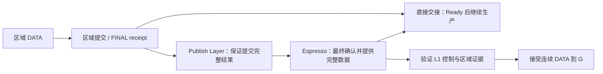

# Sync HotStuff RR Part II v3.2：四模块与并发 Session 中文阅读版

对应：[英文正文](sync_hotstuff_rr_part2_rotation_v3_2.tex) · [英文 PDF](sync_hotstuff_rr_part2_rotation_v3_2.pdf) · [Arch v4 中文阅读版](arch_v4_zh.md)

本文对应英文 v3.2 候选稿，保留 v3.1 的模型、假设和进展前提。新增四个 cross-region 模块、每个节点管理的并发 session、精确 Ready 检查及显式退役接口。正常运行时的区域 DATA/DRAIN、四元组 view、常规轮转、两类 Force 及优先级沿用原规则；Force 后停止旧程序的路径在第 6.8 节单独定义。完整消息格式和逐项验证条件以英文正文为准。

本稿已给出全局前缀、程序隔离和退役安全的条件性命题与证明，并记录当前规则的活性失败轨迹。当前版本仍是候选稿，等待对完成稿开展新的独立 adversarial review；前置分析不能替代这次审查。

## 先记住一套编号

完整 view 统一写成：

$$
(\beta,r,g,t).
$$

| 编号 | 直白含义 | 何时改变 |
|---|---|---|
| $\beta$ | 当前生产分支的版本号 | 一次 Force **实际执行**后加一 |
| $r$ | 某个地区的一次生产轮次编号；不是地区编号 | 常规跨地区交接时加一 |
| $g$ | 这一生产轮次内的恢复编号 | 区域内 recovery 时加一 |
| $t$ | 这次恢复阶段内的 leader 轮次 | 区域内正常换 leader 时加一 |

**Session 就是 $(\beta,r)$。** 实现可以编码或哈希这些字段，但正文只用这套编号。

例如：

```text
(7,20,0,0)  A 开始生产
     ↓ 区域内换 leader
(7,20,0,1)
     ↓ 区域内 recovery
(7,20,1,0)
     ↓ 常规交接给 B
(7,21,0,0)
```

这里每一步的含义都写在编号上。常规交接改变 session，但不改变 $\beta$。

**本次保留原有 Force 检查。** MSIG 指令仍指定目标 $\beta$；若其他 Force 已改变它，这条指令就作废。先检查匹配的 MSIG，再检查 AUTO。MSIG 仍不是无条件到点执行。

还要区分三个进度：区域已经生产的分支 $R$、已经全局确认的数据 $G$、已经被 L1 接受的发布数据 $C_{\rm pub}$。它们可以先后推进，不必同步。这里的 Publish Layer 负责向 Espresso 提交结果；$C_{\rm pub}$ 则属于后面的 rollup DA 发布阶段。

## 1. Overview：变化发生在哪里

每个正确区域节点运行 Session Manager，并为每个已经进入的 $(\beta,r)$ 保留独立区域 BFT engine。一个 session 就是一个区域在某个分支版本中的一次生产轮次，其中包含多个 leader term 和必要的 recovery。Manager 可以同时管理旧 Active 程序、新 Waiting 准备任务及正在移交责任的 Completed 程序。
常规交接进入 $(\beta,r+1,0,0)$；有效 Force 进入新的分支版本。

本稿沿用 v3.1 的两项服务：

1. **Publish Layer：** 完整区域结果可用后，在 $T_{\rm pub}$ 内保证有效提交给 Espresso。
2. **Espresso：** 提交后在 $T_E$ 内完成最终确认，并使持续在线的正确参与者能获取记录和证明。

Publish Layer 是现有 leader、副本或 data verifier 共同实现的发布能力，不是一组必须独立部署的新节点，也不增加共识轮次。正文先使用这项服务假设，第 10 节再讲 leader 优先、其他人代发和手续费代付。



节点可以有一条领先于 $G$ 的生产分支 $R$。Force 关闭整个旧版本 $\beta$，包括其投机的常规后继，但保留旧分支已经进入 $G$ 的所有 DATA。

有效 Force 先由公共解释器关闭旧版本的追加权限。Manager 随后按第 6.8 节请求旧程序收尾；这不是 Quit 或 Completion，也不直接取消已经启动的 commit timers。新 session 的准备和启动不等待旧程序完成退役。

四个模块分别负责：公开窗口检测、Multisig 健康政策、每个节点的并发程序管理，以及每份程序的精确 Ready/激活检查。公共状态仍只有 Protocol 6/5 一条验证与更新路径，Handler 使用它的结果。

[四模块图](figures/cross_region_rotation_v3_2/modules.png) · [候选变化与 Ready 图](figures/cross_region_rotation_v3_2/candidate_ready.png)

| 事件 | 新 view |
|---|---|
| 同一区域正常换 leader | $(\beta,r,g,t+1)$ |
| 区域内 recovery | $(\beta,r,g+1,0)$ |
| 常规跨区域交接 | $(\beta,r+1,0,0)$ |
| 有效 Force | $(\beta+1,r_c+1,0,0)$ |

Force 行中的 $r_c$ 是**还欠 $G$ 下一块数据的轮次**，也叫 export session 的轮次编号。它可能落后于当前正在生产的轮次。后面第 6 节说明公共状态尚未分配 duty 时怎样保留这个编号；它与某份程序的 Waiting phase 不同。

例如 A 的 session $(7,20)$ 已生产到 110，B 的 $(7,21)$ 已接班生产到 115，但 $G$ 只到 108。正在生产的是 B；欠下一块 109 的仍然是 A。因此 Force 从 A 的交付位置重新选区，而不是从某个节点看到的最新生产位置选区。

## 2. Model and assumptions：模型与假设

### 2.1 L1 control state

L1 提供两组信息：

| 信息 | 作用 |
|---|---|
| $\mathrm{AUTH}_{r,0}$ | 固定区域快照、leader schedule、DATA quota 和 export-window 参数 |
| $\mathrm{AUTH}_{r,g}$，$g>0$ | 恢复 generation 的 leader schedule；不重置快照或 quota |
| STATUS | 在未来 Espresso 时间改变指定区域的 live/off 状态 |
| CLEAR | 在未来 Espresso 时间清除指定 cooldown |
| MSIG FORCE | 指定目标分支版本、未来 activation time 和可选附带配置；不指定 retained DATA height |

Authority 一经分配不可改绑。Force 重用数字 $r$ 时，读取该 index 原有 authority，以新的 $(\beta,r)$ 区分 engine。

每个控制有 L1 序号 $c$ 和 Espresso 激活时间 $\theta_a$。**读取控制不等于激活控制。** 节点保存完整控制前缀，并保留尚未到期的 pending records。

设 Espresso 区块为 $J_q$，时间为 $\theta_q$：

$$
q(d)=\min\{q:\theta_q\ge d\}.
$$

阈值 $d$ 在 $J_{q(d)}$ 的 payload 之前触发。同一 timestamp 下，height 和块内位置仍给出确定顺序。

区域是否可选由三部分共同决定：governance flag 为 ON、自动 cooldown 已过、指定 authority 下该区域具有正权重。解释器把控制和超时处理之后、EXPORT 处理之前的结果记为历史 snapshot $\chi_E(q)$。

OFF 不撤销已经基于历史 snapshot 确定的常规交接证明；ON 不自动清除 cooldown；任何状态更新都不能改写旧证书的权重。

Genesis checkpoint 指定合成 anchor、L1/Espresso reference、初始分支版本和控制上下文。初始版本 $\beta=0$。合成边界保存 $(i_b,\beta_b,r_b)=(\bot,\bot,-1)$，从整个区域表选择第一个合格区域，开启当前版本的 session $(\beta,0)$，通常是 $(0,0)$。如果首次选区前已经发生 Force，就使用增加后的 $\beta$；初始 reference 下界也属于这个实际开启的 session。

### 2.2 数据怎样送达：Publish Layer

Publish Layer 是由现有参与者实现的一层发布服务，不要求另外部署一组专职 Publisher，也不重新执行共识。

它接收的**完整区域结果**包括：DATA、直接或覆盖它的 FINAL receipt，以及验证所需的祖先、交接证明和来源证据。正确副本一旦拿齐，就交给这层服务。只有一个 QC、一个 hash，或者只有 receipt 却缺 payload，都不算完整输入。

数据有两条获取路径：

| 路径 | 用途 |
|---|---|
| 当前区域直接发给下一地区 | 允许下一地区在 terminal DATA 尚未进入 Espresso 时就完成 Ready |
| Publish Layer → Espresso → 其他参与者 | 完整结果发布后，其他地区、Certifier 和 Proposer 可以从共同的历史中获取它 |

直接发送成功，常规交接不等 Espresso；直接发送不可用，就等待结果发布后从 Espresso 获取。这次交接会更慢，但不需要另外假设一个独立 Backbone 一定把数据送到所有人。

Espresso 提供已最终确认的记录和证据，节点仍检查其中的区域结果及轮转规则。L1 继续提供自己的 authority 和控制证明。执行状态可以直接传输，或从已验证的数据历史重建；**能下载区块不等于已经恢复好执行状态**。拿齐状态仍是 Ready 的条件。

### 2.3 Stake and faults

区域 $i$ 中成员权重满足：

$$
\omega_{i,v}>0,\qquad W_i=\sum_{v\in V_i}\omega_{i,v},\qquad F_i<W_i/2.
$$

Byzantine 总权重最多为 $F_i$。证书需要不同成员的匹配签名，合计权重 **严格大于 $F_i$**。在此假设下，每张证书至少含一个正确签名者，正确成员也能独立凑齐证书。

成员和权重在整个 session 内固定，包括 recovery。Slashing、OFF 或后来的快照不能改变历史证书的验证分母。$F_i$ 还覆盖历史证书仍被接受期间累积失陷的相关密钥。

这沿用原有同步 BFT 模型，不能把 Espresso inclusion 当作放弃区域有效性假设的理由。

### 2.4 假设：区域共识、发布服务和两条链

| 假设 | 具体内容 |
|---|---|
| Finalized L1 records | 最终确认的 authority 和完整控制前缀共同、可认证、不可改写 |
| 区域同步通信与全局时钟 | 区域内正确节点间完整消息及依赖的延迟不超过 $\Delta_i$；保留原有共同真实时钟 |
| Bounded publication service | 完整区域结果可用后，Publish Layer 在 $T_{\rm pub}$ 内把它有效提交给 Espresso |
| Honest multisignature committee | 委员会诚实、协调，只提交授权且提前公告的未来控制 |
| Bounded L1 finalization and visibility | 实际提交后至多 $T_{\rm L1}$，所有正确在线参与者获得 finalized、完整、可验证的控制 |
| Espresso history and time | 最终历史兼容、可验证并保留可取回；timestamp 非递减，且满足最大领先界 |
| Bounded Espresso finalization and visibility | 合规记录有效提交后至多 $T_E$，被 Espresso 最终确认，持续在线并跟上历史的正确参与者能够获取记录及最终性和包含证明 |

**发布服务保证。** 假设正确参与者在真实时间 $s$ 已经拿到完整区域结果，并使其对 Publish Layer 可用。服务保证在 $s+T_{\rm pub}$ 之前完成有效提交，不依赖原 leader 独自配合。至少有一条可工作的提交路径和所需费用资源；输入大小与负载满足事先约定的服务范围。已经记录到 Espresso 的相同结果，已经满足这项数据送达保证；为推进 $G$ 而重新构造 EXPORT 的重试另行处理。

这个时钟不从“leader 开始提案”或“一个副本刚刚 commit”开始，而从**完整数据和 receipt 已经可用**开始。形成 FINAL receipt 仍由区域协议负责。有效提交也不是本地调用一次发送函数，而是完整记录已经按 Espresso 的入口规则交到其提交接口。

**Espresso 确认与可见性保证。** 假设记录在真实时间 $s_E$ 有效提交。至迟到 $s_E+T_E$，它进入 finalized 区块，持续在线并跟上历史的正确参与者都能获取完整 payload、验证 inclusion 和 finality。$T_E$ 包括 inclusion、finalization、传播、获取及 Espresso 证据验证，而不只是看见一个 header hash。

另外，每个新 finalized 区块及其完整相关 namespace，在最终确认后至多 $T_E$ 对这些参与者可获取、可验证；即使这个块没有本链记录也一样。这样，节点能验证“这个区间没有新的本链数据”，而不能把本地下载失败当作缺块证据。

**长期获取保证。** 重放所需的历史和证据仍须保留、可取回。已经进入 $G$ 的 DATA 不依赖原生产地区持续在线。可以由保存认证 Espresso 历史的归档服务提供这项能力；finality certificate 本身不等于永久存储。重新上线的节点要补齐历史或从授权 checkpoint 开始，不能假设任意长历史都在同一个常数时间内同步完。

**两段时间怎样连接。** 对一份新近可用的完整结果：

$$
s_{\rm submit}\le s+T_{\rm pub},\qquad
s_{\rm visible}\le s+T_{\rm pub}+T_E.
$$

这里保证的是**所提交结果及 Espresso 证据已经可获取**。它不包含形成区域结果之前的时间，不保证新地区已经恢复执行状态，也不保证过期或无效 EXPORT 已被接受进 $G$。例如 expected base 过期、版本关闭或缺少前驱，都可能要求重试或使结果不能继续追加。

$T_{\rm pub},T_E$ 用真实时间计量；交付窗口使用 Espresso timestamp。选择窗口长度时，还要考虑时钟对应关系、区域生产、Ready 和重试的预算，不能直接把窗口长度等同于这两个上界之和。

**L1 提前公告规则不变。** $T_{\rm L1}$ 已包括 inclusion、finality、传播、获取和验证，不重复增加一个公告延迟。若 Espresso 块首次 finalized 的真实时间是 $t_E(q)$，仍假设：

$$
\theta_q\le t_E(q)+\epsilon_E.
$$

委员会在真实时间 $s$ 提交控制时选择：

$$
\theta_a>s+T_{\rm L1}+\epsilon_E+\eta,\qquad\eta>0.
$$

这样，在 Espresso 首次跨过该阈值并 finalized 之前，控制已对正确在线参与者可验证。新增的 $T_E$ 不替代 timestamp 的领先界，也不改变这个提前公告条件。


### 2.5 Conditions for progress

前缀安全与持续进展分别陈述。持续进展需要：正确 leader 反复获得实际进入的生产机会；暴露的 equivocator 最终被持续排除；完整区域结果能形成；发布路径与 Espresso 满足服务上界；authority 和执行状态可获取；最终有其他合格地区；委员会给健康地区足够的服务时间。

还要有一段持续的服务时间，让携带下一段所需 DATA 的 EXPORT 真正被接受进 $G$。一次记录已上 Espresso，不代表它没有 stale base 或其他接受问题。新上界不包含区域恢复和状态恢复，也不自动约束一连串重试。窗口仍需与这些过程及 Espresso 时钟条件相匹配。

## 3. Regional engine：保留的定义与数据结构

### 3.1 Blocks、positions 与两种 reference

外层块可写为：

$$
B=(\beta,r,k,h,\mathrm{type},x,H(B_{\rm parent}),\rho,\xi).
$$

| 字段 | 含义 |
|---|---|
| $h$ | DATA height，只统计 DATA |
| $k$ | 本 session 的 physical position，统计 DATA 和 DRAIN |
| $x$ | DATA 携带的请求 batch；DRAIN 不携带 batch |
| $\rho$ | finalized L1 block reference，含 L1 height $\lambda(B)$ |
| $\xi$ | 签名绑定的 finalized Espresso reference，包含 height 和 header hash |

$A_{\beta,r,g,t}$ 是某 view 第一个 fresh position 之前的 anchor。$A_{\beta,r,0,0}$ 是跨区域继承的 DATA；recovery anchor 则由恢复过程选择。

DATA 的 $h$ 增加一。DRAIN 的 $k$ 增加，但 $h$ 不变。

两种 reference 分开约束：L1 height 沿 DATA ancestry 不下降，首个 DATA 满足 $\lambda\ge\lambda_{\beta,r}^{\rm open}$；Espresso reference height 也不下降，首个 DATA 满足 $q\ge q_{\beta,r}^{\rm open}$。DRAIN 复制 $T_{\beta,r}$ 的两个 reference。

Reference 是提案时签名的历史上下文。一个块可能在很久以后才因 recovery / DRAIN 提交，因此 reference timestamp 不等于区域 commit time，也不是 global finality time。

**$\xi$ 的作用：先约定用哪一份地区状态选接班人。**

设区域顺序为 A → B → C。Espresso 第 500 块时 B、C 都合格；一条提前公告的 L1 控制在第 505 块把 B 设为 OFF。A 的 terminal DATA 110 签名绑定：

$$
\xi(110)=(500,H(J_{500})).
$$

这意味着常规交接从第 500 块对应的历史地区状态开始选。一个节点在 Espresso 第 503 块时收到 110 的区域 receipt，另一个节点到第 506 块才收到。如果各自按“我现在看到的最新状态”选，前者可能选 B，后者可能选 C。

有了同一个 $\xi$，只要分支没有被 Force 关闭，两者都从 500 开始选，因此都选 B。这个历史状态由 L1 控制按 Espresso 位置生效后计算，不是由 Espresso 执行状态管理合约。

**110 自己不必先上 Espresso。** 被引用的 $J_{500}$ 早已 finalized；下一地区拿到 110 的区域 receipt 和完整交接材料，就可以验证该选择。因此直接发送仍可实现不等待 Espresso 的常规交接。

代价也要说明：第 505 块的 OFF 不追溯更改已绑定的历史选择。$\xi$ 保证大家选择一致，不保证参考状态最新；需要关闭已授权分支时仍使用 Force。即使增加有界可见性，不同节点也可能在不同时刻收到 receipt，所以仍需固定共同参考点。

本次只澄清用途，保留 DATA 的 $\xi$ 字段、DRAIN 复制规则及原有验证条件。

### 3.2 Session quota、term positions 与 DRAIN

Session $(\beta,r)$ 的固定终点为：

$$
H_{\beta,r}=h(A_{\beta,r,0,0})+\mathrm{TB}_r.
$$

高度 $H_{\beta,r}$ 的 DATA 是 $T_{\beta,r}$。Recovery 不改变 $H_{\beta,r}$。Quota 统计 proposal ancestry 中的 DATA，无论这些 DATA 是否已经提交；它不以当前 $G$ 为计数基础。

若 recovery generation 的 anchor 低于 $H_{\beta,r}$，它是 DATA generation。每个 term 最多产生：

$$
m_{\beta,r,g,t}=\min\{K,H_{\beta,r}-h(A_{\beta,r,g,t})\}
$$

个 fresh DATA。最后一个位置的 QC 是 terminal QC。若它还低于 $H_{\beta,r}$，则允许进入下一 term；达到 $H_{\beta,r}$ 后不再开启下一 term。

**DRAIN 仅用于 recovery 从 quota endpoint 开始的情况。** 当 $g>0$ 且 $h(A_{\beta,r,g,0})=H_{\beta,r}$ 时：

- 这一 generation 只有 $t=0,j=0$ 的一个 fresh DRAIN。
- DRAIN 不携带请求，不增加 DATA height，不消耗 quota。
- 它以本 generation 的 ANCHOR QC 为 justification。
- ANCHOR vote 不启动 commit timer；DRAIN vote 启动原有 timer，使包括 $T_{\beta,r}$ 在内的祖先得到提交。

正常 DATA generation 到达 endpoint 后不会顺手附加 DRAIN。它等待 $T_{\beta,r}$ 的 timer，或在 Quit 后恢复。连续被打断的 recovery 可以产生多个 DRAIN，因此整个历史中的 DRAIN 数量不被 quota 限制。

例：anchor 100、quota 10、$K=4$，三个正常 term 分别生产 101–104、105–108、109–110。从 107 恢复继续生产 108–110；从已认证的 110 恢复则进入 drain generation。终点始终是 110。

### 3.3 Certificates 与 FINAL

| 证据 | 证明什么 |
|---|---|
| Proposal QC | 足够权重已对某 proposal 投票；不是区域提交证明 |
| ANCHOR QC | 新 generation 的 opening anchor 被重新认证；不启动 timer |
| BLAME proof | 满足条件的超时抱怨，可作为 Quit 的一种依据 |
| FINAL receipt $\mathcal F_{\beta,r}(B)$ | 足够权重对 session $(\beta,r)$ 的 DATA 提交作出的匹配声明 |

所有签名都绑定 chain、协议、$(\beta,r)$、固定配置、服务区域和消息类型。View 消息另外绑定 $(g,t)$ 与 $\mathrm{AUTH}_{r,g}$。FINAL 只增加 DATA 字段，不绑定 $g,t$。因此 FINAL 不随 recovery generation 或 term 改变。来自不同 generation 的、针对同一 DATA 的有效 FINAL 可以汇总。

同一 session 中，较高 DATA 的 receipt 可通过完整 ancestry 覆盖较低 DATA。后一 session 的 receipt 不能代替前一 session 的证据。

DRAIN 被提交时，为被它提交的 terminal DATA $T_{\beta,r}$ 产生 FINAL，不为 DRAIN 自身建立全局 DATA。新 session 继承 anchor 不等于重新为旧 session 签发 receipt。

正确副本把新提交 DATA 的 FINAL 签名同时发给固定区域成员和 publication collector。既有参与者按固定快照聚合匹配签名，形成完整 receipt 后，把结果交回原 session、Manager 和 Publish Layer。单个 FINAL 签名不构成完整区域结果，也不启动 $T_{\rm pub}$ 的完整结果交付保证。

### 3.4 Admission、validation 与 engine state

每个消息按 session 编号 $(\beta,r)$ 路由。签名绑定 chain、协议和 session；view 消息还绑定 $(g,t)$ 与 $\mathrm{AUTH}_{r,g}$。验证包括授权、是否允许进入该 view、块类型、quota、两种 position、祖先、证书和两个 reference。

区域 core 保留 Active、Frozen、Completed 三种含义：Active 已进入且没有合法 Quit 冻结；Frozen 有合法 Quit proof；Completed 已取得 terminal receipt 并执行 Completion。完整程序生命周期还包含 Waiting、Ready、Terminated，由第 6 节统一定义。Force 本身不把 Active 改名为 Frozen，也不伪造 Completion。

消息、锁、votes、timer 和异步任务按完整 session pair 路由。旧 generation 的材料归档，未来 generation 的材料缓冲。缺依赖就获取并等待，不能把缺数据直接当成无效或缺块。已进入程序的精确初始 anchor 不因 $G$ 推进而改变。

处理顺序保留原版原则：先检查携带的 Quit evidence，再处理依赖和有效性，再按祖先顺序处理附带 proposals / terminal QCs，最后处理消息本身。消息与 timer 同时到达时，先处理消息。

## 4. Regional protocols：正常 core 与显式退役入口

### 4.1 Steady state

以下为仍获准运行的 session 的正常规则。已验证关闭后的新动作受第 6.8 节退役 gate 约束；已有 timers、证据和 commitments 按该节继续处理。

**Protocol 1：提案、投票、提交、term rotation、Completion。**

1. 当前 leader 按顺序提案，遵守 DATA quota 或 drain-generation 规则。重发必须保持同一 proposal，不能在同一位置签两个不同块。
2. Replica 完整验证后，对首次合法投票记录时间 $\tau_v(P)$，转发并投票。
3. 投票启动原有 $2\Delta$ commit timer。到期且未取消则提交该块和未提交祖先，并为本 session 新提交的 DATA 向固定区域成员及 publication collector 发送 FINAL。
4. 低于 $H_{\beta,r}$ 的 terminal QC 可以开启下一 term；它不取消已有 commit timers。QC 本身也不启动 commit timer。
5. 取得 $\mathcal F_{\beta,r}(T_{\beta,r})$ 才执行 Completion：停止本 session 的提案、投票、恢复和进度检查，取消未到期 timer，但继续提供数据。

只有真实 Quit 或 Completion 可以取消这里已经启动的 commit timer。Force 关闭本身不取消 timer；退役 gate 阻止新的区域工作，收尾期间继续处理既有 timer、有效证据、FINAL 和 receipts。Core 向 Manager 报告 term、Quit、recovery 和 Completion 变化，不能借此改写公共 $G$。

### 4.2 Quit 与 recovery

**Protocol 2：Blame、Quit、Status、NEWVIEW、ANCHOR vote。**

对 term 中第 $p$ 个进度要求，在：

$$
e_v(\beta,r,g,t)+(2p+4)\Delta
$$

检查。如果 view 仍有效、尚未完成、投票位置少于 $p$，且未发过该 term 的 BLAME，则广播 BLAME。首个检查在进入 term 时就安排，不能让沉默 leader 无限推迟启动。

合法 Quit proof 可以是：足够权重的匹配 BLAME；同一合法位置上的 leader equivocation；或同一 generation 上选择不同 opening 的两个合法 NEWVIEW。越过 quota 的 DATA、错误 generation 中的 DRAIN，本来就无效，不能被当作该双签条件中的合法 proposal。

Quit 后冻结 generation，取消其未到期 timers，但保留已提交数据并继续收集证据。对尚未请求关闭的程序，等待至少 $a_v+\Delta$ 且下一 authority finalized 后，进入 $g+1$。已请求关闭的程序仍处理真实 Quit，但不能因为晚到 authority 或缓冲 recovery 回调重新开启 generation。

进入时固定 entry lock $Q_v$。新 leader 在自身进入后等待 $2\Delta$，选择已知最高 rank 的 QC 作为 $Q^*$ 并广播 NEWVIEW。Replica 验证后，只有在 $\operatorname{rank}(Q^*)\ge\operatorname{rank}(Q_v)$ 等条件成立时才作 ANCHOR vote。

取得 ANCHOR QC 后，在本 session 仍获准执行新动作时开始 DATA 或 DRAIN。区域 commitment 与 Completion 都不等待发布回执。正常运行中的 proposal、投票、FINAL 和计时规则保留；完整 receipt 由既有参与者聚合并回送源 engine，拿齐完整结果的副本将其交给 Publish Layer，也可直接发送给后继地区。

初始 session 在 Protocol 4 Enter 时完成 Ready → Active 并记录 $e_v(\beta,r,0,0)$。STATUS、初始 $2\Delta$ 等待、NEWVIEW 和 ANCHOR QC 都已在 Active 内；进度检查不能延后到 ANCHOR QC 后才启动。

## 5. Regional and global finality

### 5.1 Regional finality

本节关于 commit window 的进展结论，只针对所述区间内没有发生 `RequestClose` 的正常运行 session。关闭中的程序改用第 6.8 节规则；它可能保留一份本地 commitment，却没有形成完整 receipt。这是结论的适用范围，不是对所有执行新增“永不关闭”的假设。

区域 finality 仍按区域 commitment 规则定义，并与具体 production branch 绑定。若未确认分支以后被 Force 关闭，其 receipt 仍然是区域提交证据，但不再意味着它可以追加到全局链。

“某个正确 replica 已提交”“外部观察者拿到完整 receipt”“所有正确 replicas 最终提交”是不同条件。后者还涉及区域 liveness 和后续恢复；不能把一张 proposal QC 当作这三件事都已经发生。

新的发布上界针对完整结果，不覆盖每一条区域内部 BLAME 或 Quit 消息。所以外部观察者不能因为暂时没看到 Quit，就用 receipt 到达时间推断所有副本已经完成提交。 Espresso 证据能证明结果已经公开可获取；若还要约束每个副本执行本地 commit 的时刻，需要明确在线和 receipt 处理条件。本协议用 Espresso 的接受结果保护全局前缀，不依赖一个外部的“所有副本已经 commit”测试。

### 5.2 Published records：EXPORT 的接受

Publish Layer 构造并提交 EXPORT；发送者可以是原 leader、其他副本或外部 data verifier。EXPORT 可以包含跨多个常规 session 的连续 DATA，但必须包含各 session 的完整证据。发送者的签名不能代替区域 FINAL。具体谁优先发、怎样代付费用，留到第 10 节说明。

解释器在处理该 Espresso 块的控制和超时后检查：

1. Expected base 与当前 $G$ 的前缀及来源一致。
2. Branch version 仍开放；每个 DATA 属于合法边界链指定的 session。
3. 从 $h(G)+1$ 连续开始，parent/hash 对应，不遗漏、不重复。
4. 每个块的区域 commitment、应用有效性、authority 和 quota 检查通过。
5. 所用 Espresso selection reference 严格早于承载 EXPORT 的 Espresso 块，不能自我证明。
6. Force 新建的分支版本不能在触发 Force 的同一个 Espresso 块里接受 DATA。

整个 EXPORT 要么全部接受，要么全部拒绝。一个无效记录不会部分推进 $G$。之前因缺祖先而被拒绝的候选必须重新提交，不能事后在原位置补确认。

**发布成功和进入 $G$ 是两件事。** $T_{\rm pub}+T_E$ 保证所提交结果及其 Espresso 证据可获取，不保证过期 EXPORT 被接受。一份 EXPORT 即使没有推进 $G$，其中经过独立验证的区域 receipt 和数据仍可作为交接或历史证据。

**Terminal DATA 可以先进入 $G$，即使当时没有下一合格区域。** 这时公共解释器保留 pending boundary，不分配 export duty，也不运行其 DATA window。程序自身的 Waiting 还可以表示“已选中、但状态尚未恢复”，不能用它判断公共窗口有没有开始。

已证明无候选与缺验证材料不同：后者暂停重放，之后从同一规范位置恢复。

### 5.3 Global finality

观察者认证并重放 Espresso 的 finalized prefix，当某个合法 EXPORT 把 $B$ 加入 $G$ 时，便把 $B$ 视为 globally final。

这一步之后没有额外 committee wait，也不要求先把 Espresso checkpoint 登记到 L1。

之后的 Force 保留完整 $G$ 及其 block/session provenance。旧分支版本的字节仍可能被 Espresso 原样记入日志，但解释器不再接受它们成为本链输出。

全局接受不检查生产程序当前是否 Active。Completed 或 Terminated 程序的合法既有结果仍可由持久发布者提交；是否进入 $G$ 取决于版本、边界链和连续区间等公共条件。相反，旧程序仍 Active 收尾，也不能恢复关闭版本的追加权限。

### 5.4 Reference 不是 commit clock

$\rho$ 和 $\xi$ 在提案时固定，区域提交可能因 recovery 很晚才发生。窗口从解释器分配 export duty 的公开时间开始，统计最终接受进入 $G$ 的新增 DATA。

区域内部的 $2\Delta$ timer 仍使用原有同步时间模型。

## 6. Cross-region rotation：四模块与并发程序

### 6.1 Four-module cross-region architecture

每个正确区域副本独立运行一个 **Session Manager**。它观察 finalized L1 和 Espresso 历史，接收区域结果，并管理以 $(\beta,r)$ 命名的独立程序。Manager 是各副本执行的本地逻辑，不是新增的受信任区域控制器。

一个区域可以同时运行旧 session、准备可能的后继，并把更早 session 的数据责任移交给存储和发布服务。完整区域 view 仍是 $(\beta,r,g,t)$，不增加另一套 session 编号。

| 模块与执行者 | 输入 | 输出与权限边界 |
|---|---|---|
| Soft Force Detector；任何验证节点 | 完整已验证 Espresso 历史、export duty、固定窗口与实际接受计数 | 可重算的窗口失败条件；不自行改变 $\beta$ |
| Multisig Health Controller；既有 committee | 区域健康、同步和交付观测 | 未来生效的 L1 MSIG、STATUS、CLEAR；不选择保留高度 |
| Cross-region Handler；每个正确区域副本 | 已验证公共更新、区域 receipt、本地任务事件 | 准备、激活、请求收尾、责任移交；不再次执行 Force |
| Ready and Activation Gate；每份 session 程序 | 已固定交接、精确 anchor、执行状态、authority | 继续 Waiting，或通过 Protocol 4 原子进入；预取不授予投票权 |

Soft 检测和 Multisig 健康管理是两个并列的干预来源。区域副本、外部 observer、Certifier 或其他需要核对进展的节点都可调用同一 Soft 检测算法，不需要 Multisig 权限。Handler 管理候选和正式交接，每份 session 的启动检查负责验证其精确起点。

原始 Espresso 历史和完整 L1 control/authority 上下文先经过 Protocol 6/5 验证重放，才能导出 $G$、资格、Force 结果和 export duty。这是共同公共验证接口，不是第五个生命周期模块。Handler 使用它的结果；Soft 检测提供可重算条件，不能独立更新公共状态。


候选预热和正式交接缺材料时，由 Handler 发起 Fetch/Restore；完成回调先回到 Handler，再按目标与 anchor 核对。只有已固定交接进入 Ready gate。

健康的非活跃地区仍持续观察两条公共流，可以在被选中前准备数据和 authority。公共重放游标、投机程序和存储任务是不同对象。一个本地程序处于什么 phase，不能代替 EXPORT 能否进入 $G$ 的公共验证。

### 6.2 Soft detection and multisig health control

Soft Force Detector 从一个已验证 replay checkpoint 和后续完整 Espresso 历史开始，重建当前 export duty，并按第 7 节结算固定窗口。它返回以下三种结果之一：

- 尚无失败；
- 失败窗口描述、首次越过 deadline 的 header 和支持历史；
- 缺少证据，需要继续获取。

失败描述绑定 chain、当前 branch version、export-session pair、窗口起点、deadline、target 和 accepted count。缺少 namespace 或 control 证明不能被解释成 count 为零。

只有实际追加到 $G$ 的 DATA 计数。重复 DATA、DRAIN、proposal QC、无效 EXPORT 都不计数。被观察的 export session 可能比最新生产 session 落后多个常规轮次。轮询只用于取得新历史；轮询频率和本地收取时间不决定是否失败。任何接收者都要对照自己的已认证前缀重算外部提供的失败描述。

Protocol 5 仍是唯一的 Force 状态转换入口，顺序不变：

$$
\text{独立 STATUS/CLEAR}
\longrightarrow \text{首个目标版本匹配的 MSIG}
\longrightarrow \text{否则检查 AUTO}
\longrightarrow \text{EXPORT payload}.
$$

已经算出的 Soft 条件不能越过同一 prelude 中匹配的 Hard Force。

Multisig 健康政策的接口是 `HealthPolicy(地区观测, 已验证控制状态)`，输出不操作，或提交未来生效的 OFF、ON、CLEAR、Hard Force。它区分四种动作：

| 目的或观测 | 控制动作 | 含义 |
|---|---|---|
| 某区域不适合在后续接班 | 未来 OFF | 从后续选区资格中排除 |
| 需要结束目标版本的生产安排 | 未来 MSIG Force；需要持续隔离时另含或另发 OFF | 到规范激活位置且目标版本匹配时切换 |
| 已检查同步、数据服务和运维恢复 | 未来 ON | 恢复后续选区资格 |
| 需要在自动 cooldown 到期前解除它 | 显式 CLEAR | ON 本身不清除 cooldown |

每条操作记录目标、获授权的变化和未来激活时间。具体健康阈值仍是现有诚实 committee 假设下的运维政策，本节不新增数值阈值。

MSIG 针对 branch version。普通交接只改变 $r$，不会使它失效；先发生的 Force 改变 $\beta$，可能使它过期。只有目标匹配时才应用其附带配置；独立 STATUS 按自己的激活规则处理。健康观测不能直接改写其他副本的公共状态，所有动作都要经过 finalized L1 与预先公告的 Espresso 激活位置。一次 ON 也不证明未来的区域同步和故障假设永久成立。

### 6.3 Cross-region Handler

Manager 串行处理会修改本地控制状态的事件。下载和状态恢复可以并行。它不必只预测一个未来，可以保留多个有用途的准备任务；每份任务都写明候选 session 和 anchor。只有正式交接才确定唯一可启动目标。

| 输入事件 | 验证与路由 |
|---|---|
| `L1Finalized` | 认证完整 control prefix 和 authority；把未来控制放入队列，不提前激活 |
| `EspressoFinalized` | 认证完整有序历史；使用 Protocol 6/5 产生的状态转换 |
| `RegionalFinalized` | 验证 DATA、完整 FINAL receipt 和必要 ancestry；路由给原生产 pair，并交给 Publish Layer |
| `MaterialAvailable` | 核对目标 pair、anchor 原生产 pair、height、hash、所请求对象和验证结果；只更新相匹配的准备任务或固定交接 |
| `CoreEvent` | 接收指定本地 engine 的事件；记录 view、Quit、恢复、Completion 或退役进度 |

**单个 FINAL 签名不是 `RegionalFinalized` 事件。** 既有参与者收集匹配签名，形成满足 receipt 定义的完整证书。正确持有者把完整结果交给 Manager 和已经进入的源 engine，并提交给 Publish Layer。源 engine 执行原有 receipt 和 Completion 规则。尚未进入的程序只缓存结果，不能通过 receipt 回调创建 engine 或跳过交接验证。聚合不是新增共识轮次；$T_{\rm pub}$ 仍从完整结果可用时开始。

输出动作如下：

| 输出 | 接收方与内容 |
|---|---|
| `Prepare/Fetch` | 数据或状态任务；绑定目标与精确材料 |
| `Activate` | 指定 session 的 Protocol 4；执行一次初始 Enter |
| `RequestClose` | 旧程序；携带已验证关闭原因 |
| `OfferResult` | Publish Layer；保留原 DATA、receipt 字段 |
| `Persist/Release` | 存储和资源管理；持久记录状态并移交责任 |

回调提供的是材料，不是激活命令。一个晚到结果可以对存储有用，却不匹配程序当前的准备目标。

**Protocol 3：处理跨区域事件与管理程序。** 每个正确区域副本独立执行：

1. **验证事件。** 按完整 context 路由公共输入、区域结果和本地回调，保留 pending requests 与源证据。材料或 session 与请求不匹配的完成回调不能满足请求。
2. **使用公共重放结果。** 对新公共历史运行或使用 Protocol 6，包括规范顺序中的 Protocol 5，读取结果中的 $\beta$、$G$、资格 snapshot、duty 和 boundary。本 Handler 不独立增加 $\beta$、选择另一 cutoff 或改写 $G$。
3. **核对正式交接。** 对尚未关闭版本的有效 terminal receipt 导出 REGULAR boundary；接收公共重放确定的 Force boundary；按第 6.5 节验证。为本地区的正式目标准备材料，并向被选成员发送完整交接。未来 Force 不阻止当前普通交接。
4. **核对候选。** 根据当前 export context、$G$、合格地区和已知未来控制重算可能目标。只更新尚未固定的准备计划；目标 pair 改变时使用另一份程序记录。暂停过时的投机工作；只有已验证事实确定目标不可能成立，或固定交接已分配给其他地区时，才终止尚未进入的程序。
5. **处理关闭与区域结果。** 对版本已关闭的已进入程序，按退役合同发出幂等 `RequestClose`，保留其签名路由、历史证据和发布责任。terminal receipt 仍交给已进入的源 engine 执行原 Completion。
6. **检查并进入。** 对本地区已有固定交接的 Waiting 程序检查 Ready。在同一个本地事件内，最终复核公共有效性和持久 entry flag，记录 Ready，并原子调用 Protocol 4 Enter。检查失败则继续 Waiting 或执行有依据的取消，不能留下半初始化 engine。
7. **持久化并派发。** 在对外暴露动作前，持久记录状态、进入和退出记录以及必要输出动作。异步任务携带完整目标和 anchor context。重复事件可以继续未完成动作，但不能创建第二次逻辑进入。

公共解释器只有一条更新路径：Protocol 5 定义控制、窗口和 Force 转换；Protocol 6 认证并执行这些转换以及 EXPORT 接受；Protocol 3 使用结果；Protocol 1/2 只推进指定 session 的区域 core。把它们放在同一个进程中实现，也不改变这项权限划分。

### 6.4 Session lifecycle

Manager 为每份本地程序维护：

```text
Program[(beta, r)] = {
    phase,
    preparing_plan,
    fixed_handoff,
    anchor_block,
    execution_state,
    authority_and_bounds,
    core_state,
    pending_fetches,
    entered,
    close_requested,
    closure_evidence,
    c_v,
    d_v,
    publication_and_retention_handles
}
```

其中 $c_v$ 是首次本地验证关闭并执行 RequestClose 的时间，$d_v=c_v+4\Delta$ 是适用程序的 drain threshold，具体条件见第 6.8 节。六个 phase 描述本地程序，不描述全局 finality。

| Phase | 含义 |
|---|---|
| **Waiting** | 准备候选或正式交接，可以获取数据、恢复状态和缓存证据；尚未进入区域 engine、签区域 vote，或启动区域 commit/progress timer |
| **Ready** | 已固定交接、精确 anchor 状态和全部依赖通过检查；同一个串行事件紧接着执行 Enter，不额外引入调度等待 |
| **Active** | 已进入尚未 Frozen 的 generation；包括初始 STATUS、$2\Delta$ 等待、NEWVIEW、ANCHOR 认证与后续生产；收到关闭请求时仅受明确退役合同约束 |
| **Frozen** | 当前 generation 有合法 Quit proof；沿用原有 evidence、receipt 和 recovery 规则；Force 本身不会产生此 phase |
| **Completed** | 已进入的 engine 取得合法 terminal receipt 并执行原 Completion，停止生产并按原规则取消 timer；数据交付和保留责任可能仍在 |
| **Terminated** | 逻辑程序退出，不再处理 BFT timer 或发出 BFT 签名；持久存储和发布服务继续承担历史责任，退出记录阻止晚到消息重新启动它 |

正常转换是 Waiting → Ready → Active；合法 Quit 导致 Active → Frozen；原恢复准入使 Frozen → Active，同时推进 $g$、令 $t=0$；terminal Completion 使 Active/Frozen → Completed。

Waiting/Ready 在目标确定失效时可以终止；请求退出时已经 Completed 的程序在责任移交后可以终止。RequestClose 当时为 Active/Frozen 的程序只有满足第 6.8 节条件才能 Terminated，即使收尾中取得 terminal receipt 转为 Completed，也保留既定 drain threshold。请求收尾期间保留 core phase，并设置 `close_requested`；真实 Quit 或 Completion 仍能改变对应 core phase，不增加第七个状态。

尚未固定的 `preparing_plan` 可以随着 $G$、源 duty 或候选资格改变。固定交接的目标 pair、地区、初始 anchor、source context、选择位置、authority、reference bounds 都不可替换。后来的 OFF 尤其不能改写历史上已经固定的常规选区。

锁、votes、view entry time 和 timers 只属于一个 pair。进程崩溃后恢复同一持久逻辑记录，不能清除 votes 或重做初始 Enter。存储和任务引用绑定完整 pair 与 anchor 身份，不需要另一套协议级 session ID。

多个地区可以同时为同一未来 pair 保存未授权的 Waiting 准备记录，只有固定交接选中的地区可以进入。暂时失去候选资格可以仅暂停任务；如果以后仍可能被选中，不必立即 Terminated。退出记录在释放运行资源后仍然保存。

旧程序仍 Active 时可能已经无权推进 $G$；Completed/Terminated 程序的既有结果也可能继续被接受，只要版本和区间仍满足公共接受规则。生命周期 phase 不创造或撤销这项权限。

### 6.5 Handoff records、anchor 与 Ready

`NextLive(i, M)` 在固定循环顺序 $\mathcal L_R$ 中，从 $i$ 之后寻找第一个**其他**合格地区，最多检查一整轮。没有则返回 $\bot$。资格由历史 governance flag、cooldown 和指定 authority 的正总权重共同决定。genesis 的合成源为 $\bot$，从列表首地区开始搜索整轮。本版保留必须选择其他地区的规则。

pending boundary 保存 source context $(i_b,\beta_b,r_b)$，下一个数字 index 是 $r_b+1$。常规边界保存已完成前驱；存在 export duty 时，Force 捕获该 duty 的 context；没有已分配 duty 时，Force 复用已经保存的 source context。分配前发生多次 Force，会替换 pending cause 和 version，不会逐次增加尚未打开的 session index。genesis 使用 $(\bot,\bot,-1)$。

REGULAR 从 $(\beta,r)$ 打开 $(\beta,r+1)$，精确继承 $T_{\beta,r}$。Force 在新版本打开 index $r_b+1$，精确继承触发块 payload 前的 $G$。这个 anchor 的生产 session 可能早于被捕获的 export session，它保留原 producing pair、hash 和 commitment evidence。

常规边界令 $q_0$ 为 $\xi(T_{\beta,r})$ 的高度；Force 令 $q_0$ 为触发 Espresso 高度。使用上述源地区与下一 authority：

$$
q_s=\min\{q\ge q_0:\operatorname{NextLive}(i_b,\chi_E(q))\ne\bot\},
\qquad
i_{\rm next}=\operatorname{NextLive}(i_b,\chi_E(q_s)).
$$

只搜索已验证历史。缺少证据就等待，不能跳过可能的更早候选。后来的 snapshot 不改变已经确定的最小值。普通选区不必等待 terminal DATA 发布到 Espresso；它的签名 reference 可以是历史位置，本版不新增按接收时间判断 freshness 的规则。

一份带类型的 `Handoff` 包含：

| 字段 | 类型和意义 |
|---|---|
| Domain、kind | chain/protocol domain；REGULAR、MSIG、AUTO 之一 |
| Source context | 前驱 pair $(\beta_b,r_b)$ 和源地区 $i_b$；未分配 duty 时包括保存的 context |
| Target | 目标 pair $(\beta',r')$ 和被选地区 $i_{\rm next}$ |
| Anchor | 原 producing pair、DATA height、hash、完整 DATA 或引用、原 direct/covering commitment evidence |
| Authority | finalized $\mathsf{AUTH}_{r',0}$、固定配置、quota 与 publication-height proof |
| Selection、bounds | $q_0,q_s$、已认证 selection snapshot、$q^{\rm open}_{\beta',r'}$、$\lambda^{\rm open}_{\beta',r'}$ |
| Cause、evidence | 类型对应的原因；可信或已验证 replay checkpoint、必要完整 L1/Espresso 历史与区域证明 |

引用可以指向已验证缓存，也可以指向尚待获取的对象。只有引用本身不能使程序 Ready。

`VerifyHandoff(C, history, packet)` 接受一个获授权 replay checkpoint、必要源历史和交接包，返回已验证固定字段、invalid 或 needs evidence。它不独立修改公共状态。

1. 检查 domain、字段类型、source 与 target 名字。从 checkpoint 认证并重放 cause、selection 和当前已处理公共前缀所需的兼容历史。检查完整适用 controls，不能只证明某条 control 被包含。可以使用已验证缓存。
2. 对 REGULAR，验证前驱自身的固定边界、初始 authority、精确 quota，以及 $h(T_{\beta_b,r_b})=h(A_{\beta_b,r_b,0,0})+\mathrm{TB}_{r_b}$；验证 terminal FINAL receipt、ancestry 和签名 $\xi$。要求 $\beta'=\beta_b$、$r'=r_b+1$，且该版本在已处理前缀中尚未关闭；anchor 必须就是 terminal DATA。
3. 对 MSIG，验证已授权 finalized L1 record、control sequence 和首次 crossing header $J_{q(\theta_a)}$。重放完整 prelude，确认它是首个 target 与 prelude entry version 匹配的到期 Force。只有匹配时才检查并应用附带配置。过期指令及同一 prelude 消耗掉的其他指令不能形成第二个边界。
4. 对 AUTO，从完整历史重放固定窗口计数与首次 deadline crossing，检查 accepted DATA 不足、同一 prelude 不存在优先匹配的 MSIG，并检查在实际触发 timestamp 导出的 cooldown。报警或本地 timeout 不构成证明。
5. 对两种 Force，从唯一 replay transition 取得 captured source context、旧/新版本、保留前缀和 boundary。要求 $\beta'=\beta_{\rm entry}+1$、$r'=r_b+1$，anchor 与 payload 前 $G$ 完全一致，包括 provenance。未分配 duty 期间，要验证存储 context 和中间 Force，不能虚构一个空 export session。结果版本在已处理前缀中仍须开放；后续有效 Force 会取代此边界。
6. 从 $q_0$ 和必要完整历史 snapshot 重算首个合格 $q_s$，核对地区与不可变下一 authority。设置 $q^{\rm open}_{\beta',r'}=q_s$，并令 $\lambda^{\rm open}_{\beta',r'}$ 为 anchor 的 L1 reference height 与初始 authority publication height 的最大值。验证 anchor 原 direct/covering evidence、完整 block 和必要 ancestry，不能把它重新标记成 target pair。
7. 把导出的固定字段与 packet、同一 target pair 已有记录比较。相同重复包使用同一记录；同一个 pair 的固定字段不同则拒绝。packet 不能替换已经安装的交接。进入前再次对 Manager 当前已处理公共前缀检查有效性。

Force 发生但没有合格后继时，cause、anchor、source context 和新 version 仍已固定，公共解释器保存该 pending boundary。但此时没有完整的已选中交接包，程序不能 Ready；要等首个历史合格位置确定 target region。此间另一次 Force 可以替代 pending boundary，同时沿用保存的前驱 context。

genesis 合成边界按初始 checkpoint 和第 2 节的规则验证，不冒充不存在的 REGULAR、MSIG 或 AUTO 原因。

**Ready 的定义。** 本地 Waiting 程序 $(\beta,r)$ 当且仅当以下条件全部满足时 Ready：

1. 交接验证确定该 pair，且选中的就是本副本所属地区；或认证的 genesis 规则得出同样结果。
2. 精确 anchor 的原 producing pair、height、hash、完整 DATA 与 commitment evidence 已验证。
3. 从这个 anchor 后面继续执行所需的 native state 已恢复，并验证它对应同一个 anchor。
4. 匹配的 finalized authority、固定 quota、两种 reference lower bound 和全部验证依赖齐全。
5. Manager 已处理的公共历史没有关闭或替代这次交接。
6. 持久记录从未执行初始 Enter，也没有 Terminated tombstone。

状态恢复使用应用现有验证接口，不增加新的 execution-trust 假设。缓存 DATA 110 的状态不能使 anchor 固定为 112 的程序 Ready。即使未来 Force 已公告且候选状态全部下载完成，程序仍是 Waiting。每个被选正确成员通过检查后转发完整已验证 bundle。最后的 Ready 检查与 Enter 相对公共重放串行化，并在同一事件内完成。

### 6.6 Activation and bootstrap

**Protocol 4：进入并启动被选 session。** 对固定目标 $(\beta,r)$，副本 $v\in V_{i_{\beta,r}}$ 执行，令 $\Delta=\Delta_{i_{\beta,r}}$。

1. **Enter。** 在 Ready 事件中原子检查并设置持久 initial-entry flag。安装 $A_{\beta,r,0,0}$、$\mathsf{AUTH}_{r,0}$、$\mathrm{TB}_r$ 和两种 opening reference bound。设置 entry lock 为 $Q^0_{\beta,r}$，以 unfrozen 状态进入 $(\beta,r,0,0)$，完成 Ready → Active，只记录一次 $e_v(\beta,r,0,0)$ 并启动原 progress checks。向初始 leader 发送带 lock 和固定交接的 STATUS，处理该 session 的缓冲证明。在发出签名前持久化进入记录。
2. **选择 anchor。** 初始 leader 从自己的 entry 等待 $2\Delta$。如果 view 仍 current、unfrozen，且退役合同允许此动作，则发送 NEWVIEW，精确选择 $A_{\beta,r,0,0}$，附带 $Q^0_{\beta,r}$ 和固定交接。
3. **认证与生产。** 成员执行 Protocol 2 原 ANCHOR-vote 步骤。得到 ANCHOR QC 后，leader 在 DATA height $h(A_{\beta,r,0,0})+1$、physical position 1 启动 Protocol 1。本地失败继续使用原恢复规则。除非 Quit、Completion 或明确退役转换介入，所有这些 bootstrap 动作都在 Active 内发生。

令 $e=\min_v e_v(\beta,r,0,0)$，其中取所有正确成员。如果固定交接持续有效，且没有退役打断 bootstrap，完整 bundle 转发和原区域通信界保证所有正确成员在 $e+\Delta$ 前进入。若 initializer 正确且没有 Quit，NEWVIEW 在 $e+3\Delta$ 前发出，ANCHOR QC 在 $e+5\Delta$ 前到达 leader，第一份 DATA proposal 在 $e+6\Delta$ 前到达所有正确成员。

Ready 和 Enter 是同一事件，所以保留原来的 entry-based 时间界，不增加异步 Ready 队列或调度宽限。进入前的状态传输使用直接传输或已有假设下的认证 Espresso 获取路径；这些 bootstrap 时间界不从状态传输开始计时。

公共 export clock 独立于程序 phase。普通后继已经可选时，window 从包含相应交接的 EXPORT timestamp 开始；Force 立即选中后继时，从触发块 timestamp 开始；此前没有分配 duty 时，从首个合格 selection block 开始。被选程序仍 Waiting 时，公共窗口可能已经运行。下载完成、Ready、进程重启和重复交接都不能重置 deadline。只有尚未分配 duty 时才没有 DATA window。缺少证据会把 replay 暂停在规范位置，不会创造更晚的公共 opening time。

### 6.7 Concurrent candidates and races

设 A 的 session 为 $(7,20)$，terminal DATA 是 110；B 已在 $(7,21)$ 生产，而 $G$ 只到 108。一条未来 MSIG 针对版本 7。B 可以保留旧 Active 程序，同时为候选 $(8,21)$ 预取 108。若 $G$ 推进到 109，准备目标可以改为 109，但旧 Active 程序的初始 anchor 仍是 110。

如果 Force 最终选中 B 并保留 109，之后就只补齐这个固定 anchor 的材料。B 可以在旧 $(7,21)$ 按退役合同收尾期间进入 $(8,21,0,0)$，两个程序不共享锁、votes、entry time 或 timers。

如果 A 的 terminal 110 在 Force 前进入 $G$，export context 可以转到 B，候选则变成 $(8,22)$，从 B 后面选区。设顺序为 A、B、C、D；如果未来 OFF(C) 已在 Force 选区前生效，可以把尚未固定的候选改为 D。若 Force 最终保留 B 的 112，正式目标就是 D 的 $(8,22)$，anchor 的原生产 pair 仍为 $(7,21)$。D 必须验证 112 的状态，才能开始 DATA 113。此前准备过 $(8,21)$ 或 109 的状态不会获得进入权。OFF 不能改写已固定的 REGULAR 交接。

terminal receipt 先到时，节点可以准备或启动旧版本常规后继；随后验证 Force，就取消失效的未进入目标，或请求已进入程序退役。Force 先到时，晚到 receipt 作为区域证据保存，不能复活已关闭目标。节点可以短暂持有不同的投机程序，但相同已验证公共前缀必须给出相同公共状态和 Force boundary。

每份 fetch 回调保留原 target 和 anchor 身份。为 $(7,21)$ 的 110 请求的回包不能使从 108 开始的 $(8,21)$ Ready。旧候选回包可以缓存并在其他用途下重新验证，但不能覆盖 fixed anchor。重复 receipts、交接包和回调不能再次 initial Enter。

AUTO 已提前切换后，过期 MSIG 不会关闭新版本，也不会应用其附带配置。Manager 丢弃的是过期的准备依据，不能因此使另一份已经固定的交接失效。

[候选变化与 Ready 检查图](figures/cross_region_rotation_v3_2/candidate_ready.png)

### 6.8 Graceful close and termination

#### 关闭与退出规则

固定一个 session $(\beta,r)$，令 $\Delta=\Delta_{i_{\beta,r}}$，使用该 session 不变的 voting snapshot。程序记录新增 `close_requested`、关闭证据和首次本地关闭时间 $c_v$。这些字段不构成第七个 phase。收尾中的 Active/Frozen 程序保持原 phase；只有真实 Quit 或 terminal Completion 才改变相应 core 状态。以下规则明确扩展运行中的 core，不把 Force 当作 quit proof 或 terminal receipt。

**RequestClose。** Session Manager 对每份程序执行一次以下操作：

1. 验证完整证据，确认某个 authenticated finalized Espresso block 的规范 prelude 已关闭本程序的版本 $\beta$。证据包括 triggering header、从已验证 checkpoint 开始所需的完整 control/namespace 历史，以及重放得到的关闭与 retained-prefix 上下文。重新检查既有 MSIG/AUTO 条件。pending MSIG、OFF、未 finalized 的 header 或单独时间戳都不够。关闭不等待后继被选中或达到 Ready。
2. 在首次验证完成时，原子设置 `close_requested`，记录当前时间 $c_v$ 与证据，把完整 validation bundle 转发给固定区域成员。这只是传送已有来源证明，不是区域投票或新增证书。持久记录旧版本已关闭，阻止晚到 witness 再创建或启动旧 $\beta$ 程序。重复证据不重置 $c_v$。
3. 关闭本实例所有新动作入口：不能提出 DATA/DRAIN 或 NEWVIEW，不能投 DATA/DRAIN/ANCHOR vote，不能启动新 commit timer，不能运行会产生新 BLAME 的 progress check，不能进入新 term 或 generation。该限制也覆盖 initial Enter、延迟到达的 authority/recovery callback、terminal-QC rotation 和 buffered-message processing。新的 STATUS 或其他 entry 动作不能绕过限制。已经发出的消息不撤回。新 session 的准备与启动使用自己的 pair，无需等待旧实例退出。
4. 保留已有 commit timers 及其原 deadline。继续完整验证、比较保留的 signed material，并按 evidence-first 顺序处理消息。真实的 current-generation quit proof 仍执行 Quit、广播 proof、取消相应 timers 并保留 commitments，但不能重新打开 entry gate。存活到期的 timer 仍提交其 block 和 ancestors。每个由此提交的 DATA 所产生的 Protocol 1 FINAL，**同时发送给固定区域成员和 publication collector**，保留原 receipt 正文规定的区域传播。单个或不足阈值的 FINAL 不触发 Publish Layer 针对完整结果的保证。
5. 继续收集旧 votes、QCs、FINAL 与 receipts，把每个完整结果交给 Publish Layer。有效 terminal receipt 仍执行真实 Completion，可以转为 Completed 并取消 timers；已经开始的 close 仍保留其 drain deadline。其他有效 receipts 维持原处理规则。receipt 或后续 ON 都不能重新打开旧全局分支。在持久移交前继续承担 data service 与 publication 责任。

消息先于同一时刻到期的 timer 或 retirement event 处理，包括真实 quit evidence。RequestClose 不删除 receipt、lock、vote、已提交 block 或 provenance。

**FinishClose。** 对 RequestClose 当时处于 Active/Frozen 的程序，设置

$$
d_v=c_v+4\Delta.
$$

只有在时间 $t\ge d_v$ 且满足以下全部条件时，才能把程序标记为 Terminated：

1. 所有已有 commit timers 均已执行，或被真实 Quit/Completion 取消；任何排队动作都不能再通过新动作入口。
2. 持久存储已经接管 exit record、closed-version record、committed log、必要签名证据与 validation dependencies、receipts、anchor data 和可恢复 state，不能释放最后一份仍有义务保留的数据。
3. 持久责任方已经接管未完成的完整结果提交、publication retries 和 data service；每个本地完整结果均已 offered 给 Publish Layer。
4. dispatcher 把以后到达的 $(\beta,r)$ 消息交给这些责任方。它们可以收集或转发已有签名、验证迟到 receipt、服务数据并继续发布，但不能重启 engine、执行其 BFT timers 或为其产生新的 BFT 签名。

该移交可以发生在同一个正确副本内，不需要新增 agreement 或 certificate。全部条件满足后，才可释放生产/恢复 worker 与 timer machinery。迟到 terminal receipt 成为归档证据，不把 Terminated 程序改回 Completed 或 Active。

已被确定无效的 Waiting/Ready 程序尚未 Enter，没有区域 timers 需要收尾。请求退出时已经 Completed 的程序，也已通过原 Completion 取消 timers。这些程序在完成对应持久退出与责任移交后，可以不等待 $4\Delta$。尚未固定的候选仅暂时失去资格，不必因此终止。Terminated 不删除 commitment、不从 $G$ 删除 DATA，也不授权 stake withdrawal。

**命题：关闭传播与诚实消息收尾。** 在既有区域同步通信假设下，令

$$
c=\min_{v\text{ correct}}c_v
$$

为本区域首次正确 RequestClose 时间，且它转发上述完整 bundle。所有正确成员在 $c+\Delta$ 前关闭。全部存活的诚实 commit timers 在 $c+3\Delta$ 前到期；这些 timer events 产生的区域 FINAL 在 $c+4\Delta$ 前到达所有正确成员。因此，$d_v=c_v+4\Delta$ 是保守的本地 drain threshold，不是完成全部退出责任的 deadline。

**证明。** 首个正确转发是完整的 correct-to-correct message，其交付与验证受既有区域界约束，因此

$$
c\le c_v\le c+\Delta.
$$

正确成员在 $s=\tau_v(P)$ 投 DATA/DRAIN vote 时启动唯一 timer，其到期时间为 $s+2\Delta$。关闭入口给出 $s\le c_v\le c+\Delta$，也不允许 callback 启动替代 timer。因此到期时间至多为 $c+3\Delta$。Quit/Completion 可以取消 timer，不能推迟它。存活 timer 到期时实际生成的 FINAL，再经过最多 $\Delta$ 区域传播即送达。最后，由 $c_v\ge c$ 得 $d_v\ge c+4\Delta$；message-first 顺序处理等号情形。证毕。

该界从完整验证关闭并实际区域转发开始，不从 control 签名、triggering Espresso timestamp 或任意长历史 catch-up 的开始算起，也没有增加新的来源可见性假设。三个本地 $\Delta$ 足以覆盖最后一个诚实 timer event，却不足以覆盖其 FINAL 送达：某成员可在 $c+\Delta$ 前一刻投票，在 $c+3\Delta$ 前一刻提交，FINAL 直到 $c+4\Delta$ 前一刻才送达。

四个 $\Delta$ **不约束**后续 receipt relay、拜占庭消息释放、storage copy、$T_{\rm pub}$、$T_E$ 或成功 EXPORT acceptance。这些未完成职责转交持久责任方。没有 bounded storage size 或 storage-transfer latency 的承诺，单凭等待结束不能执行 FinishClose。

**命题：退役期间的条件性区域安全。** 在已声明的区域模型及 baseline DATA/DRAIN、receipts、Completion 的 soundness 前提下，上述扩展保持正确区域 commitments 的 prefix-comparability 与 irrevocability，也保持外部 global-prefix 论证。它不保留“每个存活 timer 都得到 protecting QC”的无条件结论，也不保证旧 session 的 progress 或完整 receipt 形成。

**证明。** 以下检查新增关闭入口相对于 baseline soundness 的影响，不重新证明全部 DATA/DRAIN 与 Completion 规则。考虑正确副本对 generation $g$ 中 block $B$ 的 direct timer：它在 $s$ 启动，并存活到 $s+2\Delta$。如果该 generation 的首次正确真实 Quit 发生在 $a\le s+\Delta$，proof 会在 timer 到期前送达 committer 并取消 timer。收尾仍处理此 proof，因此任何这样的 Quit 必须满足

$$
a>s+\Delta.
$$

每个正确副本进入 $g+1$ 的时间必须满足

$$
e_v(\beta,r,g+1,0)\ge a_v+\Delta
\ge a+\Delta>s+2\Delta.
$$

分两种情况：

- 若 $s+\Delta<c$，在 $B$ 的完整 proposal 传播窗口内，retirement gate 尚未压制任何 vote。baseline protecting-QC 和 recovery-lock 论证继续适用于该 timer，并保留原有真实 Completion 的处理。
- 若 $s+\Delta\ge c$，timer 到期时间至少为 $c+\Delta$。此时所有正确成员均已关闭，而任何后续 generation entry 必须更晚才可能发生，因此被 entry gate 禁止。后续 generation 的 QC 又必须包含正确 signer，所以这一晚期窗口内缺少 votes 不能通过再次 recovery 造成冲突。

同一 generation 内，完整 signed histories 或者相互延伸，或者给出原规则中的 admissible equivocation proof。正确 voter 转发其 history。对不相容 history 投票的正确成员，要么先收到前者并检测出 proof，从而不能投冲突票；要么已足够早地转发其冲突 history，使首个 voter 在自身 $2\Delta$ 到期前发现 proof。evidence-first Quit 因而阻止冲突 timer commitments。这依赖保留并继续检查证据，不依赖已关闭成员继续贡献 matching vote。

跨 generation 时，如果存在正确的更高 generation vote，较低 generation 的 direct commitment 就不可能属于上述晚期情形。早期情形的 baseline protecting-QC/lock 论证保证 extension。Ancestor commitments 继承可比性；receipt-based commitment 继续依赖已提交该 DATA 的正确 FINAL signer，包括 baseline terminal-Completion 情形。没有退役步骤撤销 commitment。

公共解释器仍在规范 Force boundary 保留整个 $G$ 并拒绝后续旧版本 DATA。局部退役既不选择 anchor，也不授予 append 权限，因此不改变这些外部状态转换。证毕。

不能直接照搬 Part I 的 universal protecting-QC lemma，因为该证明要求所有正确成员给出 matching vote，而关闭成员现在只保留 proposal、不再投票。例如，三个单位权重成员、$F=1$：正确 $H_0$ 在 $c=0$ 关闭，正确 $H_1$ 在 $\Delta$ 才收到关闭。拜占庭 leader 在 $0<s<\Delta$ 把有效 proposal 交给 $H_1$；后者投票、转发并最终提交，$H_0$ 仅保留。如果拜占庭成员拒绝提供 vote 与 FINAL，则只有 $H_1$ 的 FINAL，权重不大于 $F$，proposal QC 和完整 receipt 都可能永远不形成。退出规则保留这份本地 commitment 和证据，却不能称之为 Completion。Publish Layer 的完整结果前提也不能补出缺少的签名。

## 7. Force handler：两类 Force 的统一执行

### 7.1 Export duty 与缺块窗口

窗口参数由该 session 的 initial authority 固定。设窗口开启时剩余 quota 为 $R$。

启动窗口：

$$
[\theta_0,\theta_0+W_{\rm start}),\qquad m=\min(m_{\rm start},R).
$$

随后是连续固定窗口，长度 $W_{\rm run}$，目标 $\min(q_{\min},R)$。$R$ 按各窗口开始时确定。

只有新增进入 $G$ 的本 session DATA 计数。有效空 DATA 也计数；DRAIN、heartbeat、QC、重复记录和缺口后面的未来 DATA 不计数。

在首次跨越 deadline 的块前检查计数，成功则进入下一固定窗口，失败则触发 AUTO。超额输出不会变成无限未来信用。Terminal DATA 在 deadline 前被接受，则取消本 session 余下检查。

所有窗口都是左闭右开。恰好在 deadline 的 DATA 已迟到。

### 7.2 Scheduled control 与两类 Force

MSIG Force 是提前写在 L1 的授权记录，绑定目标 $\beta$、未来 $\theta_a$、控制序号和配置。L1 finalization 使其被知晓；真正关闭分支发生在 Espresso crossing block。

例如指令是“在 Espresso 时间 120，若当前仍是版本 7，就执行 Force”。如果 120 之前发生了常规交接，版本仍然是 7，指令仍会执行。如果先发生了 AUTO，版本已变成 8，这条旧指令作废，附带配置也不执行。单独的 STATUS 不受这个条件影响。

AUTO Force 由失败窗口及完整历史直接派生。它不需要 multisig 交易，也不需要额外 Espresso transaction。

**Protocol 5：处理每个 Espresso 块时，先处理控制和超时，再读取块内 EXPORT。**

1. **STATUS / CLEAR。** 按 $(\theta_a,c)$ 应用到期且未应用的独立控制。
2. **MSIG。** 只执行第一个目标版本匹配的到期 Force，保存当前待交付 session；若尚未分配 duty，则沿用已保存的地区和 session，应用该记录附带配置并关闭当前分支。其他到期 Force 按 stale 处理，不应用其附带配置。
3. **AUTO。** 若没有匹配的 MSIG 且存在 export duty，结算到期窗口。第一个失败触发关闭，并令该 export region 的 cooldown 到 $\theta+C_{\rm auto}$。
4. **保留与重开。** 原封不动保留 $G$，归档未确认旧后缀，记录触发原因和原地区、session，将 $\beta$ 加一。新版本 DATA 不在当前触发块中接受。
5. **选区或等待。** 记录 $\chi_E(q)$，解析新边界或既有未分配 duty 的 pending boundary。分配 duty 后才开始新的 startup window；无候选则继续等待。
6. **处理 payload。** 然后才按顺序验证 EXPORT。

因此，同一边界上的优先级是：独立状态变更 → 匹配的 MSIG Force → 否则 AUTO → EXPORT。Soft Detector 可以被不同节点复用，但它的输出要在这里按完整 context 重算；Handler 不能再次执行已经由解释器执行的 Force。

若 timestamp 一次跳过多个 deadline，只结算到第一个失败。新 successor 的启动预算从实际选区时间开始，不能把旧 deadline 套到它身上造成一次跳跃连续淘汰所有区域。

### 7.3 控制完整性

一个 L1 控制事件的 inclusion proof 不够。节点和 Certifier 要知道这个区间所有适用控制，保留未激活的队列，并在确认新的 Espresso interval 前刷新完整上下文。

缺证明就暂停。不能凭本地“还没看到 Force”继续确认，也不能以后按本地到达时间补执行它。

若已确认后才发现漏掉了本应适用的控制，说明完整性或提前公告假设被破坏；本协议不把它解释为可以回滚 $G$ 的合法操作。

## 8. External observer：节点怎样得到同一个结果

**Protocol 6：认证、重放、接受、持久化。**

1. 验证所需 L1 控制前缀，以及 Espresso 的连续 finalized headers 和完整 namespace。
2. 对每个块执行同一控制和超时检查，派生 STATUS、Force、窗口与选区变化。
3. 按规范顺序，在临时状态中验证每个 EXPORT；整包通过才一次性提交全部变化。
4. 保存完整 $S$ 和游标，向外公开新增的 $G$；投机输出单独展示。把已验证的 $\beta$、$G$、资格、duty 和正式 boundary 更新交给 Manager。

Protocol 5 定义公共转换，Protocol 6 是它们和 EXPORT 接受的共同验证与应用路径。Manager 消费这些结果，再管理各份本地程序；不会再独立增加 $\beta$ 或改写 $G$。

Expected base 绑定 $G$，Certifier 的状态转换证明则绑定整个 $S_0\to S_1$。两种承诺不能互换。

请求只有进入 $G$ 后才从 pending queue 最终移除。在被 Force 丢弃的区域后缀中的请求仍需保留，允许新分支重新提出。区域 commitment 或常规交接不代表可以永久删除请求。

完整结果在 Espresso 最终确认记录前要保留，供 Publish Layer 和直接读取者使用；最终确认后其他地区可从认证的 Espresso 历史中获取。归档和 checkpoint 规则必须保留所需历史，不能删除唯一副本。

Proposer 从 $C_{\rm pub}$ 后的完整区间发布。Force 后仍先处理旧的 global backlog。缺已确认数据或 native continuation 时等待，不能制造替代内容或把 anchor 向后退。

## 9. Examples and guarantees

### 9.1 常规轮转与晚到 DRAIN

A 的 anchor 是 100，quota 是 10。A 的 FINAL(110) 允许 B 在 Ready 后生产 111，即使 $G$ 还停在 100。

如果 110 只有 QC，timer 因 Quit 取消，从 110 开始的 recovery 使用 DRAIN 完成提交，再为 110 形成 FINAL。B 仍继承 DATA 110，不继承 DRAIN 作为新 DATA。

Publish Layer 可以把 A 的 101–110 与 B 的 111 一起完整导出。单独一个 111 的 receipt 不能跳过 A 的缺失区间。

### 9.2 完整走一次 MSIG Force

设区域顺序为 A → B → C。A 的 session $(7,20)$ 生产 101–110；拿到 terminal FINAL 后，B 的 $(7,21)$ 已开始生产到 115。但 Espresso 只接受到 108，所以欠交付下一块的仍是 A。

委员会提前向 L1 提交：

```text
目标版本：7
生效时间：Espresso timestamp 120
附带配置：OFF(A)
```

公告满足第 2 节的完整可见性上界。执行过程是：

1. 到 120 之前，A、B 仍可生产，合法旧版本 EXPORT 仍可推进 $G$。
2. Espresso 最终确认第一个 timestamp ≥120 的块。节点与 Certifier 先确认当前版本仍是 7，再执行这条指令。
3. 假设此时 $G=108$。完整保留 108，关闭版本 7。此后旧 A:109–110 和旧 B:111–115 不能再进入 $G$，即使它们已有区域 FINAL。
4. 应用 OFF(A)。从欠交付的 A 后面寻找下一合格区域；若 B 合格，选择 B。
5. 版本加一，确定 B 的新 session 为 $(8,21)$，完整 entry view 是 $(8,21,0,0)$。旧 B 的 $(7,21)$ 与它是两个 engine。至此才处理触发块的 EXPORT：旧版本输出已失去权限，新版本输出也不能在这个触发块中接受。
6. B 验证边界、108 的原生产证据和精确执行状态后达到 Ready，并在同一事件内通过 Protocol 4 Enter 进入 Active。随后在 Active 内执行 STATUS → 等待 $2\Delta$ → NEWVIEW → ANCHOR QC，再提案新的 DATA 109。旧 B 可同时按第 6.8 节收尾，不阻塞新 B。
7. 新输出最早在后面的 Espresso 块接受，不能在触发这次 Force 的同一个块中接受。

```text
旧版本 7：... → 108 → A:109 → A:110 → B:111 → ... → B:115
                保留   └── 尚未 global，不能继续追加 ──┘

新版本 8：... → 108 → B':109 → B':110 → ...
```

这里 $B'$ 是 B 地区的新 engine，不是旧 B engine 直接续跑。若 $\mathrm{TB}_{21}=10$，旧 B 从 110 后开始，终点是 120；新 B 从 108 后开始，终点是 118。相同 authority index 不代表相同 anchor 或终点。

**两个变体必须看清：**

- 如果 AUTO 已在 120 之前把版本 7 换成 8，MSIG 不再执行，附带的 OFF(A) 也不执行。若 OFF(A) 必须独立生效，应提交独立 STATUS。
- 如果只是 A 正常交接给 B，而且 B 已成为欠交付的轮次，版本仍是 7。MSIG 仍会执行，保留届时更新的 $G$，从 B 后面选下一地区。

所以旧版本检查只会让“已被另一次 Force 处理过”的指令作废，不会让常规交接取消它。这是本次明确保留的规则。

### 9.3 Force 后四个字段怎么变：四个具体例子

完整 view 是 $(\beta,r,g,t)$，依次表示分支版本、区域生产轮次、恢复编号和 leader 轮次。

**一次真正执行的 Force，让 $\beta$ 加一；新 session 的 $g,t$ 都从 0 开始。新 $r$ 取还欠全局链下一块数据的轮次编号加一，不一定取最新生产轮次加一。**

以下假设区域顺序为 A → B → C，下一地区可用，并完成 Ready 和正常启动流程。MSIG 已满足提前公告条件。前三例既适用于有效 MSIG Force，也适用于 AUTO Force。

**例子 1：A 正在生产，也正是 A 的数据还没有交齐。**

A 当前 view 是 $(7,20,2,3)$。它负责 DATA 101–110，但全局只确认到 108，下一块欠交付的是 A 的 109。Force 选中 B 后：

$$
(7,20,2,3)\xrightarrow{\mathrm{Force}}(8,21,0,0).
$$

| 字段 | 变化 | 原因 |
|---|---|---|
| $\beta$ | $7\to8$ | Force 开启新版本 |
| $r$ | $20\to21$ | 从欠交付的轮次 20 后面开启新轮次 |
| $g$ | $2\to0$ | 新 session 的恢复编号从零开始 |
| $t$ | $3\to0$ | 新 session 的 leader 轮次从零开始 |

B 启动后从 DATA 109 开始。已经全局确认的 108 及其之前的数据完整保留。

**例子 2：A 已正常交接给 B，而且全局确认也已经推进到 B。**

先发生常规交接：

$$
(7,20,0,2)\xrightarrow{\mathrm{regular}}(7,21,0,0).
$$

B 随后正常换了一次 leader，变成 $(7,21,0,1)$。假设全局已经确认到 B 的 DATA 113，下一块欠交付的是 B 的 114，因此负责交付的轮次是 21。

此时 Force 选中 C：

$$
(7,21,0,1)\xrightarrow{\mathrm{Force}}(8,22,0,0).
$$

C 从 DATA 114 开始。此前的常规交接没有改变 $\beta$，所以针对版本 7 的 MSIG Force 仍然有效。

**例子 3：生产已经跑到 C，但全局确认还卡在 A。**

| 区域 | Session | 区域生产情况 |
|---|---|---|
| A | $(7,20)$ | 已区域提交 101–110 |
| B | $(7,21)$ | 已区域提交 111–120 |
| C | $(7,22)$ | 正在生产 121 之后的数据，当前 view 为 $(7,22,1,2)$ |

但是全局只确认到 108，下一块需要的仍是 A 的 109。因此欠交付的轮次是 **20**。

Force 从 A 后面选区。如果 B 可用，新 B 的 entry view 是：

$$
(8,21,0,0),\qquad\text{不是 }(8,23,0,0).
$$

这里用的是欠交付轮次 $20+1$，不是最新生产轮次 $22+1$。

```text
旧版本 7：... → 108 → A:109–110 → B:111–120 → C:121…
                保留   └── 尚未全局确认，关闭后不能再追加 ──┘

新版本 8：... → 108 → 新 B:109 → 新 B:110 → …
```

虽然数字 $r$ 从最新生产的 22 回到 21，**全局确认的数据没有倒退**。旧 B 的 $(7,21)$ 和新 B 的 $(8,21)$ 是两个独立 engine。

**例子 4：旧 MSIG 到期，但此前 AUTO 已经执行过。**

委员会原先提交：“在 Espresso 时间 120，如果当前仍是版本 7，就执行 Force。”

但在时间 115，AUTO 已经执行：

$$
(7,20,2,3)\xrightarrow{\mathrm{AUTO}}(8,21,0,0).
$$

到首次跨过时间 120 时，假设新区域已运行到 $(8,21,1,2)$。旧指令的目标是 7，当前版本却是 8，所以旧指令作废。在没有其他状态变化的情况下：

$$
(8,21,1,2)\xrightarrow{\text{旧 MSIG 作废}}(8,21,1,2).
$$

**四个字段都不改变。** 它不再增加 $\beta,r$，也不重置 $g,t$，附带配置也不执行。独立 STATUS 仍按自己的规则生效。

**如果没有可用的下一地区怎么办？**

Force 仍然增加 $\beta$ 并保留 $G$，但公共状态先保留未分配 duty 的 pending boundary，不代表新区域已经开始生产。可能存在的本地准备程序仍是 Waiting。

例如关闭 $(7,20)$ 后，系统处于版本 8 并等待。之后选中地区并达到 Ready，才进入 $(8,21,0,0)$。如果等待期间又执行了一次有效 Force，版本变成 9，但上一轮次编号仍保留为 20；最终进入的是 $(9,21,0,0)$，不会凭空变成 $(9,22,0,0)$。

### 9.4 AUTO、相同 timestamp 与时间跳跃

假设启动窗口 $[0,4)$ 需要 1 个 DATA，随后窗口 $[4,8)$ 需要 2 个 DATA，且剩余 quota 足够。

- 时间 1 接受 1 个 DATA，启动窗口达标。
- 时间 5 只再接受 1 个 DATA。
- 首个 timestamp 为 8 的块到来时，第二窗口失败。
- 即使这个块含有更多旧分支版本 DATA，它们也不能修复已失败窗口。

若下一块直接从时间 5 跳到 30，同样检测到首个失败窗口。立即选中的新区域从 30 开始启动预算；不会从旧 deadline 8 开始计时。后续另一个 timestamp 同为 30 的块不重复执行已应用事件。

### 9.5 Conditional safety and lifecycle invariants

以下命题区分全局解释与区域执行，不从安全性推出活性。模型和验证接口保持第 2 节的内容。

**命题：共同解释与全局 DATA 的保留。** 两个正确观察者从同一个已认证 interpreter checkpoint 开始，在所声明的历史、公告和验证前提下执行 Protocol 5/6，则其全局 DATA 序列前缀可比。重放同一个完整 Espresso 前缀，得到相同 interpreter state。每个已接受 DATA 的内容、位置和原生产身份永久保留。某个版本关闭后，后来的 EXPORT 不能再把该版本的新 DATA 加入 $G$。

**证明。** 对共同 finalized Espresso 序列归纳；每个块内部再按 prelude 和 EXPORT 顺序归纳。初始 checkpoint 的状态相同。完整适用 L1 controls、不可变 authority、Espresso headers 和 namespace 内容给出相同的下一个认证输入。提前公告保证相关控制前缀在 crossing 前可用；缺证据的验证者等待。独立状态处理顺序、首个匹配 MSIG、替代的 AUTO 检查、固定窗口和首个历史合格位置都是确定性的，因此两者得到相同 prelude state。

每个 EXPORT 对照这个状态和精确当前 DATA base 验证。区域和 native validation 使用所声明的 sound interfaces 及相同数据。接受时原子追加精确下一段连续范围；拒绝时不追加。因此，每条记录后状态仍相同。不同长度的已验证历史由 Espresso prefix property 排序，两个观察者只是处于同一状态序列的不同位置。

再逐项检查保留性。STATUS、CLEAR 和窗口结算不删除 DATA。Force 保留 payload 前的整个 $G$，只改变后续追加的授权。未分配 boundary 的选区也不改变 $G$。EXPORT 只扩展 $G$。保留 DATA 维持原 producing pair 和 hash。已关闭版本不会重新开放，每份后续 EXPORT 都对新增 DATA 检查当前版本。因此，旧常规后继和晚到 receipt 都不能追加已关闭 suffix。Handler 的本地 phase 与退役不修改 $G$，不会给上述归纳引入例外。证毕。

**命题：固定进入与本地程序隔离。** 在区域有效性和来源验证前提下，每个已开启 pair $(\beta,r)$ 只有一份固定交接。一个正确副本对该 pair 至多执行一次初始 Enter，使用的精确 anchor 和 state 就是该交接所规定的对象；过时任务回调不能充当进入授权。一个 pair 的动作不改变另一 pair 的 locks、votes、timers 或 entry time。候选准备不产生这些 BFT 动作。

**证明。** 从初始 checkpoint 沿后续交接归纳。对 REGULAR，前驱的固定 boundary 和 quota 确定 terminal height；区域有效性确定 terminal DATA 及其签名 selection reference。最早合格位置确定 region 和 designated authority。对 Force，共同 replay 确定旧/新版本、source context 和精确保留的 $G$；历史选区再确定 target。尚未分配 duty 时的重复 Force 改变 $\beta$，但保持存储的 predecessor index，不能复用已经开启的 pair。交接验证拒绝冲突的固定字段，而不会替换既有记录。

一份 preparation 可以随时间准备多个候选 anchor，但在验证安装正式交接前，都不能 Enter。材料回调保留所请求 pair 和 anchor 身份；Gate 检查精确固定状态及当前已处理版本。串行的 Ready/Enter 事件在派发签名前检查并设置持久 entry flag。因此重复事件、重启和晚到回调不能重做 Enter 或重置 entry time。每条 core message 按其签名 pair 认证并路由，本地任务使用同一 pair 和 anchor context。Waiting 不运行 core；关闭和 Terminated 记录阻止晚到事件重开旧程序。对本地事件序列归纳，得到所述隔离性。证毕。

这里的本地授权是相对于节点**已经处理的公共前缀**而言，不要求所有节点在同一真实时刻得知 finalized Force。落后节点可以短暂继续运行旧程序，但全局前缀命题仍排除其关闭版本的输出。第 6.8 节的退役安全命题检查新增区域退役行为。这里的两个命题都不独立重证整个 Part I，或 baseline DATA/DRAIN 与应用验证接口。

### 9.6 进展条件与限制

正常区域 engine 保留原有 fair schedule、equivocator exclusion 和 uninterrupted commit window 条件。普通交接仍需要 state transfer 和 authority；直接传输成功时，不必等待其 terminal DATA 被 Espresso 确认。Espresso retrieval 提供另一条路径。全局输出除 Publish Layer 和 Espresso 服务界以外，还需要完整下一段结果，并在固定 deadline 前真正被接受。运输界本身不建立这个端到端速率。

Force 需要可恢复的 retained anchor 和合格后继。Startup budget 从公共 opening 开始，不从某副本更晚的 Ready 开始。因此，固定预算仍依赖某段服务区间中及时启动这一既有条件。空 DATA 可以满足协议交付，却不证明用户交易包含或抗审查。只剩一个合格地区时，保留的“选择其他地区”规则可以无限等待，本版没有加入同地区续期。

Espresso 自身故障会阻止新的全局确认和自动 crossing。提前公告的 MSIG Force 不需要第二次 L1 往返，但仍要等所公告的 Espresso 边界与后续 Ready。本稿不提供无条件的 wall-clock failover 或 withdrawal 上界。

AUTO 失败描述的是规定窗口内下一段 global output 未及时交付；可能原因包括 receipt 形成、状态恢复、发布或 Espresso 服务问题。它不自动确定故障责任，也不构成 proposer slashing 证据。

### 9.7 尚未建立的活性目标与明确失败轨迹

需要区分三个目标：$G$ 无限增长、每个持续健康且合格地区最终获得服务机会，以及在线 reader 最终追上历史。兼容历史和可恢复数据支持第三项接口，不会自动证明前两项。客户端请求最终进入 $G$ 也需要单独的论证，不能仅由空 DATA 的高度增长推出。以下保留规则的失败模式等待独立审查及后续协议修订；其前置分析见[冻结前提下的活性预检](reviews/v3_2/preflight_liveness_scope.md)。

**过短 startup window 可以阻止持续全局输出。** 考虑诚实地区 A、B，Espresso timestamp 等于真实时间，$\Delta=1$，authority/state 及时可用，发布服务可靠。有限的初始 duties 具有宽裕的固定 startup budget 并成功服务。后续所有不可变 authority 都规定 $W_{\rm start}=1$、target 为 1、$C_{\rm auto}<1$。

每个新程序都及时 Enter，但 Protocol 4 在发 NEWVIEW 前仍等待 $2\Delta$。因此下一个 startup deadline 早于第一份 DATA。AUTO 交替选择两个地区，在有效输出出现前关闭每个版本；cooldown 到期后，之前的地区又可以被选择。退役还可能阻止旧 bootstrap 后来继续产生结果。原始记录的发布保证不会凭空提供尚未及时形成的 DATA。

这个轨迹暴露了第 2 节“某段持续服务区间”表述的有限范围，以及从运输界到持续窗口成功之间缺少的蕴含。Committee 无需发出任何 Force。如果“compatible clock profile”或“enough service time”被理解为要求**每一个未来 startup** 都能放进预算，就比明确的有限区间措辞多了更强量词；本稿不会默默使用这种理解。审查必须说明它采用哪一种精确解释。

**历史选择可以使恢复地区一直得不到服务。** 循环顺序为 A、B、C。在已验证位置 $q_0$，A、B 为 ON，C 为 OFF。后来 C 变成 ON，并持续健康、合格。取一个合法的初始 opening bound $q_0$，之后 A/B 的每个 terminal DATA 都继续引用 $q_0$。

这个 reference 非递减，满足各自继承的 opening lower bound，而且严格早于包含它的 EXPORT。因此历史选区可以永远 A → B → A。所有 session 和 EXPORT 都可以按时成功，$G$ 无限增长，C 却从未服务。这是 per-region service fairness 的失败，不是 prefix safety 或 global throughput 的失败。

**一个合格地区不足以满足保留的选择规则。** 唯一合格地区完成 terminal quota 后，`NextLive` 只搜索其他地区，不能选择自己，boundary 可以一直 unassigned。这与期望的 one-live-region 服务目标冲突，但不是一个满足全部冻结进展前提的反例：原前提明确要求等待边界最终有**另一个**合格地区。增加同地区续期会是实质协议修订。

这些是待解决的义务，不是新增假设，也不是安全审查已经完成的结论。任何修复都必须说明改变哪条 selection、window 或 closure 规则，并对照不变模型检查。有限成功区间不证明无限进展；$G$ 无限增长不证明每个合格地区都会服务。

### 9.8 尚待落实的设计

- 固定 Espresso finality proof、namespace completeness、timestamp 与 clock lead 规格，包括历史保留。
- 完成 L1 registry/control proof 编码和 Certifier 的完整 control-version 接受规则。
- 根据明确服务条件选择窗口与 cooldown 参数，并修复上述 historical reference 与 service-window 问题。
- 落实所有允许 global anchor 的 native execution 和签名续接，包括受支持时的 partial-EVM 状态。
- 独立验证退役扩展及其条件性区域安全论证；关闭 signing gate 后不能直接复用旧 universal protecting-QC lemma。
- 完成 staking retirement，并验证 Publish Layer 实现确实满足服务上界。交付窗口失败本身不证明 proposer equivocation。

快速回读时，可以先看第 5 节的“什么进入 $G$”，再看第 6 节的“从哪里继续”，最后看第 7 节的“什么时候关闭旧分支”。这三处决定新版本的主要行为。

## 10. Publish Layer 怎样实现

前面的轮转协议只使用发布服务假设。这里说明一种实现方式：**原 leader 优先发，其他人可以代发，手续费可以由别人承担。** 它不增加共识轮次，也不给某个 Publisher 独占发布权。

这部分是实现方案，不是已经证明满足 $T_{\rm pub}$。具体部署要保证下面的数据、提交和费用路径确实可用。

### 10.1 原 leader 优先，其他人可以代发

原出块 leader 拿到完整最终确认结果后，尽快构造并提交 EXPORT。其他副本仍收集区域 FINAL、保留数据，并把聚合后的完整 receipt 与 DATA 交给源程序、Manager 和发布服务。Publish Layer 接收的是完整结果；它不因为收到一个 FINAL 签名就承担完整结果的有界提交保证。区域 commitment 和 Completion 都不等待“发布成功”的回执。

其他副本或外部 data verifier 拿到相同完整结果后，也可以提交，不需要原 leader 批准。实现可以给 leader 一个短的优先机会，但等待、获取数据和重试的总时间必须放在 $T_{\rm pub}$ 的预算里。

Leader 私下说“我已经发了”不能无限阻止别人代发。服务要跟踪实际提交和 Espresso 证据。谁最先成功不是共识规则，也不影响结果有效性。

代发者必须提交原 DATA 和原 FINAL，不能替换内容、改 session 编号，也不能代替区域节点签出 FINAL。

### 10.2 手续费代付

代发者可以不持币、不自己垫手续费。它可以使用有资金的 relay、预充值提交账户，或其他能向 Espresso 提交的赞助路径。

**发布者不用自己付钱，不代表系统没有费用。** 为了满足发布上界，即使原 leader 不可用，合格结果也必须能使用至少一条有资金且可工作的路径。一条路径拒绝或失败时，可以换另一条。

赞助路径只负责支付和提交，不获得修改区域结果的权力。具体代付方式留给实现；这里不假设 Espresso 运行我们的应用智能合约。

### 10.3 重复提交、重试与全局接受

同一结果可能被多人放进不同的 EXPORT。DATA 的原生产 session $(\beta,r)$ 和 block hash 标识这份输出；发送者、receipt 编码和 signer set 不会创造第二份输出。只有被接受的连续新区间才推进 $G$ 和窗口计数。

提交之后还要检查是否进入 $G$：

- 如果另一个发送者已经推进 $G$，根据新的 base 重建尚未接受的连续后缀。
- 已经进入 $G$ 的 DATA 不必再次推进。
- 因缺少前驱被拒绝的候选，需要在前驱补齐后重新提交，不能回到过去补接受。
- 分支已经关闭，重试也不能恢复其追加权限；记录最多作为原区域的历史证据保留。

$T_{\rm pub}+T_E$ 保证一次提交的数据送达并可见，不自动给反复 stale-base 重试提供总时间上界。因此持续进展仍需要一段稳定服务时间，使下一段所需数据在 deadline 前被实际接受。区域生产和状态恢复也要满足对应预算。

### 10.4 数据保留与激励

Espresso 最终确认记录前，持有完整结果的人保留 payload 和证据，供备用发送者获取。最终确认后，认证的 Espresso 历史成为共同的数据获取路径；直接发送仍可加快常规交接和状态恢复。退休、归档和 checkpoint 规则必须保留所需数据，不能删除唯一副本。Completed 或 Terminated 程序可以把存储和发布责任交给持久服务，生产 worker 不必永久运行；接管完成前不能释放最后一份必需数据。晚到 FINAL 可以继续在归档路由下聚合成 receipt，但不能重新启动已退役 engine。

奖励与费用报销可以支持这项服务，但重复 DATA 不能重复计算全局进度。交付窗口失败本身也不能证明原 leader、代发者或赞助者双签；本稿不据此直接推出 slashing 规则。
