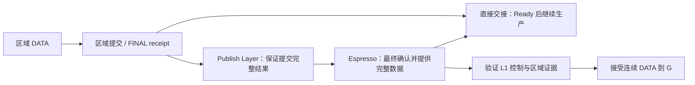
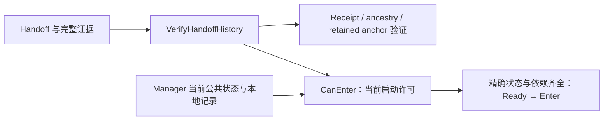

# Sync HotStuff RR Part II v3.4：不依赖程序阶段的关闭传播中文阅读版

对应：[英文正文](sync_hotstuff_rr_part2_rotation_v3_4.tex) · [英文 PDF](sync_hotstuff_rr_part2_rotation_v3_4.pdf) · [Arch v4 中文阅读版](arch_v4_zh.md)

本文对应英文 v3.4 候选稿。对 v3.3 的新一轮审查发现一条遗漏路径：尚未 Enter 的成员可能得知 Force 后静默退出，而已经 Enter 的成员失去了它的投票，却还不知道关闭。原退役证明中的最早 close time 没有覆盖这种停止投票的成员。

v3.4 将关闭证据保存、传播，以及对晚到旧 session 消息的回复统一规定为 Session Manager 的义务；尚未 Enter、已经 Terminated 或没有 worker，都不能跳过。Manager 保存完整 `Closed[beta]` 来源证据；membership context 尚未齐全时保留 pending relay，后续旧消息补齐 context 后，在拒绝或丢弃它之前发送完整关闭包。

立即生效的公共 cutoff 和既有 timer 规则保留，第 2 节仍与 v3.1 逐字一致。v3.3 的 ReadyBundle、receipt multicast、历史／当前准入分离和选区修复继续适用。完整活性目标仍未建立；本版是等待独立审查的安全修复候选，不是最终完成声明。

## 先记住一套编号

完整 view 统一写成：

$$
(\beta,r,g,t).
$$

| 编号 | 直白含义 | 何时改变 |
|---|---|---|
| $\beta$ | 当前生产分支的版本号 | 一次 Force **实际执行**后加一 |
| $r$ | 某个地区的一次生产轮次编号；不是地区编号 | 常规交接时加一，包括同地区续期 |
| $g$ | 这一生产轮次内的恢复编号 | 区域内 recovery 时加一 |
| $t$ | 这次恢复阶段内的 leader 轮次 | 区域内正常换 leader 时加一 |

**Session 就是 $(\beta,r)$。** 实现可以编码或哈希这些字段，但正文只用这套编号。

例如：

```text
(7,20,0,0)  A 开始生产
     ↓ 区域内换 leader
(7,20,0,1)
     ↓ 区域内 recovery
(7,20,1,0)
     ↓ 常规交接给 B
(7,21,0,0)
```

这里每一步的含义都写在编号上。常规交接改变 session，但不改变 $\beta$。v3.3 在没有其他合格地区时允许合格源地区接续新 session；即使地区相同，也使用新的 pair 和独立 core。

**本次保留原有 Force 检查。** MSIG 指令仍指定目标 $\beta$；若其他 Force 已改变它，这条指令就作废。先检查匹配的 MSIG，再检查 AUTO。MSIG 仍不是无条件到点执行。

还要区分三个进度：区域已经生产的分支 $R$、已经全局确认的数据 $G$、已经被 L1 接受的发布数据 $C_{\rm pub}$。它们可以先后推进，不必同步。这里的 Publish Layer 负责向 Espresso 提交结果；$C_{\rm pub}$ 则属于后面的 rollup DA 发布阶段。

## 1. Overview：变化发生在哪里

每个正确区域节点运行 Session Manager，并为每个已经进入的 $(\beta,r)$ 保留独立区域 BFT engine。一个 session 就是一个区域在某个分支版本中的一次生产轮次，其中包含多个 leader term 和必要的 recovery。Manager 可以同时管理旧 Active 程序、新 Waiting 准备任务及正在移交责任的 Completed 程序。
常规交接进入 $(\beta,r+1,0,0)$；有效 Force 进入新的分支版本。

本稿沿用 v3.1 的两项服务：

1. **Publish Layer：** 完整区域结果可用后，在 $T_{\rm pub}$ 内保证有效提交给 Espresso。
2. **Espresso：** 提交后在 $T_E$ 内完成最终确认，并使持续在线的正确参与者能获取记录和证明。

Publish Layer 是现有 leader、副本或 data verifier 共同实现的发布能力，不是一组必须独立部署的新节点，也不增加共识轮次。正文先使用这项服务假设，第 10 节再讲 leader 优先、其他人代发和手续费代付。



节点可以有一条领先于 $G$ 的生产分支 $R$。Force 关闭整个旧版本 $\beta$，包括其投机的常规后继，但保留旧分支已经进入 $G$ 的所有 DATA。

有效 Force 先由公共解释器关闭旧版本的追加权限。每个正确区域节点的 Manager 持久保存完整关闭证据，并对已知旧 session snapshot 执行关闭传播，不区分 Waiting、Ready、Active、Frozen、Completed、Terminated，也不要求 worker 存在。已进入程序按第 6.8 节收尾；关闭不是 Quit 或 Completion，不直接取消已经启动的 commit timers。新 session 的准备和启动不等待旧程序完成退役。

四个模块分别负责：公开窗口检测、Multisig 健康政策、每个节点的并发程序管理，以及每份程序的精确 Ready/激活检查。公共状态仍只有 Protocol 6/5 一条验证与更新路径，Handler 使用它的结果。

本稿保留 v3.3 的四项接口和选区变化：历史证据验证后单独检查当前 Enter 许可；ReadyBundle 携带完整可执行状态；完整 receipt 必须向本 session 固定成员转发；terminal reference 严格推进，选区先找其他地区、没有时再考虑合格源地区。v3.4 进一步规定：worker 退出不删除关闭证明或回复路径，收到旧 packet 时不能只返回 tombstone 而不传播已知关闭。

[四模块图](figures/cross_region_rotation_v3_2/modules.png) · [候选变化与 Ready 图](figures/cross_region_rotation_v3_2/candidate_ready.png)

| 事件 | 新 view |
|---|---|
| 同一区域正常换 leader | $(\beta,r,g,t+1)$ |
| 区域内 recovery | $(\beta,r,g+1,0)$ |
| 常规交接，包括同地区续期 | $(\beta,r+1,0,0)$ |
| 有效 Force | $(\beta+1,r_c+1,0,0)$ |

Force 行中的 $r_c$ 是**还欠 $G$ 下一块数据的轮次**，也叫 export session 的轮次编号。它可能落后于当前正在生产的轮次。后面第 6 节说明公共状态尚未分配 duty 时怎样保留这个编号；它与某份程序的 Waiting phase 不同。

例如 A 的 session $(7,20)$ 已生产到 110，B 的 $(7,21)$ 已接班生产到 115，但 $G$ 只到 108。正在生产的是 B；欠下一块 109 的仍然是 A。因此 Force 从 A 的交付位置重新选区，而不是从某个节点看到的最新生产位置选区。

## 2. Model and assumptions：模型与假设

### 2.1 L1 control state

L1 提供两组信息：

| 信息 | 作用 |
|---|---|
| $\mathrm{AUTH}_{r,0}$ | 固定区域快照、leader schedule、DATA quota 和 export-window 参数 |
| $\mathrm{AUTH}_{r,g}$，$g>0$ | 恢复 generation 的 leader schedule；不重置快照或 quota |
| STATUS | 在未来 Espresso 时间改变指定区域的 live/off 状态 |
| CLEAR | 在未来 Espresso 时间清除指定 cooldown |
| MSIG FORCE | 指定目标分支版本、未来 activation time 和可选附带配置；不指定 retained DATA height |

Authority 一经分配不可改绑。Force 重用数字 $r$ 时，读取该 index 原有 authority，以新的 $(\beta,r)$ 区分 engine。

每个控制有 L1 序号 $c$ 和 Espresso 激活时间 $\theta_a$。**读取控制不等于激活控制。** 节点保存完整控制前缀，并保留尚未到期的 pending records。

设 Espresso 区块为 $J_q$，时间为 $\theta_q$：

$$
q(d)=\min\{q:\theta_q\ge d\}.
$$

阈值 $d$ 在 $J_{q(d)}$ 的 payload 之前触发。同一 timestamp 下，height 和块内位置仍给出确定顺序。

区域是否可选由三部分共同决定：governance flag 为 ON、自动 cooldown 已过、指定 authority 下该区域具有正权重。解释器把控制和超时处理之后、EXPORT 处理之前的结果记为历史 snapshot $\chi_E(q)$。

OFF 不撤销已经基于历史 snapshot 确定的常规交接证明；ON 不自动清除 cooldown；任何状态更新都不能改写旧证书的权重。

Genesis checkpoint 指定合成 anchor、L1/Espresso reference、初始分支版本和控制上下文。初始版本 $\beta=0$。合成边界保存 $(i_b,\beta_b,r_b)=(\bot,\bot,-1)$，从整个区域表选择第一个合格区域，开启当前版本的 session $(\beta,0)$，通常是 $(0,0)$。如果首次选区前已经发生 Force，就使用增加后的 $\beta$；初始 reference 下界也属于这个实际开启的 session。

### 2.2 数据怎样送达：Publish Layer

Publish Layer 是由现有参与者实现的一层发布服务，不要求另外部署一组专职 Publisher，也不重新执行共识。

它接收的**完整区域结果**包括：DATA、直接或覆盖它的 FINAL receipt，以及验证所需的祖先、交接证明和来源证据。正确副本一旦拿齐，就交给这层服务。只有一个 QC、一个 hash，或者只有 receipt 却缺 payload，都不算完整输入。

数据有两条获取路径：

| 路径 | 用途 |
|---|---|
| 当前区域直接发给下一地区 | 允许下一地区在 terminal DATA 尚未进入 Espresso 时就完成 Ready |
| Publish Layer → Espresso → 其他参与者 | 完整结果发布后，其他地区、Certifier 和 Proposer 可以从共同的历史中获取它 |

直接发送成功，常规交接不等 Espresso；直接发送不可用，就等待结果发布后从 Espresso 获取。这次交接会更慢，但不需要另外假设一个独立 Backbone 一定把数据送到所有人。

Espresso 提供已最终确认的记录和证据，节点仍检查其中的区域结果及轮转规则。L1 继续提供自己的 authority 和控制证明。执行状态可以直接传输，或从已验证的数据历史重建；**能下载区块不等于已经恢复好执行状态**。拿齐状态仍是 Ready 的条件。

### 2.3 Stake and faults

区域 $i$ 中成员权重满足：

$$
\omega_{i,v}>0,\qquad W_i=\sum_{v\in V_i}\omega_{i,v},\qquad F_i<W_i/2.
$$

Byzantine 总权重最多为 $F_i$。证书需要不同成员的匹配签名，合计权重 **严格大于 $F_i$**。在此假设下，每张证书至少含一个正确签名者，正确成员也能独立凑齐证书。

成员和权重在整个 session 内固定，包括 recovery。Slashing、OFF 或后来的快照不能改变历史证书的验证分母。$F_i$ 还覆盖历史证书仍被接受期间累积失陷的相关密钥。

这沿用原有同步 BFT 模型，不能把 Espresso inclusion 当作放弃区域有效性假设的理由。

### 2.4 假设：区域共识、发布服务和两条链

| 假设 | 具体内容 |
|---|---|
| Finalized L1 records | 最终确认的 authority 和完整控制前缀共同、可认证、不可改写 |
| 区域同步通信与全局时钟 | 区域内正确节点间完整消息及依赖的延迟不超过 $\Delta_i$；保留原有共同真实时钟 |
| Bounded publication service | 完整区域结果可用后，Publish Layer 在 $T_{\rm pub}$ 内把它有效提交给 Espresso |
| Honest multisignature committee | 委员会诚实、协调，只提交授权且提前公告的未来控制 |
| Bounded L1 finalization and visibility | 实际提交后至多 $T_{\rm L1}$，所有正确在线参与者获得 finalized、完整、可验证的控制 |
| Espresso history and time | 最终历史兼容、可验证并保留可取回；timestamp 非递减，且满足最大领先界 |
| Bounded Espresso finalization and visibility | 合规记录有效提交后至多 $T_E$，被 Espresso 最终确认，持续在线并跟上历史的正确参与者能够获取记录及最终性和包含证明 |

**发布服务保证。** 假设正确参与者在真实时间 $s$ 已经拿到完整区域结果，并使其对 Publish Layer 可用。服务保证在 $s+T_{\rm pub}$ 之前完成有效提交，不依赖原 leader 独自配合。至少有一条可工作的提交路径和所需费用资源；输入大小与负载满足事先约定的服务范围。已经记录到 Espresso 的相同结果，已经满足这项数据送达保证；为推进 $G$ 而重新构造 EXPORT 的重试另行处理。

这个时钟不从“leader 开始提案”或“一个副本刚刚 commit”开始，而从**完整数据和 receipt 已经可用**开始。形成 FINAL receipt 仍由区域协议负责。有效提交也不是本地调用一次发送函数，而是完整记录已经按 Espresso 的入口规则交到其提交接口。

**Espresso 确认与可见性保证。** 假设记录在真实时间 $s_E$ 有效提交。至迟到 $s_E+T_E$，它进入 finalized 区块，持续在线并跟上历史的正确参与者都能获取完整 payload、验证 inclusion 和 finality。$T_E$ 包括 inclusion、finalization、传播、获取及 Espresso 证据验证，而不只是看见一个 header hash。

另外，每个新 finalized 区块及其完整相关 namespace，在最终确认后至多 $T_E$ 对这些参与者可获取、可验证；即使这个块没有本链记录也一样。这样，节点能验证“这个区间没有新的本链数据”，而不能把本地下载失败当作缺块证据。

**长期获取保证。** 重放所需的历史和证据仍须保留、可取回。已经进入 $G$ 的 DATA 不依赖原生产地区持续在线。可以由保存认证 Espresso 历史的归档服务提供这项能力；finality certificate 本身不等于永久存储。重新上线的节点要补齐历史或从授权 checkpoint 开始，不能假设任意长历史都在同一个常数时间内同步完。

**两段时间怎样连接。** 对一份新近可用的完整结果：

$$
s_{\rm submit}\le s+T_{\rm pub},\qquad
s_{\rm visible}\le s+T_{\rm pub}+T_E.
$$

这里保证的是**所提交结果及 Espresso 证据已经可获取**。它不包含形成区域结果之前的时间，不保证新地区已经恢复执行状态，也不保证过期或无效 EXPORT 已被接受进 $G$。例如 expected base 过期、版本关闭或缺少前驱，都可能要求重试或使结果不能继续追加。

$T_{\rm pub},T_E$ 用真实时间计量；交付窗口使用 Espresso timestamp。选择窗口长度时，还要考虑时钟对应关系、区域生产、Ready 和重试的预算，不能直接把窗口长度等同于这两个上界之和。

**L1 提前公告规则不变。** $T_{\rm L1}$ 已包括 inclusion、finality、传播、获取和验证，不重复增加一个公告延迟。若 Espresso 块首次 finalized 的真实时间是 $t_E(q)$，仍假设：

$$
\theta_q\le t_E(q)+\epsilon_E.
$$

委员会在真实时间 $s$ 提交控制时选择：

$$
\theta_a>s+T_{\rm L1}+\epsilon_E+\eta,\qquad\eta>0.
$$

这样，在 Espresso 首次跨过该阈值并 finalized 之前，控制已对正确在线参与者可验证。新增的 $T_E$ 不替代 timestamp 的领先界，也不改变这个提前公告条件。


### 2.5 Conditions for progress

前缀安全与持续进展分别陈述。持续进展需要：正确 leader 反复获得实际进入的生产机会；暴露的 equivocator 最终被持续排除；完整区域结果能形成；发布路径与 Espresso 满足服务上界；authority 和执行状态可获取；最终有其他合格地区；委员会给健康地区足够的服务时间。

还要有一段持续的服务时间，让携带下一段所需 DATA 的 EXPORT 真正被接受进 $G$。一次记录已上 Espresso，不代表它没有 stale base 或其他接受问题。新上界不包含区域恢复和状态恢复，也不自动约束一连串重试。窗口仍需与这些过程及 Espresso 时钟条件相匹配。

## 3. Regional engine：保留的定义与数据结构

### 3.1 Blocks、positions 与两种 reference

外层块可写为：

$$
B=(\beta,r,k,h,\mathrm{type},x,H(B_{\rm parent}),\rho,\xi).
$$

| 字段 | 含义 |
|---|---|
| $h$ | DATA height，只统计 DATA |
| $k$ | 本 session 的 physical position，统计 DATA 和 DRAIN |
| $x$ | DATA 携带的请求 batch；DRAIN 不携带 batch |
| $\rho$ | finalized L1 block reference，含 L1 height $\lambda(B)$ |
| $\xi$ | 签名绑定的 finalized Espresso reference，包含 height 和 header hash |

$A_{\beta,r,g,t}$ 是某 view 第一个 fresh position 之前的 anchor。$A_{\beta,r,0,0}$ 是跨区域继承的 DATA；recovery anchor 则由恢复过程选择。

DATA 的 $h$ 增加一。DRAIN 的 $k$ 增加，但 $h$ 不变。

两种 reference 分开约束：L1 height 沿 DATA ancestry 不下降，首个 DATA 满足 $\lambda\ge\lambda_{\beta,r}^{\rm open}$；Espresso reference height 也不下降，首个 DATA 满足 $q\ge q_{\beta,r}^{\rm open}$。v3.3 另外要求 terminal DATA 满足：

$$
\operatorname{height}(\xi(T_{\beta,r}))>q^{\rm open}_{\beta,r}.
$$

DRAIN 仍复制 $T_{\beta,r}$ 的两个 reference。

Reference 是提案时签名的历史上下文。一个块可能在很久以后才因 recovery / DRAIN 提交，因此 reference timestamp 不等于区域 commit time，也不是 global finality time。

**$\xi$ 的作用：先约定用哪一份地区状态选接班人。**

设区域顺序为 A → B → C，A 本 session 的 opening reference 小于 500。Espresso 第 500 块时 B、C 都合格；一条提前公告的 L1 控制在第 505 块把 B 设为 OFF。A 的 terminal DATA 110 签名绑定：

$$
\xi(110)=(500,H(J_{500})).
$$

这意味着常规交接从第 500 块对应的历史地区状态开始选。一个节点在 Espresso 第 503 块时收到 110 的区域 receipt，另一个节点到第 506 块才收到。如果各自按“我现在看到的最新状态”选，前者可能选 B，后者可能选 C。

有了同一个 $\xi$，只要分支没有被 Force 关闭，两者都从 500 开始选，因此都选 B。这个历史状态由 L1 控制按 Espresso 位置生效后计算，不是由 Espresso 执行状态管理合约。

**110 自己不必先上 Espresso。** 被引用的 $J_{500}$ 早已 finalized；下一地区拿到 110 的区域 receipt 和完整交接材料，就可以验证该选择。因此直接发送仍可实现不等待 Espresso 的常规交接。

代价也要说明：第 505 块的 OFF 不追溯更改已绑定的历史选择。$\xi$ 保证大家选择一致，不保证参考状态最新；需要关闭已授权分支时仍使用 Force。即使增加有界可见性，不同节点也可能在不同时刻收到 receipt，所以仍需固定共同参考点。

本版保留 $\xi$ 字段与 DRAIN 复制规则，但 terminal DATA 的 reference 必须严格推进 opening position。被选程序在 Ready 前获取一个满足该条件的 finalized Espresso header 及完整验证证据，所以正常 DATA 生产阶段不必临时等待这个 header。terminal DATA 自身仍无需先被全局确认，才能进行普通交接。严格推进不是按接收时间定义的 freshness 保证。

### 3.2 Session quota、term positions 与 DRAIN

Session $(\beta,r)$ 的固定终点为：

$$
H_{\beta,r}=h(A_{\beta,r,0,0})+\mathrm{TB}_r.
$$

高度 $H_{\beta,r}$ 的 DATA 是 $T_{\beta,r}$。Recovery 不改变 $H_{\beta,r}$。Quota 统计 proposal ancestry 中的 DATA，无论这些 DATA 是否已经提交；它不以当前 $G$ 为计数基础。

若 recovery generation 的 anchor 低于 $H_{\beta,r}$，它是 DATA generation。每个 term 最多产生：

$$
m_{\beta,r,g,t}=\min\{K,H_{\beta,r}-h(A_{\beta,r,g,t})\}
$$

个 fresh DATA。最后一个位置的 QC 是 terminal QC。若它还低于 $H_{\beta,r}$，则允许进入下一 term；达到 $H_{\beta,r}$ 后不再开启下一 term。

**DRAIN 仅用于 recovery 从 quota endpoint 开始的情况。** 当 $g>0$ 且 $h(A_{\beta,r,g,0})=H_{\beta,r}$ 时：

- 这一 generation 只有 $t=0,j=0$ 的一个 fresh DRAIN。
- DRAIN 不携带请求，不增加 DATA height，不消耗 quota。
- 它以本 generation 的 ANCHOR QC 为 justification。
- ANCHOR vote 不启动 commit timer；DRAIN vote 启动原有 timer，使包括 $T_{\beta,r}$ 在内的祖先得到提交。

正常 DATA generation 到达 endpoint 后不会顺手附加 DRAIN。它等待 $T_{\beta,r}$ 的 timer，或在 Quit 后恢复。连续被打断的 recovery 可以产生多个 DRAIN，因此整个历史中的 DRAIN 数量不被 quota 限制。

例：anchor 100、quota 10、$K=4$，三个正常 term 分别生产 101–104、105–108、109–110。从 107 恢复继续生产 108–110；从已认证的 110 恢复则进入 drain generation。终点始终是 110。

### 3.3 Certificates 与 FINAL

| 证据 | 证明什么 |
|---|---|
| Proposal QC | 足够权重已对某 proposal 投票；不是区域提交证明 |
| ANCHOR QC | 新 generation 的 opening anchor 被重新认证；不启动 timer |
| BLAME proof | 满足条件的超时抱怨，可作为 Quit 的一种依据 |
| FINAL receipt $\mathcal F_{\beta,r}(B)$ | 足够权重对 session $(\beta,r)$ 的 DATA 提交作出的匹配声明 |

所有签名都绑定 chain、协议、$(\beta,r)$、固定配置、服务区域和消息类型。View 消息另外绑定 $(g,t)$ 与 $\mathrm{AUTH}_{r,g}$。FINAL 只增加 DATA 字段，不绑定 $g,t$。因此 FINAL 不随 recovery generation 或 term 改变。来自不同 generation 的、针对同一 DATA 的有效 FINAL 可以汇总。

同一 session 中，较高 DATA 的 receipt 可通过完整 ancestry 覆盖较低 DATA。后一 session 的 receipt 不能代替前一 session 的证据。

DRAIN 被提交时，为被它提交的 terminal DATA $T_{\beta,r}$ 产生 FINAL，不为 DRAIN 自身建立全局 DATA。新 session 继承 anchor 不等于重新为旧 session 签发 receipt。

正确副本把新提交 DATA 的 FINAL 签名同时发给固定区域成员和 publication collector。既有参与者按固定快照聚合匹配签名。正确持有者首次获得本 session 的完整有效 receipt 时，必须把 receipt、DATA 和全部必要验证依赖 multicast 给该 session 的固定成员，并交回原 session、Manager 和 Publish Layer。按 session 与 DATA hash 去重；待发送动作持久保留至派发。Completion 使用的 receipt、Completed 程序或归档持有者也遵守这条规则。

单个 FINAL 签名不构成完整区域结果，也不启动 $T_{\rm pub}$ 的完整结果交付保证。区域 receipt multicast 只转发已有签名，不新增共识或证书；其 $\Delta$ 界从实际完整发送开始，不限制 receipt 首次形成的时间。

### 3.4 Admission、validation 与 engine state

每个消息按 session 编号 $(\beta,r)$ 路由。签名绑定 chain、协议和 session；view 消息还绑定 $(g,t)$ 与 $\mathrm{AUTH}_{r,g}$。验证包括授权、是否允许进入该 view、块类型、quota、两种 position、祖先、证书和两个 reference。

区域 core 保留 Active、Frozen、Completed 三种含义：Active 已进入且没有合法 Quit 冻结；Frozen 有合法 Quit proof；Completed 已取得 terminal receipt 并执行 Completion。完整程序生命周期还包含 Waiting、Ready、Terminated，由第 6 节统一定义。Force 本身不把 Active 改名为 Frozen，也不伪造 Completion。

消息、锁、votes、timer 和异步任务按完整 session pair 路由。旧 generation 的材料归档，未来 generation 的材料缓冲。缺依赖就获取并等待，不能把缺数据直接当成无效或缺块。已进入程序的精确初始 anchor 不因 $G$ 推进而改变。

处理顺序保留原版原则：先检查携带的 Quit evidence，再处理依赖和有效性，再按祖先顺序处理附带 proposals / terminal QCs，最后处理消息本身。消息与 timer 同时到达时，先处理消息。

## 4. Regional protocols：正常 core 与显式退役入口

### 4.1 Steady state

以下为仍获准运行的 session 的正常规则。新 BFT 动作同时检查 Manager 的持久 `Closed[beta]` 与本程序状态：只要版本已记录关闭，即使 membership 未齐、per-session `close_requested` 或 $c_v$ 尚未设置，也不能 Enter、投票或启动新 timer。已有 timers、证据和 commitments 按第 6.8 节继续处理。

**Protocol 1：提案、投票、提交、term rotation、Completion。**

1. 当前 leader 按顺序提案，遵守 DATA quota 或 drain-generation 规则。重发必须保持同一 proposal，不能在同一位置签两个不同块。
2. Replica 完整验证后，对首次合法投票记录时间 $\tau_v(P)$，转发并投票。
3. 投票启动原有 $2\Delta$ commit timer。到期且未取消则提交该块和未提交祖先，并为本 session 新提交的 DATA 向固定区域成员及 publication collector 发送 FINAL。
4. 低于 $H_{\beta,r}$ 的 terminal QC 可以开启下一 term；它不取消已有 commit timers。QC 本身也不启动 commit timer。
5. 取得 $\mathcal F_{\beta,r}(T_{\beta,r})$ 才执行 Completion：首次取得时先 multicast 完整已验证 terminal receipt 及依赖给固定区域成员，并持久记录发送动作；提交 terminal DATA 与其未提交祖先，再停止本 session 的提案、投票、恢复和进度检查，取消未到期 timer，但继续提供数据。

只有真实 Quit 或 Completion 可以取消这里已经启动的 commit timer。Force 关闭本身不取消 timer；退役 gate 阻止新的区域工作，收尾期间继续处理既有 timer、有效证据、FINAL 和 receipts。Core 向 Manager 报告 term、Quit、recovery 和 Completion 变化，不能借此改写公共 $G$。

### 4.2 Quit 与 recovery

**Protocol 2：Blame、Quit、Status、NEWVIEW、ANCHOR vote。**

对 term 中第 $p$ 个进度要求，在：

$$
e_v(\beta,r,g,t)+(2p+4)\Delta
$$

检查。如果 view 仍有效、尚未完成、投票位置少于 $p$，且未发过该 term 的 BLAME，则广播 BLAME。首个检查在进入 term 时就安排，不能让沉默 leader 无限推迟启动。

合法 Quit proof 可以是：足够权重的匹配 BLAME；同一合法位置上的 leader equivocation；或同一 generation 上选择不同 opening 的两个合法 NEWVIEW。越过 quota 的 DATA、错误 generation 中的 DRAIN，本来就无效，不能被当作该双签条件中的合法 proposal。

Quit 后冻结 generation，取消其未到期 timers，但保留已提交数据并继续收集证据。对 Manager 尚未记录该版本关闭、且本程序没有 close request 的程序，等待至少 $a_v+\Delta$ 且下一 authority finalized 后，进入 $g+1$。已知关闭后仍处理真实 Quit，但不能因为晚到 authority 或缓冲 recovery 回调重新开启 generation。

进入时固定 entry lock $Q_v$。新 leader 在自身进入后等待 $2\Delta$，选择已知最高 rank 的 QC 作为 $Q^*$ 并广播 NEWVIEW。Replica 验证后，只有在 $\operatorname{rank}(Q^*)\ge\operatorname{rank}(Q_v)$ 等条件成立时才作 ANCHOR vote。

取得 ANCHOR QC 后，在本 session 仍获准执行新动作时开始 DATA 或 DRAIN。区域 commitment 与 Completion 都不等待发布回执。正常运行中的 proposal、投票、FINAL 和计时规则保留；完整 receipt 由既有参与者聚合并回送源 engine，拿齐完整结果的副本将其交给 Publish Layer，也可直接发送给后继地区。

初始 session 在 Protocol 4 Enter 时完成 Ready → Active 并记录 $e_v(\beta,r,0,0)$。STATUS、初始 $2\Delta$ 等待、NEWVIEW 和 ANCHOR QC 都已在 Active 内；进度检查不能延后到 ANCHOR QC 后才启动。

## 5. Regional and global finality

### 5.1 Regional finality

本节关于 commit window 的进展结论，只针对所述区间内没有发生 `RequestClose` 的正常运行 session。关闭中的程序改用第 6.8 节规则；它可能保留一份本地 commitment，却没有形成完整 receipt。这是结论的适用范围，不是对所有执行新增“永不关闭”的假设。

区域 finality 仍按区域 commitment 规则定义，并与具体 production branch 绑定。若未确认分支以后被 Force 关闭，其 receipt 仍然是区域提交证据，但不再意味着它可以追加到全局链。

“某个正确 replica 已提交”“外部观察者拿到完整 receipt”“所有正确 replicas 最终提交”是不同条件。后者还涉及区域 liveness 和后续恢复；不能把一张 proposal QC 当作这三件事都已经发生。

新的发布上界针对完整结果，不覆盖每一条区域内部 BLAME 或 Quit 消息。所以外部观察者不能因为暂时没看到 Quit，就用 receipt 到达时间推断所有副本已经完成提交。 Espresso 证据能证明结果已经公开可获取；若还要约束每个副本执行本地 commit 的时刻，需要明确在线和 receipt 处理条件。本协议用 Espresso 的接受结果保护全局前缀，不依赖一个外部的“所有副本已经 commit”测试。

### 5.2 Published records：EXPORT 的接受

Publish Layer 构造并提交 EXPORT；发送者可以是原 leader、其他副本或外部 data verifier。EXPORT 可以包含跨多个常规 session 的连续 DATA，但必须包含各 session 的完整证据。发送者的签名不能代替区域 FINAL。具体谁优先发、怎样代付费用，留到第 10 节说明。

解释器在处理该 Espresso 块的控制和超时后检查：

1. Expected base 与当前 $G$ 的前缀及来源一致。
2. Branch version 仍开放；每个 DATA 属于合法边界链指定的 session。
3. 从 $h(G)+1$ 连续开始，parent/hash 对应，不遗漏、不重复。
4. 每个块的区域 commitment、应用有效性、authority 和 quota 检查通过。
5. 所用 Espresso selection reference 严格早于承载 EXPORT 的 Espresso 块，不能自我证明。
6. Force 新建的分支版本不能在触发 Force 的同一个 Espresso 块里接受 DATA。

整个 EXPORT 要么全部接受，要么全部拒绝。一个无效记录不会部分推进 $G$。之前因缺祖先而被拒绝的候选必须重新提交，不能事后在原位置补确认。

**发布成功和进入 $G$ 是两件事。** $T_{\rm pub}+T_E$ 保证所提交结果及其 Espresso 证据可获取，不保证过期 EXPORT 被接受。一份 EXPORT 即使没有推进 $G$，其中经过独立验证的区域 receipt 和数据仍可作为交接或历史证据。

**Terminal DATA 可以先进入 $G$，即使当时没有下一合格区域。** 这时公共解释器保留 pending boundary，不分配 export duty，也不运行其 DATA window。程序自身的 Waiting 还可以表示“已选中、但状态尚未恢复”，不能用它判断公共窗口有没有开始。

已证明无候选与缺验证材料不同：后者暂停重放，之后从同一规范位置恢复。

### 5.3 Global finality

观察者认证并重放 Espresso 的 finalized prefix，当某个合法 EXPORT 把 $B$ 加入 $G$ 时，便把 $B$ 视为 globally final。

这一步之后没有额外 committee wait，也不要求先把 Espresso checkpoint 登记到 L1。

之后的 Force 保留完整 $G$ 及其 block/session provenance。旧分支版本的字节仍可能被 Espresso 原样记入日志，但解释器不再接受它们成为本链输出。

全局接受不检查生产程序当前是否 Active。Completed 或 Terminated 程序的合法既有结果仍可由持久发布者提交；是否进入 $G$ 取决于版本、边界链和连续区间等公共条件。相反，旧程序仍 Active 收尾，也不能恢复关闭版本的追加权限。

### 5.4 Reference 不是 commit clock

$\rho$ 和 $\xi$ 在提案时固定，区域提交可能因 recovery 很晚才发生。窗口从解释器分配 export duty 的公开时间开始，统计最终接受进入 $G$ 的新增 DATA。

区域内部的 $2\Delta$ timer 仍使用原有同步时间模型。

## 6. Cross-region rotation：四模块与并发程序

### 6.1 Four-module cross-region architecture

每个正确区域副本独立运行一个 **Session Manager**。它观察 finalized L1 和 Espresso 历史，接收区域结果，并管理以 $(\beta,r)$ 命名的独立程序。Manager 是各副本执行的本地逻辑，不是新增的受信任区域控制器。

一个区域可以同时运行旧 session、准备可能的后继，并把更早 session 的数据责任移交给存储和发布服务。完整区域 view 仍是 $(\beta,r,g,t)$，不增加另一套 session 编号。

| 模块与执行者 | 输入 | 输出与权限边界 |
|---|---|---|
| Soft Force Detector；任何验证节点 | 完整已验证 Espresso 历史、export duty、固定窗口与实际接受计数 | 可重算的窗口失败条件；不自行改变 $\beta$ |
| Multisig Health Controller；既有 committee | 区域健康、同步和交付观测 | 未来生效的 L1 MSIG、STATUS、CLEAR；不选择保留高度 |
| Cross-region Handler；每个正确区域副本 | 已验证公共更新、区域 receipt、本地任务事件 | 准备、激活、请求收尾、责任移交；不再次执行 Force |
| Ready and Activation Gate；每份 session 程序 | 已固定交接、精确 anchor、执行状态、authority | 继续 Waiting，或通过 Protocol 4 原子进入；预取不授予投票权 |

Soft 检测和 Multisig 健康管理是两个并列的干预来源。区域副本、外部 observer、Certifier 或其他需要核对进展的节点都可调用同一 Soft 检测算法，不需要 Multisig 权限。Handler 管理候选和正式交接，每份 session 的启动检查负责验证其精确起点。

原始 Espresso 历史和完整 L1 control/authority 上下文先经过 Protocol 6/5 验证重放，才能导出 $G$、资格、Force 结果和 export duty。这是共同公共验证接口，不是第五个生命周期模块。Handler 使用它的结果；Soft 检测提供可重算条件，不能独立更新公共状态。


候选预热和正式交接缺材料时，由 Handler 发起 Fetch/Restore；完成回调先回到 Handler，再按目标与 anchor 核对。只有已固定交接进入 Ready gate。

健康的非活跃地区仍持续观察两条公共流，可以在被选中前准备数据和 authority。公共重放游标、投机程序和存储任务是不同对象。一个本地程序处于什么 phase，不能代替 EXPORT 能否进入 $G$ 的公共验证。

### 6.2 Soft detection and multisig health control

Soft Force Detector 从一个已验证 replay checkpoint 和后续完整 Espresso 历史开始，重建当前 export duty，并按第 7 节结算固定窗口。它返回以下三种结果之一：

- 尚无失败；
- 失败窗口描述、首次越过 deadline 的 header 和支持历史；
- 缺少证据，需要继续获取。

失败描述绑定 chain、当前 branch version、export-session pair、窗口起点、deadline、target 和 accepted count。缺少 namespace 或 control 证明不能被解释成 count 为零。

只有实际追加到 $G$ 的 DATA 计数。重复 DATA、DRAIN、proposal QC、无效 EXPORT 都不计数。被观察的 export session 可能比最新生产 session 落后多个常规轮次。轮询只用于取得新历史；轮询频率和本地收取时间不决定是否失败。任何接收者都要对照自己的已认证前缀重算外部提供的失败描述。

Protocol 5 仍是唯一的 Force 状态转换入口，顺序不变：

$$
\text{独立 STATUS/CLEAR}
\longrightarrow \text{首个目标版本匹配的 MSIG}
\longrightarrow \text{否则检查 AUTO}
\longrightarrow \text{EXPORT payload}.
$$

已经算出的 Soft 条件不能越过同一 prelude 中匹配的 Hard Force。

Multisig 健康政策的接口是 `HealthPolicy(地区观测, 已验证控制状态)`，输出不操作，或提交未来生效的 OFF、ON、CLEAR、Hard Force。它区分四种动作：

| 目的或观测 | 控制动作 | 含义 |
|---|---|---|
| 某区域不适合在后续接班 | 未来 OFF | 从后续选区资格中排除 |
| 需要结束目标版本的生产安排 | 未来 MSIG Force；需要持续隔离时另含或另发 OFF | 到规范激活位置且目标版本匹配时切换 |
| 已检查同步、数据服务和运维恢复 | 未来 ON | 恢复后续选区资格 |
| 需要在自动 cooldown 到期前解除它 | 显式 CLEAR | ON 本身不清除 cooldown |

每条操作记录目标、获授权的变化和未来激活时间。具体健康阈值仍是现有诚实 committee 假设下的运维政策，本节不新增数值阈值。

MSIG 针对 branch version。普通交接只改变 $r$，不会使它失效；先发生的 Force 改变 $\beta$，可能使它过期。只有目标匹配时才应用其附带配置；独立 STATUS 按自己的激活规则处理。健康观测不能直接改写其他副本的公共状态，所有动作都要经过 finalized L1 与预先公告的 Espresso 激活位置。一次 ON 也不证明未来的区域同步和故障假设永久成立。

### 6.3 Cross-region Handler

Manager 串行处理会修改本地控制状态的事件。下载和状态恢复可以并行。它不必只预测一个未来，可以保留多个有用途的准备任务；每份任务都写明候选 session 和 anchor。只有正式交接才确定唯一可启动目标。

| 输入事件 | 验证与路由 |
|---|---|
| `L1Finalized` | 认证完整 control prefix 和 authority；把未来控制放入队列，不提前激活 |
| `EspressoFinalized` | 认证完整有序历史；使用 Protocol 6/5 产生的状态转换 |
| `RegionalFinalized` | 验证 DATA、完整 FINAL receipt 和必要 ancestry；路由给原生产 pair，并交给 Publish Layer |
| `MaterialAvailable` | 核对目标 pair、anchor 原生产 pair、height、hash、所请求对象和验证结果；只更新相匹配的准备任务或固定交接 |
| `CoreEvent` | 接收指定本地 engine 的事件；记录 view、Quit、恢复、Completion 或退役进度 |

即使某个版本当前没有本地程序，Manager 也持久保存 $\mathsf{Closed}_v[\beta]$ 及完整已认证证据字节。这是公共来源证明，不是新 committee certificate。删除 worker 或程序运行资源不能删除这张 map，也不能删除 pending control-routing 责任。

Dispatcher 在处理旧 session 的完整 proposal、ReadyBundle、authority packet 或归档消息前检查 `Closed`。如果关闭阻止 entry 或新动作，就使用 packet 的已验证历史 membership context，按第 6.8 节形成并发送完整关闭包。缺 context 时保留 pending obligation，后来的 packet 补齐后再触发。这个回复发生在拒绝 entry、丢弃 duplicate 或返回 Terminated/tombstone 之前；不能静默丢包。它不签 BFT vote，也不重新创建已退役 engine。

**单个 FINAL 签名不是 `RegionalFinalized` 事件。** 既有参与者收集匹配签名，形成满足 receipt 定义的完整证书。正确持有者把完整结果交给 Manager 和已经进入的源 engine，向固定区域成员 multicast 完整 receipt 与依赖，并提交给 Publish Layer。源 engine 执行原有 receipt 和 Completion 规则。尚未进入的程序只缓存结果，不能通过 receipt 回调创建 engine 或跳过交接验证。聚合不是新增共识轮次；$T_{\rm pub}$ 仍从完整结果可用时开始。

输出动作如下：

| 输出 | 接收方与内容 |
|---|---|
| `Prepare/Fetch` | 数据或状态任务；绑定目标与精确材料 |
| `Activate` | 指定 session 的 Protocol 4；执行一次初始 Enter |
| `RequestClose` | 每个已知旧 session 的持久 control record；完整关闭包与首次 per-session close event，不依赖 phase |
| `OfferResult` | Publish Layer；保留原 DATA、receipt 字段 |
| `Persist/Release` | 存储和资源管理；持久记录状态并移交责任 |

回调提供的是材料，不是激活命令。一个晚到结果可以对存储有用，却不匹配程序当前的准备目标。

**Protocol 3：处理跨区域事件与管理程序。** 每个正确区域副本独立执行：

1. **验证事件。** 按完整 context 路由公共输入、区域结果和本地回调，先执行适用的 Manager closure receive handler，再进行普通处理。保留 pending requests 与源证据。材料或 session 与请求不匹配的完成回调不能满足请求，但其中可验证的旧 session context 仍可触发关闭传播。
2. **使用公共重放结果。** 对新公共历史运行或使用 Protocol 6，包括规范顺序中的 Protocol 5，读取结果中的 $\beta$、$G$、资格 snapshot、duty 和 boundary。本 Handler 不独立增加 $\beta$、选择另一 cutoff 或改写 $G$。
3. **核对正式交接。** 对尚未关闭版本的有效 terminal receipt 导出 REGULAR boundary；接收公共重放确定的 Force boundary；按第 6.5 节验证。为本地区的正式目标准备材料，并向被选成员发送完整交接。未来 Force 不阻止当前普通交接。
4. **核对候选。** 根据当前 export context、$G$、合格地区和已知未来控制重算可能目标。只更新尚未固定的准备计划；目标 pair 改变时使用另一份程序记录。暂停过时的投机工作；只有已验证事实确定目标不可能成立，或固定交接已分配给其他地区时，才取消未进入程序。释放准备资源前必须把关闭记录、pending relay 与晚到消息责任交给持久 owner。
5. **处理关闭与区域结果。** 把每份已验证 closure 保存到持久 `Closed[beta]`，不论 phase 都禁止旧版本 initial entry 和新动作。对该版本本地区的每个已知 fixed snapshot，包括未进入和已归档程序，执行完整 closure relay 与幂等 `RequestClose`。Snapshot 未知时保存 pending relay；任何后来的旧 session packet 补齐 context，都在普通处理前触发 control response。保留签名路由、历史证据和发布责任；terminal receipt 仍交给已进入的源 engine 执行原 Completion。
6. **检查并进入。** 对本地区已有固定交接的 Waiting 程序检查 Ready。在同一个本地事件内，最终复核公共有效性和持久 entry flag，记录 Ready，并原子调用 Protocol 4 Enter。检查失败则继续 Waiting 或执行有依据的取消，不能留下半初始化 engine。
7. **持久化并派发。** 在对外暴露动作前，持久记录状态、进入和退出记录以及必要输出动作。异步任务携带完整目标和 anchor context。重复事件可以继续未完成动作，但不能创建第二次逻辑进入。

公共解释器只有一条更新路径：Protocol 5 定义控制、窗口和 Force 转换；Protocol 6 认证并执行这些转换以及 EXPORT 接受；Protocol 3 使用结果；Protocol 1/2 只推进指定 session 的区域 core。把它们放在同一个进程中实现，也不改变这项权限划分。

### 6.4 Session lifecycle

Manager 为每份本地程序维护：

```text
Program[(beta, r)] = {
    phase,
    preparing_plan,
    fixed_handoff,
    anchor_block,
    execution_state,
    authority_and_bounds,
    core_state,
    pending_fetches,
    entered,
    close_requested,
    closure_evidence,
    c_v,
    d_v,
    publication_and_retention_handles
}
```

Manager 的 branch-wide `Closed[beta]` 独立于这份程序记录。$c_v$ 是针对该 fixed session snapshot 首次完整处理并 multicast complete close bundle 的时间；如果仅得知 Espresso closure、membership context 尚未齐全，先保存 Closed 和 pending relay，不设置 $c_v$。适用程序的 $d_v=c_v+4\Delta$ 从这个完整 per-session event 计算，不能从更早的观察时间提前计时。具体条件见第 6.8 节。六个 phase 描述本地程序，不描述全局 finality。

| Phase | 含义 |
|---|---|
| **Waiting** | 准备候选或正式交接，可以获取数据、恢复状态和缓存证据；尚未进入区域 engine、签区域 vote，或启动区域 commit/progress timer |
| **Ready** | 已固定交接、精确 anchor 状态和全部依赖通过检查；同一个串行事件紧接着执行 Enter，不额外引入调度等待 |
| **Active** | 已进入尚未 Frozen 的 generation；包括初始 STATUS、$2\Delta$ 等待、NEWVIEW、ANCHOR 认证与后续生产；收到关闭请求时仅受明确退役合同约束 |
| **Frozen** | 当前 generation 有合法 Quit proof；沿用原有 evidence、receipt 和 recovery 规则；Force 本身不会产生此 phase |
| **Completed** | 已进入的 engine 取得合法 terminal receipt 并执行原 Completion，停止生产并按原规则取消 timer；数据交付和保留责任可能仍在 |
| **Terminated** | 生产程序退出，不再处理 BFT timer 或发出 BFT 签名；Manager/control owner、持久存储和发布服务继续承担关闭传播与历史责任，退出记录阻止重新启动但不能成为静默丢弃旧消息的理由 |

正常转换是 Waiting → Ready → Active；合法 Quit 导致 Active → Frozen；原恢复准入使 Frozen → Active，同时推进 $g$、令 $t=0$；terminal Completion 使 Active/Frozen → Completed。

Waiting/Ready 在目标确定失效时可以取消，但只在持久 control owner 接管完整关闭证据、待补齐 context、relays/replies 和晚到消息路由后，才能释放准备 worker。首次得知关闭时已经 Completed 的程序，在相同责任移交后可以退出。首次得知关闭时为 Active/Frozen 的程序必须先完成 per-session RequestClose，再满足 $d_v=c_v+4\Delta$ 等条件；即使收尾中取得 terminal receipt 转为 Completed，也保留既定 drain threshold。真实 Quit 或 Completion 仍可改变 core phase，不增加第七个状态。

尚未固定的 `preparing_plan` 可以随着 $G$、源 duty 或候选资格改变。固定交接的目标 pair、地区、初始 anchor、source context、选择位置、authority、reference bounds 都不可替换。后来的 OFF 尤其不能改写历史上已经固定的常规选区。

锁、votes、view entry time 和 timers 只属于一个 pair。进程崩溃后恢复同一持久逻辑记录；派发 callback 或 signature 前还须恢复 Closed、per-session close times、pending relays 和 owners。不能清除 votes 或重做初始 Enter。存储和任务引用绑定完整 pair 与 anchor 身份，不需要另一套协议级 session ID。

多个地区可以同时为同一未来 pair 保存未授权的 Waiting 准备记录，只有固定交接选中的地区可以进入。暂时失去候选资格可以仅暂停任务；如果以后仍可能被选中，不必立即 Terminated。退出记录在释放运行资源后仍然保存。

旧程序仍 Active 时可能已经无权推进 $G$；Completed/Terminated 程序的既有结果也可能继续被接受，只要版本和区间仍满足公共接受规则。生命周期 phase 不创造或撤销这项权限。

### 6.5 Handoff records、anchor 与 Ready

`NextLive(i, M)` 先按固定循环顺序 $\mathcal L_R$ 搜索 $i$ 之后的其他地区。如果没有其他合格地区，而 $i$ 自身合格，就返回 $i$；否则返回 $\bot$。资格仍由历史 governance flag、cooldown 和指定 authority 的正总权重共同决定。genesis 的合成源为 $\bot$，从列表首地区搜索整轮。同地区续期创建新 pair 和新 core state，不复用旧 engine。

AUTO 对源地区设置的 cooldown 仍然生效。没有替代地区时，pending boundary 等待源地区重新合格；重复 replay 不重置 cooldown。OFF 一直有效，直到后续 ON。如果 MSIG 希望排除源地区，就要附带或独立安排 OFF；只有 Force 时，唯一合格地区可能接续自己的新 session。这是明确的 selector 修改，不是新增可用性前提。

pending boundary 保存 source context $(i_b,\beta_b,r_b)$，下一个数字 index 是 $r_b+1$。常规边界保存已完成前驱；存在 export duty 时，Force 捕获该 duty 的 context；没有已分配 duty 时，Force 复用已经保存的 source context。分配前发生多次 Force，会替换 pending cause 和 version，不会逐次增加尚未打开的 session index。genesis 使用 $(\bot,\bot,-1)$。

REGULAR 从 $(\beta,r)$ 打开 $(\beta,r+1)$，精确继承 $T_{\beta,r}$。Force 在新版本打开 index $r_b+1$，精确继承触发块 payload 前的 $G$。这个 anchor 的生产 session 可能早于被捕获的 export session，它保留原 producing pair、hash 和 commitment evidence。

常规边界令 $q_0$ 为 $\xi(T_{\beta,r})$ 的高度；Force 令 $q_0$ 为触发 Espresso 高度。使用上述源地区与下一 authority：

$$
q_s=\min\{q\ge q_0:\operatorname{NextLive}(i_b,\chi_E(q))\ne\bot\},
\qquad
i_{\rm next}=\operatorname{NextLive}(i_b,\chi_E(q_s)).
$$

只搜索已验证历史。缺少证据就等待，不能跳过可能的更早候选。后来的 snapshot 不改变已经确定的最小值。普通选区不必等待 terminal DATA 发布到 Espresso；它的签名 reference 可以是历史位置，本版不新增按接收时间判断 freshness 的规则。

一份带类型的 `Handoff` 包含：

| 字段 | 类型和意义 |
|---|---|
| Domain、kind | chain/protocol domain；REGULAR、MSIG、AUTO 之一 |
| Source context | 前驱 pair $(\beta_b,r_b)$ 和源地区 $i_b$；未分配 duty 时包括保存的 context |
| Target | 目标 pair $(\beta',r')$ 和被选地区 $i_{\rm next}$ |
| Anchor | 原 producing pair、DATA height、hash、完整 DATA 或引用、原 direct/covering commitment evidence |
| Authority | finalized $\mathsf{AUTH}_{r',0}$、固定配置、quota 与 publication-height proof |
| Selection、bounds | $q_0,q_s$、已认证 selection snapshot、$q^{\rm open}_{\beta',r'}$、$\lambda^{\rm open}_{\beta',r'}$ |
| Cause、evidence | 类型对应的原因；可信或已验证 replay checkpoint、必要完整 L1/Espresso 历史与区域证明 |

引用可以指向已验证缓存，也可以指向尚待获取的对象。只有引用本身不能使程序 Ready。

`VerifyHandoffHistory(C, history, packet)` 接受获授权 checkpoint、必要历史和 handoff packet，返回历史固定字段、invalid 或 needs evidence。它只认证该边界当时确定了什么，不要求版本现在仍开放，也不授予启动许可。当前准入另由 `CanEnter` 检查，两者都不修改公共 replay。

1. 检查 domain、字段类型、source 与 target。从 checkpoint 认证并重放 cause、历史 selection 和原 admission 所需历史；检查完整适用 controls，不能只证明某条 control 被包含。可以使用已验证缓存。
2. 对 REGULAR，验证前驱自身固定边界、初始 authority、精确 quota，以及 $h(T_{\beta_b,r_b})=h(A_{\beta_b,r_b,0,0})+\mathrm{TB}_{r_b}$；验证 terminal FINAL receipt、ancestry 和签名 $\xi$，包括新的 terminal reference 下界。要求 $\beta'=\beta_b$、$r'=r_b+1$，anchor 为 terminal DATA。递归验证前驱 boundary 时仍使用历史模式，当前关闭不能抹去原证据。
3. 对 MSIG，验证 authorized finalized L1 record、control sequence 和首次 crossing header $J_{q(\theta_a)}$。重放完整 prelude，确认它是首个 target 与当时 entry version 匹配的到期 Force。仅在匹配时处理附带配置。过期或同一 prelude 已消耗的其他指令不产生第二个边界。
4. 对 AUTO，从完整历史重放固定窗口计数与首次 deadline crossing，验证 accepted DATA 不足、没有优先匹配的 MSIG，以及实际触发 timestamp 下的 cooldown。报警或本地 timeout 不构成证明。
5. 对两种 Force，从唯一 replay transition 取得 captured source context、旧/新版本、retained prefix 与 boundary。要求 $\beta'=\beta_{\rm entry}+1$、$r'=r_b+1$，anchor 等于 payload 前 $G$，包括 provenance。没有已分配 duty 时验证所存 context 和中间 Force，不虚构空 export session。后来的 Force 会取代此边界的未来启动权限，但不使其历史原因、原选区或 retained anchor 失效。
6. 从 $q_0$ 和必要完整 snapshots 重算首个合格 $q_s$，核对地区与下一不可变 authority。设置 $q^{\rm open}_{\beta',r'}=q_s$，令 $\lambda^{\rm open}_{\beta',r'}$ 为 anchor 的 L1 reference height 与初始 authority publication height 的最大值。验证 anchor 原 direct/covering evidence、完整 block 和必要 ancestry，不把它重标成 target pair。
7. 比较导出的固定字段与 packet 及已有记录。相同重复包使用同一记录；同 pair 的固定字段冲突则拒绝，不能替换已安装 handoff。这里记录历史事实，不表示目标仍可 Enter。

**当前能否进入。** `CanEnter(S, packet)` 接受 Manager 当前 verified public state $S$ 和已通过历史验证的 packet，要求目标 version 是 current 且 open、Manager 尚未记录该版本的 Closed、packet 仍是适用的 fixed boundary、当前副本所属地区被选中、本地没有 prior initial entry、close request 或 Terminated record。Ready 再检查精确 anchor state 和全部依赖。对已经进入的相同记录，可以继续提供服务，但不能再 Enter。

所有初始进入路径都要通过这两个检查。Receipt、ancestry 和 retained-anchor 验证只使用历史验证；全局 EXPORT 另外检查当前 append permission。例如版本 7 被 Force 关闭后，保留 DATA 108 的原 $(7,20)$ boundary 和 receipt 仍是有效历史。`CanEnter` 拒绝重开 $(7,20)$，新的 $(8,21)$ Force packet 却可以继承同一 DATA。缓存命中和缺失使用相同历史规则，不能依赖某个以前缓存的通过结论。



Force 发生但没有合格后继时，cause、anchor、source context 和新 version 仍已固定，公共解释器保存该 pending boundary。但此时没有完整的已选中交接包，程序不能 Ready；要等首个历史合格位置确定 target region。此间另一次 Force 可以替代 pending boundary，同时沿用保存的前驱 context。

genesis 合成边界按初始 checkpoint 和第 2 节的规则验证，不冒充不存在的 REGULAR、MSIG 或 AUTO 原因。

**Ready 的定义。** 本地 Waiting 程序 $(\beta,r)$ 当且仅当以下条件全部满足时 Ready：

1. 历史交接验证确定该 pair，且选中的就是本副本所属地区；或认证的 genesis 规则得出同样结果。独立当前启动检查 `CanEnter` 也通过。
2. 精确 anchor 的原 producing pair、height、hash、完整 DATA 与 commitment evidence 已验证。
3. 从这个 anchor 后面继续执行所需的 native state 已恢复，并验证它对应同一个 anchor。
4. 匹配的 finalized authority、固定 quota、两种 reference lower bound 和全部验证依赖齐全；还已取得一个严格晚于 $q^{\rm open}_{\beta,r}$ 的 finalized Espresso header 及完整验证证据，供之后 terminal selection reference 使用。
5. Manager 已处理的公共历史没有关闭或替代这次交接。
6. 持久记录从未执行初始 Enter，也没有 Terminated tombstone。

状态恢复使用既有 native validation interface。缓存 DATA 110 的状态不能使 anchor 固定为 112 的程序 Ready；未来 Force 公告仍只允许 Waiting/preparation。以下完整区域消息接口明确 relay 的内容及接收者能推出的结论，包含 Ready 所需的后续 finalized header 及其验证依赖。

#### 完整区域 ReadyBundle 消息

下面明确第 6 节 Ready relay 的消息接口，沿用 Ready 和 Protocol 4 的状态转换。它明确传输的可执行状态，并说明现有 $\Delta$ 到底能覆盖哪些步骤。这是待独立审查的协议消息合同，不是新的 READY certificate，也不改变公共 export duty 的开启时间。

固定目标 $(\beta,r)$，令 $A=A_{\beta,r,0,0}$、$\Delta=\Delta_{i_{\beta,r}}$。`READYBUNDLE` 是通过已认证区域通道发送的消息，包含以下带类型字段。全部必要对象以完整字节出现在规范化 dependency set 中，每份对象保存一次。URL、state root、未解析 hash 或“以后再下载”的承诺不能代替对象。

| 字段 | 必需内容 |
|---|---|
| Domain 与 target | chain/protocol domain、编码及 native-state format 标识、目标 $(\beta,r)$、选中 region、sender 身份 |
| 固定 handoff | 完整交接包，包括 cause、predecessor/source context、selection 和 fixed target |
| 精确 anchor | $A$ 的原 producing pair、height、hash、完整 DATA、原 direct/covering commitment evidence 和必要 ancestry |
| 可执行状态 $S_A$ | **已经构造完成的完整 application-state 对象**；包含从 $A$ 后面继续执行所需的所有 state、code 和 continuation metadata；若支持 partial execution，包含精确继续位置。它不导入发送方的区域 locks、votes 或 entry timers |
| 状态证据 $\Pi_A$ | 把这一个 $S_A$ 绑定到这一个 $A$ 的 native validation evidence，以及全部证明输入和依赖；使用既有 sound application-validation interface，发送方声明或裸 state hash 不够 |
| Authority 与 bounds | finalized $\mathsf{AUTH}_{r,0}$、固定配置和 quota、$Q^0_{\beta,r}$、$q^{\rm open}_{\beta,r}$、$\lambda^{\rm open}_{\beta,r}$，以及验证继承历史所需的全部 authority evidence |
| 公共证据 | 获授权 replay checkpoint，以及验证 handoff、references 和所提供授权 context 所需的完整 finalized L1 control/authority 与 Espresso header/namespace 历史；包含 checkpoint 自身的信任／授权依赖 |
| Dependency set | 上述对象的全部传递验证依赖字节；接收者无需另外获取对象、重放应用执行来重建 $S_A$，或等待新 authority，才能处理这个 bundle |

Native interface 决定怎样用 $\Pi_A$ 验证 $A$ 处状态。如果 block format 没有直接承诺 state root，bundle 必须携带该接口要求的 execution evidence 与已认证起始状态；本合同不会凭空补出这种 commitment。一个尚需恢复或转换的序列化快照，还不是这里要求的直接可执行对象。接收者独立验证 packet，不信任发送方决定 handoff 授权或状态正确性。

**发送与接收事件。** 每个被选正确成员先构造完整 bundle，再首次 Ready/Enter。历史搜集、跨区域下载、状态重建和 bundle formation 都发生在这个事件之前；既有模型没有给这些步骤固定时间界。

首次事件中，成员安装自己的已验证状态，执行一次初始 Enter，并把完整 bundle 发给被选地区固定快照内的所有成员。每个正确成员都在自己的首次事件这样做，因此最早正确 entrant 必然发送，无需知道自己是否最早。不能把 bundle 构造或异步派发推迟到已经记录的 entry time 之后。

接收方通过串行 Session Manager 处理：

1. 认证 domain、sender、target，按原 evidence-first 规则检查证据。验证历史 handoff、精确 anchor、必要 authority、references 和 native-state evidence。缺材料或无效材料不能授权 Enter。接收方已有兼容缓存时可减少重复验证，但发送方不能假定未知接收者已缓存某对象而省略必要字节。
2. 对照接收方已处理公共状态执行既有 live-activation 检查。目标已关闭或被替代、固定 handoff 冲突、有 close request 或 exit record，都阻止初始 Enter。消息不能替换 fixed anchor，也不能越过更新的已验证关闭。如果目标已关闭，先使用该完整 packet 的已验证历史 snapshot 调用不依赖 phase 的 Manager closure relay，再拒绝 entry。Terminated 记录及重启后也必须如此，不需要重建 worker。如果同一 pair 已经进入，完成适用的关闭回复后保留有用证据，不重置状态或 entry time。
3. 对尚未进入且有效的目标，验证并接纳收到的 $S_A$，检查 Ready 的其余条件，在**同一个消息处理事件**中执行现有 Ready/Enter。派发签名前原子记录 durable entry flag、固定状态关联和 entry time，并按上述规则转发完整 bundle。该事件与 Enter 之间不存在独立 Ready 队列、另行下载任务或 Ready 后的状态安装 job。

这里“接纳”的逻辑含义是：**已验证的接收对象本身成为新程序可直接使用的 application state**；程序在这个对象上继续执行，不先从它重建另一份 database。这是表示和消息处理合同，不是在宣称任意 database import、disk copy 或 native-runtime initialization 都不耗时。必需安装工作尚未完成时，接收者不能报告 Ready。

**精确时间结论。** 设 $e$ 为本 pair 最早正确初始 Enter 时间。发送规则使完整正确成员间 bundle 在 $e$ 时发送。假定讨论的区间内，fixed handoff 持续可激活，且没有关闭或其他有效准入禁止介入。

如果验证、接纳和原子 Enter 转换就是既有区域网络假设覆盖的**完整消息处理操作**，则：

$$
e_v(\beta,r,0,0)\le e+\Delta
\qquad\text{对每个被选正确成员 }v.
$$

理由是最早正确发送者已经提供完整可执行对象和所有验证依赖；原有 delivery-and-processing 界使每个正确接收者在 $e+\Delta$ 前结束该 handler。它的最后一步是通过 guard 后 Enter，或者它更早已经 Enter。这个论证没有剩余的状态重建步骤。

这支持的是上述**抽象消息解释**，没有额外假设一个 state-installation 服务界。原网络前提写明覆盖完整验证依赖的交付与处理，却不会仅因把外部 native import 或 storage 操作叫作“安装”，就自动给它时间界。如果有工作落在有界消息验证之后，令 $u_v\ge0$ 表示其实际剩余延迟；当 Enter 最终完成且持续获授权时，只能分解为：

$$
e_v(\beta,r,0,0)\le e+\Delta+u_v.
$$

冻结模型没有给 $u_v$ 统一上界。把一段工作命名为“单个事件”不能证明 $u_v=0$。在这种实现中，$e+\Delta$ 以及依赖它的后续 bootstrap 界仍未获得支持。

因此，只有当 native state 确实作为完整 validation dependency 由所建模 handler 直接接纳并执行时，ReadyBundle 才在抽象协议层补齐原先缺失的接口。具体 native adapter 必须证明自己符合这份合同；状态证明 sound 不等于安装时限已证明。未完成该义务前，不能保留无条件的 native-installation 结论。这里也不为 packet 之外的任意历史 catch-up 或首个成员构造 packet 的时间给出上界。

ReadyBundle 只是区域内传输已有状态和证据。它不新增 READY 签名 quorum、Espresso transaction、publisher guarantee 或公共 activation certificate，不开启或重置 export window。公共时钟与独立 live-activation 检查仍由现有 Protocol 5/6 和 Ready/Enter 规则决定。

### 6.6 Activation and bootstrap

**Protocol 4：进入并启动被选 session。** 对固定目标 $(\beta,r)$，副本 $v\in V_{i_{\beta,r}}$ 执行，令 $\Delta=\Delta_{i_{\beta,r}}$。

1. **Enter。** 在 Ready 事件中原子复核 Manager 没有该版本的 Closed 及其他 entry guards，再检查并设置持久 initial-entry flag。安装 $A_{\beta,r,0,0}$、$\mathsf{AUTH}_{r,0}$、$\mathrm{TB}_r$ 和两种 opening reference bound。设置 entry lock 为 $Q^0_{\beta,r}$，以 unfrozen 状态进入 $(\beta,r,0,0)$，完成 Ready → Active，只记录一次 $e_v(\beta,r,0,0)$ 并启动原 progress checks。向初始 leader 发送带 lock 和固定交接的 STATUS，处理该 session 的缓冲证明。在发出签名前持久化进入记录。
2. **选择 anchor。** 初始 leader 从自己的 entry 等待 $2\Delta$。如果 view 仍 current、unfrozen，且退役合同允许此动作，则发送 NEWVIEW，精确选择 $A_{\beta,r,0,0}$，附带 $Q^0_{\beta,r}$ 和固定交接。
3. **认证与生产。** 成员执行 Protocol 2 原 ANCHOR-vote 步骤。得到 ANCHOR QC 后，leader 在 DATA height $h(A_{\beta,r,0,0})+1$、physical position 1 启动 Protocol 1。本地失败继续使用原恢复规则。除非 Quit、Completion 或明确退役转换介入，所有这些 bootstrap 动作都在 Active 内发生。

令 $e=\min_v e_v(\beta,r,0,0)$，其中取所有正确成员。在上述完整 handler 时间合同成立、handoff 持续可激活且 bootstrap 未被打断的条件下，所有正确成员在 $e+\Delta$ 前进入。若 initializer 正确且没有 Quit，NEWVIEW 在 $e+3\Delta$ 前发出，ANCHOR QC 在 $e+5\Delta$ 前到达 leader，第一份 DATA 在 $e+6\Delta$ 前到达所有正确成员。

这些界从首次实际 Enter 开始，不从公共 assignment 或候选创建开始。如果 native installation 仍在有界消息处理之外，这些界尚未建立，额外耗时不能默默计入 $\Delta$。两种实现都不能据此重置公共 deadline。

公共 export clock 独立于程序 phase。普通后继已经可选时，window 从包含相应交接的 EXPORT timestamp 开始；Force 立即选中后继时，从触发块 timestamp 开始；此前没有分配 duty 时，从首个合格 selection block 开始。被选程序仍 Waiting 时，公共窗口可能已经运行。下载完成、Ready、进程重启和重复交接都不能重置 deadline。只有尚未分配 duty 时才没有 DATA window。缺少证据会把 replay 暂停在规范位置，不会创造更晚的公共 opening time。

### 6.7 Concurrent candidates and races

设 A 的 session 为 $(7,20)$，terminal DATA 是 110；B 已在 $(7,21)$ 生产，而 $G$ 只到 108。一条未来 MSIG 针对版本 7。B 可以保留旧 Active 程序，同时为候选 $(8,21)$ 预取 108。若 $G$ 推进到 109，准备目标可以改为 109，但旧 Active 程序的初始 anchor 仍是 110。

如果 Force 最终选中 B 并保留 109，之后就只补齐这个固定 anchor 的材料。B 可以在旧 $(7,21)$ 按退役合同收尾期间进入 $(8,21,0,0)$，两个程序不共享锁、votes、entry time 或 timers。

如果 A 的 terminal 110 在 Force 前进入 $G$，export context 可以转到 B，候选则变成 $(8,22)$，从 B 后面选区。设顺序为 A、B、C、D；如果未来 OFF(C) 已在 Force 选区前生效，可以把尚未固定的候选改为 D。若 Force 最终保留 B 的 112，正式目标就是 D 的 $(8,22)$，anchor 的原生产 pair 仍为 $(7,21)$。D 必须验证 112 的状态，才能开始 DATA 113。此前准备过 $(8,21)$ 或 109 的状态不会获得进入权。OFF 不能改写已固定的 REGULAR 交接。

terminal receipt 先到时，节点可以准备或启动旧版本常规后继；随后验证 Force，就保存 branch-wide Closed，对已知 snapshot 传播完整关闭，取消失效的未进入目标或请求已进入程序退役。未进入程序的取消不能删掉持久 control owner。Force 先到时，晚到 receipt 作为区域证据保存，并在补齐旧 snapshot 时触发 closure reply，不能复活已关闭目标。节点可以短暂持有不同的投机程序，但相同已验证公共前缀必须给出相同公共状态和 Force boundary。

每份 fetch 回调保留原 target 和 anchor 身份。为 $(7,21)$ 的 110 请求的回包不能使从 108 开始的 $(8,21)$ Ready。旧候选回包可以缓存并在其他用途下重新验证，但不能覆盖 fixed anchor。重复 receipts、交接包和回调不能再次 initial Enter。

AUTO 已提前切换后，过期 MSIG 不会关闭新版本，也不会应用其附带配置。Manager 丢弃的是过期的准备依据，不能因此使另一份已经固定的交接失效。

[候选变化与 Ready 检查图](figures/cross_region_rotation_v3_2/candidate_ready.png)

### 6.8 Graceful close and termination

#### 关闭与退出规则

固定一个 session $(\beta,r)$，令 $\Delta=\Delta_{i_{\beta,r}}$，使用该 session 不变的 voting snapshot。关闭是 **Session Manager 的义务**，不依赖某份程序是否存在或已经 Enter。Manager 持久保存已认证的 $\mathsf{Closed}_v[\beta]$ 及其完整来源证据，不能只保留 hash 或未来 retrieval promise。区域 control owner 为下述 receive handler 保留完整证据字节；正在进行的 storage copy 不能暂停该 owner。这个 branch-wide record 立即禁止旧 $\beta$ 的所有 initial entry 与新 core 动作。它独立于六个程序 phase，也不同于下面定义的 per-session complete-close event。

对于已知 fixed session snapshot 中自己所属的每个 session，manager 都保留 control record，包括 Waiting、Ready、Completed、Terminated 或没有 worker 的情况。记录包含历史 fixed boundary、source region、不变 authority 与 membership、`close_requested`、首次完整关闭时间 $c_v$（若已发生），以及待完成的 relay。Active/Frozen 程序在收尾时保持原 core phase；只有真实 Quit 或 terminal Completion 才改变该 phase。Force 不是 quit proof，也不是 terminal receipt。

**完整 receipt 的传播。** 以下义务同时适用于正常运行与退役期间。正确区域成员或其本地 manager/collector 第一次持有本 session 的完整有效 receipt 时，必须把 receipt 及全部 validation dependencies multicast 给该 session 的固定成员。特别地，terminal receipt 的 multicast 不得晚于本地 Completion。按 session 与 DATA hash 去重可以抑制重复 encoding 或 signer set，不能抑制首次完整转发。Completed/Terminated 后，由持久责任方继续承担已发起的转发与交付责任。

接收者即使处于 Frozen 或 closing，也要独立于 receipt 的 generation 处理本 session 的 terminal receipt，并在同一时刻的 timer 之前执行 Completion。尚未 Enter 的程序缓存它；Terminated 程序归档但不重启。该规则只转发已有签名，不增加 vote 或 certificate。既有区域 complete-message 的 $\Delta$ 界适用于实际转发，不约束 receipt 首次形成的时间。

**Manager closure 与 RequestClose。** 以下 handler 由 manager 或持久 control owner 执行，不只由已经 Enter 的 engine 执行。

1. **记录公共关闭。** 验证完整证据，确认某个 authenticated finalized Espresso block 的规范 prelude 已关闭 $\beta$。保存 triggering header、从已验证 checkpoint 开始所需的完整 control/namespace 历史，以及 closure 和 retained-prefix 上下文。检查既有 MSIG/AUTO 规则；pending MSIG、OFF、未 finalized header 或单独 timestamp 都不够。原子保存 $\mathsf{Closed}_v[\beta]$、禁止该版本的新动作，并通知该版本全部本地 control records，不区分 phase。这是接收既定关闭结果，不再次执行 Force 或选择 anchor。
2. **对每个已知 snapshot 传播。** 对本区域每个已知 fixed session $(\beta,r)$，把保存的 closure proof 与该 session 不变 authority、membership 和历史 admission context 合并，形成 **complete close bundle**。其他成员无需已有程序、当前 entry permission 或未提供的 cache，即可验证关闭与精确 recipient snapshot。首次完整处理时，原子执行 RequestClose：设置 `close_requested`，以当前时间记录 $c_v$，并向固定成员 multicast bundle。Waiting、Ready、Active、Frozen、Completed、Terminated 全部适用。接收者验证 bundle、保存 Closed 并执行相同幂等操作，不创建 worker 或进入 engine。重复 bundle 不重置 $c_v$。
3. **保留尚未解决的传播义务。** 如果 fixed snapshot 或其依赖尚未知，保留已认证 Closed 与 pending relay obligation。Entry gate 已经关闭，但尚不设置 $c_v$，也不虚构 $4\Delta$ 时钟。任何旧 pair 的 Ready、proposal、authority、history 或其他 packet 补齐已认证 snapshot context 时，manager/archive 必须在该 receive handler 中组装并 multicast complete close bundle，并向 packet sender 回复它。该动作先于普通 BFT 处理、拒绝 live entry、丢弃 duplicate 或返回 Terminated/tombstone。历史 context 的验证不要求旧版本仍 open。正确 voter 的完整 proposal 携带这些 context，或按既有 complete-message 界使其可解析。即使旧 worker 从未创建、ReadyBundle 被拒绝，或 callback 在退出/重启后才到达，此 handler 也必须执行。
4. **限制新动作。** Closed 禁止旧版本的 DATA/DRAIN proposal、NEWVIEW、DATA/DRAIN/ANCHOR vote、新 commit timer、产生 BLAME 的 progress check、term entry 和 generation entry。检查覆盖 initial Enter、延迟 authority/recovery callback、terminal-QC rotation 与 buffered-message processing。新的 STATUS 或重建本地 worker 都不能绕过持久 gate。已经发出的消息不撤回；新 session 使用自己的 pair 准备和进入，无需等待旧程序退出。
5. **处理既存工作。** 保留已有 commit timers 及其原 deadline；仅观察到 Closed，不能取消 timer 或释放 evidence-processing owner。继续完整验证、比较保留的 signed material，并执行 evidence-first processing。真实 current-generation quit proof 仍执行 Quit、广播 proof、取消对应 timers 并保留 commitments，但不能重新打开 gate。存活 timer 提交其 block 和 ancestors。每个由此提交的 DATA 的 Protocol 1 FINAL 同时发给固定区域成员和 publication collector。部分 FINAL 不触发 Publish Layer 对完整结果的保证。
6. **保留证据责任。** 继续收集旧 votes、QCs、FINAL 与 receipts，按前述规则 multicast 完整本 session receipt，并把每个完整结果交给 Publish Layer。有效 terminal receipt 仍执行真实 Completion，可以改变为 Completed 并取消 timers；已有 drain deadline 保留。receipt 或后续 ON 不重新打开分支。在持久移交前继续承担 data、control relay 和 publication 责任。

所有 closure relays 都传送已有认证来源证据和签名，不增加 BFT vote 或 certificate。Worker 终止后，manager/control owner 仍继续传送它们。已知 snapshot 不能因为程序退出就被忘记。Crash recovery 必须在 dispatch callback 或 signature 之前恢复 Closed、session close times、pending relays 和 owners。消息（包括完整 closure、quit 和 terminal-receipt evidence）先于同一时刻的 timer、entry 或 retirement event 处理。该 handler 不删除 receipt、lock、vote、committed block 或 provenance。

**FinishClose。** 对首次得知关闭时处于 Active/Frozen 的程序，先要求其完整 per-session RequestClose event 已发生，再设置

$$
d_v=c_v+4\Delta.
$$

较早的 Closed flag 若尚未形成 complete-close event，不能代替 $c_v$，更不能授权提前释放 timer/evidence processing。只有在时间 $t\ge d_v$ 且满足以下全部条件时，才能把程序标记为 Terminated：

1. 所有已有 commit timers 均已执行，或被真实 Quit/Completion 取消；任何排队动作都不能再通过新动作入口。
2. 持久存储已经接管 exit、Closed 和 per-session close records、committed log、必要签名证据与 validation dependencies、receipts、anchor data 和可恢复 state，不能释放最后一份仍有义务保留的数据。
3. 持久责任方已经接管 pending closure-context discovery、complete-close relays/replies、完整 receipt multicast、完整结果提交、publication retries 和 data service；每个本地完整结果均已 offered 给 Publish Layer。
4. dispatcher 把以后到达的 $(\beta,r)$ 消息交给这些责任方。即使是尚未识别的旧 pair，也必须运行 manager-level closure handler。它们可以收集或转发已有签名、验证迟到 receipt、服务数据并继续发布，但不能重启 engine、执行其 BFT timers 或为其产生新的 BFT 签名。

该移交可以发生在同一个正确副本内，不需要新增 agreement 或 certificate。新的 control owner 必须已经持有必要证据并接管 receive route，旧 owner 才能释放它们；尚未完成的 retrieval task 不算这种移交。全部条件满足后，才可释放生产/恢复 worker 与 timer machinery。迟到 terminal receipt 成为归档证据，不把 Terminated 程序改回 Completed 或 Active。

已确定无效的 Waiting/Ready 程序没有区域 timers 需要收尾，但只有在 durable exit record 与上述全部 manager/control 义务均有 owner 后，才可不等待 $4\Delta$ 释放 worker。特别地，在首份 ReadyBundle 之前得知 Force 不允许 silent cancellation：snapshot 已知时立即执行 RequestClose；未知时保留 pending relay，并由被拒绝的 ReadyBundle 或后续 proposal 补齐它。已经 Completed 的程序已执行原 timer cancellation，可以在相同责任移交后释放 worker，但仍保留全部 control-relay 义务。候选资格暂时变化不必终止 preparation。Terminated 不删除 commitment、不从 $G$ 删除 DATA，也不授权 stake withdrawal。

**命题：投票窗口内不存在静默关闭。** 假设一个正确成员在 $s$ 对 $(\beta,r)$ 的有效 proposal 投票并完整转发。如果另一个正确成员在至迟 $s+\Delta$ 处理该 proposal 时，因为自己的 authenticated Closed 而被禁止 matching vote 或 entry，则某个正确成员会在 $s+\Delta$ 前完整处理并 multicast 该 session 的 complete close bundle。因此，令 $c=\min_{v\text{ correct}}c_v$ 遍历所有不区分 phase 的 complete-close events（没有此类事件时取 $c=+\infty$），这种禁止必然意味着 $c\le s+\Delta$。

**证明。** 转发的 proposal 及其历史 authority/admission dependencies 在 $\Delta$ 内到达接收者的 manager/archive，即使它没有 worker 或已有 exit tombstone。依赖材料确定了 fixed regional snapshot。如果 Closed 已经记录，receive handler 在拒绝普通处理之前，将该 context 与保留的 closure evidence 合并并发送完整 bundle。如果在该 packet 之后、压制 vote 之前才得知关闭，snapshot 已经已知，关闭 handler 自身立即 multicast。两种情况都给出某个 $c_v\le s+\Delta$。该 control relay 不需要新的 initial entry、executable-state restoration 或远程 membership discovery；restart 与 duplicate 路径都使用同一个持久 handler。证毕。

**命题：关闭传播与诚实消息收尾。** 在既有区域同步通信假设下，令

$$
c=\min_{v\text{ correct}}c_v
$$

为该固定 snapshot 的正确成员中首次完整 per-session RequestClose 时间，涵盖任意 phase 及 manager/archive owners。所有正确成员在 $c+\Delta$ 前关闭。全部存活的诚实 commit timers 在 $c+3\Delta$ 前到期；这些 timer events 产生的区域 FINAL 在 $c+4\Delta$ 前到达所有正确成员。因此，$d_v=c_v+4\Delta$ 是保守的本地 drain threshold，不是完成全部退出责任的 deadline。

**证明。** 首个正确转发包含 closure 与 fixed snapshot 的全部 validation context。即使接收方没有 worker，其交付和处理仍受既有区域界约束。因此

$$
c\le c_v\le c+\Delta.
$$

所有旧版本新动作 gate 至迟在 $c+\Delta$ 关闭。某成员可能更早已设置 Closed，这只会使其更早停止投票。正确成员在 $s=\tau_v(P)$ 投 DATA/DRAIN vote 时启动唯一 timer，其到期时间为 $s+2\Delta$。关闭入口给出 $s\le c_v\le c+\Delta$，也不允许 callback 启动替代 timer。因此到期时间至多为 $c+3\Delta$。Quit/Completion 可以取消 timer，不能推迟它。存活 timer 到期时实际生成的 FINAL，再经过最多 $\Delta$ 区域传播即送达。最后，由 $c_v\ge c$ 得 $d_v\ge c+4\Delta$；message-first 顺序处理等号情形。证毕。

该界从完整 per-session 关闭处理及实际区域 relay 开始，不从 snapshot 尚未知时更早的 Closed observation、control 签名、triggering Espresso timestamp 或任意长历史 catch-up 的开始算起，也没有增加新的来源可见性假设。三个本地 $\Delta$ 足以覆盖最后一个诚实 timer event，却不足以覆盖其 FINAL 送达：某成员可在 $c+\Delta$ 前一刻投票，在 $c+3\Delta$ 前一刻提交，FINAL 直到 $c+4\Delta$ 前一刻才送达。

四个 $\Delta$ **不约束**后续 receipt relay、拜占庭消息释放、storage copy、$T_{\rm pub}$、$T_E$ 或成功 EXPORT acceptance。这些未完成职责转交持久责任方。没有 bounded storage size 或 storage-transfer latency 的承诺，单凭等待结束不能执行 FinishClose。

**命题：退役期间的条件性区域安全。** 假定已声明的区域模型、baseline regional validation 与 DATA/DRAIN soundness 前提，以及第 6.6 节明确规定的 complete-message Ready/Enter installation contract 成立。加入上述不区分 phase 的 manager closure handler、完整 receipt multicast 与 retirement 规则后，正确区域 committed logs 保持 prefix-comparable 且不可撤销，也保持外部 global-prefix 论证。该结论不宣称每个晚期存活 timer 都有 protecting QC，不保证旧 session progress 或完整 receipt 形成。

**证明。** 以下明确检查 timer/lock 论证的前提，不从 baseline safety 推出一个未证明的 universal-QC 性质。固定某个正确 direct timer：它针对 generation $g$ 中的 DATA 或 DRAIN block $B$，在 $s$ 投票并启动，实际存活到 $s+2\Delta$，没有被取消。以下比较均针对同一 session。

令 $e_0$ 为该 session 的首次正确 initial-entry 时间。指定的 Ready contract 使所有尚未关闭的正确成员在 $e_0+\Delta$ 前进入。本 session 的 terminal receipt 必须包含某个 timer 之后产生的正确 FINAL，而 timer 最早只能在 $e_0+2\Delta$ 到期。因此，对于以后会运行所选 timer 的正确成员，这种 receipt 不可能只到达一个尚未进入的 cache，从而绕过 Completion。

*Quit 与 Completion 不能压制该 timer 的早期投票窗口。* 如果某个正确成员在 $a\le s+\Delta$ 首次 Quit $g$，完整 quit proof 会在 $a+\Delta\le s+2\Delta$ 前到达 committer 并取消 timer。因此，任何首次正确 Quit 必须满足 $a>s+\Delta$。如果某个正确成员在 $b\le s+\Delta$ 执行 Completion，其完整 terminal receipt 不晚于 $b$ multicast，并在 $b+\Delta\le s+2\Delta$ 前到达 committer。后者执行 Completion：提交 terminal DATA 及其 ancestors，并取消这个 timer，包括 DRAIN timer。这同样与所选 timer 实际存活矛盾。因此，不存在发生在 $s+\Delta$ 或之前的正确 Completion。这里仅使用实际取消规则，没有先假定 receipt-triggered commitments 已经 prefix-comparable。

*Proposal 能在区域窗口内被处理。* 对 $g=0$，第 6.6 节的 self-contained Ready relay 与 installation contract 保证接收者在 $s+\Delta$ 前进入。本结论以该精确接口为条件，不限制任何成员 Ready 之前的 state restoration 时间。对 $g>0$，令 $a^-$ 为 generation $g-1$ 的首次正确 Quit 时间，$e$ 为首次正确进入 $g$ 的时间。原 recovery 规则给出 $e\ge a^-+\Delta$，且 $s\ge e$。完整 quit relay 在 $a^-+\Delta$ 前到达每个正确成员，因此各自的强制等待至迟在

$$
a^-+2\Delta\le e+\Delta\le s+\Delta
$$

结束。转发的完整 proposal 提供 finalized authority 与其余 admission history。因此，只要 Quit、Completion 或 close 没有禁止 entry，接收者就可在 $s+\Delta$ 前于 generation $g$ 处理它。对更早 generation 归纳应用同样的 complete-proof 论证，可得到处理该 quit proof 所需的前驱 entry。这里使用原 recovery waits 与完整 validation bundles，没有新增所有节点同时看到 authority 的时间假设。

*早期与晚期窗口。* 令 $c$ 为任意 phase 的正确 manager/control owner 首次完成 per-session RequestClose 的时间。不能仅凭 $c$ 的定义，就排除更早的 Closed flag 或 unentered/Terminated record；上面的“投票窗口内不存在静默关闭”命题证明：如果它们在 $s+\Delta$ 前压制 matching vote 或 entry，则 $c\le s+\Delta$。因此，$s+\Delta<c$ 时，不存在这种关闭导致的禁止。此前的取消论证也排除了该窗口内的 Quit 与 Completion。Earlier-term processing 与此前的 indirect commitment 也不抑制该票；不相容的 retained history 会在此窗口内形成真实 quit proof，与 timer 存活矛盾。因此每个正确成员都已经或至迟在 $s+\Delta$ 投出 matching DATA/DRAIN vote。其总权重至少为 $W-F>F$，使所有仍可能进入后续 recovery 的正确成员在 $s+2\Delta$ 前取得 $B$ 的 protecting QC。在投票窗口之后已 Completed 的成员不再进入 recovery，不需要给它虚构一个不会使用的 recovery lock。

任何正确的 $g+1$ entry 都必须满足

$$
e_v(\beta,r,g+1,0)\ge a_v+\Delta
\ge a+\Delta>s+2\Delta.
$$

因此，早期情形下，所有这样的 entrant 都在 lock snapshot 前知道 protecting QC，highest-QC 规则给出 baseline recovery-lock invariant。关闭规则保留对这些已经发出的 votes/QCs 的收集，只可能取消后续 entry。晚期情形 $s+\Delta\ge c$ 下，timer 到期时间至少为 $c+\Delta$。带完整 snapshot 的 relay 此时已关闭每个正确成员的 entry gate，包括此前尚未进入或已经归档的成员；上述严格不等式排除任何后续 generation entry 及其正确签名。后续 generation QC 必须有正确 signer，所以该情形中即便缺少 protecting QC，也不能经再次 recovery 利用它。

*Direct timers 与 receipt-based commits。* 同一 generation 内，完整 signed histories 或者相互延伸，或者形成原规则中的 admissible equivocation proof。正确 voter 转发其完整 history。对不相容 history 签名的正确成员，要么先处理 $B$ 而不能投冲突票，要么在处理 $B$ 前、至迟 $s+\Delta$ 已转发其 history。该 history 在 committer 的到期时刻前到达并揭示 proof。真实 Quit，或到期前的 Completion，都会取消 timer。因此不能有冲突的同 generation correct direct timer 存活；同样排除 conflicting QC，包括由旧 votes 在更晚时刻拼成的 QC。

跨 generation 时，如果存在正确的更高 generation vote，较低 generation 的存活 direct timer 不可能属于晚期情形。早期 protecting QC 在每个后续 live lock snapshot 前已知。此时 baseline ranked-QC descent 的实际前提成立：正确 ANCHOR voter 必须满足这些 locks；DATA/DRAIN QC 继承更低 rank 的 parent justification。该下降论证排除不延伸已提交 block 的后续 QC，故更高 generation direct proposal 的 parent 也延伸该 block。这里调用的是 Part I 的 protecting-QC、recovery-lock 和 unique-extension 步骤，并已在上面显式检查 vote-window 前提，同时使用 baseline DATA/DRAIN validation 规则。Direct commitments 因而可比，ancestor commitments 继承这一性质。

最后，有效 receipt 包含正确 FINAL signer。该 signer 只能在某个 timer 直接或作为 ancestor 提交命名 DATA 之后发送 FINAL；通过另一份 receipt 提交不会产生 FINAL。因此，每个 receipt-based commit（包括 Completion）都可追溯到因果上更早、提交该 DATA 或其 descendant 的 direct timer commitment，只增加已经受到保护的 prefix。此 provenance 论证没有把 receipt-based commit 的安全性本身作为前提。被 Completion 取消的 timer 不贡献另一次 direct commitment，尤其不会提交其尚未到期的 DRAIN。退役不删除已有 commitment。

公共解释器仍在规范 Force boundary 保留整个 $G$，拒绝后续旧版本 DATA。retirement 与 receipt relay 既不选择 retained anchor，也不授予 append 权限，因此这些外部转换不变。证毕。

不能直接照搬 Part I 的 universal protecting-QC lemma，因为该证明要求所有正确成员给出 matching vote，而关闭成员现在只保留 proposal、不再投票。例如，三个单位权重成员、$F=1$：正确 $H_0$ 在 $c=0$ 关闭，正确 $H_1$ 在 $\Delta$ 才收到关闭。拜占庭 leader 在 $0<s<\Delta$ 把有效 proposal 交给 $H_1$；后者投票、转发并最终提交，$H_0$ 仅保留。如果拜占庭成员拒绝提供 vote 与 FINAL，则只有 $H_1$ 的 FINAL，权重不大于 $F$，proposal QC 和完整 receipt 都可能永远不形成。退出规则保留这份本地 commitment 和证据，却不能称之为 Completion。Publish Layer 的完整结果前提也不能补出缺少的签名。


**在首份 ReadyBundle 前得知 Force。** 设 $H_0$ 在 $e_0$ Enter 并转发完整 ReadyBundle，$H_1$ 在该 bundle 到达前得知 Force。$H_1$ 立即保存 Closed。如果 snapshot 已知，它立即 multicast closure；否则 ReadyBundle 至迟在 $e_0+\Delta$ 提供历史 snapshot，并在拒绝 entry 之前触发同样的 multicast。因此，不论 $H_0$ 多晚才直接从 Espresso 取回该块，complete close evidence 都在 $e_0+2\Delta$ 前到达 $H_0$。Control processing 优先于同一时刻结束的 initial-leader wait。如果 proposal 才是首个提供 snapshot 的 packet，上述命题仍给出所需的 $c\le s+\Delta$，并由晚窗口论证阻止后续 recovery。Worker termination、stale callback 或 restart 都不能删除这条 relay 路径，因此不会再把缺少投票保护的 timer 误归为 early-window commitment。

## 7. Force handler：两类 Force 的统一执行

### 7.1 Export duty 与缺块窗口

窗口参数由该 session 的 initial authority 固定。设窗口开启时剩余 quota 为 $R$。

启动窗口：

$$
[\theta_0,\theta_0+W_{\rm start}),\qquad m=\min(m_{\rm start},R).
$$

随后是连续固定窗口，长度 $W_{\rm run}$，目标 $\min(q_{\min},R)$。$R$ 按各窗口开始时确定。

只有新增进入 $G$ 的本 session DATA 计数。有效空 DATA 也计数；DRAIN、heartbeat、QC、重复记录和缺口后面的未来 DATA 不计数。

在首次跨越 deadline 的块前检查计数，成功则进入下一固定窗口，失败则触发 AUTO。超额输出不会变成无限未来信用。Terminal DATA 在 deadline 前被接受，则取消本 session 余下检查。

所有窗口都是左闭右开。恰好在 deadline 的 DATA 已迟到。

### 7.2 Scheduled control 与两类 Force

MSIG Force 是提前写在 L1 的授权记录，绑定目标 $\beta$、未来 $\theta_a$、控制序号和配置。L1 finalization 使其被知晓；真正关闭分支发生在 Espresso crossing block。

例如指令是“在 Espresso 时间 120，若当前仍是版本 7，就执行 Force”。如果 120 之前发生了常规交接，版本仍然是 7，指令仍会执行。如果先发生了 AUTO，版本已变成 8，这条旧指令作废，附带配置也不执行。单独的 STATUS 不受这个条件影响。

AUTO Force 由失败窗口及完整历史直接派生。它不需要 multisig 交易，也不需要额外 Espresso transaction。

**Protocol 5：处理每个 Espresso 块时，先处理控制和超时，再读取块内 EXPORT。**

1. **STATUS / CLEAR。** 按 $(\theta_a,c)$ 应用到期且未应用的独立控制。
2. **MSIG。** 只执行第一个目标版本匹配的到期 Force，保存当前待交付 session；若尚未分配 duty，则沿用已保存的地区和 session，应用该记录附带配置并关闭当前分支。其他到期 Force 按 stale 处理，不应用其附带配置。
3. **AUTO。** 若没有匹配的 MSIG 且存在 export duty，结算到期窗口。第一个失败触发关闭，并令该 export region 的 cooldown 到 $\theta+C_{\rm auto}$。
4. **保留与重开。** 原封不动保留 $G$，归档未确认旧后缀，记录触发原因和原地区、session，将 $\beta$ 加一。新版本 DATA 不在当前触发块中接受。
5. **选区或等待。** 记录 $\chi_E(q)$，解析新边界或既有未分配 duty 的 pending boundary。分配 duty 后才开始新的 startup window；无候选则继续等待。
6. **处理 payload。** 然后才按顺序验证 EXPORT。

因此，同一边界上的优先级是：独立状态变更 → 匹配的 MSIG Force → 否则 AUTO → EXPORT。Soft Detector 可以被不同节点复用，但它的输出要在这里按完整 context 重算；Handler 不能再次执行已经由解释器执行的 Force。

若 timestamp 一次跳过多个 deadline，只结算到第一个失败。新 successor 的启动预算从实际选区时间开始，不能把旧 deadline 套到它身上造成一次跳跃连续淘汰所有区域。

### 7.3 控制完整性

一个 L1 控制事件的 inclusion proof 不够。节点和 Certifier 要知道这个区间所有适用控制，保留未激活的队列，并在确认新的 Espresso interval 前刷新完整上下文。

缺证明就暂停。不能凭本地“还没看到 Force”继续确认，也不能以后按本地到达时间补执行它。

若已确认后才发现漏掉了本应适用的控制，说明完整性或提前公告假设被破坏；本协议不把它解释为可以回滚 $G$ 的合法操作。

## 8. External observer：节点怎样得到同一个结果

**Protocol 6：认证、重放、接受、持久化。**

1. 验证所需 L1 控制前缀，以及 Espresso 的连续 finalized headers 和完整 namespace。
2. 对每个块执行同一控制和超时检查，派生 STATUS、Force、窗口与选区变化。把每份 verified closure 及完整来源证明交给本地 Session Manager。每个正确区域节点独立运行或使用这个转换；Manager 对所有已知旧版本 snapshots 传播关闭，包括 Waiting/Ready 和归档记录。缺 context 时保存持久 pending relay。这是必须调用第 6.8 节 handler 的动作，不是只向 Active worker 尽力发送的报警。
3. 按规范顺序，在临时状态中验证每个 EXPORT；整包通过才一次性提交全部变化。
4. 保存完整 $S$ 和游标，向外公开新增的 $G$；投机输出单独展示。把已验证的 $\beta$、$G$、资格、duty 和正式 boundary 更新交给 Manager。

Protocol 5 定义公共转换，Protocol 6 是它们和 EXPORT 接受的共同验证与应用路径。Manager 消费这些结果，再管理各份本地程序；不会再独立增加 $\beta$ 或改写 $G$。

Expected base 绑定 $G$，Certifier 的状态转换证明则绑定整个 $S_0\to S_1$。两种承诺不能互换。

请求只有进入 $G$ 后才从 pending queue 最终移除。在被 Force 丢弃的区域后缀中的请求仍需保留，允许新分支重新提出。区域 commitment 或常规交接不代表可以永久删除请求。

完整结果在 Espresso 最终确认记录前要保留，供 Publish Layer 和直接读取者使用；最终确认后其他地区可从认证的 Espresso 历史中获取。归档和 checkpoint 规则必须保留所需历史，不能删除唯一副本。

Proposer 从 $C_{\rm pub}$ 后的完整区间发布。Force 后仍先处理旧的 global backlog。缺已确认数据或 native continuation 时等待，不能制造替代内容或把 anchor 向后退。

## 9. Examples and guarantees

### 9.1 常规轮转与晚到 DRAIN

A 的 anchor 是 100，quota 是 10。A 的 FINAL(110) 允许 B 在 Ready 后生产 111，即使 $G$ 还停在 100。

如果 110 只有 QC，timer 因 Quit 取消，从 110 开始的 recovery 使用 DRAIN 完成提交，再为 110 形成 FINAL。B 仍继承 DATA 110，不继承 DRAIN 作为新 DATA。

Publish Layer 可以把 A 的 101–110 与 B 的 111 一起完整导出。单独一个 111 的 receipt 不能跳过 A 的缺失区间。

### 9.2 完整走一次 MSIG Force

设区域顺序为 A → B → C。A 的 session $(7,20)$ 生产 101–110；拿到 terminal FINAL 后，B 的 $(7,21)$ 已开始生产到 115。但 Espresso 只接受到 108，所以欠交付下一块的仍是 A。

委员会提前向 L1 提交：

```text
目标版本：7
生效时间：Espresso timestamp 120
附带配置：OFF(A)
```

公告满足第 2 节的完整可见性上界。执行过程是：

1. 到 120 之前，A、B 仍可生产，合法旧版本 EXPORT 仍可推进 $G$。
2. Espresso 最终确认第一个 timestamp ≥120 的块。节点与 Certifier 先确认当前版本仍是 7，再执行这条指令。
3. 假设此时 $G=108$。完整保留 108，关闭版本 7。此后旧 A:109–110 和旧 B:111–115 不能再进入 $G$，即使它们已有区域 FINAL。
4. 应用 OFF(A)。从欠交付的 A 后面寻找下一合格区域；若 B 合格，选择 B。
5. 版本加一，确定 B 的新 session 为 $(8,21)$，完整 entry view 是 $(8,21,0,0)$。旧 B 的 $(7,21)$ 与它是两个 engine。至此才处理触发块的 EXPORT：旧版本输出已失去权限，新版本输出也不能在这个触发块中接受。
6. B 验证边界、108 的原生产证据和精确执行状态后达到 Ready，并在同一事件内通过 Protocol 4 Enter 进入 Active。随后在 Active 内执行 STATUS → 等待 $2\Delta$ → NEWVIEW → ANCHOR QC，再提案新的 DATA 109。旧 B 可同时按第 6.8 节收尾，不阻塞新 B。
7. 新输出最早在后面的 Espresso 块接受，不能在触发这次 Force 的同一个块中接受。

```text
旧版本 7：... → 108 → A:109 → A:110 → B:111 → ... → B:115
                保留   └── 尚未 global，不能继续追加 ──┘

新版本 8：... → 108 → B':109 → B':110 → ...
```

这里 $B'$ 是 B 地区的新 engine，不是旧 B engine 直接续跑。若 $\mathrm{TB}_{21}=10$，旧 B 从 110 后开始，终点是 120；新 B 从 108 后开始，终点是 118。相同 authority index 不代表相同 anchor 或终点。

**两个变体必须看清：**

- 如果 AUTO 已在 120 之前把版本 7 换成 8，MSIG 不再执行，附带的 OFF(A) 也不执行。若 OFF(A) 必须独立生效，应提交独立 STATUS。
- 如果只是 A 正常交接给 B，而且 B 已成为欠交付的轮次，版本仍是 7。MSIG 仍会执行，保留届时更新的 $G$，从 B 后面选下一地区。

所以旧版本检查只会让“已被另一次 Force 处理过”的指令作废，不会让常规交接取消它。这是本次明确保留的规则。

### 9.3 Force 后四个字段怎么变：四个具体例子

完整 view 是 $(\beta,r,g,t)$，依次表示分支版本、区域生产轮次、恢复编号和 leader 轮次。

**一次真正执行的 Force，让 $\beta$ 加一；新 session 的 $g,t$ 都从 0 开始。新 $r$ 取还欠全局链下一块数据的轮次编号加一，不一定取最新生产轮次加一。**

以下假设区域顺序为 A → B → C，下一地区可用，并完成 Ready 和正常启动流程。MSIG 已满足提前公告条件。前三例既适用于有效 MSIG Force，也适用于 AUTO Force。

**例子 1：A 正在生产，也正是 A 的数据还没有交齐。**

A 当前 view 是 $(7,20,2,3)$。它负责 DATA 101–110，但全局只确认到 108，下一块欠交付的是 A 的 109。Force 选中 B 后：

$$
(7,20,2,3)\xrightarrow{\mathrm{Force}}(8,21,0,0).
$$

| 字段 | 变化 | 原因 |
|---|---|---|
| $\beta$ | $7\to8$ | Force 开启新版本 |
| $r$ | $20\to21$ | 从欠交付的轮次 20 后面开启新轮次 |
| $g$ | $2\to0$ | 新 session 的恢复编号从零开始 |
| $t$ | $3\to0$ | 新 session 的 leader 轮次从零开始 |

B 启动后从 DATA 109 开始。已经全局确认的 108 及其之前的数据完整保留。

**例子 2：A 已正常交接给 B，而且全局确认也已经推进到 B。**

先发生常规交接：

$$
(7,20,0,2)\xrightarrow{\mathrm{regular}}(7,21,0,0).
$$

B 随后正常换了一次 leader，变成 $(7,21,0,1)$。假设全局已经确认到 B 的 DATA 113，下一块欠交付的是 B 的 114，因此负责交付的轮次是 21。

此时 Force 选中 C：

$$
(7,21,0,1)\xrightarrow{\mathrm{Force}}(8,22,0,0).
$$

C 从 DATA 114 开始。此前的常规交接没有改变 $\beta$，所以针对版本 7 的 MSIG Force 仍然有效。

**例子 3：生产已经跑到 C，但全局确认还卡在 A。**

| 区域 | Session | 区域生产情况 |
|---|---|---|
| A | $(7,20)$ | 已区域提交 101–110 |
| B | $(7,21)$ | 已区域提交 111–120 |
| C | $(7,22)$ | 正在生产 121 之后的数据，当前 view 为 $(7,22,1,2)$ |

但是全局只确认到 108，下一块需要的仍是 A 的 109。因此欠交付的轮次是 **20**。

Force 从 A 后面选区。如果 B 可用，新 B 的 entry view 是：

$$
(8,21,0,0),\qquad\text{不是 }(8,23,0,0).
$$

这里用的是欠交付轮次 $20+1$，不是最新生产轮次 $22+1$。

```text
旧版本 7：... → 108 → A:109–110 → B:111–120 → C:121…
                保留   └── 尚未全局确认，关闭后不能再追加 ──┘

新版本 8：... → 108 → 新 B:109 → 新 B:110 → …
```

虽然数字 $r$ 从最新生产的 22 回到 21，**全局确认的数据没有倒退**。旧 B 的 $(7,21)$ 和新 B 的 $(8,21)$ 是两个独立 engine。

**例子 4：旧 MSIG 到期，但此前 AUTO 已经执行过。**

委员会原先提交：“在 Espresso 时间 120，如果当前仍是版本 7，就执行 Force。”

但在时间 115，AUTO 已经执行：

$$
(7,20,2,3)\xrightarrow{\mathrm{AUTO}}(8,21,0,0).
$$

到首次跨过时间 120 时，假设新区域已运行到 $(8,21,1,2)$。旧指令的目标是 7，当前版本却是 8，所以旧指令作废。在没有其他状态变化的情况下：

$$
(8,21,1,2)\xrightarrow{\text{旧 MSIG 作废}}(8,21,1,2).
$$

**四个字段都不改变。** 它不再增加 $\beta,r$，也不重置 $g,t$，附带配置也不执行。独立 STATUS 仍按自己的规则生效。

**如果包括源地区在内都没有合格候选怎么办？**

Force 仍然增加 $\beta$ 并保留 $G$，但公共状态先保留未分配 duty 的 pending boundary，不代表新区域已经开始生产。可能存在的本地准备程序仍是 Waiting。

例如关闭 $(7,20)$ 后，系统处于版本 8 并等待。之后选中地区并达到 Ready，才进入 $(8,21,0,0)$。如果没有其他合格地区，但源地区已从 AUTO cooldown 恢复且仍为 ON，也可以选择源地区，以这个新 pair 重新进入。若源地区为 OFF，cooldown 到期不能代替 ON。

如果等待期间又执行了一次有效 Force，版本变成 9，但上一轮次编号仍保留为 20；最终进入的是 $(9,21,0,0)$，不会凭空变成 $(9,22,0,0)$。

### 9.4 AUTO、相同 timestamp 与时间跳跃

假设启动窗口 $[0,4)$ 需要 1 个 DATA，随后窗口 $[4,8)$ 需要 2 个 DATA，且剩余 quota 足够。

- 时间 1 接受 1 个 DATA，启动窗口达标。
- 时间 5 只再接受 1 个 DATA。
- 首个 timestamp 为 8 的块到来时，第二窗口失败。
- 即使这个块含有更多旧分支版本 DATA，它们也不能修复已失败窗口。

若下一块直接从时间 5 跳到 30，同样检测到首个失败窗口。立即选中的新区域从 30 开始启动预算；不会从旧 deadline 8 开始计时。后续另一个 timestamp 同为 30 的块不重复执行已应用事件。

### 9.5 Conditional safety and lifecycle invariants

以下命题区分全局解释与区域执行，不从安全性推出活性。模型和验证接口保持第 2 节的内容。

**命题：共同解释与全局 DATA 的保留。** 两个正确观察者从同一个已认证 interpreter checkpoint 开始，在所声明的历史、公告和验证前提下执行 Protocol 5/6，则其全局 DATA 序列前缀可比。重放同一个完整 Espresso 前缀，得到相同 interpreter state。每个已接受 DATA 的内容、位置和原生产身份永久保留。某个版本关闭后，后来的 EXPORT 不能再把该版本的新 DATA 加入 $G$。

**证明。** 对共同 finalized Espresso 序列归纳；每个块内部再按 prelude 和 EXPORT 顺序归纳。初始 checkpoint 的状态相同。完整适用 L1 controls、不可变 authority、Espresso headers 和 namespace 内容给出相同的下一个认证输入。提前公告保证相关控制前缀在 crossing 前可用；缺证据的验证者等待。独立状态处理顺序、首个匹配 MSIG、替代的 AUTO 检查、固定窗口和首个历史合格位置都是确定性的，因此两者得到相同 prelude state。

每个 EXPORT 对照这个状态和精确当前 DATA base 验证。区域和 native validation 使用所声明的 sound interfaces 及相同数据。接受时原子追加精确下一段连续范围；拒绝时不追加。因此，每条记录后状态仍相同。不同长度的已验证历史由 Espresso prefix property 排序，两个观察者只是处于同一状态序列的不同位置。

再逐项检查保留性。STATUS、CLEAR 和窗口结算不删除 DATA。Force 保留 payload 前的整个 $G$，只改变后续追加的授权。未分配 boundary 的选区也不改变 $G$。EXPORT 只扩展 $G$。保留 DATA 维持原 producing pair 和 hash。已关闭版本不会重新开放，每份后续 EXPORT 都对新增 DATA 检查当前版本。因此，旧常规后继和晚到 receipt 都不能追加已关闭 suffix。Handler 的本地 phase 与退役不修改 $G$，不会给上述归纳引入例外。证毕。

**命题：固定进入与本地程序隔离。** 在区域有效性和来源验证前提下，每个已开启 pair $(\beta,r)$ 只有一份固定交接。一个正确副本对该 pair 至多执行一次初始 Enter，使用的精确 anchor 和 state 就是该交接所规定的对象；过时任务回调不能充当进入授权。一个 pair 的动作不改变另一 pair 的 locks、votes、timers 或 entry time。候选准备不产生这些 BFT 动作。

**证明。** 从初始 checkpoint 沿后续交接归纳。对 REGULAR，前驱的固定 boundary 和 quota 确定 terminal height；区域有效性确定 terminal DATA 及其签名 selection reference。最早合格位置确定 region 和 designated authority。对 Force，共同 replay 确定旧/新版本、source context 和精确保留的 $G$；历史选区再确定 target。尚未分配 duty 时的重复 Force 改变 $\beta$，但保持存储的 predecessor index，不能复用已经开启的 pair。交接验证拒绝冲突的固定字段，而不会替换既有记录。

一份 preparation 可以随时间准备多个候选 anchor，但在验证安装正式交接前，都不能 Enter。材料回调保留所请求 pair 和 anchor 身份；Gate 检查精确固定状态及独立当前启动谓词。串行的 Ready/Enter 事件在派发签名前检查并设置持久 entry flag。因此重复事件、重启和晚到回调不能重做 Enter 或重置 entry time。每条 core message 按其签名 pair 认证并路由，本地任务使用同一 pair 和 anchor context。Waiting 不运行 core；关闭和 Terminated 记录阻止晚到事件重开旧程序。对本地事件序列归纳，得到所述隔离性。证毕。

这里的本地授权是相对于节点**已经处理的公共前缀**而言，不要求所有节点在同一真实时刻得知 finalized Force。落后节点可以短暂继续运行旧程序，但全局前缀命题仍排除其关闭版本的输出。第 6.8 节的退役安全命题检查新增区域退役行为。这里的两个命题都不独立重证整个 Part I，或 baseline DATA/DRAIN 与应用验证接口。

### 9.6 进展条件与限制

正常区域 engine 保留原有 fair schedule、equivocator exclusion 和 uninterrupted commit window 条件。普通交接仍需要 state transfer 和 authority；直接传输成功时，不必等待其 terminal DATA 被 Espresso 确认。Espresso retrieval 提供另一条路径。全局输出除 Publish Layer 和 Espresso 服务界以外，还需要完整下一段结果，并在固定 deadline 前真正被接受。运输界本身不建立这个端到端速率。

Force 需要可恢复的 retained anchor 和合格后继。Startup budget 从公共 opening 开始，不从某副本更晚的 Ready 开始。因此，固定预算仍依赖某段服务区间中及时启动这一既有条件。空 DATA 可以满足协议交付，却不证明用户交易包含或抗审查。修订后的 selector 允许唯一合格地区在 governance 状态和 cooldown 都允许时接续自己的新轮次。这消除一种选区停滞，但不证明下一份结果能赶在固定 cutoff 前被接受。

Espresso 自身故障会阻止新的全局确认和自动 crossing。提前公告的 MSIG Force 不需要第二次 L1 往返，但仍要等所公告的 Espresso 边界与后续 Ready。本稿不提供无条件的 wall-clock failover 或 withdrawal 上界。

AUTO 失败描述的是规定窗口内下一段 global output 未及时交付；可能原因包括 receipt 形成、状态恢复、发布或 Espresso 服务问题。它不自动确定故障责任，也不构成 proposer slashing 证据。

### 9.7 选区修复确立了什么

**命题：推进的常规选择与同地区续期。** 沿连续 REGULAR handoff，opening selection height 严格增加。如果存在无限多个这样的交接，而且某个 Espresso height 后的资格集合固定且非空，那么该集合的每个成员都被反复选中。另外，固定 pending boundary 没有其他合格候选时，源地区一旦合格就可被选中。这两个结论都不证明及时的全局接受。

**证明。** 对普通后继：

$$
q^{\rm open}_{\beta,r+1}
=q_s\ge\operatorname{height}(\xi(T_{\beta,r}))
>q^{\rm open}_{\beta,r}.
$$

这些 height 是整数，因此无限多个 REGULAR handoff 不会一直停留在任何固定历史高度之前。越过最后的资格变化高度后，循环搜索按顺序访问固定合格集合。若集合只有一个成员，fallback 让它续期；否则在回到源地区前先选择下一个合格成员。列表有限，因此每个合格成员都反复被选中。

对第二个结论，历史搜索取 selector 首次返回地区的位置。没有其他合格地区时，selector 恰在源地区自己合格时返回它。Espresso 时间持续增长可使 AUTO 的有限 cooldown 到期，但不覆盖 OFF。后来的有效 Force 可以替代 pending boundary，因此命题固定该 boundary。选择只创建新 pair，不执行 Enter，也不接受 DATA。证毕。

固定资格集合和无限常规交接是本命题的适用范围，不是给整个协议新增的环境假设。命题尤其没有证明这样一条成功的无限交接序列一定存在。

### 9.8 尚未建立的活性目标与更强失败轨迹

完整目标仍包括：存在可服务地区时的持续全局进展、健康合格地区的有效服务，以及请求进展。这些都强于“选中某地区”或“旧 DATA 可恢复”。[v3.2 独立活性评审](reviews/v3_2/fresh_liveness.md)给出的以下障碍，尚未被接口和 selector 修复排除。

**更强的慢 session 轨迹。** 使用 A、B 两个地区，每个地区有两个正确的单位权重成员和一个沉默 Byzantine 成员，$W=3,F=1,\Delta=1$。全部 authority 和状态可用。后续 duties 的 quota 和 startup target 都为 1，$W_{\rm start}=6$，$C_{\rm auto}=1/2$。Committee 不发出中断它们的操作，Espresso timestamp 等于真实时间，完整结果满足 $T_{\rm pub}=T_E=1$。

经过一个任意长但有限的成功前缀，在时间 $a$ 打开 duty。v3.3 所需的下一个 Espresso header 可以在 $a+\varepsilon$ 出现，$0<\varepsilon<1/10$；两个正确成员此时都 Ready/Enter。之后安排合法的区域消息延迟：

| 时间 | 事件 |
|---|---|
| $a+2+\varepsilon$ | 正确 initializer 发送 NEWVIEW |
| $a+4+\varepsilon$ | 收到另一正确成员的 ANCHOR vote，提出 terminal DATA，并立即自己投票 |
| $a+5+\varepsilon$ | 另一正确成员对 DATA 投票 |
| $a+6$ | AUTO 检查发现 accepted count 为零，关闭版本并打开后继 duty |
| $a+6+\varepsilon$ | 第一个正确成员的 commit timer 到期 |
| $a+7+\varepsilon$ | 第二个正确成员的 commit timer 到期；Byzantine 不提供 FINAL 时，完整 receipt 不可能早于此刻 |

关闭不取消这些既有 timer。完整结果后来形成，并在声明的服务界内发布，但已经不能进入 $G$。后继在 $a+6$ 打开；到 $a+12$ 再次需要前一源地区时，其 cooldown 已到期。重复这一安排，并在每个地区轮换正确 initializer 身份。每个正确身份都真实进入、提出 DATA、无限多次提交；该轨迹没有利用“计划表列了正确 leader，却从不让它进入”的漏洞。严格推进 reference 和完整 receipt multicast 都不能使完整结果早于第一次诚实 commitments 出现。

如果按有限区间解释 *some sustained service interval*，成功前缀已经满足它，之后 $G$ 停止增长。如果相邻服务措辞意在要求每个未来 duty 都有足够长的成功区间，或要求一个无限成功尾部，那么轨迹会被这种更强解释排除。冻结正文没有形式化这个量词；活性证明不能默默把一种解释替换为另一种。

**全局增长不证明请求进展。** 把正确 admissible request $x$ 交给所有正确节点，且放在它们队列首位。上述每个正确 leader 的慢 DATA 都包含 $x$。在这些轮次之间插入由 Byzantine initializer 领导的快 session；它遵守签名规则，但提出空 DATA。

当实际消息延迟足够小时，快 session 在完成必需的 $2\Delta$ 等待后，大约于 $a+4$ 形成 receipt，EXPORT 可在 $a+5<a+6$ 前被接受。两个地区都可以反复获得这种成功 session。其余轮次让所有正确身份轮流担任 leader，并按慢轨迹运行：它们确实生产 $x$，但结果都在已关闭 suffix 中。无需任何 equivocation，所以 eventual equivocator exclusion 不会排除这个快 initializer；空 DATA 合法且计入交付。

因此，$G$ 和两个地区各自的已接受输出都能无限增长，$x$ 却始终不进入 $G$。Pending request 保留和“前面只有有限请求”的条件都成立。正确 leader 的公平进入不蕴含某份正确 leader 的输出能赶上全局 deadline。若采用更强的 acceptance-service 解释，必须明确覆盖所需正确输出或请求，不能只要求其他 EXPORT 成功。

**旧例子的精确范围。** v3.2 中，固定引用 $q_0$ 的 A/B 循环可以在历史选区中排除后来 ON 的 C；它是否满足全部进展前提，取决于 leader fairness 是否已经量化到 C 的 leader。新的 strict-reference 规则排除了这种协议级循环，但不声称原例在每一种公平性解释下都是有效反例。

同样，v3.2 的唯一合格地区停滞，不满足“未分配 boundary 最终有另一个合格地区”这一完整前提。Fallback 消除了规则上的自身排除，但没有证明面对不断 preemption 的更强 one-live-region 目标。

服务措辞中的两个量词需要精确解释，固定 cutoff 仍需要不会反复使所有有效工作失效的协议修复。仅增大一个常数，不能约束无固定上界的状态准备或 recovery-authority 等待。保护已开始工作或推迟 Force 实际生效的方案会改变 cutoff 语义，必须明确写出；本版没有作这种修改，也没有声称完整目标已达成。

### 9.9 尚待落实的设计

- 固定 Espresso finality proof、namespace completeness、timestamp 与 clock lead 规格，包括历史保留。
- 完成 L1 registry/control proof 编码和 Certifier 的完整 control-version 接受规则。
- 根据明确服务条件选择窗口与 cooldown 参数，处理上一节的 service-window 失败轨迹。
- 落实所有允许 global anchor 的 native execution 和签名续接，包括受支持时的 partial-EVM 状态；证明具体实现满足 ReadyBundle 的安装合同。
- 独立验证退役扩展及其条件性区域安全论证；关闭 signing gate 后不能直接复用旧 universal protecting-QC lemma。
- 完成 staking retirement，并验证 Publish Layer 实现确实满足服务上界。交付窗口失败本身不证明 proposer equivocation。

快速回读时，可以先看第 5 节的“什么进入 $G$”，再看第 6 节的“从哪里继续”，最后看第 7 节的“什么时候关闭旧分支”。这三处决定新版本的主要行为。

## 10. Publish Layer 怎样实现

前面的轮转协议只使用发布服务假设。这里说明一种实现方式：**原 leader 优先发，其他人可以代发，手续费可以由别人承担。** 它不增加共识轮次，也不给某个 Publisher 独占发布权。

这部分是实现方案，不是已经证明满足 $T_{\rm pub}$。具体部署要保证下面的数据、提交和费用路径确实可用。

### 10.1 原 leader 优先，其他人可以代发

原出块 leader 拿到完整最终确认结果后，尽快构造并提交 EXPORT。其他副本仍收集区域 FINAL、保留数据，并把聚合后的完整 receipt 与 DATA 交给源程序、Manager 和发布服务；首次取得本 session 完整 receipt 时，还必须向固定区域成员 multicast，Completion 使用的 receipt 也不例外。Publish Layer 接收的是完整结果；它不因为收到一个 FINAL 签名就承担完整结果的有界提交保证。区域 commitment 和 Completion 都不等待“发布成功”的回执。

其他副本或外部 data verifier 拿到相同完整结果后，也可以提交，不需要原 leader 批准。实现可以给 leader 一个短的优先机会，但等待、获取数据和重试的总时间必须放在 $T_{\rm pub}$ 的预算里。

Leader 私下说“我已经发了”不能无限阻止别人代发。服务要跟踪实际提交和 Espresso 证据。谁最先成功不是共识规则，也不影响结果有效性。

代发者必须提交原 DATA 和原 FINAL，不能替换内容、改 session 编号，也不能代替区域节点签出 FINAL。

### 10.2 手续费代付

代发者可以不持币、不自己垫手续费。它可以使用有资金的 relay、预充值提交账户，或其他能向 Espresso 提交的赞助路径。

**发布者不用自己付钱，不代表系统没有费用。** 为了满足发布上界，即使原 leader 不可用，合格结果也必须能使用至少一条有资金且可工作的路径。一条路径拒绝或失败时，可以换另一条。

赞助路径只负责支付和提交，不获得修改区域结果的权力。具体代付方式留给实现；这里不假设 Espresso 运行我们的应用智能合约。

### 10.3 重复提交、重试与全局接受

同一结果可能被多人放进不同的 EXPORT。DATA 的原生产 session $(\beta,r)$ 和 block hash 标识这份输出；发送者、receipt 编码和 signer set 不会创造第二份输出。只有被接受的连续新区间才推进 $G$ 和窗口计数。

提交之后还要检查是否进入 $G$：

- 如果另一个发送者已经推进 $G$，根据新的 base 重建尚未接受的连续后缀。
- 已经进入 $G$ 的 DATA 不必再次推进。
- 因缺少前驱被拒绝的候选，需要在前驱补齐后重新提交，不能回到过去补接受。
- 分支已经关闭，重试也不能恢复其追加权限；记录最多作为原区域的历史证据保留。

$T_{\rm pub}+T_E$ 保证一次提交的数据送达并可见，不自动给反复 stale-base 重试提供总时间上界。因此持续进展仍需要一段稳定服务时间，使下一段所需数据在 deadline 前被实际接受。区域生产和状态恢复也要满足对应预算。

### 10.4 数据保留与激励

Espresso 最终确认记录前，持有完整结果的人保留 payload 和证据，供备用发送者获取。最终确认后，认证的 Espresso 历史成为共同的数据获取路径；直接发送仍可加快常规交接和状态恢复。退休、归档和 checkpoint 规则必须保留所需数据，不能删除唯一副本。Completed 或 Terminated 程序可以把存储和发布责任交给持久服务，生产 worker 不必永久运行；接管完成前不能释放最后一份必需数据。晚到 FINAL 可以继续在归档路由下聚合成 receipt；完整 receipt 的首次区域转发责任也由持久责任方继续执行。旧消息还必须先经过 Manager/control owner 的关闭处理，补齐 snapshot 时发送完整 closure reply。存储移交不能中断这条控制路径，也不能重新启动已退役 engine。

奖励与费用报销可以支持这项服务，但重复 DATA 不能重复计算全局进度。交付窗口失败本身也不能证明原 leader、代发者或赞助者双签；本稿不据此直接推出 slashing 规则。
