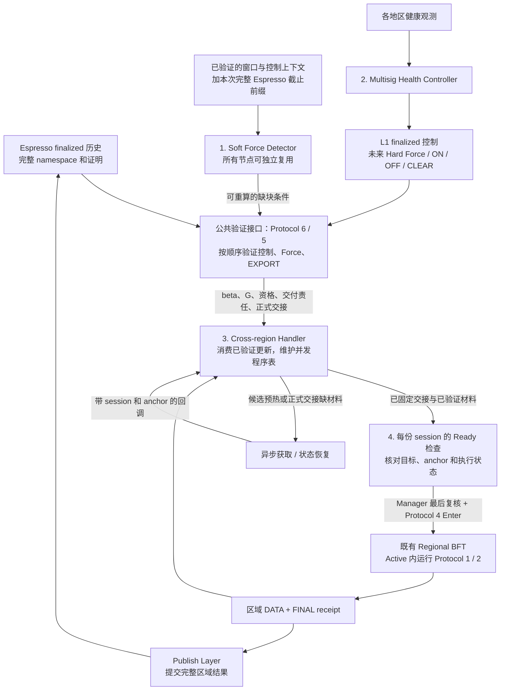
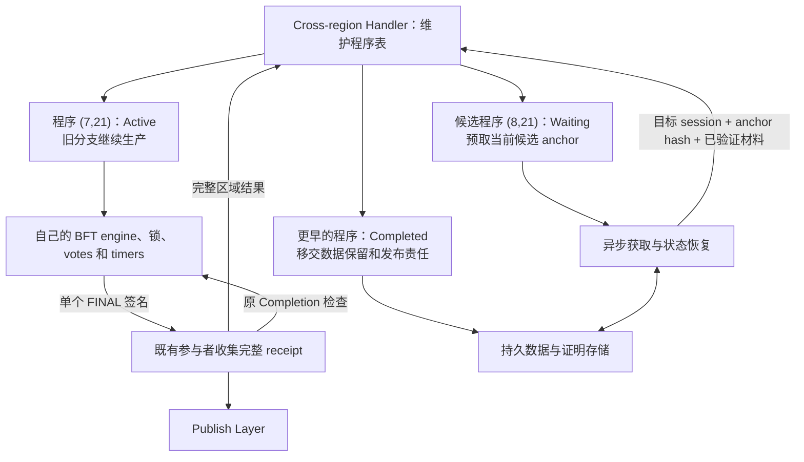
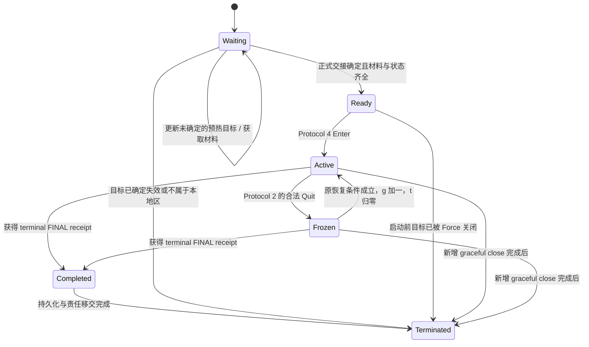
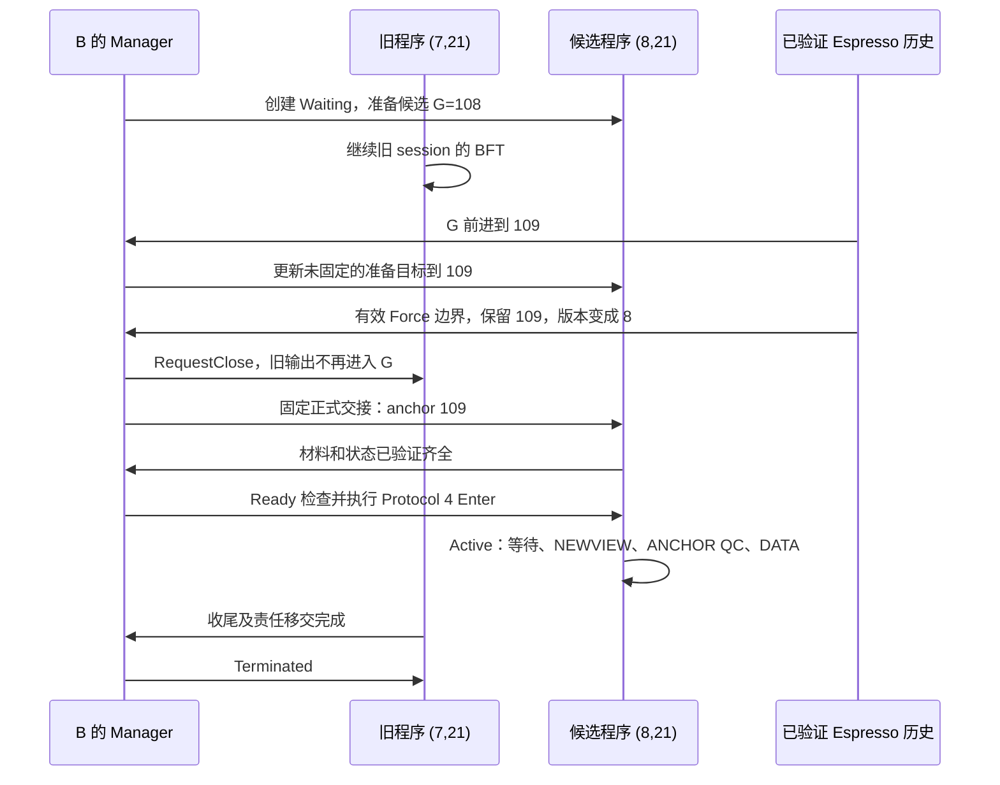
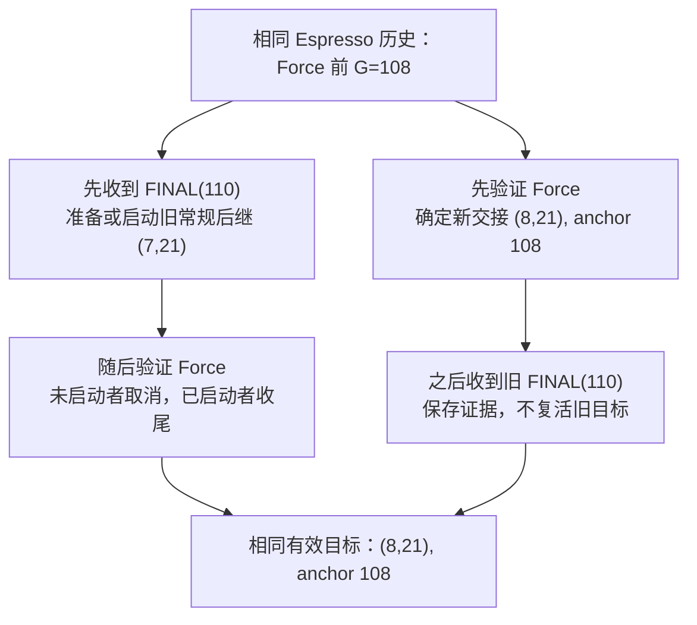

# Part II v3.2 修订提纲：四模块架构、并发 Session 与 Ready

状态：按本次补充更新的设计提纲。四个模块依次回答：是否需要干预、如何管理地区健康、如何管理并发程序、某个程序能否正式启动。本文不改动 v3.1 假设，也不把尚未验证的退出规则写成已证明结论。语音中的 Spark 按前文理解为 Espresso；委员会的控制称为 Hard Force。

依据：[当前英文 v3.1](sync_hotstuff_rr_part2_rotation_v3_1.tex) · [当前中文 v3.1](sync_hotstuff_rr_part2_rotation_v3_1_zh.md)

## 1. 这次重构要表达什么

每个区域节点运行一个 **Session Manager**。它监听 L1、Espresso 和区域 BFT 结果，管理多个以 $(\beta,r)$ 命名的独立程序。每个程序都有自己的交接材料、执行状态、BFT 状态和生命周期。

一个区域可以同时有：

- 正在生产的旧程序；
- 为可能的 Force 后继准备数据的新程序；
- 已完成 BFT、等待交付数据保留责任的程序；
- 已退出、但其历史证据仍保存在公共数据服务中的程序。

区域 BFT 是每个程序内部的模块。第 6 节的重点是这些程序怎样被创建、准备、启动、恢复和回收。

直白地说：**Handler 持续决定“现在应该准备谁”；Ready 检查决定“这个确定的程序能否从这个确定的块开始”；Protocol 4 才真正启动它。** “可能下一个轮到我”只允许预取数据，不允许提前出块。

整个 cross-region 部分分成四个模块：Soft Force 检测、Multisig 健康管理与 Hard Force、Cross-region Handler，以及每份 session 的 Ready／启动检查。前两个提供干预依据，后两个管理程序怎样准备和真正启动。

编号只保留现有一套：

$$
\text{session}=(\beta,r),\qquad\text{view}=(\beta,r,g,t).
$$

$\beta,r$ 命名程序所属的逻辑 session；$g,t$ 由该 session 内的区域 BFT 推进。Manager 不能因为收到新的 $G$ 就把一个已运行程序的编号或 anchor 原地改掉。

模型中，Manager 由每个正确区域副本独立执行。图里的“区域 B Manager”表示这些副本运行同一逻辑，不增加一个受信任的地区中心控制器。

## 2. 四个 Cross-region 模块与微观架构

### 2.1 前端判断、运行时管理、逐 session 启动

前两个模块回答“是否应当干预”；第三个模块回答“现在管理哪些候选和正式程序”；第四个模块回答“这一份具体程序是否已经能从确定的 anchor 开始运行”。前两个是并列来源，不是先经过 Soft 再经过 Multisig。

| 模块 | 谁运行 | 输入 | 输出 | 不负责什么 |
|---|---|---|---|---|
| **1. Soft Force Detector** | 所有需要验证进展的节点复用同一算法 | 已验证 Espresso 历史、$G$、当前 export session、窗口参数和计数 | 无需切换，或可验证的缺块条件与对应截止位置 | 不按本机等待时长独自切换，不直接增加 $\beta$ |
| **2. Multisig Health Controller** | 现有 multisig 控制服务 | 各地区健康情况、同步和数据交付情况、运维策略 | 提交到 L1 的未来 Hard Force、ON/OFF，必要时显式 CLEAR | 不决定保留哪个旧块，不回滚 $G$，不替节点启动程序 |
| **3. Cross-region Handler / Session Manager** | 每个正确区域节点 | finalized L1、finalized Espresso、区域 FINAL、Soft 条件和本地完成事件 | 候选／正式交接计划；创建、更新、暂停、取消、启动和收尾动作 | 不把一次预测当作已获授权的 view，不重复执行 Force |
| **4. Per-session Ready and Activation Gate** | 每份 $(\beta,r)$ 程序 | Manager 确定的计划、交接证明、精确 anchor、authority 和执行状态 | 仍 Waiting，或经最终复核 Ready，再通过 Protocol 4 Enter 进入 Active | 不自己改 anchor，不把下载成功等同于授权成功 |

四个模块不增加新的可信角色。Publish Layer、Espresso、L1 和既有区域 BFT 是它们使用的服务。Protocol 5/6 提供一份共同的公共验证接口：**原始 Espresso 记录先经过验证与重放，才得到 $G$、地区资格、Force 结果和交付责任。** 图中将这一步单独画成灰色接口，它不是第五个生命周期管理者。



[可放入文档的四模块图](figures/cross_region_rotation_v3_2/modules.pdf) · [PNG 预览](figures/cross_region_rotation_v3_2/modules.png) · [图源](figures/cross_region_rotation_v3_2/modules.tex)

两条路径同时存在：完整 regional receipt 可以直接交给 Handler，提前完成 regular handoff；Publish Layer 把结果交给 Espresso，供全局确认及后续数据获取。前一条路径不需要等待后一条完成。普通节点的 Soft 检测使用同一套公开规则，但不需要具备 multisig 的控制权限。

### 2.2 Soft Force 是可复用的确定性检查

观测对象是**当前还欠 $G$ 下一块 DATA 的 export session**，而不一定是已经跑到最前面的 production session。

- 计数仍使用实际接受进 $G$ 的新增 DATA；重复提交、DRAIN、仅有 QC 或无效 EXPORT 不计数。
- 各节点可以定时轮询 Espresso，但轮询只是获取新输入；本地轮询频率和接收时间不能改变 Force 的判断。
- 只有读到完整、finalized 的截止区块及必要历史，才能证明一个窗口失败；下载不到不能解释成窗口内没有数据。
- 算法输出“这一公开窗口是否失败”的条件和证据。执行时仍按已有优先级：独立 STATUS/CLEAR → 第一个匹配的 Hard Force → 否则 Soft Force → EXPORT。
- Soft 条件即使已算出，也不能绕过同块有效 Hard Force 的优先级。任何节点提供的检测结果都可以由其他节点独立重算。

该算法可以作为 Protocol 5 中缺块检查的明确子过程；不新增一种受信任的报警者，也不要求在 Espresso 上运行应用合约。

### 2.3 Multisig 模块应明确回答的政策问题

这部分不只写“multisig 可以 Force”，而应把输入、判断和提交动作分开：

```text
HealthPolicy(地区观测, 已验证控制状态)
    → 不操作
      或提交未来生效的 OFF / ON / CLEAR / Hard Force
```

这是委员会的健康管理政策接口。具体如何判断恢复到可服务状态，沿用已有诚实委员会假设并记录可审查的依据；不能在改写架构时偷偷增加一个新的健康证明或时间上界。

| 观察或目的 | 可以采用的控制动作 | 生效后的含义 |
|---|---|---|
| 某个非当前地区不适合继续被选择 | 对该地区提交未来 OFF | 改变后续选区资格 |
| 需要终止当前目标版本的生产安排 | 提交 Hard Force；需要隔离地区时附加或单独提交 OFF | 到 Espresso 激活位置且目标版本匹配时执行切换 |
| 某地区已完成同步和服务恢复，符合公开恢复策略 | 提交未来 ON | 允许参与之后的选区，不保证马上接班 |
| 还需要提前解除自动 cooldown | 显式 CLEAR | 与 ON 分开处理，不隐含清除 |

正式稿为每种动作列出所需观测、策略条件、目标和生效时间，不臆造尚未选定的数值阈值。网络同步、密钥和运维健康的判断继续依赖现有诚实 multisig 假设；一次 ON 不是对未来 BFT 假设永久成立的证明。

Hard Force 仍作用于目标分支版本，而不是只盯住提交时的一个地区。普通交接不会使它失效；提前发生的其他 Force 才可能使其目标版本过期。若只想禁止某地区以后接班而不重置当前版本，应使用 OFF。

所有控制仍先在 L1 finalized，并在指定的未来 Espresso 位置生效。控制服务不能因为本地发现问题，就让其他地区绕过这条公共顺序立即切换。

### 2.4 Handler 的核心：不断核对候选，而不是预测一次就不再改变

Handler 每次收到有效更新后，重新回答四个问题：

1. 当前已确认的 $\beta$、$G$、地区资格和 export duty 是什么？
2. 哪些交接已经正式确定，哪些还只是可能的下一轮？
3. 本地区应创建、继续预热、暂停或取消哪些程序和任务？
4. 哪些正式目标已准备齐全，可以进行启动前的最后检查？

Handler 可同时维护一个旧 Active 程序和多个 Waiting 准备任务。候选随 $G$ 或地区资格变化时，可以换目标 session、换候选地区或更新尚未固定的 anchor；不改写已经启动的程序。

临时候选变化首先作用于准备任务，不必把一个仍可能再次被选中的 Waiting 程序立即标记为 Terminated。正式分配或不可逆的版本变化确定它不再被使用后，再执行对应取消。

Handler 不必预测唯一的未来。它可以保留多个有用途的准备任务，但每个任务都写明“为哪个候选 session、哪一个 anchor 服务”。一次新观测可能只更新 anchor，也可能换接班地区或换 session 编号。只有正式交接才给出唯一可启动的目标。

### 2.5 Ready 的关键是“精确启动点”，不是一个宽泛的材料齐全标记

检查顺序固定为：

```text
确认目标 session 和接班地区
    → 确认这次正式交接从哪个 DATA 开始
    → 固定 anchor 的原生产 session、hash、height
    → 验证交接依据、authority 和完整 block
    → 恢复并验证这个 anchor 对应的执行状态
    → 最后检查版本仍有效，原子地进入 Protocol 4
```

目标新版本和 anchor 的原版本是两件事。例如 D 要进入 $(8,22)$，它继承的 DATA 112 可能由旧 B 的 $(7,21)$ 产生。新 session 是版本 8，但不能把 anchor 的原生产身份改成版本 8。

因此不使用含混的“anchor beta”作为单独启动条件。明确记录两项：**目标程序 $(\beta,r)$**，以及**anchor 的原生产 session、hash 和 height**。同一个高度上，旧分支和新分支可能有不同的块；只记高度不够。

Ready 条件必须对应这一个已经固定的 anchor。缓存了 110 的状态，不等于可以对要求从 112 开始的程序报告 Ready。

### 2.6 一个地区内部的并发程序



并发的是程序和数据任务；影响同一本地控制状态的事件要串行处理。无需等旧程序的所有数据任务结束，才开始预热新程序。预热程序不签区域 vote，不启动 commit timer。

## 3. 六个生命周期状态

新增 `Waiting`、`Ready` 和 `Terminated`，保留原区域 engine 的 `Active`、`Frozen` 和 `Completed` 含义。现稿的 `Complete` 统一拼写为 `Completed`。

| 状态 | 含义 | 允许做什么 | 不能据此推断什么 |
|---|---|---|---|
| **Waiting** | 程序已存在，但还缺正式交接、接班资格、数据、状态或 authority | 观察更新、预取、恢复状态、缓存证明 | 不表示已经有权启动；也不表示公共窗口尚未开始 |
| **Ready** | 正式交接和精确 anchor 已确定，材料及执行状态已验证齐全，但尚未进入 BFT engine | 接受启动前最后检查 | 仅仅缓存了候选状态，不足以 Ready |
| **Active** | 已进入当前 generation，未因 Quit 冻结；包括初始 ANCHOR bootstrap 和随后 DATA 生产 | 按 Protocol 1 / 2 运行本 session | 不表示它的输出一定还能进入当前 $G$；旧版本可能已经被 Force 关闭 |
| **Frozen** | 本 session 当前 generation 有合法 Quit proof | 按原规则保留提交、处理证据，并等待恢复或 terminal receipt | Force 本身不等于 Quit，不能直接把 Force 映射为 Frozen |
| **Completed** | 已取得 terminal DATA 的有效 receipt，并执行原 Completion 动作 | 停止 BFT 生产，移交发布和数据保留责任 | 不表示所有 DATA 已进入 $G$，也不表示立刻可以删除数据 |
| **Terminated** | 此逻辑程序已退出，不再处理 BFT 计时器或签发消息 | 由持久存储和其他服务继续提供历史材料 | 不表示区域结果失效、数据消失、或 stake 可提款 |

状态是每个节点的本地程序状态，不要求所有副本在同一真实时刻转换。共同历史确定交接是否合法；节点拿齐材料的时间可以不同。

### 3.1 正常转换



图中 `Active/Frozen → Terminated` 是 v3.2 需要定义和验证的新退出路径，不是 v3.1 已经支持的行为。收尾期间程序仍显示原状态，并记录 `close_requested`；不另加第七个生命周期状态。

如果候选地区只是暂时不合格，且正式交接尚未确定，不必立即 Terminated。可以保持 Waiting 并暂停不必要的数据任务；以后重新合格时继续准备。

### 3.2 程序状态与全局追加权限分开

程序表的 phase 不能代替公共验证规则：

- 一个旧程序仍在 Active 收尾，不表示旧版本可以继续推进 $G$。
- 一个程序已 Completed，甚至已把责任移交后 Terminated，其之前合法产生的数据仍可能在稍后被接受进 $G$，前提是版本和区间等接受条件仍成立。
- 决定旧版本失去追加权限的是有效 Force，不是某个节点关闭了一个进程。

这不是增加第二套 view。追加权限从已经验证的公共历史和交接规则推导；phase 只描述本地程序正在做什么。

## 4. 一份程序记录保存什么

正式稿给出以下记录类型，不再另加不透明的 session hash：

```text
Program[(beta, r)] = {
    phase,
    preparing_plan,       // 尚未确定时的候选交接信息
    fixed_handoff,       // 正式确定后不可替换的交接信息；可暂缺
    anchor_block,
    execution_state_at_anchor,
    authority_and_reference_bounds,
    core_state,          // Active 后包含 g,t、锁、投票、timer 等
    pending_fetches,
    close_requested,
    publication_and_retention_handles
}
```

说明：

1. `preparing_plan` 可以随 $G$ 和有效地区状态更新，但不能产生共识签名。
2. 正式 Force 边界一旦确定，保留的 anchor 就固定，即使程序还在 Waiting 下载。
3. 正式常规边界继承的是 terminal DATA；不能因为 $G$ 前进而改成另一块。
4. 固定的 session 交接不能被普通 OFF 追溯重选；保留 v3.1 的历史选区与 Force 规则。
5. 更新候选导致目标 $(\beta,r)$ 改变时，Manager 管理另一份程序记录，不能覆盖已运行程序的身份。
6. 程序进入时间和投票记录要持久化。进程崩溃后恢复同一逻辑 session，不能当成从零创建一个新 engine。
7. `Terminated` 留下持久的退出记录，防止迟到消息重新启动已关闭的逻辑实例；历史数据由存储服务保留。

同一个候选 $(\beta,r)$ 在不同地区都可以有尚未授权的预热记录。只有正式选择出的地区，才允许它的记录进入 Ready 和 Active。这些预热记录不是多个已经打开的共识实例。

## 5. 交接包与 Ready 的正式定义计划

### 5.1 用交接包展开 witness

Witness 是 Ready 的输入材料，不是 Ready 本身，也不等于全部执行状态。v3.2 将其明确写成一份有字段、有验证规则的交接包：

```text
Handoff = {
    chain_and_protocol,
    kind: REGULAR | MSIG | AUTO,
    predecessor_session,
    target_session,
    target_region,
    anchor: {producing_session, height, hash, block_or_reference},
    authority,
    selection_position,
    evidence
}
```

数据可以直接携带，也可以引用已经验证的缓存或待获取对象。执行状态另行恢复，并验证它对应这一个 anchor；数据引用本身不满足 Ready。

### 5.2 三种交接分别检查什么

| 类型 | 必须验证的依据 | 新 session 与 anchor |
|---|---|---|
| REGULAR | 前驱 session、固定 quota、terminal FINAL、签名 $\xi$、历史选区、下一 authority、当前版本未关闭 | $(\beta,r+1)$，anchor 为前驱 terminal DATA |
| MSIG | 完整 finalized L1 控制、目标版本匹配、首个生效 Espresso 位置、同块控制优先级、完整重放状态与选择结果 | 新版本中由捕获的 export context 确定的 session；anchor 为触发块 payload 前的 $G$ |
| AUTO | 完整 Espresso 历史、失败窗口的计数和 deadline、无优先匹配 MSIG、cooldown 与选择结果 | 使用同一 Force 交接规则，保留同一个规范的 $G$ |

正式稿需要定义一个接受／拒绝的验证过程，不能继续只写“valid witness”。该过程接收已验证 checkpoint、必要历史和交接包，检查并固定以上结果。

若已发生 Force 但尚无合格地区，先保存已确定的 Force 原因和 anchor。没有确定的接班地区，就不能产生可进入 Ready 的完整交接包。

### 5.3 Waiting → Ready 的条件

节点只有在以下条件全部成立时才转换：

1. 正式交接已由验证规则确定，本节点所属地区确实被选中。
2. 精确 anchor 的 DATA、原生产 session 身份和提交证据已验证。
3. 从该 anchor 后面继续执行所需的状态已经恢复并验证。
4. 下一 authority、quota、reference 下界和必要依赖齐全。
5. 已处理的公共历史没有关闭或替代该交接。
6. 没有把同一 session 已经执行过的启动过程再执行一次。

未来 Force 尚未激活时，可以缓存候选 anchor 的所有状态，但仍是 Waiting。Ready 表示可以开始正式进入，不只是“下载大概完成”。

## 6. Protocol 4 如何对应 Ready → Active

用户的理解基本正确：Protocol 4 是新程序的启动接口。但 Active 的进入点必须写准确。

**建议在 Protocol 4 第一步安装状态、记录进入时间、启动进度检查时，完成 Ready → Active。** 此后的 $2\Delta$ 等待、NEWVIEW 和 ANCHOR QC 都在 Active 内进行。

```text
Waiting：收集并验证交接材料和状态
    ↓ 材料齐全且正式交接有效
Ready：可以进入，但尚未启动 BFT timers
    ↓ Protocol 4 Enter，原子登记
Active：记录进入时间、启动进度检查、发送 STATUS
    ↓ 初始 leader 等待 2Δ
Active：发送 NEWVIEW，收集 ANCHOR QC
    ↓ ANCHOR QC 有效
Active：开始第一个 DATA，进入 Protocol 1 正常循环
```

不能把“拿到 ANCHOR QC”才定义为 Active，再把所有进度 timer 推迟到那时。否则沉默的初始 leader 可以推迟原有超时检查，改变当前 BFT 的活性逻辑。

正式稿中的 $e_v(\beta,r,g,t)$ 要统一对应实际进入该 view 的事件。初始 session 的 entry time 在 Protocol 4 Enter 时记录一次。

默认实现把 Ready 检查和 Enter 放在同一个本地事件处理过程内，以保留原来的进入时序。若允许 Ready 后异步排队很久才 Active，必须另给调度上界，并重算原来的 bootstrap 时间界，不能继续原样引用 $e+\Delta$、$e+6\Delta$。

## 7. Protocol 3：Session Manager 的输入与输出

### 7.1 输入事件

| 输入 | 来源 | Manager 的动作 |
|---|---|---|
| `L1Finalized` | 完整控制与 authority 证明 | 验证并更新控制队列；准备未来切换，不提前执行 Force |
| `EspressoFinalized` | 按序的 finalized block、完整 namespace 与证明 | 通过 Protocol 6/5 更新 $G$、资格和正式交接；复用 Soft Detector 的检查；重新核对程序表 |
| `RegionalFinalized` | DATA 与完整 FINAL receipt | 验证、交给 Publish Layer；对已进入的源程序触发原 Completion，满足条件时形成常规交接 |
| `MaterialAvailable` | 数据获取／执行状态恢复任务 | 按目标 session 和 anchor hash 验证回调，更新材料是否齐全 |
| `CoreEvent` | 本地 Protocol 1/2 engine | 同步本 session 的 $g,t$、Frozen、恢复和 Completed 等状态 |

还要补齐 FINAL 的聚合接口：**单个副本的 FINAL 签名不是完整 `RegionalFinalized` 事件。** 收集方形成有效 receipt 后，必须把它交回原 session 程序与 Manager，才能触发 Completion 和常规交接。聚合可以由既有参与者实现，不是一轮新共识；$T_{\rm pub}$ 仍从完整区域结果可用时开始。未进入该 session 的程序先缓存 receipt，不能仅凭回调跳过交接验证或初始化。

Soft Detector 的输出是可复核的派生条件，不是一个额外可信输入；Handler 必须确认它对应自己的已验证历史。Multisig 的链下健康判断则先形成 L1 控制，不能直接当作其他节点的生效状态。

### 7.2 输出动作

| 输出 | 接收方 | 内容 |
|---|---|---|
| `Prepare` / `Fetch` | 数据与状态任务 | 获取指定 session、anchor 的材料 |
| `Activate` | 该 session 的 Protocol 4 | 用已固定交接执行一次 Enter |
| `RequestClose` | 过期程序 | 已验证的关闭依据与收尾请求，不是伪造 Quit |
| `OfferResult` | Publish Layer | 原 DATA、FINAL receipt 与必要依赖 |
| `Persist` / `Release` | 持久存储和资源管理 | 保存投票、状态、证据、任务移交及退出记录 |

### 7.3 公共状态只有一个更新入口

- Protocol 5 定义控制、窗口与 Force 的状态转换。
- Protocol 6 验证两条链并按规范顺序应用这些转换，推进公共状态。
- Protocol 3 使用该结果管理本地程序，不再独立增加一次 $\beta$ 或自行改写 $G$。
- Protocol 1/2 只推进各自 session 内的 BFT 状态。

Manager 每次收到事件后执行一次“重新核对程序表”：

```text
HandleEvent(event):
    验证并归入对应的公共历史、区域结果或本地任务
    按规范更新公共状态（如果该事件涉及公共重放）
    根据 G、资格和区域结果重新计算候选下一 session 与地区
    更新尚未固定的候选材料，或安装已经固定的正式交接
    使已确定过期的准备任务失效
    为已关闭版本中运行的程序请求收尾
    对符合条件的 Waiting 程序检查 Ready
    对 Ready 程序原子检查并调用 Protocol 4 Enter
    持久化本次状态更新与输出动作
```

下载和恢复可以并行；最后的版本检查、Ready 判断和进入登记必须与本地公共状态更新串行化。回调提供的是材料，不是绕过检查直接启动 session 的命令。

## 8. 程序 Waiting 不等于“公共窗口没有开始”

这是重构时必须消除的同名歧义。

旧稿的全局 Waiting 通常表示“还没有选出接班地区，也没有 export duty”。新程序的 Waiting 还包含“已经选中 B，但 B 正在下载和恢复”。

因此建议：

- 生命周期只用 `Waiting` 这个枚举。
- 公共状态是否存在 export duty，直接用“已分配／未分配”描述，不再和程序 phase 共用一个 Waiting 标记。

如果 B 已被正式选中，公共交付窗口可以已经开始，而 B 的本地程序仍在 Waiting。它不能通过晚下载、晚 Ready 或重新创建任务来重置 deadline。

只有公共状态尚未分配 export duty 时，才没有该 duty 的 DATA window。

## 9. 如何定义 Terminated 与 graceful close

### 9.1 未进入 BFT 的程序

Waiting 或 Ready 程序若已确定不再被使用，可以停止任务并进入 Terminated。因为它尚未进入 BFT，不存在本 session 已启动的 commit timers 或已发出的 BFT votes 需要收尾。

单纯的临时资格变化不必终止一个仍可能被选中的候选；可继续 Waiting。最终分配、已关闭版本和不再可能成立的候选，才触发确定的取消。

### 9.2 已 Completed 的程序

保留原 Completion：取得 terminal receipt 后，停止生产、投票和进度检查，按原规则取消 timers。

之后只有在以下责任已经持久移交时，才能 Terminated：

- 已提交 DATA、receipts 和必要日志有可恢复的副本；
- 尚未完成的发布任务已移交给 Publish Layer；
- 保留的 anchor、状态和历史数据仍可获取；
- 退出记录已持久化，重复消息不会再次启动程序。

不必把“程序还活着”作为保存数据的唯一方式。Completed 程序可以退出，由其他服务继续发布和保留其结果。

### 9.3 Force 后的 Active / Frozen 程序

这是本次需要新增的生命周期行为。建议采用明确的两步关闭接口：

1. `RequestClose`：验证旧版本已关闭的依据，禁止它再作为当前生产分支提供新输出；记录收尾请求。
2. `FinishClose`：达到规定的静止与责任移交条件后，才把程序标记为 Terminated 并释放资源。

**拟议的 graceful-close 方向：** 停止产生新的旧 session 工作，同时继续处理已有计时器、必要的消息转发、证据和 FINAL，完成后归档退出。这里不能直接复用 Frozen 名字，因为它没有区域 Quit proof。

正式稿必须进一步写死并核对：

- 哪些新 proposal、vote、term 和 recovery 动作从何时停止；
- 哪些已在途消息、已经启动的 commit timers 和证据仍必须处理；
- 收尾等待要覆盖其他正确副本获知关闭、在途证据传播和相关 timers 的剩余时间；
- 为什么不能仅凭本地 timer 列表为空就立即退出；
- 哪些旧 session 的进展承诺在正式退役后结束，哪些提交与安全性承诺仍然保留。

这条路径是对原执行模型的扩充。v3.1 原来只允许 Quit 或 Completion 取消 timer，并未定义强制退役。因此不能只改状态名字，就声称原有所有证明不受影响。

在正文推导并验证 `FinishClose` 条件之前，不能写成“Force 激活时所有旧程序立即终止”，也不能宣称已经得到固定的退出时间界。新的 session 可以与旧程序的收尾并行启动，不必把旧程序完全退出作为自己的前置条件。

程序 Terminated 与 stake retirement 是两件事；退出单个程序不代表所有历史责任和未来 authority 责任都结束。

## 10. 并发时间线例子

### 10.1 B 一边生产，一边准备 Force 后继

初始：A 的 session 为 $(7,20)$，B 已通过常规交接运行 $(7,21)$。B 的旧 anchor 是 110，而当前 $G$ 只到 108。

| 时点 | 旧 B 程序 $(7,21)$ | 候选程序 $(8,21)$ | 公共状态 |
|---|---|---|---|
| 得知未来 MSIG | Active，继续生产和发布 | Waiting，预取 108 的证据与状态 | 版本仍为 7，Force 未生效 |
| $G$ 推进到 109 | 旧 anchor 仍是 110，不改变 | Waiting，改为准备候选 109；旧下载回调不能直接触发 Ready | 下一块仍欠 A 的 110 |
| Force 边界最终确认 | 失去全局追加权限，收到收尾请求 | 正式交接固定为 $(8,21)$，anchor 固定为 109 | 版本变成 8，完整保留 $G=109$ |
| 材料齐全 | 可以仍在收尾 | Waiting → Ready → Active，运行 Protocol 4 | 公共窗口不因本地 Ready 时间改变 |
| ANCHOR QC 获得 | 独立收尾 | Active，开始 DATA 110 | 新旧程序不共享锁、votes 或 timers |
| 旧程序收尾完成 | Terminated；证据仍保留 | 继续 Active | 旧版本不能重新追加 |



图中的 `RequestClose/Terminated` 是拟议生命周期接口，具体安全收尾条件按第 9 节补齐；图不宣称旧 BFT 可以立即被杀掉。

### 10.2 激活前 G 已越过 A 的 terminal DATA

若 Force 生效前 A 的 110 已进入 $G$，export duty 转到 B 的 $(7,21)$，则应从 B 后面选区。若 C 合格，正式后继可能是 C 的 $(8,22)$。

B 的 $(8,21)$ 只是预热候选，不会因为自己已经缓存好了 109 的状态就获得启动权。Manager 按正式结果取消不再可能使用的候选；C 的 Manager 准备或激活真正被选中的程序。

### 10.3 Regular 先到与 Force 先到



节点可以短暂拥有不同的投机程序，但重放相同公共前缀后，当前版本、$G$ 和正式交接必须一致。

已经在 Force 之前进入 $G$ 的 DATA 永远保留；同一触发块内的旧版本 EXPORT 仍按“先 Force、后 payload”拒绝。阶段变化不改变这项全局顺序。

### 10.4 旧下载回调与重复消息

Manager 为 $(7,21)$ 请求了 anchor 110 的状态，之后 Force 确定 $(8,21)$ 从 108 开始。旧任务随后返回时，只能作为带原目标的材料进入缓存，不能对新 session 发出 Ready。

重复 receipt、交接包或下载完成事件不能再次运行 Protocol 4 Enter，也不能重置已经存在的 entry time 或 public delivery window。

旧 MSIG 因目标 $\beta$ 不匹配而作废时，也不能误关已经由 AUTO 正式开启的新 session。取消的是过期的准备依据，程序是否保留要看正式交接结果。

### 10.5 同一条准备流水线如何更新、取消和重新定向

设地区循环顺序为 A → B → C → D。旧版本为 7；A 的 session 为 $(7,20)$，terminal DATA 是 110；B 已常规接班为 $(7,21)$。有一条提前公告的 Hard Force 针对版本 7，期间没有其他 Force 先执行。

以下展示的是**未来 Force 的候选**，不是已经确定的常规交接：

| 新观测 | 当前 export session | 下一次 Force 的候选 | Handler 的动作 |
|---|---|---|---|
| $G=108$ | A 的 $(7,20)$ | B 的 $(8,21)$，候选 anchor 108 | B 创建 Waiting 程序，预取 108 |
| $G=109$ | 仍为 A 的 $(7,20)$ | 仍为 B 的 $(8,21)$，候选 anchor 改成 109 | 更新未固定目标；旧回调不能直接触发 Ready |
| A 的 110 已进入 $G$ | B 的 $(7,21)$ | C 的 $(8,22)$，候选 anchor 110 | 旧 B 候选不再对应这次切换；C 准备新目标 |
| OFF(C) 已在公共历史中生效 | 仍为 B 的 $(7,21)$ | 跳过 C，改为 D 的 $(8,22)$ | 暂停 C 的非必要预热，D 开始准备；不改变旧 B 的 Active 身份 |
| Force 边界确定，边界前 $G=112$ | 捕获 B 的 $(7,21)$ | **正式确定 D 的 $(8,22)$，anchor 固定为 112** | 验证完整 Force 交接；后面只补齐 112，不再追着最新 $G$ 改 anchor |
| D 拿齐 112 的证明和执行状态 | 新 duty 已分配给 D | 同一正式 $(8,22)$ | Waiting → Ready → Protocol 4 Enter → Active；ANCHOR QC 后从 DATA 113 开始 |

OFF(C) 改变的是这次 Force 的候选地区；它不追溯重写已经固定的旧 REGULAR 交接。旧 B 在 Force 生效前仍正常运行，之后只按明确的收尾规则退出，不会因为预热候选改变就被提前杀掉。

[候选变化与 Ready 检查图](figures/cross_region_rotation_v3_2/candidate_ready.pdf) · [PNG 预览](figures/cross_region_rotation_v3_2/candidate_ready.png) · [图源](figures/cross_region_rotation_v3_2/candidate_ready.tex)

该例说明两种不同变化：

- **session 编号变化**：$(8,21)$ → $(8,22)$，因为交付责任已从 A 转到 B。
- **同一候选编号的地区变化**：C → D，因为地区资格发生变化；此时尚未开启该编号的共识实例。

最终 Ready 的正式记录必须同时绑定：目标 $(8,22)$、地区 D、anchor 112 的原生产身份 $(7,21)$ 和 hash，以及从 112 继续执行所需的状态。

## 11. 第 6 节的建议新结构

保留章节编号，不把系统运行时逻辑继续散落在几段文字中。

| 新小节 | 英文标题 | 内容 |
|---|---|---|
| 6.1 | Four-module cross-region architecture | 四个模块的职责、部署位置、输入输出和整体微观图 |
| 6.2 | Soft detection and multisig health control | Soft 检测的公共输入与输出；Hard Force / ON / OFF / CLEAR 的政策和 L1 提交接口 |
| 6.3 | Cross-region Handler | 重写 Protocol 3：事件、程序表、候选变更、任务取消和正式交接 |
| 6.4 | Session lifecycle | 六个状态、转换表、固定字段、并发程序和数据责任 |
| 6.5 | Handoff records, anchors and Ready | 正式定义交接包和验证规则；精确 anchor 及其执行状态；Ready 的检查顺序 |
| 6.6 | Activation and bootstrap | Protocol 4 Enter 完成 Ready → Active；随后保留 STATUS/NEWVIEW/ANCHOR 流程 |
| 6.7 | Concurrent candidates and races | 候选 session / 地区 / anchor 的变化；regular/Force race；迟到回调和图示 |
| 6.8 | Graceful close and termination | 关闭请求、收尾条件、资源与数据责任移交；不假装已有完整退出证明 |

为避免第 3 节与第 6 节出现两套互相矛盾的状态，第 3.4 节只解释区域 core 的 Active/Frozen/Completed，并明确它们如何映射到六状态生命周期。第 6 节是程序生命周期的唯一完整定义。

## 12. 其他章节的同步修订

| 位置 | 修改内容 |
|---|---|
| 第 1 节 | 用一个区域并发管理多个 session 的微观图解释系统结构 |
| 第 2 节 | 原样保留 v3.1 模型、假设和进展前提，包括紧邻假设的限制说明；Manager、状态恢复和收尾写成协议接口与待证明义务，不新增环境服务保证 |
| 第 3 节 | 区分 session 生命周期与 generation 的 Frozen；声明程序记录和消息路由键 |
| 第 4 节 | 明确 P1/P2 发出的 CoreEvent；保持正常 BFT 动作，单独标出退役接口引入的行为变化 |
| 第 5 节 | 全球 finality 不以本地 phase 判断；Complete/Terminated 后的合法既有结果仍可发布 |
| 第 7 节 | 提供第 6 节前端调用的 Soft 检查与统一 Force 执行规则；保留旧版本匹配、MSIG 优先和规范 cutoff，只有一个地方增加 beta |
| 第 8 节 | Protocol 6 向 Manager 提供已验证的公共状态更新；区分全局未分配 duty 和本地 Waiting |
| 第 9 节 | 保留既有四元组例子，补并发预热、启动 race 和退出路径；调整涉及退役 session 的保证范围 |
| 第 10 节 | 发布、receipt 聚合与返回、数据保留任务可独立于 BFT 程序存活；补 Completed/Terminated 的责任移交接口 |

## 13. 写正文前后必须核对的性质

1. **唯一启动起点：** 同一正式 $(\beta,r)$ 的 anchor、地区、authority 不因下载完成时间改变。
2. **预热无签名权限：** 未确定的候选不会发出合法 BFT vote 或启动 commit timer。
3. **启动一次：** 同一节点对同一 session 的初始 Enter 最多一次，重复事件不重置状态。
4. **正确路由：** 不同 $(\beta,r)$ 的锁、votes、timers、状态恢复任务隔离。
5. **历史一致：** 相同公共历史产生相同正式交接；本地投机程序可以不同。
6. **G 不回滚：** 所有 lifecycle 转换保留已经全局确认的数据。
7. **计时不混用：** 区域 timer 从 BFT entry/vote 开始；公共窗口从规范 Espresso 事件开始；Waiting 或 Ready 不推迟公共 deadline。
8. **退出不伪造完成：** Force 退役不等于 terminal quota 已完成，也不等于出现 Quit proof。
9. **退出不丢数据：** 进程释放前已把 required data、receipts 和 publish duties 持久移交。
10. **检测结果可复核：** 同一完整 Espresso 历史给出同一 Soft 条件；轮询频率和本地时间不能改变它。
11. **健康控制不改写 finality：** Multisig 只能按 L1 控制接口管理资格与切换，不能改变既有 $G$。
12. **新目标不改写旧 anchor 身份：** 目标版本增加后，继承块仍保留原生产 session、hash 和 height。
13. **收尾有明确范围：** 旧程序停止哪些工作、继续处理哪些工作、何时可回收，都有输入条件和可检查的规则。不能以“graceful”一词替代定义或证明。

正常与候选准备的程序管理可以先完整形式化；Force 对已运行 BFT 的提前退役，需要同步完成退出条件和相应安全性核对。这是 v3.2 的实质新增点，不应包装成纯粹的符号整理。

## 14. 后续正式交付

正式稿按本提纲组织，并逐项核对：

- `sync_hotstuff_rr_part2_rotation_v3_2.tex`：英文正式稿；
- `sync_hotstuff_rr_part2_rotation_v3_2_zh.md`：对应中文稿；
- 英文 PDF，以及微观架构、生命周期、并发时间线和 race 图。

本次架构更新包含提纲与两张图（PDF、PNG 和可编辑 TikZ 图源）。v3.1 的现有正文、PDF 和图保持不变。

## 15. 正确性检查需要单独回答的问题

架构清楚不等于活性已经证明。后续正式稿与独立审查必须分别处理以下问题，不能靠增加假设把问题隐藏起来：

1. **旧程序怎样退出。** Force 立即关闭旧版本的全局追加权限；已有区域计时器、证据和发布责任如何收尾，必须另写规则。不能把 Force 当成 Quit，也不能保证每份旧结果都能凑齐 receipt。
2. **持续全球进展。** v3.1 的进展前提只明确给出某段成功服务区间。要声称无限进展，必须核对后续 AUTO 窗口是否可能反复打断健康区域，不能把“一段成功”直接改写成“永远成功”。
3. **每个健康区域是否最终轮到。** 历史 Espresso reference 固定选区可以保留 regular handoff 的确定性，但若一直允许使用旧 reference，后来恢复的地区可能一直未被选中。这需要独立分析，不能由 $G$ 持续增长直接推出公平轮转。
4. **只剩一个 live region。** 当前 `NextLive` 排除前驱地区，而原进展前提要求等待边界最终出现另一个 eligible region。因此“一个 live region 就足够”是需要另行解决的协议目标，不能当成当前假设已经保证的性质。

这些问题将进入版本差异与审查记录。它们不会改变本图的四模块划分，但会影响模块内部选区、窗口和退出规则的最终版本。
