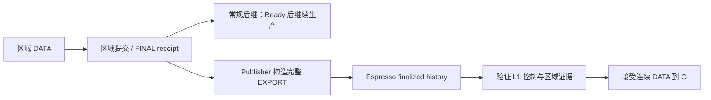

# Sync HotStuff RR Part II v2：跨区域轮转中文阅读版

对应：[英文正文](sync_hotstuff_rr_part2_rotation_v2.tex) · [英文 PDF](sync_hotstuff_rr_part2_rotation_v2.pdf) · [Arch v3 中文阅读版](arch_v3_zh.md)

本文按英文正文九个章节的顺序说明协议。保留假设分组、DATA/DRAIN、关键计时与边界规则；对重复验证细节作了压缩。精确消息格式、完整 admission 条件和逐项算法以英文正文为准。

## 先掌握四个区别

| 容易混淆的对象 | 本版的区别 |
|---|---|
| 区域 FINAL 与 global finality | FINAL 证明区域提交；global finality 还要求对应 EXPORT 在 Espresso finalized history 中被解释器合法接受 |
| 常规 rotation 与 Force | 常规 rotation 可以领先全局确认；Force 从触发边界前的完整 $G$ 开始新 epoch |
| production session 与 export session | 前者正在生产最新数据；后者欠 $G$ 下一个 DATA。缺块检查针对后者 |
| 区域 timer 与 Espresso 时间 | 区域 BFT 仍使用原有同步时钟和 $\Delta_i$；外部窗口与控制激活使用 Espresso timestamp |

## 1. Overview：变化发生在哪里

每个区域运行原有 Part I 区域 BFT engine。一个 session $r$ 是一个区域的一次生产轮次，view 写成 $(r,g,t)$：

- $r$：区域 session index。
- $g$：恢复 generation。
- $t$：generation 内的 leader term。

本版保留区域协议，把外部全局确认改为对 Espresso 历史的确定性重放。

节点可以有一条领先于 $G$ 的生产分支 $R$。Force 关闭整个旧 branch epoch $\beta$，包括其投机的常规后继，但保留旧分支已经进入 $G$ 的所有 DATA。

外部 Force 不调用旧区域 engine 的 Quit 或 Completion，也不取消它的 commit timers。

## 2. Model and assumptions：模型与假设

### 2.1 L1 control state

L1 提供两组信息：

| 信息 | 作用 |
|---|---|
| $\mathrm{AUTH}_{r,0}$ | 固定区域快照、leader schedule、DATA quota 和 export-window 参数 |
| $\mathrm{AUTH}_{r,g}$，$g>0$ | 恢复 generation 的 leader schedule；不重置快照或 quota |
| STATUS | 在未来 Espresso 时间改变指定区域的 live/off 状态 |
| CLEAR | 在未来 Espresso 时间清除指定 cooldown |
| MSIG FORCE | 指定目标 epoch、未来 activation time 和可选附带配置；不指定 retained DATA height |

Authority 一经分配不可改绑。Force 重用数字 $r$ 时，读取该 index 原有 authority，以新的 session ID 区分 engine。

每个控制有 L1 序号 $c$ 和 Espresso 激活时间 $\theta_a$。**读取控制不等于激活控制。** 节点保存完整控制前缀，并保留尚未到期的 pending records。

设 Espresso 区块为 $J_q$，时间为 $\theta_q$：

$$
q(d)=\min\{q:\theta_q\ge d\}.
$$

阈值 $d$ 在 $J_{q(d)}$ 的 payload 之前触发。同一 timestamp 下，height 和块内位置仍给出确定顺序。

区域是否可选由三部分共同决定：governance flag 为 ON、自动 cooldown 已过、指定 authority 下该区域具有正权重。解释器把 prelude 之后、payload 之前的结果记为历史 snapshot $\chi_E(q)$。

OFF 不撤销已经基于历史 snapshot 确定的常规 witness；ON 不自动清除 cooldown；任何状态更新都不能改写旧证书的权重。

Genesis checkpoint 指定合成 anchor、L1/Espresso reference、初始 epoch 和控制上下文。合成 predecessor context 为 $(\bot,-1,\bot)$，从整个区域表选择第一个合格区域，开启 session 0。

### 2.2 Stake and faults

区域 $i$ 中成员权重满足：

$$
\omega_{i,v}>0,\qquad W_i=\sum_{v\in V_i}\omega_{i,v},\qquad F_i<W_i/2.
$$

Byzantine 总权重最多为 $F_i$。证书需要不同成员的匹配签名，合计权重 **严格大于 $F_i$**。在此假设下，每张证书至少含一个正确签名者，正确成员也能独立凑齐证书。

成员和权重在整个 session 内固定，包括 recovery。Slashing、OFF 或后来的快照不能改变历史证书的验证分母。$F_i$ 还覆盖历史证书仍被接受期间累积失陷的相关密钥。

这沿用原有同步 BFT 模型，不能把 Espresso inclusion 当作放弃区域有效性假设的理由。

### 2.3 六组假设

| 假设 | 具体内容 |
|---|---|
| Finalized L1 records | 最终确认的 authority 和完整控制前缀共同、可认证、不可改写 |
| Authenticated synchronous communication and global clock | 区域内正确节点间完整消息及依赖的延迟最多为 $\Delta_i$；共享原有全局时钟 |
| Cross-region backbone | 已提交块和 receipt 最终送达其他节点；一般情况下不承诺固定上界 |
| Honest multisignature committee | 委员会是诚实、协调的控制服务，只提交授权且提前公告的未来控制 |
| Bounded L1 finalization and visibility | 实际提交后至多 $T_{\rm L1}$，所有正确在线参与者都获得 finalized、完整、可验证的记录 |
| Espresso history and time | 最终历史兼容且可获取；namespace 完整性可验证；timestamp 非递减且满足约定的最大领先界 |

$T_{\rm L1}$ 已经包括 inclusion、finality、传播、获取和验证，不再额外加一个重复的 announce delay。

若 Espresso 块首次 finalized 的真实时间是 $t_E(q)$，假设：

$$
\theta_q\le t_E(q)+\epsilon_E.
$$

委员会在真实时间 $s$ 提交控制时选择：

$$
\theta_a>s+T_{\rm L1}+\epsilon_E+\eta,\qquad\eta>0.
$$

于是，当 Espresso 首次跨过这个阈值并 finalized 时，控制已经对正确在线参与者可验证。该推导依赖上界假设，不是使用平均确认延迟的经验估计。

### 2.4 Conditions for progress

前缀安全与持续进展分别陈述。持续进展还需要：正确 leader 反复获得实际进入的生产机会；暴露的 equivocator 最终被持续排除；Espresso 继续确认并纳入输出；完整数据及时到达可工作的 publisher；authority 与恢复状态可获取；最终存在其他合格区域；委员会给健康区域足够的服务时间。

仅有“backbone 最终送达”不足以保证满足固定时间窗口。

## 3. Regional engine：保留的定义与数据结构

### 3.1 Blocks、positions 与两种 reference

外层块可写为：

$$
B=(r,k,h,\mathrm{type},x,H(B_{\rm parent}),\rho,\xi).
$$

| 字段 | 含义 |
|---|---|
| $h$ | DATA height，只统计 DATA |
| $k$ | 本 session 的 physical position，统计 DATA 和 DRAIN |
| $x$ | DATA 携带的请求 batch；DRAIN 不携带 batch |
| $\rho$ | finalized L1 block reference，含 L1 height $\lambda(B)$ |
| $\xi$ | 签名绑定的 finalized Espresso reference，包含 height 和 header hash |

$A_{r,g,t}$ 是某 view 第一个 fresh position 之前的 anchor。$A_{r,0,0}$ 是跨区域继承的 DATA；recovery anchor 则由恢复过程选择。

DATA 的 $h$ 增加一。DRAIN 的 $k$ 增加，但 $h$ 不变。

两种 reference 分开约束：L1 height 沿 DATA ancestry 不下降，首个 DATA 满足 $\lambda\ge\lambda_r^{\rm open}$；Espresso reference height 也不下降，首个 DATA 满足 $q\ge q_r^{\rm open}$。DRAIN 复制 $T_r$ 的两个 reference。

Reference 是提案时签名的历史上下文。一个块可能在很久以后才因 recovery / DRAIN 提交，因此 reference timestamp 不等于区域 commit time，也不是 global finality time。

### 3.2 Session quota、term positions 与 DRAIN

一个 session 的固定终点为：

$$
H_r=h(A_{r,0,0})+\mathrm{TB}_r.
$$

高度 $H_r$ 的 DATA 是 $T_r$。Recovery 不改变 $H_r$。Quota 统计 proposal ancestry 中的 DATA，无论这些 DATA 是否已经提交；它不以当前 $G$ 为计数基础。

若 recovery generation 的 anchor 低于 $H_r$，它是 DATA generation。每个 term 最多产生：

$$
m_{r,g,t}=\min\{K,H_r-h(A_{r,g,t})\}
$$

个 fresh DATA。最后一个位置的 QC 是 terminal QC。若它还低于 $H_r$，则允许进入下一 term；达到 $H_r$ 后不再开启下一 term。

**DRAIN 仅用于 recovery 从 quota endpoint 开始的情况。** 当 $g>0$ 且 $h(A_{r,g,0})=H_r$ 时：

- 这一 generation 只有 $t=0,j=0$ 的一个 fresh DRAIN。
- DRAIN 不携带请求，不增加 DATA height，不消耗 quota。
- 它以本 generation 的 ANCHOR QC 为 justification。
- ANCHOR vote 不启动 commit timer；DRAIN vote 启动原有 timer，使包括 $T_r$ 在内的祖先得到提交。

正常 DATA generation 到达 endpoint 后不会顺手附加 DRAIN。它等待 $T_r$ 的 timer，或在 Quit 后恢复。连续被打断的 recovery 可以产生多个 DRAIN，因此整个历史中的 DRAIN 数量不被 quota 限制。

例：anchor 100、quota 10、$K=4$，三个正常 term 分别生产 101–104、105–108、109–110。从 107 恢复继续生产 108–110；从已认证的 110 恢复则进入 drain generation。终点始终是 110。

### 3.3 Certificates 与 FINAL

| 证据 | 证明什么 |
|---|---|
| Proposal QC | 足够权重已对某 proposal 投票；不是区域提交证明 |
| ANCHOR QC | 新 generation 的 opening anchor 被重新认证；不启动 timer |
| BLAME proof | 满足条件的超时抱怨，可作为 Quit 的一种依据 |
| FINAL receipt $\mathcal F_r(B)$ | 足够权重对 session $r$ 的 DATA 提交作出的匹配声明 |

FINAL 不随 recovery generation 或 term 改变。来自不同 generation 的、针对同一 DATA 的有效 FINAL 可以汇总。

同一 session 中，较高 DATA 的 receipt 可通过完整 ancestry 覆盖较低 DATA。后一 session 的 receipt 不能代替前一 session 的证据。

DRAIN 被提交时，为被它提交的 terminal DATA $T_r$ 产生 FINAL，不为 DRAIN 自身建立全局 DATA。新 session 继承 anchor 不等于重新为旧 session 签发 receipt。

### 3.4 Admission、validation 与 engine state

每个消息按完整 session ID 路由。验证覆盖 authority、view admission、块类型、quota、两种 position、祖先、证书和两个 reference。

引擎区分 active、frozen 和 complete。旧 generation 的材料归档，未来 generation 的材料缓冲。缺依赖就获取并等待，不能把缺数据直接当成无效或缺块。

处理顺序保留原版原则：先检查携带的 Quit evidence，再处理依赖和有效性，再按祖先顺序处理附带 proposals / terminal QCs，最后处理消息本身。消息与 timer 同时到达时，先处理消息。

## 4. Regional protocols：区域协议不换一套

### 4.1 Steady state

**Protocol 1：提案、投票、提交、term rotation、Completion。**

1. 当前 leader 按顺序提案，遵守 DATA quota 或 drain-generation 规则。重发必须保持同一 proposal，不能在同一位置签两个不同块。
2. Replica 完整验证后，对首次合法投票记录时间 $\tau_v(P)$，转发并投票。
3. 投票启动原有 $2\Delta$ commit timer。到期且未取消则提交该块和未提交祖先，并为本 session 新提交的 DATA 广播 FINAL。
4. 低于 $H_r$ 的 terminal QC 可以开启下一 term；它不取消已有 commit timers。QC 本身也不启动 commit timer。
5. 取得 $\mathcal F_r(T_r)$ 才执行 Completion：停止本 session 的提案、投票、恢复和进度检查，取消未到期 timer，但继续提供数据。

只有 Quit 或 Completion 可以取消这里的 commit timer。外部 Force 不可以。

### 4.2 Quit 与 recovery

**Protocol 2：Blame、Quit、Status、NEWVIEW、ANCHOR vote。**

对 term 中第 $p$ 个进度要求，在：

$$
e_v(r,g,t)+(2p+4)\Delta
$$

检查。如果 view 仍有效、尚未完成、投票位置少于 $p$，且未发过该 term 的 BLAME，则广播 BLAME。首个检查在进入 term 时就安排，不能让沉默 leader 无限推迟启动。

合法 Quit proof 可以是：足够权重的匹配 BLAME；同一合法位置上的 leader equivocation；或同一 generation 上选择不同 opening 的两个合法 NEWVIEW。越过 quota 的 DATA、错误 generation 中的 DRAIN，本来就无效，不能被当作该双签条件中的合法 proposal。

Quit 后冻结 generation，取消其未到期 timers，但保留已提交数据并继续收集证据。等待至少 $a_v+\Delta$ 且下一 authority finalized 后，进入 $g+1$。

进入时固定 entry lock $Q_v$。新 leader 在自身进入后等待 $2\Delta$，选择已知最高 rank 的 QC 作为 $Q^*$ 并广播 NEWVIEW。Replica 验证后，只有在 $\operatorname{rank}(Q^*)\ge\operatorname{rank}(Q_v)$ 等条件成立时才作 ANCHOR vote。

取得 ANCHOR QC 后开始 DATA 或 DRAIN。区域 commitment 与 Completion 都不需要 Publisher acknowledgement。

## 5. Regional and global finality

### 5.1 Regional finality

区域 finality 仍按区域 commitment 规则定义，并与具体 production branch 绑定。若未确认分支以后被 Force 关闭，其 receipt 仍然是区域提交证据，但不再意味着它可以追加到全局链。

“某个正确 replica 已提交”“外部观察者拿到完整 receipt”“所有正确 replicas 最终提交”是不同条件。后者还涉及区域 liveness 和后续恢复；不能把一张 proposal QC 当作这三件事都已经发生。

### 5.2 Published records：EXPORT 的接受

Publisher 提交的 EXPORT 可以包含跨多个常规 session 的连续 DATA，但必须包含各 session 的完整证据。

解释器在处理该 Espresso 块的 prelude 后检查：

1. Expected base 与当前 $G$ 的前缀及来源一致。
2. Epoch 仍开放；每个 DATA 属于合法边界链指定的 session。
3. 从 $h(G)+1$ 连续开始，parent/hash 对应，不遗漏、不重复。
4. 每个块的区域 commitment、应用有效性、authority 和 quota 检查通过。
5. 所用 Espresso selection reference 严格早于承载 EXPORT 的 Espresso 块，不能自我证明。
6. Force 新建的 epoch 不能在触发 Force 的同一个 Espresso 块里接受 DATA。

整个 EXPORT 原子接受。一个无效记录不会部分推进 $G$。之前因缺祖先而被拒绝的候选必须重新提交，不能事后在原位置补确认。

**Terminal DATA 可以先进入 $G$，即使当时没有下一合格区域。** 这时保留它并进入 Waiting，不分配 export duty，也不运行其 DATA window。

已证明无候选与缺验证材料不同：后者暂停重放，之后从同一规范位置恢复。

### 5.3 Global finality

观察者认证并重放 Espresso 的 finalized prefix，当某个合法 EXPORT 把 $B$ 加入 $G$ 时，便把 $B$ 视为 globally final。

这一步之后没有额外 committee wait，也不要求先把 Espresso checkpoint 登记到 L1。

之后的 Force 保留完整 $G$ 及其 block/session provenance。旧 epoch 的字节仍可能被 Espresso 原样记入日志，但解释器不再接受它们成为本链输出。

### 5.4 Reference 不是 commit clock

$\rho$ 和 $\xi$ 在提案时固定，区域提交可能因 recovery 很晚才发生。窗口从解释器分配 export duty 的公开时间开始，统计最终接受进入 $G$ 的新增 DATA。

区域内部的 $2\Delta$ timer 仍使用原有同步时间模型。

## 6. Cross-region rotation

### 6.1 Anchor、选区与边界身份

$\mathrm{NextLive}(i,M)$ 按固定循环表，从 $i$ 后面寻找第一个合格的**其他区域**。找不到就返回 $\bot$；本版没有同区域自动续期。Genesis 的合成起点单独扫描整个表。

常规交接继承 $T_r$；Force 继承触发块 payload 之前的完整 $G$。

| 边界 | 搜索起点 $q_0$ | 区域循环搜索的 source |
|---|---|---|
| REGULAR | $\xi(T_r)$ 中的 Espresso height | 完成 quota 的区域 |
| FORCE | 触发 Force 的 Espresso height | 被关闭 export duty 的区域；Waiting 时沿用存储的 context |

在已认证历史内，选择：

$$
q_s=\min\{q\ge q_0:\mathrm{NextLive}(i_{\rm source},\chi_E(q))\ne\bot\}.
$$

找到的最早位置确定 successor。后续历史只增加更晚的候选位置，不改变既定最小值。缺 history 或 authority 不能被当成“该位置没有候选”。

常规选择使用历史 reference，所以不用等待 $T_r$ 自己被 Espresso 发布。后来的 OFF 不重选这个 witness。需要关闭整条已授权分支时用 Force。

边界同时设置：

$$
q_{\rm next}^{\rm open}=q_s,
$$

$$
\lambda_{\rm next}^{\rm open}
=\max\{\text{anchor 的 L1 reference height},\text{下一 initial authority 的 L1 publication height}\}.
$$

这两个下界分别约束 Espresso reference 和 L1 reference，不能混为同一个时间。

### 6.2 Regular 与 Force

**Protocol 3：跟踪生产分支并轮转。**

常规路径：拿到 $\mathcal F_r(T_r)$，检查 quota、authority 和 reference，形成 REGULAR witness，把完整状态转给选定区域。没有候选就等待。未来已经公告、但尚未激活的 Force 不阻止这条路径。

Force 路径：验证边界，完整保留 $G$，关闭旧 epoch，归档其未确认后缀及投机后继，保留待处理请求，从精确 anchor 获取状态后开启新 session。

新 epoch 的身份绑定旧 epoch、cause、触发 header 和 retained anchor，不依赖尚未确定的 successor。新 session 的身份再绑定 successor、authority、selection position 和 predecessor session。

**Waiting 的特殊情况：** 每个待决边界保存 $(i_b,r_b,\sigma_b)$，下一 numeric index 是 $r_b+1$。有 export duty 时 Force 捕获该 duty 的 context；无 duty 时沿用待决 context。重复 Force 会替换边界和 epoch，但不会增加一个根本没有开启的 session index。

旧 engine 仍保有自己的日志和 timers。外部分支关闭不等于获得了区域 Quit proof。

### 6.3 Ready 与共同 bootstrap

Selected member 验证完整 boundary、anchor、应用状态和 finalized authority 后达到 Ready。强制边界还需要 finalized Espresso trigger 与完整 replay evidence。

**Protocol 4：** 成员安装 anchor、authority、quota、reference 下界和 entry lock，发送 STATUS。初始 leader 在自身 Ready 后等待 $2\Delta$，发送选择精确 anchor 的 NEWVIEW。取得 ANCHOR QC 后从 $h(anchor)+1$ 开始 DATA。

设第一个正确成员 Ready 的时间为 $e$。在正确 initializer 且无 Quit 的条件下：

| 时点上界 | 事件 |
|---|---|
| $e+\Delta$ | 所有正确成员进入 |
| $e+3\Delta$ | NEWVIEW 发出 |
| $e+5\Delta$ | Leader 获得 ANCHOR QC |
| $e+6\Delta$ | 首个 DATA proposal 到达所有正确成员 |

这些上界从 Ready 计，不从 Force 触发时计。Ready 之前的状态传输仍有独立条件。

公开 export window 则使用规范的 duty opening time：已可选的常规后继用前驱 terminal 被 EXPORT 接受的时间；立即可选的强制后继用触发块时间；经历 Waiting 的后继用首次合格选择块的时间。不能使用本地 fetch 完成时间。

## 7. Force handler：两类 Force 的统一执行

### 7.1 Export duty 与缺块窗口

窗口参数由该 session 的 initial authority 固定。设窗口开启时剩余 quota 为 $R$。

启动窗口：

$$
[\theta_0,\theta_0+W_{\rm start}),\qquad m=\min(m_{\rm start},R).
$$

随后是连续固定窗口，长度 $W_{\rm run}$，目标 $\min(q_{\min},R)$。$R$ 按各窗口开始时确定。

只有新增进入 $G$ 的本 session DATA 计数。有效空 DATA 也计数；DRAIN、heartbeat、QC、重复记录和缺口后面的未来 DATA 不计数。

在首次跨越 deadline 的块前检查计数，成功则进入下一固定窗口，失败则触发 AUTO。超额输出不会变成无限未来信用。Terminal DATA 在 deadline 前被接受，则取消本 session 余下检查。

所有窗口都是左闭右开。恰好在 deadline 的 DATA 已迟到。

### 7.2 Scheduled control 与两类 Force

MSIG Force 是提前写在 L1 的授权记录，绑定目标 $\beta$、未来 $\theta_a$、控制序号和配置。L1 finalization 使其被知晓；真正关闭分支发生在 Espresso crossing block。

AUTO Force 由失败窗口及完整历史直接派生。它不需要 multisig 交易，也不需要额外 Espresso transaction。

**Protocol 5：每个 Espresso 块先执行 prelude。**

1. **STATUS / CLEAR。** 按 $(\theta_a,c)$ 应用到期且未应用的独立控制。
2. **MSIG。** 只执行第一个匹配 entry epoch 的到期 Force，捕获 duty 或 Waiting context，应用该记录附带配置并关闭 epoch。其他到期 Force 按 stale 处理，不应用其附带配置。
3. **AUTO。** 若没有匹配的 MSIG 且存在 export duty，结算到期窗口。第一个失败触发关闭，并令该 export region 的 cooldown 到 $\theta+C_{\rm auto}$。
4. **保留与重开。** 原封不动保留 $G$，归档未确认旧后缀，记录 cause 和 source context，建立新 epoch。新 epoch 的 DATA 不在当前触发块中接受。
5. **选区或等待。** 记录 $\chi_E(q)$，解析新边界或既有 Waiting 边界。分配 duty 后才开始新的 startup window；无候选则继续等待。
6. **处理 payload。** 然后才按顺序验证 EXPORT。

因此，同一边界上的优先级是：独立状态变更 → 匹配的 MSIG Force → 否则 AUTO → EXPORT。

若 timestamp 一次跳过多个 deadline，只结算到第一个失败。新 successor 的启动预算从实际选区时间开始，不能把旧 deadline 套到它身上造成一次跳跃连续淘汰所有区域。

### 7.3 控制完整性

一个 L1 控制事件的 inclusion proof 不够。节点和 Certifier 要知道这个区间所有适用控制，保留未激活的队列，并在确认新的 Espresso interval 前刷新完整上下文。

缺证明就暂停。不能凭本地“还没看到 Force”继续确认，也不能以后按本地到达时间补执行它。

若已确认后才发现漏掉了本应适用的控制，说明完整性或提前公告假设被破坏；本版不把它解释为可以回滚 $G$ 的合法操作。

## 8. External observer：节点怎样得到同一个结果

**Protocol 6：认证、重放、接受、持久化。**

1. 验证所需 L1 控制前缀，以及 Espresso 的连续 finalized headers 和完整 namespace。
2. 对每个块执行同一 prelude，派生 STATUS、Force、窗口与选区变化。
3. 按规范顺序，在临时状态中验证每个 EXPORT；全部通过才原子提交。
4. 保存完整 $S$ 和游标，向外公开新增的 $G$；投机输出单独展示。

Expected base 绑定 $G$，Certifier 的状态转换证明则绑定整个 $S_0\to S_1$。两种承诺不能互换。

请求只有进入 $G$ 后才从 pending queue 最终移除。在被 Force 丢弃的区域后缀中的请求仍需保留，允许新分支重新提出。区域 commitment 或常规交接不代表可以永久删除请求。

Proposer 从 $C_{\rm pub}$ 后的完整区间发布。Force 后仍先处理旧的 global backlog。缺已确认数据或 native continuation 时等待，不能制造替代内容或把 anchor 向后退。

## 9. Examples and guarantees

### 9.1 常规轮转与晚到 DRAIN

A 的 anchor 是 100，quota 是 10。A 的 FINAL(110) 允许 B 在 Ready 后生产 111，即使 $G$ 还停在 100。

如果 110 只有 QC，timer 因 Quit 取消，从 110 开始的 recovery 使用 DRAIN 完成提交，再为 110 形成 FINAL。B 仍继承 DATA 110，不继承 DRAIN 作为新 DATA。

Publisher 可以把 A 的 101–110 与 B 的 111 一起完整导出。单独一个 111 的 receipt 不能跳过 A 的缺失区间。

### 9.2 MSIG Force 保留哪个 anchor

委员会提交 Force 时观察到 $G=100$；在 activation crossing 前，合法 EXPORT 把 $G$ 推进到 108。

Force 必须保留 108，不能仍按提交时的 100 重启。触发块 payload 中的旧 epoch 109 不再接受。新区域用新身份从 109 开始，并且其输出最早在之后的 Espresso 块接受。

### 9.3 AUTO、相同 timestamp 与时间跳跃

假设启动窗口 $[0,4)$ 需要 1 个 DATA，随后窗口 $[4,8)$ 需要 2 个 DATA，且剩余 quota 足够。

- 时间 1 接受 1 个 DATA，启动窗口达标。
- 时间 5 只再接受 1 个 DATA。
- 首个 timestamp 为 8 的块到来时，第二窗口失败。
- 即使这个块含有更多旧 epoch DATA，它们也不能修复已失败窗口。

若下一块直接从时间 5 跳到 30，同样检测到首个失败窗口。立即选中的新区域从 30 开始启动预算；不会从旧 deadline 8 开始计时。后续另一个 timestamp 同为 30 的块不重复执行已应用事件。

### 9.4 条件性的前缀安全论证

在前述历史、公告、区域有效性和验证假设下，从同一可信 checkpoint 出发：

1. 两个正确观察者认证兼容的历史，使用相同的控制排序、选区、窗口和 payload 顺序，因此重放同一前缀得到同一状态。较慢者可以等待，但不能自行换解释。
2. EXPORT 只追加连续 DATA；STATUS、Waiting 和窗口转换不删除 DATA；Force 完整保留 $G$。所以每步都保留之前的全局前缀。
3. 关闭的 epoch 不能被 ON、重复 Force 或迟到 receipt 重新打开。新 session / epoch 身份隔离旧消息。

这是按状态转换作出的条件论证，不是宣称 Espresso 可以替代所有区域安全和应用有效性条件。

### 9.5 进展条件与限制

AUTO 观察到的是“规定窗口内下一段 global output 没有及时交付”。可能原因包括区域故障、publisher 故障、backbone 延迟或 Espresso 服务中断。它是恢复信号，不自动构成 proposer slash 的证据。

没有其他合格区域时，协议 Waiting；本版未加入同区域续期。反复 Force 或过短窗口也不能保证有效进展。窗口需覆盖实际区域恢复、发布、inclusion 与状态获取的服务预算。

### 9.6 尚待落实的设计

- 固定 Espresso 证明、namespace completeness、timestamp 与 clock lead 规格。
- 完成 L1 control commitment 和 Certifier 的完整版本接受规则。
- 根据服务预算选择窗口与 cooldown 参数。
- 落实所有允许 global anchor 的 native / partial-EVM 续接。
- 若希望 Force 后旧 engine 提前停止，需单独定义合法停止协议。
- 完成 staking retirement 与 publisher incentives，避免把交付 timeout 等同于可归责双签。

快速回读时，可以先看第 5 节的“什么进入 $G$”，再看第 6 节的“从哪里继续”，最后看第 7 节的“什么时候关闭旧分支”。这三处决定新版本的主要行为。
