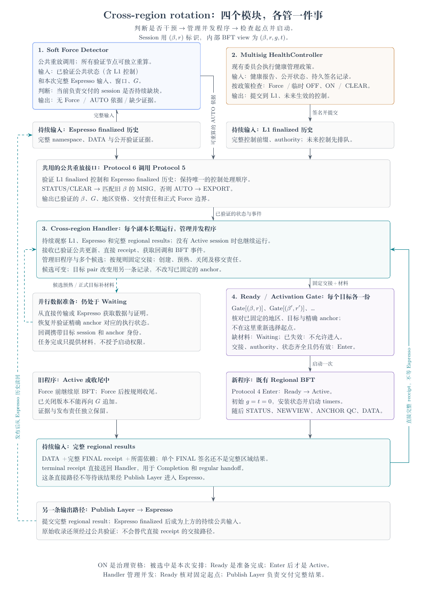
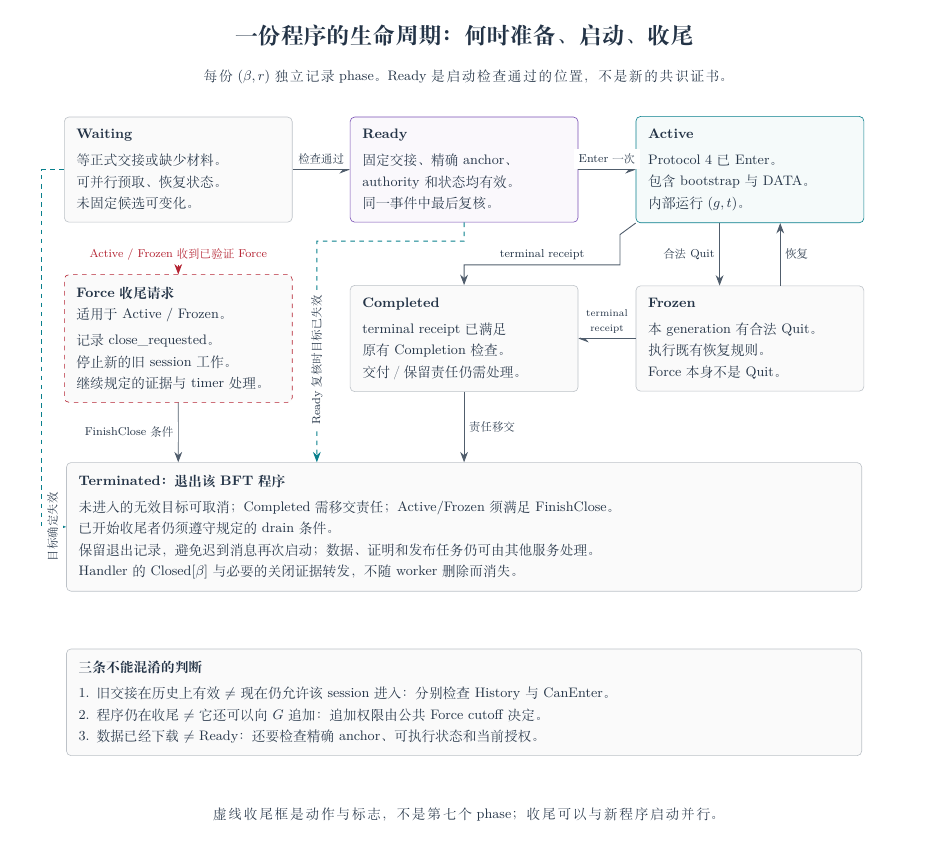
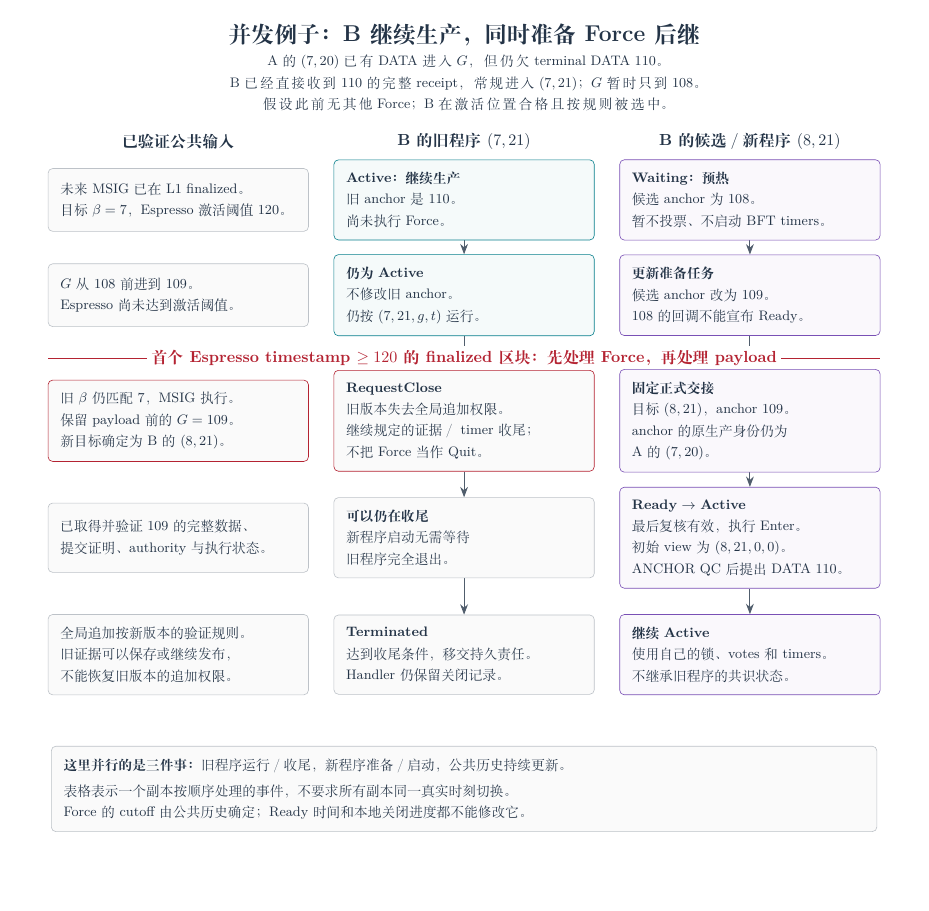
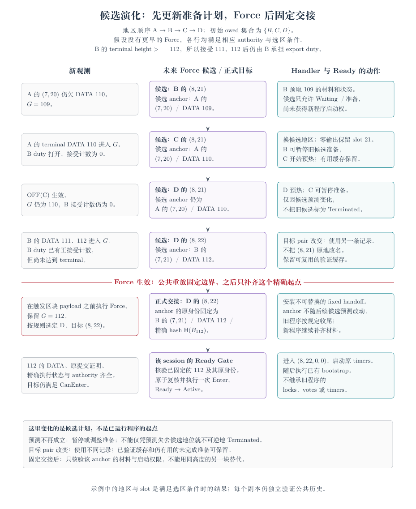

# Cross-region rotation：四模块修订提纲与并发架构

更新：2026-10-19。保留原提纲路径；本轮按你的补充明确四个模块、三路输入和候选变化。v3.1 是假设基线，接口已对照当前 v3.11 正文。本提纲不修改原假设，不代表新的正确性证明。

**你的划分是合理的：前端判断是否需要干预，Handler 管理各个 session，Ready 核对已固定的起点是否具备启动条件，然后进入已有的区域 BFT。** 核心是区分“准备一个可能的未来”和“启动一个已经确定的程序”。

口述中的 Spark 按 Espresso 理解；multisig 那部分称为 HealthController，负责 Hard Force 和地区状态管理。“何时提交控制、何时把 region 设为 live”放在这个模块里说明。

这四个模块分成三个阶段：**判断是否干预 → 管理并发程序 → 检查起点并启动**。第一阶段包含并列的 Soft Detector 和 HealthController。四个模块可以放在同一进程中，不要求四个独立服务。

直接按你说的系统流程理解：

```text
1. 现在需要干预吗？
   Soft Detector 看公开交付进度；HealthController 按政策管理地区。
                  ↓ 已验证的控制和状态变化
2. 现在该准备和运行哪些程序？
   Handler 持续管理旧程序、下一候选和后台准备任务。
   候选可能换地区、换 (beta,r)、换候选 anchor；已固定的交接不能改。
                  ↓ 确定的交接 + 对应材料
3. 这个具体程序能从这块开始了吗？
   Ready Gate 核对目标、anchor、状态和权限；通过后执行一次 Enter。
                  ↓
   已有 Regional BFT：STATUS → NEWVIEW → ANCHOR QC → DATA / DRAIN。
```

其中，**ON、被选中、Ready、Active 是四件事**：ON 只是治理上允许参加；选区规则还要检查 cooldown 和 authority；被选中后还要备齐这次交接的状态；Enter 后才算 Active。

## 1. 四个模块各管什么

1. **Soft Force Detector**：当前负责交付的地区，是否一直没有按要求交付有效 DATA？
2. **Multisig HealthController**：根据健康政策，什么时候提交 Hard Force、OFF、ON 或 CLEAR？
3. **Cross-region Handler**：现在应该准备、运行、取消或收尾哪些 session？
4. **Per-session Ready / Activation Gate**：这一份确定的 session，是否已能从确定的 anchor 开始运行？

前两个是并列的“Force 与健康判断前端”。后两个负责本地程序管理。已有 Regional BFT 接在 Ready 检查之后，不另算一个 cross-region 模块。

每个正确区域副本独立运行 Handler。**即使本地区当前没有 Active session，Handler 仍持续监听 L1、Espresso 和 regional results 三条输入流。** 图里画一个 Handler 表示一份本地逻辑，不是增加受信任的区域控制者。Certifier 复用公共验证和 Soft Detector，不需要启动区域 BFT。



v3.11 在图中的准备阶段加入请求接力与 OC：它们在 Ready 前完成，四模块边界不变。

[四页架构图 PDF](figures/cross_region_rotation_arch_revision/architecture_zh.pdf) · [可编辑 TikZ 源码](figures/cross_region_rotation_arch_revision/architecture_zh.tex)

| 模块 | 谁运行 | 主要输入 | 主要输出 |
|---|---|---|---|
| Soft Detector | 每个验证节点 | 已验证公共状态（含 L1 控制）、完整 Espresso 输入、交付窗口与接受计数 | 无 Force、AUTO 依据，或缺少证据 |
| HealthController | 现有 multisig 服务 | 地区健康观测、已验证控制状态、政策记录 | 提交到 L1 的未来 MSIG / OFF / ON / CLEAR |
| Handler | 每个正确区域副本 | 公共重放结果、完整区域 receipt、获取回调、BFT 事件 | Prepare、安装正式交接、Activate、RequestClose、责任移交 |
| Ready Gate | 每份目标 session | 固定交接、精确 anchor、authority、完整可执行状态与 OC | 继续 Waiting，或检查通过并执行 Protocol 4 Enter |

灰色部分是共享接口与服务：公共验证、数据获取、Publish Layer 和持久存储。它们不增加另一套选区或共识。

## 2. Soft Force：公开算法，不是另一个控制者

“观察出块速度”应具体写为：**当前 export session 在规定的 Espresso 窗口里，有多少有效 DATA 实际进入了 $G$。**

不能统计 proposal、单个 FINAL、上传次数或原始 Espresso 记录数。重复提交、无效 EXPORT 和 DRAIN 不是新增 DATA。区域生产可能已经领先，但全局仍在等前一个 session 的结果；Detector 检查的是这个尚欠交付的 session。

```text
CheckSoftForce(已验证重放状态, 本次完整 Espresso 输入)
    -> NoForce
     | AutoEvidence(目标 beta, export session, 窗口与缺块依据)
     | NeedEvidence(缺少的公开输入)
```

- 节点可以定时轮询；轮询只获取输入，本地接收时间不决定 Force。
- RPC 超时或 namespace 没拿全是缺证据，不能据此认定缺块。
- 当前正文还检查连续 miss 数与 duty 固定的容忍值 $M=1+\beta$；一次窗口失败未必触发 Force。
- Detector 不自行增加 $\beta$，不命令某个地区启动。其他节点可以独立重算它的依据。

同一个检测函数可被 Handler 所用的公共验证逻辑、certifier 和监控工具复用。它在节点本地运行，不要求 Espresso 支持应用智能合约。

这是公共重放调用的判断函数。它既要知道 Espresso 中的交付记录，也要使用已经验证的 L1 控制状态，才能知道当前责任属于谁、是否有优先的 MSIG。缺少其中任一路必要证据，都不能单独判定 AUTO。

## 3. HealthController：为什么提交，以及何时生效

```text
HealthPolicy(健康观测, 已验证控制状态, 持久政策记录)
    -> 不操作
     | 提交未来 MSIG / OFF / ON / CLEAR
```

| 控制 | 它决定什么 | 它不决定什么 |
|---|---|---|
| MSIG / Hard Force | 是否结束指定旧 beta 的生产安排 | 不自行选一个更旧的 G 或 anchor |
| OFF(i) | 暂停地区 i 参加后续选择的资格 | 不追溯撤销固定的历史交接 |
| ON(i) | 恢复地区 i 的治理资格 | 不表示马上接班或未来必定健康 |
| CLEAR(i) | 提前解除自动 cooldown | 不由 ON 隐式执行，也不打开旧 beta |

正文应明确每个动作的观测、政策条件、目标和激活阈值。不能只写“诚实 multisig 决定”，就宣称持续活性成立。

这个模块要把“为什么想干预”和“现在能否签发”分开：

| 收到的运维请求 | Controller 必须核对 | 合法时的动作 |
|---|---|---|
| 当前安排需要中断，例如收到同步异常报告 | 当前已验证 beta、签名额度、提前公告条件 | 提交指定旧 beta、未来生效的 MSIG |
| 地区 i 需要暂时隔离 | 地区额度、没有尚未处理完的租期、恢复控制能先落地 | 提交有限期的 OFF/ON 安排 |
| 临时隔离到期 | 已签 ON 到达公开激活阈值 | 按规则恢复 ON，不等待新的恢复报告 |
| 希望提前解除 cooldown | CLEAR 权限和额度、提前公告条件 | 提交未来 CLEAR；普通 ON 不替代它 |

同步异常等报告是运维输入，不是一个已假设准确的故障判定器。收到报告也不能越过签名政策。**当前正文采用有限期隔离，所以 ON 表示恢复参加资格，不表示 Controller 已证明该地区健康。** 如果以后希望改为“检查恢复后才 ON”，需要另写恢复检查和活性论证，不能在本次架构整理中默默替换。

与当前正文对接时：新 MSIG 不带附加 OFF；临时健康隔离使用独立 OFF/ON 租期，先使未来 ON 在 L1 finalized，再提交更早生效的 OFF。签名预算和已签控制记录要持久保存。具体政策仍见正文，这里只解释模块边界。

控制路径为：

```text
健康观测 -> 政策判断 -> 签名并提交 L1 -> L1 finalized
    -> Espresso 首次跨过指定阈值 -> 公共重放应用控制
```

L1 finalized 使未来控制可验证，不提前激活它。获知未来 Force 可以开始预热，旧程序仍按当时有效的规则运行。

## 4. 公共状态只更新一次

四模块共用 Protocol 5/6 的验证接口：

```text
验证完整 L1 与 Espresso 输入
    -> 独立 STATUS / CLEAR
    -> 首个到期且旧 beta 匹配的 MSIG；否则检查 AUTO
    -> 处理本区块的 EXPORT payload
    -> 输出公共状态更新与正式边界事件
```

Protocol 5 定义 Force 转换；Protocol 6 按规范验证和应用。Handler 消费结果，不再执行第二次 Force。两类检查、MSIG 优先级和旧 beta 匹配全部保留。

验证了相同、完整且适用的公共前缀后，节点应得到相同的已应用公共结果。未来 L1 控制队列、下载进度和预热缓存可以不同。

公共输入先保存并按已有接口转发；依赖齐全后，按规范顺序处理。在完成处理的同一事件中，把公共更新交给 Handler，并检查已备齐材料的目标。不增加一个“等下次定时轮询才启动”的步骤。缺少证据时记录等待，不能把缺失输入解释成地区离线。

## 5. Handler：持续维护并发程序表

只用已有编号：

$$
\text{session}=(\beta,r),\qquad \text{完整 view}=(\beta,r,g,t).
$$

$\beta,r$ 标识程序；$g,t$ 由该程序内部的区域 BFT 推进。Handler 不能因为 $G$ 更新，就给已运行程序改编号、换 anchor 或重置锁。

```text
Program[(beta, r)] = {
    phase,
    candidate_plan,       // 尚未确定，可以更新
    fixed_handoff,        // 正式确定后不能替换
    anchor_and_state,
    authority,
    core_state,           // 自己的 g,t、锁、votes、timers
    entered,              // 持久标记，避免重复初始 Enter
    pending_tasks,
    close_requested,
    retention_and_publication_handles
}
```

Handler 另外保存公共重放位置、`Closed[beta]` 和必要的关闭证据转发任务。这些不属于某个可以直接删除的 worker。

### 5.1 候选与正式交接分开

```text
CandidatePlan：可能由谁接班，可能从哪块开始
    -> FixedHandoff：规则已确定目标与起点
    -> Ready / Enter：该目标已具备启动条件
```

候选随 $G$、交付责任、地区资格和控制更新而变化。可以改变接班地区、目标 session 或候选 anchor；Handler 相应更新、暂停或重定向准备任务。有用缓存可以保留。

**计划变了，不等于把原程序改名。** 同一个 $(\beta,r)$ 尚未固定的准备计划可以更新；目标 pair 改变，就使用另一条程序记录。例如从预备 $(8,21)$ 改为预备 $(8,22)$，后者有自己的记录，不能沿用前者的启动标记、锁或计时器。

**预测落选，也不等于 Terminated。** 如果目前只是认为另一个候选更可能接班，可以暂停原候选的非必要工作。只有已验证的事实确定它不可能再启动，才终止它。否则预测再次改变时，会被自己提前写下的退出记录挡住。

正式交接固定后，不能再追着最新 $G$ 更换 anchor。后来若被另一项 Force 关闭，应取消启动或请求收尾，并处理另一个目标，不能原地改写已有程序。

Force 已发生但尚无地区可选时，原因和保留的 anchor 可以已经固定，而接班地区仍未分配。这时不能 Ready。

### 5.2 输入与程序行为

| 输入事件 | Handler 做什么 |
|---|---|
| L1Finalized | 验证控制和 authority，把未来控制排入队列 |
| EspressoFinalized | 消费公共重放对 G、资格、交付责任和 Force 边界的更新 |
| RegionalFinalized | 验证完整 receipt，交给源程序、regular handoff 与 Publish Layer |
| MaterialAvailable | 检查目标 session、anchor 原生产身份及 hash，只更新匹配任务 |
| CoreEvent | 更新该程序的 g,t、Quit、恢复、Completed 或收尾进度 |

前面三项是持续监听的外部输入，后面两项是本地任务回调。Handler 不靠猜测来选一个它喜欢的 view：它按规则推导正式目标，同时为尚未确定的候选提前准备。

单个 FINAL 签名须先聚合成完整 receipt，不能直接当作 RegionalFinalized。

```text
Handle(event):
    验证并路由输入；先处理其中已验证的关闭证据
    如涉及公共历史，消费公共重放产生的更新
    更新候选准备；安装不可替换的正式交接
    使确定失效的任务失效；对旧程序请求收尾
    对有正式交接的目标检查 Ready
    同一串行事件里复核 CanEnter，登记唯一 Enter 和状态安装
    先持久化 entry 标记、状态及待发动作，再发送 STATUS / 签名
```

获取、恢复可以并发。修改控制状态、判断 Ready 和登记 Enter 要串行化。下载回调只交材料，不能直接启动 BFT。

### 5.3 Handler 与 Ready 的接口

接口里直接写已有字段，不增加一个新的 session 编号：

```text
Handler -> 准备任务：
    Prepare(target_region, (beta,r), candidate_anchor, required_material)

准备任务 -> Handler：
    MaterialAvailable((beta,r), anchor 的原生产 pair/height/hash, material)

Handler -> Ready Gate：
    CheckReady(fixed_handoff, exact_anchor_state, authority, current_verified_state)

Ready Gate -> Handler：
    Waiting(还缺哪些材料)
    或 NotAllowed(当前为何不能进入)
    或 Pass(本次固定交接已满足启动条件)
```

`NotAllowed` 只是检查结果，不是新 phase；Handler 根据原因决定继续等待还是终止。`Pass` 也不是可转交给其他节点的启动许可证。检查通过后，Handler 在同一串行事件中复核并执行 Enter，避免检查与启动之间刚好发生 Force。

同一个地区可以同时有三类工作：旧程序继续出块，一个候选在恢复状态，另一个候选只缓存 authority。谁值得优先准备可以调整，但正式接班者必须由交接规则确定。调度优先级不能改变选区结果或公共计时窗口。

## 6. Ready：确认精确起点，再进入 BFT

“确定 anchor beta”应拆成两项：

- **目标程序**：例如 B 的 $(8,21)$。
- **继承块的身份**：例如 A 的 $(7,20)$ 产生的 DATA 109，包含原生产 session、height、精确 hash。

新程序属于版本 8，不会把旧块身份改成版本 8。同高度不等于同一块。

**起点由交接规则确定，Ready 负责核验和准备。** 常规交接继承前一个 session 的 terminal DATA；Force 继承触发位置处理 payload 之前的 $G$ 末块。Handler 安装这一正式交接，Ready gate 检查本机是否能从这一个起点继续。不能在 Ready 时另选一个更新、更方便的块。

Ready 依次检查：

1. `VerifyHandoffHistory`：交接历史有效，地区、目标、选区位置与 anchor 都推导正确。
2. anchor 的完整 DATA、原提交证据和 ancestry 齐全且有效。
3. 从该 anchor 后面继续执行的可执行状态已恢复，并验证对应这一个 anchor。
4. authority、quota、reference 下界与依赖齐全。
5. OC 对应这个精确 anchor、authority 和目标；其选中请求通过原输入检查。接收一份合法 OC 即可，不另等本机重复扫描。
6. `CanEnter`：目标现在仍可进入，没有关闭、替代、重复 Enter 或退出记录。
7. 在同一事件里登记 Enter，完成 Ready → Active。

Witness 是交接证明材料，不等于全部执行状态。ReadyBundle 可传递完整材料和可执行状态，但不是新的 READY 共识证书或 Espresso 激活交易。

例如 `Ready(B, (8,21), A:(7,20)/109/hash)` 表示：选中 B 的依据已经验证，B 的这个新程序已有 A 产生的那一块 109 的完整材料和可执行状态，而且现在仍允许进入。它不表示“B 大致追上了”，也不表示“109 已下载，所以直接开工”。

**Protocol 4 的 Enter 就是 Ready → Active。** 此时安装 $(\beta,r,0,0)$，记录 entry time 并启动原进度检查。STATUS、等待 $2\Delta$、NEWVIEW、ANCHOR QC 都在 Active 内；不能等到 ANCHOR QC 才开始计时。

公共交付窗口由公共规则开始，不因本地 Waiting、下载缓慢或任务重建而延后。

## 7. 六个 phase 与收尾责任



| phase | 含义 |
|---|---|
| Waiting | 正在准备；正式交接未确定，或材料未齐全 |
| Ready | 精确交接和运行材料已验证，进入同事件的最终启动检查 |
| Active | 已 Enter，正在 bootstrap 或运行区域 BFT |
| Frozen | 当前 generation 有合法 Quit，按原规则处理恢复 |
| Completed | terminal receipt 满足原 Completion 条件，停止区域生产 |
| Terminated | 程序退出，证据、存储和发布责任已保留或移交 |

Force 不是 Quit，不直接制造 Frozen。它触发规定的关闭与收尾，不等于立刻杀掉进程。`close_requested` 是标志，不是第七个 phase。

删除 worker 后，Handler 仍保存 Closed[beta] 和必要的关闭证据服务。即使程序是 Waiting、Completed、Terminated，甚至本机没有 worker，也不能丢掉相应的关闭证据转发责任。

新程序可与旧程序收尾并行。它们不共享锁、votes 或 timers；可复用已验证的数据缓存和准备结果。

## 8. 并发例子：B 一边生产，一边准备后继



A 的 $(7,20)$ 已有 DATA 进入 $G$，terminal DATA 是 110。B 已直接收到 110 的完整 receipt，并通过 regular handoff 进入 $(7,21)$；但 $G$ 只到 108。

L1 上有已 finalized 的 MSIG，目标为旧 beta 7，激活 Espresso timestamp 为 120。假设此前没有其他 Force，激活时 B 按规则合格且被选中。

| 时点 | B 的旧程序 $(7,21)$ | B 的候选／新程序 $(8,21)$ |
|---|---|---|
| 得知未来 Force | Active，继续生产发布；旧 anchor 是 110 | Waiting，预取候选 anchor 108 |
| G 前进到 109 | 不修改旧 anchor | 准备目标改成 109；108 的回调不能触发 Ready |
| 首个 timestamp ≥120 的 Espresso 区块 finalized | 先执行匹配 MSIG；旧版本不能追加；请求收尾 | 固定正式目标 $(8,21)$，anchor 是 payload 前的 109 |
| 109 的材料、状态齐全 | 可以仍在收尾 | Ready → Enter → Active；初始 view $(8,21,0,0)$ |
| 完成 ANCHOR QC | 独立收尾与责任移交 | 从 anchor 后面提出 DATA 110 |

并行准备减少切换时需要现做的工作，但不保证所有节点恰在阈值对应的真实时刻同时 Ready。

### 8.1 候选也可能换地区、换编号

以下采用当前正文：Force 关闭的 duty 若尚无 DATA 进入 G，保留 slot r；已有接受结果则使用 r+1。这不是本次架构重构新增的规则。



地区顺序 A → B → C → D。下表假设 B 的 terminal DATA 高于 112，并且各步的 authority、eligibility 和 owed 选区条件均使所列地区被选中：

| 新观测 | 未来 Force 候选 | Handler 动作 |
|---|---|---|
| A 仍欠 110，G=109 | B 的 $(8,21)$，anchor 109 | B 预热 |
| A 的 110 进入 G；B duty 刚打开，接受计数 0 | C 的 $(8,21)$，anchor 110 | 换候选地区；零输出保留 slot 21 |
| OFF(C) 生效 | D 的 $(8,21)$，anchor 110 | D 预热；C 可暂停非必要任务 |
| B 的 111、112 也进入 G | D 的 $(8,22)$，anchor 112 | B 已有接受结果，目标 slot 变成 22 |
| 此时 Force 生效 | 正式 D 的 $(8,22)$，anchor 112 | 固定交接；以后只补齐 112 |

候选变化不改写 B 已运行的 $(7,21)$。候选编号相同也不意味着不同地区都获得了启动权。

整个准备过程里可以同时存在：旧程序 Active、下一程序 Waiting、另一个较低优先级候选的准备任务，以及更早程序的收尾任务。Handler 管理这些并行工作；真正的 Enter 只依据当时有效的正式交接。平滑切换意味着尽量提前完成工作，不意味着可以省略 Ready 检查或保证零停顿。

## 9. Regular 与 Force 的 race

保留两条输入路径：

```text
完整 terminal receipt -> Handler -> regular handoff -> Ready / Enter
完整 L1 + Espresso 历史 -> Force 边界 -> Handler -> 关闭旧版本 / 准备新目标
```

regular 可走直接 receipt 路径，不要求 terminal DATA 自身先进入 G；其他 reference、authority 和状态条件仍须满足。未来 Force 公告不提前禁止 regular。

| 到达顺序 | 处理结果 |
|---|---|
| regular receipt 先到，目标仍有效 | 可启动旧 beta 下的常规后继；Force 后来生效，再请求收尾 |
| Force 先被验证，旧 receipt 后到 | 保存历史证据，不能据此复活旧目标 |
| 下载回调在两者之间到达 | 缓存材料，最后按当前正式交接检查，不能自行启动 |
| 另一项 Force 先发生，旧 MSIG 后到阈值 | 旧 beta 不匹配，不执行第二次；保留原 double check |

本地投机运行进度可以不同；相同规范公共前缀确定的 Force cutoff 和保留 G 必须相同。同一触发块先 Force、后 payload，旧版本 EXPORT 不能在 Force 后抢进 G。

## 10. 正文修订顺序

保留 Part II 整体结构，把第 6 章组织为：

| 小节 | 内容 |
|---|---|
| 6.1 Four-module architecture | 四模块、运行者、共享接口、总图 |
| 6.2 Soft detection and health control | 公开检测函数；multisig 政策和 L1 接口 |
| 6.3 Cross-region Handler | Protocol 3 的事件、输入输出、程序表和串行处理 |
| 6.4 Session lifecycle | 六个 phase；候选与固定交接；持久关闭记录 |
| 6.5 Handoff, anchor and Ready | 交接材料、精确状态、History 与 CanEnter |
| 6.6 Activation and bootstrap | Protocol 4 Enter 与原 bootstrap 流程 |
| 6.7 Concurrency and races | 并发预热、候选变化、race 与迟到回调 |
| 6.8 Close and termination | RequestClose、FinishClose、证据转发、责任移交 |

第 2 章保留原假设；第 3/4 章保留区域 BFT 与 DATA/DRAIN；第 5 章定义全局接受；第 7/8 章提供唯一公共转换；第 9 章逐项审查性质；第 10 章说明 Publish Layer、receipt 聚合与持久责任。

必须核对：固定交接不被覆盖；初始 Enter 最多一次；旧回调不能启动过期目标；收尾不改变 cutoff；新程序不等待旧程序彻底退出；worker 退出不删除证据服务或发布责任。窗口、健康政策和公平选区的证明单独审查，不能从架构图直接推出活性。

## 11. 修改范围与依据

本轮更新提纲和四页中文图：四模块与三路输入、并发时间线、生命周期、候选变化。未修改 v3.1 假设、区域 BFT 正文或当前英文主稿。窗口、健康政策与选区规则引用现有正文，不作为本轮新增机制。

依据：[v3.1 基线](sync_hotstuff_rr_part2_rotation_v3_1.tex)、[当前 v3.11 正文](sync_hotstuff_rr_part2_rotation_v3_11.tex)、[公共输入和持久存储](sections/rotation_v3_11_source_step.tex)、[ReadyBundle](sections/rotation_v3_11_ready_bundle.tex)、[健康政策](sections/rotation_v3_5_health.tex)。后两份文件仍由当前正文引用，文件名保留历史版本号。本文只核对上述 cross-region 接口，不展开当前正文的请求导入机制。

当前 Protocol 4 已采用 “Declare the fixed anchor”：该步骤宣布并认证已确定的起点，没有再次选择起点的权限。后续中英文修订保持这一表述。

更新前内容已保存为[历史提纲](sync_hotstuff_rr_part2_revision_outline_before_2026_10_19_zh.md)。历史版本中的 slot 例子与退出讨论属于当时版本，应以上述当前接口说明为准。
