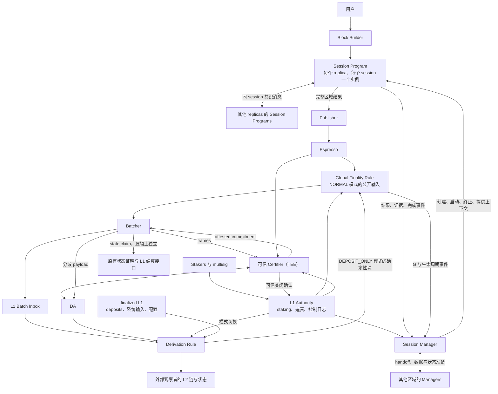
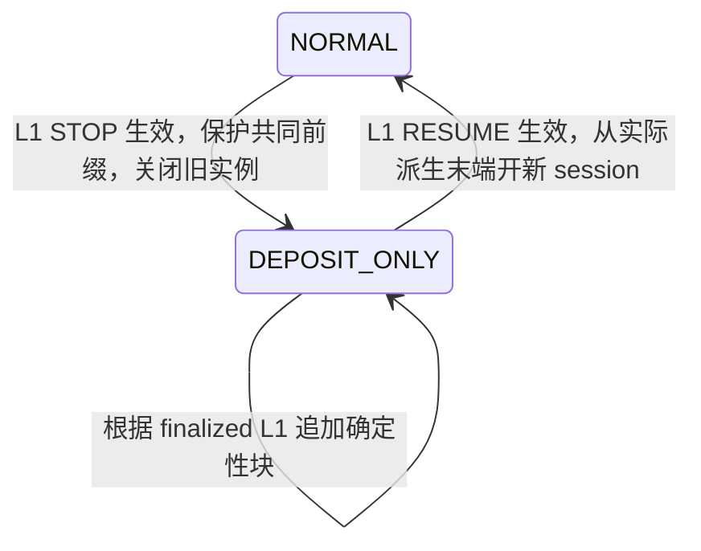

# Sequencer Rotation 的组合式抽象 v2：Global Finality Rule 形式化

日期：2026-10-25。状态：新修订；保留上一版模块接口，将全局最终化写成参数化的确定性状态机。

本文以 `formalization_v3` 中 Part II v4.9、Part III v6 为轮换与 authority 的当前工作基线，以子仓库 `megaeth_specs` 的本地版本 `a738f9b14c7880953d8cff8788db14e8e3e79124` 为 **mega-espresso** 基线。
Part IV v0.1 只用于理解 publisher 的实现职责；其中旧的 authority 接口不覆盖 v4.9/v6。
mega-espresso 的 block-certification 文档仍标为未激活的草案，本文的“继承”指继承这些规格的语义，不代表线上部署现状。

本稿保留本次讨论的三个设计决定：

1. **保持强全局最终性。** 一旦 $B\in G$，后续轮换、停机和恢复均不能删除或替换 $B$；对应执行状态必须由同一历史确定。
2. **Session program 是 Session Manager 管理的子协议实例。** 约束重点是生命周期与实例状态隔离，不限制它只能向两个接口发消息。
3. **合并 staking 与 multisig。** 它们共同构成部署在 L1 上的 Authority 模块，提供权重、追责、区域配置和模式切换。

本稿只讨论 Espresso 的 **liveness failure**；partial safety 不在本轮范围内。
停机后允许 multisig 显式切换至 L1 deposit-only 模式，再从实际派生链恢复普通出块。
“怎样保护已经进入 $G$、但尚未结算的积压块”保留为明确的待选实现契约，见 §6.4。
本次修订将两条来源链各收敛为 Submit/Read/Verify，将 TEE 视为可信第三方，并逐接口列出输入、输出和功能。

## 本次修订

上一版保留在 [接口修订稿](composability_abstraction_zh.md)。
本版的主要新增内容是 §5：数据类型、状态、初始化、接纳谓词、NORMAL/Force/STOP/deposit-only/RESUME 转移、等待规则和最终性定义。
所有公开接口继续使用“输入列表、输出列表、功能段落”。

形式化中明确保留两个尚未选定实现的协议参数：共同边界策略 $\mathfrak B$ 与 §6.4 的前缀保护契约。
$\mathfrak B$ 必须由同一公共历史确定跨模式的处理次序，并保证这个次序不会因未来公告而追溯改变；它不是一个已经证明存在的理想服务。
因此，本版给出的是**在这些契约成立时完整定义的回放规则**，不是对“只加一个时间过滤即可恢复”的证明，也不是完整 UC realization。

为使接口能落到状态机，另固定四个约定：模式提交使用 finalized L1 的 `ModeApplied`；普通/恢复分支的 L1 floor 始终不减；暂缺 plan 的 boundary 记作 `OPEN` 而不冒充“无合格区域”；deposit-only 使用原生派生得到的精确块及状态。
这些约定及其与旧稿的关系均在 §5 中展开。

## 1. 抽象的组织方式

把系统分成三类对象，避免每个动作都成为一个新“层”。

| 类别 | 对象 | 回答的问题 |
| --- | --- | --- |
| 共享外部功能 | Ethereum L1、Espresso、通信与时钟、DA、可信第三方与状态证明设施 | 我们可以读取和验证什么？哪些服务在什么条件下按时完成？ |
| 协议模块 | Builder、L1 Authority、Session Manager、Session Program、Publisher、Batcher、Certifier | 谁保管状态、接受请求、发送消息并履行服务义务？ |
| 确定性规则 | Global Finality Rule、Derivation Rule，以及 `Plan`、`Leader` 等查询 | 给定相同的已认证输入，任何观察者应得到什么相同结果？ |

Global Finality Rule 不运行额外共识；Manager、certifier 和外部观察者各自执行同一规则。
Derivation Rule 同样不是一个中心化服务，由外部节点读取 L1 与 DA 独立执行。
L1 Authority 和 L1 inbox 都是 L1 上的应用状态机，不能仅凭“运行在 L1”就假定应用逻辑正确。

本文借鉴 UC 的“先声明功能，再证明实现满足功能”的组织方式。
L1、Espresso 等是所有 session、其他链和外部观察者共享的功能，不能为每个 session 分配一份彼此独立的账本。
共享设置的组合问题可参见 [UC](https://eprint.iacr.org/2000/067) 与 [GUC](https://eprint.iacr.org/2006/432)；本文给出接口与组合义务，不声称已经构造模拟器或证明 UC/GUC realization。



图中 `Derivation → Global Finality` 只表示 deposit-only 分支。
它根据已经固定的模式边界和 finalized L1 派生新区块，不读取“尚未生成的 $G$”；NORMAL 分支也不等待 batcher 才形成区域回执。
通信骨干、时钟和验证证明的传递省略在图外，统一由 §3 的接口承载。

## 2. 记号与共同约定

### 2.1 尽量沿用 v3 的记号

| 记号 | 本文含义 |
| --- | --- |
| $(\beta,r,g,t)$；$j$ | 分支版本、session 轮次、恢复代、leader term；term 内 fresh position。$t$ 不作为墙钟时间。 |
| $s=(\beta,r)$ | 一个 session；其每个 replica 运行独立的本地实例。 |
| $i_{\beta,r}$，$V_{\beta,r}$ | session 的区域与固定委员会。 |
| $w_o,W_{\beta,r},F_{\beta,r}$ | 固定投票权重、总权重、拜占庭权重上界；$F<W/2$，证书签名权重须 $>F$。 |
| $\mathcal C_e$；$a_e,c_e$ | staking epoch 快照及其激活、截止 L1 高度。 |
| $\mathcal P_\beta=(S_\beta,\mathcal L_\beta,\lambda_\beta)$ | 分支内不变的 ON/OFF 表、循环区域顺序、L1 floor。 |
| $\Pi_s=\mathsf{AUTH}_{s,0}$；$\mathsf{AUTH}_{s,g}$ | session plan；恢复代 authority。 |
| $E_s$；$A_s=A_{\beta,r,0,0}$ | 选区/选主参考块；实际执行起点。regular successor 分别使用前驱的初始 anchor 与 terminal DATA。 |
| $\mathrm{cid}_s$ | $\mathsf H(\mathrm{id}(\Pi_s),\mathsf H(A_s))$；用于签名和恢复记录的上下文绑定。 |
| $\mathrm{TB},K,H_s,T_s$ | 每 session 的 DATA 配额、每 term 的上限、session terminal 高度与 terminal DATA。 |
| $h(B)$；$\mathit{st}(B)$ | 块高度；精确执行至该块后的状态。 |
| $\rho,\lambda(B)$；$\xi(B)$ | 区块绑定的 finalized L1 引用及高度；finalized Espresso header 引用。 |
| $\mathsf{FC}_s(B)$ | 区域 FINAL 回执，或同 session 内的 covering evidence；不是 proposal QC。 |
| $J_q,\theta_q$ | Espresso finalized block 及其认证时间戳。 |
| $U,c,\Lambda,\kappa$ | 控制更新、序号、完整控制日志、处理进度及其承诺。 |
| $G$；$R$ | 不可回退的全局链；可能领先于 $G$ 的区域生产分支。 |
| $\nu,\sigma_G(B),\mathsf{Tail}$ | session descriptor、块绑定的来源记录、下一块的生产责任。 |
| $\Delta_i,T_{\rm pub},T_E,T_{\rm L1},T_{\rm ready}$ | 区域通信、发布、Espresso、L1 与准备服务的时间界。 |
| $\epsilon_E,T_{\rm update}$ | Espresso 时间戳相对真实时间的最大提前量；普通更新的最小激活间隔。 |

新增记号只用于当前接口确实缺少的概念：

| 新记号 | 用途 |
| --- | --- |
| $\tau$ | 真实时间，避免与 term $t$ 混淆。 |
| $\Delta_{\rm cross}$ | mixed p2p 骨干的跨区域完整消息交付界。 |
| $\mu\in\{\mathsf{NORMAL},\mathsf{DEPOSIT\_ONLY}\}$ | 全局生产模式。 |
| $G^\star,A^\star$ | 模式切换保护的完整前缀，以及 $A^\star=\operatorname{last}(G^\star)$。 |
| $\ell_a$ | 模式控制规定的 L1 截止/最早激活高度；实际提交位置由 finalized `ModeApplied` 给出。 |
| $B_n^{\rm dep}$ | L1 规则派生的 deposit-only 块，绝不是 v3 的 DRAIN。 |

Part II 中 $E$ 还曾表示 entry proof；本文只用 $E_s$ 表示 Part III 的 selection reference，进入凭证写作 `EntryEvidence`。
原生记录里的 `epoch_num` 是 **L1 origin 高度**，不是 staking epoch $e$，也不自动等于 authority 引用 $\lambda(B)$。

### 2.2 通用调用语义

每个接口明确调用者、输入、输出和失败行为。
查询返回值或 `WAIT`；可判定的坏输入返回 `REJECT`；只有已取得完整证据且确认不存在合格对象，才返回 $\bot$ 或空集合。
`WAIT` 不等于 OFF、零权重、空 namespace、证据无效或已经完成。

提交接口先返回请求标识，最终返回带证明的执行结果。
“已提交”指完整请求已被服务接收并满足准入条件，不是本地发起了一次网络发送。
状态相关的竞争交易仍可执行失败；L1 的按时处理承诺不保证每笔调用都成功改变应用状态。
下文每个接口均采用两个列表：输入列表与输出列表，随后一段功能说明。
L1 应用接口默认通过 `Submit_L1` 调用；`caller`、请求标识 `rid`、chain 与 rule version 是公共调用字段，不在每个接口重复列出。
其输出表示 finalized 执行结果；`REJECT` 不改变应用状态，`WAIT` 表示依赖暂缺而不提交新的状态转移。
所有实际执行仍由 L1 原子排序；重复请求返回已记录结果，不能重复扣款或新建同一恢复记录。
L1 应用记录 `ReqResults[(caller,rid)]=(requestHash,result)`；相同标识配不同请求内容时拒绝，纯查询不使用此去重状态。

所有认证对象绑定 chain/deployment、协议版本、消息类型和相关 session context；结构化对象使用固定编码，快照 rows 按 position ID 排序。
请求具有稳定标识，重试不能重复扣款、重新 Enter 或追加同一块。
角色可以由同一机器承担，但两个角色之间的验证责任不因此消失。
本模型不提供消息保密性；攻击者可观察公开数据、发送垃圾输入并控制拜占庭参与者。
诚实节点间的交付顺序可以由网络调度决定，但在声明的服务范围内受时间界约束。
区域故障界约束固定委员会在其证书仍可被接受期间累计被攻陷的权重，不能由“已质押”推出诚实多数。
沿用 v3 对 multisig 的诚实协调服务假设；其响应速度另行声明。

## 3. 外部共享功能

### 3.1 Ethereum L1 与 Espresso：只保留 Submit、Read、Verify

分别记为 $\mathcal F_{\rm L1}$ 与 $\mathcal F_E$，以下用 $X\in\{\mathrm{L1},E\}$ 表示来源。
**本稿不要求 L1 与 Espresso 验证彼此的数据，也不建模 light client。**
`Verify` 是提供给数据消费者的抽象能力：节点、外部观察者和可信 certifier 可以读取并核验两条链；L1 合约需要跨链结论时接收可信 certifier 的消息。
Espresso 只排序其收到的数据，不验证本协议的 L1 authority 或区域回执。

$\mathcal F_X$ 维护唯一的 finalized 历史 $\mathcal H_X$；L1 历史包含交易执行结果、事件和应用状态，Espresso 历史包含有序 blocks 及完整 namespace 内容。
未 finalized 的数据不通过这些接口输出。
证明 $\pi_X$ 是不展开内部结构的验证材料；不规定其密码学格式、quorum 更新或跨链验证实现。

正常运行时，finalized histories 在正确消费者之间前缀相容；它们可以因传播而处在不同进度。
Espresso 的 $\theta_q$ 非递减，且首次最终化时间 $\tau_E(q)$ 满足 $\theta_q\le\tau_E(q)+\epsilon_E$。
普通 Force 的进展另需 header/time progress；Espresso 停机撤销新记录的最终化时限，旧历史的持久性仍成立，历史字节的可取得性另按保留条件承担。

#### 3.1.1 `Submit_X(req)`

**输入**

- $X$：目标为 L1 或 Espresso。
- $req=(rid,u,target,data,value)$：请求标识、提交者、目标、精确数据字节和随请求支付的费用/资金。
- 对 L1，$target$ 是合约地址，$data=(method,args)$；对 Espresso，$target$ 是本链 namespace，$data$ 是 publication 字节。

**输出**

- `Accepted(rid)`：完整请求已满足准入条件并进入处理；不满足时返回 `REJECT(reason)`。
- 后续 `Finalized(rid,pos,result)`：确定的来源位置与执行结果；L1 的 `result` 包括成功或失败及相应事件，Espresso 的结果标识已记录的数据。

**功能。** 将请求纳入目标来源的处理流程，在正常服务条件下于 $T_{\rm L1}$ 或 $T_E$ 内完成处理、最终化并使正确在线消费者可读取验证。L1 的状态竞争可能使调用执行失败；该时限保证处理结果，不保证每个请求都成功改变应用状态。

#### 3.1.2 `Read_X(query)`

**输入**

- $query=([a,b],scope)$：要读取的来源区间和范围；$b=\mathsf{latest}$ 表示读取服务当前提供的 finalized 截止点。
- L1 的 `scope` 指定合约日志、交易结果或在截止高度的状态键；Espresso 的 `scope` 指定本链 namespace。

**输出**

- $R_X=(X,query^*,D,\pi_X)$：解析为确定截止点的查询、该范围内的完整有序数据及验证材料。
- 已认证的空序列也是合法 $D$；来源尚未最终化或材料暂缺时返回 `WAIT`。

**功能。** 返回指定范围内全部相关的 finalized 数据，单条读取是 $a=b$ 的特例，历史前缀读取使用同一接口。`latest` 只确定本次返回的截止点，不证明未来没有新数据；本地未取到数据与已验证的空范围不同。

#### 3.1.3 `Verify_X(R_X)`

**输入**

- $R_X=(X,query^*,D,\pi_X)$：一个含确定来源、区间、范围和精确字节的读取结果。

**输出**

- `VALID`：$D$ 确为所声明范围内完整、有序、不可回退的 finalized 数据。
- `INVALID`：声明或材料不成立，包括缺少必要验证材料的输入。

**功能。** 使任意消费者对同一个 finalized 事实得到相同判断，并将完整性一并纳入验证。证明只覆盖 `query*` 声明的范围；一份有效的单记录读取结果不能冒充完整控制前缀。该接口是抽象保证，不表示 L1 或 Espresso 必须执行对另一条链的验证。

### 3.2 通信与时钟

采用 v3 的公共时钟，以 $\tau$ 表示真实时间。
网络只保证认证交付，不负责判断消息内容是否符合协议。

#### 3.2.1 `Send(u,v,domain,m)`

**输入**

- $u,v$：发送者与接收者身份及其所属区域。
- $domain=(chain,version,s,\mathrm{cid})$：消息所属协议与 session；非 session 消息使用相应模块的 domain。
- $m$：完整消息字节及本次处理所需的验证依赖。

**输出**

- 接收者事件 `Deliver(u,v,domain,m)`，保留发送者身份和精确内容。
- 对正确、在线端点，区域内交付与约定验证处理不晚于发送后 $\Delta_i$，跨区域不晚于 $\Delta_{\rm cross}$。

**功能。** 将同一套认证通信语义用于区域内快速网络和跨区域 mixed p2p 骨干。时间界以规定大小、负载和正确传递路径为前提；允许乱序和重复，拜占庭发送者可以沉默。任意规模的状态重建不由网络时限兜底，仍使用 $T_{\rm ready}$ 的独立预算。

### 3.3 DA

$\mathcal F_{\rm DA}$ 维护 commitment 到已分散 payload 的绑定，并在声明的保留条件下提供取回。
本稿省略 DA 内部 operator、registry 和证书算法；这些由 DA 功能承担。

#### 3.3.1 `Disperse(payload)`

**输入**

- `payload`：一个批次提交的精确字节，包括 derivation version 与同一 channel 的连续 frames。
- `rid` 与服务费用：用于识别这次请求并满足 DA 准入条件。

**输出**

- $(d,\pi_{\rm DA})$：payload 的数据承诺及 DA 的确认材料。
- `WAIT` 或 `REJECT(reason)`：尚未完成或不满足准入条件。

**功能。** 将完整 payload 交给 DA 保管并固定其内容绑定；只有完成分散才产生成功结果。DA 不决定这些输入的顺序是否合法，也不使它们自动进入 $G$。

#### 3.3.2 `ReadDA(d)`

**输入**

- $d$：已经存在的 DA commitment。

**输出**

- $(payload,\pi_{
m DA})$：与 $d$ 对应的完整字节及确认材料；暂不可取得时返回 `WAIT`。

**功能。** 为 certifier、derivation 与恢复节点取得批次数据。取回保证依赖声明的保留服务；已被 L1 接受的数据取不回来时，derivation 在该处等待，不以 deposit-only 代替。

#### 3.3.3 `VerifyDA(d,payload,π_DA)`

**输入**

- $d$、`payload`、$\pi_{\rm DA}$：数据承诺、拟使用的精确字节及 DA 确认材料。

**输出**

- `VALID` 或 `INVALID`：确认材料是否成立，以及字节是否与该承诺一致。

**功能。** 保证实际读取和执行的是 DA 所确认的那份数据。长期可用性仍是保留条件，不由一次成功验证推得永久可取回；当前方案不增加其他 DA 网络的自动 fallback。

### 3.4 TEE 只作为可信第三方

记 $\mathcal T$ 为可信第三方，并假设它正确执行本稿规定的 certifier 业务规则。
**凡是由 $\mathcal T$ 发出的消息，消费者直接信任；消息来源归属和不可被冒充由模型隐式提供。**
不定义 TEE 的 `Run`、远程认证、measurement、密钥注册、签名或验签接口，也不把 host/core 划分带入协议抽象。
TEE 消息记作 $\chi=\langle\mathcal T,kind,body\rangle$；其业务字段在 §4.7 的输出中定义。

§4.7 描述的是“批次核对、控制生效确认”这两个业务接口，不是 TEE 硬件接口。
L1 Authority/inbox 接收相应 $\chi$ 时直接使用其结论，因此不需要在 L1 内验证 Espresso 历史。
可信性不增加业务范围：批次对应性消息只声明输入对应关系，不声明一个尚未经状态证明系统处理的 state root 已完成结算。

### 3.5 原生执行与状态结算边界

原生执行是确定性规则；Kailua/fault-proof 负责提交的 state root 与正确派生执行的一致性。
本稿沿用其职责，不为子仓库仍是 stub 的 fault-proof 页面虚构具体争议算法；提交接口在 §4.6.4 单独列出。

#### 3.5.1 `Execute(parentState,ordinaryTxs,nativeContext)`

**输入**

- `parentState`：精确 parent 块之后、已验证的状态 $\mathit{st}(parent)$。
- `ordinaryTxs`：按确定顺序排列的普通交易完整字节列表。
- `nativeContext`：chain/rule version、下一块高度与 timestamp、finalized L1 origin header、应纳入的 deposits、系统交易及生效配置。

**输出**

- $(B_{\rm native},\mathit{st}(B),stateRoot,receipts)$：确定的原生块、执行后状态、state root 和交易结果。
- `INVALID(reason)`：块级执行条件不成立；必要输入缺失时返回 `WAIT`。

**功能。** 按既定 MegaETH 执行/派生规则计算唯一结果；普通交易执行 revert 仍属于合法的执行结果，不自动使整块无效。执行不会选择 global branch，也不会给结果授予最终性；普通模式和 deposit-only 模式都使用同一原生规则与参数。

### 3.6 持久化前提

沿用 v3 的 `PublicStore`，作为节点状态，不新增一个外部接口层。
它保存读取结果的精确字节、区域证据、未完成发送、checkpoint 与精确 anchor 状态。
session 终止不删除这些材料；stake release 前完成保管交接，离线节点同步完成后再确认新输出。

## 4. Sequencer Rotation 各模块的接口

### 4.1 Block Builder：产生有序候选输入

Builder 维护本地待处理交易集合及其稳定交易标识。
一个区域 DATA 在本稿对应一个完整 L2/EVM block，该块可含多个 mini-blocks；DRAIN 不产生新的 L2 块。
原生投影为 $\mathsf{Record}(B)=(block\_number,epoch\_num,transactions)$，其中交易列表只包含普通交易。
这个投影不解除完整块对 parent、origin 和 timestamp 的绑定；deposits 与系统输入使用 §3.5 的 `nativeContext`。

#### 4.1.1 `SubmitTx(tx)`

**输入**

- `tx`：一笔用户签名的完整原生交易字节，含 chain、nonce、目标、value、调用数据、gas 与费用字段。

**输出**

- `Received(txid)`：记录交易的稳定标识；格式或准入不满足时返回 `REJECT(reason)`。

**功能。** 将交易纳入本地候选集合并按交易标识去重，不授予包含、排序优先级或最终性。若要保证某笔用户交易最终包含，需要单独的输入公平性规则。

#### 4.1.2 `Build(s,parent,parentState,nativeContext,limits)`

**输入**

- $s=(\beta,r)$：请求候选块的 session，调用者为其本机 proposer/program。
- `parent` 与 `parentState`：精确 parent 块及 $\mathit{st}(parent)$。
- `nativeContext`：§3.5 的高度、timestamp、finalized L1 origin、deposits 与系统配置。
- `limits`：本块 gas、字节数、交易数及 mini-block 格式的限制。

**输出**

- $x$：候选 payload，包含有序普通交易列表、原生上下文及 mini-block 划分；也可产生普通交易列表为空的合法候选。
- `WAIT`：必要来源或状态未准备好；`REJECT(reason)`：请求的上下文或限制无效。

**功能。** 在当前 parent 和既定限制上选取、排序并组织候选交易，mini-block 的拼接顺序须与完整交易列表一致。Builder 不选择新的 authority 或 parent branch，也不使候选获得共识许可。

#### 4.1.3 `ValidateCandidate(parent,parentState,x,nativeContext)`

**输入**

- `parent`、`parentState`、$x$ 与 `nativeContext`：精确前置块、前置状态、候选 payload 和执行上下文。

**输出**

- `VALID(B_native,st(B),stateRoot)`：格式、交易顺序、mini-block 对应与原生执行检查通过。
- `INVALID(reason)` 或 `WAIT`：候选不合法或依赖暂缺。

**功能。** 通过 §3.5 的执行规则验证候选，并核对 mini-block 与完整块输入绑定；区域协议还须检查 session、view、quota 和签名。此接口输出不等于区域或全局最终性。

### 4.2 L1 Authority：明确状态、context 与状态转移

Authority 是 L1 上的应用状态机，成员管理、追责和 multisig 控制共用该状态。
它不重放 Espresso，也不判断每个 speculative session 是否真的存在；canonical session 的确定由 Manager/global rule 负责。

**固定参数。** Genesis 固定 chain/rule version、区域集合 $\mathcal L_R$、multisig authority $\mathcal K$、质押资产、最低质押 $B_{\min}$、准入上限、每区域入队/出队的 amount/count 预算及成熟等待、$M,N,a_0$、惩罚比例 $\rho_{\rm slash}$、$T_{\rm hold}$，以及 $\mathrm{TB},K,\Delta_i,\varphi_i$。
$\rho_{\rm slash}$ 是 Part III 的 penalty fraction $\rho$，这里加下标以免与区块的 L1 reference $\rho$ 混淆。

**初始化。** Genesis checkpoint 给定初始 positions/escrow、$\mathcal C_0$、$\mathcal P_0$、$A_0$、初始 ban 集与控制前缀。
KeyPosition 从初始 positions 建立，`nextId` 大于所有已分配 ID，`lastSeq` 与初始控制前缀一致；queues、REC、SeenOffenses、ReqResults、Closures 与 Clear 在新系统 genesis 为空。
从后来的授权 checkpoint 启动则恢复其完整状态，不重新清空这些表。

**维护状态。** 下表是 finalized L1 高度 $\ell$ 上的逻辑状态；历史查询读取确定高度的版本。

| 状态 | 精确内容 |
| --- | --- |
| $\mathsf{Pos}[o]$ | $(i_o,pk_o,owner_o,B_o,phase_o,p^{\rm join}_o,p^{\rm exit}_o,e_x(o))$：区域、operator 公钥、提款 owner、剩余 escrow、生命周期、join/exit 请求位置、退役 epoch。未定义的 exit 字段为 $\bot$。 |
| `ReqResults` | §2.2 的调用去重表，保存已执行请求的内容承诺与结果，避免重复 Join/转账。 |
| $\mathsf{KeyPosition}[pk]$、`nextId` | 尚未解除责任的 key 到 position 的映射；永久不复用的 position 编号。 |
| $Q_i^{\rm in},Q_i^{\rm out}$ | 按 L1 `(height,txIndex,logIndex)` 排序的 FIFO position 列表；每项带请求位置和成熟条件。 |
| $\mathcal C_e$、$\ell_{\rm pub}(e)$ | epoch 的冻结权重表、root、cutoff/activation，以及发布高度。每个 $e$ 的内容只确定一次。 |
| $\mathsf{Ban}(\ell)$ | 在该 finalized L1 高度已登记禁任的 operator key 集合，只增不减。 |
| $\mathsf{REC}[(\mathrm{cid},g)]$ | 恢复代创建的 L1 高度 $\ell_{\rm rec}$；该代的禁任集为 $\mathsf{Ban}(\ell_{\rm rec})$，在该高度最终化后固定。 |
| $\mathsf{SeenOffenses}$ | 已处理的 $(o,kind,slot)$；`slot` 含 $\mathrm{cid}$ 和该冲突类型的坐标。 |
| $\Lambda,\mathsf{lastSeq}$ | 完整的有类型控制日志及最大序号；每项保存控制内容、multisig 认证、L1 发布位置。 |
| $\mathsf{Closures}$ | 由可信 certifier 确认已经生效的关闭记录，按控制序号去重；不是仅已公告的控制。 |
| $\mathsf{Clear}$ | 按严格增加的 $e^\star$ 保存 $(e^\star,\tau_c)$；表示相应退役责任已清退，持有期从 $\tau_c$ 起算。 |

$phase_o\in\{\mathsf{Pending},\mathsf{Active},\mathsf{Exiting},\mathsf{Retired},\mathsf{Cleared},\mathsf{Released},\mathsf{Cancelled}\}$。
`Cleared` 可由 $e_x(o)$ 与 Clear 表推导，不要求逐 position 写入；进入冻结快照也不等于立即获得某个 session 的签名权。

epoch 的固定时间与权重表为：

$$
a_e=a_0+eM,\qquad c_e=a_e-N,\qquad
\mathcal C_e=(e,c_e,a_e,\mathsf{Rows}_e,root_e),
$$

$$
\mathsf{Rows}_e=\{(o,i_o,pk_o,w_{e,o}):o\text{ 被纳入 epoch }e\},
\qquad
w_{e,o}=B_o(c_e^-),\quad
W_{e,i}=\sum_{o:i_o=i}w_{e,o}.
$$

未纳入的 position 在该表的权重为零；$c_e^-$ 指 L1 高度严格小于 $c_e$ 的完整历史。
之后的 slash 只减当前 $B_o$，不改任何已经冻结的 $w_{e,o}$。
$root_e$ 绑定快照内容；实际发布高度单独记录，因此迟发布不改变该 epoch 应有的权重表。

**Context 的统一定义。** 全文使用

$$
C=(\Pi,A),\qquad
\mathrm{cid}(C)=\mathsf H(\mathrm{id}(\Pi),\mathsf H(A)).
$$

$\Pi$ 是下文 `Plan` 的完整输出，绑定 chain、session、区域、快照权重和固定参数；$A$ 是该 session 声称的精确初始 anchor，而不是 recovery anchor。
完整 anchor 字节固定其 hash 与高度，因此 $H_s=h(A)+\mathrm{TB}$ 也确定。
所有 BFT 签名额外绑定协议 domain、消息类型和 $\mathrm{cid}(C)$。
**Authority 对 $C$ 作相对验证**：核对 plan 与其 L1 快照/ban 来源一致，按 $C$ 的固定成员、权重、leader 和 slot 检查签名与证据；不由此认定该 anchor/session 已被全局规则授权。
伪造一个从未运行的 context 不能转用诚实成员在另一 $\mathrm{cid}$ 下的签名，也不能占用真实 context 的 REC。

下文 `admission` 表示相对该 $C$ 的 generation entry/quit 证据、所需 REC、之前各 term 的 terminal QCs，以及具体 proposal 的 opening、parent 和 quota 材料。
它不要求 L1 验证 Espresso 历史或重新执行全局 handoff；完整的 canonical handoff 与原生区块验证仍由共识节点承担。

签名消息在接口中写成 $m=(domain,\mathrm{cid},kind,slot,body,pk,signature)$，签名覆盖除签名本身之外的固定编码。
PROPOSE/fresh vote 的 body 绑定 generation opening、block type、physical position、DATA height 与 block hash；NEWVIEW 绑定 opening、justification 与 entry proof；ANCHOR_VOTE 绑定 opening；FINAL 绑定 DATA height/hash。
BLAME 的 slot 为 $(\mathrm{cid},g,t)$，所有该 view 的投诉签署同一声明，不附带本地进度计数。
`admission` 的材料由 `(quitChain,RECrefs,terminalQCs,opening,openingQC,blocks)` 组成：此前 generation 的 quit 证明链、对应 REC、此前各 term 的 terminal QCs、精确 opening、恢复 opening 的 ANCHOR QC 及检查 position/quota 所需的完整块。
Generation zero 相对 $C$ 的固定 $A$ 起步，相关恢复材料为空；仅取当前消息类型需要的字段，FINAL 不需要 generation/term admission。

offense 的类型、冲突槽与判定内容固定如下；`slot` 总是包含 context ID。

| kind | 同一个 slot | 必须冲突的内容 |
| --- | --- | --- |
| PROPOSE | $(\mathrm{cid},g,t,j)$ | designated leader 签署两份不同且满足 admission/quota 的 DATA 或 DRAIN proposal。 |
| FRESH_VOTE | $(\mathrm{cid},g,t,j)$ | 同一成员选择不同 block；DATA/DRAIN 共用一次 fresh-vote 权限。 |
| NEWVIEW | $(\mathrm{cid},g)$ | recovery leader 签署不同 opening，即使两个 opening 可比较。 |
| ANCHOR_VOTE | $(\mathrm{cid},g)$ | 同一成员对不同 recovery opening 投票。 |
| FINAL | $(\mathrm{cid},h)$ | 同一成员对同一 DATA 高度签署不同 block hash；不使用 $g,t$。 |

#### 4.2.1 `Join(i,pk,owner,b,pop,ownerAuth)`

**输入**

- $i\in\mathcal L_R$：加入的区域；$pk$：operator 的 BFT 签名公钥。
- `owner`：最终提款的 owner 地址；$b\ge B_{\min}$：本次实际转入 escrow 的资产数量。
- `pop`：$pk$ 对绑定 `(chain,Authority,rid,i,owner,b)` 的 possession 证明。
- `ownerAuth`：owner 对同一请求的授权；若 owner 即已认证的 L1 caller，可由其调用授权承担。

**输出**

- `Joined(o,i,pk,owner,b)`：新 position ID 与注册内容。
- 状态效果：创建 $\mathsf{Pos}[o]$，令 $B_o=b,phase_o=\mathsf{Pending}$，登记 key 映射并加入 $Q_i^{\rm in}$。
- `REJECT(reason)`：区域、资金、授权、key 唯一性或准入限制不满足。

**功能。** 原子接收资金并登记一个 whole-position 入队请求；同一 key 不能同时对应多个未解除责任的 position，position ID 永不复用。Join 不立即改变正在使用的任何 epoch 权重表或 session 委员会。

#### 4.2.2 `Cancel(o,ownerAuth)`

**输入**

- $o$：尚未被任何冻结快照纳入的 Pending position。
- `ownerAuth`：$owner_o$ 对取消该 position 的授权。

**输出**

- `Cancelled(o,refund)`，其中 `refund` 为剩余 escrow。
- 状态效果：移出 inbound queue、置 $B_o=0$ 和 `Cancelled`、解除该 key 的未结责任映射；不满足条件时 `REJECT(reason)`。

**功能。** 允许尚未承担冻结快照责任的 position 取消加入并一次性退款。一旦已进入任意冻结快照，就必须使用退出与清退流程，不能改用 Cancel。

#### 4.2.3 `RequestExit(o,ownerAuth)`

**输入**

- $o$：已被冻结快照纳入、尚无退役记录且没有未完成 exit request 的 position。
- `ownerAuth`：$owner_o$ 对不可撤销退出请求的授权。

**输出**

- `ExitRequested(o,p_exit)`：L1 中的唯一请求位置。
- 状态效果：登记 $p_o^{\rm exit}$，令 phase 为 `Exiting` 并加入 $Q_{i_o}^{\rm out}$；不满足条件时 `REJECT(reason)`。

**功能。** 排队申请从未来快照中移除整个 position，不即时改变当前/历史权重、不退款，也不授权停止已经分配的 session 职责。

#### 4.2.4 `CutSnapshot(e)`

**输入**

- $e>0$：要冻结的 epoch；调用时 L1 高度至少为 $c_e$。
- 本账本内部来源：$\mathcal C_{e-1}$ 与严格早于 $c_e$ 的 positions、queues、余额和 offense 历史，调用者不能另传一份替代状态。

**输出**

- $\mathcal C_e$ 与发布高度 $\ell_{\rm pub}(e)$；已存在时返回同一快照。
- 状态效果：更新队列；新纳入的 Pending position 成为 Active；尚有未处理退出请求的旧成员保持 Exiting；被移除的旧成员获得 $e_x(o)=e$ 并成为 Retired。
- `WAIT` 或 `REJECT(reason)`：前驱/历史未齐或请求尚不满足冻结条件。

**功能。** 先移除 cutoff 前已发生 offense 或 escrow 低于最低额的旧成员，再分别按成熟条件和 amount/count 预算取 inbound/outbound FIFO 的最长合格前缀，join 按锁定金额、voluntary exit 按前一快照权重计入各自预算，保留其余旧成员，并以 cutoff 时 escrow 冻结权重；自愿退出预算不限制强制退役，也不以区域最低 stake 否决退出。只消费本次 cut 处理的 queue entries，保留 cutoff 之后的新请求；快照按 $a_e$ 激活，迟发布时消费者等待而不重算其内容。

#### 4.2.5 `ReadAuthority(ℓ,query)`

**输入**

- $\ell$：确定的 finalized L1 高度。
- `query`：`Position(o)`、`Snapshot(e)`、`Ban`、`Recovery(cid,g)`、`Controls(c_from,c_to)` 或 `Clearance`。

**输出**

- 对应状态值或有序记录；`Snapshot(e)` 返回完整 $\mathsf{Rows}_e$、root 与发布/激活信息，`Controls` 返回指定区间的完整日志。
- 与该高度绑定的 $R_{\rm L1}$；已认证不存在则返回 $\bot$，未取得该高度数据则返回 `WAIT`。

**功能。** 将 §3.1 的 `Read_L1/Verify_L1` 专用于本 Authority 状态；它不引入另一套链访问机制。调用者可以由同一 epoch 表计算每个区域的总权重，不能将未取得快照解释为零权重。

#### 4.2.6 `Plan(Pβ,β,r,E,i_src)`

**输入**

- $\mathcal P_\beta=(S_\beta,\mathcal L_\beta,\lambda_\beta)$、$\beta,r$：固定 policy 与目标 session。
- $E$：精确 selection-reference 块，包含 $h(E),\mathsf H(E),\lambda(E)$；$i_{\rm src}$ 为 source region，genesis 可为 $\bot$。
- 读取依赖：$\ell=\max\{\lambda(E),\lambda_\beta\}$ 上的 $\mathsf{Ban}(\ell)$ 和 $\mathcal C_{e(\ell)}$，其中 $e(\ell)=\max\{e':a_{e'}\le\ell\}$。

**输出**

- $\Pi$：保存以上固定输入与来源；输出选中的区域 $i$、$V_s$、每个成员的 $w_o$、$W_s,F_s$、$\mathrm{TB},K,\Delta_i$、初始 ban 集、$\lambda(\Pi)$ 与 $\mathrm{id}(\Pi)$。
- 若完整来源表明无合格区域，则 $i=\bot$；来源未齐返回 `WAIT`。

**功能。** 按 $\mathcal L_\beta$ 从 $i_{\rm src}$ 之后循环选择第一个 ON 且未禁任 proposer 正权重总和非零的区域；$i_{\rm src}=\bot$ 时从顺序起点选择。该区域快照内所有正权重成员组成固定委员会，包括被禁任的投票成员，$F_s=\varphi_iW_s$；$\lambda(\Pi)=\max\{\ell,\ell_{\rm pub}(e)\}$，plan ID 绑定全部选择输入及结果。该纯查询不写 L1，也不单独授权一个 session 启动。

#### 4.2.7 `Auth(C,g)`

**输入**

- $C=(\Pi,A)$ 与恢复代编号 $g\ge0$。
- 对 $g>0$，本账本中的 $\mathsf{REC}[(\mathrm{cid}(C),g)]$ 及其记录高度的 ban 集。

**输出**

- $\mathsf{AUTH}_{s,0}=\Pi$；或 $\mathsf{AUTH}_{s,g}=(\Pi,REC,\mathsf{Ban}(\ell_{\rm rec}))$。
- 对缺失或尚未 finalized 的 REC 返回 `WAIT`。

**功能。** 固定该代可提议的成员集合；同一 session 的委员会、投票权重、quota 与阈值不变。未来的新快照或 slash 不重写已取得的 authority。

#### 4.2.8 `Leader(AUTH_sg,t)`

**输入**

- $\mathsf{AUTH}_{s,g}$：已取得的代 authority；$t$：term 编号。

**输出**

- $L(\beta,r,g,t)$：按原始快照权重从该代未禁任成员中确定的 leader；集合为空时为 $\bot$。

**功能。** 沿用 v6 的 `WeightedRand`，seed 为 $\mathsf H(\texttt{LEADER},chain,\beta,r,h(E_s),g,t)$，而非可由 producer 改变的 $\mathsf H(E_s)$。它是确定性查询，不提供不可预测性或 schedule fairness 保证，也不改变投票集合。

#### 4.2.9 `SubmitOffense(C,o,ev)`

**输入**

- $C=(\Pi,A)$：上述完整 context；$o$：在 $\Pi$ 的真实快照中对应被指控公钥 $pk_o$ 的 position。
- $ev=(kind,m_1,m_2,admission)$：同一 key 的两条完整签名消息，均绑定该 $\mathrm{cid}(C)$；`admission` 含该类型所需的代/term 准入、opening 与 quota 材料。
- `kind` 为 `PROPOSE`、`FRESH_VOTE`、`NEWVIEW`、`ANCHOR_VOTE` 或 `FINAL`；冲突槽定义见本节的类型表。

**输出**

- `Slashed(o,kind,slot,amount,B_after)`，其中 $amount=\min\{\rho_{\rm slash}w_o,B_o\}$，$w_o$ 取自 $C$ 固定的快照。
- 状态效果：减少当前 escrow、永久登记 proposer ban、写入 SeenOffenses；下一次适用 cut 将该 position 退役。
- 已处理同一 offense 时返回 `AlreadyProcessed` 且不再扣款；无效/不完整证据返回 `REJECT` 且不改状态。

**功能。** 相对 $C$ 验证签名者、历史权重、admission 与冲突，不以最新权重替换历史权重。按 `(o,kind,slot)` 去重而非按证据字节去重，总扣款不超过 escrow；timeout、BLAME、区域 OFF 和单纯转发都不构成 slash。

#### 4.2.10 `SubmitQuit(C,g,Q)`

**输入**

- $C=(\Pi,A)$、$g$：要退出的 context 与恢复代。
- $Q$：以下三种完整证明之一：同一 admitted term 上权重 $>F_s$ 的 BLAME 证书；该 term leader 在同一 $(g,t,j)$ 的有效 proposal 双签；或 $g>0$ 时 recovery leader 的两个不同有效 NEWVIEW openings。
- `admission`：相对 $C$ 的 entry/quit 链、$g>0$ 时已有 REC、$t>0$ 时前序 terminal QCs，以及双签 proposal 所需的 quota 材料；作为 $Q$ 的组成部分提交。

**输出**

- `RecoveryRecorded(cid,g+1,ℓ_rec)`：唯一的新 REC，或已存在的同一 REC。
- 若 $Q$ 包含 offense，先返回并应用相应 slash/ban 结果，再记录恢复代来源高度；纯 BLAME 不扣款。
- 无效或缺必要证据时 `REJECT`，不创建 REC，也不预留该槽。

**功能。** 在 L1 原子处理所有类型的 quit proof；新代 ban 集由其记录高度的 finalized $\mathsf{Ban}$ 决定，之后保持固定。REC 的 key 为 $(\mathrm{cid},g+1)$，不是裸 $(\beta,r,g+1)$；调用者不能用任意 context 抢占真实 session 的恢复槽。

#### 4.2.11 `SubmitUpdate(U,Σ_U)`

**输入**

- $U=(chain,c,\theta_a,\beta_{\rm target},S_{\rm new},\mathcal L_{\rm new})$：目标链、序号、Espresso 激活阈值、目标分支、完整区域状态表与完整循环顺序。
- $\Sigma_U$：满足固定 multisig authority $\mathcal K$ 的认证。

**输出**

- `UpdateRecorded(c,λ_U,U)`：在 $\Lambda$ 的确定位置与 L1 发布高度。
- 状态效果：追加日志、更新 `lastSeq`；认证、序号、字段完整性或阈值规则不满足则 `REJECT`。

**功能。** 记录一个不可变的普通 Force 意图；$c>lastSeq$，$\theta_a$ 相对前一有效普通更新至少增加 $T_{\rm update}$，每个区域必须恰有一个 ON/OFF 标记并在顺序中恰出现一次。实际生效仍由 global rule 在对应 Espresso prelude 判定，stale target 整体 no-op；提前公告、$T_{\rm update}$ 与每 block 至多一个普通激活的条件沿用 §5，而不由 L1 自行验证 Espresso。

#### 4.2.12 `ScheduleMode(U_mode,Σ_U)`

**输入**

- $U^{\rm mode}=(chain,c,\beta_{\rm target},mode,\ell_a,boundary,policy)$：`mode` 为 STOP 或 RESUME，$\ell_a$ 为未来 L1 激活高度。
- `boundary`：§6 定义的共同截断/接续材料或待完成材料的标识；RESUME 的 `policy` 提供完整 $S_{\rm new},\mathcal L_{\rm new}$，STOP 可为空。
- $\Sigma_U$：multisig authority $\mathcal K$ 的认证。

**输出**

- `ModeScheduled(c,λ_U,U_mode)`：进入有类型控制日志的不可变记录。
- 状态效果：追加 $\Lambda$ 并更新 `lastSeq`；认证、序号、激活条件或字段格式不成立则 `REJECT`。

**功能。** 要求 $c>lastSeq$ 且 $\ell_a$ 晚于处理该请求的 L1 高度，公告一个可由 L1 驱动的模式切换；缺少最终 boundary 时只记录待完成状态，不把它解释为已安全完成接续。边界生效由 §6 的公共规则确定，可信 certifier 可将该结果报告给 L1；公告本身不授权回退 $G$ 或释放 stake。

#### 4.2.13 `ProveClosure(χ_close)`

**输入**

- $\chi_{\rm close}=\langle\mathcal T,\mathsf{CLOSURE},(chain,c,\beta_{\rm closed},activation,\lambda_{\rm floor})\rangle$：§4.7 输出的可信关闭确认。
- 本账本中的对应控制记录 $\Lambda[c]$；`activation` 指认其实际生效位置，$\lambda_{\rm floor}$ 是所有后续 plan 必须遵守的最低 L1 来源高度。

**输出**

- `ClosureRecorded(c,β_closed)`；若 $e^\star=e(\lambda_{\rm floor})$ 高于现有 clearance，则追加 `ClearedThrough(e*,τ_c)`。
- 状态效果：登记 Closures 与递增的 Clear 表；重复确认不重复清退，消息类型/链/控制对应关系不符则 `REJECT`。

**功能。** 直接信任 TEE 对“旧版本已按协议关闭且后续 floor 隔离旧职责”的结论，L1 不验证 Espresso header。该接口统一承接普通 Force 与 STOP 的清退，明确替换 v6 的 `ProveForce(U,J)` light-client 路径；$e_x(o)\le e^\star$ 的退役 position 可进入持有期，但关闭不等于马上退款。

#### 4.2.14 `Release(o,ownerAuth)`

**输入**

- $o$ 与 $owner_o$ 的提款授权。
- 本账本中的 $e_x(o)$、首个覆盖它的 $(e^\star,\tau_c)$、剩余 escrow 和已处理 offense 状态。

**输出**

- `Released(o,amount)`，其中 `amount` 为结算已有有效处罚后的剩余 $B_o$。
- 状态效果：一次性支付 owner、置 $B_o=0$ 和 `Released`、解除 key 的未结责任映射；条件不满足则 `REJECT`。

**功能。** 仅在已清退且真实持有期严格超过 $\tau_c+T_{\rm hold}$ 后释放资金，操作员在此前仍承担证据与数据保管责任。停机路径的持有期须覆盖 L1 关闭传播、证据收集与处罚提交，不能继续套用包含无界停机 $T_E$ 的旧预算；预算未定时保持锁定。

### 4.3 Session Manager：管理子协议生命周期

先固定模块间共享的数据类型，后续接口直接引用其精确结构。

| 类型 | 字段与含义 |
| --- | --- |
| $\nu$ | $(\beta,r,i,A,H,q^{\rm open},cause,\Pi)$，沿用 v3 descriptor；$H=h(A)+\mathrm{TB}$。 |
| `Handoff` | $(\nu,\mathcal P_\beta,\lambda^{\rm open},E,i_{\rm src},Q^0,evidence)$；$\lambda^{\rm open}=\max\{\lambda(A),\lambda(\Pi)\}$，$Q^0$ 为精确 anchor 的继承 commitment evidence。 |
| `Handoff.evidence` | REGULAR：前驱 handoff、精确 terminal DATA 与其 FINAL kernel；FORCE：控制记录与对应公开回放边界；RESUME：模式边界与 deposit-only anchor 的 L1 派生材料；GENESIS：初始 checkpoint。 |
| `RegionalResult` | $(C,B,D,\Sigma,\pi_{\rm path})$：目标 DATA、同 session 的 FINAL root、该 root 的签名集合、从 root 到目标的完整 hash-linked bodies。直接回执取 $D=B$。 |
| `ReadyBundle` | `(Handoff,st(A),stateEvidence,sourceReads)`；包含可直接使用的完整状态、其原生验证依据及 plan/reference 依赖的 `Read` 结果。 |
| `ControlEvent` | `(kind,c,closedVersion,newTail,boundary)`：由公共规则产生的关闭/恢复事件，固定实际 source cut 与 anchor。 |

完整 bytes 已在 `PublicStore` 中时，接口可传稳定标识；接收者必须能在该接口的处理预算内解析为上述完整对象。
Manager 维护 $(\mathcal X,R,PublicStore,Programs,ClosedVersions)$，以及按精确 anchor 索引的 baseline/successor states。
`Programs[s]` 保存固定 handoff、Assigned/Running/Terminated、单次 entry 与 termination 记录。

#### 4.3.1 `ObservePublic(reads)`

**输入**

- `reads`：一组 $R_{\rm L1}$ 或 $R_E$，即 §3.1 的 finalized 读取结果；可只含其中一种来源的新数据。

**输出**

- 更新后的公开回放状态 $\mathcal X$、$(G,\mathsf{Tail})$ 和模式 $\mu$。
- 由回放生成的 `ControlEvent` 与需准备的 handoff；来源尚不足时返回当前已完成进度及 `WAIT`。

**功能。** 先调用相应 `Verify` 并持久化来源，再执行 `AdvanceGlobal`；控制与数据处理由公共规则决定，不按网络到达先后选择分支。发现关闭事件后调用本模块的 `ApplyControl`，已有追加不因后来缺依赖而撤销。

#### 4.3.2 `ObserveRegional(result,handoffEvidence)`

**输入**

- `result`：上述 `RegionalResult`，其中 $C=(\Pi,A)$ 使用原 producing session。
- `handoffEvidence`：建立该 $C$ 的完整 Handoff 链与相应来源读取结果，或其已验证缓存标识。

**输出**

- `Stored(s,h(B),H(B))`：已验证并保管的区域结果，及相应更新的生产分支 $R$。
- 若是前驱 terminal DATA，则输出确定的 regular successor Handoff；验证失败返回 `REJECT`，来源缺失返回 `WAIT`。

**功能。** 为跨区交接接收公开可验证的区域结果，准备 successor state，并将完整结果交 Publisher。REGULAR 使用 $E_{s'}=A_s,A_{s'}=T_s$ 及 $q^{\rm open}_{s'}=\max\{\operatorname{height}(\xi(T_s)),q^{\rm open}_s+1\}$；有效当前版本的结果可以推进 $R$ 和准备后继，但不直接推进 $G$，关闭版本的结果只作历史保管。

#### 4.3.3 `InstallHandoff(handoff)`

**输入**

- `handoff`：完整 Handoff，包含固定 descriptor、policy、reference floors、anchor evidence 和 plan。
- 本机节点身份 $v$：用于检查是否属于被选中的固定委员会。

**输出**

- `Assigned(s,C)`：保存唯一 handoff 并创建本机 Program；重复相同输入返回现有实例。
- `NotAssigned`：验证通过但本机无该 session 的成员职责；冲突/关闭上下文返回 `REJECT`，来源未齐返回 `WAIT`。

**功能。** 验证 handoff 历史与 plan；已有相同实例时复用其当前状态，首次创建时检查目标版本当前有效且未关闭、该 pair 未进入或终止，然后调用 Program 的 `Create`。不会因为一个合法历史 handoff 仍可验证，就重新创建已关闭实例。

#### 4.3.4 `PrepareAndEnter(s,stateMaterial)`

**输入**

- $s$：已经 Assigned 的本机 session。
- `stateMaterial`：精确 $A_s$ 的完整状态及原生验证依据，或从已验证 checkpoint 到 $A_s$ 的完整执行输入；来源读取结果须覆盖该 handoff 的依赖。

**输出**

- `ReadyBundle` 以及 Program 的 `Entered(s,τ_entry)`；需要下载、重建或验证时返回 `WAIT`。
- 状态效果：保管 $\mathit{st}(A_s)$ 与 provenance，记录单次 entry；目标已关闭则 `REJECT`。

**功能。** 完成精确 anchor 的状态准备，在最终调用 Enter 前再次检查生命周期权限。只有可直接使用的完整状态才满足 Ready；state root 或下载地址不够，跨区通信界不代替重建时间。

#### 4.3.5 `HandleProgramEvent(s,event)`

**输入**

- $s$：事件所属 Program。
- `event`：`Result(RegionalResult)`、`Evidence(C,g,Q)`、`Offense(C,o,ev)` 或 `Complete(T_s,RegionalResult)`，均带上述接口要求的完整对象。

**输出**

- 持久化任务：`Publisher.Offer`、`Authority.SubmitQuit` 或 `Authority.SubmitOffense` 的精确调用参数。
- 对 Complete，更新 `Programs[s]` 为 Terminated，并输出 terminal relay/regular handoff 的待办；已处理事件返回原结果。

**功能。** 将程序的逻辑输出转换为不会随程序退出而丢失的交付任务，所有类型的 quit proof 都提交 L1。终止不删除回执、处罚证据或尚未完成的发送，Manager 不能把 Complete 事件当作一份尚未形成的 FINAL 回执。

#### 4.3.6 `ApplyControl(event,sourceEvidence)`

**输入**

- `event`：本机公共回放产生的 ControlEvent，或可由同一规则重新验证的外部事件。
- `sourceEvidence`：对应 finalized 控制、共同 boundary 和相关读取结果；RESUME 包含实际派生末端的 anchor 材料。

**输出**

- `Closed(β,sessionIds)`：原子持久化关闭标记，终止该版本全部 Assigned/Running 实例。
- 对有效开设/恢复，输出新的 Tail、plan 与 Handoff；旧/stale 事件输出 no-op，材料不足则在相应步骤 `WAIT`。

**功能。** 将公开控制结果落实到本机生命周期：关闭旧 callbacks、votes、timers、term/recovery 动作，按固定边界更新生产分支并保存已有 $G$。RESUME 从实际 deposit-only 状态准备新实例，不能从本机最远的旧 speculative program 接棒。

### 4.4 Session Program：固定 session 的区域共识子协议

Program 固定保存 $(s,C,H_s,\mathrm{TB},K)$，可变状态为 `(phase,g,t,locks,votes,QCs,timers,committedPrefix,executionState)`。
`phase` 沿 `Assigned → Running → Terminated` 变化，quit/recovery 只改变 Running 内部状态。
另一个 session 的实例不继承其 locks、votes 或 timers。
`Result/Evidence/Complete` 是程序输出事件，不再混作外部可以任意调用的完成指令。

#### 4.4.1 `Create(s,handoff)`

**输入**

- $s=(\beta,r)$ 与 Manager 已验证的完整 Handoff。

**输出**

- `Assigned(s,C)`：一个绑定固定 context、委员会和初始 anchor 的实例。
- 相同实例已存在则返回原实例；不同 handoff、已关闭或已终止的 pair 返回 `REJECT`。

**功能。** 建立独立的 session 状态和持久化身份，不复制前驱锁或授权提前投票。创建本身不启动 BFT timers，也不授予绕过 Ready 的签名权。

#### 4.4.2 `Enter(s,readyBundle)`

**输入**

- $s$ 与完整 ReadyBundle，精确状态必须对应该实例固定的 $A_s$。
- 当前 Manager 的版本关闭标记与单次 entry 记录，作为本机运行时状态读取。

**输出**

- `Entered(s,τ_entry)` 与本区域所有成员的 ReadyBundle 发送消息。
- 状态效果：初始化 entry lock $Q_s^0$、执行状态与 $(g,t)=(0,0)$，记录初始 entry 并设为 Running；权限失效则 `REJECT`。

**功能。** 在原子复查权限后只进入一次，并于该事件发送完整 ReadyBundle；随后按区域协议启动进度检查。genesis/regular/Force 初始进入不增加 STATUS/NEWVIEW/ANCHOR 轮，首个 DATA 仍须等待合法的 L1/Espresso references。

#### 4.4.3 `Provide(s,input)`

**输入**

- $s$：当前实例。
- `input`：`Candidate(parent,x,nativeContext)`、`References(R_L1,R_E)` 或 `Authority(g,AUTH_sg)` 三种有类型对象之一。

**输出**

- `Installed(kind,id)`：输入经验证后进入该实例的候选/来源缓存。
- `WAIT` 或 `REJECT(reason)`：缺少依赖、上下文不符、试图修改固定字段或目标已关闭。

**功能。** 将 builder 候选、已 finalized 来源和 REC 派生 authority 交给程序；每种输入均须匹配当前 context 与协议进度。提供新 authority 不改变 session 的固定成员权重，提供候选也不自动触发投票。

#### 4.4.4 `Step(s,event)`

**输入**

- $s$：目标实例；`event` 为 `Receive(m)` 或本机公共时钟产生的 `Timer(timerId,τ)`。
- $m$：完整签名消息，包含 domain、$\mathrm{cid}$、消息类型、对应 view/slot、payload 及该类型的 admission/parent 证据；FINAL 不绑定 $g,t$。

**输出**

- `peerMessages`：按协议发送的 PROPOSE、vote、STATUS、NEWVIEW、BLAME、FINAL 或 ReadyBundle 消息。
- `programEvents`：新形成的完整 Result、quit/offense Evidence、或带 terminal receipt 的 Complete；可以为空。
- 更新后的实例状态，或因必要依赖未齐而保留的等待任务。

**功能。** 执行 Part I/II 的区域状态转移，先处理有效冲突/quit 证据，再执行普通投票和 timer 逻辑；每次 BFT 动作检查该实例仍获授权。收到 QC 不等于已形成 FINAL，别的 session 的材料仅按明确的历史/handoff 用途读取，不能改变本实例的核心锁。

#### 4.4.5 `Close(s,controlEvent)`

**输入**

- $s$ 与 Manager 已验证的、覆盖该实例版本的关闭 ControlEvent。

**输出**

- `Terminated(s,c)`：记录控制序号和终止状态，重复关闭返回同一结果。
- 原有回执、证据与未完成输出的持久化移交记录。

**功能。** 立即取消该实例所有后续 BFT 权限，包括延迟 callback、term 变化和恢复，不等待物理资源清理。关闭不撤销已有 $G$，不生成新的 FINAL，也不直接释放 stake。

### 4.5 Publisher：交付完整区域结果

Publisher 维护按 `(cid,DATA hash)` 去重的待发布队列和 Espresso 提交状态。
任何完整结果持有者都可以调用，不要求原 leader 继续在线；付费路径属于 $T_{\rm pub}$ 的服务前提。

沿用 mega-espresso 的 record framing 思路，但区域 FINAL 取代单 publisher 的独占内容授权。
不能让一个仍然必须持有旧 publisher key 的提交条件破坏备份发布路径。

#### 4.5.1 `Offer(result,handoffEvidence)`

**输入**

- `result=(C,B,D,Σ,π_path)`：完整 RegionalResult；$\Sigma$ 是 $D$ 的 FINAL 签名集合，路径包含精确 DATA/DRAIN bodies。
- `handoffEvidence`：建立 producing context 的 Handoff 与所需已验证来源，或其可在服务界内解析的缓存标识。

**输出**

- `Queued(id)` 与随后 `Submitted(id,rid_E)`：稳定结果标识及 Espresso 请求标识。
- 后续 `Recorded(id,R_E)`：发布位置与可验证的 finalized 读取结果；证据无效时 `REJECT`，暂缺时 `WAIT`。

**功能。** 检查 producing context、`CheckFINAL` kernel 与 payload 绑定后，打包完整对象并调用 Espresso 的 Submit；正常条件下从完整结果可用起 $T_{\rm pub}$ 内提交，继而在 $T_E$ 内可见。`Recorded` 仅表示材料已发布，是否进入 $G$ 仍由全局规则决定；重复/分片结果可共同补齐，停机时队列持久保管。

### 4.6 Batcher 与 L1 Inbox：批次及状态 claim 的提交

Batcher 维护待提交 $G$ 区间和 channel 编码状态；inbox 维护已接受输入进度。
在本抽象中，cursor 写为

$$
cur=(n_{\rm acc},b_{\rm acc},ch,j_{\rm next},digest_{\rm frames},c_{\rm mode}),
$$

分别表示已接纳完整块的高度与标识、当前 channel、下一 frame 序号、已接纳 frame 前缀的承诺、模式边界序号。
$n_{\rm acc}$ 表示输入接纳进度，不表示 state root 已完成争议结算；中间 frames 不提前推进它。
该结构规定抽象字段含义，不要求原有实现的 cursor 使用相同 wire encoding。

#### 4.6.1 `BuildPayload(a,b,cur,X,channelState)`

**输入**

- $[a,b]$：拟提交的连续普通块区间，来自已验证 $G$ 且未被 inbox 消耗。
- $cur$：finalized L1 上读取的接受进度；$\mathcal X$：已验证的 global/mode 状态。
- `channelState`：本 batcher 已构造的 channel 前缀、压缩状态与 frame 进度；新 channel 则为空。

**输出**

- `payload`：按原有 codec 生成的同一 channel 的一个或多个连续新 frames。
- `channelState'` 与 `(prevCursor=cur,range=[a,b])`：本地编码进度及待认证目标。
- 不连续、跨越未认证模式边界或来源未齐时 `REJECT / WAIT`。

**功能。** 从精确全局输入构造批次，不使用仅在 $R$ 的 speculative 内容。不同 batcher 可采用不同压缩/打包方式；中断 channel 可按继承的接手规则重新打包，但必须满足 §6.4 对已有 $G$ 的保护。

#### 4.6.2 `SubmitBatch(χ_batch)`

**输入**

- $\chi_{\rm batch}$：§4.7.1 的可信 BATCH 消息，含 chain、前后 cursor、DA commitment 与对应输入范围。
- L1 caller：满足 inbox 当前提交权限的 batcher。

**输出**

- `CursorAdvanced(prev,next,d)`：finalized L1 接受事件。
- 状态效果：只有 `prev` 与 inbox 当前 cursor 匹配且普通提交仍被对应模式允许时更新 cursor；不满足则 `REJECT`。

**功能。** 直接使用 TEE 对输入对应性和 DA 绑定的可信结论，L1 不重验 Espresso 或 TEE attestation。合约仍原子检查自身的提交权限、cursor 连续性和模式接纳条件；一次旧证书不能覆盖已经改变的接受进度。

#### 4.6.3 `ApplySettlementBoundary(χ_mode)`

**输入**

- $\chi_{\rm mode}$：§4.7.2 的可信 MODE 消息，绑定控制序号、公告激活条件、protected prefix、接续 anchor 与派生位置；实际 L1 提交位置由合约执行时记录。
- inbox 当前 cursor 与对应 finalized L1 模式控制记录。

**输出**

- `ModeApplied(c,prev,next,boundary)`：可供 derivation 按 L1 顺序处理的模式事件。
- 更新后的模式/cursor 与适当的 channel reset；protected prefix 尚未按选定契约完成交付则 `WAIT`。

**功能。** 在授权控制的激活条件满足、前缀保护条件成立后提交不可变模式边界，并授权跳过已确定的 deposit-only 区间。finalized ModeApplied 连同可信消息成为 §5 的实际模式输入；TEE 可先认证候选边界，合约随后提交它，因此不要求证书依赖其自身未来的接受事件。channel reset 不丢弃受保护内容，具体交付条件随 §6.4 的 A/B 选择细化。

#### 4.6.4 `SubmitStateClaim(a,b,parentClaim,inputRef,stateRoot)`

**输入**

- $[a,b]$：claim 覆盖的连续 L2 高度；`parentClaim`：前置状态/claim 的固定标识。
- `inputRef`：确定该段派生输入的 L1 接受/模式位置及 DA commitments，绑定 chain 与 rule version。
- `stateRoot`：声称执行至 $b$ 后得到的状态根。

**输出**

- `ClaimRegistered(claimId)`：进入原有状态证明/争议流程的 claim 标识。
- 后续 `Resolved(claimId,accepted/rejected)`：原有机制给出的结算结果；未决时为 `PENDING`。

**功能。** 把状态根提交给已有 Kailua/fault-proof 路径，由该模块保证与同一派生输入和正确执行一致。该逻辑角色可由 batcher 的运营者承担，但 BATCH 消息不能替代状态证明；具体挑战、证明与时限沿用原系统，本文不另设 TEE 的 state-root 保证。

### 4.7 Certifier：可信第三方承担的业务功能

Certifier 由 §3.4 的 $\mathcal T$ 实现，维护其已验证的公开来源、global replay 状态和已认证业务结果。
它自行调用来源的 Read/Verify 与 DA 接口，不需要由 host 提供 quorum、远程认证或密钥证明。
以下返回的 $\chi$ 被消费者直接信任，无需额外的 `VerifyTEE` 接口。

#### 4.7.1 `CertifyBatch(prevCursor,payload,d,π_DA)`

**输入**

- `prevCursor`：本次请求以之开始的 inbox 接受进度；TEE 从 L1 Read 核对。
- `payload`：完整提交字节；$d,\pi_{\rm DA}$：这份 payload 已完成 DA dispersal 的结果。
- 延续 channel 所需的已接受 frames：通过其 DA commitments 读取，或使用 TEE 已保存的相同字节。

**输出**

- $\chi_{\rm batch}=\langle\mathcal T,\mathsf{BATCH},(chain,version,prev,next,d,range,globalRef)\rangle$。
- `range` 为本次完整消费的块区间，可为空；`globalRef` 绑定本次核对的 $G$ 前缀与模式控制，`next` 给出新的 frame/完整块进度。
- 内容不匹配返回 `REJECT`；必要来源或 frame 未取得则 `WAIT`，两者都不输出成功消息。

**功能。** 从已验证的 L1/Espresso 历史运行同一 global rule，检查 channel/frame 连续性和 DA 绑定，对完整解码块逐项核对高度、timestamp、L1 origin 与有序普通交易。未闭合 channel 不消耗 L2 块；可信消息只确认这些业务事实，既不保证未来交付时限，也不证明 state root。相比 mega-espresso，选择依据明确改为轮换后的 $G$，不再是单 publisher 的 first-valid record。

#### 4.7.2 `ConfirmControl(c,purpose)`

**输入**

- $c$：finalized L1 控制日志中的更新序号。
- `purpose`：`CLOSURE` 或 `MODE`；TEE 通过 Read/Verify 自行取得该控制、适用的完整来源与边界材料。

**输出**

- 对 `CLOSURE`，返回 $\chi_{\rm close}=\langle\mathcal T,\mathsf{CLOSURE},(chain,c,\beta_{\rm closed},activation,\lambda_{\rm floor})\rangle$。
- 对 `MODE`，返回 $\chi_{\rm mode}=\langle\mathcal T,\mathsf{MODE},(chain,c,mode,\ell_a,sourceCut,protectedPrefix,anchor,derivePos)\rangle$；字段按 §5.4 的 $K_S/K_R$ 解释，实际 L1 提交位置由后续 ModeApplied 提供。
- `MODE` 在公告与候选边界材料已确定后可输出；`CLOSURE` 仅在普通 Force 或 STOP 已实际关闭对应版本后输出。来源缺失返回 `WAIT`；无效或 stale 控制返回 `REJECT`。

**功能。** MODE 认证按共同边界策略计算的候选切换，供 L1 提交；CLOSURE 认证实际关闭及未来 floor 对旧职责的隔离，供清退使用。前者无需等待其自身的 ModeApplied，后者不能把一个尚未执行的模式公告当成关闭。跨链来源由 TEE 读取核对，L1/Espresso 不互验；可信性仍不替代 §5.4 中尚待实现的公共边界策略。

## 5. Global Finality Rule：形式化状态机

以下定义一个确定性回放器 $\mathsf{GF}_{\mathfrak B}$。
它只读已认证的来源历史，维护唯一的 $G$；它不运行额外共识，不采用本地消息到达顺序，也不由调用者传入一个任意选择的 next block。
$\mathfrak B$ 是 genesis/rule version 固定的公共边界策略，约束见 §5.4。

### 5.1 公开回执检查

#### 5.1.1 `CheckFINAL(C,B,D,Σ,π_path)`

**输入**

- $C=(\Pi,A)$：检查者已经从 canonical handoff 导出的 producing context；$\mathrm{cid}(C)$、委员会和 $H_s=h(A)+\mathrm{TB}$ 因此固定。
- $B$：候选 DATA；$D$：直接承载 FINAL 的同 session DATA，可取 $D=B$。
- $\Sigma$：不同委员会成员对该 context 下 $(h(D),\mathsf H(D))$ 的完整 FINAL 签名。
- $\pi_{\rm path}$：从 $D$ 回到 $B$ 的精确 hash-linked DATA/DRAIN bodies；直接回执时只有 $B$。

**输出**

- `VALID`：匹配签名的总权重 $>F_s$，且实际字节、hash links、positions、同 session 和目标 quota 检查通过。
- `INVALID`：某项检查失败；`INCOMPLETE`：必要对象尚缺。

**功能。** 使用 v4.9 的公开 FINAL kernel 证明目标 DATA 的区域最终性，soundness 仍依赖固定权重故障界及诚实签名者的完整区域验证。该函数不授予当前 global append 权限，覆盖不能跨 session，也不要求 publisher 附带每一代 recovery 的可选 sidecar。

### 5.2 统一推进接口

#### 5.2.1 `AdvanceGlobal(X,reads)`

**输入**

- $\mathcal X$：§5.5 的持久化回放状态，以及绑定到该状态的 `PublicStore`。
- `reads`：通过 §3 的 Read 取得的新 L1/Espresso 数据或已接受 DA 字节；回放器自行验证并缓存。
- 协议固定参数：$\mathfrak B$、原生 derivation/rule version、genesis，以及 §6.4 中已声明的保护契约；调用者不能逐次更换它们。

**输出**

- $\mathcal X'$、$\mathrm{Out}'=(G',\mathsf{Tail}')$：已完成并持久化的转移结果。
- `Append`、`Open`、`Close`、`ModeChanged` 等已确定事件，以及 `OK / WAIT(missing,pc) / INCONSISTENT(reason)`。
- `WAIT` 保留已追加块和精确执行位置；`INCONSISTENT` 不删除已确认输出，也不猜测替代历史。

**功能。** 按 §5.12 的驱动循环执行以下状态机。读取/验证进度与协议回放进度分开，只有被固定公共顺序选中的输入才能触发转移；一个调用可以完成多个转移，亦可在任何缺必要依赖的位置暂停。模式切换和普通日志使用同一份 $G$，不在恢复时另选一条已确认历史。

### 5.3 数据与来源

**全局块。** $G$ 中允许两种块：正常区域 DATA $B$ 和 $B^{\rm dep}$；DRAIN 仅作为区域证明对象出现，不作为 $G$ 的新区块。
正常 DATA 保留 v3 的 $(\beta,r,k,h,\mathit{type},x,\mathsf H(parent),\rho,\xi)$。
$\mathsf{native}(B)$ 表示其精确原生 L2 块，$\mathit{st}(B)$ 是该原生块后的执行状态。
全局 envelope 的 hash 与原生 L2 block hash 是不同类型；parent 连续性分别在对应类型上检查，不把二者混用。

一个 deposit-only 全局块的确定性 envelope 为

$$
 B^{\rm dep}=
 (h,\mathsf{L1DEP},x_{\rm native},\mathsf H(parent),\rho_{\rm dep},c_s,p,j_D),
$$

其中 $c_s$ 是进入该模式的 STOP 序号，$p$ 是产生该块的确定 L1 派生输入位置，$j_D$ 是处理同一 $p$ 时的输出序号。
$j_D$ 从 1 开始，等于当前 $G$ 中来源为同一 $(c_s,p)$ 的块数加一；它由已持久化输出决定，不由消息接收次数决定。
$x_{\rm native}$ 的普通交易列表为空；其 deposits、系统交易、timestamp、origin 和 native parent 由原生规则决定。
令 $\lambda(B^{\rm dep})=\max\{\lambda(parent),\operatorname{height}(p)\}$，$\rho_{\rm dep}$ 引用该高度的已认证 L1 header；此引用只给 authority/后继 plan 使用，不替换 native origin。
它没有区域 session、FINAL 或 Espresso reference；恢复后的 session 可以把它作为有 L1 派生证据的 anchor，并局部令 $k_s(A_s)=0$。

**全局元数据。** 对正常块仍记 $\sigma_G(B)=\nu$；对 deposit-only 块记

$$
 \sigma_G(B^{\rm dep})=\mathsf{L1DEPOSIT}(c_s,p,j_D).
$$

$\gamma(G)$ 固定为对 genesis 标识及其后有序块/元数据对的承诺：

$$
\gamma(G)=\mathsf H\!\left(\mathsf H(A_0),
  \bigl\langle(\mathsf H(B),\sigma_G(B)):B\in G\setminus\{A_0\}\bigr\rangle_G\right).
$$

其中下标 $G$ 表示保持链上顺序，而不是对集合任意排序。
“保留 $G$”同时保留精确块和这些元数据，不只保留高度或交易集合。

**公开来源。** $\mathscr H=(\mathscr H_{\rm L1},\mathscr H_E)$ 表示已验证的两个来源前缀。
L1 位置 $p=(\ell,txIndex,logIndex)$ 按字典序排列；必要时加入该块的开始/结束位置，以表示原生派生的 header/timeout 处理点。
这些是来源坐标，不是新的墙钟。
在来源断点、应有日志或 namespace 未完整取得时，相应前缀只延伸到已经验证完成的位置。

记 $M_q$ 为 $J_q$ 的完整 namespace 中解析出的实际 block bodies 与 FINAL signatures，

$$
 \mathcal O_q=\mathcal O_{\rm checkpoint}\cup\bigcup_{j=q_{\rm init}}^q M_j.
$$

同一个对象按精确内容标识去重；多个 publications 的合法签名可合并，重复 signer 只计一次权重。
无效对象、无关对象和 optional sidecars 不授予权限；私有缓存中的区域结果不加入 $\mathcal O_q$。
一个已经在该集合中、但本地丢失了字节的对象要求取回后在原处继续，不等于“从未发布”。

### 5.4 两条来源怎样衔接：边界参数的正式契约

从 $\mathscr H$ 提取控制日志 $\Lambda$ 与 inbox 的 finalized `ModeApplied` 事件。
`ScheduleMode` 是公告；本版把**携带可信 MODE 消息的 finalized `ModeApplied`** 作为实际模式转移输入。
这是对上一版控制/settlement 接口的明确化，使只读取 L1/DA 的 derivation 节点也能看见同一模式边界。
其位置 $p_{\rm eff}$ 必须满足 $\operatorname{height}(p_{\rm eff})\ge\ell_a$。
$\ell_a$ 到实际提交完成之间可以是停止确认新普通块的等待区间，不得用“尚未提交模式结果”作为越过公告截止边界的许可。

边界策略从两个公共来源产生一个**规范输入序列的已确定前缀**：

$$
 \mathsf{Frames}_{\mathfrak B}(\mathscr H)
   =\langle e_1,\ldots,e_z\rangle,
$$

输入类型只有：

| 输入 | 含义 |
| --- | --- |
| $\mathsf E(q)$ | 在 NORMAL 处理完整 $J_q$；其普通 Force 在该输入内部先执行。 |
| $\mathsf{STOP}(c,p_{\rm eff},\chi_{\rm mode})$ | L1 已提交的 STOP 边界，关闭当前普通片段。 |
| $\mathsf D(c_s,p)$ | 在由 $c_s$ 打开的 deposit-only 片段中，将原生派生推进至固定 L1 输入位置 $p$。 |
| $\mathsf{RESUME}(c,p_{\rm eff},\chi_{\rm mode})$ | L1 已提交的恢复边界，结束 deposit-only 片段并开启新的普通片段。 |

给定固定的 STOP/RESUME cuts，一次完整切换的序列具有如下形式：

$$
\begin{aligned}
&\langle\mathsf E(q_{\rm init}),\ldots,\mathsf E(q_*)\rangle
 \cdot\langle\mathsf{STOP}\rangle\\
&\quad\cdot\langle\mathsf D(c_s,p_1),\ldots,\mathsf D(c_s,p_*)\rangle
 \cdot\langle\mathsf{RESUME}\rangle\\
&\quad\cdot\langle\mathsf E(q_R+1),\ldots\rangle .
\end{aligned}
$$

未恢复时取该序列的有限前缀；某次读取只取得其中部分依赖时也只处理已确定部分。

该序列是公开历史上的派生记法，不另存一条共识日志。
实现 $\mathfrak B$ 必须满足：

1. **确定性与来源真实性。** 相同的已认证来源和初始 checkpoint 给出相同序列；每项都指向真实来源对象、正确的 chain/version 和授权控制。
2. **前缀稳定。** 对任意两个允许的来源前缀 $\mathscr H\preceq\mathscr H'$，必须有
   $$\mathsf{Frames}_{\mathfrak B}(\mathscr H)\preceq\mathsf{Frames}_{\mathfrak B}(\mathscr H').$$
   以后取得的 STOP/RESUME 不得插入已经输出的输入前面，或删除其中一项。
3. **普通片段完整。** 普通片段内 $\mathsf E(q)$ 连续递增，处理每个 namespace 的全部内容；该输入要求的完整 L1 控制/plan 来源也必须可验证。
4. **切换为整段边界。** STOP 的 $q_*$ 是一个已经完整处理的 Espresso block 末端；其前的普通输入不能省略，其后不能再出现旧普通片段的 $\mathsf E$。RESUME 同样固定一个完整的 L1 派生截止点 $p_*$，之后不再为旧 deposit-only 片段补插输出。
5. **deposit-only 完整。** $\mathsf D(c_s,p)$ 按原生规则规定的 L1 位置顺序推进，不以调用者一次读取了多大区间改变块的产生位置或内容。
6. **停机可完成。** 若 L1 控制、所选旧 Espresso 前缀和 protected-prefix 材料都已可得，产生 STOP 不得再等待一个新的 Espresso block。该项是恢复进展的实现义务，具体期限还需控制与服务预算。

尤其不能先让观察者不受限制地确认所有 Espresso 数据，再用后来收到的时间阈值重写历史。
前缀稳定同时约束 RESUME：不能让某些节点已确认更多 deposit-only 块后，再选择一个更早的恢复 anchor。
可信 TEE 可以认证按这些规则得到的边界，但“TEE 可信”本身不定义这条边界规则。
**本版不把 $\mathfrak B$ 的实现宣称为已完成；以上是待选实现必须满足的明确条件。**
在 $\mathfrak B$ 尚不能给出下一项时，`AdvanceGlobal` 返回 WAIT，而不是自行选择一种跨链顺序。

两类边界的具体字段为：

$$
 K_S=(c_s,\beta_s,p_{\rm eff},q_*,\mathsf H(J_{q_*}),
       h_*,\mathsf H(A_*),\gamma_*),
$$

$$
 K_R=(c_r,\beta_s,p_{\rm eff},p_*,d_*,q_R,\mathsf H(J_{q_R}),
       h_R,\mathsf H(A_R),\gamma_R).
$$

STOP 中 $(A_*,\gamma_*)$ 指向旧普通片段的完整输出；RESUME 中 $(A_R,\gamma_R,d_*)$ 指向完整 deposit-only 输出和原生派生状态的规范承诺。
$d_*$ 只承诺原生派生的确定性状态字段，不包含私有缓存、取回顺序或本地计时器；其截止点 $p_*$ 严格早于本次 RESUME 的 $p_{\rm eff}$。
$q_R\ge q_*$ 是恢复时选定的 Espresso source cut；到 $q_R$ 的历史仍需读取验证，但停机区间的 publications 不被当作普通片段重新执行。
`ModeApplied` 的记录位置提供实际 $p_{\rm eff}$，TEE 的消息提前绑定控制、cut 与目标前缀，不需要猜测未来 L1 交易会落在哪个位置。

### 5.5 回放状态与初始化

维护：

$$
 \mathcal X=(G,\sigma_G,\mathsf{Tail},\beta,\mathcal P_\beta,
             \mu,q,\kappa,\mathsf{Closed},\mathcal D,z,pc).
$$

| 字段 | 含义 |
| --- | --- |
| $G,\sigma_G$ | 已确认块与不可变来源元数据。 |
| $\beta,\mathcal P_\beta$ | 当前分支版本及其固定 policy；DEPOSIT_ONLY 时保留被关闭版本的信息。 |
| $\mu$ | NORMAL 或 DEPOSIT_ONLY。 |
| $q$ | 当前已摄入的 Espresso source cut；处理到一半的输入由 $pc$ 区分，DEPOSIT_ONLY 中不因后台取回而改变。 |
| $\kappa=(c_{\rm seen},h_\Lambda,Done)$ | 已取得完整控制前缀的末序号与承诺，以及每个已决控制的结果；结果为 APPLIED/STALE/CANCELLED。 |
| $\mathsf{Closed}$ | 已关闭的 branch versions，只增不减。 |
| $\mathcal D$ | 进入 deposit-only 后的原生派生状态、STOP 边界与续接信息；准备未完时记为未初始化。 |
| $z,pc$ | 已完整处理的规范输入数，以及下一输入的内部执行位置/待完成动作。 |

来源字节、authority 来源和 $\mathcal O_q$ 由 `PublicStore` 保管；后台取得更高来源不自动推进协议状态。
$Done$ 使较早公告、却等待 Espresso 的普通控制不阻止后来的 L1 模式控制；不能再把 $\kappa$ 简化成“所有已执行指令构成一个连续序号前缀”。
对 Done 的写入只使用当前规范输入固定的控制来源 cut；后台提前读到的后来记录不会提前执行或取消，来源缓存进度也不要求不同观察者同时一致。

Tail 的完整类型为：

$$
 \mathsf{Tail}\in\{
 \mathsf{NEXT}(\nu),\ \mathsf{PENDING}(\omega),\
 \mathsf{OPEN}(\omega,E),\ \mathsf{DEPOSIT}(\omega_D)\}.
$$

- $\nu=(\beta,r,i,A,H,q^{\rm open},cause,\Pi)$，含义沿用 v3。
- $\omega=(cause,\beta,r,i_{\rm src},A,q^{\rm open})$，沿用 v3 的未选中边界。
- `PENDING` 表示完整 Plan 已返回无合格 region；只有新的有效控制可以替换它。
- `OPEN` 表示边界字段已经确定但 Plan 尚未解析；它是等待状态，不是新的业务模式，也不允许追加 DATA。
- $\omega_D=(c_s,K_S,r_{\rm next},i_{\rm src},\lambda_{\min})$，固定恢复用的 turn/source 与后续最小 L1 floor。

初始化取 genesis 的 $G=A_0$、$\beta=0$、$\mathcal P_0$、$\mu=\mathsf{NORMAL}$、空 Closed 和初始控制前缀。
令 $q=q_{\rm init}-1$，初始来源切面及其认证材料由 checkpoint 给定；如需 synthetic 起点，也由该 checkpoint 显式给定。
设置

$$
 \mathsf{Tail}=\mathsf{OPEN}
 ((\mathsf{GENESIS},0,0,\bot,A_0,q_{\rm init}),A_0),
$$

并执行 §5.7 的 ResolveOpen。
后续 checkpoint 必须给出整份上述状态及所需源对象，不能只给 $\operatorname{last}(G)$。

### 5.6 正常 DATA 的接纳谓词

给定 $\mathsf{Tail}=\mathsf{NEXT}(\nu)$，令 $C_\nu=(\Pi(\nu),A(\nu))$。
定义

$$
\begin{aligned}
 \mathrm{Fin}_q(\nu,B)\iff{}&\exists D,\Sigma,\pi:\\
 &\mathsf{CheckFINAL}(C_\nu,B,D,\Sigma,\pi)=\mathsf{VALID},
\end{aligned}
$$

其中 $B,D$、路径上的全部 bodies 和 $\Sigma$ 中计权的签名都必须实际属于 $\mathcal O_q$。
可以跨 publication 和 Espresso block 合并签名，但不能使用私有对象或可选的发送者断言补足该存在量词。

Tail 不是 NEXT 时，Eligible 定义为假。
否则令 $A_G=\operatorname{last}(G)$、$q'=\operatorname{height}(\xi(B))$；类型或必需字段不合法的对象同样不合格。
其余情况定义为

$$
\begin{aligned}
 \mathrm{Eligible}_q(\mathcal X,B)\iff{}&
 \mu=\mathsf{NORMAL}\ \land\ \mathsf{Tail}=\mathsf{NEXT}(\nu)\\
 &\land\ \beta(\nu)=\beta\notin\mathsf{Closed}\\
 &\land\ B\in\mathcal O_q\text{ 是 DATA，且其 domain/context 对应 }C_\nu\\
 &\land\ (\beta(B),r(B))=(\beta(\nu),r(\nu))\\
 &\land\ \mathsf{parent}(B)=\mathsf H(A_G)\\
 &\land\ h(B)=h(A_G)+1\le H(\nu)\\
 &\land\ \mathrm{Fin}_q(\nu,B)\\
 &\land\ \xi(B)=(q',\mathsf H(J_{q'})),\quad q^{\rm open}(\nu)\le q'<q.
\end{aligned}
$$

最后一行要求对应 header 已从真实 finalized Espresso 历史认证。
当 Eligible 集非空时，唯一选择为固定字节序下 hash 最小的块；不存在额外的 publisher 排序权。
这保留 v4.9 的确定性 tie-break，区域安全性仍应使真正冲突的合格结果不会同时出现。

### 5.7 两个内部定义：打开边界与保存 turn

这些是状态机内部子步骤，不增加外部模块接口。

**ResolveOpen。** 若 Tail 为 $\mathsf{OPEN}(\omega,E)$，取其中的固定参数计算

$$
 \Pi=\mathsf{Plan}(\mathcal P_\beta,\beta,r,E,i_{\rm src}).
$$

Plan 缺来源则保持 OPEN 并 WAIT；Plan 的 region 为 $\bot$ 则转成 $\mathsf{PENDING}(\omega)$；否则设置

$$
 \nu=(\beta,r,\mathsf{region}(\Pi),A,h(A)+\mathrm{TB},q^{\rm open},cause,\Pi),
 \qquad \mathsf{Tail}=\mathsf{NEXT}(\nu).
$$

只有 region 非空时输出相应 Handoff，包含 $\lambda^{\rm open}=\max\{\lambda(A),\lambda(\Pi)\}$；PENDING 只保存边界，不创建 Program。
同一 OPEN 解析重试不改变 $E,A$ 或 policy。

**NextTurn。** 只对已经解析的 NORMAL Tail 定义：

$$
 \mathsf{NextTurn}(G,\mathsf{NEXT}(\nu))=
 \begin{cases}
 (r(\nu),i(\nu)),&a(G,\nu)=0,\\
 (r(\nu)+1,i(\nu)),&a(G,\nu)>0,
 \end{cases}
$$

其中 $a(G,\nu)$ 只计 $\sigma_G(B)=\nu$ 的普通 DATA。
对 $\mathsf{PENDING}(cause,\beta,r,i_{\rm src},A,q^{\rm open})$，返回 $(r,i_{\rm src})$。
它不从最远的 speculative session 计算下一轮；OPEN 尚未解析时先 WAIT。

### 5.8 转移 N：NORMAL 与普通 Force

输入为下一项 $\mathsf E(\widehat q)$，要求 $\widehat q=\mathcal X.q+1$、当前 NORMAL、没有未完成的前一输入，且完整 $J_{\widehat q}$ 与适用控制前缀已取得。
N0 将当前 source cut 更新为 $q:=\widehat q$；后续内部步骤均使用这个固定 $q$。

```text
N0. 置 q := 输入的 q_hat；摄入完整 M_q，固定本次 O_q；持久化位置 N1。
N1. 从完整控制日志求本 J_q 首次越过阈值的有效普通更新 Λ_q。
    保留 v3 的正常条件：Λ_q 至多含一个未决更新。
    若无更新，进入 N2。
    若 U 已有 Done 结果，进入 N2。
    若 U.beta_target != beta，记 Done[U.c] = STALE，进入 N2。
    否则：
        (r_next, i_src) := NextTurn(G, Tail)
        A := last(G)
        Closed := Closed ∪ {beta}; 记录待发 Close(beta, U.c)
        beta := beta + 1
        floor := max(旧 policy 的 L1 floor, λ_U)
        P_beta := (U.S_new, U.L_new, floor)
        Tail := OPEN((FORCE(U.c,q), beta, r_next, i_src, A, q), A)
        Done[U.c] := APPLIED
        将状态、Done、待发事件与位置 N2 一并持久化，然后发送事件。
N2. 若 Tail = OPEN，执行 ResolveOpen；缺来源则在 N2 WAIT。
    若 Tail = PENDING，结束这个 Espresso 输入。
N3. 求当前 Eligible_q 的集合。
    若空，结束这个 Espresso 输入。
    否则取 hash 最小的 B，原子追加 B 并设置 sigma_G(B) := nu。
    若 h(B) < H(nu)，持久化并回 N3。
    若 h(B) = H(nu)，令：
        q_open' := max(height(xi(B)), q_open(nu)+1)
        omega' := (REGULAR, beta, r(nu)+1, i(nu), B, q_open')
        Tail := OPEN(omega', A(nu))
        持久化本次追加与 OPEN；输出 Append(B)；回 N2。
```

非 terminal 的追加也输出一次 `Append(B)`；任何重复执行都从持久化的 $pc$ 恢复，不能再追加或再 Force 一次。
terminal DATA 先追加并可被观察者确认，才解析 successor；缺快照时返回 OPEN，不撤回该块，也不伪称所有区域都不合格。

在没有模式交错的 v4.9 情形，控制发布高度不减，`max` 恰等于 $\lambda_U$。
本版在跨模式情形保留这个显式 `max`，避免早先公告的控制在后生效时降低 L1 floor。
这只强化 floor 的单调约束，regular handoff 仍不改变本分支 policy。

### 5.9 转移 S：STOP

输入为 $\mathsf{STOP}(c_s,p_{\rm eff},\chi_{\rm mode})$。
必要的验证条件为：

- 对应的 L1 控制与 `ModeApplied` 已 finalized，授权、类型、chain/version、序号和 $\ell_a$ 条件一致。
- 消息确由可信 $\mathcal T$ 发出，使用同一 $K_S$；消费者不另验 TEE 硬件或 Espresso light client。
- 当前为 NORMAL，目标 $\beta_s=\beta$，且前一 Espresso 输入已经完成，Tail 不是 OPEN。
- 当前 source cut 恰为 $q_*$，其 header hash 一致；并有
  $$h(A_*)=h(\operatorname{last}(G)),\quad
  \mathsf H(A_*)=\mathsf H(\operatorname{last}(G)),\quad \gamma_* = \gamma(G).$$

若只缺必要来源则 WAIT；若 cut 在本机尚未到达，先按规范序列处理前面的输入。
若已经越过该 cut 或承诺不匹配，则是 INCONSISTENT，保留已有 $G$ 并停止在该处；不能截回去迎合控制。
授权正确但目标 stale 的公告不会取得成功 MODE 提交，不成为该转移的有效输入。

满足条件后，原子执行：

$$
\begin{aligned}
 (r_{\rm next},i_{\rm src})&:=\mathsf{NextTurn}(G,\mathsf{Tail}),\\
 \lambda_{\min}&:=\max\{\lambda_\beta,\lambda_{U_s}\},\\
 \mathsf{Closed}&:=\mathsf{Closed}\cup\{\beta\},\\
 \mu&:=\mathsf{DEPOSIT\_ONLY},\\
 \mathsf{Tail}&:=\mathsf{DEPOSIT}(c_s,K_S,r_{\rm next},i_{\rm src},\lambda_{\min}).
\end{aligned}
$$

保存 $G^\star:=G$，将 $\mathcal D$ 记为“等待受保护前缀准备完成”，记录 $Done[c_s]=\mathsf{APPLIED}$。
在本次 $p_{\rm eff}$ 的完整控制前缀内，尚未执行且指向关闭版本的普通更新记为 CANCELLED；以后公布的旧版本更新也不取得权限，到其处理位置按 stale 规则处置。
输出 `Close(β,c_s)` 与 `ModeChanged(DEPOSIT_ONLY,c_s)`，$G$、已有 $\sigma_G$、$r$ 的历史和 native state 均不修改。
STOP 此时不增 $\beta$；RESUME 才创建新版本。

### 5.10 转移 D：deposit-only 的推进

在第一项 $\mathsf D(c_s,p)$ 前先准备原生派生状态。
定义 $\mathsf{ReadyDep}(G^\star,c_s)$ 为以下条件同时成立：

1. L1 已提交对应 ModeApplied，并以同一 $G^\star$ 为 protected prefix。
2. §6.4 所选契约已经使该前缀所需输入可按正确规则交付/接续；必须处理的 accepted DA 字节全部可取回。
3. 原生派生可重建 $\mathsf{native}(G^\star)$ 及精确 $\mathit{st}(A_*)$，与 protected prefix 一致。

缺数据时等待，不能补空块；若原生历史与已确认前缀冲突，则 INCONSISTENT，而不是选择其中一条回滚。
初始化 $\mathcal D$ 保留尚未消费的 L1 输入、deposit 队列与 channel 进度。
如原生派生已有更长的已确认 deposit-only 前缀，保留并按其原始确定性派生轨迹补入 $G$；不能回滚原生历史，也不能假定它从来不存在。

令 $\mathsf{DepNext}(\mathcal D,p)$ 为 §7 原生派生规则在**固定 L1 cut $p$** 下的单步展开，返回以下之一：

| 返回 | 语义 |
| --- | --- |
| `BLOCK(N,D')` | 产生一个确定的原生 deposit-only 块 $N$ 及后继状态。 |
| `DONE(D')` | 到该 cut 的处理完成，暂不产生更多块。 |
| `WAIT(missing)` | 该步必要输入未取得，位置不前进。 |

它是原有原生派生程序的确定性展开，不是一个可自由返回区块的理想 finalizer。
其内容、origin、timestamp、deposits 与配置检查属于固定 native rule version，当前回放模式不授权改写先前原生结果。

```text
D0. 要求 Tail = DEPOSIT(omega_D)，且输入 c_s 与之相同。
    p 必须是规范序列中该片段的下一 L1 cut。
D1. 若 D 未初始化，完成 ReadyDep 并安装精确前置状态；否则 WAIT。
D2. 调用 DepNext(D,p)。
    若 WAIT，保存 pc 并返回 WAIT。
    若 DONE(D')，保存 D'，完成这个输入。
    若 BLOCK(N,D')：
        检查 N.number = h(last(G))+1；
        检查 N.native_parent_hash = hash(native(last(G)))；
        检查 N 的普通交易列表为空，且执行结果为原生规则给出的结果；
        按 §5.3 从现有输出计算 j_D，再构造唯一 envelope B_dep；
        原子追加 B_dep，设置 sigma_G(B_dep)=L1DEPOSIT(c_s,p,j_D)，保存 D'；
        输出 Append(B_dep)，回 D2。
```

本转移不读新的 Espresso block、不形成 FC、不调用 Plan、不消耗任何区域 session 的 TB。
重复取得同一 L1 数据不会重复生成块，执行位置与原生状态一起持久化。

### 5.11 转移 R：RESUME

输入为 $\mathsf{RESUME}(c_r,p_{\rm eff},\chi_{\rm mode})$，匹配 $K_R$。
要求：已授权的 L1 模式提交与可信消息一致、$\operatorname{height}(p_{\rm eff})\ge\ell_a$，当前为 DEPOSIT_ONLY，目标是该片段记录的关闭版本 $\beta_s$。
必须先完成到 $p_*$ 的全部 $\mathsf D$ 输入，且其原生状态承诺等于 $d_*$、当前末块和 $\gamma(G)$ 等于证书的 $A_R,\gamma_R$。
较早 anchor 不授权截断；不匹配返回 INCONSISTENT，缺输入则 WAIT。

读取认证到 $q_R$ 的 Espresso source prefix，包含指定 header 和所需完整 namespace；$q_R\ge q_*$。
该区间仅加入 `PublicStore`，不执行停机期间的普通追加或滞后的旧 Force。
本次 $p_{\rm eff}$ 控制前缀中，阈值首次越过位置落在被跳过区间、且尚未执行的普通控制记为 CANCELLED，不延迟到恢复后补执行。

令 $\mathsf{Tail}=\mathsf{DEPOSIT}(c_s,K_S,r_{\rm next},i_{\rm src},\lambda_{\min})$，原子执行：

$$
\begin{aligned}
 A&:=\operatorname{last}(G),\qquad \beta':=\beta_s+1,\\
 \mathcal P_{\beta'}&:=
 (S_{\rm new},\mathcal L_{\rm new},\max\{\lambda_{\min},\lambda_{U_r}\}),\\
 \beta&:=\beta',\qquad \mu:=\mathsf{NORMAL},\qquad q:=q_R,\\
 \mathsf{Tail}&:=\mathsf{OPEN}
 ((\mathsf{RESUME}(c_r,p_{\rm eff}),\beta',r_{\rm next},i_{\rm src},A,q_R),A).
\end{aligned}
$$

将以上字段、$Done[c_r]=\mathsf{APPLIED}$ 和执行位置 `R.OPEN` 一并持久化，输出 `ModeChanged(NORMAL,c_r)`，再执行 ResolveOpen。
Plan 缺来源只使新实例暂不开启，不重新打开旧版本；无合格区域则返回 PENDING。
恢复的首个普通块使用新 context、当前精确 $A$ 与其原生状态；opening reference floor 为 $q_R$，故它最早只能在 $J_{q_R+1}$ 的规则中被接纳。
停机区间即使产生许多 deposit-only 块，也不递增保存的 $r_{\rm next}$。

### 5.12 驱动、等待与重复处理

执行位置至少区分 `INIT.OPEN`、`N0/N1/N2/N3`、`S.CHECK/S.DONE`、`D0/D1/D2`、`R.CHECK/R.OPEN/R.DONE`。
S 的状态变化和 `S.DONE` 原子保存；R 的安装与 `R.OPEN` 原子保存。
`R.OPEN` 重试只解析 Plan，不重新执行 RESUME 的目标版本检查或再次增加 $\beta$。
`INIT.OPEN` 完成后进入 idle；只有当前输入的全部步骤完成才增加 $z$。

```text
AdvanceGlobal(X, reads):
    验证 reads；有效字节持久化，不能把无效/私有记录加入来源前缀。
    更新已见完整控制前缀；不据此自动执行每个公告。
    若 pc = INIT.OPEN，执行 ResolveOpen；缺来源则返回 WAIT，完成后置 pc = idle。
    循环：
        若没有进行中的输入：
            从 Frames_B(H) 取紧接已完成 z 项之后的下一项；无确定下一项则 WAIT。
            固定该输入和初始 pc，先持久化。
        按当前类型执行 N、S、D 或 R 的下一内部步骤。
        若缺必需来源：返回当前持久化状态与 WAIT。
        若必要一致性条件矛盾：返回当前状态与 INCONSISTENT。
        若本输入完成：z := z+1，清空该输入的 pc，继续。
```

同一输入内部的追加、元数据、控制结果和 pc 作为一个持久化转移提交，然后才对外发送对应事件。
重启或重复 Read 只恢复该位置，不重复追加、不再次增 $\beta$、不重置 entry time。
垃圾 publication、坏 FINAL 签名与无关 sidecar 只影响相应候选；真实 namespace/control/plan 缺失才暂停依赖它的步骤。
INCONSISTENT 只用于已认证的规范来源/边界彼此矛盾；攻击者送来一份未通过来源验证的错误边界，只被丢弃，不能据此停止回放。
`PENDING`、`OPEN/WAIT` 与 `DEPOSIT` 是三种不同状态，不能互相替代以“继续运行”。

### 5.13 最终性定义与保证范围

令 $m$ 编号每个已经持久化的内部转移，输出为 $\mathrm{Out}_m=(G_m,\mathsf{Tail}_m)$。
正常完整 Espresso 输入结束处仍可用 $G_q$ 表示该时刻输出，但整个恢复过程用 $m$ 或其来源位置索引。

**定义（全局最终性）。** 对观察者 $u$，当其从授权起点验证规定来源并完成一个追加 $B$ 的转移时，$B$ 在 $u$ 处全局最终化；等价地，$B\in G_m^u$。
单独的 FC、Espresso inclusion、模式公告或 TEE 批次消息均不能替代这个追加步骤。

对遵守同一固定规则与边界契约的执行，目标性质为：

$$
 G_m\preceq G_{m+1},\qquad
 B\in G_m\Rightarrow\sigma_{G_{m+1}}(B)=\sigma_{G_m}(B),
$$

$$
 \forall u,v,m,n:\quad
 G_m^u\preceq G_n^v\ \lor\ G_n^v\preceq G_m^u.
$$

第一组性质直接来自转移结构：N/D 只追加，Force/S/R 只改变生产责任和后续状态，没有删除路径；所有不匹配均等待或停止。
第二组性质以共同、前缀稳定的 $\mathfrak B$、一致来源和确定性子函数为前提：对规范输入及其内部步骤归纳，完整 $\mathcal O_q$ 给出同一候选集合，Plan/DepNext 给出同一结果，迟到读取只造成等待。
该归纳不证明 $\mathfrak B$ 已经实现，也不把参数的前缀稳定性当作从“同步网络”自动得到的结论。

**强最终性与结算。** 上述链前缀性质之外，用户要求的结算含义还需要

$$
\begin{aligned}
 B\in G_m\ \Longrightarrow{}&
 \text{后续正确 L1 派生不能在同一高度}\\
 &\text{用另一块替代 }\mathsf{native}(B).
\end{aligned}
$$

这由区域输入/执行有效性、可信 certifier、原生状态证明及 §6.4 的保护契约共同承担。
保护义务从每个普通块进入 $G$ 时就开始，不能等 STOP 后才补救已经被原生 fallback 替代的块。
安全地等待与保证最终交付也不同：B 方案可保持不替换但暂停，最终结算的活性还需数据与交付服务恢复。

**进展范围。** 正常模式仍需要区域服务、来源与发布进展；STOP 还需要委员会和边界提交；deposit-only 需要 protected prefix、L1 与状态数据；RESUME 还需要可用 Espresso 与新区域 Ready。
这些条件没有给齐时，本规则允许 WAIT，不推出统一恢复期限，也不宣称完成整体 UC 或部署正确性证明。

### 5.14 边界轨迹示例

以下只展示转移结果，不代替前述来源与控制验证。

| 起点与输入 | 必须得到的结果 |
| --- | --- |
| $G$ 到 108，当前 $\nu$ 的 quota 到 110；下一 $\mathsf E(q)$ 的 prelude 执行 Force，且同块含旧版本 109 的回执 | 先关闭旧版本并以 108 开新边界；旧 109 不追加。新 session 的 $q^{\rm open}=q$，也不能在同一 $q$ 依靠自引用获得接纳。 |
| 当前 session 已选中但 $a(G,\nu)=0$，随后 Force | $\beta$ 增一，$r$ 不增；其零产出 session 不留下 $\sigma_G$ 记录。 |
| terminal 110 已追加，后继 Plan 来源暂缺 | $G$ 保留至 110，Tail 为 OPEN，返回 WAIT；不撤销 110，也不设为“无合格区域”的 PENDING。 |
| STOP 的 source cut 对应 $G^\star$ 到 108，但外部提供的 anchor 是 105 | INCONSISTENT；不以 105 截断已有 $G$。正确 STOP 需要精确承诺到 108。 |
| 正确 STOP 保留 108；本观察者暂只能从 L1/DA 重建到 105 | 等待 106–108 的受保护输入；不以 deposit-only 替换这三个高度。 |
| protected prefix 已备妥；D 依次生成 109–120，随后有效 RESUME | 保留全部块，从 120 的真实状态开新版本；普通首块是 121，旧 session 的迟到 109 无 append 权限。 |
| 某观察者已处理更远的 D 输入，随后收到声称应在更早位置 RESUME 的消息 | 违反共同边界/前缀稳定契约，拒绝回退并返回 INCONSISTENT；不把此情形称作正常恢复。 |

## 6. Espresso 停机时的模式扩展

### 6.1 两种模式，共同的一条全局链

本稿采用如下最小扩展：$G$ 包含普通 DATA 对应的 L2 块，也包含由 L1 派生并确认的 deposit-only L2 块。
两类块共享连续的 L2 高度和明确的 parent/state 关系，但使用不同的最终性证据。
这个扩展改变了旧稿中“$G$ 只含区域 DATA”的类型，不能直接套用旧定义而不修改。

| 模式 | 谁确定新区块 | 追加到 $G$ 所需证据 |
| --- | --- | --- |
| $\mathsf{NORMAL}$ | 获准的区域 session | 区域 FINAL、Espresso finalized 对象、Authority 与 global-rule 检查。 |
| $\mathsf{DEPOSIT\_ONLY}$ | 确定性 L1 derivation | 已认证的模式边界、完整 finalized L1 输入、正确的派生与执行。无需区域 FINAL 或新 Espresso block。 |

“Deposit-only”沿用原生含义：普通交易列表为空，仍含按 L1 规则要求的 deposits、forced-inclusion 和系统输入。
局部 timeout 只能触发监控报告；multisig 的 finalized L1 控制才改变模式。
这个恢复范围不包含任意 L1、DA 或执行证明系统同时失效的情形。



### 6.2 模式控制的接口契约

新增控制记录在概念上包含：

$$
U^{\rm mode}=
(\mathit{chain},c,\beta_{\rm target},\mathit{mode},
\ell_a,\mathit{boundary},\mathit{policy}),
$$

并由既定 multisig authority $\mathcal K$ 认证。
`policy` 在 RESUME 时提供完整 $S_{\rm new},\mathcal L_{\rm new}$；STOP 不需要虚构一个正在出块的新 session。
本稿用未来 L1 高度 $\ell_a$ 表示公告规定的截止/最早激活条件，实际模式输入为 §5.4 的 finalized ModeApplied；缺少边界/交付材料时停在截止处等待。若改用时间戳，也必须规定共同的来源判定条件。
L1 激活点、Espresso 的 $\theta_q$、L2 block timestamp 和观察者的到达时间不是同一坐标。

`boundary` 不是让委员会任意指定一个历史块，而是携带或引用**所有观察者可验证的共同截断/接续材料**：

| 控制 | boundary 必须确定的对象 | 生效效果 |
| --- | --- | --- |
| STOP | 可重放的 Espresso source cut、完整控制上下文、对应 $G^\star$ 及其原有证据 | 停止普通接纳，关闭旧版本所有实例，保留 $G^\star$，固定 deposit-only 的起点。 |
| RESUME | 按 L1 控制顺序确定的 deposit-only 结束位置、精确 anchor 与状态来源，以及可验证的 Espresso 恢复上下文 | 从该 anchor 开新版本，设置新 policy/floor 和 reference bounds，再准备 session。 |

对 STOP 的核心不变量是：

$$
\text{任何正确观察者此前已确认的 }G\text{ 都是 }G^\star\text{ 的前缀}.
$$

这个条件不能靠“收到指令时取本机的 last(G)”实现，因为节点可能有不同的同步进度。
也不能仅靠“拒绝 block timestamp 晚于某值”实现：旧时间戳的迟到结果与已派生的 deposit-only 高度仍须有唯一归属。

**待细化的边界实现。** 当前 v3 和 mega-espresso 都没有上述 STOP boundary 协议；本版把其必要条件精确写成 §5.4 的固定参数 $\mathfrak B$。
后续需要把预告、普通接纳的截止、source cut 的固定及 L1 确认之间的顺序补成可执行规则，保证既不回退已确认前缀，也不漏掉仍被允许最终化的结果。
公告和边界材料可以分阶段取得，但在材料完整前不得自行认定 deposit-only 的起点。
停用生效后，边界材料缺失只能使接续等待，不能作为继续确认新普通块的许可；这一停止条件也必须按共同来源规则判定，不能取决于节点收到消息的先后。
这里声明的是模式接口必须满足的组合义务，不把“存在一个完美截断 oracle”新增为外部假设，也不声称单个时间过滤已经实现它。

### 6.3 STOP、deposit-only 与 RESUME 的转移

**STOP。** 按 §5.9 消费 finalized ModeApplied，核对完整 boundary 与当前输出精确一致后固定 $G^\star$，关闭旧版本，并把普通生产责任替换为 deposit-only 派生责任。
关闭覆盖所有旧 session，包括未 Enter 的 Assigned 实例和领先于 $G$ 的后继实例。
已进入 $G^\star$ 的块及其证据继续可用于批处理；超出该前缀的旧结果不再拥有新增全局块的权限。

**Deposit-only。** 先取得 $A^\star$ 的精确状态，履行 §6.4 的受保护前缀交付规则，再按 L1 派生规则顺序追加 $B^{\rm dep}_{h(A^\star)+1},\ldots$。
这些块的内容和推进条件不能由本地墙钟或 multisig 自行提供的 state root 决定。
如果前置状态或此前必须处理的已接受 DA 数据缺失，等待；不能将“未知”解释为空交易列表。

**RESUME。** 本稿建议仍以显式 finalized L1 控制恢复，避免各节点按自己的 Espresso 网络观测自行切换。
恢复边界先完成到固定 L1 cut 的 deposit-only 前缀，再按 §5.11 把其末块作为 $A_s=E_s$，安装新 $\beta$ 和不降低的 $\lambda_\beta$，计算 plan 并执行 Ready/Enter。
regional turn index $r$ 沿用关闭边界记下的下一轮编号；deposit-only 块不虚构区域 session，也不消耗某个旧 session 的 quota。
新 session 第一块继续满足已定义的 L1/Espresso reference floors；如果来源或状态没有准备好，就等待。
被关闭 session 的迟到结果不能替换任何已进入 $G$ 的 deposit-only 块。

例如，STOP 保护至 108，deposit-only 生成 109–120，则恢复后的普通 session 从 120 的真实状态产生 121。
旧 session 即使后来交出针对原生产分支的 109 或 121，也不会因此取得当前生产权限。

为了保留记号而不伪造区域证明，作以下类型扩展：

- $\sigma_G(B)$ 对普通块仍是原来的 $\nu$；对 deposit-only 块记录 `L1DEPOSIT(mode-control, derivation-position)` 及其可验证来源。
- $\mathsf{Tail}$ 增加 `DEPOSIT(...)` 与临时的 `OPEN(ω,E)`；前者表示 L1 派生责任，后者表示固定边界等待 Plan。`PENDING` 仍专指完整 Plan 确认没有合格区域。
- handoff 的 anchor evidence 从“原 producing session 的 FINAL 或 genesis 证据”扩展为“也可使用已确认 deposit-only 块的 L1 派生证据”。
- 正常片段仍用 $G_q$；整个系统的进度还取决于 finalized L1 位置和模式状态，不能只用 Espresso 高度 $q$ 索引。

回放仍是两份公开来源历史上的确定性规则，不为 L1 和 Espresso 假设一个天然共同的交易排序。
NORMAL 内的顺序沿用 Espresso prelude；模式转换按已认证的 L1 boundary 接合，观察者消息到达顺序不得成为第三个排序输入。

所有模式统一使用 §5.2 的 `AdvanceGlobal`；模式、边界与派生进度是回放状态的一部分。
一次已完成追加不会因后续边界材料缺失而撤销。

### 6.4 已进入 $G$ 的积压块：必须显式选择的契约

Espresso 仅停止新块最终化时，已经存在的完整记录与证明仍可用于结算。
因此，保护 $G^\star$ 本身不要求 Espresso 恢复出块。
但强最终性还要求这些块不因后续 batch/DA/L1 交付迟延而被替换。

| 实现取向 | 需要提供的保证 | 与 mega-espresso 的关系 |
| --- | --- | --- |
| A：在服务假设内保护 | 进入 $G$ 的块通过原生有效性检查；已有证据与数据保留；正常/替代 batcher、DA、L1 在该块**剩余** sequencing window 内完成所需交付，覆盖 channel、batcher 准入、接手等等待 | 可以尽量保留现有批处理/派生规则，但强最终性明确以这些服务前提为条件。不能只写一个未证明满足窗口的总时限。 |
| B：规则强制保护 | L1 inbox、derivation 与状态证明系统识别已认证的 protected prefix；允许所需的补交/接续，并禁止把其中块替换成 deposit-only | 需要修改现有窗口/恢复语义；数据不可取得时保住安全性但可能停止进展。不能只改观察者的 $G$ 标签。 |

**本稿不在 A/B 之间替用户作最终选择。**
共同上层契约是 `PreserveGlobalPrefix(G)`：每个普通块从进入 $G$ 起就受保护；STOP 只是把既有义务固定为 $G^\star$，随后从其精确状态开始 deposit-only。
这不是仅在切换时才启用的检查；若某块在 STOP 前已被原生 fallback 替换，后来的公告无法使先前的强最终性承诺重新成立。
这不是一个新模块，也不是已证明可调用的 ideal oracle，而是 Batcher–Inbox–Derivation–状态证明四个边界必须共同实现的性质。

例如，$G^\star$ 到 108 而 L1 尚只结算至 105，则 106–108 必须完成交付，或在不可得时等待；不能用 deposit-only 替换它们以声称“恢复成功”。
如果既不提供 A 的及时交付前提，也不实现 B 的保护规则，就不能声称“$B\in G$ 保证该块最终被保留”。

### 6.5 与 mega-espresso 恢复能力的对照

| 情形 | 本稿的处理 | 继承或差异 |
| --- | --- | --- |
| Espresso 不再最终化新记录 | 旧 $G$ 的可用记录继续交付；经 L1 STOP 后进入 deposit-only | 保留其基本恢复路线，新增显式模式控制。 |
| 原 batcher 停止或 channel 未完成 | 替代 batcher、超时后重新打包 | 可继承，但不能因接手太晚丢弃已有 $G$；须满足 §6.4。 |
| 停机期间仍有区域生产 | 结果可保管，但关闭边界之外不进入 $G$ | 区域回执不能绕过 STOP。 |
| Espresso 恢复 | 从实际 deposit-only 链末端恢复普通 session | 继承“跟随实际派生链”的原则；补上轮换版的 RESUME/handoff。 |
| 已接受的 DA 数据不可得 | 停在缺失处等待 | 继承现有取回规则，不把取回失败当作空块。 |
| 多签没有行动 | 显式 STOP 不会自行发生 | 比自动 sequencing-window fallback 多一个控制服务进展前提。 |

本稿可以实现与 mega-espresso 同类的“普通服务暂停—L1 继续—普通服务恢复”。
它不继承“任何未结算普通内容都可为恢复进度而丢弃”，因为用户已选择更强的 $G$ 语义。
有界恢复还需要委员会响应界、L1 生效界、边界材料交付界及状态准备界；“委员会诚实”本身不提供这些时间界。

## 7. Derivation Rule：外部观察者如何得到同一条链

每个观察者维护自己的派生状态

$$
\mathcal D=(head,\mathit{st}(head),l1Cursor,channelBuffer,\mu,boundary,acceptedInputIds).
$$

`l1Cursor` 精确到交易/事件位置，`channelBuffer` 保存已接纳且尚未完整解码的 frames；模式与边界按 L1 公共事件顺序确定。
初始状态来自独立验证的历史或明确授权的 checkpoint。

### 7.1 派生接口

#### 7.1.1 `Derive(D,reads_L1,DAobjects)`

**输入**

- $\mathcal D$：已验证的前次派生状态或初始 checkpoint。
- `reads_L1`：完整有序的 finalized L1 读取结果，包含 deposits、系统配置、inbox 的 `CursorAdvanced/ModeApplied` 和适用的控制记录。
- `DAobjects`：从已接受 commitments 解析出的 $(d,payload,\pi_{\rm DA})$；可由本节点按需 ReadDA 取得。

**输出**

- `derivedBlocks`、相应执行状态/roots 与新的 $\mathcal D'$。
- 已确认 deposit-only 区间的派生位置与精确末端，供 global rule 或 RESUME boundary 使用。
- `WAIT(missingObjects,subposition)`：必要 L1/DA/前置状态缺失时停在明确位置；已完成部分不撤销。

**功能。** 按 finalized L1 顺序读取被 inbox 接受的普通输入与模式事件，核对 DA 字节后解码并执行；DEPOSIT_ONLY 根据相同 L1 历史构造普通交易列表为空的块。节点不直接重验 Espresso，也不重验 TEE，而通过 L1 已接受的可信业务结果承接输入对应性；模式控制 calldata 不是 batch 数据，任何跳过高度都必须由同一已认证边界解释。

### 7.2 与强最终性的连接

提前确认 $G$ 的观察者读取 L1、Espresso 并运行 global rule；最终派生的观察者主要读取 L1、DA。
两条路径必须得到相同的受保护块及执行状态，这是需要建立的组合性质。
普通块的原生合法性、L1 origin、timestamp 与执行条件必须在授予强最终性前由区域完整验证保证；输入对应性证书本身不替代这些检查。

跨模式的 channel 必须保留和完成 protected prefix，按 §6.4 的实现契约舍弃不再获准的未完成后缀。
已接受但取不回的 DA payload 会使节点等待，不能转成空普通交易列表。
已最终化的 deposit-only 高度不能被补发的旧普通记录覆盖；恢复使用实际派生 parent/state。

## 8. 通信、职责与组合检查

### 8.1 各类通信的归属

| 从 → 到 | 内容 | 边界 |
| --- | --- | --- |
| 用户 → Builder | 普通交易 | 用户入口；无隐含包含保证。 |
| Staker/任意证据提交者/multisig → L1 Authority | 质押、quit/offense、配置与模式控制 | L1 认证与执行；权限按入口区分。 |
| Manager ↔ 本机 Program/Builder | 生命周期、候选输入、来源、状态、回报 | 本机接口；不可绕过验证与持久化。 |
| Program ↔ 同 session replicas | BFT、FINAL、recovery、ReadyBundle | $\Delta_i$；域与 $\mathrm{cid}$ 隔离。 |
| Manager ↔ 跨区域 Manager | 完整结果、handoff、可验证状态 | $\Delta_{\rm cross}$；不传递可继承的投票权限或锁。 |
| Program/Manager → Publisher → Espresso | 完整区域结果与 EXPORT 对象 | $T_{\rm pub}+T_E$ 的正常服务契约。 |
| Batcher ↔ 可信 Certifier；两者 ↔ DA | payload、DA commitment、可信 BATCH 消息 | Certifier 自行读取核对来源；消费者直接信任其业务结论。 |
| Batcher → L1 inbox；观察者 ← L1/DA | 批次接受与派生 | 接受事件、commitment 绑定和模式边界。 |

### 8.2 功能覆盖检查

| 所需功能 | 负责的接口/规则 | 不能遗漏的条件 |
| --- | --- | --- |
| 不同 agent 验证 finalized 数据 | §3.1 | Submit/Read/Verify 同时覆盖最终性、精确内容和查询范围完整性。 |
| 区域内快速同步、跨区域同步 | §3.2 | 正确路径、负载与完整依赖；状态重建另计。 |
| 每 epoch 权重表、join/quit/slash | §4.2 | 快照冻结、责任保留、历史权重不重写。 |
| 配置区域顺序与 Force | §4.2、§5 | 完整 policy、公共激活点、保留 $G$。 |
| 多 session 并发与生命周期 | §4.3–4.4 | 独立核心状态、单次 Enter、版本关闭与持久化。 |
| leader 不发布时仍能送达 | §4.5 | 任何完整结果持有者可转发，有可用付费路径。 |
| 唯一全局链 | §5–6 | 明确的接纳谓词与转移；共同边界策略前缀稳定；既有块和来源元数据不改写。 |
| DA 内容与全局输入一致 | §4.6–4.7 | 以 $G$ 为选择规则；可信消息绑定精确 DA 输入与模式。 |
| state root 对应正确输入执行 | §3.5、§4.6.4、§7 | 原有证明系统覆盖相同 derivation 与模式版本。 |
| Espresso 停机后仍能推进 L1 路径 | §6 | L1 驱动的 STOP、protected prefix、可派生状态。 |
| Espresso 恢复后重新出块 | §6.3 | 实际派生 anchor、新版本、Ready、重新验证来源。 |
| 停机后的 staking 安全释放 | §4.2、§4.7 | 可信关闭确认、L1 清退记录与不依赖停机 $T_E$ 的持有期。 |
| 旧数据取回与节点重新上线 | §3.6 | 数据保留或授权 checkpoint，不能只保留哈希。 |

这个接口集合覆盖了本次要求的职责，但不意味着每一项已由现有规格实现。
特别是模式切换的共同截断、强最终化前缀保护、停机后的 stake 清退和轮换版 certifier，都是本次需要补齐的集成工作。

### 8.3 保持抽象简单的约束

1. **只保留两个持久来源链。** 不额外增加跨区域共识日志；跨区消息用于提前准备，公开接纳仍由相同规则决定。
2. **只保留一个 L1 Authority 逻辑模块。** 快照、ban、REC、multisig 共享认证和日志来源；`Plan/Leader` 是其中的纯查询。
3. **共识只拆成 Manager 与实例。** 部署在同一节点的持久化、取回和转发不各自成为新层。
4. **全局最终性与 derivation 都是规则。** 不引入一个有自由裁量权的“global finalizer”。
5. **恢复只新增两种模式之间的明确边界。** “准备中/等待证据”是运行状态，不额外命名一串协议模式。
6. **把跨模块保证写清楚。** 可用性不由 finality certificate 代替，执行正确性不由 TEE 输入对应性代替，强最终性不由 timeout 后静默丢弃替代。

### 8.4 下一轮形式化的四个具体任务

| 任务 | 可检查的完成条件 |
| --- | --- |
| 实现固定边界策略 $\mathfrak B$ | 满足 §5.4 的来源真实性、前缀稳定、完整切面与停机可完成条件；不能只在最终历史上事后排序。 |
| protected-prefix 实现选择 | 明确选择 §6.4 的 A 或 B，写出服务预算或派生/接纳修改，覆盖已部分提交的 channel。 |
| 两个来源的接纳与执行对应 | 规定普通块与 deposit-only 的统一高度、parent、anchor evidence、metadata 编码；global rule、certifier、derivation 和状态证明使用同一语义。 |
| 生命周期与退出闭合 | STOP 关闭所有旧实例，RESUME 使用新的 floor；由可信 Certifier 确认关闭并在 L1 清退，给出适用的持有期，不能遗留一个永久等待 Espresso 的释放条件。 |

§5.13 给出了在固定契约下的回放前缀与确定性论证；后续仍需证明边界策略的实现、原生结算对应、session 隔离及各服务前提下的进展。
现有局部证明可以作为子结论使用，但新增模式下的完整组合结论需要重新论证。

## 9. 本稿所依据的源文件

| 来源 | 使用范围 |
| --- | --- |
| [Part I](sync_hotstuff_rr_part1_core.tex) | 区域同步共识与恢复引擎。 |
| [Part II v4.9](sync_hotstuff_rr_part2_rotation_v4_9.tex) | §2 authority/外部服务、§3 记号、§5 FINAL 与 global rule、§6 Manager/Ready、附录存储职责。 |
| [Part III v6](sync_hotstuff_rr_part3_staking_v6.tex) | 快照、L1 floor、Plan/Leader、REC、slash 与 release。 |
| [Part IV v0.1](sync_hotstuff_rr_part4_force_v0_1.tex) | Publisher 的备份发送、费用与保留；不取其旧 authority 接口覆盖新稿。 |
| [第三轮迭代说明](iteration_round3_zh.md) | 最新工作版本与尚未同步的 README/Part IV 状态。 |
| [mega-espresso 总览](../megaeth_specs/specs/block-certification/overview.md) | 输入认证、DA、TEE 与结算的职责划分。 |
| [Block records](../megaeth_specs/specs/block-certification/block-records.md) | 普通交易记录、publisher 授权、batch/fragment 与 namespace。 |
| [Certifier](../megaeth_specs/specs/block-certification/certifier.md) | 批次与来源输入对应性的业务语义；其 TEE 实现机制在本稿用可信第三方替代。 |
| [Batch inbox](../megaeth_specs/specs/block-certification/batch-inbox.md) | 接纳、替代 batcher、channel recovery 与 override。 |
| [Recovery](../megaeth_specs/specs/block-certification/recovery.md) | 无损恢复条件，S1/S2/S4/S9/S10。 |
| [Derivation](../megaeth_specs/specs/rollup/derivation.md) | 接受事件、原生派生、deposit-only 与 override 顺序。 |
| [DA](../megaeth_specs/specs/rollup/data-availability.md)、[batch submission](../megaeth_specs/specs/rollup/batch-submission.md) | 精确 payload 取回与 provider 接口。 |
| [Fault proofs stub](../megaeth_specs/specs/rollup/fault-proofs.md) | 标识原有状态证明接口尚未在该子仓库完整规范化。 |
