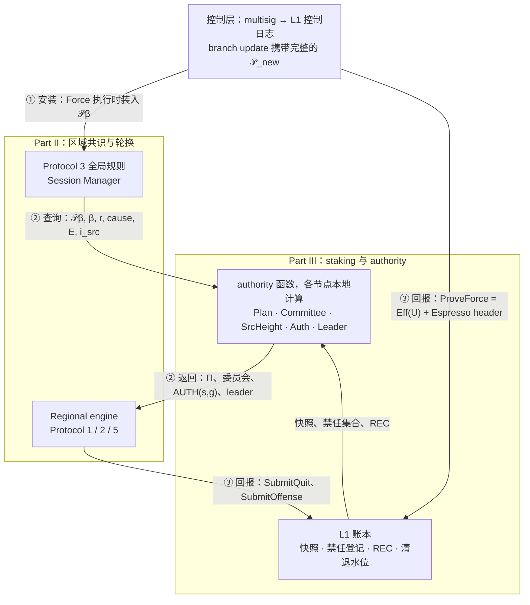
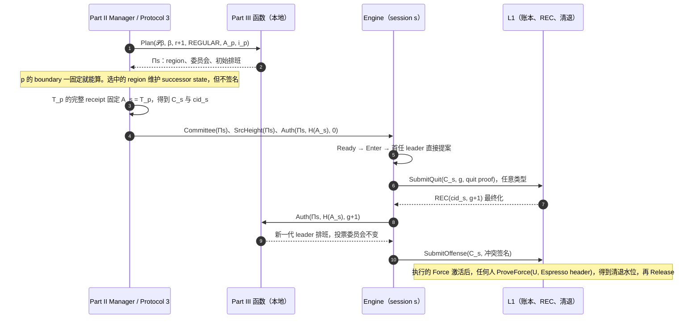
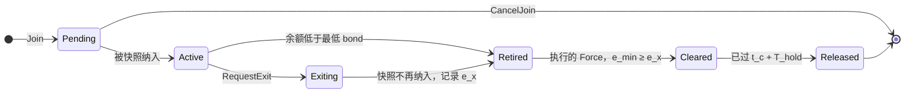
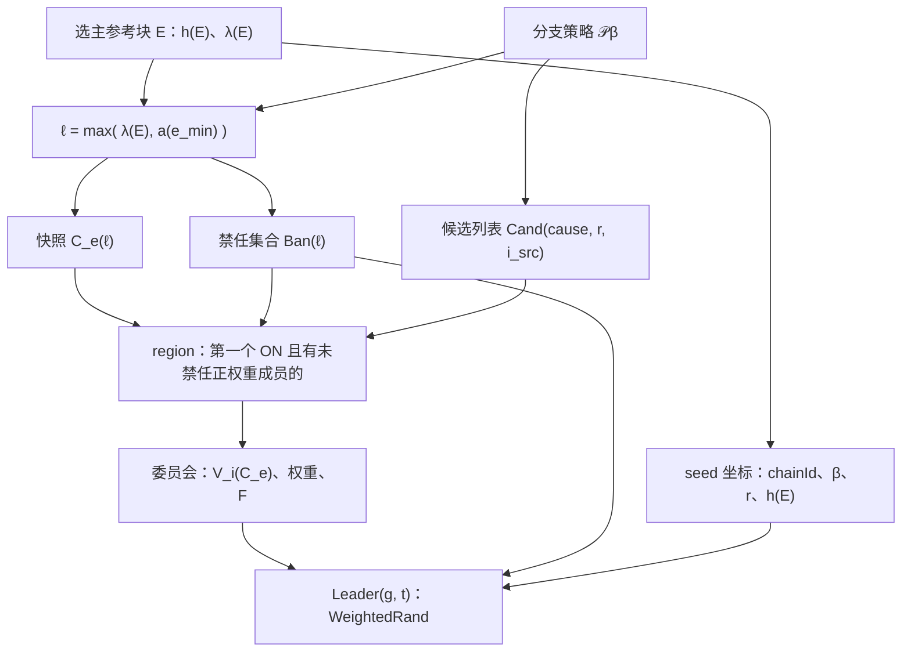

# Part II ↔ Part III：Authority 接口的抽象、对齐与 Staking 层的重新表述

对象：[Part II v4.6](sync_hotstuff_rr_part2_rotation_v4_6.tex)（区域共识与轮换）和 [Part III v3](sync_hotstuff_rr_part3_staking_v3.tex)（staking 与 authority），兼及 [Part IV v0.1](sync_hotstuff_rr_part4_force_v0_1.tex) 与 [Part I](sync_hotstuff_rr_part1_core.tex) 的 authority 假设。例子沿用 [10-20 会议记录](../meetup_record/261020.md) §6–7。

日期：2026-10-24。本文只做分析和修改建议，没有改动任何正文。"L123"指本目录对应 `.tex` 文件的行号；Part II 的定义、假设、命题和协议编号取自当前 PDF。

---

## 0 结论速览

**问题 1：接口怎么抽象？** 把 Part III 看成 Part II 的 *authority provider*，Part II 只依赖它的契约。两边只在三个方向上相交：

| 方向 | 内容 | Part II 的角色 |
|---|---|---|
| 安装 | 每个分支一份不可变的**分支策略** $\mathcal P_\beta=(S_\beta,\mathsf{Ord}_\beta,\mathsf{Boot}_\beta,e^{\min}_\beta)$，随 Force 原子替换 | 存储；Force 执行时安装；不解释内容 |
| 查询 | 纯函数 `Plan`、`Committee`、`SrcHeight`、`Auth`、`Leader`、`ValidPolicy`；同输入同输出，缺证据返回 WAIT | 在选区、handoff、验签、恢复和选主时调用 |
| 回报 | L1 入口 `SubmitQuit`、`SubmitOffense`、`ProveForce`、`Release` | 正确 replica 提交 quit proof 和冲突签名 |

对象分四层：

$$
\mathcal P_\beta\ \longrightarrow\ \Pi_s\,(=\mathsf{AUTH}_{s,0})\ \longrightarrow\ C_s=(\nu_s,\Pi_s)\ \longrightarrow\ \mathsf{AUTH}_{s,g}.
$$

Part II 不再接触快照编号、准入队列、禁任集合、最低快照或候选规则。

**问题 2：要改什么？** Part II 十组修改，Part IV 一组，Part III 七组。大多是机械替换，改完后 Part II 反而变短。最关键的四处是：

1. Branch update 携带完整的 $\mathcal P_{\rm new}$，而不只是 $S_{\rm new}$。
2. `NextLive` 改为 $\mathsf{region}(\mathsf{Plan}(\cdot))$。原来的循环规则保留为**默认策略**，所以 Part II 第 7 节和附录 B 的例子不用重写。
3. $\mathsf{AUTH}_{\beta,r,0}$ 统一定义为 plan：包含 region，不包含执行 anchor。签名和 REC 都绑定 $\mathrm{cid}_s=\mathsf H(\mathrm{id}(\Pi_s),\mathsf H(A_s))$。
4. Protocol 2 把**所有类型**的 quit proof 都提交 L1，REC 按 $(\mathrm{cid},g)$ 唯一。

**问题 3：staking 层怎样写更清楚？** 第一页放"核心思路框 + 接口框"，正文分三个模块：L1 账本（状态机）、authority 派生（纯函数）、追责与释放（L1 入口）。每个 plan 只在一个 L1 高度 $\ell_s$ 读取 L1；position 的生命周期画成一张状态图；释放改为"清退水位"，不需要重放 $G$。

**阅读中发现的四个实质问题**（不只是表述）：

| | 问题 | 后果 | 处理 |
|---|---|---|---|
| F1 | REC 按 $(\beta,r,g)$ 至多一个，但 L1 无法判断哪个 authority 是真的 | 拜占庭成员可以伪造上下文抢注 REC，真实 session 无法恢复 | 按 $(\mathrm{cid},g)$ 唯一，L1 只做相对验证（§2.2）|
| F2 | 只有 (b)(c) 类 quit proof 被送上 L1 | Leader 沉默引起的 BLAME 型 quit 没有人负责创建 REC | 所有类型都提交（§2.3）|
| F3 | Boot list 与 source region 无关 | Part II 附录 B 中 BOOT/STALL"移到下一个 region"不再成立，§7.4 的例子也会变 | 候选规则可依赖 $i_{\rm src}$，默认规则就是循环（§2.4）|
| F4 | 释放检查要求重放 Part II（$G$、Tail 等）| L1 负担很重，而且没有必要 | Force 是否执行只取决于 L1 控制日志，再加一个 Espresso header 即可（§2.5）|

---

## 1 先复述设计：我理解的版本

### 1.1 两个模块各管什么

| | Part II：区域共识与轮换 | Part III：staking 与 authority |
|---|---|---|
| 回答的问题 | 什么时候、由哪个 session、从哪个 anchor 出块；哪些 DATA 进入 $G$ | 谁有资格、权重多少、每个 view 谁当 leader；资金怎样进入、退出、被罚 |
| 时钟 | BFT DATA 高度；Espresso 时间（决定 Force 生效点）| L1 高度：长 epoch，$a_e=a_0+eM$，截止 $c_e=a_e-P$ |
| 核心状态 | $\beta$、$\mathcal X_q=(\mathrm{Out}_q,S_\beta,\kappa_q)$、生产分支 $R$、session programs | stake positions、快照 $\mathcal C_e$、禁任登记、REC |
| 不变量 | $G$ 只增；Force 只截掉 $G$ 之外的部分；每个 $\beta$ 一张不变的表 | session 内委员会和权重不变；禁任只增；已分配职责期间资金不放 |
| 现在怎样相接 | 通过 $\mathsf{AUTH}_{\beta,r,g}$ 和 `NextLive`，并说明"Part III supplies a staking-based construction"（L429）| 在 §2.3 扩展 branch update；在 §3.4 声明替换 `NextLive`、按 $(\beta,r,g)$ 索引 authority |

### 1.2 Part III 的六个设计要点

1. **钱、权重、资格、leader 分开。** 资金 $B_o$ 被罚会减少；快照权重 $w_o$ 冻结后不变；资格由 ON/OFF 和禁任决定；leader 由公开排班决定。
2. **周期快照。** 每个长 epoch 冻结一份 $\mathcal C_e$，多个 session 共用。加入和退出走 FIFO 队列与预算。
3. **选主比执行早一棒。** 对 $p$ 的 regular successor $s$：$E_s=A_p$ 用来排班，$A_s=T_p$ 用来接棒。$p$ 的 boundary 一固定，$s$ 的 region 和初始 leader 就确定了；但 $s$ 仍从 $T_p$ 之后开始生产。Force 后的首个 session 取 $E=A=$ 保留的 $G$ 末块。
4. **快照编号** $e_s=\max\{m_\beta,\,e(\lambda(E_s))\}$。$m_\beta$ 是分支的最低快照编号，防止旧 anchor 把已经退出的资金"选回来"。
5. **先选 region，再选 leader。** Region 是候选顺序中第一个 ON 且 $W_i>0$ 的 region：regular 用 `randList(β,r)`，首个 session 用 boot list。Leader 为
   $$L_s(g,t)=\mathsf{WeightedRand}\bigl(\mathcal W^g_s,\ \mathsf H(\texttt{LEADER},\mathit{chainId},h(E_s),\beta,r_s,g,t)\bigr).$$
   投票委员会全程不变，只有 proposer 资格随 generation 变化。
6. **恢复和退出都落在 L1。** $g>0$ 时，由完整 quit proof 在 L1 创建 $\mathsf{REC}$，冻结当时的禁任集合。退出要等一次有效 Force 把最低快照提到 $\ge e_x$，再等待 $T_{\rm hold}$。

### 1.3 贯穿全文的例子

| | Regular B：$(7,21)$ | Force B：$(8,21)$ |
|---|---|---|
| 背景 | A 的 $(7,20)$ 从 100 生产到 110 | U41 在 $J_{501}$ 激活，此时 $G=108$；A 已有 DATA 进入 $G$，所以目标轮次是 21 |
| 排班参考 $E$ | $A_{(7,20)}=100$，$\lambda(100)=2500$ | 保留的 $G$ 末块 108，$\lambda(108)=2600$ |
| 快照 | $e(2500)=7$，且 $m_7\le7$，用 $\mathcal C_7$ | $e(2600)=7$，但 $m_8=8$，用 $\mathcal C_8$（$a_8=3000\le$ U41 公布高度 3100）|
| 候选与表 | `randList(7,20)=(C,B,A)`；$S_7$ 中 C 为 OFF、B 为 ON，选 B | boot list $(A,B,C)$；$S_8$ 中 A 为 OFF、B 为 ON，选 B |
| Seed | 100 | 108 |
| 执行 anchor | $T_{(7,20)}=110$ | 108 |
| 何时能算出来 | $(7,20)$ 的 boundary 固定时 | U41 激活、$G^\star$ 固定时 |

### 1.4 Part II 在哪些地方用到 authority

| Part II 位置 | 需要 Part III 给什么 |
|---|---|
| §2.1 Authority contexts and leaders（L420–454）| AUTH 的内容、leader 规则、quota、源高度 $\lambda(\mathsf{AUTH})$ |
| §2.1 资格与 `NextLive`（L511–531）、Genesis（L533–556）| region 是否合格、选哪个 region |
| §2.3 Stake and faults（L588–603）| 成员、权重、$F$ |
| §3.3 Signed context（L1036–1060）、FINAL（L1086–1124）| 签名要绑定的配置和 authority 标识 |
| §3.4 Admission（L1167–1191）、Protocol 2 第 2–3 步（L1496–1527）| recovery authority 何时可得、由谁提交 |
| §5.2 CheckFINAL 的 session context（L1651–1680）| 委员会、quota |
| §5.3 descriptor、§5.4 Protocol 3（L1742–1760、L1871–2061）| 后继 region、quota、委员会；分支状态 |
| §6.2 Handoffs、Def 6.1 Ready（L2224–2302、L2376–2389）| 目标 authority、$\lambda^{\rm open}$ |
| 附录 B 参考策略（L3123–3300）| update 应携带哪些字段 |
| Part IV Protocol 1（L103–218）| Force 时的 region 选择与安装 |

---

## 2 诊断：接口处哪里没对齐

### 2.1 总表

| # | 现象 | Part II | Part III | 级别 |
|---|---|---|---|---|
| D1 | **AUTH 的含义不同。** Part II 的 AUTH 在选 region 之前固定，region 和 anchor 由 handoff 另行绑定；Part III 的 AUTH 绑定 plan、两个块和 handoff | L425–427 | L75–76、L295–296 | 必须 |
| D2 | **两套选区函数。** Part III 宣布用候选列表和 boot list 替换 `NextLive`，但 Part II 和 IV 的调用点仍是循环规则 | L520–531、L1975、L2015、L2048、L2239；IV L178 | L103–112、L347–348 | 必须 |
| D3 | **Branch update 缺字段。** 没有候选规则、boot list 和最低快照；replay state 只存 $S_\beta$ | L356–418、L492–509、L1873；IV L103、L173 | L72–74、L232–237 | 必须 |
| D4 | **Quota 的索引不同。** $\mathit{TB}_r$ 按 $r$ 索引并跨分支共享；Part III 用 genesis 常数 TB | L432、L446–447、L1306 | L82–84 | 应该 |
| D5 | **REC 的提交责任。** Part II 只把 (b)(c) 类 quit proof 送 L1，REC 却需要任意类型 | L1505–1506、L1509–1514 | L310–318 | 必须（F2）|
| D6 | **REC 的唯一性键。** 每个 $(\beta,r,g)$ 至多一个 REC | L435 | L312–316 | 必须（F1）|
| D7 | **Force 的选区语义。** Boot list 不看 source region；Part II 的例子和参考策略依赖"跳过 source" | L2657–2669、L3196–3200、L3294–3297 | L108–112 | 必须（F3）|
| D8 | **释放检查依赖 Part II 内部状态。** 要求从 checkpoint 重放 $G$、Tail 和控制游标 | — | L245–254 | 应该（F4）|
| D9 | **两条边角规则。** Region 资格只看 $W_i>0$，若成员全被禁任，$g=0$ 就没有 leader；$g=0$ 用快照截止时的禁任集，在长 epoch 下排除很慢 | — | L106、L118、L122–123、L324–326 | 应该 |
| D10 | **符号冲突、互相半引用。** 冲突见 §5.8。Part II 说"由 Part III 提供构造"，Part III §3.1 又重述 handoff 流程，接口说明放在最后一节 | L429 | §3.1、§3.4 | 表述 |

下面展开需要论证的四条。

### 2.2 F1：REC 不能按 $(\beta,r,g)$ 唯一

Part III 规定，合约对每个 $(\beta,r,g)$ 至多创建一个 $\mathsf{REC}(\beta,r,g)=(\mathit{authorityId}_s,g,J_{s,g})$（L312–316）。"至多一个"要安全，合约必须能判断提交者给出的 $\mathit{authorityId}_s$ 属于真实的 session。L1 做不到这一点：

- regular handoff 不上 L1，这正是设计目标；
- session 可以跑在 $G$ 之前，它的 boundary 只存在于 $R$ 中（直接交付的 terminal receipt），甚至还没有出现在 Espresso 上；
- 即使 L1 有 Espresso light client，要验证 $(\beta,r)$ 的 anchor 和 plan，也得沿 handoff 链一路递归到某个 checkpoint，而链上没有基例。

于是存在一个代价很低的活性攻击。被选中 region 里的任意一个拜占庭成员 $o$ 可以伪造一个 plan $\Pi'$：策略、快照和 region 都照抄真实值，只把参考块高度 $h(E')$ 改成能让 $o$ 成为 $(\beta,r,0,0)$ leader 的值。它再伪造一个 anchor $A'$，然后签两个冲突提案。相对于这个伪造上下文，这是一份"有效"的 (b) 类 quit proof。合约据此创建 $\mathsf{REC}(\beta,r,1)$ 之后，真实 session 的恢复记录就再也建不出来，只能等 Force。攻击者付出的代价只是被 slash。

**处理：** REC 改为按 $(\mathrm{cid},g)$ 唯一，其中 $\mathrm{cid}_s=\mathsf H(\mathrm{id}(\Pi_s),\mathsf H(A_s))$，也就是 BFT 签名所绑定的上下文。合约只验证"在声明的上下文 $C$ 下，这份 quit proof 成立"：权重取 $\mathsf{Committee}(\Pi)$，leader 取 $\mathsf{Leader}(\mathsf{AUTH}_{C,g},\cdot)$；$t>0$ 时核对前面各 term 的 terminal QC；$g>0$ 时要求 $\mathsf{REC}(\mathrm{cid},g)$ 已经存在。

这样，伪造上下文只会得到一条没人使用的记录，碰不到真实 session。诚实成员只在真实上下文里签名，攻击者也就无法借伪造上下文去陷害他们。对 `SubmitOffense` 做同样的相对验证即可，L1 不再需要核验"historical authority"。

这也说明 Part III v3 的 $\mathit{authorityId}_s$ 本来就是 session context 的标识（§3.2），需要修改的只是唯一性的键。

### 2.3 F2：所有类型的 quit proof 都要送上 L1

Part II Protocol 2 的 Quit 步只要求"proof of type (b) or (c), submit it to L1"（L1505–1506）；这一步沿用 Part I，目的是排除双签的 leader。可是 Status 步要等 $(\beta,r,g+1)$ 的恢复记录最终化（L1509–1514），而 Part III 的 REC 由**任意**完整 quit proof 创建（L310–313）。

Leader 沉默是最常见的故障，它对应 (a) 类 BLAME 证明。目前没有任何角色负责把这类证明送上 L1，Part III 只写了"anyone can submit"。这样一来，恢复的活性依赖一个没有点名的服务。

**处理：** Quit 步改为"无论类型，都调用 `SubmitQuit`；(b)(c) 类同时是 offense 证据"。Ass 2.9 (ii)（L685–687）从"control operation"扩展到所有 L1 操作，包括 branch update、`SubmitQuit`、`SubmitOffense` 和 `ProveForce`。这样，Part I Ass 2.2 中的有限时间 $d(g)$ 才有具体来源。

### 2.4 F3：Force 选区不能丢掉"跳过 source region"

Force 时，`NextLive` 从 export session 的 region $i_{\rm src}$ 之后开始找（L2015）。Part III 改用 boot list，与 $i_{\rm src}$ 无关（L110–111）。Part II 有两处依赖旧语义：

- **§7.4 的例子。** A 零产出，被 Force 换成 B 的 $(8,20)$；B 也零产出，"another explicit MSIG can choose C in $(9,20,0,0)$"（L2666–2667）。若 boot list 是 $(A,B,C,D)$ 且 B 仍为 ON，第二次 Force 还会选回 B。
- **附录 B。** BOOT/STALL 的效果写作"selection after $i$"（L3196–3200），并据此说明"each BOOT or STALL Force moves the selection to the next eligible region"（L3294–3297）。这是 §7.7 的恢复所需要的一步。

**处理：** 候选顺序不写死成"regular 用列表、Force 用固定 boot list"，而写成一条允许依赖 $i_{\rm src}$ 的规则 $\mathsf{Cand}(\mathcal P_\beta,\mathit{cause},r,i_{\rm src})$。

**默认策略**取循环顺序：先列 $\mathcal L_R$ 中 $i_{\rm src}$ 之后的 region，最后放 $i_{\rm src}$；$i_{\rm src}=\bot$ 时取整个 $\mathcal L_R$。在默认策略下，$\mathsf{region}(\mathsf{Plan}(\cdot))$ 与 `NextLive` 的结果相同（只差 §4.3 P6 的边角规则），所以 Part II 的例子和附录 B 仍然成立。会议记录中的 `randList (C,B,A)` 和 boot list `(A,B,C)` 属于非默认策略。

### 2.5 F4：释放检查不需要重放 $G$

Part III 要求从 checkpoint 完整重放 Part II 来完成 release check。该 checkpoint 绑定 $G$、NEXT/PENDING tail、status/policy/minimum、控制游标和待生效更新（L245–254）。其实，"这次 Force 有没有执行"只取决于 L1：

1. 有效 update 的 $\theta_a$ 沿日志严格递增（Def 2.2 (V5)），而且每个 Espresso 块至多激活一个 update（Ass 2.7）。因此**激活顺序就是日志顺序**。
2. $\beta$ 只在执行的 update 处加一（Prop A.5）。所以 $U_k$ 执行当且仅当
   $$\beta_{\rm target}(U_k)=\#\{\,j<k:\ U_j\ \text{执行}\,\}\qquad(\text{从 genesis 控制前缀起算}).$$
3. 上式只依赖日志中的目标序列。L1 控制合约在 $U_k$ **提交时**就能算出结果，记作 $\mathsf{Eff}(U_k)$。

剩下只需证明激活已经发生：给出一个最终化的 Espresso header，其时间戳 $\ge\theta_a(U)$。Espresso 的 L1 light client 可以验证这一点。至于 $G$ 停在哪里，只影响新分支的 anchor 和目标轮次；它不影响两件真正需要的事："旧分支的所有程序都已关闭"和"新分支只使用编号 $\ge e^{\min}$ 的快照"。

所以释放可以改成**清退水位**：任何人都可以提交 `ProveForce(U, header)`，L1 记录一次 $(e^{\min}(U),t_c)$；所有满足 $e_x\le e^{\min}(U)$ 的 position，在 $t_c+T_{\rm hold}$ 之后都可以提款。细节见 §5.6。

---

## 3 接口抽象（问题 1）

### 3.1 五条抽象原则

1. **参数化。** Part II 的协议和证明对 authority provider 参数化，只用到 §3.5 的契约。Part III 是其中一个实例；"单快照 + 默认循环策略"是最简单的实例，恰好复现 Part II 现有的全部例子。
2. **三个方向。** 安装（Force 安装 $\mathcal P_\beta$）、查询（纯函数）、回报（证据进入 L1）。除此之外，两边不共享任何状态。
3. **纯函数 + WAIT。** 同样的已认证输入，在所有验证者处得到同一结果。证据不全时返回 WAIT，调用方在同一个操作处暂停；WAIT 永远不被解释为零权重、空候选集或 $\bot$。这与 Part II 已有的"Missing authority means wait"一致。
4. **L1 只做相对验证。** L1 判断"在声明的上下文 $C$ 下，这份证据成立"，从不判断"哪个 session 真实存在"。真实性由 Part II 的 handoff 验证和重放负责；况且 L1 本来就看不到跑在 $G$ 之前的 session。
5. **信息隐藏。** Part II 只调用 `Plan`、`Auth`、`Leader`，只读取 $\mathsf{region}(\Pi)$、$\mathsf{Committee}(\Pi)$、$\mathsf{SrcHeight}(\Pi)$ 和 $\mathrm{cid}$；不读快照编号、读取高度、禁任集合、$e^{\min}$ 或候选规则。

### 3.2 四层对象

| 层 | 对象 | 何时固定 | 谁产生 | 包含 | 不包含 |
|---|---|---|---|---|---|
| 分支 | $\mathcal P_\beta=(S_\beta,\mathsf{Ord}_\beta,\mathsf{Boot}_\beta,e^{\min}_\beta)$ | branch update 执行时；genesis 给出 $\mathcal P_0$ | multisig 定值，Part II/IV 安装，Part III 解释 | ON/OFF 表、两条候选规则、最低快照编号 | 任何 session 信息 |
| 排班 | plan $\Pi_s=\mathsf{AUTH}_{s,0}$ | regular：前驱 boundary 固定时；首个 session：自身 boundary 固定时 | `Plan` | $(\beta,r,\mathit{cause})$、$E_s$ 的 $(h,\mathsf H,\lambda)$、$i_{\rm src}$、$\ell_s$、快照编号与 ID、策略 ID、region、$\mathsf{Ban}_{s,0}$ | 执行 anchor $A_s$ |
| 会话 | $C_s=(\nu_s,\Pi_s)$，标识 $\mathrm{cid}_s$ | handoff 固定 $A_s$ 时 | Part II | descriptor 与 plan | $g$、$t$ |
| 代 | $\mathsf{AUTH}_{s,g}=(C_s,g,\mathsf{Ban}_{s,g})$ | $g=0$ 同上；$g>0$ 在 $\mathsf{REC}(\mathrm{cid}_s,g)$ 最终化时 | `Auth` | 本代的 proposer 资格 | 投票委员会的任何变化 |

**与现有术语的对应。** "AUTH"取 Part II 的含义，不含 anchor。Part III v3 说 initial AUTH "binds the plan, both blocks, the snapshot and policy IDs, the handoff"（L295–296），描述的其实是 session context $C_s$，其中的 $\mathit{authorityId}_s$ 就是 $\mathrm{cid}_s$。Part III 的"plan"就是 $\mathsf{AUTH}_{s,0}$，不必另立概念。

这样分层后，Part II 原来那句"inputs are fixed before target-region selection; the handoff separately binds the selected region and exact execution anchor"（L425–427）改成：plan 的输入在选 region 之前就已固定，选出的 region 写入 plan，handoff 只绑定执行 anchor。

### 3.3 接口签名

**Part III 向 Part II 提供的纯函数**

| 函数 | 输入 | 输出 | Part II 调用处 | 取代 |
|---|---|---|---|---|
| `Plan` | $\mathcal P_\beta$；目标 $(\beta,r)$；$\mathit{cause}$；参考块 $E$ 的 $(h,\mathsf H,\lambda)$；$i_{\rm src}$ | $\Pi$（含 $\mathsf{region}(\Pi)\in\mathcal L_R\cup\{\bot\}$）或 WAIT | Protocol 3 初始化与两个分支；§6.2 两种 handoff；Manager 提前排班 | `NextLive`；"AUTH 的派生" |
| `Committee` | $\Pi$（$\mathsf{region}\ne\bot$）| $(V_s,w,F_s,\Delta_i,K,\mathit{TB})$ | 验签、CheckFINAL、quota、term 长度 | $\mathit{cfg}_{\beta,r}$、$\omega_{i,v}$、$F_i$、$\mathit{TB}_r$ |
| `SrcHeight` | $\Pi$ | L1 高度 | $\lambda^{\rm open}$ | $\lambda(\mathsf{AUTH}_{\beta,r,0})$ |
| `Auth` | $\Pi$、$\mathsf H(A_s)$、$g$ | $\mathsf{AUTH}_{s,g}$ 或 WAIT | Admission；Protocol 2 第 3 步 | "derive from the recovery record" |
| `Leader` | $\mathsf{AUTH}_{s,g}$、$t$ | key 或 $\bot$ | 每个 view 的 leader 检查与 Propose | $\mathsf{Leader}(\mathsf{AUTH},i,t)$ |
| `ValidPolicy` | $\mathcal P_{\rm prev}$、$\mathcal P_{\rm new}$、公布高度 | bool | Def 2.2 新增的 (V6) | — |

**Part III 拥有的 L1 入口**

| 入口 | 调用者 | L1 验证什么（相对验证）| 效果 |
|---|---|---|---|
| `SubmitQuit(C, g, Q)` | 任何人；正确 replica 必须调用 | $Q$ 相对于 $C$ 是第 $g$ 代的完整 quit proof | 若尚无记录，创建 $\mathsf{REC}(\mathrm{cid},g+1)$ 并冻结禁任集合 |
| `SubmitOffense(C, ev)` | 任何人 | 同一 key 在同一 $\mathrm{cid}$ 下的冲突签名对；$o$ 属于所声明快照 | 扣 escrow；永久禁任；按 (position, 类型, 冲突槽) 去重 |
| `ProveForce(U, hdr)` | 任何人 | $\mathsf{Eff}(U)$；`hdr` 是最终化 Espresso header 且 $\theta\ge\theta_a(U)$ | 若 $e^{\min}(U)$ 更大，追加清退水位 $(e^{\min}(U),t_c)$ |
| `Release(o)` | owner | 存在水位项 $e^\star\ge e_x(o)$，且已过 $t_c+T_{\rm hold}$ | 支付剩余 escrow，只付一次 |

**Part II 传给 `Plan` 的输入**

| 输入 | Regular successor（前驱 $\nu_p$）| Genesis / Force 后的首个 session |
|---|---|---|
| $\beta$，$\mathcal P_\beta$ | 当前分支及其策略 | 新分支及刚安装的策略；genesis 为 $\mathcal P_0$ |
| $r$ | $r(\nu_p)+1$ | Part II 的目标轮次规则（零产出时复用 $r$）|
| $\mathit{cause}$ | REGULAR | GENESIS / FORCE |
| $E$ | $A(\nu_p)$ | 新 anchor：genesis 为 $A_0$，Force 为 $\operatorname{last}(G^\star)$ |
| $i_{\rm src}$ | $i(\nu_p)$ | export session 的 region，或 PENDING 中保存的值；genesis 为 $\bot$ |

Part II 不需要 $E$ 这个符号：调用时直接传入 $A(\nu_p)$ 或新 anchor 即可。这也避开了 Part II 中 entry proof 的记号 $E$。

### 3.4 Part III 侧的定义

```text
Plan(P, β, r, cause, E, i_src):
    ℓ  ← max{ λ(E), a(P.e_min) }               # 唯一的 L1 读取高度
    e  ← e(ℓ)                                  # 等于 max{ P.e_min, e(λ(E)) }
    C  ← Snapshot(e)            或 WAIT         # 未发布或证据不全 → 等待
    B0 ← BanAt(ℓ)               或 WAIT         # 现稿用快照截止时的集合，见 §6 Q1
    L  ← Cand(P, cause, r, i_src)              # 有序候选 region
    i  ← L 中第一个满足  P.S(x) = ON  且  Σ_{o ∈ V_x(C) \ B0} w_o > 0  的 x；没有则 ⊥
    return Π = (chain, β, r, cause, (h,H,λ)(E), i_src, ℓ, e, id(C), id(P), i, B0)

Cand(P, cause, r, i_src):                      # r 是目标轮次
    if cause ∈ {GENESIS, FORCE}:  return P.Boot(i_src)
    else:                         return P.Ord(r, i_src)
    # 默认策略：Boot = Ord = Cyclic
    # Cyclic(i) = L_R 中 i 之后的 region，最后接 i；Cyclic(⊥) = L_R

Committee(Π):                                  # 仅当 Π.i ≠ ⊥
    V ← V_{Π.i}(C_{Π.e});  w ← 快照中的冻结权重;  W ← Σ_{o∈V} w_o
    return (V, w, F = φ_{Π.i} · W, Δ_{Π.i}, K, TB)

SrcHeight(Π) = max{ Π.ℓ, pub(C_{Π.e}), pub(Π 的策略) }

Auth(Π, hA, g):
    cid ← H(id(Π), hA)
    if g = 0:  return (cid, 0, Π.B0)
    rec ← REC[cid][g]，且已最终化；否则 WAIT
    return (cid, g, rec.ban)

Leader(AUTH, t):
    Wset ← { (o, w_o) : o ∈ V(Π), o ∉ AUTH.ban }
    z    ← H("LEADER", chainId, β, r, h(E), AUTH.g, t)     # 只用不可 grind 的坐标
    return WeightedRand(Wset, z)                             # 空集 → ⊥
```

两点说明：

- **一个 L1 读取高度。** 令 $\ell_s=\max\{\lambda(E_s),a_{e^{\min}_\beta}\}$，则 $e(\ell_s)=\max\{e^{\min}_\beta,\,e(\lambda(E_s))\}$，与 Part III 式 (1) 完全相同。证明：若 $\lambda(E_s)\ge a_{e^{\min}}$，两边都等于 $e(\lambda(E_s))$；否则两边都等于 $e^{\min}$，因为 $e(a_m)=m$。这样表述后，"最低快照"不再是一条例外规则，而只是把读取高度往上抬。快照和禁任集合在同一个高度读取。
- **Seed 不能含块哈希。** $\mathrm{id}(\Pi)$ 可以包含 $\mathsf H(E)$，用于绑定；但 leader 的哈希输入只能用 $(\mathit{chainId},\beta,r,h(E))$ 这类坐标。$E$ 的出块者可以改动 payload 来 grind 块哈希，却改不了 DATA 高度。

### 3.5 契约

**Part III 对 Part II 的保证**

| | 保证 |
|---|---|
| G1 确定性 | 给定同样的已认证 L1 状态和 genesis 参数，`Plan / Committee / Auth / Leader` 在所有验证者处结果相同；证据不全时返回 WAIT，不会返回别的结果 |
| G2 不可变 | plan 一旦可算就不再变化；每个 $(\mathrm{cid},g)$ 至多一个 REC，创建后不变 |
| G3 提前一棒、无 L1 交易 | regular successor 的 plan 在前驱 boundary 固定时就能算出；regular handoff 和 term 变化都不需要新的 L1 交易 |
| G4 委员会固定 | $\mathsf{Committee}(\Pi_s)$ 对该 session 的所有 $g,t$ 相同；slash 只改 escrow，不改 $w_o$ |
| G5 阈值 | $w_o$ 为正整数，$F_s=\varphi_iW_s<W_s/2$；证书需要权重 $>F_s$ |
| G6 排除单调 | 禁任登记只增；$\mathsf{Leader}(\mathsf{AUTH}_{s,g},t)\notin\mathsf{Ban}_{s,g}$，且 $\mathsf{Ban}_{s,g}\subseteq\mathsf{Ban}_{s,g+1}$ |
| G7 退出隔离 | 若 $e_x(o)\le e^{\min}_\beta$，则 $o$ 不在分支 $\beta$ 及其后任何 plan 的委员会中 |

**Part II 对 Part III 的义务**

| | 义务 |
|---|---|
| O1 参考块 | 按 §3.3 的表传入 $E$、$r$、$\mathit{cause}$、$i_{\rm src}$ |
| O2 策略 | 每个 $\beta$ 一份 $\mathcal P_\beta$，只由执行的 branch update 原子安装；regular handoff 不改变它 |
| O3 签名 | 所有区域 BFT 签名绑定 (domain, $\mathrm{cid}_s$, type)，view 消息另外绑定 $(g,t)$ |
| O4 回报 | 正确 replica 对每个 quit proof 调用 `SubmitQuit`；双签证据进入 `SubmitOffense`，或随 `SubmitQuit` 一起处理（§6 Q2）|
| O5 关闭 | 执行的 Force 终止旧分支的所有 program 和 plan；旧分支从此不能再追加 $G$ |
| O6 服务界 | $T_E$、$T_{\rm pub}$，以及 L1 操作的 $T_{\rm L1}$ |

### 3.6 谁依赖哪条契约

| 结论 | 所在文档 | 需要的契约 |
|---|---|---|
| FINAL kernel 可靠（Prop A.1）| Part II | G4、G5；G1 保证 session context 可由公共历史唯一导出 |
| 全局前缀一致与保持（Prop A.3）| Part II | G1（含 WAIT 语义）、G2、O2 |
| Program 隔离（Prop A.4）| Part II | G2、O3 |
| 不会有未公告的 Force（Prop A.5）| Part II | Part III 从不改变 $\beta$：最低快照只能经 branch update 提出 |
| 准备时间有界（Ass 6.2、Prop A.6）| Part II | G3 |
| Finalized authority（Part I Ass 2.2）| Part I | $g=0$ 用 G3；$g>0$ 用 O4 加 Ass 2.9 (ii)，给出 REC 最终化的有限时间 |
| Accountability（Part I Ass 2.3）| Part I | G6，并假设证据服务在 $T_{\rm ev}$ 内送达 |
| Schedule fairness（Part I Ass 2.4）| Part I | **仍是假设**，Part III 不证明 |
| 退出隔离 | Part III | O5、$\mathsf{Eff}$ 在 L1 上可算、G7 |
| 持有期足够 | Part III | O6 |

### 3.7 两张图

**接口总图：** 安装、查询、回报三个方向。Part II 与 Part III 之间只有三条箭头：两条 ②、一条 ③。



**一个 session 的调用时序：** 从提前排班到恢复，再到释放。



---

## 4 修改清单（问题 2）

原则：**接口只在一处定义（Part III），Part II 只调用；默认策略让 Part II 保持自足**，不读 Part III 也能看懂 Part II 的全部例子。

### 4.1 Part II（十组）

**M1 Branch update 携带完整分支策略。**
- 位置：Def 2.1–2.3（L356–388、L492–509）；表 3（L395–418）；Ingesting controls（L456–469）；L511–518；replay state（L1871–1881）；附录 C 表（L3338–3340）。
- 改为 $U=(\mathit{chain},c,\theta_a,\beta_{\rm target},\mathcal P_{\rm new})$，其中 $\mathcal P=(S,\mathsf{Ord},\mathsf{Boot},e^{\min})$；新增 (V6) $\mathsf{ValidPolicy}(\mathcal P(U'),\mathcal P_{\rm new},\lambda_{\rm pub}(U))$；执行时令 $\mathcal P_{\beta'}:=\mathcal P_{\rm new}$；replay state 改为 $\mathcal X_q=(\mathrm{Out}_q,\mathcal P_{\beta_q},\kappa_q)$。"no status-only updates"改为"no policy-only updates"。
- 原因：D3。会议记录中的三条规则（每个 $\beta$ 一份、regular 沿用、Force 原子替换）原样推广到整份策略。草稿见附录 A1。

**M2 用接口段替换"Authority contexts and leaders"。**
- 位置：§2.1（L420–454），记号表 L775。
- 改为附录 A2 的段落，要点：五个函数；$\mathsf{AUTH}_{\beta,r,0}:=\Pi_{\beta,r}$（含 region，不含 anchor）；$\mathrm{cid}$；WAIT 语义；"Part II reads no other staking state"。删除 L444–447 中"The quota remains indexed by $r$"一句。
- 原因：D1、D10。

**M3 选区：`NextLive` 改为 $\mathsf{region}(\mathsf{Plan})$。**
- 位置：L511–531、L533–556、L1674、L1959–1966；Protocol 3（L1974–1983、L2014–2025、L2048–2058）；L2234–2249、L2265–2268、L3445；Prop A.3/A.4 证明中的"fixed-map NextLive"（L2982、L3045）。
- 改为 $\Pi'=\mathsf{Plan}(\ldots)$、$i'=\mathsf{region}(\Pi')$。"Choosing the next region"改写为默认循环策略的说明（附录 A3）。§7 开头加一句"本节例子使用默认循环策略"。
- 原因：D2、D7。默认策略就是原来的 `NextLive`，所以例子和附录 B 不用改。

**M4 Quota 用常数 TB。**
- 位置：L400、L432、L446–447、L778、L929–932、L962、L1306–1307、L1667、L1749、L1758、L1977、L2022、L2055、L2109、L2596–2599。
- 改为 $\mathit{TB}$，作为 $\mathsf{Committee}(\Pi)$ 中的 genesis 参数。删除"Only $\mathit{TB}_r$ remains shared by that turn index"；L2596–2599 改为"both have quota TB"。
- 原因：D4。没有任何证明依赖"quota 按 $r$ 跨分支共享"。

**M5 Stake and faults 改为引用 Committee。**
- 位置：§2.3（L588–603），记号表 L773。
- 改为：成员 $V_s$、权重 $w_o$、总权重 $W_s$ 和 $F_s<W_s/2$ 都由 $\mathsf{Committee}(\Pi_s)$ 给出。其余语义（session 内固定、slash 不改权重、用旧快照验旧证书）保留。再补一句：委员会"仍被接受"的期间，至迟在关闭其分支的 Force 生效时结束。这正是 Part III 的退出边界，于是故障假设的时间范围与退出规则对上了。
- 原因：D10 的记号问题（$\omega_{i,v}$ 与 PENDING($\omega$) 冲突）；故障假设的时间范围与退出规则对齐。

**M6 签名上下文绑定 cid。**
- 位置：§3.3 Signed context（L1036–1060）、FINAL 消息（L1088–1092）、Def 3.1 (ii)（L1111–1114）、CheckFINAL 的 RawFINAL（L1701–1707）。
- 改为：每个区域 BFT 签名绑定 (domain, $\mathrm{cid}_{\beta,r}$, type)，view 消息另外绑定 $(g,t)$。$\mathrm{cid}$ 已经承诺了 chain、$(\beta,r)$、初始 anchor hash、委员会和 region，所以实际被签的字段没有变，只是给这组字段起了名字。
- 原因：REC 和 offense 都按 $\mathrm{cid}$ 归属（F1）。

**M7 Quit proof 一律提交；REC 按 cid 索引。**
- 位置：Protocol 2 第 2 步（L1505–1506）和第 3 步（L1509–1514）；Admission（L1177–1180）；Changes from Part I 第 7 条（L1323–1326）；Ass 2.4（L615–623）；Ass 2.9 (ii)（L685–687）；表 1 的 L1 行（L252）。
- 改为附录 A4 的写法：等待 $\mathsf{REC}(\mathrm{cid}_{\beta,r},g+1)$ 最终化。Ass 2.4 把快照、禁任登记、REC 和清退水位列入"finalized L1 records"。Ass 2.9 (ii) 改为"任一有效 L1 操作"。
- 原因：F1、F2。

**M8 Descriptor 携带 plan。**
- 位置：§5.2 session context 表（L1651–1680）；§5.3 descriptor（L1742–1760）；Protocol 3（L1977、L2022、L2055）；例子（L1813–1814、L2109）。
- 改为 $\nu=(\beta,r,i,A,H,q^{\rm open},\mathit{cause},\Pi)$，其中 $i=\mathsf{region}(\Pi)$，$H=h(A)+\mathit{TB}$；$C_\nu=(\nu,\Pi)$。$\nu$ 中也可以只放 plan 的 ID，把 plan 本体作为验证依赖。
- 原因：CheckFINAL 需要的委员会可以直接从 $\nu$ 取得；$\sigma_G(B)$ 也因此记录了产出 $B$ 的委员会，证据归属和 §6 Q5 都会用到。

**M9 Session Manager 提前排班；handoff 验证改用 plan。**
- 位置：§6 开头四条规则（L2130–2143）；§6.1（L2173–2197）；§6.2 handoff 字段（L2226–2232）与 Verify（L2279–2302）；Def 6.1 (iv)（L2386–2387）。
- 改为：Manager 对每个 boundary 已固定的 session $p$，计算其 regular successor 的 plan；plan 指定的 region 维护 successor state。Plan 不创建 program，也不授予签名权。Handoff 字段中的"target authority $\mathsf{AUTH}_{\beta,r,0}$, the version's map $S_\beta$"改为"the plan $\Pi$ and $\mathcal P_\beta$"。
- 原因：G3 是 Part III 最大的工程收益。现在的 Part II 要等到 terminal receipt 之后才"知道"后继是谁。

**M10 参考策略（附录 B）。**
- 位置：L3130–3248。
- 改为四条：
  - (a) 所有 update 默认取 $e^{\min}_{\rm new}:=$ 签名时最新已激活的快照编号；
  - (b) 新增 WITHDRAW 条件：若有 position 满足 $e_x>e^{\min}_\beta$ 且已等待超过 $\tau_{\rm wd}$，期间又没有其他 Force，就发一次不改 $S$ 的 update；
  - (c) 默认循环策略下，BOOT/STALL 保持"selection after $i$"；采用非默认策略时须自行保证这一点；
  - (d) R5"Keep a candidate"要在新快照下检查。
- 原因：退出依赖 Force，但大多数 Force 本来就会发生。每次 Force 顺带抬高 $e^{\min}$，就不需要为退出额外发 Force。

### 4.2 Part IV（一组）

- §1.1（L99–112）：$U$ 携带 $\mathcal P_{\rm new}$；"names the branch version to close and the complete policy to install"。
- Protocol 1 第 1 步和第 3 步（L153、L173–179）：安装 $\mathcal P_{\beta'}:=\mathcal P_{\rm new}$；令 $\Pi'=\mathsf{Plan}(\mathcal P_{\beta'},\beta',r',\textsf{FORCE},A,i_{\rm src})$，$i'=\mathsf{region}(\Pi')$；NEXT 中的 $\nu$ 携带 $\Pi'$ 并使用 TB。
- L216–221：stale update 不安装 $\mathcal P_{\rm new}$。
- 若采用 §6 Q3，第 2 步"Check its target"变成一条断言。

### 4.3 Part III（七组）

| | 位置 | 修改 | 原因 |
|---|---|---|---|
| P1 | §1.1 表（L67–77）、§3.1 第 2 步（L293–297）、§3.4（L341–350）| plan $=\mathsf{AUTH}_{s,0}$，不含 $A_s$；把"binds the plan, both blocks, … the handoff"改为 session context $C_s=(\nu_s,\Pi_s)$ 及其 $\mathrm{cid}_s$ | D1 |
| P2 | §3.2（L308–322）| REC 按 $(\mathrm{cid},g)$ 唯一；写明 L1 的相对验证范围；把"its authority dependencies"改为"the claimed context $C$"。§2.3 的 slash 同样按相对验证写 | F1 |
| P3 | §1.2 Region（L103–112）、L130–131 | 改用 $\mathsf{Cand}(\mathcal P,\mathit{cause},r_s,i_{\rm src})$，按**目标**轮次索引，消除"列表用当前 $r$、哈希用目标 $r_s$"的错位；给出默认循环策略；boot list 是 $\mathit{cause}\in\{\text{GENESIS},\text{FORCE}\}$ 的情形 | D2、F3 |
| P4 | §2.3（L239–275）| 改为清退水位；删去"full replay of Part II … checkpoint binds $G$, the NEXT/PENDING tail …"。保留 $T_{\rm hold}$ 公式、"首次清退不回拨""剩余资金只付一次"等规则 | F4 |
| P5 | §1.2 式 (1)（L95–101）| 引入 $\ell_s$，令 $e_s=e(\ell_s)$，并注明与原式等价 | 表述 |
| P6 | L105–106 | Region 资格要求至少有一个未被禁任的正权重成员 | D9 |
| P7 | 全文结构与记号 | 接口框放第一页；删除 §3.1 对 Prepare/Bind/Enter 的重述，改为"Part II 步骤 ↔ 本模块函数"对照表；$J\to\mathsf{Ban}$，$m_\beta\to e^{\min}_\beta$ | D10、§5 |

### 4.4 保持不变的部分

- 四个 view 编号、两种 handoff、Force 的截止点和保留 $G$ 的规则；Protocol 1、2、5 中的 quit、lock、timer 规则；CheckFINAL 和全局规则的结构；Ready 与 Enter。
- $E_s=A_p$、$A_s=T_p$，以及 Force 首个 session 取 $E=A$；快照周期、FIFO 与预算、offense 表、$T_{\rm hold}$ 公式、"接受的代价"清单。
- 默认策略下，Part II 第 7 节的全部例子。

### 4.5 改完后的自检

- [ ] Part II 和 IV 中的 `NextLive` 只出现在"默认循环策略"的说明里，或已不再出现。
- [ ] $S_{\rm new}$ 只作为 $\mathcal P_{\rm new}$ 的分量出现；replay state 存的是 $\mathcal P_\beta$。
- [ ] 不再出现 $\mathit{TB}_r$。
- [ ] 每处 $\mathsf{AUTH}_{\beta,r,0}$ 都读作 plan，没有一处还说它"在 region 选择之前、不含 region"。
- [ ] Protocol 2 第 2 步对 quit proof 的类型不再设条件。
- [ ] 所有恢复记录都写作 $\mathsf{REC}(\mathrm{cid},g)$。
- [ ] Part II 正文不出现快照编号、$\ell$、$\mathsf{Ban}$ 等 staking 记号；$e^{\min}$ 只出现在 $\mathcal P$ 的字段说明里。
- [ ] Part III 的释放检查不再提到 $G$、Tail 或 Part II 重放。
- [ ] Part III 的 leader 哈希和候选规则使用同一个（目标）轮次。
- [ ] 会议记录中的 `randList (C,B,A)` / boot `(A,B,C)` 例子已标注为非默认策略。

---

## 5 Staking 层的重新表述（问题 3）

### 5.1 现稿的阅读障碍

1. **接口最后才出现。** §3.4 才说明替换了 Part II 的哪些东西。读者在读前两节时，不知道哪些对象会被 Part II 用到。
2. **链上与链下不分。** 快照由谁计算、REC 合约验证什么、释放检查中的重放由谁来做，正文都没有说清。读者无法区分"L1 合约逻辑"和"节点本地纯计算"。
3. **生命周期分散。** Join/Exit/Retire 在 §2.1，Slash 在 §2.2–2.3，Clear/Release 在 §2.3，全文没有一张状态图。
4. **重复 Part II 的流程。** §3.1 的 Prepare/Bind/Enter 和 §3.3 的 Force bootstrap 部分重述了 Part II，反而让读者分不清以哪份为准。
5. **记号密，并与 Part II 冲突。** 冲突见 §5.8。仅 $e$ 一个字母就有 $e(\ell)$、$e_s$、$e_x$、$a_e$、$c_e$ 五种用法；"列表用当前 $r$、哈希用目标 $r_s$"还需要专门提醒。

### 5.2 建议的 v4 结构（仍控制在 6 页）

| 页 | 内容 |
|---|---|
| 1 | 核心思路框、接口框、贯穿例子 |
| 2–3 上 | §1 L1 staking 账本：状态表、生命周期图、迁移表、快照的截止与发布 |
| 3 下–4 | §2 Authority 派生：$\ell_s$、候选与 region、委员会、leader 与各代 authority、两列例子 |
| 5 | §3 追责与释放：冲突表、`SubmitQuit` 与 REC、`ProveForce` 与清退水位、$T_{\rm hold}$ |
| 6 | §4 保证（G1–G7）与 Part II 的义务、接受的代价、参考文献 |

### 5.3 第一页：核心思路框

建议照 Part II §1.1 的样子写一个框，共五条（英文草稿见附录 A6）：

1. **四件事分开。** 资金 $B_o$ 可被罚，快照权重 $w_o$ 冻结后不变，资格由 ON/OFF 和禁任决定，leader 由公开排班决定。
2. **一次读 L1。** 每个 plan 只在一个 L1 高度 $\ell_s$ 读取快照和禁任登记。长 epoch 的一份快照服务多个 session。
3. **排班早一棒。** $E_s=A_p$ 排班，$A_s=T_p$ 接棒。前驱 boundary 一固定，后继的 region、委员会和初始 leader 就确定了；plan 不授予签名权。
4. **委员会不变，资格只减。** session 内的投票委员会和权重不变；proposer 资格只会随 REC 和新 plan 收紧。
5. **退出等一次关门。** Position 先离开新快照；一次执行的 Force 把 $e^{\min}$ 抬到 $\ge e_x$，并关闭所有旧程序；再等 $T_{\rm hold}$ 放款。

接口框列出 §3.3 的函数与入口，并写明"Part II reads no other staking state"。

### 5.4 模块 A：L1 staking 账本（状态机）

**状态**

| 状态 | 字段 | 谁写 | 谁读 |
|---|---|---|---|
| Position $o$ | ID、region、operator key、owner、escrow $B_o$、生命周期状态、$e_x$、已处理的 offense | Join / Exit / Slash / Release | 快照、slash |
| 快照 $\mathcal C_e$ | $e$、$c_e$、$a_e$、成员与权重、root、发布高度 | `CutSnapshot` | `Plan` |
| 禁任登记 | 永久 key 集合，只增 | `SubmitOffense` | `Plan`（$g=0$，采纳 §6 Q1 时）、`SubmitQuit`（$g>0$）|
| REC | $(\mathrm{cid},g)\mapsto$ 禁任集合 | `SubmitQuit` | `Auth` |
| 清退水位 | $[(e^\star_1,t_1),(e^\star_2,t_2),\ldots]$，$e^\star$ 严格递增 | `ProveForce` | `Release` |

**Position 生命周期**



"Banned"是正交的标记：position 一旦进入过快照，在 Released 之前的任何状态下，一次有效 offense 都会扣 escrow 并永久禁任，但不改历史权重。CancelJoin 只在尚未进入任何冻结快照时可用。若采纳 §6 Q4，还要加一条迁移"Active → Retired：有效 offense"。

**迁移**

| 迁移 | 触发者 | 前提 | 效果 |
|---|---|---|---|
| Join | owner | 存入至少最低 bond，且在准入额度内；证明 key 所有权和 owner 授权 | 进入该 region 的 inbound FIFO |
| CancelJoin | owner | 尚未被任何冻结快照纳入 | 移出队列并退款 |
| RequestExit | owner | 已在某个冻结快照中；没有 exit record，也没有 pending exit | 进入 outbound FIFO，不可撤销；不解除任何已分配职责 |
| `CutSnapshot(e)` | 任何人，在 L1 高度 $\ge c_e$ 时 | 结果只取决于 $c_e$ 之前的 L1 状态 | 先强制退役余额低于最低 bond 的成员，再按预算取各 FIFO 的成熟前缀；冻结 $\mathcal C_e$；被省略者记 $e_x=e$ |
| `SubmitOffense` | 任何人 | 冲突相对于声明上下文成立，且尚未处理过 | 扣 $\min(\text{比例}\cdot w_o,\ B_o)$；key 永久禁任 |
| `SubmitQuit` | 任何人 | 相对于 $C$ 的完整 quit proof | 若尚无记录，创建 $\mathsf{REC}(\mathrm{cid},g+1)$ |
| `ProveForce` | 任何人 | $\mathsf{Eff}(U)$；Espresso header 的时间戳 $\ge\theta_a(U)$ | 若 $e^{\min}(U)$ 更大，追加 $(e^{\min}(U),t_c)$ |
| Release | owner | 存在 $(e^\star,t_c)$ 使 $e^\star\ge e_x$，且当前时间 $>t_c+T_{\rm hold}$；尚未释放 | 支付剩余 escrow，只付一次 |

`CutSnapshot` 写成无需许可的调用后，"Publish before $a_e$"的含义就清楚了：任何人都能完成发布，结果唯一；没人调用时，消费方返回 WAIT。

### 5.5 模块 B：Authority 派生（纯函数）

正文按 §3.4 的伪代码写，并配一张数据流图：



用 $\ell$ 重写 §1.3 的例子：

| | $(7,21)$ | $(8,21)$ |
|---|---|---|
| $\lambda(E)$ | 2500 | 2600 |
| $a_{e^{\min}}$ | $a_{e^{\min}_7}\le2000$ | $a_8=3000$ |
| $\ell$ | 2500 | 3000 |
| $e(\ell)$ | 7 | 8 |
| 候选列表 | $\mathsf{Ord}_7(21,A)=(C,B,A)$ | $\mathsf{Boot}_8(A)=(A,B,C)$ |
| region | B | B |
| seed 坐标 | $(\mathit{chainId},7,21,100)$ | $(\mathit{chainId},8,21,108)$ |
| 执行 anchor（由 Part II 给出）| 110 | 108 |

最后一行提醒读者：执行 anchor 不属于 plan，由 Part II 的 handoff 给出。

### 5.6 模块 C：追责与释放（L1 入口）

- **冲突类型：** 保留现稿的表（L201–214）。只补一句：冲突的"同一 session"指同一个 $\mathrm{cid}$。
- **REC：** 按 $(\mathrm{cid},g)$ 唯一，做相对验证（§2.2）。可选：所附证明若是双签，先处理禁任，再冻结集合（§6 Q2）。
- **为什么退出需要 Force：** 已退出的 position 可能还在跑在 $G$ 之前的 session 里，或者在已经排好的后继里，而 L1 看不到这些 session。一次执行的 Force 能一次性关闭整个旧分支，并让以后所有 plan 的快照编号 $\ge e^{\min}$。所以 Force 起的是"批量关门"的作用。
- **清退水位：** 按 §2.5 计算 $\mathsf{Eff}(U)$，再加一个 Espresso header。注意，所有满足 $e_x\le e^{\min}(U)$ 的 position，其 exit record 都早于 $U$ 的公布：$e_x$ 在快照 $e_x$ 的截止点就已记录，而 $c_{e_x}<a_{e_x}\le a_{e^{\min}(U)}\le\lambda_{\rm pub}(U)$。因此一条全局水位足以代替逐个 position 的清退记录。
- **持有期：** 公式不变，
  $$T_{\rm hold}\ge 2T_E+T_{\rm pub}+T_{\rm ev}+T^{\rm stake}_{\rm L1}+\varepsilon_{\rm clock},$$
  从水位项的 $t_c$ 起算。$t_c$ 不早于激活，所以从 $t_c$ 起算偏保守。

### 5.7 三条时钟

| 时钟 | 单位 | 决定什么 | 在例子里 |
|---|---|---|---|
| L1 高度 | L1 块 | 快照激活 $a_e$ 与截止 $c_e$；控制与 staking 交易的最终化；块的 L1 引用 $\lambda(B)$ | $a_7=2000$，$a_8=3000$；$\lambda(100)=2500$，$\lambda(108)=2600$；U41 在 3100 公布 |
| BFT DATA 高度 | DATA | session 的 anchor 和 terminal；选主参考 $E$；seed 坐标 $h(E)$ | $(7,20)$ 从 100 到 110；$G^\star=108$ |
| Espresso 时间 | 块与时间戳 | Force 生效点 $q(\theta_a)$；$G$ 的增长；清退证明 | U41 的 $\theta_a=120$，在 $J_{501}$（$\theta=122$）生效 |

**Plan 只在一个 L1 高度读取 staking 状态；anchor 只由 DATA 决定（terminal receipt 或保留的 $G$ 末块）；Force 的生效点只由 Espresso 时间决定。** 这句话可以放在 v4 的第 1 页。

### 5.8 统一记号

| 记号 | 含义 | 归属 | 说明 |
|---|---|---|---|
| $(\beta,r,g,t)$ | 分支、轮次、恢复代、term | Part II | 不变 |
| $s$、$p$ | 目标 session、前驱 session | Part III | 只在 Part III 内部使用 |
| $\mathcal P_\beta=(S_\beta,\mathsf{Ord}_\beta,\mathsf{Boot}_\beta,e^{\min}_\beta)$ | 分支策略 | 接口 | 取代只有 $S_\beta$ 的写法；$e^{\min}_\beta$ 即 v3 的 $m_\beta$，避开 Part II 的 $m_{\beta,r,g,t}$ |
| $E_s$ | 选主参考块 | Part III | Part II 不使用，避开其 entry proof $E$ |
| $\ell_s$ | plan 的 L1 读取高度 | Part III | 新增 |
| $e$、$a_e$、$c_e$、$\mathcal C_e$ | 快照编号、激活高度、截止高度、快照 | Part III | Part II 不出现 |
| $\Pi_s$ | plan，即 $\mathsf{AUTH}_{s,0}$ | 接口 | 不含执行 anchor |
| $C_s=(\nu_s,\Pi_s)$、$\mathrm{cid}_s$ | session context 及其标识 | 接口 | $\mathrm{cid}_s$ 即 v3 的 $\mathit{authorityId}_s$ |
| $\mathsf{AUTH}_{s,g}$ | 第 $g$ 代 authority | 接口 | $g>0$ 来自 $\mathsf{REC}(\mathrm{cid}_s,g)$ |
| $\mathsf{Committee}(\Pi)=(V_s,w,F_s,\Delta,K,\mathit{TB})$ | 委员会与 BFT 参数 | 接口 | 取代 Part II 的 $\omega_{i,v}$、$W_i$、$F_i$、$\mathit{cfg}_{\beta,r}$、$\mathit{TB}_r$ |
| $w_o$、$W_s$、$F_s$ | 成员权重、委员会总权重、故障界 | Part III | Part II 原来的 $\omega_{i,v}$ 与 PENDING($\omega$) 冲突 |
| $\mathsf{Ban}(\ell)$、$\mathsf{Ban}_{s,g}$ | L1 高度 $\ell$ 处的禁任集合；第 $g$ 代使用的禁任集合 | Part III | 取代 v3 的 $J_e$、$J_{s,g}$，避开 Part II 的 Espresso 块 $J_q$ |
| "快照" / "委员会" | 全局、按 epoch / 单个 session、单个 region | 两者 | Part II 的"configuration"一律改称"委员会" |
| $\mathsf{Eff}(U)$ | update 是否执行 | 接口 | 在 L1 上可算 |
| 清退水位 | $[(e^\star,t_c)]$ | Part III | 取代逐个 position 的清退记录 |
| $M$、$P$ | epoch 长度、截止提前量 | Part III | $P$ 与 Part II 的 proposal 同名，建议改为 $M_{\rm cut}$ |

### 5.9 与现有配套文档的关系

v4 完成后，[中文快速导读](sync_hotstuff_rr_part3_staking_v3_quick_guide_zh.md)可以缩成"例子 + 记号表"两部分；第 3 节的公式解读会被 §5.5 的数据流图代替。[10-20 会议记录](../meetup_record/261020.md)的图 5、图 6 可以直接引用为 Part III 的例子图，只需注明它们使用非默认策略。

---

## 6 开放问题（需要你决定）

**Q1 $g=0$ 用哪份禁任集合？** 推荐用 $\mathsf{Ban}(\ell_s)$。现稿用快照截止时的 $J_{e_s}$：一个已被证明双签的 key，在下一份快照被使用之前，仍会进入每个新 session 的初始排班，每次被选中就可能再引起一次 recovery，持续时间约为一个 epoch。改用 $\mathsf{Ban}(\ell_s)$ 后，滞后从约一个 epoch 缩短为"L1 最终化延迟 + 约两个 session"（plan 读取的是参考块所引用的 L1 高度）；确定性不变，而且 $\mathsf{Ban}(\ell_s)\supseteq J_{e_s}$。代价是 plan 要多读一项 L1 状态。

**Q2 `SubmitQuit` 是否先处理所附的双签？** 推荐处理。现稿 REC 取"as it stands before that transaction"的禁任集合，于是引起这次 quit 的双签 leader，在第 $g+1$ 代仍可能当选。若所附证明属于 (b)(c) 类，在同一笔交易里先完成 slash 和禁任，再冻结集合，排除就会立即生效；对 leader 双签而言，两次 L1 调用也合并成一次。其他冲突类型（投票、FINAL）仍走 `SubmitOffense`。

**Q3 是否在 L1 提交时就拒绝 stale update？** 可选。由于 $\mathsf{Eff}(U)$ 在提交时已经确定，拒绝 stale update 与"stale 整体 no-op"在语义上等价，只是失败提前到提交时发生。这样控制日志里只剩会执行的 update，Part IV 的"Check its target"变成一条断言，$\mathsf{Eff}$ 也恒为真。

**Q4 被 slash 的 position 是否强制退出？** 推荐强制退出。现稿只禁止它当 proposer；只要余额不低于最低 bond，它就继续投票。让已被证明为拜占庭的 key 继续占用 $F$ 的预算并不划算。"有效 offense 即强制退役，从下一份快照起缺席"这条规则更简单，也与以太坊的做法一致。

**Q5 是否保留一条不依赖 Force 的退出边界？** 建议作为后续选项。$\lambda$ 沿 DATA 祖先不减，$E$ 又依次取前驱 anchor，所以同一分支内 $e_s$ 不减；Force 后的首个 session 以 $G$ 中的块为参考，编号也不会变小。由此可得：**一旦 $G$ 中出现某个 session $s$ 的 DATA，且 $e_s\ge e_x$，以后所有未完成或新开的 session 都不会再使用含 $o$ 的快照。**

这可以替代"等一次 Force"作为清退条件。代价是 L1 要验证一个关于 $G$ 的陈述（$\sigma_G(B)$ 中 plan 的快照编号），也就是需要 Part II 重放的有效性证明，ZK 或挑战式均可。好处是不需要 multisig 行动，也不会丢弃 $G$ 之外的后缀。M8 让 $\sigma_G(B)$ 携带 plan，正好提供了这个陈述的对象。v4 建议仍用 Force 方案。

**Q6 退出成员的数据义务何时结束？** 需要写明。Part II 附录 C 要求成员永久保存字节，没有给出结束条件。建议规定 Release 之前必须完成数据转交（Part III 已写"retained or durably transferred"），并在 Part II 附录 C 中说明：position 被 Released 之后，它的存储义务由仍在线的成员和 Espresso 归档承担。

**Q7 Seed 与 grinding。** 写进"接受的代价"即可。$h(E_s)$ 对唯一性是冗余的，因为 $(\beta,r_s,g,t)$ 已经唯一；它也不提供不可预测性。保留它无害，但不要换成块哈希。另外，$\lambda(E_s)$ 由 $E_s$ 的出块 leader 在一个区间内选择，在 epoch 边界附近可以在两份快照之间挑一份。这是现设计已经接受的粗粒度影响，值得在 Part III 的"Accepted costs and limits"里补一句。

---

## 附录 A：可直接替换的英文草稿

以下草稿与正文现有宏一致（`\tagg`、`\Hash`、`\TB`、`\defterm`）。$\mathcal P$、`Plan` 等记号在 Part I、II、IV 中都尚未使用。

**A1 Part II Def 2.1 与 (V6)**

```latex
\begin{definition}[\defterm{Atomic branch update}]
\label{def:control-update}
An atomic branch update is
\[
 U=(\mathit{chain},c,\theta_a,\beta_{\rm target},\mathcal P_{\rm new}),\qquad
 \mathcal P_{\rm new}=(S_{\rm new},\mathsf{Ord}_{\rm new},\mathsf{Boot}_{\rm new},
                      e^{\min}_{\rm new}),
\]
together with a signature set $\Sigma_U$ on its hash. Here $c$ is its sequence number,
$\theta_a$ its Espresso activation threshold and $\beta_{\rm target}$ the branch version it
asks to close. $S_{\rm new}:\mathcal L_R\to\{\tagg{ON},\tagg{OFF}\}$ is one explicit,
complete status map. The other three fields form the selection policy that Part~III
interprets: the candidate rules for regular and first sessions, and the minimum snapshot
index of the new branch. The update names no retained DATA height. There are no
policy-only updates and no separate Force tag.
\end{definition}

% Definition 2.2, new condition:
\item[(V6)] $\tagg{ValidPolicy}(\mathcal P(U'),\mathcal P_{\rm new},\lambda_{\rm pub}(U))$
holds (Part~III), where $U'$ is the previous valid update or the genesis policy and
$\lambda_{\rm pub}(U)$ is the L1 height that includes $U$.
```

**A2 Part II §2.1 接口段（替换 L420–454）**

```latex
\paragraph{Authority interface.}
\label{sec:authority-context}
Part~III~\cite{part3} supplies every session's authority through pure functions. For a
target session $(\beta,r)$ opened by $\mathit{cause}$, with selection reference $E$ and
source region $i_{\rm src}$,
\[
 \Pi_{\beta,r}=\tagg{Plan}(\mathcal P_\beta,\beta,r,\mathit{cause},E,i_{\rm src})
\]
is its \defterm{plan}; we also write $\tagg{AUTH}_{\beta,r,0}:=\Pi_{\beta,r}$. The plan
fixes the selected region $\tagg{region}(\Pi)\in\mathcal L_R\cup\{\bot\}$ and the
committee $\tagg{Committee}(\Pi)=(V,w,F,\Delta,K,\TB)$. It does not contain the execution
anchor; the handoff binds that anchor. The session context identifier is
$\mathrm{cid}_{\beta,r}=\Hash(\mathrm{id}(\Pi_{\beta,r}),\Hash(A_{\beta,r,0,0}))$.
For $g>0$, $\tagg{AUTH}_{\beta,r,g}=\tagg{Auth}(\Pi_{\beta,r},\Hash(A_{\beta,r,0,0}),g)$
adds the unique finalized recovery record $\tagg{REC}(\mathrm{cid}_{\beta,r},g)$; only
proposer eligibility changes. The leader of an admitted view is
$L(\beta,r,g,t)=\tagg{Leader}(\tagg{AUTH}_{\beta,r,g},t)$, and
$\lambda(\tagg{AUTH}_{\beta,r,0}):=\tagg{SrcHeight}(\Pi_{\beta,r})$.
Each function returns a value or \emph{wait}. A wait pauses the caller at the same
operation; it is never read as zero weight, an empty candidate set or $\bot$.
Part~II reads no other staking state, and a regular handoff needs no new L1 transaction.
```

**A3 Part II "Choosing the next region"（替换 L520–531）**

```latex
\paragraph{Choosing the next region.}
The region of a target session is $\tagg{region}(\Pi)$ of its plan. Part~III defines it
from the branch policy: the first region of an ordered candidate list
$\tagg{Cand}(\mathcal P_\beta,\mathit{cause},r,i_{\rm src})$ that $S_\beta$ sets ON and
that has positive eligible weight in the plan's snapshot. Under the \emph{default cyclic
policy}, the list is the cyclic order $\mathcal L_R$ after $i_{\rm src}$, with
$i_{\rm src}$ last, and the whole of $\mathcal L_R$ for $i_{\rm src}=\bot$; this is the
selector of earlier versions, and the examples of this document use it. Because
$\mathcal P_\beta$ is fixed and $\tagg{Plan}$ is pure, every regular handoff in version
$\beta$ obtains the same result, no matter when its terminal receipt is delivered.
```

**A4 Part II Protocol 2 第 2、3 步**

```latex
% Step 2 (Quit), replace the last item:
 \item Submit the proof to L1 as $\tagg{SubmitQuit}(C_{\beta,r},g,\cdot)$, whatever its
       type; a proof of type (b) or (c) is also offense evidence. Do not wait for L1 to
       process it.
% Step 3 (Status and entry), replace the waiting sentence:
Wait until at least $a_v+\Delta$ and until $\tagg{REC}(\mathrm{cid}_{\beta,r},g+1)$ is
finalized. Set $e_v(\beta,r,g+1,0)$ to the time both conditions hold, and let
$\tagg{AUTH}_{\beta,r,g+1}=\tagg{Auth}(\Pi_{\beta,r},\Hash(A_{\beta,r,0,0}),g+1)$.
```

**A5 Part II Protocol 3 第 2 步的 terminal 分支**

```latex
Let $\Pi'=\tagg{Plan}(\mathcal P_\beta,\beta,r+1,\tagg{REGULAR},A(\nu),i(\nu))$.
If $\tagg{region}(\Pi')=\bot$, set
\[
 \mathsf{Tail}:=\tagg{PENDING}
 (\tagg{REGULAR},\beta,r+1,i(\nu),B,q^{\rm open}_{\rm next}).
\]
Otherwise set
\[
 \nu'=(\beta,r+1,\tagg{region}(\Pi'),B,h(B)+\TB,
       q^{\rm open}_{\rm next},\tagg{REGULAR},\Pi'),
 \qquad \mathsf{Tail}:=\tagg{NEXT}(\nu').
\]
```

**A6 Part III 第一页的核心思路框**

```latex
\begin{mdframed}[linewidth=.6pt,innertopmargin=6pt,innerbottommargin=6pt]
\textbf{Core idea.}
\begin{enumerate}[label=\textbf{\arabic*.},itemsep=2pt]
\item \textbf{Four things apart.} Escrow $B_o$ can be slashed; snapshot weight $w_o$ is
frozen; eligibility comes from the status map and the ban registry; leaders come from a
public schedule.
\item \textbf{One L1 read per plan.} A plan reads L1 at one height
$\ell_s=\max\{\lambda(E_s),a_{e^{\min}_\beta}\}$: the latest activated snapshot and the ban
registry there. One long-epoch snapshot serves many sessions.
\item \textbf{Schedule one session ahead.} $E_s=A_p$ fixes the plan; $A_s=T_p$ fixes where
$s$ continues. A plan grants no signing right.
\item \textbf{Fixed committee, shrinking proposer set.} Voting members and weights never
change inside a session; only recovery records and later plans exclude proposers.
\item \textbf{Exit waits for one closure.} A retired position leaves new snapshots; an
effective Force raises $e^{\min}$ to at least its exit index and closes all old programs;
funds are released after $T_{\rm hold}$.
\end{enumerate}
\textbf{Interface.} Part~II calls $\tagg{Plan}$, $\tagg{Committee}$, $\tagg{SrcHeight}$,
$\tagg{Auth}$, $\tagg{Leader}$ and $\tagg{ValidPolicy}$, and reports evidence through
$\tagg{SubmitQuit}$ and $\tagg{SubmitOffense}$. Anyone may call $\tagg{ProveForce}$;
owners call $\tagg{Release}$. Part~II reads no other staking state.
\end{mdframed}
```
