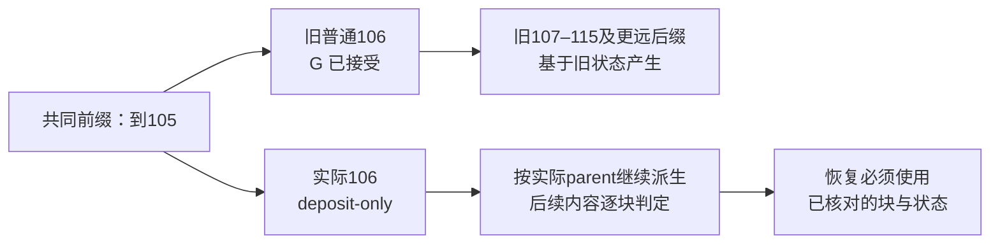

# 批次层失效：G 继续出块，D 怎样跟上，恢复从哪里开始

这里讨论另一种故障：**Espresso、区域共识和 Publisher 都正常，普通块不断进入 G；但 batcher 或 Certifier 不能把这些内容交给 L1。**

开始时，D 只是落后于 G。
如果错过派生所要求的交付窗口，D 会在一些高度采用 deposit-only，原来的 G 和 D 就会出现内容分歧。
此后恢复有两项工作：恢复批次提交能力，以及让后续生产使用与 D 相容的 parent 和状态。

本文沿用 [10 月 20 日记录](../meetup_record/261020.md) 的例子，依据 [Part 0 v0.6](part0_model_goals_zh_v0_6.md)、[Part 1](part1_module_interfaces_zh.md)及本地 mega-espresso 规格。
流程中会明确区分：原生派生已经规定的行为、当前轮换草稿写出的行为，以及还没有定义完整的接续。
配套的[审阅记录](batcher_failure_review_zh.md)给出反例和并发检查。

## 1. 同一个例子，这次 Espresso 不停

起点仍然是：

| 对象 | 当前进度 |
| --- | --- |
| A 的 `(7,20)` | 从 100 生产到 terminal DATA 110 |
| B 的 `(7,21)` | 已从旧 110 接棒，生产到 115 |
| R | 到旧 115 |
| G | 到 108 |
| D | 到 105，106–108 尚未完成派生 |

现在 batcher 停止提交，或者 C 不再提供新认证。
Publisher 仍可把 109–115 交给 Espresso，所以 G 可以继续到 115，之后还可能继续增长。
**故障不是“没有区域结果”，而是“已有的全局结果没有及时成为可派生的批次”。**

下文的 D 指节点从同一 finalized L1 历史及其要求的数据派生出的原生链。
Batch Inbox 的 cursor 是接纳进度，不能直接当成 D 的高度。
“已派生”也不等于对应 state claim 已完成证明或争议结算。

## 2. D 不会因为 G 已经确认，就直接采用 G 的内容

D 的输入是 L1 认可的批次和按原生规则取得的数据，不是 Publisher 的实时输出。
因此，Espresso 上有完整记录，仍不能代替 batcher、C 和 Batch Inbox 的提交路径。

没有可消费的批次时，D 先等待。
当原生 sequencing-window 条件满足、必要 L1 输入已齐时，节点可以生成普通交易列表为空的块，并执行应包含的 deposits 与系统输入。
若一直没有 batcher 工作，这条路径可以继续推进；它不会恢复丢失的普通内容。[OP 派生规范](https://specs.optimism.io/protocol/derivation.html#batch-queue)

窗口按 L1 区块和 origin 计算，不能写成“batcher 停机后统一再等十二小时”。
每个高度已经用掉多少窗口、channel 是否完整、是否还有更早的输入未解决，都影响结果。

**G 比 D 高，并不必然是冲突。**
例如 `D=105、G=115`，且 D 仍是 G 的前缀，只是进度不同。
真正的分歧发生在某个高度 n：`D[n]` 已经是 deposit-only，而原来的 `G[n]` 是含普通交易的块。

## 3. 情形一：在截止前恢复，只补交批次

假设 106–115 还没有被派生替换，数据完整，恢复后的交付能满足相应窗口与 channel 条件。

1. **Batcher** 从当前 cursor 继续构造批次，先处理较早的缺口，不能只提交最新的 G tip。
2. **C** 核对 payload 对应的公开内容及 DA 绑定，出具批次认证。
3. **Batch Inbox** 检查提交权限、cursor 连续性和认证，接纳成功的调用。
4. **派生节点** 取回数据，解码并按序执行 106–115，D 追上这段 G。
5. **Session Manager 与 Program** 继续原有生产轨迹；没有 parent 分歧就不需要换 anchor。

若只是 primary batcher 失效，可以由注册过的 alternative 接手，但要遵守独占窗口和 channel 接续条件。
若原 channel 只有一部分 frames，接手者不能假设自己拥有原来的压缩状态；通常要等允许重开 channel 时，从 frame 0 重新打包。
这些能力已经存在于本地规格的 [S1](../megaeth_specs/specs/block-certification/recovery.md#s1-the-batcher-stops-submitting-while-records-continue) 和 [S2](../megaeth_specs/specs/block-certification/recovery.md#s2-the-primary-stalls-part-way-through-a-channel)。

若是 C 整体不可用，换 batcher 不能替代 C。
已经签好的、仍满足接纳条件的提交可以继续；需要新认证的部分要等 C 恢复。
之前已经被接纳的批次，只要数据可取得，D 也不需要 C 再签一次。

## 4. 情形二：没有任何 batcher 能成功提交，106 起被补成 deposit-only

继续假设 Espresso 正常，G 已经接纳旧 106–115。
但直到 106 的原生窗口处理完，也没有能用于该高度的合格批次。

| 阶段 | G 的旧生产轨迹 | D 的实际结果 |
| --- | --- | --- |
| 批次刚停止 | 普通 106–115 已经存在 | 暂停在 105 等输入 |
| 106 的 fallback 条件满足 | 仍有旧普通 106 | 在 105 后执行 deposit-only 106 |
| 后续窗口继续结束 | 可能已经产生更长的普通后缀 | 无批次的后续高度依次成为 deposit-only |

这不意味着两个诚实派生节点对 D 分叉。
在相同 L1 历史、数据和规则下，它们仍会得到同一个 D。
分歧发生在 sequencer 先前确定的轨迹与 L1 最终允许采用的轨迹之间，这是方案 A 必须处理的情况。

如果 batcher 和 C 一直不恢复，D 的 fallback 本身不会使新的普通交易重新可用。
用户可以从 Deposit Portal 提交强制包含输入；这仍以必要 L1 数据可读、没有被此前已接纳而不可取得的 payload 堵住为前提。

## 5. 情形三：只有部分内容丢失，后面的块不一定全部为空

假设旧 106 中有 Alice 的 nonce=0 交易，旧 107 中有她的 nonce=1 交易；到 D 的 105 时，Alice 的 nonce 仍为 0。
106 被 deposit-only 替代之后，Alice 的 nonce 没有变成 1。

如果恢复提交的旧 107 批次通过前面的派生检查，执行时可能因为 nonce 不匹配而被判为块级无效，继而按规则替代。
但旧 108 若只含另一个独立账户 Bob 的合法交易，且其余原生检查通过，它的普通内容可能保留。

因此，一个可能的结果是：

| 高度 | 原 G 的内容 | 恢复后 D 的结果 |
| --- | --- | --- |
| 106 | Alice nonce=0 | deposit-only：原批次未及时交付 |
| 107 | Alice nonce=1 | deposit-only：在实际 parent 状态上执行无效 |
| 108 | Bob 的独立交易 | 普通内容保留，但块 hash 和执行状态未必与旧 108 相同 |

“交易执行 revert”不等于块级无效；不能因为一次合约调用 revert 就整块补空。
这里的例子要求确实触发原生块级无效条件。

本地 mega-espresso 规定：针对实际派生 parent 逐块检查，保留仍然有效的内容；某个块失败时，不应一概丢掉剩下的整个 channel。
这是 [Recovery S4](../megaeth_specs/specs/block-certification/recovery.md#s4-a-height-settles-as-a-deposit-only-block) 和 [Δ6](../megaeth_specs/specs/rollup/derivation.md#channel-retention-after-execution-rejection) 的语义。
它与未作这些修改的 OP Stack / Holocene channel 处理存在差异，不能混用两套规则。

**保留普通交易列表，不等于保留原 block hash、receipt 或 state root。**
只要 parent 改了，就必须重新解释后续执行；恢复不能直接拿旧 115 的状态继续出块。

## 6. 几种容易混在一起的失败

| 失败位置 | D 怎样处理 | 服务恢复后先做什么 |
| --- | --- | --- |
| 没有新批次到达，包括没有 batcher 或 C 无法签发新认证 | 等原生窗口；满足条件后 fallback | 检查哪些高度已经决定，不能原地补回已丢失的内容 |
| 只收到未完成 channel 的部分 frames | 按 channel 和派生规则等待、超时或重开；不因看到一笔提交就认定内容完整 | 恢复 channel 或在允许时重新打包 |
| 批次被接纳但太晚、origin 不合法，或执行失败 | 依各自规则丢弃或同高度替代，不是统一的“接纳即成功” | 按实际 parent 继续处理后续内容 |
| payload 已被接纳，但数据暂时取不回 | 停在该输入等待，不能把未知内容当作空 | 恢复数据读取；override 也不能跳过前面的必要输入 |
| 只有 C 离线，但必要批次已被接纳、数据可读 | 继续解码和执行已接纳内容 | 为尚未认证的新批次恢复服务 |

最后两行直接说明：C 的在线状态、Batch Inbox 的 cursor、D 的真实进度不能相互替代。
[数据取回规则](../megaeth_specs/specs/rollup/data-availability.md#batch-commitment-resolution)明确要求已接纳 payload 不可得时等待。

## 7. 当前轮换草稿怎样响应：有方向，但接续还没写完整

[Part 1 §6.4](part1_module_interfaces_zh.md) 目前给出的链条是：

**D 发生 fallback → Global Finality Rule 在截止事件执行 R-FB → 输出 `Replaced(h)` → Manager 把 R 重置到新 G → 等待 R-DEP / R-OVR 接管。**

这表达了“以实际派生结果纠正生产轨迹”的方向，但还不能当作完整的恢复算法。

| 参与方或规则 | 当前写出的职责 | 尚缺的关键内容 |
| --- | --- | --- |
| Global Finality Rule | R-FB 把受影响段改为 D 的块 | 固定重放哪段 D、如何取得确定的执行结果、替换到哪里 |
| Session Manager | 收到 `Replaced(h)` 后重置 R | 哪些 Running / Assigned 实例关闭，哪些 prepared states 作废 |
| Session Program | 正常规则仍以原 anchor 和锁运行 | 不能在原实例里直接换 parent；何时取得新 context |
| Publisher | 持续交付区域结果 | 哪些结果只作历史保管，哪些仍能授权当前分支 |
| Batcher | 从当前 cursor 提交 G 的连续区间 | 历史普通内容和回退后的 G 不同时，应采用哪个认证切面 |
| C | 核对某个 gpos 上的 G | 什么旧证书仍有效，怎样处理已接纳的旧 channel |
| Batch Inbox | 按 prev-cursor 和认证接纳 | 恢复边界如何限制迟到的旧提交 |
| Derivation | 执行原生批次、替代和 fallback 规则 | 这部分决定 D；它不会替轮换协议分配新 session |

其中有一个额外风险：**R-FB 发生时，相关高度的 `Expire` 事件可能早已处理过。**
不能直接假定“回退以后，再等这些高度过期，就会自动换区”。
审阅记录 B2 给出这个执行过程。

## 8. 批次服务恢复后，新 anchor 应怎样确定

先分两类：

- **只有延迟，没有内容分歧：** 继续原 session，补交批次，不需要新 anchor。
- **D 已改变 parent 历史：** 需要一个共同的恢复边界、新的执行状态和新的 session context。不能只重启 batcher。

恢复边界至少要固定两样东西：**L1 输入处理到哪里，以及旧生产结果处理到哪里。**
前者让大家得到相同的 D；后者避免 Publisher 一边不断追加旧轨迹，batcher 一边永远追赶一个移动的末端。
这里是恢复必须满足的契约，当前草稿还没有给出完整的边界选择规则。

假设在这个共同位置，已经处理了之前所有必要批次，D 的实际末端是 120，里面可能混合普通块与 deposit-only。
那么恢复的已确定基线是：

$$
A_{\rm base}=D[120],\qquad S_{\rm base}=\operatorname{stateAfter}(D[120]).
$$

Manager 要验证的是精确的 120、它的 origin、来源及完整状态，不是把数字 120 放进 handoff。
旧 `(7,21)` 绑定旧 110；若后续仍选 B，也必须使用新的 context，不能在旧 Program 中改写 anchor 或清空签名槽后重新投票。

**但“D 到 120”还不能保证马上能从 121 恢复实时出块。**
D 可能比当前 Espresso 时间落后一个 sequencing window，而 R-EXP 又禁止接纳太旧的普通块。
例如 D 的下一块时间戳落后 12 小时，`W_exp` 只有 2 小时，那么现在提议 121 也不能通过普通接纳。

当前 R-ANCHOR 用时间公式把 anchor 往前推，试图解决这个问题。
不过在这次故障中，120 之后的很多高度**已经有 G 接受的普通内容**，并不是 Espresso 停机时尚未产生普通内容的空档。
哪些要继续交付，哪些必须替代，哪些可以提前补 DEP，需要明确规则；不能直接把整段后缀都说成空。

因此，恢复 anchor 的选择还必须处理“基线安全”与“能否及时继续生产”两件事。
在这些条件未闭合前，本文不把 `last(D)` 或 R-ANCHOR 公式单独写成已经证明正确的完整答案。

## 9. OP Stack 的办法能继承什么，M 又能做什么

OP Stack 会把本地 sequencer 产生但尚未由 L1 确定的 unsafe 链，与 L1 派生输入进行核对。
不匹配时，以派生输入为准，重组 safe head 之后的执行分支。[OP consolidation](https://specs.optimism.io/protocol/derivation.html#l1-consolidation-payload-attributes-matching)
这说明继续产生普通块不等于这些块会被 L1 保留。
我们多了区域 FINAL、session 锁与跨区 handoff，不能只搬一次执行引擎重组，就认为这些权限也已经重置。

本地 mega-espresso 的恢复还包含一个 drain：逐个处理已经选中的历史记录，保留能在实际 parent 上执行的内容；然后开始在实际链上生产新记录。
这里的 drain 是批次恢复过程，不是区域协议里的 DRAIN 块。
轮换版本把选取依据改成了可能被 R-FB 改写的 G，因此还需要定义历史 record / gpos 的保留与认证权限。

M 的动作也要按故障区分：

- primary 失效时，可以由适当的注册管理路径启用可用提交者；换 region 或 Force 本身不会恢复 batcher。
- C 不可用时，需要恢复可用的认证服务；普通 override 不会让后续批次免除认证。
- cursor 无法继续时，可以考虑受约束的 override，但必须先处理已接纳输入，并保护实际派生前缀。
- 当前草稿只允许通过 STOP / RESUME 执行 override。这能否覆盖“Espresso 正常但批次层故障”，还需要定义；不能把 STOP 简写为“系统已经有安全新 anchor”。

如果 M 选择越过一段**尚未过交付期限、已经进入 G 的普通内容**，这会改变内容保留机会。
它与“只停止未来生产”的效果不同，必须符合已经选定的确认语义，不能直接归类为无害的活性调整。

**这次故障的恢复检查点是：先确认哪些内容已由 D 决定，再固定旧生产的结束边界，处理遗留 cursor / channel / 证书，最后建立新 session。**
在这条链条中，重新获得 batcher 或 C 的响应只是第一步。
