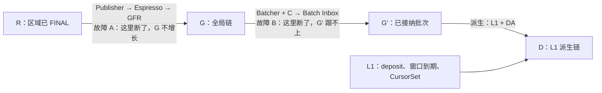
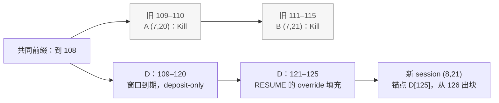
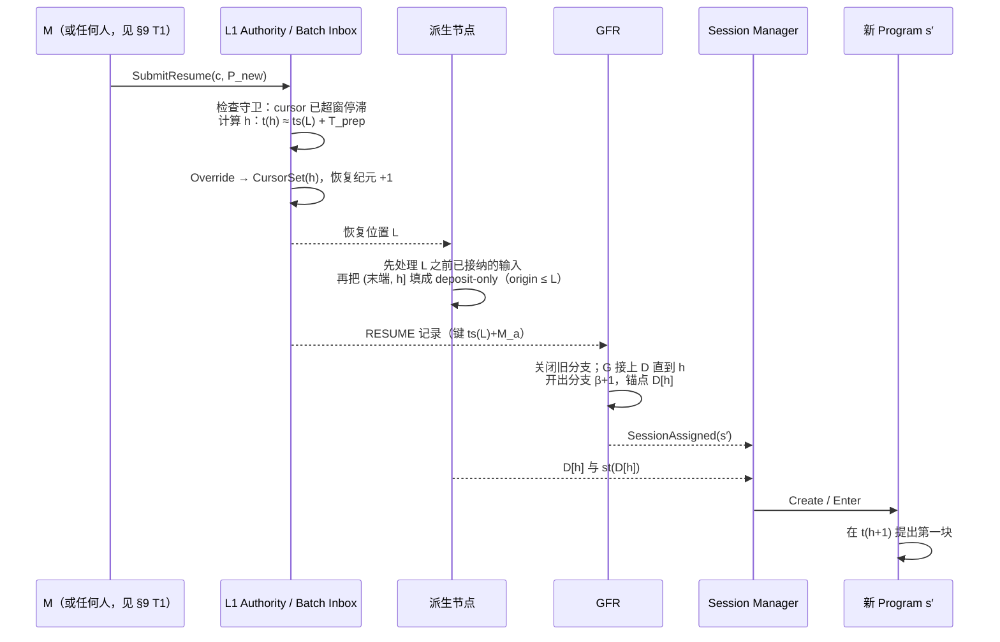
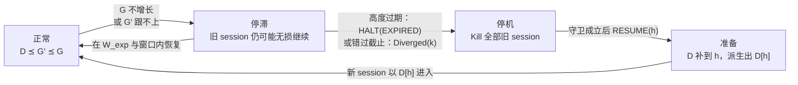

# 以 D 为准的恢复：派生一致投票、Kill 与 RESUME

日期：2026-10-26。
状态：设计草案。本文把新提出的恢复思路写成规则，再逐条检查它的问题。
它准备取代[协议修订记录](protocol_revisions_zh.md) §2.6、§3 中以 R-DEP、R-OVR、R-ANCHOR、R-FB 为核心的恢复逻辑；新旧对应见 §10。
依据：[Part 0 v0.6](part0_model_goals_zh_v0_6.md)、[Part 1](part1_module_interfaces_zh.md)、[mega-espresso 派生与 cursor 恢复](mega_espresso_derivation_pipeline_zh.md)；相关审阅：[Espresso 恢复审阅](espresso_recovery_review_zh.md)、[批次层失效审阅](batcher_failure_review_zh.md)。
本文没有修改 Part 0、Part 1 与修订记录。

> **后续决定（2026-10-26）。** 本文的方案已经写进 [Part 0 v0.7](part0_model_goals_zh_v0_7.md)、[Part 1 v0.2](part1_module_interfaces_zh_v0_2.md) 与[修订记录 §6](protocol_revisions_zh.md)（R21–R28）。§9、§11、§12 的建议按以下决定取舍：
> - **$\mathsf M$ 诚实。** 不加 RESUME 守卫，“cursor 超窗停滞”只作为 $\mathsf M$ 的操作规程。$h$ 由 $\mathsf M$ 给出，约束也写在操作规程里。不做无许可 RESUME。
> - **全局链可以被撤销。** “全局最终”在紧急情况下可被 RESUME 撤销，批次结算才是真正的最终，名称保留。不加公共分叉事件 R-DIV，也不加 R-LATE。
> - **GFR 只改 RESUME 一处。** 处理 RESUME 时，GFR 经派生规则读取 DA，把 $G$ 替换为 $D_L$；锚点取 $\mathrm{last}(D_L)$。
> - **R-EXP 保留。** $W_{\rm exp}$ 取约 10 h，接受过期之后全局链停住，暂不考虑吞吐约束。
> - **$\mathsf C$ 的签名时机规则代替恢复纪元。** 签名所用的 GFR 位置不早于 prev cursor 的写入位置。
> - **取消轻量自动轮换。** 区域故障由 Force 或 RESUME 处理。

## 0. 一页看懂

v5 现在的做法是：出故障时，让 G **预测** L1 将来会填出的 deposit-only 块（R-DEP），再用时间公式算出新锚点（R-ANCHOR）。
两份审阅中有不少问题出在“预测”上：预测的块要与 L1 实际填出的块逐块相同（F3）；公式算出的锚点不一定是实际派生出的块（F6、F13、O-4）；回退之后还要等一个早已处理过的过期事件（B1）。

新方案换了一个方向：

> **不预测。D 按原生规则自己补位；凡是已经不可能进入 D 的 session 一律关闭；恢复时由 RESUME 把 D 一次补到一个未来高度 h，以实际派生出的 D[h] 作为新 session 的锚点。**

| 规则 | 一句话 | 作用 |
| --- | --- | --- |
| 派生一致投票 | 成员只为“放进 L1 派生一定原样通过”的块投票；首先是必须包含应包含的 deposit | 正常时，G 中的块就是 D 中的块 |
| Kill | Manager 一旦确认某个 session 已不可能再进入 G 和 D，就关闭它 | 故障时，旧 session 体面退场 |
| RESUME(h) | cursor 前移到未来高度 h，D 用 deposit-only 补到 h，新 session 以 D[h] 为锚点 | 故障后，所有人从同一个真实状态重新出块 |

与 v5 对照：

| 问题 | v5 | 新方案 |
| --- | --- | --- |
| 停机后谁补 deposit-only | G 预测（R-DEP），L1 之后要填出同样的块 | 只有 D 补；G 不预测 |
| 新锚点 | 时间公式 $h_A=\max(h(\mathrm{last}(G)),h_{\rm det}(\theta))$ | 实际派生出的 D[h] |
| 旧 session 怎样结束 | R-OVR、Force、STOP 各自关闭，回退后的关闭集合未定义 | 统一的 Kill：不可能再进入 D 就关 |
| 批次层故障 | R-FB 改用 D 的块，后续接续未定义 | 分叉 → Kill → RESUME，与 Espresso 停机走同一条路 |

最后一行是新方案最大的结构性优点：**G 与 D 不论因为什么分开——Espresso、发布层、区域、batcher，甚至实现错误——都走同一个恢复入口。**

**审阅结论。**
方向是对的，而且明显比 v5 简单：DepFill 相等性、时间公式锚点、锚点随下载进度移动、等不到过期事件、锚点过旧，这几类问题在新方案中都不再出现（§10）。
但有四处必须补上，否则会推翻方案自己的目标，或让 M 拥有超出活性的权力（§9.1）：

1. 派生一致投票不能只查 deposit，要与派生的全部检查逐条对齐，并对 L1 的后续扩展稳健；
2. G 必须保留接纳时限（R-EXP），否则“G 中的块必进入 D”不成立；W_exp 也要重新取值；
3. RESUME 需要一个 L1 上可检查的守卫，否则 M 能撤销仍可结算的 G 内容；
4. h 必须受约束：高于 cursor、晚于 RESUME 所在的 L1 块，又不能晚太多。

另有三处规则需要补全（§9.2），四项取舍需要你决定（§9.3、§12）。
§11 给出补全后的整套规则。

---

## 1. 原方案复述

以下按原文顺序复述，括号中是本文的理解。

1. **目标。**若 Espresso 与批次层都存活（Espresso 上的数据总能进入 L1 的 Batch Inbox），G 中的块都会成为 D 中的块。
2. **前提：区域块包含已激活的 deposit。**做法是修改投票：块中包含应包含的 deposit 交易，成员才为它投票。
3. **两类故障。**
   - G 不增长：发布层故障，或 Espresso 活性故障。
   - Batch Inbox 的内容（记作 G′）跟不上 G。C 保证 G′ 是 G 的前缀。
4. **处理 G 不增长。**
   - G 卡住，G′ 也会卡住。D 由 G′ 加上 deposit-only 块组成。
   - **Kill：**Session Manager 若发现 session s 不可能再进入 G，就关闭 s 的 Program。判据：(a) s 不是从 last(D) 派生的；或 (b) s 从 last(D) 派生，但不是从 last(G) 派生的。（原文 (b) 后半句不完整；本文理解为“G 领先 D 时，s 还必须从 last(G) 派生”。）
   - **RESUME：**Espresso 恢复后，M 用 cursor set 的办法指定一个未来的 L2 高度 h，从 last(D) 到 h 都填成 deposit-only。同一个调用还告诉所有 Session Manager：D 被补到 h 之后，以 D 的 h 块为锚点创建新 session s′。
5. **处理批次层故障（G 增长，G′ 不增长）。**
   - 由于活性规则，D 用 deposit-only 填补空位，G 与 D 就不再对齐：某个高度上 D 是 deposit-only，G 却是普通块。
   - 仍用同一个 RESUME 指定 h，以 D[h] 为新 session 的锚点；Kill 规则不变。

---

## 2. 四条链与它们的关系

| 记号 | 是什么 | 谁算、用什么算 |
| --- | --- | --- |
| R | 生产分支：区域已 FINAL、可能领先 G 的结果 | 每个节点的 Session Manager |
| G | 全局链 | 任何观察者运行 GFR，只读 L1 与 Espresso |
| G′ | Batch Inbox 已接纳的内容，即 cursor 以下的高度 | L1 合约状态 |
| D | L1 派生链 | 任何派生节点，读 L1 与 DA，按原生派生规则（含 mega-espresso 的修改） |

三条基本事实：

- **G′ ⪯ G。**C 只为与 G 一致的批次签名（Part 1 的 G-CERT-1）。
- **D 的每个高度只有两种可能**（L2-S1）：要么是 G′ 在该高度的普通交易列表在 D 的实际父块上重新执行的结果，要么是 deposit-only 块。
- **D 已派生的前缀不会再变。**派生只读已最终化的 L1，规则确定，DA 绑定字节。Kill 能成立，靠的就是这一条（§6）。

正常运行时 `D ⪯ G′ ⪯ G ⪯ R`，内容一致；D 落后只是因为提交与派生需要时间。



**例子**（沿用[10 月 20 日记录](../meetup_record/261020.md)）：

| 对象 | 进度 |
| --- | --- |
| A 的 `(7,20)` | 从 100 出到 110，110 有 terminal FINAL |
| B 的 `(7,21)` | 凭 110 接棒，出到 115 |
| R | 115 |
| G | 108 |
| G′ | 105（106–108 的批次还在路上） |
| D | 105 |

---

## 3. 目标 T 与它的前提

**目标 T（G 进入 D）。**若 Espresso 与批次层都存活，G 中的每个块最终都以同一个块——同一高度、同一 hash、同一执行状态——出现在 D 中。

T 比 v5 的 L2-S1（“内容或 deposit-only”）强：它要求块本身相同，而不只是交易列表相同。
新 session 要从 D 的状态接着出块，所以需要的正是这个更强的版本。

**精确写法。**设块 B 在 $\tau_B$ 进入 G，高度为 h。若

1. 每个向 G 追加块的 session 满足 A-BYZ，诚实成员执行派生一致投票（§4）；
2. B 进入 G 时满足接纳时限 $\theta\le t(h)+W_{\rm exp}$，且 $W_{\rm exp}+M_a+T_{\rm batch}+D_{\rm drift}\le W_{\rm seq}$；
3. 批次层在 $[\tau_B,\tau_B+T_{\rm batch}]$ 上存活：B 及其之前的块的批次在此期间被 Batch Inbox 接纳，payload 可从 DA 取回；
4. 此期间没有 `CursorSet` 越过 h；

则 $\mathrm{native}(B)$ 就是 D 在高度 h 的块。

**证明思路（对高度归纳）。**

- **基础：**每个 session 的锚点都在 D 中。genesis 如此；RESUME 的锚点就是 D[h]；常规交接的锚点是前驱的块，按归纳已在 D 中。
- **归纳步：**设 G[h−1] = D[h−1]。由前提 2、3，G[h] 的批次在截止块 ddl(h) 之前被接纳。派生在实际父块 D[h−1] = G[h−1] 上构造该块：deposit、L1 attributes 与系统交易由派生自己从 origin 取，普通交易来自批次。由前提 1，各项检查都通过，派生构造的 deposit 前缀与区域块相同，执行得到同一个块。

前提 2 的算术：B 进入 G 的时间不晚于约 $t(h)+W_{\rm exp}$ 加上处理延迟（修订记录 §3.7 用 $M_a$ 计这段余量），再过 $T_{\rm batch}$ 被接纳；而 B 的窗口最早在 $\mathit{ts}(o(B))+W_{\rm seq}\ge t(h)-D_{\rm drift}+W_{\rm seq}$ 结束。修订记录 §3.7 已有这条约束。

前提 3 是假设本身，其余三个前提都要由协议规则保证：

| 前提 | 由什么保证 | 原方案中有没有 |
| --- | --- | --- |
| 1 块在父块上一定通过派生 | 派生一致投票 | 有 deposit 部分；需要补全（§9 P1） |
| 2 块进入 G 不能太晚 | GFR 的接纳时限 R-EXP | 没有写；必须保留（§9 P2） |
| 3 批次层存活 | 这是假设本身 | 原文的“批次层存活” |
| 4 没有 override 截掉可结算的块 | RESUME 的守卫 | 没有写；必须加（§9 P3）。有了守卫，前提 4 自动成立 |

---

## 4. 规则一：派生一致投票

**为什么需要它。**
批次中没有 deposit。
派生从块的 origin 自己取出 L1 attributes、该 origin 的 deposit（本块是该 epoch 第一块时）与系统交易，放在批次的普通交易前面，再执行。
所以区域块的这段前缀与派生构造的不同，D 中的块就与 G 中的块不同，此后每一块都对不上。
C 也查不出来：它只核对普通交易列表、时间戳与 origin（Part 1 §4.7.1），这三项可能完全一致。

例：父块的 origin 是 L1 块 1000，L1 块 1001 中有一笔 deposit d1。
leader 提出高度 k 的块，origin 前进到 1001，却漏掉了 d1。
若成员照样投票，G[k] 不含 d1，而 D 在高度 k 一定执行 d1；两者状态不同。

**规则 DerivOK。**诚实成员只为满足下列全部条件的块 B（父块 P，高度 h）提议、投票与签 FINAL。
每一条都必须在成员已最终化的 L1 视图下成立，而且**在这个视图的任何后续扩展下仍然成立**。

| 条件 | 内容 | 不满足时派生怎样处理 |
| --- | --- | --- |
| V1 origin | o(B) ∈ {o(P), o(P)+1}，o(B) 已最终化，且 ts(o(B)) ≤ t(h) | Δ5：同高度 deposit-only |
| V2 drift | 非空块：t(h) ≤ ts(o(B)) + D_drift。空块只在两种情形下可以超过：推进了 origin（o(B) = o(P)+1）；或保留 origin，且成员已在最终化视图中看到 L1 块 o(P)+1、其时间戳晚于 t(h) | Δ5：同高度 deposit-only |
| V3 deposit 前缀 | 前缀恰好等于派生在 (P, o(B)) 上构造的前缀：L1 attributes、该 origin 的全部 deposit（epoch 首块时）、系统交易，顺序一致；普通交易中没有 deposit 类型的交易 | 块与 D 不同，或批次无效 |
| V4 执行 | Exec(st(P), B) 有效 | Δ6：deposit-only |
| V5 新鲜度 | R-FRESH：授权 L1 引用满足 ts(λ(B)) ≥ t(h) − δ_ref（λ 是否与 origin 统一见 D12） | GFR 不接纳该块（Eligible (f)） |

**V2 为什么要比原生规则严。**
原生规则对空块有两个 drift 例外：推进 origin；或者保留 origin，而下一个 origin 的时间戳晚于本块。
第二个例外由派生在批次被纳入 L1 时判断，那时派生看到的 L1 可能比投票成员多。
成员投票时如果还没看到 L1 块 e+1，可能接受一个保留 origin e、超过 drift 的空块；派生看到 ts(e+1) ≤ t(h)，就会用 e+1 及其 deposit 把它替换掉。
因此投票规则只能依据已经确定的事实：不能因为“还没看到下一块”就认定可以超过 drift。
第一个例外不受影响，§9 P4 中新 session 用空块逐块追赶 origin，用的就是它。

**与 v5 的关系。**
Part 1 的 `ValidateCandidate` 已经检查 N2 与 deposit 包含（G-BLD-2）。
本规则把它补成“与派生逐条对齐、对 L1 扩展稳健”，并明确它是目标 T 的前提，而不只是原生有效性的一部分。

---

## 5. 两类故障下 D 的样子

### 5.1 故障 A：G 不增长

原因可以是 Espresso 停机、Publisher 故障，或负责区域整体停摆。

1. G′ 把 G 中剩下的块交付完，也停下来（G′ ⪯ G）。
2. 高度 last(G)+1 的 sequencing window 到期后，派生用 deposit-only 补上它；之后的高度依次补位。
3. 于是 D = G + 一段 deposit-only：**D 越过了 G。**

例子：106–108 按时交付，D 先到 108；此后 109、110……的窗口依次到期，D 用 deposit-only 补到 120。

### 5.2 故障 B：G′ 跟不上 G

Espresso 与区域都正常，但 batcher、DA 或 C 不能及时交付。

1. G 继续增长，例如到 200；G′ 停在 105。
2. 106 的窗口到期后，D[106] 是 deposit-only，而 G[106] 是普通块：**D 与 G 在 106 分叉。**
3. 此后 D 继续补位；G 如果没有被拦住，还会继续增长。

### 5.3 D 不总是“G′ 加一段 deposit-only”

这是最常见的形态，但有三种例外：

- 迟到的批次（被接纳时已超窗）也会推进 cursor，派生却丢弃它（审阅 F1）；
- 分叉之后再被接纳的旧批次，会在新的父块上逐块重新执行，独立账户的交易可能被保留（Δ5、Δ6）；
- 已接纳但取不回的 payload 会让 D 停下等待，而不是补 deposit-only（F2）。

方案本身只依赖 §2 的那条事实：D 的前缀一旦派生出来就不再改变。
例外会影响守卫与 G 的改写（§9 P3、G1）；§11 的 R-LATE 可以排除前两种例外，使 D 恰好等于“G′ 加 deposit-only”。

---

## 6. 规则二：Kill

**原则。**session s 已经不可能再进入 G 和 D，就关闭它的 Program。

记 chain(s) 为 s 的锚点 $A_s$ 及其全部祖先，加上 s 已提交的块。

**D 判死 Dead_D(s)。**D 已经在某个高度上定下一个块，而 s 的链（包括 s 将来要出的块）在这个高度上不可能是它。有两种情形：

- **分叉：**D 与 chain(s) 在某个共同高度上不同；
- **越过：**D 在 s 还没出块的某个高度 $k\le H_s$ 上，已经有一个由窗口到期或 override 填出的 deposit-only 块。

**G 判死 Dead_G(s)。**G 已经不可能再接 s 的块。有三种情形：

- GFR 已关闭 s 或它所在的分支（v5 已有的 COMPLETE、Force、RESUME，以及 §9 G1 建议的分叉事件）；
- G 在 s 需要的某个高度上已经接纳了别的块，即 G 走了另一条路；
- s 的下一个高度在 G 中已过接纳时限（R-EXP），而 G 在那里还没有块。

$$
\mathrm{Kill}(s)\iff \mathrm{Dead}_D(s)\ \lor\ \mathrm{Dead}_G(s).
$$

**与原文的对应。**
原文 (a)“s 不是从 last(D) 派生的”就是 Dead_D 的简写；(b) 是 Dead_G 的第二种情形，例如 Force 之后 G 在新分支上继续，而 D 还落后在分叉点之前。
本文把 (a) 拆成“分叉”与“越过”，是为了不误杀一个只是落后的成员：它的本地 chain(s) 也许还不包含 s 已经出好、并已进入 D 的块。这种块来自批次，不是 deposit-only，不会触发“越过”。

**四条性质。**

1. **不误杀。**D 已派生的前缀不会再变；G 已处理的前缀也不会再变（唯一的例外是批次失败撤销，而那时旧 session 已全部关闭）。所以被 kill 的 session 确实不会再进入 D。前提是派生只读已最终化的 L1；用尚未最终化的 L1 派生，会因为 L1 重组而误杀。
2. **单调，最终一致。**各 Manager 看到的 D 进度不同，kill 的真实时间也不同；但只要派生到同一高度，结论就相同。早一点或晚一点 kill 只影响活性：被 kill 的 session 本来就不会再进入 D，而拜占庭成员的权重不超过 $F_s$，凑不出 FINAL。
3. **一次覆盖所有依赖者。**提前进入的常规后继（B 的 `(7,21)`）、已 Assigned 但尚未 Enter 的实例，它们的链都含有已死的块，会同时被判死。审阅 F7、B5 指出的“关闭集合”缺口因此补上。
4. **Espresso 停机时也能工作。**停机期间 GFR 受 R-WAIT 约束，所有 L1 事件与时间事件都要等 Espresso，G 判死无从发生。D 只依赖 L1（以及已接纳批次的数据），照常前进。Dead_D 是停机期间唯一能起作用的关闭依据——这正是“优雅地 kill”的意义。

**实现上不必完整派生 D。**
D 第一次分叉或越过之后，至多再过一个 L1 块，L1 上就能看到 Batch Inbox 的 cursor 已超窗停滞（§9 P3 的守卫条件；迟到批次的例外也见那里）。
这时任何还要越过 cursor+1 出块的 session 都已死，Manager 读 cursor 与 L1 块号就能判断，不必等 DA。

**“优雅”的具体动作**（沿用 Part 1 的 `PROG.Close`）：

- 先持久化关闭标记，再取消计时器与一切后续 BFT 动作；此后不再签任何消息；
- 保留区域结果、签名记录与 quit / offense 证据；未完成的证据提交照常进行；
- Publisher 不再发布该 session 尚未进入 G 的块；
- Builder 对新交易返回 `REJECT(NOT_RESPONSIBLE)` 并说明正在恢复；强制包含仍可经 Deposit Portal 进入 D。

**例子。**D[109] 成为 deposit-only 时，A 的 `(7,20)`（链含旧 109–110）与 B 的 `(7,21)`（链含旧 109–115）同时被判死。



---

## 7. 规则三：RESUME(h)

**接口。**`SubmitResume(c, P_new, Σ_M)`。h 建议由合约计算；若由 M 提供，合约必须检查 §9 P4 的约束。

| 步骤 | 谁 | 做什么 |
| --- | --- | --- |
| 1 | L1 Authority | 检查签名、序号、守卫（§9 P3）与 h 的约束；调用 `BIN.Override`：cursor 的 L2 高度设为 h，frame 摘要清零，恢复纪元加一（§9 G2）；产生 `CursorSet`。记这笔交易所在的 L1 块为 L |
| 2 | 派生 | 先处理 L 之前已接纳的全部输入（数据取不回就等待）；放弃未完成的 channel；把 (D 的末端, h] 立即填成 deposit-only，origin 不超过 L，不等窗口到期 |
| 3 | GFR | 在 RESUME 的键 ts(L)+M_a 处（R-WAIT 照旧）：关闭当前分支；G 接上 D 直到 h；令 β := β+1，安装 P_new；开出新 session s′，锚点 A = D[h]；Tail := NEXT(s′) |
| 4 | Session Manager | D 派生到 h 之前返回 WAIT；拿到 D[h] 后核对，准备 st(D[h])；InstallHandoff → PrepareAndEnter |
| 5 | 新 Program s′ | 提出 h+1，之后按正常规则出块与交接 |
| 6 | Batcher、C | 从 cursor h 接着提交；C 只认证 RESUME 之后的 G |

第 2 步的“origin 不超过 L、立即填充”来自上游的 [override 派生规则](../megaeth_specs/specs/rollup/derivation.md#emergency-cursor-overrides)与它引用的 [activation 填充规则](../megaeth_specs/specs/block-certification/activation.md#activation-deposit-only-fill)。

**为什么 h 要在未来。**

1. **h 一定高于 L 处 D 的末端。**合约要求 h > cursor，所以 cursor 以下由批次派生的部分都低于 h。守卫要求 cursor 已停滞超过一个窗口，D 靠窗口到期补出的末端，时间戳大约落后 L 一个 $W_{\rm seq}$。只要 $t(h)\ge \mathit{ts}(L)$，override 就一定是“补到 h”，不会出现“D 已越过 h、只做 channel reset”的情形——那样新锚点 D[h] 一出生就被 Dead_D 判死。
2. **所有节点在同一个 L1 位置得到同一个 D[h]。**override 的填充只用 L 及以前的 L1 数据，不等窗口，也不看本地下载进度。审阅 F13 说的“锚点随材料到达而移动”在这里不会发生：WAIT 只推迟结果，不改变 h。
3. **留出准备时间。**GFR 要到 ts(L)+M_a 之后才处理 RESUME，Manager 还要准备 st(D[h])。把 t(h) 放在 ts(L) 之后大约 $M_a+T_{\rm ready}$，新 session 就能在 t(h+1) 准时出第一块，不必追赶。

**为什么锚点是 D[h]，而不是一个公式。**
D[h] 是派生实际得到的块，带有精确的 hash、parent、origin 与执行状态，任何人都能从 L1 与 DA 重算。
h 既是 override 的目标，也是锚点高度——只有一个数，v5 中 N 与 AnchorHeight 是否相等的问题（O-4）也就不存在了。

**例子。**在 §5.1 的例子中，D 在 L 处已补到 120；RESUME 的 h = 125（高度只是示意：按时间换算，h 在 L 之后，D 的末端在 L 之前约一个 $W_{\rm seq}$）。
派生把 121–125 填成 deposit-only。新 policy 选中 B，新 session 记为 `(8,21)`，锚点 D[125]，从 126 出块。

**一个小改进。**新 session 的选区参考块 E 默认也是 D[h]，所以委员会要等 D 派生到 h 才算得出。
若希望提前排班，可以像常规交接那样把 E 与 A 分开：E 取 RESUME 所在的 L1 块，A 仍是 D[h]。



---

## 8. 完整走法：两条时间线

参数（示例）：$b_t=1$ s，$W_{\rm seq}=12$ h，$D_{\rm drift}=30$ min，$M_a=15$ min，准备时间 $T_{\rm prep}=20$ min，$W_{\rm exp}=10$ h（§9 P2 的建议值；v5 示例用的是 2 h）。
“块 @10:00”指时间戳为 10:00 的块。一个块的窗口约在其 origin 的时间加 12 h 结束，所以比块的时间戳加 12 h 早一点，最多早 $D_{\rm drift}$。

### 8.1 Espresso 停机：day0 10:00 开始，G = G′ = @09:59:58

假设 @09:59:58 的 origin 约为 09:45，于是 @09:59:59 的窗口约在 21:45 结束。

| 停机时长 | 发生了什么 | 要 RESUME 吗 | 中断时长 | 内容 |
| --- | --- | --- | --- | --- |
| 3 h（13:00 恢复） | 旧 session 发布积压，或在背压下从 @09:59:59 追赶出块；这些块在 θ≈13:00 进入 G（≤ t+10 h）；batcher 在 21:45 之前交付 | 不要 | 3 h | 无损 |
| 11 h（21:00 恢复） | @09:59:59 在 19:59:59 已过接纳时限；Espresso 恢复后 GFR 处理这个过期事件，G 停在 @09:59:58，旧 session 被 Dead_G 关闭。21:45 窗口到期，D 在 @09:59:59 补 deposit-only。22:00 RESUME，h = @22:20；22:15 GFR 处理；22:20:01 新 session 出块 | 要 | 约 12 h 20 min | 停机期间区域产生的内容丢失 |
| 2 天（day2 10:00 恢复） | day0 约 22:00 起，各 Manager 已由 Dead_D 关闭旧 session（GFR 仍停着）。到 day2 10:00，D 约补到 @day1 22:00。10:01 RESUME，h = @10:21，派生立即补齐；10:16 GFR 处理；10:21:01 新 session 出块 | 要 | 约 48 h 21 min | 同上 |

**W_exp 取 v5 的 2 h 会怎样。**
3 小时的停机中，@09:59:59 在 11:59:59 就已过期；Espresso 13:00 恢复时 G 已经停住，只能等到 21:45 之后 RESUME。
**3 小时的停机变成约 12 小时 20 分的中断。**这是 §9 P2 建议放大 W_exp 的原因。

### 8.2 批次层故障：day0 10:00 batcher 停止，cursor 在 @09:55:00

假设 @09:55:00 的 origin 约为 09:40，于是 @09:55:01 的窗口约在 21:40 结束。Espresso 一直正常。

| 情形 | 发生了什么 | 要 RESUME 吗 | 结果 |
| --- | --- | --- | --- |
| batcher 16:00 恢复 | 从 cursor 继续交付积压；每个高度都在自己的窗口内被接纳（需要足够的交付吞吐） | 不要 | 无损 |
| batcher 22:00 才恢复 | 10:00 到约 21:55，G 照常增长。21:40 窗口到期，D 在 @09:55:01 补 deposit-only：分叉。约 21:55 GFR 输出分叉事件（§9 G1），G 截回 @09:55:00，所有 session 被关闭；各 Manager 也由 Dead_D 得出同样结论。22:00 RESUME，h = @22:20；22:20:01 新 session 出块，batcher 为它提交 | 要 | @09:55:01 到约 @21:55，约 12 h 的 G 内容被撤销（它们都曾“全局最终”）；22:20 起恢复 |

若加了背压（§9 T3，取 Λ = 1 h），G 在 cursor 落后约 1 h 时就停止增长，损失降到 1 h 左右，代价是链从那时起暂停。

---

## 9. 问题与建议

分三类：**必须修补**（不修就推翻目标 T，或让 M 拥有超出活性的权力）；**需要补全的规则**；**设计取舍**。

### 9.1 必须修补

**P1. 派生一致投票只查 deposit 不够。**
V1–V5 中任何一条不满足，派生都会在同一高度换成 deposit-only（Δ5、Δ6），或得到与 G 不同的块，目标 T 就不成立。
其中 V2 还必须比原生规则严（空块超过 drift 只能依据已经确定的事实），否则投票成员与派生看到的 L1 不同，会对同一个块得出不同结论（§4）。
**建议：**把 DerivOK 写进 Part 1 的 `ValidateCandidate`，并在 Derivation 的 Part 中，逐条对照 Δ5 的转换条件与 Holocene 的执行替换条件。

**P2. 没有接纳时限，目标 T 不成立；保留时限，又要重新取 W_exp。**
反例：Espresso 在 10:00 停机，21:50 恢复。
若 GFR 没有 R-EXP，旧 session 的 @09:59:59 在 θ≈21:50 进入 G；它的窗口约在 21:45 已经结束，batcher 再正常也来不及。
G 中的块进不了 D，T 被推翻；而且这个块已经“全局最终”，随后又要撤销。
所以 T 需要前提 2：块进入 G 时离窗口结束还有足够余量。这正是 R-EXP 加上修订记录 §3.7 的约束 $W_{\rm exp}+M_a+T_{\rm batch}+D_{\rm drift}\le W_{\rm seq}$。

**但保留 R-EXP、去掉 R-DEP 后会出现新现象：**一个高度在 G 中过期，G 就停在它前面，直到 D 越过它（约 $t+W_{\rm seq}$）才能 RESUME（P3 的守卫要求 D 已越过）。
于是 W_exp 成了分界线：停机短于 W_exp，旧 session 恢复后接着出，无损、无需干预；长于 W_exp，要等到约 $t_{\rm fail}+W_{\rm seq}$ 才能恢复。
v5 的 2 h 在这里会把 3 小时的停机放大成约 12 小时的中断（§8.1）。

**建议：**

- W_exp 取接近上界的值，例如 $W_{\rm seq}-D_{\rm drift}-M_a-T_{\rm batch}-\text{余量}\approx 10$ h。代价是 R13 的释放公式含 W_exp，质押解锁约晚 8 小时。
- 无损恢复还受吞吐约束：停机 9 小时后恢复，积压的 9 小时内容要在约 2–3 小时内发布并交付（审阅 B7 的 λ/μ 条件）。可以在区域层加背压：发布不出去就暂停出块，恢复后用追赶模式（修订记录 §2.3）补出空缺高度。

**P3. RESUME 没有守卫时，M 能撤销仍可结算的 G 内容。**
反例：batcher 慢了一小时（或 C 短暂离线），G 已有 106–200，这些块的窗口还剩约 11 小时，批次层随后会交付它们。
此时 M（被腐化或误判）提交 RESUME，h = 260。合约执行 override，派生把 106–260 全部填成 deposit-only：95 个已“全局最终”、本可原样结算的块被撤销。
这直接违反 Part 0 的 A-GOV（M 只影响活性）与 D10（全局最终只可能被批次层撤销）。
v5 用 STOP(h_cut) 加 RESUME 的条件防止这一点；新方案去掉了 STOP 与 DEP 预测，需要新的守卫。

**建议的守卫：cursor 已超窗停滞。**RESUME 只在下式成立时执行：

```text
block.number > cursor.epoch_num + seq_window_size + 1
```

含义：cursor 在一个完整的 sequencing window 内没有前进，高度 cursor+1 的截止块一定已经过去，D 在 cursor+1 上一定是 deposit-only。
于是 cursor 之上的 G 内容都已不可能原样进入 D——它们要么不存在（故障 A），要么在 cursor+1 处已与 D 分叉（故障 B）。override 丢掉的只是本来就不会结算的内容。
这个条件只读 Batch Inbox 的状态与 L1 块号，合约自己能检查。
“+1”是因为 cursor+1 的 origin 可能比 cursor 的 origin 大一；精确的边界要在 Part 6 对照原生 batch queue 核对。

**一个漏洞与补法。**
截止刚过、还没人触发守卫时，一笔迟到的批次仍可能被接纳并推进 cursor（F1），守卫重新变假，RESUME 又要等一个窗口。
持有旧证书的 batcher 可以借此把恢复最多拖后约一个 $W_{\rm seq}$。两种补法：

- **粘滞标记：**任何人一旦在链上证明过 cursor 超窗停滞，标记就保持到下一次 RESUME；
- **R-LATE（推荐）：**C 在签名中带上批次首块的 origin，Batch Inbox 拒收首块已过截止的提交。cursor 从此不会越过分叉点，守卫一旦成立就一直成立；它还让 D 恰好等于“G′ 加 deposit-only”（§5.3），并简化 G1。

**P4. h 的取值必须受约束。**

| 约束 | 理由 | 违反时 |
| --- | --- | --- |
| h > cursor.block_number | override 只能前进 | 合约回滚 |
| t(h) ≥ ts(L) | 保证 h 高于 L 处 D 的末端（§7） | D 已越过 h，override 只做 reset，新锚点一出生就被判死，只能再 RESUME |
| t(h) − ts(L) ≤ D_drift − 余量 | 新 session 第一块 h+1 的 origin 只能是 o(D[h]) 或其下一块，而 o(D[h]) 不超过 L | 头几块必须是空块，逐块推进 origin 直到满足 drift；规则 V 要允许这一点 |
| t(h) − ts(L) 有上界 | 防止把 h 设得很远 | 恶意 M 可以让链在很长时间内只有 deposit-only |
| 不溢出 | cursor 的 block_number 是 uint64 | 上游 S8：到最大值后再也无法 override |

**建议：**由合约计算 h，而不是由 M 提供：

$$
h:=\min\{k:\ t(k)\ge \mathit{ts}(L)+T_{\rm prep}\},\qquad M_a+T_{\rm ready}\le T_{\rm prep}\le D_{\rm drift}-\text{余量}.
$$

这样 M 无法选择 h，上表各条自动成立（守卫保证 cursor 远低于 h）。

### 9.2 需要补全的规则

**G1. RESUME 怎样改写 G，以及“全局最终”的新含义。**
RESUME 之后，新 session 第一块的父块是 D[h]；而 v5 的 Eligible (b) 要求父块等于 last(G)。所以 G 必须以 D[h] 结尾。
但 GFR 只读 L1 与 Espresso，而 D 依赖 DA。这带来两个问题：

1. G 的计算要不要依赖 DA；
2. 从分叉到 RESUME 之间，G 中留着已经不可能进入 D 的块，却仍显示为“全局最终”（§8.2 的例子长达约 12 小时）。

**建议分两步：**

- **增加公共的分叉事件 R-DIV。**GFR 处理高度 k 的截止事件 ddl(k) 时，若 k 是第一个没有在截止前被接纳的高度，就输出 `Diverged(k)`：G 截到 k−1，关闭所有分支与 session，Tail := HALT(DIVERGED)。
  - 它只读 L1 的 `CursorAdvanced` 事件与块号，以及 G 自己块的 origin，不需要 DA。
  - ddl(k) 按原生规则确定：G 在 k 处有块时用该块的 origin；没有时用 G[k−1] 的 origin，因为派生的补位由父块所在 epoch 的窗口触发。精确的边界在 Part 6 核对。
  - 在规则 V、A-BYZ、A-CERT、DA-S1 下，“截止前被接纳”就意味着派生原样采用（§3 的归纳步），所以第一个分叉点一定是“错过截止”，R-DIV 不会漏判。
  - 它把 v5 的 R-FB（“改用 D 的块”，需要读 D）换成“截到分叉点之前”（不需要 D）。撤销仍然只由批次失败引起，D10 不变。
  - 它与 §6 的 Dead_D 一致：Espresso 停机时 GFR 停着，本地 kill 先发生；恢复后 GFR 补上 R-DIV，结论相同。
- **RESUME 只追加，不撤销。**有了 R-DIV，处理 RESUME 时 G 停在 k−1（守卫保证 ddl(k) 在合并顺序中排在 RESUME 之前），只需把 D 的 [k, h] 追加上去。GFR 得到这一段有两种办法：
  - (a) **采用 R-LATE（P3）。**分叉后不再有批次被接纳，这一段全是窗口到期与 override 的填充，GFR 只用 L1 与 G[k−1] 的状态，按派生的补位规则就能算出。G 仍然只依赖 L1 与 Espresso。这里用的是派生自己的补位规则，在事实已经确定之后执行，不是 v5 那种提前预测，所以不再有 F3 的三方相等问题。
  - (b) **不采用 R-LATE。**这一段可能含有迟到批次在新父块上重执行的结果，GFR 必须运行完整派生。G 依赖 DA：安全上多 DA-S1（绑定），活性上多“已接纳数据可取回”。Part 0 中“观察者只读 L1 与 Espresso”与 DG1 的依赖表都要改。

**G2. RESUME 前后的旧证书与迟到批次。**
RESUME 之后还要保持 G′ ⪯ G。

- RESUME 之前签的证书，prev 是旧 cursor；override 之后 prev 对不上，Batch Inbox 自动拒收。这部分不用担心。
- 危险的是：C 已从 L1 读到新 cursor h，它自己的 GFR 却还没处理 RESUME（RESUME 的键是 ts(L)+M_a，要等 R-WAIT）。如果旧 G 恰有高于 h 的块——批次层故障时旧 session 有 D_drift 的提前量，落后的 Manager 还会晚 kill——C 可能以 prev = h 认证旧的 h+1。这个批次被接纳后，D[h+1] 是旧内容在 D[h] 上的重执行；新 session 的 h+1 再也进不了 D，T 对新 session 失效，又得 RESUME。

**建议：**

- C 只在其 GFR 已处理到 prev 被写入的那个 L1 位置之后才签名（gpos 不早于该位置）。这是 G-CERT-2“切面绑定”的具体化。
- cursor 增加**恢复纪元**字段，每次 RESUME 加一；C 的签名覆盖它。旧纪元的证书在任何情况下都不能被接纳。
- 有了 R-DIV，旧 G 在分叉时就被截短，C 本来也不会认证旧后缀；纪元字段是第二道保险。
- 还可以在规则 V 中加一条：块的时间戳不超前于成员的本地时钟。这样旧 session 产生不了时间戳晚于 RESUME 的块，旧 G 也就不会越过 h。
- override 写入的完整 cursor（位置字段、epoch_num、quorum 摘要、纪元）仍需在 Part 6 写清（审阅 F4）。

**G3. Kill 与 Force 的口径。**

- 原文 (b) 不完整，本文按“G 领先 D 时，s 还必须从 last(G) 派生”理解（§6）。请确认。
- Kill 必须基于从已最终化 L1 派生的 D（§6 性质 1）。
- 关闭集合要包括 Assigned 但尚未 Enter 的实例（§6 性质 3）。
- **分叉之后 Force 没有意义：**它从 last(G) = k−1 开出新分支，而 D[k] 已是 deposit-only，新 session 一出生就死。建议：Tail = HALT(DIVERGED) 时 Force 记录无效，或者只把它的 policy 留给下一次 RESUME；被 RESUME 关闭的分支上尚未生效的 Force，按 v5 的规则成为 stale。
- **本地与公共的分工：**R-EXP 与 R-DIV 是公共规则，决定 G；本地的 Dead_D 只让节点更早停下（尤其在 Espresso 停机时）。两者只会在时间上不同，结论一致。

### 9.3 设计取舍

**T1. 活性依赖 M；停机长于 W_exp 时，要等到约 W_seq。**

- 分叉之后，没有 RESUME 就没有新 session。M 沉默时，链上只有 deposit-only：强制包含经 D 仍然有效（L2-L2），但 DRS 层的 L-fi 要等 RESUME 之后才在 G 中兑现。v5 的 R-OVR 路径不需要 M。
- 停机长于 W_exp 时，最早约在 $t_{\rm fail}+W_{\rm seq}$ 才能 RESUME（P3 的守卫要求 D 已越过）；v5 的自动路径在 Espresso 恢复时就能继续出块，代价是 DEP 预测与空批次。

**建议：**

- **RESUME 无许可化。**守卫只读 L1，h 由合约计算（P4）；policy 默认沿用当前 policy，从上一个负责区域之后的第一个合格区域开始（同 v5 R-OVR 的顺序）。M 只在需要改 policy 时出手；可以给 M 一段优先期。
- **可选：用 Espresso light client 防止白跑。**合约要求 L1 上的 Espresso light client 有足够新的块，才接受 RESUME。否则 Espresso 未恢复时开出的新 session 发布不出去，过一个窗口又会分叉。
- 若要在 W_seq 之前恢复，需要一个 L1 可验证的“G 已停在 cursor、下一个高度已在 G 中过期”的证明，例如由 C 签名（依赖 A-CERT）。这会把 C 放回恢复路径，需要权衡。

**T2. 区域故障不再自动轮换。**

- 去掉 R-OVR 后，区域停摆只能靠 Force；W_exp 之内没有 Force，就要等 D 越过（约 W_seq）再 RESUME。
- Force 本身不受影响：只要 D 还没越过 G，Force 从 last(G) 接棒（D4），新 session 追赶缺口，不需要 deposit-only，T 照样成立。
- **可选：轻量的自动轮换。**负责 session 在 Espresso 时间 $T_{\rm ovr}$ 内没有延长 G，就按 policy 顺序换到下一区域，锚点就是 last(G)。新 session 能在 W_exp 内补出缺口，所以这里也不需要预测 deposit-only。要注意不能在 Espresso 刚恢复、积压尚未处理完时误触发，例如按 Espresso 块的数量计时，而不是按时间戳差。

**T3. 批次层故障时，最多丢掉约 W_seq 的 G 内容。**

- Espresso 正常时 G 照常增长，直到分叉（约 W_seq 之后）；这段时间的块都是“全局最终”的，分叉时一起撤销。这是方案 A 原有的代价，新方案没有缩小它。
- **drain 还是 override：**上游 mega-espresso 的 S4 恢复会在实际父块上逐块处理旧内容，保留独立账户的交易；新方案直接 override 到未来高度，放弃这些内容，换来更简单的状态和更快的恢复。若想保留，可以先 drain 再 RESUME，但 RESUME 要等 drain 结束，也不能采用 R-LATE。
- **背压：**可以把损失上界从 W_seq 降到一个更小的 Λ。当 cursor 落后 L1 头部超过 Λ（L1 上可见，对应上游的 SETTLEMENT_LAG_BOUND）时，GFR 暂停接纳新的普通块，区域暂停出块。代价是 batcher 的短暂故障也会让链暂停。

**T4. DA 取不回、Espresso 未恢复时的 RESUME。**

- 已接纳的 payload 取不回时，D 停在那里等待（F2）：RESUME 的 D[h] 算不出来，因为 override 要先处理之前的输入。新方案没有改变这条硬边界。G1 方案 (a) 下 GFR 与 Manager 可以从 G[k−1] 的状态算出新锚点，不必等 D 本身；但 D[..k−1] 中的数据最终仍须可取回，结算才能继续。
- Espresso 未恢复就执行 RESUME：新 session 的块要引用 q_open 之后的 Espresso 块（Eligible (d)），出不了块；过 W_exp 在 G 中过期，过 W_seq 又分叉，需要再次 RESUME。无害，但白白浪费时间。T1 的 light client 检查可以避免。

---

## 10. 与 v5 规则和已有审阅的对应

**规则对应。**

| v5 | 新方案 |
| --- | --- |
| R-EXP | 保留；W_exp 按 §9 P2 重新取值；过期时不再补 DEP，而是关闭负责 session、Tail := HALT |
| R-FRESH | 保留，并入规则 V（V5） |
| R-DEP（G 中补 DEP 块） | 删除；deposit-only 只由 D 产生 |
| R-OVR | 删除；可选轻量版见 §9 T2 |
| R-ANCHOR、AnchorHeight、h_det | 删除；锚点就是 D[h] |
| R-FB 与 `Replaced(h)` | 换成 R-DIV 与 `Diverged(k)`（§9 G1） |
| STOP(h_cut) | 不再是 RESUME 的前提；可以删除，或只作紧急暂停 |
| RESUME 的 N 与条件 | 换成未来高度 h 与“cursor 超窗停滞”守卫（§9 P3、P4） |
| O-4（N = AnchorHeight） | 删除 |
| R16（DEP 空批次）、C 认证 DEP 高度、O-5 | 删除；batcher 只提交 G 的普通块 |
| G-DER-3（DepFill 一致性核对） | 删除；G1 方案 (a) 下改为“GFR 与派生使用同一套补位规则” |
| Force | 正常情形不变（D4）；分叉期间无效（§9 G3） |

**已有审阅问题的去向。**

| 问题 | 去向 |
| --- | --- |
| F3 DepFill 相等性 | 消失：不再预测 |
| F6 时间公式锚点；O-4 | 消失：锚点是 D[h]，h 是 override 的目标 |
| F13 Plan WAIT 让锚点移动 | 消失：h 由 L 固定，WAIT 只推迟 |
| B1 回退后等不到过期事件 | 消失：分叉 → HALT → RESUME，不依赖重放事件 |
| B2 实际 D tip 过旧 | 消失：h 在未来 |
| B3 R-FB 读 D 的切面不固定 | 消失：R-DIV 只读 L1；RESUME 的切面是 L |
| B5、F5、F7 关闭集合与 context | 解决：Kill 覆盖所有依赖者；新分支、新 cid |
| B7 旧生产后缀不断增长 | 解决：分叉时截止 |
| B8 Force 不能代替批次恢复 | 解决：RESUME 统一处理 |
| B4 接纳 ≠ 派生 | 部分解决：R-DIV 以“截止前接纳”为准，迟到接纳按错过处理；边界待 Part 6 |
| B6 旧证书 | 转为 §9 G2 |
| F1 cursor ≠ D | 仍相关：影响守卫（§9 P3） |
| F2 DA 取不回 | 仍存在（§9 T4） |
| F4 override 的完整 cursor | 仍需在 Part 6 写清（§9 G2） |
| F8、F9、F10、B9 | 与本方案无关，状态不变 |

---

## 11. 补全后的规则（建议稿）

以下把原方案与 §9 的修补合在一起。
新增或修改的生命周期事件：`Diverged(k)`、`Halted(EXPIRED)`、`Resumed(c, β′, h)`。

- **R-VOTE（派生一致投票）。**诚实成员只为满足 DerivOK（§4 的 V1–V5）的块提议、投票与签 FINAL；每一条对已最终化 L1 视图的任何扩展都成立。
- **R-EXP（接纳时限，保留）。**GFR 只在 $\theta_q\le t(h)+W_{\rm exp}$ 时接纳高度 h 的普通块，且 $W_{\rm exp}+M_a+T_{\rm batch}+D_{\rm drift}\le W_{\rm seq}$。若 G 的下一个高度过期，关闭负责 session，Tail := HALT(EXPIRED)。
- **R-LATE（迟到拒收，新增，推荐）。**C 在签名中带上批次首块的 origin；Batch Inbox 拒收首块已过截止的提交。
- **R-DIV（分叉事件，新增）。**GFR 处理 ddl(k) 时，若 k 是第一个未在截止前被接纳的高度，输出 `Diverged(k)`：G 截到 k−1，关闭所有分支与 session，Tail := HALT(DIVERGED)。此后只有 RESUME 能重开，Force 记录无效。
- **R-KILL（本地关闭，新增）。**Manager 在 Dead_D(s) 或 Dead_G(s) 时关闭 s（§6）；D 只从已最终化的 L1 派生。
- **R-RES（RESUME，修改）。**
  - 守卫：`block.number > cursor.epoch_num + seq_window_size + 1`（未采用 R-LATE 时加粘滞标记）；
  - 高度：$h:=\min\{k: t(k)\ge \mathit{ts}(L)+T_{\rm prep}\}$，由合约计算；
  - Override：cursor 高度 h、frame 摘要 0、恢复纪元加一；
  - 派生：先处理 L 之前的输入，再把 (末端, h] 立即填成 deposit-only；
  - GFR：在键 ts(L)+M_a 处关闭当前分支，把 D 的 [k, h] 追加到 G，开出分支 β+1，锚点 A = D[h]；
  - Manager：D 到 h 之前 WAIT，之后准备 st(D[h]) 并进入。
- **R-EPOCH（认证纪元，新增）。**C 只在其 GFR 已处理到 prev 被写入的 L1 位置之后签名，签名覆盖恢复纪元；Batch Inbox 只接纳当前纪元的证书。

**状态流转。**



---

## 12. 需要你决定的问题

1. 原文 Kill 判据 (b) 是否如 §6 所理解？
2. 是否采用 R-LATE？采用则 G 不依赖 DA，但放弃分叉后的 drain；不采用则 GFR 要运行完整派生（§9 G1、T3）。
3. RESUME 是否无许可化；h 由合约计算还是由 M 提供（§9 P4、T1）？
4. W_exp 取多大；是否加背压，Λ 取多大（§9 P2、T3）？
5. 是否保留 STOP 作为紧急暂停，是否加轻量自动轮换（§10、§9 T2）？
6. 是否接受“停机长于 W_exp 时要等到约 W_seq”，还是引入由 C 签名的提前恢复证明（§9 T1）？
