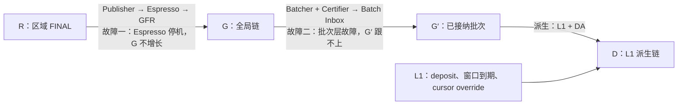
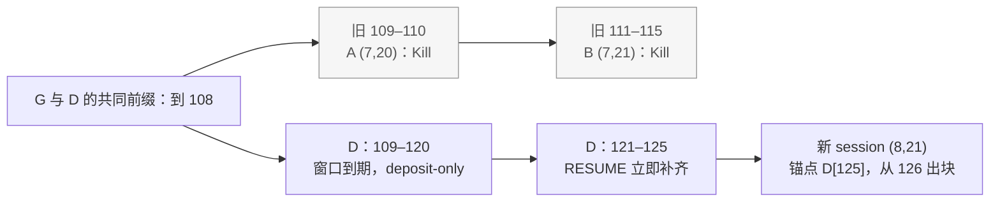
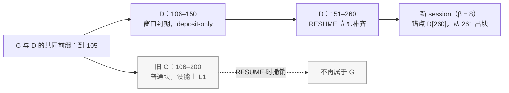

# 超出区域故障时怎样恢复：Espresso 停机与批次层故障

日期：2026-10-26。
本文面向汇报。它用一个贯穿始终的例子说明：故障超出单个区域时，新的轮换协议怎样保住已经结算的内容，又怎样重新出块。
依据：[Part 0 v0.7](part0_model_goals_zh_v0_7.md)、[Part 1 v0.2](part1_module_interfaces_zh_v0_2.md)。推导与审阅见[以 D 为准的恢复](d_anchored_recovery_zh.md)；例子沿用[10 月 20 日记录](../meetup_record/261020.md)。

## 0. 要点

- **区域故障**仍由 multisig M 的 Force 处理：从全局链 G 的末端换一个区域接着出块，不丢内容。本文讲比它更大的两类故障：**Espresso 停机**和**批次层故障**（batcher、DA 或 certifier 不能把块交到 L1）。
- 核心思想只有一句：**以 L1 派生链 D 为准。** 协议不预测、不补块；D 按 OP Stack 的原生规则自己补 deposit-only；恢复时把 G 换成 D，再从 D 的末端重新出块。
- 整个恢复只靠三条规则：**派生一致投票**、**Kill**、**RESUME(h)**。另外有一个参数：普通块必须在 10 小时内进入 G（R-EXP）。
- 代价有三项：长时间故障要靠 M 出手恢复；故障期间来不及上 L1 的内容会丢失；“全局最终”在紧急情况下可以被撤销。真正不可撤销的是 D。

---

## 1. 四条链与三级确认

| 链 | 是什么 | 谁算、用什么算 |
| --- | --- | --- |
| R | 区域已经 FINAL 的块，可以领先 G | 每个节点的 Session Manager |
| G | 全局链 | 任何人运行全局最终化规则（GFR），读 L1 与 Espresso |
| G′ | Batch Inbox 已接纳的块，即 cursor 以下的高度 | L1 合约 |
| D | L1 派生链，即 L2 最终结算的链 | 任何派生节点，读 L1 与 DA |

正常时它们一个跟着一个：`D ⪯ G′ ⪯ G ⪯ R`。
D 落后，只是因为提交和派生需要时间。

一个块依次经过三级确认：

| 级别 | 含义 | 能被什么推翻 |
| --- | --- | --- |
| 区域最终 | 区域委员会已经提交 | Force、过期、Kill、RESUME |
| 全局最终 | 已进入 G | 只有紧急情况下的 RESUME |
| 批次结算 | 已进入 D | 不能推翻 |

“全局最终”这个名字保留。它的意思是：sequencer 层已经定下来，非紧急情况下一定会结算。

---

## 2. 贯穿的例子

沿用 10 月 20 日的例子。区域 A、B 轮流出块，每个 session 出 10 块。

| 对象 | 进度 |
| --- | --- |
| A 的 session `(7,20)` | 从 100 出到 110，110 已经 FINAL |
| B 的 session `(7,21)` | 凭 110 接棒，已出到 115 |
| R | 115 |
| G | 108 |
| G′ | 105（106–108 的批次还在路上） |
| D | 105 |

下面两类故障都从这个状态开始。
它们是两种不同的后续，不能串成一次执行。

---

## 3. 规则一：派生一致投票——正常时 G 的块一定进入 D

**目标。** 只要 Espresso 和批次层都正常，G 中的每个块都会以**同一个块**进入 D：同一高度、同一 hash、同一状态。
新 session 要从 D 的状态接着出块，所以“同一个块”很重要。

**为什么要改投票。**
批次里没有 deposit。
派生从块的 L1 origin 自己取出 deposit，放在普通交易前面，再执行。
如果区域块的 deposit 和派生构造的不一样，D 中的块就和 G 中的块不同。
Certifier 也查不出来，因为它只核对普通交易、时间戳和 origin。

例：块 108 的 origin 是 L1 块 1000，L1 块 1001 里有一笔 deposit d1。
A 的 leader 提出 109，origin 前进到 1001，却漏掉了 d1。
如果成员照样投票，G[109] 没有 d1，D[109] 一定有 d1，两条链从此对不上。

**规则。** 诚实成员只为“放进 L1 派生一定原样通过”的块投票：

1. 包含 origin 要求的全部 deposit，顺序一致；
2. origin 合法：与父块相同或前进一块，且已在 L1 最终化；
3. 满足 sequencer drift，不能依据“还没看到下一个 L1 块”来放宽；
4. 执行有效。

**另一个前提：块进入 G 不能太晚。**
块进入 G 之后，batcher 要在 sequencing window（约 12 小时）结束前把它送上 L1。
所以 GFR 只接纳 10 小时之内的普通块（R-EXP）。
算一下：10 h 的接纳时限，加上 15 min 的处理余量、批次交付时间，再加上 origin 最多落后的 30 min，不超过 12 h。

---

## 4. 规则二：Kill——把不可能再进入 D 的 session 关掉

**原则。** 如果一个 session 已经不可能再进入 G 和 D，它所在节点的 Session Manager 就关闭它。

两种判死：

- **D 判死：** D 已经在某个高度定下了一个块，而这个 session 的链在那里不可能是这个块。比如 D 已经越过了它（D 在它要出的高度补了 deposit-only），或者 D 与它分叉了。
- **G 判死：** G 已经不可能再接它的块。比如它的下一个高度已经超过 10 小时，或者 G 在那里接了别的块。

**例子。** 当 D 在 109 补了 deposit-only：

- A 的 `(7,20)` 的链里有旧 109、110，被判死；
- B 的 `(7,21)` 从旧 110 接棒，链里也有旧 109、110，同样被判死；
- 提前进入的后继、还没进入的实例，也一并关闭。

**三个特点。**

1. **不误杀。** D 已派生的部分永远不变，所以被关掉的 session 确实不可能再进入 D。
2. **Espresso 停机时也能工作。** 停机期间 GFR 在等 Espresso，什么也决定不了；但 D 只依赖 L1，照常前进。Kill 是停机期间唯一能关闭旧 session 的依据。
3. **只是本地动作。** Kill 不改变 G，也不发 L1 交易。它只让诚实成员早点停下，不再产出注定要被撤销的块。实现上看一眼 L1 就够：Batch Inbox 的 cursor 超过一个 sequencing window 没有前进，就说明 D 已经越过或偏离了 G。

**GFR 一侧的对应动作：过期停住。**
G 的下一个高度超过 10 小时仍没有块，GFR 就关闭当前分支，G 停在那里，直到 RESUME。

---

## 5. 规则三：RESUME(h)——把 G 换成 D，从 D 的末端重新出块

M 在 L1 上发起 RESUME，指定一个未来的 L2 高度 h。

| 步骤 | 谁 | 做什么 |
| --- | --- | --- |
| 1 | M | 提交 `SubmitResume(c, P_new, h)`，P_new 是恢复后用的区域 policy |
| 2 | L1 Authority | 检查签名、序号和格式；把 Batch Inbox 的 cursor 直接移到 h（cursor override） |
| 3 | L1 派生 | 先处理此前已接纳的批次；再把 D 的末端到 h 之间立即补成 deposit-only，不等窗口到期 |
| 4 | GFR | 把 G 换成这时的 D：和旧 G 相同的部分不变，分叉点之后的旧块撤销；开出新分支 |
| 5 | Session Manager | 派生到 h，准备 h 处的精确状态，进入新 session |
| 6 | 新 session | 以 D[h] 为锚点，在 t(h+1) 准时出第一块 |
| 7 | Batcher、Certifier | 从 cursor h 接着提交新块 |

**为什么所有节点结论一致。**
RESUME 在 L1 上有一个固定位置，派生规则是确定的。
所以所有节点得到同一个 D，也得到同一个锚点。
下载慢的节点只是晚一点得到结果，结果不会变。

**为什么 h 要选在未来。**

- h 一定高于此刻 D 的末端，override 一定是“补到 h”；
- 留出约 20 分钟，让各节点准备好新 session；
- 新 session 从 h+1 开始就是实时出块，不用追赶。

**M 的操作规程**（M 诚实，合约不检查）：

1. 等 D 已经越过或偏离 G 之后才发，也就是 cursor 超过一个 sequencing window 没有前进。发早了会撤销本来能结算的内容。
2. 确认 Espresso 已经恢复；如果故障在批次层，确认 batcher 和 certifier 也已恢复。
3. h 高于 cursor 和旧 G 的末端；t(h) 比 RESUME 所在 L1 块的时间晚约 20 分钟，但不超过 30 分钟的 drift。
4. 新 policy 排除仍有故障的区域。

---

## 6. 走一遍：Espresso 停机

### 6.1 短停机：不到 10 小时，自动无损

Espresso 恢复时，109 还没超过 10 小时。

1. Publisher 重新发布 A 的 109、110 和 B 的 111–115。
2. GFR 照常接纳：先接 A 的块，再按正常交接接 B 的块。
3. Batcher 在窗口结束前把它们送上 L1。

结果：没有内容丢失，不需要 M，也不需要新锚点。

### 6.2 长停机：超过 10 小时，由 RESUME 恢复

| 阶段 | 发生了什么 | G | D |
| --- | --- | --- | --- |
| 停机开始 | Espresso 不再最终化新块；batcher 继续交付 G 里已有的 106–108 | 108 | 105 → 108 |
| 停机期间 | 区域还能出块，R 到 115，但发布不出去 | 108 | 108 |
| 109 的窗口到期 | D 在 109 补 deposit-only，之后 110、111…依次补 | 108 | 109 起依次为 deposit-only |
| 同一时刻 | 各 Manager 看到 D 越过 G：Kill A 的 `(7,20)` 和 B 的 `(7,21)`。这时 Espresso 还没恢复 | 108 | 109… |
| Espresso 恢复 | GFR 处理积压：109 已超过 10 小时，当前分支关闭，G 停住 | 108 | 已补到 120 |
| M 发 RESUME，h = 125 | cursor 移到 125；D 立即把 121–125 补成 deposit-only | 108 | 125 |
| GFR 处理 RESUME | G 换成 D：108 及以前不变，接上 109–125。这次没有撤销任何块，因为旧 G 本来就是 D 的前缀 | 125 | 125 |
| 新 session | 新 policy 选中 B，开出 `(8,21)`，锚点 D[125]，从 126 出块 | 126… | |

（高度只是示意。按时间算，D 的末端比 RESUME 早约 12 小时，h 则在 RESUME 之后约 20 分钟。表中假设停机超过 12 小时；停机在 10–12 小时之间时，Espresso 先恢复、窗口后到期，见 §8。）

停机期间用户还能做什么：普通交易暂停；强制包含交易照常经 L1 的 Deposit Portal 进入 D，会出现在那些 deposit-only 块里。

---

## 7. 走一遍：批次层故障

这次 Espresso 和区域都正常，只是 batcher、DA 或 certifier 停了。

### 7.1 在窗口内恢复：自动无损

batcher 在 106 的窗口结束前恢复，从 cursor 105 接着补交。
每个高度都按时进入 D，内容不丢。

### 7.2 超过窗口：由 RESUME 恢复

| 阶段 | 发生了什么 | G | G′ | D |
| --- | --- | --- | --- | --- |
| batcher 停止 | 区域照常出块，G 照常增长 | 108 → 200 | 105 | 105 |
| 106 的窗口到期 | D 在 106 补 deposit-only，而 G[106] 是普通块：D 与 G 分叉 | 200 | 105 | 106 为 deposit-only |
| 同一时刻 | 各 Manager Kill 所有还在出块的 session，G 停止增长 | 200 | 105 | 106 |
| 等待恢复 | D 继续用 deposit-only 补位，例如补到 150 | 200 | 105 | 150 |
| batcher 恢复，M 发 RESUME，h = 260 | cursor 移到 260；D 立即把 151–260 补成 deposit-only | 200 | 260 | 260 |
| GFR 处理 RESUME | G 换成 D：105 及以前不变；旧的 106–200 被撤销；开出新分支 β = 8 | 260 | 260 | 260 |
| 新 session | 锚点 D[260]，从 261 出块；batcher 从 cursor 260 接着提交 | 261… | | |

这里被撤销的 106–200 都曾“全局最终”。
它们没能在窗口内上 L1，D 已经在 106 用 deposit-only 定下来了，这些块永远不可能结算。
RESUME 只是让 G 承认这个事实。

---

## 8. 时间线：要等多久

参数：L2 出块间隔 1 s；sequencing window 12 h；接纳时限 10 h；drift 30 min；准备时间 20 min。
故障都从 day0 10:00 开始。

**Espresso 停机。**

| 停机时长 | 发生了什么 | 中断 | 内容 |
| --- | --- | --- | --- |
| 3 h | 13:00 恢复，原 session 接着出，batcher 在窗口内交付 | 3 h | 无损 |
| 11 h | 10:00 那一块在 20:00 过期；21:00 Espresso 恢复，GFR 处理这个过期，G 停住；约 21:45 窗口到期，D 越过 G；22:00 RESUME；22:20 新 session 出块 | 约 12 h 20 min | 停机期间区域出的块丢失 |
| 2 天 | day0 约 21:45 起，各节点在停机期间就已 Kill 旧 session；day2 10:00 恢复；10:01 RESUME；10:21 新 session 出块 | 约 48 h 20 min | 同上 |

**批次层故障。**

| 情形 | 发生了什么 | 中断 | 内容 |
| --- | --- | --- | --- |
| 6 h 后恢复 | 从 cursor 补交，全部在窗口内 | 无 | 无损 |
| 22:00 才恢复 | G 照常出块到约 21:40；21:40 窗口到期，D 分叉，Kill，G 停止；22:00 RESUME；22:20 新 session 出块 | 约 40 min | 10:00 到 21:40 进入 G 的内容被撤销 |

**简单记法：** 故障短于窗口（Espresso 停机短于 10 h，批次层故障短于 12 h），系统自动恢复，不丢内容。超过窗口，就在故障开始约 12 小时后由 M 用 RESUME 恢复。

---

## 9. 保证与代价

| 问题 | 回答 |
| --- | --- |
| 已进入 D 的块会被撤销吗 | 不会。override 保留已经派生出的前缀 |
| 全局最终的块会被撤销吗 | 只在紧急情况下由 RESUME 撤销，而且被撤销的只会是已经不可能进入 D 的块 |
| 安全依赖 M 吗 | 不依赖。一致性、最终性、有效性、快速确认、问责、质押安全（S1–S6）都不依赖 M |
| 恢复依赖 M 吗 | 依赖。超过窗口的故障，只有 RESUME 能重新开出 session |
| M 被腐化会怎样 | 它可以拒绝恢复，或用不必要的 RESUME 撤销尚未结算的 G 内容；它动不了 D |
| 所有节点结论一致吗 | 一致。RESUME 在 L1 上的位置固定，派生是确定的 |
| 故障期间用户能交易吗 | 普通交易暂停；强制包含照常经 Deposit Portal 进入 D |
| 依赖 DA 吗 | GFR 只在处理 RESUME 时读 DA。此前已接纳的批次数据取不回，就停下等待，不会猜 |
| 会丢多少内容 | Espresso 长停机：停机期间区域出的块。批次层故障超过窗口：从第一个没上 L1 的块起，到 Kill 生效为止，最多约 12 小时 |

---

## 10. 与上一版（v0.6）相比

上一版让 G 预测 deposit-only 块，再用时间公式算新锚点。
预测的块必须和 L1 将来填出的块逐块相同，这条要求很难证明，审阅中的许多问题都出在这里。

| 上一版 | 现在 |
| --- | --- |
| G 预测 deposit-only 块（R-DEP） | 删除：deposit-only 只由 D 产生 |
| 区域停摆后自动轮换（R-OVR） | 删除：10 小时内用 Force，超过就用 RESUME |
| 用时间公式算新锚点（R-ANCHOR） | 删除：锚点就是 D 的真实末端 |
| 批次失败后 G 改用 D 的块（R-FB），后续未定义 | 删除：统一由 RESUME 把 G 换成 D |
| STOP 加 RESUME，合约计算 N | 删除 STOP：只有 RESUME，h 由 M 给出 |
| batcher 为 deposit-only 高度提交空批次 | 删除：batcher 只提交 G 的普通块 |

GFR 的改动只有两处：处理 RESUME 时把 G 换成 D；G 的下一个高度过期时停住。
两类紧急故障走同一个恢复入口，不论 G 与 D 是因为什么分开的。

---

## 11. 还需要确认的事

1. **Kill 判据 (b) 的含义。** 原文后半句不完整，目前理解为“G 领先 D 时，session 还必须从 last(G) 派生”。
2. **派生一致投票的条件清单。** 需要在 Derivation 的 Part 中与 mega-espresso 的派生规则逐条核对。
3. **cursor override 的字段编码。** override 写入的 cursor 除了高度 h，还有位置、epoch 等字段，要在 Part 6 定义。
4. **准备时间。** 20 分钟能否覆盖各节点派生到 h、准备状态和进入新 session。
