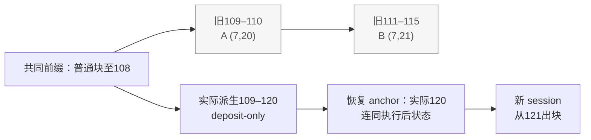
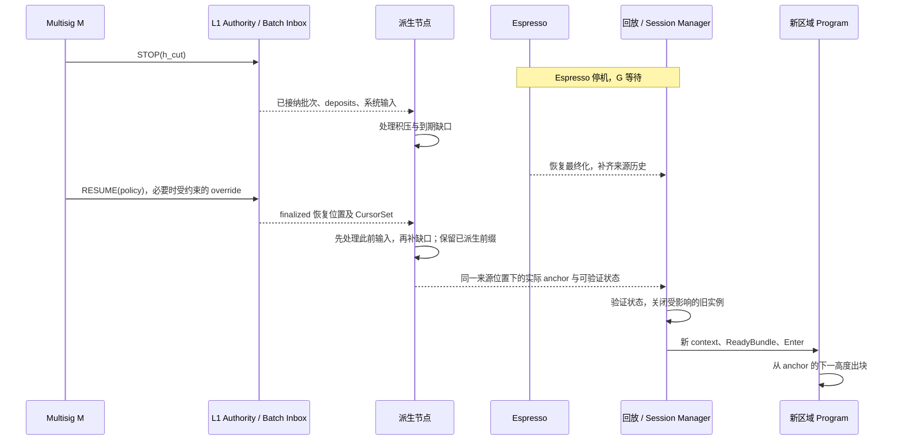

# Espresso 停机与恢复：谁继续工作，下一棒从哪里开始

我们希望 Espresso 停机后，已经确认的普通内容还能继续提交，用户仍能走 L1 强制包含；Espresso 恢复后，各区域从同一条实际链、同一个状态重新出块。

当前选择是：**停机期间允许 G 停止增长；L1 派生按原有规则处理积压批次和 deposit-only。恢复时，先处理这段历史，再确定新 session 的 anchor。**
M 可以通过 STOP 提交截断范围，再通过 RESUME 协调恢复；C 继续核对批次，不负责选择截断点。

本文沿用 [10 月 20 日记录](../meetup_record/261020.md) 的例子，解释 [Part 0 v0.6](part0_model_goals_zh_v0_6.md) 和[协议修订记录](protocol_revisions_zh.md)中的恢复方向。
各场景是同一起点的不同后续，不能串成同一次执行。
提前预测 deposit-only、RESUME 的合约守卫和 cursor 接续虽已写入当前方案，其组合保证仍需核对；下文把恢复必须满足的条件与这些优化分开。
名称沿用当前稿：Deposit Portal 是用户的强制包含入口，Batch Inbox 是 batcher 的批次收件箱。

## 1. 仍然用 A、B、100、108、110、115 这个例子

停机前的状态如下：

| 对象 | 当前进度 | 意味着什么 |
| --- | --- | --- |
| 区域 A 的 `(7,20)` | 从 100 生产了 101–110，配额为 10 | 110 已有 terminal FINAL receipt |
| 区域 B 的 `(7,21)` | 凭 110 的 receipt 接棒，生产到 115 | B 的执行 anchor 是旧 110 |
| 区域生产分支 R | 到旧 115 | 109–115 已有区域结果，但还没有全部进入 G |
| 全局链 G | 到 108 | sequencer 层已接受到 108 |
| L1 派生链 D | 到 105 | 106–108 的批次还在途中 |

这里多加了 D，是为了看清三种进度：**区域最终、全局最终、批次化后的 L1 派生结果。**
“批次已提交”“Batch Inbox 已接纳”“节点已解码并执行出该块”也不是同一个事件；本文用 D 表示最后一种结果，讨论固定的 finalized L1 历史。

Espresso 停机时，108 不会因此失去已有的 Espresso 证据。
但旧 109–115 即使有区域 FINAL，也不能跳过 Espresso，直接成为可认证的新普通批次。
这是 [mega-espresso 的 S9](../megaeth_specs/specs/block-certification/recovery.md#s9-espresso-liveness-failure) 给出的基本边界。

## 2. Espresso 刚停机，各方分别做什么

先区分两个事件：**节点暂时收不到新块**，以及 **M 在 L1 提交 STOP**。
前者是本地观察，不能直接确定公共截断点；后者才是协议控制输入。
STOP 已在 L1 记录，也不等于所有节点已经按全局回放顺序执行了 STOP。

| 参与方或规则 | 停机后的动作 |
| --- | --- |
| Block Builder | 保留待处理交易；只有当前 Program 仍获授权、parent 与 references 都合法时，才继续构块 |
| Session Program | 可以保留已经产生的区域结果；不能把 Espresso 沉默解释为新出块权限，也不能保证停机期间持续完成后续 session |
| Session Manager | 保管 G、R、anchor 状态和未完成任务；全局回放等待缺少的 Espresso 输入，不按本地 timeout 改写公共链 |
| Publisher | 保存完整区域结果和证明，保留重试任务；提交成功回执不等于 Espresso 已最终化 |
| Batcher | 优先交付 G 中尚未批次化的 106–108；剩余窗口仍足够时，这三块可以照常落到 L1 |
| Certifier C | 继续核对已有公开证据支持的批次及 DA 绑定；不为仅有区域 FINAL 的 109–115补授全局权限 |
| Batch Inbox 与派生节点 | 接纳满足规则的批次，取得数据后执行；没有合格批次的高度，在原生窗口条件满足后生成 deposit-only |
| 用户与 Deposit Portal | 用户仍可从 L1 投递强制包含交易；其执行随 L1 派生推进 |
| M 与 L1 Authority | M 观察故障并决定是否提交 STOP；Authority 记录通过检查的控制，供各方按共同规则处理 |

**停机本身不等于丢块。**
例如 batcher 在截止前交付了 106–108，D 就从 105 继续到 108。
需要新 Espresso 确认的 109–115 才是被阻塞的部分。

deposit-only 的普通交易列表为空，但仍有 deposits 和系统输入，也会改变执行状态。
这些块由节点执行派生规则得到，不需要 M 或某个 region 替它们出具区域 FINAL。

## 3. 情形一：很快恢复，原来的生产分支还能用

假设没有生效的 STOP 或其他关闭，109–115 仍满足普通接纳规则；它们的前置状态没有被 L1 派生替换，而且后续批次还有足够的剩余交付时间。
这才是这里所说的“短停机”；不能只按停了几分钟判断。

恢复流程如下：

1. **Publisher** 重试发布旧 109–115 的完整内容与区域证据。
2. **Espresso** 最终化这些记录；观察者读取完整 namespace 和适用的 L1 控制历史。
3. **Global Finality Rule** 从 G=108 继续：先接纳 A 的 109、110，再通过原有 regular handoff 接纳 B 的 111–115。
4. **Session Manager** 保留仍然有效的实例和签名记录。B 的 `(7,21)` 仍以 110 为初始 anchor，已经执行到 115，可以继续提出 116。
5. **Batcher、C、DA、Batch Inbox** 继续完成新增普通块的批次路径。

**这条路径不需要新 anchor。**
Espresso 恢复不会自动触发换区，也不会自动重建 B 的 session。
正常交接仍然是“用前驱初始 anchor 排班，从前驱 terminal DATA 接棒”。

## 4. 情形二：停机较久，L1 已经填了 109–120

仍从同一起点出发。
假设 106–108 的积压批次按时交付，但旧 109–115 一直没有可用批次。
在后续某个**共同确定的 finalized L1 来源位置**上，派生结果已经是：

| 高度 | 实际内容 |
| --- | --- |
| 100–108 | 保留的普通历史 |
| 109–120 | deposit-only，包含该段按规则派生的 deposits 与系统输入 |

此时 G 可能还停在旧 108，B 仍存着旧 115 的状态，但 D 已经到 120。
**恢复不能继续使用旧 110 或旧 115 的状态，也不能从 108 重新生产普通 109。**

Espresso 恢复后，要依次做四件事：

1. **先核对公开历史。** Publisher 可以交付此前未最终化的材料；观察者仍按 Espresso 日志与控制的共同顺序处理。旧记录现在最终化，也不能把 L1 已确定的 deposit-only 109 换回普通 109。
2. **再接续实际派生结果。** 回放与 Manager 确认 109–120 的真实内容、L1 origin、parent 和执行状态。不是把这十二个高度简单标成“空”。
3. **关闭受影响的旧实例。** A 的旧 session，以及从旧 110 提前启动的 B，都不能继续授权新链上的输出。Manager 保留历史证据，但取消旧实例的提案、投票和 timer 权限。
4. **从 120 创建新实例。** 若当前 policy 仍选择 B，新实例必须有新的身份和 context；例如恢复开设 `(8,21)`，以实际 120 为 anchor，准备 `st(120)`，Ready 后 Enter，首块为 121。

这里的 `(8,21)` 用来说明它与旧 `(7,21)` 是两个实例；正式编号由同一个公开恢复事件固定，不能由各节点自己递增。
新分支的第一棒用恢复 anchor 同时作为选区参考块和执行起点，即 `E=A=120`。
旧 B 用 100 排班、从旧 110 接棒的那套 context，不能搬到新链上。

**anchor 是一个精确的块和状态，不是一个高度数字。**
写成 `A_rec = 实际派生的120`，意味着固定它的 hash、parent、L1 origin、执行后状态及来源证据。
所有节点必须在同一个恢复来源位置上取得它；各自读取“当前最新 D”可能分别得到 120 和 123，不能据此启动同一个 session。

自动越过故障区域的 R-OVR 可以触发这条路径，M 不必每次介入。
但它解决的是下一棒的生产责任；batcher 仍需处理 Batch Inbox cursor、遗留 channel 和记录扫描起点，不能由“D 已到 120”推出“Batch Inbox 已准备接纳 121”。
按当前 R19，Builder 不跨区域转发待处理交易；换区后客户端要向新的负责区域重提，并按新状态检查 nonce 和有效性。

## 5. 情形三：M 提交 STOP，再用 RESUME 协调恢复

M 的作用是**提交公共控制，停止旧生产权限，并协调恢复范围**。
M 不提供一个可以直接信任的 state root；C 也不签发恢复 anchor。

### STOP：先限制后续旧内容

M 向 L1 Authority 提交 STOP，包含序号、目标上下文及截断高度 `h_cut`。
Authority 检查授权、序号和协议规定的截断条件，然后把控制记入 L1。

**`h_cut` 表示旧普通内容的接纳上限，不是要求所有人回滚到这个高度，也不是恢复 anchor。**
它必须与已经接受的公共历史相容；M 不能凭一次签名抹掉已派生的 L1 前缀。

停机期间，各节点可以取得并缓存 STOP，停止没有继续价值的本地生产任务。
但按照当前 R-WAIT 的设计，STOP 的公共回放效果仍要放在共同事件顺序中；不能把“我先收到 STOP”作为修改 G 的依据。
G 等待 Espresso，L1 则继续处理积压批次与到期缺口。

### RESUME：先处理 L1 输入，再固定锚点

Espresso 恢复后，M 提交 RESUME 与新的区域 policy。
当前方案由 Authority 的受约束路径调用 Batch Inbox 的 cursor override，越过已放弃的缺口。
这条路径的完整字段与安全论证仍需落实，不能把原有 admin 的任意 override 权限直接当作“只影响活性”。

沿用刚才的长停机例子：假设在共同恢复位置，D 已到 120，而合法 override 的目标为 `N=125`。

| 步骤 | 谁做 | 本例的结果 |
| --- | --- | --- |
| 1. 记录恢复控制 | M、Authority、Batch Inbox | L1 记录 RESUME，以及适用时的 `CursorSet` |
| 2. 处理 override 之前的输入 | 派生节点 | 先取回并处理此前已接纳的 payload，执行其完整 channel |
| 3. 处理 channel reset 和缺口 | 派生节点 | 按规则清理被放弃的未完成 channel；缺失的 121–125 填为 deposit-only |
| 4. 固定恢复边界 | 全局回放、Session Manager | 对同一来源位置确认实际派生末端及旧 context 的关闭 |
| 5. 准备新 session | Session Manager、Builder、Program | 在新 policy 下准备 `st(125)`，新实例 Ready / Enter，从 126 生产 |
| 6. 恢复两条交付路径 | Publisher；Batcher、C、DA、Batch Inbox | 普通结果重新经 Espresso 进入 G，再按新的批次 cursor 继续交付 |

**如果处理此前输入后，D 已经到了 128，override 不能把它拉回 125。**
此时恢复必须承接已确定的 128 及其状态，从 129 继续；各方要据此统一恢复 context 和 batcher 的接续位置。
这正是现有 [Emergency Cursor Overrides](../megaeth_specs/specs/rollup/derivation.md#emergency-cursor-overrides) 的要求：cursor 的目标不能替换实际 L2 parent。

如果 RESUME 提交时 Espresso 仍未恢复，L1 侧可以先处理它，但普通生产仍须等待 Espresso 及公共恢复边界。
重新看见一个 Espresso 块，只能说明来源开始前进；不能替代状态准备、cursor 接续和新实例的 Enter。

## 6. 情形四：连 106–108 都没有按原内容派生

前面的长停机例子假设积压的 106–108 成功交付。
如果这一步失败，就要从更早的位置重建状态。

| 106–108 遇到什么 | 派生如何处理 | 恢复时意味着什么 |
| --- | --- | --- |
| 在原生窗口结束时，仍没有可消费的合格批次 | 按原生规则决定 deposit-only 替代 | 106 起的状态可能改变；旧 108 和它后面的执行状态都不能直接复用 |
| L1 已接纳必要 payload，但节点取不回它 | 停在该输入等待，不能跳过 | 还没有一个可用的后续 anchor；过期、STOP、override 都不能把未知数据当作空内容 |

第二行来自现有 [DA 取回规则](../megaeth_specs/specs/rollup/data-availability.md#batch-commitment-resolution)。
因此，“Espresso 停机时 L1 继续推进”有一个前提：L1 派生没有被此前已接纳但不可取得的数据堵住。

同样，后续所有高度也不一定全部变成 deposit-only。
若已有部分后续批次，它们须针对实际派生 parent 逐个验证：能保留的保留，需要替代的才替代。
恢复 anchor 应继承这条可能混合普通块与 deposit-only 的实际链，正如 [Recovery S4](../megaeth_specs/specs/block-certification/recovery.md#the-sequencer-follows-the-derived-chain) 所要求的。

## 7. 写协议时，需要固定的三个边界

**第一，固定 STOP/RESUME 与旧 Espresso 记录的公共顺序。**
迟到记录按其真实来源位置处理；本地收到消息的先后不产生另一条顺序。
M 提交截断，但节点和合约仍须强制相同的接纳规则。

**第二，固定新 anchor 的内容和状态。**
必须同时给出公共恢复来源位置、精确块、L1 origin 和可执行状态。
`h_cut`、override 的 `N`、Batch Inbox cursor、实际派生末端各有不同用途，不能相互代替。

**第三，区分“已经派生”与“预测将会派生”。**
当前 R-DEP / R-ANCHOR 想提前补位，减小恢复等待，这是一个额外优化。
但“普通交易都为空”本身不能保证块相同：还要有相同 parent、origin、deposits 和执行结果。
OP 的空批次规则还包含 epoch 边界条件，不能只用固定 L2 block time 算出一个高度就认定锚点已经安全。[OP 派生规范](https://specs.optimism.io/protocol/derivation.html#batch-queue)

所以，这份例子先抓住已经明确的恢复要求：**没有分歧就继续原 session；L1 已填充或替代了历史，就从同一公共边界下的实际链重新准备新 session。**
提前补位能否在所有并发情形下得到同样结果，单独在[恢复审阅记录](espresso_recovery_review_zh.md)中检查，不作为本文默认已经证明的前提。
