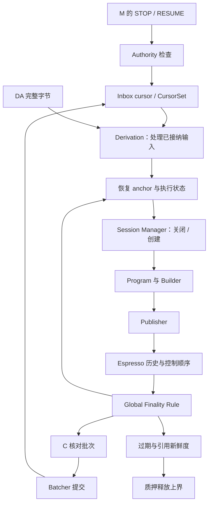

# Espresso 恢复设计审阅：取舍、反例与并发风险

审阅日期：2026-10-26。
配套阅读：[恢复流程说明](espresso_recovery_pipeline_zh.md)。

**结论：停机时保住可交付的积压、允许 L1 按原生规则补位、恢复后承接实际派生状态，这个方向合理；但目前不能声称恢复规则已经闭合。**
有些问题是证明缺项，有些是现有规格直接否定的推断。
尤其是“cursor 前进等于派生完成”“已接纳 DA 数据等过期就能跳过”“算出新 anchor 的高度就得到正确状态”，都不能作为后续协议的前提。
复核新补全的 Part 1 后，还发现一个直接影响公共回放一致性的规则：Plan 缺材料时，跳到下一 Espresso 块重算 anchor，会把数据到达先后带入协议决定（F13）。

这不是要求退回方案 B，也不是反对已经接受的 P1、P2、D9–D11。
我们可以接受批次失败后的恢复和条件化确认；需要补清的是：**什么证据触发恢复、到底改哪段状态、哪些旧权限随之失效。**

## 1. 本次检查的范围

审阅从 [Part 0 v0.5](part0_model_goals_zh_v0_5.md) 与当时的修订记录开始。
检查期间工作区更新出了 [Part 0 v0.6](part0_model_goals_zh_v0_6.md)、R1–R20 和补全后的 [Part 1](part1_module_interfaces_zh.md)，本稿已复核这些变化；结束核对时的版本哈希见文末。
其他依据是本地 mega-espresso 的 recovery / inbox / derivation / DA 规格，以及 v3 的 session 和 authority 规则。
这些都是设计与接口草稿，不当作已经实现和验证的协议。

本次保持以下边界：

- L1 和 Espresso 的 finalized 历史仍安全；不构造伪造 L1 或 Espresso 最终性的攻击。
- C 诚实；不靠伪造 C 签名制造反例。
- M 可以恶意；这是 D2 要覆盖的情形。
- Espresso 可以停止最终化；DA 可以暂时不可用；batcher 可以拖延；这些都在当前故障范围内。
- 涉及区域保证时，仍遵守对应的拜占庭权重界、同步与持久化条件。
- 例子仍用 A 的 `(7,20)`、B 的 `(7,21)`，以及停机起点 `R=115、G=108、D=105`。

下文的 **Critical Error（明确错误）** 指某条断言或推导已有反例，不自动表示已经证明整套共识会分叉。
**Justification Gap（规则或证明缺口）** 指现有材料不足以推出保证；我不会把它写成已经成功的攻击。
有意允许的停机、治理审查和批次内容丢失，单列为设计代价。

| 编号 | 核心发现 | 分类 | 主要影响 |
| --- | --- | --- | --- |
| F1 | inbox cursor 不是实际派生末端 | Critical Error | RESUME 就绪判断、anchor、回退触发 |
| F2 | 已接纳但不可取得的 DA 数据不能被 timeout 跳过 | Critical Error | 强制包含和恢复的活性声明 |
| F3 | 相同高度、空交易列表，不足以证明 DEP 块相同 | Justification Gap | R-DEP、R-ANCHOR 与 L1 的对应 |
| F4 | 只检查 override 高度，不足以证明 M 只损失活性 | Justification Gap | 完整 cursor、批次选择和恢复权限 |
| F5 | 回退父块后，只重置 R 不足以恢复 session 与证书语义 | Critical Error / Justification Gap | 后续块有效性、锁、签名与生命周期 |
| F6 | 时间公式选出的 anchor 不必等于 override 目标或实际 D | Critical Error / Justification Gap | 新实例从错误或尚未确定的状态开始 |
| F7 | 自动越过没有完整处理提前启动的后继 | Justification Gap | 同一 session 身份出现不同 anchor |
| F8 | Force 的两种排序规则冲突，其他控制还有并发缺项 | Critical Error / Justification Gap | 旧 Force、STOP/RESUME、边界时刻的接纳 |
| F9 | P2 的时间上界还没有覆盖全部引用和责任 | Justification Gap | 解锁、历史证据与数据保管 |
| F10 | “有诚实 batcher”不足以给出成功交付上界 | Justification Gap | 方案 A 的交付预算与恢复时间 |
| F11 | v0.6 已把换区重提明确为客户端责任 | 已澄清的取舍 | 不能继续承诺跨区自动转发 |
| F12 | 记录 Rec 一致不等于可回退的 G 满足标准 SMR 最终性 | 已接受的取舍，需准确表述 | 对外承诺、性质依赖与恢复边界 |
| F13 | Plan 的 WAIT 让快慢观察者重算出不同 anchor | Critical Error | 同一恢复事件的回放、context 与 Rec 一致性 |

## 2. 先看跨模块依赖：哪里出问题会传到哪里



这张图中的循环不一定有错，但不能用循环中的下一步反过来证明上一步已经成立。
例如，“C 以后只认证 G 的 DEP 内容”不能单独证明“现在生成的 DEP 必然等于已经存在或以后 fallback 得到的 L1 块”。
先前已接纳的输入、parent、origin 和 fallback 规则都还要检查。

## 3. 逐项检查

### F1：cursor 已经到 110，不代表 L2 已经派生到 110

**位置。** 修订记录 §2.1、§3.6；Part 1 §4.2.10。
关键推断是：“cursor 已不低于 `h_cut`”，所以“截断以下的高度已由 L1 定下来”。

**反例。**

1. Batcher 提交一份得到 C 认证的批次，内容与 Espresso 记录一致。
2. 提交已经晚于这些块的 sequencing window。现有 inbox 仍可以接纳它，并推进 cursor。
3. 派生会把迟到批次丢弃，对缺失高度执行 fallback。

全过程不需要破坏 C，也不需要 L1 出错。
本地 [batch-inbox 规格](../megaeth_specs/specs/block-certification/batch-inbox.md#security-considerations) 第 674–677 行明确允许这种情况。
另一个更直接的例子是：cursor 已推进，但派生节点还取不到被接纳的 payload，D 仍停在 105。

**结论：这个推断是 Critical Error。**
cursor 可以证明某个接纳事件发生过，不能证明目标块已按原内容执行，也不能证明恢复状态已经可用。
这不等于 `SubmitResume` 提前成功必然造成分叉：若后续派生严格等待，安全仍可能保住。
但草案不能据此直接声称 RESUME 已准备好、anchor 等于 N、或者恢复已经完成。

R-FB 也有同一问题。
它现在只检查“截止前有没有接纳”，但合格内容必须经过必要的 channel、batch validity 和执行处理；仅有 `CursorAdvanced` 不是按内容保留的充分条件。

### F2：已经接纳的 DA 数据取不回，连强制包含也可能被堵住

**位置。** 修订记录 §3.8 第 4 项；Part 0 §4.2 的 L2-L2 及其依赖表。
旧文一处说等待超过截止可以触发回退，另一处说 L1 强制包含只依赖 L1、不依赖 DA。

**反例。**

1. 106–108 对应的 payload 已被 L1 接纳；节点必须按 L1 顺序先处理它。
2. DA 暂时无法交付该 payload，节点不能验证和执行 106–108。
3. 后面出现了一笔用户的 force-inclusion 交易，也出现了 M 的 RESUME / `CursorSet`。
4. 根据现有规则，派生仍停在前面的 payload，不能越过它处理后面的控制和用户输入。

DA 不可用时长可以超过原稿宣称的包含上界，同时 L1 一直正常工作。
因此 L2-L2 的“只依赖 L1”在当前 DA 集成下不成立。

**这是 Critical Error，影响活性结论，不是已证明的安全攻击。**
安全处理恰恰是继续等待。
若实现按草稿文字把未知 payload 当作没有普通内容，就会与已经取到数据的节点产生不同的派生结果。

[DA 规格](../megaeth_specs/specs/rollup/data-availability.md#batch-commitment-resolution)和 [override 派生规则](../megaeth_specs/specs/rollup/derivation.md#emergency-cursor-overrides)都明确禁止这种跳过。
需要区分“未交付批次”和“已经接纳但暂不可取得”，不能用同一个 timeout 解释二者。

### F3：DepFill 的相等性是核心证明义务，目前还不是可用的事实

**位置。** 修订记录 §2.6、§2.7、§3.1；Part 1 §3.2 第 403 行。
原稿写：“无论窗口过期、空批次还是 override，得到的都是同一个块。”

这个结论至少需要相同的实际 parent、完整派生状态、L1 来源、origin 选择、deposit 列表和执行规则。
只知道高度和普通交易列表为空不够。

例如父块 origin 为 e，下一 L1 块 e+1 已有一笔 deposit，且它的时间戳不晚于下一 L2 时间戳。
在 drift 允许的范围内，一份普通空批次可能仍声明 origin=e；fallback / override 的补位可能采用 e+1。
前者暂不执行那笔 deposit，后者执行，块和状态就不同。
R16 要求空批次采用 DepFill 的 origin，可以排除这一种选择差异，但仍须证明其他分支也一致。

另有两处必须逐条对照：

- OP 的 batch queue 对 epoch 首个块有特殊处理，简化成“能推进就推进”并未涵盖全部状态。[OP batch queue](https://specs.optimism.io/protocol/derivation.html#batch-queue)
- mega-espresso 的执行失败替代保留失败 payload 的 origin；它明确不同于 batch-validity 失败时重新选 origin 的规则。[执行失败替代](../megaeth_specs/specs/rollup/derivation.md#channel-retention-after-execution-rejection)

**分类：Justification Gap。**
不是已经证明所有 R-DEP 都错误，而是现有文本没有证明它适用于所有会被调用的状态。
依赖这个相等性的“提前 anchor 已安全”“override 不改变 G”“自动恢复不必等实际派生”都应标为尚未验证。

### F4：限制 M 的 override 高度，还没有限制完整 cursor 的含义

**位置。** 修订记录 §2.1、§3.6；Part 1 §2.8、§4.6.4；mega-espresso 的 `Cursor` 与 override。

原来的 cursor 不只包含 L2 高度，还包含记录扫描位置、origin 和 Espresso quorum 等验证上下文。
上游规格明确提醒：仅检查向前移动，不能保证后续选中的普通内容正确；错误的扫描起点会跳过原记录并改变后续选择。

**潜在攻击路径。**
如果实现只把 admin 换成 Authority，却仍让不受验证的扫描位置或证明上下文进入 `Override(next)`，恶意 M 就可能通过一条高度合法的控制改变恢复后的记录选择。
这不是伪造 C：诚实 C 可能被要求从一个错误的恢复位置开始验证。

Part 1 提议把原 Espresso cursor 字段改成 GFR 回放位置，因此不能直接断言上游攻击原样成立。
但新的完整编码、来源证明、旧证书失效规则还没有写出来；目前 `SubmitResume` 只算出 N，并不能据此构造一份已证明合法的完整 next cursor。

**分类：Justification Gap，而不是已证实的当前实现攻击。**
需要明确到底继承哪种 cursor、哪些字段由规则推导、哪些由 M 提交，以及每个消费者怎样核验。
“M 只影响活性”是这些检查共同建立的结论，不能当作证明它们安全的假设。

### F5：父块被替换后，旧证书和 session 不能只改一个 G 指针就继续用

**位置。** 修订记录 R-FB；Part 1 §4.3.6：`Replaced(h)` 只要求“把生产分支 R 重置到新的 G”。

**执行例子。**

1. G 已包含旧 106–115；B 的 `(7,21)` 绑定旧 110 的 hash 和执行状态。
2. 106 的批次未按要求交付，D 在 106 处采用 deposit-only。
3. 即使后面 107 的普通交易列表被保留，它现在执行在另一条 parent 历史上；块 hash、state root、origin 或交易结果可能改变。
4. B 的旧投票、锁和 FINAL 绑定的仍是原 context 和原 block hash。

**明确错误的部分：不能从“普通交易列表保留”推出“原区块和原 FINAL 仍然有效”。**
若直接把重执行后的块继续标为原 session 已认证的完整 DATA，就没有对应签名；若保留原块体，它的 parent 又可能不接新的链。

**尚缺的部分：** R-FB 的生命周期效果。
哪些 Program 必须关闭，已经准备的后继状态何时作废，遗留 Publisher / Batcher 任务如何识别旧 context，新的 session 身份何时建立，目前没有完整转移。

这会影响 S3、S4 和 Manager 的隔离保证。
它不能用“G 允许回退”一笔带过；允许回退后，更需要精确规定回退的状态范围。

### F6：时间公式只能给候选高度，不能自动给出恢复后的实际块

**位置。** 修订记录 §3.3：`h_A=max(h(last(G)),h_det(θ))`，随后声称 `t(h_A)≤θ-M_a-δ_c`。

**这个上界本身有直接反例。**
取 `t(h)=h`，`θ=100`，`M_a+δ_c=10`，当前 G 已到高度 95。
公式给出 `h_det=90、h_A=95`，但 `t(h_A)=95>90`。
正常情况下 G 比这个时间下界更靠前，恰恰就会出现这种情形。
这说明该上界证明无效，不说明复用已验证的 G tip 本身不安全。

另外，RESUME 在 L1 算出的 N 与之后 Espresso 块算出的 `h_det` 使用不同时间。
Espresso 块晚几个 L2 block time 到达，就可能有 `h_det>N`；“通常相同”不能作为协议不变量。
Part 1 的 O-4 现在直接要求二者相等，已有算术反例：取 `t(h)=h、ts(b_R)=100、M_a=10、δ_c=1`，则 N=99；若第一个跨阈值块的 θ=112，而 G 不高于 99，则 `AnchorHeight=101`。
Espresso 没有承诺其时间戳恰好等于激活阈值，因此这不是违反网络或时钟假设的情形。

再看实际状态：若 override 目标是 125，而处理此前输入后 D 已到 128，规范要求保留 128。
因此，恢复还需要固定公共来源位置，核对已有派生前缀、精确块和执行状态；不能让各节点取自己的 latest，也不能把 N 直接当作 parent。

**分类：上界推导是 Critical Error；完整恢复 anchor 的定义是 Justification Gap。**
候选高度之前尚未实际派生的部分仍依赖 F3，不能把它的结论提前用掉。

### F7：自动越过 A 时，提前启动的 B 也必须被处理

**位置。** 修订记录 R-OVR 写“关闭 s”；Part 1 的 Manager 又要求同一 `(β,r)` 不得安装两个不同 handoff。

**并发例子。**

1. A 的 `(7,20)` 已把 110 的 receipt 交给 B；B 的 `(7,21)` 从旧 110 出块到 115。
2. 公共 G 仍到 108，109 的公开接纳过期，R-OVR 越过 A。
3. R-ANCHOR 准备以 120 开出下一棒，policy 又选择 B。

如果仍用 `(7,21)`，Manager 必须拒绝新 handoff，因为该身份已绑定旧 110。
若实现原地换 anchor，则违反隔离规则，已有 votes、locks 和签名槽不能解释为新实例状态。

**分类：Justification Gap。**
自动越过必须明确关闭哪些推测性后继、如何分配新身份、如何保留旧证据。
正常 Force 已有关闭整个旧分支的做法，但不能默认 R-OVR 已经继承了这套效果。

### F8：Force 的排序有直接冲突，其他并发边界也未完全对齐

**位置。** 修订记录 §2.1、§2.6；Part 1 的 `StopEffective`、`Replaced`、`SessionClosed`。

**先记录一个合理的局部论证。**
L1 时间戳严格递增，且合约强制 Force 提前公告时，R-WAIT 对“还有没有更早的 L1 控制尚未看到”给出了可检查条件。
Espresso 时间戳非减，观察到一个时间戳达到 x 的块，也能封住所有时间戳小于 x 的前驱；这部分思路可以保留。

但下面几种情况仍缺明确效果：

**先看新 Part 1 的排序冲突。**
§2.9 规定按事件键排序，Force 的键是 θ_a；§5.2 又要求在 Espresso 块内，把所有已到期 Force 按序号依次执行。
SubmitForce 没有要求 θ_a 随序号递增。
于是 M 可以合法提交 `U41: θ_a=200、target=7、policy=B` 和 `U42: θ_a=150、target=7、policy=C`，再遇到一个从时间戳 100 跳到 250 的恢复块。
按键应先执行 U42，得到 policy C；按序号则先执行 U41，得到 policy B。第二条控制都可能因 target 已旧而成为 stale。
这两套文字不能同时成立，属于 **Critical Error（规则冲突）**；它不是证明每一种统一选定排序的实现都会分叉。

| 并发情况 | 当前风险或缺项 |
| --- | --- |
| Force 在 STOP 之前已提交，但激活时间落在 STOP 之后 | 合约只在提交 Force 时检查未 STOP；尚未定义这条待激活 Force 是取消、stale，还是继续执行 |
| RESUME 与 `CursorSet` 在同一 L1 交易中产生不同日志 | 派生与全局回放需要一致的原子边界，不能只分别写两个 handler 而不交代中间状态 |
| 旧 session 的 REC / quit 证明在关闭后才 finalized | 可以继续记账或处罚，但不能凭新 REC 复活已关闭 Program |
| STOP 已被某 Manager 看到，尚未在公共回放生效 | 提前停止本地工作可以是活性选择，不能让它改变其他观察者的公共接纳结果 |
| RESUME 后、batcher 尚在使用旧 cursor 或旧 C 证书 | 需要明确哪些请求因 prev 不匹配被拒，哪些历史证书虽然密码学有效却已无接纳权限 |

**还有一个明确的边界冲突。**
R-EXP 允许 `θ=t(h)+W_exp`，但同键排序是“时间事件先于 Espresso 块”。
若这个高度尚缺，时间事件先填 DEP，随后恰好压线到达的普通块就不能接纳了。
这至少意味着接纳谓词与到期文字不一致；不直接证明观察者会分叉，因为所有实现严格采用同一优先级仍可得到一致结果。

其余事项属于 **Justification Gap**。
总排序解决“谁先处理”，还需要每条事件在当前状态下的适用性、stale 结果和关闭效果。

### F9：P2 可以保留方向，但“没有新签名能生效”不等于“旧责任都已清完”

**位置。** 修订记录 §2.1 的释放公式；Part 0 §1.3；Part III v6 §4 的证据与保管义务。

P2 的有用部分是：若每个可能使用旧权重的 session 都有一个可由 L1 上界的截止，且过了该截止才产生的签名不可能进入合格的 Espresso 对象，那么新腐化的旧密钥不能获得新的生产权。
在其条件成立时，时间上界的思路并不需要 L1 重放 Espresso。

但目前至少缺三项：

1. **所有 anchor 类型都要进入同一个上界。** R-FRESH 当前写给普通块；恢复 session 的 E 可能是 DEP，Part 1 的 DEP 信封没有完整定义授权引用 λ。不能直接把普通 E 的新鲜度推导套到它上面。
2. **证据窗口从什么时候计时。** `T_slash≤T_ev` 只处理证据已到达诚实方后的提交速度。一个在截止前提出、很久后才最终化或可取回的 Espresso 块，可能在释放后才暴露旧责任。必须说明可追责证据何时已有诚实持有者，以及不依赖停机 Espresso 的交付条件。
3. **数据保管不能跟着 Program 一起消失。** 关闭或解锁之后，恢复节点仍可能要读取旧块、状态和证据。旧 v3 明确要求释放前完成数据交接，单个时间公式没有替代这项义务。

**分类：Justification Gap。**
我没有在保留 A-TS 的前提下构造“释放后新签名钻进已固定旧块”的攻击；旧块内容绑定会阻止它。
这里未证明的是覆盖所有 session 的截止，以及追责和保管已经完成。
不能把“尚未证明无 C 解锁”写成“必须依赖 C”。

### F10：有诚实备用 batcher，也可能一直拿不到完成一次交付的机会

**位置。** Part 0 A-RELAY、L2-L1；修订记录 §3.7 的交付预算。

**可用的活性攻击。**
恶意 primary 只提交一部分合法 frames，不把 channel 完成；诚实 alternative 必须等待独占窗口和 channel 条件。
如果 primary 能反复开 channel、拖住、再放弃，仅有“至少一个诚实 batcher 存在”不保证目标批次能在剩余窗口内完成。
每次提交都可以得到诚实 C 的认证：问题是能否完成全部交付，而不是某个 frame 的内容是否伪造。

上游 [full-node 条件](../megaeth_specs/specs/block-certification/full-node.md#conditions-under-which-it-holds)已经把及时完成整个 channel、必要时处理反复拖延的 primary 列为额外前提。

**分类：Justification Gap，具体攻击影响活性。**
A-RELAY 的“存在诚实方”与“它能成功完成一次交付”需要分开。
方案 A 的预算还必须覆盖排队、接手、完整 channel、L1 执行成功及取回，而不是只加几个 RPC 时间。

sequencing window 本身按 L1 区块位置判断。
把 `seq_window_size` 换成一个近似小时数，不能直接作为恶意调度下的截止证明；每个块还已经消耗了一部分窗口。[OP 派生规则](https://specs.optimism.io/protocol/derivation.html#batch-queue)

### F11：v0.6 已明确换区后由客户端重提，这是取舍，不再按旧目标判错

**位置。** Part 0 v0.6 的 L-tx、R19；Part 1 §4.1.1。
v0.5 允许向任一在线诚实成员提交后主张包含，与 Builder 不转发的接口冲突。
v0.6 已把目标改为向负责区域提交，并在换区后重提；这消除了这一版本间冲突。

**执行例子。**
用户把 tx 交给 A，A 在停机前尚未包含它。
恢复后改由 B 出块，A 保存了 tx，但不会转发；用户也没有重提。
即使 B 诚实、A-LEAD 成立、系统负载很低，B 的 Builder 也未必知道 tx。

**分类：已经澄清的设计取舍。**
这个执行不再反驳 v0.6 的条件性活性，因为用户没有履行重提前提。
恢复说明需要准确表达客户端重提、重试幂等和 nonce 变化；已经在原轨迹执行过的交易也不能直接当作在新状态下一定有效。
Deposit Portal 可以提供另一条输入路径，不能自动补上普通 RPC 提交的转发承诺。

本文其他地方所说的强制包含入口，统一对应当前命名 Deposit Portal；批次收件箱对应 Batch Inbox。

### F12：Rec 保持前缀一致，是一种恢复记录保证，不是 G 的严格不可撤销

**位置。** Part 0 §3.2 的 S1、S2 和“标准 SMR”的表述。

设观察者已经输出普通 106；后续派生合法地用 deposit-only 替代了 106。
把“接受普通 106”和“后来替换 106”依次写进 Rec，确实可以让 Rec 只追加。
但两个不同时刻输出的 G 仍然不满足标准的只追加 SMR 日志性质。

**这是已经接受的取舍，不以此判定设计必须改为方案 B。**
需要准确承诺的是 sequencer 对接受记录的确定性、允许的恢复条件、L1 派生安全，以及哪些确认级别允许变化。
如果批次失败后连精确 block hash 和 state 都可能改变，也不能只说“普通交易内容大体相同”来替代区块相等。

另外，DG1 写“不依赖时间界”，却把含 A-TS 的 L1-S / E-S 整体列作前提；STOP 的范围证明和 P2 又显式使用 A-TS。
应逐条标依赖，不能把逻辑上的记录一致、原生有效、G/D 对应和安全解锁合成一个“安全”标签。

### F13：Plan 缺材料时，不能让恢复 anchor 随下载进度移动

**位置。** Part 1 §5.2 第 1370 行：

> Plan 返回 WAIT：……到下一个 Espresso 块重试。重试时按当时的 θ_J 重新计算 h_A。

**两名诚实观察者就能出现不同结果。**

1. 同一恢复事件应在 J500 开新 session。此时 AnchorHeight 给出的候选是 120。
2. 观察者甲已经取得所需快照，Plan 成功：固定 anchor=120，输出 SessionAssigned。
3. 观察者乙暂缺该快照，进入规则允许的 WAIT，例如该快照迟发布，而乙正在实时回放，甲稍后才完整追赶这段历史。
4. 乙按现有文字继续到 J501，拿到材料后重新计算 anchor=125，并输出另一个 SessionAssigned。
5. 两者最终取得完全相同的账本历史，却为同一次恢复固定了不同 anchor、q_open，甚至不同 plan。甲后面已经产生的 121 普通块，还可能对应乙提前补入的 DEP 高度。

这里没有伪造来源，没有 C 作恶，也没有超出区域拜占庭界。
问题来自把“我现在拿到材料没有”变成了“这次恢复选择哪个公共边界”。
实时回放与稍后从完整历史重放，也会遇到同样差异。

**分类：Critical Error，直接破坏文中声称的回放唯一性。**
该反例针对规则允许 Plan WAIT 后消费下一 Espresso 步骤、重新定锚的字面语义。
如果作者实际意图是固定原步骤并在原位置等待，那是另一种语义，不能同时保留“按当时的新 θ_J 重新计算”的文字。
在这点澄清前，G-GFR-1、依赖它的统一 handoff 和恢复 context 不能视为已经建立。

## 4. 目前已能确认的局部保护

下面这些不是上述缺口的解决方案，但确实限制了攻击者能力：

- 原有 finalized L1 / Espresso 前缀不因停机丢失；晚到 publication 仍需通过 session 和连续性检查。
- inbox 的 prev-cursor 检查会拒绝许多已过时的并发提交；不能把普通的竞争回滚描述成攻击成功。
- 按完整 L1 事件顺序先处理已接纳数据，再处理 override，可以保护已经派生的前缀。
- Manager 的持久化关闭标记，以及签名绑定 cid，可以阻止单纯重放旧 ReadyBundle 或重用旧签名来启动新 context。
- 方案 A 允许未成功交付的内容落为 deposit-only，这是已接受的结果；C 诚实并不等于它能保证 batcher 按时行动。
- 恶意 M 反复 STOP、选择没有可用区域的 policy、或一直不 RESUME，属于 D2 允许的活性损失，不另报为安全漏洞。

## 5. 这几个设计取舍需要怎样理解

| 取舍 | 获得什么 | 要承担什么 |
| --- | --- | --- |
| 停机时暂停 G，等待 Espresso 恢复后统一回放 | 不用在停机期间猜测尚未封口的 Espresso 后缀 | G 的恢复依赖 Espresso 再次前进；L1 活性仍有前置数据可用性条件 |
| 方案 A，保留原生 fallback | 对原派生语义的修改较少 | 普通内容保留依赖成功交付，确认等级必须区分 |
| 直接承接实际派生 anchor | 已处理的普通块、deposit 与状态都有确定依据 | 需要等待必要输入和重建；不能用时间公式代替 |
| 提前预测 DEP 并启动下一棒 | 可能缩短停机后的等待 | 必须证明与所有允许的派生路径等价，当前 F3、F5、F6 尚未满足 |
| M 提交截断、C 不参与截断 | 治理与批次认证职责清楚 | 完整 cursor、截断范围和控制并发必须由可验证规则限制 |
| P2 按时间解锁 | L1 可自行计算时间条件 | 新鲜度、时间戳、证据交付和数据保管成为必要条件 |
| 自动越过故障区域 | 降低恢复对 M 的响应依赖 | 必须处理 speculative 后继、实例身份和所有区域都故障时的行为 |

最应先澄清的是：**实际派生结果怎样进入恢复边界、恢复边界怎样使旧上下文失效、M 能改变哪些完整字段。**
在这三件事未定之前，继续补接口名或声称所有模块可独立替换，会掩盖真正的依赖。

## 6. 审阅方法与验证范围

本次是逐条 source review、反例构造和并发依赖检查，没有运行协议实现、完整状态空间搜索或密码学证明。
对 F1、F2、F6 的错误推断，以及 F8 的排序冲突和 F13 的 WAIT 行为，已给出直接来源、算术反例或执行序列。
F5 区分了错误的区块复用推断与尚未写明的生命周期规则；其余缺口只标记尚未建立的性质，没有把缺失细则补成一个自创协议再宣布安全。

来源中的关键位置：

| 来源 | 使用范围 |
| --- | --- |
| `protocol_revisions_zh.md:50–82` | 控制守卫、RESUME 条件、释放公式 |
| `protocol_revisions_zh.md:108–182` | 合并顺序、R-DEP、R-ANCHOR、R-FB |
| `protocol_revisions_zh.md:306–347` | M 只影响活性的论证、预算、DA 边界情况 |
| `part0_model_goals_zh_v0_6.md:443–459` | Rec 与 G 的安全声明 |
| `part0_model_goals_zh_v0_6.md:576–598` | L2 对应与强制包含依赖 |
| `part1_module_interfaces_zh.md:380–404` | DepFill 接口与等价要求 |
| `part1_module_interfaces_zh.md:691–729` | STOP / RESUME 接口 |
| `part1_module_interfaces_zh.md:918–950` | Manager 的回退与关闭效果 |
| `part1_module_interfaces_zh.md:1321–1374` | Force 排序、R-FB、Plan WAIT 后重新定锚 |
| `part1_module_interfaces_zh.md:1587` | O-4 对 RESUME 两个锚点高度相等的要求 |
| `megaeth_specs/specs/rollup/derivation.md:94–173` | 替代执行、CursorSet、前缀保留 |
| `megaeth_specs/specs/rollup/data-availability.md:24–37` | 已接纳数据不可取得时等待 |
| `megaeth_specs/specs/block-certification/batch-inbox.md:674–705` | cursor 不保证派生、override 的安全条件 |

为方便后续对照，结束核对时三份稿件的 SHA-256 如下；后续修改不包含在本次结论内：

```text
part0_model_goals_zh_v0_6.md
262f08614bbc07b7b71fdec0a738a6e7383af09f22bd20f0407098ebb75e0560

protocol_revisions_zh.md
be844b3e2cbb885593f5fdaba15f3f73b4127fdc85831921b7c77b4b0ff16af2

part1_module_interfaces_zh.md
24bb17a6ac073437a6bef38eceb691a46dae8b617453fc40a3c05cfaa11e5521
```

这些发现没有直接改写 Part 0、Part 1 或协议修订记录；原设计与本次审阅可以分别比较。
