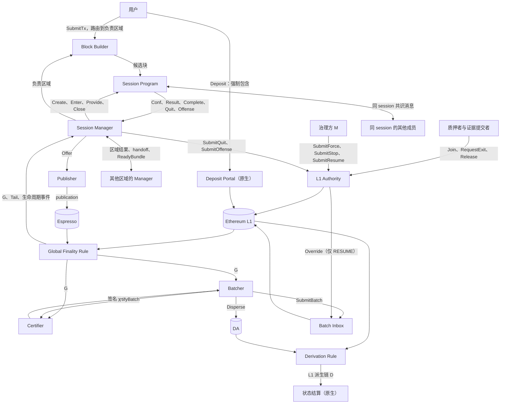

# MegaETH Sequencer Rotation 技术报告 · Part 1

## 模块与接口（中文工作稿 v0.1）

日期：2026-10-26。
状态：草稿。

本稿给出系统的模块划分、每个模块的接口与保证，以及模块之间如何耦合。
它不给协议框：每个模块的协议与证明在后续各 Part 中给出。那些 Part 先复述本稿的对应小节，再实现它。

前置文档：

- [Part 0 v0.6](part0_model_goals_zh_v0_6.md)：模型、假设与设计目标；
- [协议修订记录](protocol_revisions_zh.md)：对协议本身的修订 R1–R20。

---

## 0. 定位、来源与写法

### 0.1 来源与取舍顺序

1. **Part 0 v0.6：** 记号、假设（A-*）、设计目标（S0–S6、L-tx、L-fi、DG1–DG8、L2 的性质）。
2. **协议修订记录 R1–R20：** 对协议本身的改动。
3. **组合式抽象 v1/v2**（[v1](../formalization_v3/composability_abstraction_zh.md)、[v2](../formalization_v3/composability_abstraction_v2_zh.md)）：模块划分与接口骨架。
4. **Part II v4.9 与 Part III v6：** 字段与语义的细节。

几份材料冲突时，按以上顺序取舍。

### 0.2 与组合式抽象的对应

本稿沿用组合式抽象的模块划分，只按修订记录修改接口内容。章节对应如下：

| 本稿 | 组合式抽象 | 说明 |
| --- | --- | --- |
| §1 抽象的组织方式 | §1 | 模块表、架构图、典型流程 |
| §2 记号与共享类型 | §2 | 类型按修订更新 |
| §3 共享规则 | §3.5、§4.2、§5.1 中的确定性函数 | 汇总为共享规则，并新增 DepFill |
| §4 各模块的接口 | §4 | Builder、Authority、Manager、Program、Publisher、Batcher 与 Batch Inbox、Certifier，以及原生组件 |
| §5 Global Finality Rule | §5 | v2 的模式状态机被替换 |
| §6 恢复中各模块的分工 | §6 | 停机模式扩展被恢复流程取代 |
| §7 Derivation Rule | §7 | 规则不改（方案 A） |
| §8 通信、职责与组合检查 | §8 | 跨模块义务、与 Part 0 目标的对应、新旧接口对照 |

组合式抽象的 §3（外部共享功能）已由 Part 0 §2 承担，本稿不再重复。

### 0.3 每个模块的写法

每个模块按同一个模板写：

1. **职责：** 一段话。
2. **状态：** 它拥有哪些状态，谁能修改。
3. **接口：** 每个接口一小节，先列**输入**，再列**输出**，最后一段写**功能**。功能段写清调用者、前置条件、幂等性，以及何时返回 `WAIT`、`REJECT` 或 $\bot$。
4. **保证：** 编号为 G-<简称>-k，先列 safety 类，再列 liveness 类。每条注明依赖 Part 0 的哪些假设。
5. **依赖：** 用到其他模块的哪几条保证。

### 0.4 通用调用语义

以下约定适用于本稿的每个接口。

**返回值**（同 Part 0 §0.3）：

- 值，或经验证的 $\bot$：在调用者已掌握的数据范围内可以判定时返回；$\bot$ 表示“已证明不存在”；
- `WAIT`：所需数据尚未取得，并指明缺什么；`WAIT` 不等于 $\bot$；
- `REJECT(reason)`：请求格式错误，或可判定为无效。

**三类接口的调用方式：**

- **L1 合约接口**（L1 Authority、Batch Inbox、Deposit Portal、状态结算）：
  - 经由 L1 交易调用；输出指已最终化的执行结果与事件；
  - `REJECT` 即交易回滚，合约状态不变；
  - 改变状态的调用带请求标识 $(\mathit{caller},\mathit{rid})$：相同标识、相同内容的重复调用返回原结果；相同标识、不同内容则 `REJECT`。
- **节点内接口**（Block Builder、Session Manager、Session Program、Publisher 之间）：
  - 本地调用；先持久化，后对外发送；
  - 重复调用返回原结果，不重复执行逻辑动作。
- **确定性规则**（Global Finality Rule、Derivation Rule 与 §3 的共享规则）：
  - 纯函数，同输入同输出；
  - 输入不足时返回 `WAIT`，并给出缺失的对象与停止位置；已完成的输出不撤销。

**网络消息。** 使用 Part 0 §1.5 的认证信道。区域内的签名一律绑定 $(\mathit{domain},\mathit{chain},\mathit{version},\mathit{type},\mathrm{cid})$。

**完整对象。** 输入要么包含完整字节，要么包含接收方能在处理预算内解析的稳定标识。状态根、URL 或“稍后再取”的承诺都不能代替完整对象。

**记号提醒。** $\mathsf C$（无衬线）指 Certifier；$C$（斜体）指 session context（§2.3）；$\mathcal C_e$ 指 epoch $e$ 的质押快照。

---

## 1. 抽象的组织方式

### 1.1 四类对象

| 类别 | 对象 | 回答的问题 |
| --- | --- | --- |
| 外部组件（Part 0 §2） | Ethereum L1、Espresso、DA、通信与时钟 | 能读到什么、能验证什么、哪些服务在什么条件下按时完成 |
| 协议模块 | Block Builder、L1 Authority、Session Manager、Session Program、Publisher、Batcher、Batch Inbox、Certifier | 谁保管状态、接受请求、发送消息、履行义务 |
| 确定性规则 | Global Finality Rule、Derivation Rule；共享规则 Exec、DepFill、CheckFINAL、Plan/Auth/Leader | 给定相同的已认证输入，任何人都得到什么相同结果 |
| 原生组件 | Deposit Portal、状态结算（Kailua） | 沿用现有合约，本稿只列接口 |

### 1.2 模块表

| 模块 | 简称 | 运行位置 | 归属 | 拥有的状态 | 实现所在（建议） |
| --- | --- | --- | --- | --- | --- |
| Block Builder | BLD | 每个成员节点 | DRS | 本地待处理交易 | Part 4 |
| L1 Authority | AUTH | L1 合约 | DRS | 质押、快照、禁任、REC、控制日志、STOP 状态 | Part 2 |
| Session Manager | MGR | 每个成员节点 | DRS | 重算状态、生产分支、程序表、关闭标记、已准备的状态、待发送任务 | Part 4 |
| Session Program | PROG | 每个成员节点，每个 session 一个实例 | DRS | 视图、签名记录、锁、投票、QC、计时器、执行状态 | Part 3 |
| Publisher | PUB | 任何持有完整结果的参与方 | DRS | 待发布队列 | Part 4 |
| Global Finality Rule | GFR | 确定性规则；观察者、MGR、Certifier、Batcher 都运行它 | DRS | 无：输出由两本账本的日志决定 | Part 5 |
| Batcher | BAT | 角色（注册的 batcher） | L2 | channel 构造状态 | Part 6 |
| Batch Inbox | BIN | L1 合约 | L2 | cursor、batcher 注册表、Certifier 公钥、admin | Part 6 |
| Certifier | CERT | 可信方 | L2 | 自己的来源视图 | Part 6 |
| Derivation Rule | DER | 确定性规则 | L2 | 无 | Part 6 |
| Deposit Portal | DP | L1 合约（原生） | 原生 | deposit 记录 | 沿用 |
| 状态结算 | SETTLE | L1 合约（原生，Kailua） | L2 | 状态 claim | 沿用 |

**DRS 与 L2 只是组合名，不是模块：**

- **DRS** = Block Builder + L1 Authority + Session Manager + Session Program + Publisher + Global Finality Rule，并以 Deposit Portal 为输入；
- **L2** = DRS + Batcher + Batch Inbox + Certifier + Derivation Rule + 状态结算。

### 1.3 架构图

图中所有跨信任域的交互，都经由 L1、Espresso 或 Certifier 的签名；节点之间的直接消息只用来加快进度，不决定任何结果。

### 1.4 四条典型流程

**流程 1：正常出块与常规轮换。**

1. 用户把交易发给负责区域的成员：`BLD.SubmitTx`。
2. leader 的 Program 取候选：`BLD.Build`；成员验证：`BLD.ValidateCandidate`；经区域共识后提交，输出快速确认 `Conf` 与区域结果 `Result`。
3. Manager 把结果交给 Publisher：`PUB.Offer`，结果进入 Espresso。
4. 各方运行 `GFR.AdvanceGlobal`，把块追加到 $G$。
5. 区域 A 的末块得到区域 FINAL 后，区域 B 的 Manager 经 `MGR.ObserveRegional` 收到它，算出常规后继的 handoff，并依次执行 `MGR.InstallHandoff` 与 `MGR.PrepareAndEnter`；B 的 Program 不必等末块进入 $G$ 就开始出块。
6. L2 侧：`BAT.BuildPayload` → `DA.Disperse` → `CERT.CertifyBatch` → `BIN.SubmitBatch`，随后由 `DER.Derive` 派生出 L1 上的链。

**流程 2：治理 Force。**

1. 治理方调用 `AUTH.SubmitForce`；合约检查公告提前量等条件。
2. GFR 在 $\theta\ge\theta_a$ 的第一个 Espresso 块处生效：关闭旧分支，按 R-ANCHOR 确定锚点，开出新分支的 session。
3. Manager 在 `MGR.ApplyLifecycle` 中关闭旧 Program（`PROG.Close`），并为新 session 安装 handoff。

**流程 3：区域停摆（Espresso 正常）。**

1. 负责区域不再出块。高度过期后，GFR 用 DepFill 补位（R-DEP）。
2. 补位落进负责 session 的区间时，GFR 关闭它，并在下一个 Espresso 块处按 R-ANCHOR 开出下一个区域的 session（R-OVR）。
3. 下一个区域的 Manager 安装 handoff 并进入。L2 侧，Batcher 为补位块提交空批次（R16）。

**流程 4：Espresso 停机与恢复。**

1. 停机期间 GFR 暂停；Batcher 继续提交 $G$ 中已有的块；无内容的高度在窗口过期后由 L1 派生自动填成 deposit-only。
2. 恢复后，GFR 按合并顺序补齐：过期高度补位，开出新 session。
3. 可选的治理加速：`AUTH.SubmitStop` 提交截断高度；Espresso 恢复后 `AUTH.SubmitResume` 让 Batch Inbox 一次越过空档（`BIN.Override`），省去大量空批次。

§6 按模块接口逐步写出流程 3、4 及治理加速。

---

## 2. 记号与共享类型

本节定义所有跨模块传递的对象。§4–§7 的接口只引用这里的类型，每个对象只有一个定义处。

### 2.1 记号（补充 Part 0 §0.2）

| 记号 | 含义 |
| --- | --- |
| $s=(\beta,r)$ | session：分支版本 $\beta$，轮次 $r$ |
| $(\beta,r,g,t)$；$j$ | 区域视图：恢复代 $g$，leader term $t$；term 内的 fresh 位置 $j$ |
| $k_s(B)$ | 块在 session $s$ 内的物理位置，DATA 与 DRAIN 都计数 |
| $h(B)$；$t(h)$ | L2 高度；高度 $h$ 的 L2 时间戳（Part 0 N1） |
| $\lambda(B)$；$\xi(B)$ | 块的授权 L1 引用的高度；块引用的 Espresso 块 $(q,\mathsf H(J_q))$ |
| $\mathsf H$ | 抗碰撞哈希 |
| $\mathrm{last}(G)$ | 全局链的末块 |
| $\mathit{st}(B)$ | 精确执行到块 $B$ 之后的状态 |

### 2.2 全局常数

以下常数在 genesis 固定。“使用方”一列同时是一张一致性清单：同一常数在所有使用方处必须取同一个值（§8.2 的义务 O-2）。

| 常数 | 含义 | 使用方 |
| --- | --- | --- |
| $\mathit{chain}$、ruleVersion | 链标识与规则版本 | 全部 |
| $\mathcal R$、$\mathcal L_R$ | 区域集合与 genesis 的循环顺序 | AUTH、GFR |
| $t_{\rm gen},h_{\rm gen},b_t$ | 高度与 L2 时间戳的对应（N1） | BLD、PROG、AUTH、GFR、DER |
| $D_{\rm drift}$、`seq_window_size`（时长 $W_{\rm seq}$） | 原生 sequencer drift 与 sequencing window | BLD、PROG、AUTH、DER |
| $\mathrm{TB},K$ | session 的 DATA 配额；每个 term 的位置上限 | AUTH（plan 与释放公式）、PROG、GFR |
| $\Delta_i,\varphi_i$ | 区域 $i$ 的消息时限与故障比例 | AUTH（plan）、PROG |
| $M_a$ | 公告提前量；L1 事件在合并顺序中的键偏移 | AUTH、GFR |
| $W_{\rm exp}$ | 普通块的过期时长（R-EXP） | GFR、PROG、AUTH（释放公式） |
| $\delta_{\rm ref}$ | 授权 L1 引用的新鲜度（R-FRESH） | GFR、PROG、AUTH（释放公式） |
| $\delta_c$ | 锚点余量（R-ANCHOR、RESUME 的 $N$） | GFR、AUTH |
| $\delta_{\rm slot}$ | L1 出块间隔的上界 | AUTH（RESUME 条件） |
| $\Delta_{\rm ts}$ | 时间戳偏差上界（A-TS） | AUTH（STOP 下界、释放公式） |
| $T_{\rm ev}$ | 证据窗口 | AUTH |
| 质押参数 | $B_{\min}$、入队与出队预算、$M,N,a_0$、$\rho_{\rm slash}$ | AUTH |
| $\mathit{pk}_{\mathsf M}$、$\mathit{pk}_{\mathsf C}$ | 治理方与 Certifier 的公钥 | AUTH、BIN |
| $A_0$、$q_{\rm init}$、初始 policy 与控制前缀 | genesis 检查点 | AUTH、GFR |

### 2.3 Policy、plan 与 context

- **Policy** $\mathcal P_\beta=(S_\beta,\mathcal L_\beta,\lambda_\beta)$：每个区域的 ON/OFF 标记、循环顺序、L1 floor。它在分支版本 $\beta$ 内不变，由 genesis、Force 或 RESUME 安装；floor 在分支之间不减。
- **Plan** $\Pi=\mathsf{Plan}(\mathcal P_\beta,\beta,r,E,i_{\rm src})$（§4.2）。字段为：
  - 选择输入：$\mathit{chain},\beta,r,h(E),\mathsf H(E),\lambda(E),i_{\rm src}$；
  - 所用快照：epoch $e$ 与快照根 $\mathit{root}_e$；所用 policy；初始禁任集 $\mathsf{Ban}_0$；
  - 结果：区域 $i$ 或 $\bot$；委员会 $\{(o,\mathit{pk}_o,w_o)\}$；$W$、$F=\varphi_iW$、$\mathrm{TB}$、$K$、$\Delta_i$；
  - 来源高度 $\lambda(\Pi)$ 与标识 $\mathrm{id}(\Pi)$。
- **恢复代的授权** $\mathsf{AUTH}_{s,0}=\Pi_s$；当 $g>0$ 时，$\mathsf{AUTH}_{s,g}=(\Pi_s,\mathsf{REC}(\mathrm{cid}_s,g),\mathsf{Ban}_{s,g})$。
- **Context** $C_s=(\Pi_s,A_s)$，$\mathrm{cid}_s=\mathsf H(\mathrm{id}(\Pi_s),\mathsf H(A_s))$，其中 $A_s$ 是 session 的初始锚点。所有区域签名都绑定 $\mathrm{cid}_s$。
- **授权 L1 引用** $\lambda(E)$：对区域块，是其字段 $\rho$ 所指 L1 块的高度；对 DEP 块，暂取其原生 L1 origin（D12 待定）。

### 2.4 块与出处

- **区域块** $B=(\beta,r,k,h,\mathit{type},x,\mathsf H(B_{\rm parent}),\rho,\xi)$，$\mathit{type}\in\{\mathsf{DATA},\mathsf{DRAIN}\}$，与 Part II v4.9 相同：
  - DATA 通过 $x$ 绑定一个完整的原生 L2 块：有序普通交易、L1 origin、deposit、系统交易；其高度为父块加一。
  - DRAIN 不带新的原生块，高度不变，只推进 $k$。
  - $\rho$ 是授权 L1 引用，$\xi$ 是 Espresso 引用。
- **DEP 块**：由 DepFill（§3.2）确定的 deposit-only 原生块，外层信封为 $(h,\mathsf{DEP},\mathit{native},\mathsf H(\mathit{parent}))$。
- **原生块与状态**：$\mathrm{native}(B)$ 是块 $B$ 对应的原生 L2 块，$\mathit{st}(B)$ 是执行它之后的状态。信封哈希与原生块哈希是不同的类型，不能混用。
- **出处** $\sigma(B)\in\{\mathsf{ORD}(\nu),\ \mathsf{DEP}\}$：普通块记下它被接纳时所用的 descriptor $\nu$（§2.7），即 Part 0 的 $\mathsf{ORD}(s)$，其中 $s=\mathrm{sid}(\nu)$；DEP 块只记类型。

### 2.5 区域签名消息与证书

每条区域签名消息都签名覆盖 $(\mathit{domain},\mathit{chain},\mathit{version},\mathit{type},\mathrm{cid}_s,\mathit{slot},\mathit{payload})$。本稿只列出跨模块用得到的部分；完整定义在 Session Program 的 Part 中给出。

| 类型 | 槽位 | 跨模块用途 |
| --- | --- | --- |
| PROPOSE | $(g,t,j)$ | 双签构成 offense 与 quit 证据 |
| DATA-VOTE、DRAIN-VOTE | $(g,t,j)$，两者共用一个槽位 | 双投构成 offense |
| STATUS | $(g,0)$ | 仅区域内使用 |
| NEWVIEW | $(g,0)$ | 恢复 leader 双开口构成 offense 与 quit 证据 |
| ANCHOR-VOTE | $(g,0)$ | 双投构成 offense |
| BLAME | $(g,t)$ | 权重 $>F_s$ 的 BLAME 证书构成 quit 证据 |
| FINAL | $(s,h(B))$，绑定 $\mathsf H(B)$，不含 $g,t$ | 区域最终证书，被 CheckFINAL 使用；同高度双签构成 offense |

**证书**：来自 $V_s$ 中不同成员、总权重严格大于 $F_s$ 的一组匹配签名。

### 2.6 区域结果与证据

- **区域结果** $\mathit{Res}=(C,B,D,\Sigma,\pi)$：
  - $B$ 是目标 DATA 块；
  - $D$ 是承载 FINAL 证书的同 session DATA 块，可以就是 $B$；
  - $\Sigma$ 是 $D$ 上的 FINAL 签名集合；$\pi$ 是从 $D$ 回到 $B$ 的完整、哈希相连的块体。

  $(D,\Sigma,\pi)$ 称为 $B$ 的 kernel。
- **快速确认** $\mathsf{Conf}_v(s,B)$：成员 $v$ 在区域内提交了块 $B$。
- **Quit 证据** $Q=(\mathit{kind},\mathit{coords},\mathit{msgs},\mathit{admission})$，$\mathit{kind}$ 为以下三者之一：
  - 某个已准入 term 上权重 $>F_s$ 的 BLAME 证书；
  - 该 term leader 在同一 $(g,t,j)$ 上的两份有效 proposal；
  - $g>0$ 时，恢复 leader 的两份不同 NEWVIEW 开口。
- **Offense 证据** $\mathit{ev}=(\mathit{kind},m_1,m_2,\mathit{admission})$，$\mathit{kind}\in\{\mathsf{PROPOSE},\mathsf{FRESH\_VOTE},\mathsf{NEWVIEW},\mathsf{ANCHOR\_VOTE},\mathsf{FINAL}\}$：同一把密钥在同一槽位签了两份冲突的消息。
- **恢复记录** $\mathsf{REC}(\mathrm{cid},g)$：L1 Authority 为 context $\mathrm{cid}$ 的第 $g$ 代记下的 L1 高度 $\ell_{\rm rec}$。每个 $(\mathrm{cid},g)$ 至多一条。

### 2.7 交接与生命周期

- **Descriptor**
  $$\nu=(\beta,r,i,A,H,q^{\rm open},\mathit{cause},\Pi),\qquad H=h(A)+\mathrm{TB},$$
  $$\mathit{cause}\in\{\mathsf{GENESIS},\ \mathsf{REGULAR},\ \mathsf{FORCE}(c,q),\ \mathsf{OVERRUN}(q),\ \mathsf{RESUME}(c,q)\}.$$
  其中 $c$ 是控制记录的序号，$q$ 是开出该 session 的 Espresso 块高度。
- **未定边界** $\omega=(\mathit{cause},\beta,r,i_{\rm src},A,q^{\rm open})$：目标 session 的标识已定，但区域或锚点尚未确定；$A$ 可以暂为 $\bot$，由 R-ANCHOR 填入。
- **Tail**：GFR 关于“下一块由谁负责”的输出，取以下四种之一：
  - $\mathsf{NEXT}(\nu)$：session $\mathrm{sid}(\nu)$ 负责下一个高度；
  - $\mathsf{PENDING}(\omega)$：plan 已完整算出，但没有合格区域；只有新的 Force 或 RESUME 能替换它；
  - $\mathsf{OPEN}(\omega)$：边界已定，在等 plan 的来源，或等下一个 Espresso 块来计算锚点；
  - $\mathsf{HALT}(\omega)$：STOP 生效，且下一个高度高于 $h_{\rm cut}$；只有 R-DEP 能延长 $G$，直到 RESUME。
- **Handoff** $=(\nu,\mathcal P_\beta,E,i_{\rm src},\lambda^{\rm open},Q^0,\mathit{evidence})$，其中 $\lambda^{\rm open}=\max\{\lambda(A),\lambda(\Pi)\}$，$Q^0$ 是锚点原有的承诺证据。按 cause 不同，evidence 为：
  - GENESIS：genesis 检查点；
  - REGULAR：前驱的 handoff，加上前驱末块的完整区域结果；
  - FORCE、OVERRUN、RESUME：GFR 固定该边界的重算位置（Espresso 高度与 L1 高度）。若锚点是 DEP 块，再附上从 $\mathrm{last}$ 普通块到锚点的 DEP 链；任何人都可以用 DepFill 重算并核对它。
- **ReadyBundle**：handoff；锚点的完整字节与证据；$\mathit{st}(A)$ 及其原生验证依据；所需的来源读取结果。它不携带任何锁、投票或计时器。
- **生命周期事件**（GFR 的输出，§5）：

| 事件 | 含义 |
| --- | --- |
| $\mathsf{Appended}(B,\sigma(B))$ | 块 $B$ 被追加到 $G$ |
| $\mathsf{Replaced}(h)$ | 批次失败回退：$G$ 从高度 $h$ 起改用 L1 派生的块 |
| $\mathsf{SessionAssigned}(\nu)$ | Tail 变为 $\mathsf{NEXT}(\nu)$，且 $\nu$ 是新的 descriptor |
| $\mathsf{SessionClosed}(s,\mathit{reason})$ | session $s$ 不能再向 $G$ 追加块；$\mathit{reason}\in\{\mathsf{COMPLETE},\mathsf{FORCE},\mathsf{OVERRUN},\mathsf{STOP},\mathsf{RESUME}\}$ |
| $\mathsf{BranchClosed}(\beta,\mathit{reason})$ | 分支版本 $\beta$ 上的所有 session 都被关闭 |
| $\mathsf{StopEffective}(c,h_{\rm cut})$ | STOP 生效：此后不再接纳高于 $h_{\rm cut}$ 的普通块 |
| $\mathsf{Halted}(\omega)$ | Tail 进入 $\mathsf{HALT}$ |
| $\mathsf{Resumed}(c,\beta')$ | RESUME 生效，新分支版本为 $\beta'$ |
| $\mathsf{Pending}(\omega)$ | Tail 进入 $\mathsf{PENDING}$ |

### 2.8 控制记录

治理方 $\mathsf M$ 签署、经 L1 Authority 检查后记入控制日志 $\Lambda$。每条记录连同它的 L1 位置 $p=(\ell,\mathit{txIndex},\mathit{logIndex})$ 与所在块的时间戳 $\mathit{ts}(b)$ 一起保存。

- **Force** $U=(c,\theta_a,\beta_{\rm target},\mathcal P_{\rm new})$：在 Espresso 时间 $\theta_a$ 关闭分支 $\beta_{\rm target}$，并以 $\mathcal P_{\rm new}=(S_{\rm new},\mathcal L_{\rm new})$ 开出新分支。新分支的 floor 由 GFR 取为 $\max\{\lambda_\beta,\ \lambda_U\}$，$\lambda_U$ 是记录所在的 L1 高度。
- **STOP** $(c,h_{\rm cut})$：截断高度。
- **RESUME** $(c,\mathcal P_{\rm new},N)$：$N$ 由 L1 Authority 计算，不由 $\mathsf M$ 指定（§4.2）。

### 2.9 重算状态、事件与键

**重算状态** $\mathcal X=(G,\sigma,\mathsf{Tail},\beta,\mathcal P_\beta,\mathit{stop},\mathsf{Closed},\kappa,\mathit{pc})$：

- $G$ 与出处 $\sigma$；
- Tail；当前分支版本及其 policy；
- $\mathit{stop}\in\{\bot,(c,h_{\rm cut})\}$；
- 已关闭的分支与 session $\mathsf{Closed}$；
- 已处理的控制位置 $\kappa$；
- 合并顺序中的处理位置 $\mathit{pc}$。

**事件与键。** GFR 按键从小到大处理三类事件：

| 事件 | 键 |
| --- | --- |
| Espresso 块 $J_q$ | $\theta_q$ |
| L1 事件 $e$：控制记录、高度 $h$ 的截止块 $\mathrm{ddl}(h)$、Batch Inbox 的 `CursorSet` | $\mathit{ts}(b_e)+M_a$；Force 的生效键为 $\theta_a$ |
| 时间事件 $\mathsf{Expire}(h)$ | $t(h)+W_{\rm exp}$ |

键相同时：L1 事件在前、时间事件其次、Espresso 块最后；同类之间按 L1 位置、高度或 Espresso 高度排序。

**R-WAIT（处理条件）。** 处理键为 $x$ 的事件之前，须满足：

- 观察者的 L1 日志已有时间戳 $\ge x-M_a$ 的块；
- 对 L1 事件与时间事件，Espresso 日志还须已有 $\theta\ge x$ 的块。

**重算记录** $\mathrm{Rec}^u(\tau)$：观察者 $u$ 到 $\tau$ 为止已处理的事件序列及其效果。$G^u(\tau)$ 由它确定。

### 2.10 L2 对象

- **Cursor**：沿用 mega-espresso batch inbox 的 cursor（已接纳的 L2 高度、L1 origin 编号、未完成 channel 的 frame 摘要等）。原来记录 Espresso 记录位置的字段，改为记录 Certifier 核对时所用的 GFR 重算位置；精确编码在 Part 6 中定义。
- **批次 payload**：一个 channel 的连续 frame。普通块高度带完整的普通交易列表与元数据；DEP 高度带空交易列表与 DepFill 所选的 origin。
- **DA 承诺** $d$ 与 DA 证书 $\pi_{\rm DA}$（Part 0 §2.5）。
- **Certifier 证书** $\chi$：$\mathsf C$ 对 $(\mathit{chain},\text{Batch Inbox 地址},\mathit{prev},d,\mathsf H(\pi_{\rm DA}),\mathit{next},[a,b],\mathit{gpos})$ 的签名。其中 $[a,b]$ 是本批次覆盖的高度区间，$\mathit{gpos}$ 是 Certifier 核对时所用的 GFR 位置。

---

## 3. 共享规则

共享规则是多个模块都要调用的确定性函数。所有使用方必须使用同一个规则版本（§8.2 的义务 O-1）。

### 3.1 Exec：原生执行

**输入**

- 前一状态 $\mathit{st}$；
- 一个原生块的输入 $x$：有序普通交易、高度、时间戳、L1 origin、应包含的 deposit、L1 attributes 与系统交易、生效配置。

**输出**

- $(\mathit{st}',N,\mathit{root})$：执行后的状态、原生块与状态根；
- `INVALID(reason)`：块级条件不成立，例如时间戳与 origin 不符合 N2、漏掉应包含的 deposit；
- `WAIT`：所需输入（例如 L1 header 或 receipt）尚未取得。

**功能。** 固定 rule version 下的 MegaETH 原生执行。块内交易 revert 不会使整块无效。Exec 不选择分支，也不赋予最终性。
**使用方：** BLD、PROG、MGR、GFR（批次失败回退时重新执行）、DER、状态结算。

### 3.2 DepFill：规范 deposit-only 规则

**输入**

- 父块 $P$ 及其状态 $\mathit{st}(P)$；
- 目标高度 $h=h(P)+1$；
- L1 日志 $\mathrm{LOG}^{\rm L1}$。

**输出**

- 高度 $h$ 的 deposit-only 原生块 $N^{\rm dep}$ 及其执行后的状态；
- `WAIT`：L1 日志还不足以确定 origin 或 deposit。

**功能。** 构造方法如下：

1. 时间戳取 $t(h)=t(P)+b_t$，不含任何普通交易。
2. 设父块的 origin 为 $e$：
   - 若 L1 块 $e+1$ 已在日志中，且 $\mathit{ts}(e+1)\le t(h)$，origin 取 $e+1$；
   - 若 L1 块 $e+1$ 已在日志中，且 $\mathit{ts}(e+1)>t(h)$，origin 保留 $e$；
   - 若 L1 块 $e+1$ 还不在日志中，返回 `WAIT`。
3. 若 origin 前进到新的 epoch，包含该 L1 块中 Deposit Portal 记录的全部 deposit，以及 L1 attributes 与系统交易；否则只含 L1 attributes。
4. 用 Exec 执行。

**一致性要求（核对项）。** 对时间戳不晚于决定性 L1 块时间戳的高度，DepFill 与以下三者给出同一个块：OP Stack 窗口过期时生成的空批次；mega-espresso 的 cursor override 填充；batcher 为 DEP 高度提交的空批次。这一点在 Part 6 逐条核对，记为 G-DER-3。
**使用方：** GFR（R-DEP、R-ANCHOR）、MGR（准备 DEP 锚点的状态）、BAT（空批次的 origin）、CERT（核对空批次）、DER（必须与之一致）。

### 3.3 CheckFINAL：公开的区域最终检查

**输入**

- $C=(\Pi,A)$：检查者自己从公开历史推出的 producing context，不取发布者声称的 context；
- $B$：待检查的 DATA 块；
- $D$：承载 FINAL 证书的同 session DATA 块，可以就是 $B$；
- $\Sigma$：$D$ 上的 FINAL 签名；$\pi$：从 $D$ 回到 $B$ 的完整块体。

**输出**

- `true`：两部分检查都通过；
- `false`：任一部分不通过；
- `incomplete`：缺必需的对象。

**功能。** 与 Part II v4.9 相同，分两部分：

1. **签名：** $\Sigma$ 中来自委员会不同成员的有效 FINAL 签名，在 $\mathrm{cid}(C)$ 下绑定 $D$ 的哈希与高度，总权重 $>F$。
2. **路径：** $\pi$ 的每个块体哈希正确、父链接正确、位置正确，终点是 $B$；$D$ 与 $B$ 属于同一 session；$h(B)\le h(A)+\mathrm{TB}$。

它只是密码学与结构检查，不重新做原生执行。区域有效性由 Session Program 的 G-PROG-2 保证。
**使用方：** GFR、MGR（常规交接与区域结果）、PUB（发布前的可选自查）。

### 3.4 Plan、Auth、Leader

这三个纯函数定义在 L1 Authority 的状态之上（§4.2 的接口 12–14），任何人都可以在一份已认证的 L1 前缀上计算。
**使用方：** GFR（选择后继 session）、MGR（核对 handoff）、PROG（leader 与恢复代的授权）、AUTH（相对验证 offense 与 quit 证据）。

### 3.5 时间与键函数

- **高度与时间戳：** $t(h)=t_{\rm gen}+(h-h_{\rm gen})\cdot b_t$。
- **可确定高度：** $h_{\rm det}(\theta)=\max\{h:t(h)\le\theta-M_a-\delta_c\}$。
- **新锚点（R-ANCHOR）：** 在 Espresso 块 $J$ 处，$h_A=\max\bigl(h(\mathrm{last}(G)),\ h_{\rm det}(\theta_J)\bigr)$。
- **截止块** $\mathrm{ddl}(h)$：按原生规则，由该高度所在 epoch 的 origin 编号加 `seq_window_size` 决定的 L1 块。GFR 从 L1 日志按与 DER 相同的规则读出它。
- **事件键：** 见 §2.9。

### 3.6 版本一致性

| 规则 | 使用方 | 若使用方版本不一致 |
| --- | --- | --- |
| Exec | BLD、PROG、MGR、GFR、DER、SETTLE | 区域验证与 L1 派生分歧，L2-S1 可能失效 |
| DepFill | GFR、MGR、BAT、CERT、DER | G 的 DEP 块与 L1 不一致，触发批次失败回退 |
| CheckFINAL | GFR、MGR、PUB | 观察者之间对同一结果判断不同，S1 失效 |
| Plan、Auth、Leader | GFR、MGR、PROG、AUTH | 委员会或 leader 判断不同 |
| GFR 本身 | 观察者、MGR、CERT、BAT | Certifier 认证的内容与观察者的 $G$ 不同 |

---

## 4. 各模块的接口

### 4.1 Block Builder（BLD）

**职责。**
每个成员节点的交易入口与候选块构造器。它只为本区域当前或下一个负责的 session 接受交易，并为 Session Program 构造满足原生规则的候选块。它不选择 parent，不选择授权，也不赋予候选任何共识许可。

**状态。**

- 本地待处理交易集合，按交易标识去重；
- 本区域的负责性视图，由 Session Manager 提供（`MGR.Responsibility`）：当前负责的 session 与区域，以及已知的下一个负责区域。

#### 4.1.1 `SubmitTx(tx)`

**输入**

- $tx$：用户签名的完整原生交易字节。

**输出**

- `Received(txid)`：交易已进入本地待处理集合；
- `REJECT(NOT_RESPONSIBLE, i_resp)`：本区域既不是当前负责区域，也不是下一个负责区域；$i_{\rm resp}$ 是当前负责的区域；
- `REJECT(reason)`：格式、签名或准入条件不满足。

**功能。**
调用者是客户端，或替客户端路由的 RPC 网关。只有本区域是当前负责区域或已知的下一个负责区域时，才接受交易（R19）；谁负责由 GFR 的 Tail 与常规后继的 plan 公开可算。
Builder **不向其他区域转发交易**。负责区域更换时，本地尚未被包含的交易不保证被新区域看到，由客户端重新提交。
按交易标识去重。接受交易不代表包含、排序优先级或最终性。

#### 4.1.2 `Build(s, parent, parentState, nctx, limits)`

**输入**

- $s$：请求候选的 session；调用者是本节点上该 session 的 Program，在其担任 leader 时调用。
- $\mathit{parent}$、$\mathit{parentState}$：精确的父块及其执行后状态。
- $\mathit{nctx}$：原生上下文，包括高度 $h$、时间戳 $t(h)$、L1 origin header、该 origin 对应的 deposit（来自 Deposit Portal）、L1 attributes 与系统交易、生效配置。
- $\mathit{limits}$：gas、字节数、交易数与 mini-block 格式的限制。

**输出**

- $x$：候选 payload，包括有序普通交易列表、原生上下文与 mini-block 划分；普通交易列表可以为空；
- `WAIT`：必要的来源或状态尚未就绪；
- `REJECT(reason)`：上下文或限制无效。

**功能。**
在给定 parent 上选择并排序待处理交易，组织成满足 Exec 的候选。候选必须包含原生规则要求的 deposit，也就是强制包含交易。mini-block 的拼接顺序须与完整交易列表一致。
Builder 不选择 parent 或授权；高度上限等生产约束由 Program 在调用前检查。

#### 4.1.3 `ValidateCandidate(parent, parentState, x, nctx)`

**输入**

- $\mathit{parent}$、$\mathit{parentState}$、$x$、$\mathit{nctx}$：含义同上。

**输出**

- `VALID(N, st', root)`：格式、交易顺序、mini-block 对应与原生执行都通过；
- `INVALID(reason)` 或 `WAIT`。

**功能。**
用 Exec 验证候选，并检查三件事：mini-block 与完整交易列表一致；时间戳、origin 与 drift 满足 N2；应包含的 deposit 都已包含。结果是确定性的。
调用者是 Program：每个成员在投票前都调用它。通过验证不等于区域最终或全局最终。

**保证。**

- **G-BLD-1（候选有效）：** Build 只输出 ValidateCandidate 接受的候选；ValidateCandidate 是确定性的。
- **G-BLD-2（强制包含）：** 任何通过 ValidateCandidate 的候选，都包含原生规则要求的 deposit。
- **G-BLD-3（交易包含，活性）：** 诚实成员担任 leader 时，Build 在容量之内包含其待处理集合中所有持续有效的交易。

**依赖。** Exec（§3.1）；Deposit Portal 与 L1-S（deposit 的来源）；Session Manager 的负责性视图（G-MGR-8）。

---

### 4.2 L1 Authority（AUTH）

**职责。**
L1 上的应用状态机。它管理质押与冻结快照，提供委员会与 leader 的确定性计算，处理 offense 与 quit 证据，记录治理方的控制，充当 Batch Inbox 的 admin，并按时间上界释放质押。
它不读 Espresso，也不判断某个 session 是否真的进入了 $G$；这些由 GFR 决定。

**状态。** 以下是已最终化 L1 高度 $\ell$ 上的逻辑状态；历史查询读取确定高度上的版本。

| 状态 | 内容 |
| --- | --- |
| $\mathsf{Pos}[o]$ | $(i_o,\mathit{pk}_o,\mathit{owner}_o,B_o,\mathit{phase}_o,p^{\rm join}_o,p^{\rm exit}_o,e_x(o))$：区域、公钥、提款 owner、剩余 escrow、生命周期、入队与出队请求位置、退役 epoch |
| `ReqResults` | 请求去重表 |
| $\mathsf{KeyPosition}[\mathit{pk}]$、`nextId` | 尚未解除责任的 key 到 position 的映射；不复用的 position 编号 |
| $Q^{\rm in}_i$、$Q^{\rm out}_i$ | 每个区域的入队与出队 FIFO |
| $\mathcal C_e$、$\ell_{\rm pub}(e)$ | epoch $e$ 的冻结快照及其发布高度 |
| $\mathsf{Ban}(\ell)$ | 已登记禁任的 key 集合，只增不减 |
| $\mathsf{REC}[(\mathrm{cid},g)]$ | 恢复记录 |
| `SeenOffenses` | 已处理的 $(o,\mathit{kind},\mathit{slot})$ |
| $\Lambda$、`lastSeq` | 控制日志与已用的最大序号 |
| `Stopped` | $\bot$，或 $(c,h_{\rm cut})$ |

$\mathit{phase}_o\in\{\mathsf{Pending},\mathsf{Active},\mathsf{Exiting},\mathsf{Retired},\mathsf{Released},\mathsf{Cancelled}\}$。
快照的时间与权重沿用 Part III v6：$a_e=a_0+eM$，$c_e=a_e-N$，$w_{e,o}=B_o(c_e^-)$。
v1 中的 `Closures` 与 `Clear` 表已删除，由释放的时间上界取代（R13）。

**接口总览。** 接口 1–10 是改变状态的 L1 调用，11–14 是只读或纯函数。

| 组 | 接口 | 相对 Part III v6 / 组合式抽象的变化 |
| --- | --- | --- |
| 质押 | 1 Join、2 Cancel、3 RequestExit、4 CutSnapshot、5 Release | Release 改用时间上界（R13），其余不变 |
| 追责 | 6 SubmitOffense、7 SubmitQuit | 不变 |
| 治理控制 | 8 SubmitForce、9 SubmitStop、10 SubmitResume | SubmitUpdate 改名为 SubmitForce 并加合约检查（R4）；ScheduleMode 拆成 SubmitStop 与 SubmitResume（R12）；删除 ProveClosure |
| 只读与纯函数 | 11 ReadAuthority、12 Plan、13 Auth、14 Leader | ReadAuthority 增加 StopState；Plan 的选区参考块可以是 DEP 块 |

#### 4.2.1 `Join(i, pk, owner, b, pop, ownerAuth)`

**输入**

- $i\in\mathcal R$：加入的区域；$\mathit{pk}$：operator 的签名公钥；
- $\mathit{owner}$：提款 owner；$b\ge B_{\min}$：本次转入 escrow 的数量；
- $\mathit{pop}$：$\mathit{pk}$ 对 $(\mathit{chain},\text{Authority},\mathit{rid},i,\mathit{owner},b)$ 的 possession 证明；
- $\mathit{ownerAuth}$：owner 对该请求的授权。

**输出**

- `Joined(o, i, pk, owner, b)`；状态效果：创建 $\mathsf{Pos}[o]$，置 $B_o=b$、阶段为 Pending，登记 key 映射，加入 $Q^{\rm in}_i$；
- `REJECT(reason)`：区域、资金、授权、key 唯一性或准入限制不满足。

**功能。** 原子地接收资金并登记一个整 position 的入队请求。同一 key 不能同时对应多个未解除责任的 position；position 编号不复用。Join 不改变任何已冻结的快照或委员会。

#### 4.2.2 `Cancel(o, ownerAuth)`

**输入**

- $o$：尚未被任何冻结快照纳入的 Pending position；$\mathit{ownerAuth}$。

**输出**

- `Cancelled(o, refund)`；状态效果：移出入队队列，置 $B_o=0$ 与 Cancelled，解除 key 映射；
- `REJECT(reason)`。

**功能。** 让尚未承担任何快照责任的 position 取消加入并一次性退款。一旦进入过冻结快照，就只能走 RequestExit 与 Release。

#### 4.2.3 `RequestExit(o, ownerAuth)`

**输入**

- $o$：已被冻结快照纳入、尚无退役记录、也没有未完成退出请求的 position；$\mathit{ownerAuth}$。

**输出**

- `ExitRequested(o, p_exit)`；状态效果：登记退出请求位置，阶段改为 Exiting，加入 $Q^{\rm out}_{i_o}$；
- `REJECT(reason)`。

**功能。** 排队申请从未来的快照中移除整个 position。它不改变当前或历史的权重，不退款，也不解除已分配的 session 职责。

#### 4.2.4 `CutSnapshot(e)`

**输入**

- $e>0$：要冻结的 epoch；调用时 L1 高度至少为 $c_e$。
- 合约内部来源：$\mathcal C_{e-1}$，以及严格早于 $c_e$ 的 position、队列、余额与 offense 历史；调用者不能另传一份状态。

**输出**

- $\mathcal C_e$ 与 $\ell_{\rm pub}(e)$；若已存在，返回同一快照；
- 状态效果：更新队列；新纳入的 position 变为 Active；被移除的旧成员获得 $e_x(o)=e$ 并变为 Retired；
- `WAIT` 或 `REJECT(reason)`。

**功能。** 沿用 Part III v6：先移除 cutoff 之前已有 offense 或 escrow 低于最低额的成员，再按成熟条件与预算从入队、出队 FIFO 中各取最长的合格前缀，并以 cutoff 时的 escrow 冻结权重。迟发布时，消费者等待，快照内容不会因此改变。

#### 4.2.5 `Release(o, ownerAuth)`

**输入**

- $o$：已退役的 position；$\mathit{ownerAuth}$。
- 合约内部来源：$e_x(o)$ 与快照 $\mathcal C_{e_x}$ 的激活高度 $a_{e_x}$；当前 L1 块的时间戳 $\mathit{ts}$。

**输出**

- `Released(o, amount)`，$\mathit{amount}$ 为扣除已生效处罚后的剩余 escrow；状态效果：支付 owner，置 $B_o=0$ 与 Released，解除 key 映射；
- `REJECT(reason)`：尚未退役，或时间上界未到。

**功能。** 只有满足下式时才释放（R13）：

$$
\mathit{ts}\ \ge\ \mathit{ts}(a_{e_x})+\delta_{\rm ref}+2\mathrm{TB}\cdot b_t+W_{\rm exp}+2\Delta_{\rm ts}+T_{\rm ev}.
$$

合约不读 Espresso。这个公式之所以安全，依赖 GFR 对每个普通块执行的 R-EXP 与 R-FRESH（G-GFR-5），以及 A-TS。推导见 Part 0 v0.4 的 P2。

#### 4.2.6 `SubmitOffense(C, o, ev)`

**输入**

- $C=(\Pi,A)$：被声称的 context；
- $o$：在 $\Pi$ 的快照中对应被指控公钥的 position；
- $\mathit{ev}=(\mathit{kind},m_1,m_2,\mathit{admission})$：同一 key 的两条冲突签名消息，都绑定 $\mathrm{cid}(C)$，并附上该类型所需的准入材料。

**输出**

- `Slashed(o, kind, slot, amount, B_after)`，其中 $\mathit{amount}=\min\{\rho_{\rm slash}w_o,B_o\}$，$w_o$ 取自 $C$ 的快照；状态效果：扣减 escrow，永久禁任，记入 SeenOffenses；
- `AlreadyProcessed`：同一 $(o,\mathit{kind},\mathit{slot})$ 已处理，不再扣款；
- `REJECT(reason)`：证据无效或不完整，状态不变。

**功能。** 相对 $C$ 做验证：核对签名者、历史权重、admission 与冲突，但不判断 $C$ 对应的 session 是否真的开过。伪造的 context 不能转用诚实成员在另一个 $\mathrm{cid}$ 下的签名。timeout、BLAME、区域 OFF 与单纯转发都不构成 offense。

#### 4.2.7 `SubmitQuit(C, g, Q)`

**输入**

- $C$、$g$：要退出的 context 与恢复代；
- $Q$：完整的 quit 证据（§2.6），连同相对 $C$ 的 admission 材料。

**输出**

- `RecoveryRecorded(cid, g+1, ℓ_rec)`：唯一的新 REC，或已存在的同一条 REC；
- 若 $Q$ 中含有 offense，先应用相应的 slash 与禁任；
- `REJECT(reason)`：证据无效，不创建 REC，也不预留恢复槽。

**功能。** 在 L1 上原子地处理所有类型的 quit 证据。REC 的键是 $(\mathrm{cid},g+1)$，不是裸的 $(\beta,r,g+1)$，所以任意 context 都无法抢占真实 session 的恢复槽。新一代的禁任集为 $\mathsf{Ban}(\ell_{\rm rec})$。

#### 4.2.8 `SubmitForce(U, Σ_M)`（原 SubmitUpdate）

**输入**

- $U=(c,\theta_a,\beta_{\rm target},\mathcal P_{\rm new})$（§2.8）；
- $\Sigma_{\mathsf M}$：治理方的签名。

**输出**

- `ForceRecorded(c, p, ts(b))`：记入控制日志的位置与所在块的时间戳；
- `REJECT(reason)`。

**功能。** 合约依次检查：

1. $\Sigma_{\mathsf M}$ 有效；
2. $c>$ `lastSeq`；
3. $\theta_a\ge\mathit{ts}(b)+M_a$，其中 $b$ 是收录这笔交易的 L1 块（R4）；
4. $\mathcal P_{\rm new}$ 给每个区域恰好一个 ON/OFF 标记，且每个区域在循环顺序中恰好出现一次；
5. `Stopped` $=\bot$。

合约只记录意图。实际生效位置与效果由 GFR 决定：在 $\theta\ge\theta_a$ 的第一个 Espresso 块处生效；若届时目标分支已不是当前分支，整条记录无效。

#### 4.2.9 `SubmitStop(c, h_cut, Σ_M)`

**输入**

- $c$：控制序号；$h_{\rm cut}$：截断高度；$\Sigma_{\mathsf M}$。

**输出**

- `StopRecorded(c, h_cut, p, ts(b))`；状态效果：`Stopped` $:=(c,h_{\rm cut})$；
- `REJECT(reason)`。

**功能。** 合约检查：$\Sigma_{\mathsf M}$ 有效；$c>$ `lastSeq`；`Stopped` $=\bot$；并且

$$
t(h_{\rm cut})\ \ge\ \mathit{ts}(b)+M_a+2\Delta_{\rm ts}+D_{\rm drift}.
$$

这条下界保证：STOP 生效之前进入 $G$ 的普通块都不高于 $h_{\rm cut}$（修订记录 §3.6）。STOP 对 $G$ 的效果由 GFR 在键 $\mathit{ts}(b)+M_a$ 处执行（R-STOP）。

#### 4.2.10 `SubmitResume(c, P_new, Σ_M)`

**输入**

- $c$：控制序号；$\mathcal P_{\rm new}$：恢复后使用的 policy；$\Sigma_{\mathsf M}$。

**输出**

- `ResumeRecorded(c, P_new, N, p, ts(b))`；
- 若 $N$ 高于 Batch Inbox 的当前 cursor，在同一交易内调用 `BIN.Override`，并产生 `CursorSet`；
- 状态效果：`Stopped` $:=\bot$；
- `REJECT(reason)`。

**功能。** 合约检查：

1. $\Sigma_{\mathsf M}$ 有效；$c>$ `lastSeq`；`Stopped` $\ne\bot$；$\mathcal P_{\rm new}$ 格式正确；
2. 截断以下的高度已由 L1 定下来：Batch Inbox 的 cursor 已不低于 $h_{\rm cut}$，或者 $\mathit{ts}(b)\ge t(h_{\rm cut})+W_{\rm seq}+\delta_{\rm slot}$。

通过后，合约计算 $N:=\max\{h:t(h)\le\mathit{ts}(b)-\delta_c\}$，并在 $N$ 高于当前 cursor 时执行 override（R12、R17）。
新分支的锚点由 GFR 在 $\mathit{ts}(b)+M_a$ 之后的第一个 Espresso 块处按 R-ANCHOR 确定；正常情况下就是 $N$。

#### 4.2.11 `ReadAuthority(ℓ, query)`

**输入**

- $\ell$：确定的已最终化 L1 高度；
- $\mathit{query}\in\{$`Position(o)`、`Snapshot(e)`、`Ban`、`Recovery(cid, g)`、`Controls(c_from, c_to)`、`StopState`$\}$。

**输出**

- 对应的状态值或有序记录（`Snapshot(e)` 返回完整的权重表、根与发布、激活信息），连同与该高度绑定的 L1 读取结果；
- 已证明不存在则返回 $\bot$；尚未取得该高度则返回 `WAIT`。

**功能。** 把 Part 0 §2.4 的 L1 读取专用于本合约的状态。调用者不能把“没读到快照”解释为零权重。

#### 4.2.12 `Plan(P_β, β, r, E, i_src)`（纯函数）

**输入**

- $\mathcal P_\beta$、$\beta$、$r$：固定 policy 与目标 session；
- $E$：选区参考块，提供 $h(E)$、$\mathsf H(E)$、$\lambda(E)$；
- $i_{\rm src}$：来源区域，genesis 时为 $\bot$。

**输出**

- Plan $\Pi$（§2.3），其中区域可能为 $\bot$；
- `WAIT`：所需的快照或禁任记录尚未取得。

**功能。**

1. 取 $\ell=\max\{\lambda(E),\lambda_\beta\}$，$e=\max\{e':a_{e'}\le\ell\}$，读取 $\mathcal C_e$ 与 $\mathsf{Ban}(\ell)$。
2. 按 $\mathcal L_\beta$ 从 $i_{\rm src}$ 之后循环，取第一个 ON、且未禁任成员的总权重为正的区域；没有则为 $\bot$。
3. 该区域在 $\mathcal C_e$ 中所有正权重成员组成委员会（被禁任的成员仍投票）；$F=\varphi_iW$。
4. $\lambda(\Pi)=\max\{\ell,\ell_{\rm pub}(e)\}$；$\mathrm{id}(\Pi)$ 哈希全部输入与结果。

**选区参考块的取法。** REGULAR 取前驱的初始锚点，所以后继的 plan 提前一个 session 就已确定；FORCE、OVERRUN、RESUME、GENESIS 取新锚点本身。
Plan 是纯函数：它不写 L1，也不单独授权任何 session 开始。

#### 4.2.13 `Auth(C, g)`（纯函数）

**输入**

- $C=(\Pi,A)$ 与恢复代 $g\ge0$；当 $g>0$ 时，还需本合约中的 $\mathsf{REC}(\mathrm{cid}(C),g)$。

**输出**

- $\mathsf{AUTH}_{s,0}=\Pi$；或 $\mathsf{AUTH}_{s,g}=(\Pi,\mathsf{REC},\mathsf{Ban}(\ell_{\rm rec}))$；
- `WAIT`：REC 缺失或尚未最终化。

**功能。** 固定该代可以提议的成员集合。委员会、投票权重、配额与门槛在所有代中不变。

#### 4.2.14 `Leader(AUTH_{s,g}, t)`（纯函数）

**输入**

- $\mathsf{AUTH}_{s,g}$；term 编号 $t$。

**输出**

- leader $L_s(g,t)$；未禁任成员为空时返回 $\bot$。

**功能。** 在未禁任成员上按原始权重做 WeightedRand，种子为 $\mathsf H(\texttt{LEADER},\mathit{chain},\beta,r,h(E_s),g,t)$。它是确定性的，不提供不可预测性，也不改变投票集合。

**保证。**

- **G-AUTH-1（确定性）：** Plan、Auth、Leader 是已最终化 L1 前缀的确定函数；所需记录缺失时返回 `WAIT`，绝不返回别的结果。〔L1-S〕
- **G-AUTH-2（不可变）：** 每个 $\mathcal C_e$ 的内容只确定一次；同一组输入的 plan 不变；每个 $(\mathrm{cid},g)$ 至多一条 REC，创建后不变。〔L1-S〕
- **G-AUTH-3（委员会与门槛）：** 一个 session 的委员会与权重对所有 $g,t$ 相同；$w_o$ 为正整数；$F_s=\varphi_iW_s<W_s/2$；slash 只改 escrow，不改 $w_o$。
- **G-AUTH-4（禁任单调）：** Ban 只增不减；$\mathsf{Leader}(\mathsf{AUTH}_{s,g},t)\notin\mathsf{Ban}_{s,g}$；$\mathsf{Ban}_{s,g}\subseteq\mathsf{Ban}_{s,g+1}$。
- **G-AUTH-5（控制纪律）：** 被记录的 Force、STOP、RESUME 都满足 §4.2.8–§4.2.10 的检查，无论 $\mathsf M$ 签署了什么。〔L1-S4〕
- **G-AUTH-6（问责）：** 一个从未在同一槽位签过冲突消息的 key，不会被 slash；同一 $(o,\mathit{kind},\mathit{slot})$ 至多处罚一次；证据只在它所绑定的 $\mathrm{cid}$ 下有效。〔A-CRYPTO、A-PKI；依赖 G-PROG-5〕
- **G-AUTH-7（质押安全）：** 被释放的 position 满足 Part 0 的 S6。〔A-TS、E-S；依赖 G-GFR-5〕
- **G-AUTH-8（退出隔离）：** 在 epoch $e_x$ 被移出的 position，不在任何 $e\ge e_x$ 的快照中，因而不在读取高度 $\ell\ge a_{e_x}$ 的 plan 的委员会中。
- **G-AUTH-9（唯一 override 入口）：** Batch Inbox 的 cursor override 只能经由 SubmitResume 执行，目标为合约计算的 $N$。〔与 G-BIN-2 一起成立〕
- **G-AUTH-10（活性）：** 每个准入的调用在 $T_{\rm L1}$ 内最终化，并对活跃诚实方可见；有效的 quit 证据在 $T_{\rm L1}$ 内产生 REC。〔L1-L〕

**依赖。** A-L1、A-CRYPTO、A-PKI、A-TS；G-PROG-5（用于 G-AUTH-6）；G-GFR-5（用于 G-AUTH-7）；Batch Inbox 的 Override 接口（G-BIN-2）。

---

### 4.3 Session Manager（MGR）

**职责。**
每个成员节点上的协调者。它运行 GFR，跟踪全局链 $G$ 与生产分支 $R$，创建、进入和关闭 Session Program，准备精确锚点的状态，并把 Program 的输出持久地交付出去：发布、追责、交接与快速确认。
它不做自由选择：区域、锚点、截断与 $G$ 都来自 GFR 与 L1 Authority。

**状态。**

- 重算状态 $\mathcal X$ 与 PublicStore（来源字节、区域证据、检查点）；
- 生产分支 $R$：按 session 分组、已验证的区域结果，可以领先于 $G$；
- `Programs[s]`：固定的 handoff、阶段（Assigned、Running、Terminated）、初次进入与终止记录；
- `Closed`：已关闭的分支与 session 的标记，只增不减；
- 已准备的状态：基线状态 $\mathit{st}(\mathrm{last}(G))$、常规后继的状态、DEP 锚点的状态；
- 待发送任务：发布、证据提交与交接消息，在 Program 结束后仍保留。

#### 4.3.1 `ObservePublic(reads)`

**输入**

- $\mathit{reads}$：新增的已最终化 L1 与 Espresso 读取结果。

**输出**

- 更新后的 $\mathcal X$，以及本次产生的生命周期事件（随即交给 ApplyLifecycle）；
- `WAIT(next key, missing)`。

**功能。** 先验证并持久化来源，再调用 `GFR.AdvanceGlobal`（§5.2）。来源不足时，停在 R-WAIT 指定的位置；已经产生的事件不撤销。Manager 不按消息到达顺序决定任何结果。

#### 4.3.2 `ObserveRegional(Res, handoffEvidence)`

**输入**

- $\mathit{Res}=(C,B,D,\Sigma,\pi)$：来自本区域或其他区域的区域结果；
- $\mathit{handoffEvidence}$：建立 $C$ 的 handoff 链及其来源，或已验证的缓存标识。

**输出**

- `Stored(s, h(B), H(B))`：已验证并保存，生产分支 $R$ 随之更新；
- 若 $B$ 是负责 session 的末块，另输出常规后继的 handoff；
- `REJECT` 或 `WAIT`。

**功能。**
用 CheckFINAL 在真实的 $C$ 下检查结果，扩展 $R$，并把结果交给 Publisher（`PUB.Offer`）。
若 $B$ 是末块 $T_s$：

1. 按 $\mathsf{Plan}(\mathcal P_\beta,\beta,r+1,A_s,i_s)$ 算出常规后继，并取 $q^{\rm open}=\max\{\mathrm{height}(\xi(T_s)),\ q^{\rm open}_s+1\}$；
2. 若后继选中本区域，调用 InstallHandoff，不必等末块进入 $G$；
3. 无论是否选中本区域，都把完整的末块结果持久地发往后继区域。

已关闭版本的结果只作为历史保存，不再推进 $R$。

#### 4.3.3 `InstallHandoff(handoff)`

**输入**

- $\mathit{handoff}$（§2.7）；本节点的身份 $v$。

**输出**

- `Assigned(s, C)`：保存唯一的 handoff，并调用 `PROG.Create`；
- `NotAssigned`：handoff 有效，但本节点不在委员会中；
- `REJECT`：与已安装的 handoff 冲突，或目标已关闭；`WAIT`：来源不全。

**功能。** 两步检查：

1. **VerifyHandoffHistory：**
   - REGULAR：核对前驱的边界、末块高度与完整末块结果，并重算目标与 $q^{\rm open}$；
   - FORCE、OVERRUN、RESUME、GENESIS：核对它与 GFR 在相应重算位置输出的 `SessionAssigned` 完全一致；锚点是 DEP 块时，用 DepFill 重算 DEP 链。
2. **CanEnter：** 目标版本未关闭；handoff 选中本区域；该 pair 既未进入也未终止。

同一 pair 的 handoff 一经安装，就不再被不同字段的 handoff 替换。

#### 4.3.4 `PrepareAndEnter(s, stateMaterial)`

**输入**

- $s$：已 Assigned 的 session；
- $\mathit{stateMaterial}$：精确锚点 $A_s$ 的可执行状态及其验证依据；或者从已验证检查点到 $A_s$ 的完整执行输入（普通块的祖先，或由 DepFill 生成的 DEP 链）。

**输出**

- ReadyBundle，以及 `PROG.Enter` 的结果 `Entered(s, τ_entry)`；
- `WAIT`：仍需下载、重建或验证；`REJECT`：目标已关闭。

**功能。** 完成 Part II v4.9 定义的 Ready 之后，原子地再次检查 CanEnter，然后调用 `PROG.Enter`。只有可直接使用的完整状态才满足 Ready；状态根或下载地址都不够。

#### 4.3.5 `HandleProgramEvent(s, event)`

**输入**

- $\mathit{event}\in\{$`Conf(B)`、`Result(Res)`、`Complete(T_s, Res)`、`Quit(C, g, Q)`、`Offense(C, o, ev)`$\}$。

**输出**（持久化的任务；已处理过的事件返回原结果）

- `Conf` → 向客户端提供快速确认；
- `Result` → `PUB.Offer`，并更新 $R$；
- `Complete` → 记录正常终止，把末块结果发往后继区域；
- `Quit` → `AUTH.SubmitQuit`；REC 最终化之后，把 `AUTH.Auth(C, g+1)` 经 `PROG.Provide` 交给 Program；
- `Offense` → `AUTH.SubmitOffense`。

**功能。** 把 Program 的逻辑输出变成不会随 Program 退出而丢失的交付任务。终止不删除结果、证据或未完成的发送。

#### 4.3.6 `ApplyLifecycle(event)`

**输入**

- GFR 的一个生命周期事件（§2.7）。

**输出**

- 对本节点 Program 表、生产分支与负责性视图的更新。

**功能。** 按事件类型处理：

- `SessionAssigned(ν)`：若选中本区域，构造对应的 handoff 并调用 InstallHandoff。若同一 pair 已有提前安装的常规 handoff，核对二者一致。
- `SessionClosed`、`BranchClosed`：先原子地持久化关闭标记，再对受影响的 Program 调用 `PROG.Close`，取消其计时器与一切后续 BFT 动作；尚未进入的 Assigned 实例同样关闭。
- `StopEffective(c, h_cut)`：对所有 Running 的 Program 调用 `PROG.Provide(Limit(h_cut))`，并更新 Builder 的负责性视图。Manager 也可以在 L1 上一看到 STOP 记录就提前下发限高，这只影响活性。
- `Replaced(h)`：把生产分支 $R$ 重置到新的 $G$。
- `Halted`、`Pending`、`Resumed`：更新负责性视图；Halted 与 Pending 不创建 Program。
- `Appended`：推进基线状态。

#### 4.3.7 `Responsibility()`

**输入**

- 无；读取 $\mathcal X$ 与已知的常规后继 plan。

**输出**

- (当前负责的 session 与区域，已知的下一个负责区域)；Tail 为 PENDING、OPEN 或 HALT 时，当前负责者为 $\bot$。

**功能。** 供 `BLD.SubmitTx` 判断是否接受交易，也可经 RPC 提供给客户端用于路由。

**保证。**

- **G-MGR-1（handoff 真实）：** 只为通过 VerifyHandoffHistory 的 handoff 创建 Program。REGULAR handoff 来自前驱真实的末块区域结果；其他 cause 与 GFR 的 `SessionAssigned` 完全一致。同一 pair 的固定字段不被替换。
- **G-MGR-2（单次进入，不复活）：** 每个 pair 至多一次初次 Enter；已终止或已关闭的 pair 不再进入。
- **G-MGR-3（及时关闭）：** 处理一个关闭事件之后、本节点对受影响 session 做任何后续 BFT 动作之前，关闭标记已经持久化，Program 已经关闭。
- **G-MGR-4（无自由裁量）：** 区域、锚点、截断与 $G$ 全部来自 GFR 与 L1 Authority；同一公开输入下，所有诚实 Manager 做出相同的生命周期决定。
- **G-MGR-5（持久与交付）：** 区域结果、证据与待发送任务在 Program 终止或节点崩溃后保留；每份 quit 与 offense 证据都会提交给 L1 Authority。〔持久化存储、A-RELAY〕
- **G-MGR-6（准备活性）：** 在分配事件之后 $T_{\rm ready}$ 内达到 Ready，并在 Enter 时发出 ReadyBundle。〔$T_{\rm ready}$〕
- **G-MGR-7（限高下发）：** 处理 `StopEffective` 之后，本节点的 Program 在提出或签署任何高于 $h_{\rm cut}$ 的块之前，已经收到限高。
- **G-MGR-8（负责性视图）：** `Responsibility()` 与 GFR 的 Tail 及常规后继的 plan 一致。

**依赖。** GFR（G-GFR-1、3、6、7）；L1 Authority（G-AUTH-1、2、10）；Session Program；Publisher；Exec、DepFill、CheckFINAL；跨区域网络 $\Delta_{\rm cross}$（只用于交接消息，仅影响活性）；$T_{\rm ready}$。

---

### 4.4 Session Program（PROG）

**职责。**
一个固定 session 在一个成员节点上的区域共识实例：Part I 的同步共识，加上 Part II 的适配（加权门槛、有限配额、DRAIN、恢复代、ReadyBundle 直接启动）。它产生区域最终块与快速确认，并输出 quit 与 offense 证据。
不同 session 的实例互不共享核心状态。

**状态。**

- 固定：$s$、$C_s$、$H_s$、$\mathrm{TB}$、$K$、锚点 $A_s$ 与入口证据 $Q^0_s$；
- 可变：阶段（Assigned、Running、Terminated）；视图 $(g,t)$；逐槽位的签名记录；锁、投票、QC、计时器；已提交前缀与执行状态；限高 $h_{\max}$（初值为 $H_s$）。

#### 4.4.1 `Create(s, handoff)`

**输入**

- $s$；Manager 已验证的 handoff。

**输出**

- `Assigned(s, C)`；相同实例已存在时返回它；
- `REJECT`：handoff 不同，或 pair 已关闭、已终止。

**功能。** 建立独立的 session 状态与持久化身份。不复制前驱的锁；不启动计时器，也不授予签名权。

#### 4.4.2 `Enter(s, readyBundle)`

**输入**

- $s$；完整的 ReadyBundle，其中的状态必须对应固定的锚点 $A_s$。

**输出**

- `Entered(s, τ_entry)`；同时向本区域全体成员发送 ReadyBundle；
- `REJECT`：权限已失效。

**功能。** 原子地复查权限之后，只进入一次：初始化入口锁 $Q^0_s$、执行状态与 $(g,t)=(0,0)$，置为 Running，并启动进度检查。leader 随即可以直接提议第一块（父块为 $A_s$），没有额外的启动投票轮。

#### 4.4.3 `Provide(s, input)`

**输入**

- $\mathit{input}$ 为以下有类型对象之一：
  - `Candidate(parent, x, nctx)`：来自 Builder；
  - `References(R_L1, R_E)`：已最终化的 L1 与 Espresso 引用；
  - `Authority(g, AUTH_{s,g})`：来自 L1 Authority 的恢复代授权；
  - `Limit(h_max)`：来自 Manager 的限高（STOP）。

**输出**

- `Installed(kind, id)`；
- `WAIT`，或 `REJECT`（context 不符、试图修改固定字段，或目标已关闭）。

**功能。** 每种输入都须与当前 context 和协议进度相符。提供新的授权不改变委员会与权重；提供候选不会自动触发投票；限高只能降低，不能升高。

#### 4.4.4 `Step(s, event)`

**输入**

- $\mathit{event}$ 为 `Receive(m)`（完整的签名消息，带该类型所需的 admission 与父块证据），或 `Timer(id, τ)`。

**输出**

- $\mathit{peerMessages}$：按协议发出的 PROPOSE、投票、STATUS、NEWVIEW、BLAME、FINAL 与 ReadyBundle；
- $\mathit{programEvents}$：新产生的 Conf、Result、Complete、Quit、Offense，可以为空；
- 更新后的实例状态。

**功能。** 执行区域状态转移：先处理有效的冲突与 quit 证据，再处理投票与计时器。每个 BFT 动作之前都检查实例仍获授权（未被关闭）。签名之前先持久化槽位记录。

#### 4.4.5 `Close(s, reason)`

**输入**

- $s$；$\mathit{reason}\in\{\mathsf{COMPLETE},\mathsf{FORCE},\mathsf{OVERRUN},\mathsf{STOP},\mathsf{RESUME}\}$，由 Manager 给出。

**输出**

- `Terminated(s, reason)`；重复关闭返回同一结果。

**功能。** 立即取消该实例的一切后续 BFT 权限，包括延迟的回调、term 变化与恢复。关闭不撤销 $G$，不产生新的 FINAL，也不释放质押。

**输出事件**（交给 `MGR.HandleProgramEvent`）

| 事件 | 何时产生 |
| --- | --- |
| `Conf(s, B)` | 本成员在区域内提交了 DATA 块 $B$（快速确认） |
| `Result(Res)` | 某个 DATA 块的完整区域结果已经形成（含 FINAL 证书与路径） |
| `Complete(T_s, Res)` | 本 session 的末块 $T_s$ 已有完整区域结果；实例正常结束 |
| `Quit(C, g, Q)` | 第 $g$ 代的完整 quit 证据已经形成 |
| `Offense(C, o, ev)` | 观察到成员 $o$ 的冲突签名 |

**生产约束。** 诚实成员只为满足以下全部条件的块提议、投票与签 FINAL；GFR 对其中可以公开检查的部分再检查一次（§5.4）。

- **高度：** $h\le\min\{H_s,h_{\max}\}$；
- **引用：** $\lambda(B)\ge\lambda^{\rm open}$、$\mathrm{height}(\xi(B))\ge q^{\rm open}$；R-FRESH：$\mathit{ts}(\lambda(B))\ge t(h(B))-\delta_{\rm ref}$；
- **原生：** N2 与 deposit 包含（经 `BLD.ValidateCandidate`）；
- **时效：** 不为来不及在 $t(h)+W_{\rm exp}$ 之前进入 Espresso 的高度出块；新锚点落在过去时，允许以快于 $b_t$ 的速度追赶。

**保证。**

- **G-PROG-1（区域一致，S4(a)）：** $s$ 良态时，两个诚实成员不会在同一高度提交不同的块。〔良态、$\Delta_i$、A-CRYPTO〕
- **G-PROG-2（FINAL 可靠）：** 若 A-BYZ 对 $s$ 成立，则任何在 $\mathrm{cid}_s$ 下权重 $>F_s$ 的 FINAL 证书所签的 DATA 块 $D$，都曾被某个诚实成员在完整验证之后提交。因此 $D$ 及其同 session 祖先满足原生有效性（Exec、N2、deposit）、R-FRESH、配额与引用下界。〔A-BYZ、A-CRYPTO；依赖 G-MGR-1、G-BLD-1〕
- **G-PROG-3（生产约束）：** 诚实成员只为满足上述生产约束的块提议、投票与签 FINAL。
- **G-PROG-4（隔离与关闭）：** 不同 session 的实例不共享核心状态；关闭之后不再产生任何签名；每个实例至多一次初次 Enter。
- **G-PROG-5（诚实不留证据）：** 诚实成员不会在同一槽位签两份冲突的消息，因为签名前先持久化槽位记录；因此不存在针对诚实 key 的有效 offense 证据。它输出的 quit 证据都有效。〔持久化存储〕
- **G-PROG-6（同步进入）：** 第一个诚实成员 Enter 之后 $\Delta_i$ 内，所有诚实成员都已进入。〔良态、$\Delta_i$〕
- **G-PROG-7（区域活性）：** 若 $s$ 良态、A-LEAD 成立、候选与引用可得，且未被关闭或限高阻止，则每个 fresh 高度在 $T_{\rm pos}$ 内被提交（输出 Conf），末块结果在 $T_{\rm sess}$ 内形成（输出 Complete）；leader 失职时会形成 quit 证据。
- **G-PROG-8（证据输出）：** 诚实成员观察到的 quit 或 offense 证据，在 $\Delta_i$ 内输出给 Manager。

$T_{\rm pos}$ 与 $T_{\rm sess}$ 是由协议推导的时限，在 Session Program 的 Part 中给出。

**依赖。** Session Manager（G-MGR-1、2、3、7）；L1 Authority（G-AUTH-1 至 4，以及 REC）；Block Builder（G-BLD-1、3）；Exec；A-BYZ、A-LEAD、$\Delta_i$、A-CRYPTO。

---

### 4.5 Publisher（PUB）

**职责。**
把完整的区域结果发布到 Espresso 的本链 namespace。任何持有完整结果的参与方都可以发布，不要求原 leader 在线。发布本身不授予任何追加权限。

**状态。** 按 $(\mathrm{cid},\mathsf H(B))$ 去重的待发布队列；Espresso 提交状态。

#### 4.5.1 `Offer(Res, handoffRef)`

**输入**

- $\mathit{Res}=(C,B,D,\Sigma,\pi)$：完整的区域结果；
- $\mathit{handoffRef}$：建立 $C$ 的 handoff 与来源，或可在处理预算内解析的标识。

**输出**

- `Queued(id)`，随后 `Submitted(id, rid_E)`，再随后 `Recorded(id, q)`：发布位置与可验证的读取结果；
- `REJECT`：证据无效；`WAIT`：证据暂缺。

**功能。** 可选地先用 CheckFINAL 自查，再把 kernel 所需的全部对象（块体、FINAL 签名、路径）打包，经 Part 0 的 Espresso 提交接口发布。重复的或分片的结果可以合并；停机期间队列持久保存。`Recorded` 只表示已经发布，是否进入 $G$ 由 GFR 决定。

**保证。**

- **G-PUB-1（不授权）：** 发布不授予追加权限；$G$ 只由 GFR 决定。
- **G-PUB-2（完整与去重）：** 发布的内容包含 CheckFINAL 所需的全部对象；同一结果的重试不会重复发布。
- **G-PUB-3（活性）：** 在 $\tau$ 交给诚实 Publisher 的完整结果，在 $\tau+T_{\rm pub}+T_E$ 之前在 Espresso 中最终化并可读。〔E-L、费用、A-RELAY〕

**依赖。** A-ESP；CheckFINAL。

---

### 4.6 Batcher 与 Batch Inbox

这一节按组合式抽象放在一起，但分成两组接口：Batcher 是角色，Batch Inbox 是 L1 合约。

#### Batcher（BAT）

**职责。**
把 $G$ 中的块编码成批次，分发到 DA，请 Certifier 认证，再提交到 Batch Inbox。普通块按完整内容提交，DEP 块提交空批次（R16）。Batcher 可以有多个，它不决定内容：内容由 $G$ 决定。

**状态。** channel 构造状态；它自己运行 GFR 得到的 $G$；从 L1 读到的 Batch Inbox cursor。

##### 4.6.1 `BuildPayload(range, cur, channelState)`

**输入**

- $\mathit{range}=[a,b]$：$G$ 中尚未被接纳的连续高度；
- $\mathit{cur}$：从 L1 读到的 Batch Inbox cursor；
- $\mathit{channelState}$：本 batcher 已构造的 channel 前缀；新 channel 时为空。

**输出**

- $\mathit{payload}$：同一 channel 的一个或多个连续的新 frame，以及更新后的 $\mathit{channelState}$；
- `REJECT`：区间不连续或超出 $G$；`WAIT`：$G$ 或来源尚未就绪。

**功能。** 只使用 $G$ 中的块，不使用生产分支 $R$ 中尚未进入 $G$ 的内容。普通块写入完整的普通交易列表与元数据；DEP 块写入空交易列表与 DepFill 所选的 origin。被 RESUME 的 override 越过的高度不再提交。

##### 4.6.2 `Deliver(payload)`

**输入**

- $\mathit{payload}$ 及其 channel 信息。

**输出**

- `Accepted(prev, next, d)`：批次已被 Batch Inbox 接纳；
- `WAIT`：DA、Certifier 或 L1 暂不可用；`REJECT`：例如 cursor 已被其他 batcher 推进。

**功能。** 依次调用 `DA.Disperse(payload)` 得到 $(d,\pi_{\rm DA})$，调用 `CERT.CertifyBatch(cur, payload, d, π_DA)` 得到 $\chi$，再调用 `BIN.SubmitBatch`。cursor 被其他 batcher 推进时，从新的 cursor 重新构造。

**保证。**

- **G-BAT-1（只提交 $G$ 的内容）：** Batcher 只为 $G$ 中的块构造批次。Certifier 也会强制这一点（G-CERT-1）。
- **G-BAT-2（补位记账）：** 每个 DEP 高度都会以空批次提交，除非被 RESUME 的 override 越过。
- **G-BAT-3（活性）：** 至少有一个诚实的注册 batcher 时，$G$ 中每个块在进入 $G$ 之后 $T_{\rm batch}$ 内被 Batch Inbox 接纳。〔Certifier 在线、DA-L、L1-L、A-RELAY、交付预算〕

**依赖。** GFR（G-GFR-1）；DepFill；Certifier（G-CERT-3）；Batch Inbox（G-BIN-4）；A-DA。

#### Batch Inbox（BIN）

**职责。**
L1 合约，即 mega-espresso 的 batch inbox，按 R16、R17 修改。它按 cursor 连续接纳带 Certifier 签名的批次，执行唯一的 cursor override 入口，并按 L1 顺序发出事件供 Derivation Rule 使用。

**状态。** cursor；batcher 注册表（primary、alternatives、独占窗口）；Certifier 公钥注册；admin 固定为 L1 Authority。

##### 4.6.3 `SubmitBatch(sub)`

**输入**

- $\mathit{sub}=(\mathit{prev},\mathit{next},d,\pi_{\rm DA},\chi)$；调用者是注册的 batcher（EOA）。

**输出**

- `CursorAdvanced(prev, next, d)`；
- `REJECT(reason)`。

**功能。** 沿用 mega-espresso 的接纳规则：$\mathit{prev}$ 必须等于当前 cursor；调用者须有提交权限（primary，或独占窗口过后的 alternative）；DA 证书须通过检查；Certifier 签名须覆盖 $(\mathit{prev},d,\pi_{\rm DA},\mathit{next},\dots)$。Batch Inbox 只接纳 Certifier 认证过的内容。

##### 4.6.4 `Override(next)`

**输入**

- $\mathit{next}$：目标 cursor，其中 L2 高度为 $N$，frame 摘要为 0，origin 编号不超过当前 L1 高度；
- 调用者：admin，即 L1 Authority。

**输出**

- `CursorSet(old, next)`；
- `REJECT(reason)`。

**功能。** 只能由 L1 Authority 在 SubmitResume 中调用（R17）。只能前进，并放弃任何未完成的 channel。Derivation Rule 根据 `CursorSet` 把 (safe head, $N$] 填成 deposit-only。

##### 4.6.5 `ReadCursor(ℓ)`

**输入**

- $\ell$：确定的已最终化 L1 高度。

**输出**

- 该高度上的 cursor 及其 L1 读取结果；或 `WAIT`。

**功能。** 供 Batcher、Certifier 与 L1 Authority（RESUME 的条件）读取 cursor。

batcher 注册与 Certifier 公钥注册沿用 mega-espresso，这里不再列出。

**保证。**

- **G-BIN-1（只接纳认证且连续的提交）。** 〔L1-S4、A-CERT〕
- **G-BIN-2（唯一 override 入口）：** cursor 只能被已接纳的提交或 L1 Authority 的 Override 改变。
- **G-BIN-3（事件有序）：** `CursorAdvanced` 与 `CursorSet` 按 L1 顺序产生。〔L1-S〕
- **G-BIN-4（活性）：** 准入的提交在 $T_{\rm L1}$ 内最终化。〔L1-L〕

**依赖。** Certifier（G-CERT-1）；L1 Authority（G-AUTH-9）；A-L1。

---

### 4.7 Certifier（CERT）

**职责。**
可信方（Part 0 的 A-CERT）。它核对一个批次的内容与 $G$ 一致，并核对 DA 绑定，然后签名。它不出具任何关闭证书或模式证书（R15）。

**状态。** 自己的 L1、Espresso 与 DA 视图；与观察者同版本的 GFR 状态。

#### 4.7.1 `CertifyBatch(prev, payload, d, π_DA)`

**输入**

- $\mathit{prev}$：本批次开始时的 cursor；
- $\mathit{payload}$：完整的提交字节；
- $d$、$\pi_{\rm DA}$：这份 payload 已完成 DA 认证的结果；
- 延续 channel 所需的已接纳 frame：经 DA 读取。

**输出**

- $\chi$（§2.10）；
- `REJECT`：内容与 $G$ 不符；`WAIT`：来源或 frame 尚未取得。

**功能。**

1. 从 L1 读取并核对 $\mathit{prev}$；把 GFR 运行到某个位置 $\mathit{gpos}$。
2. 解码 payload，逐个高度核对：
   - 普通块：普通交易列表、时间戳与 origin 都与 $G$ 在该高度的块一致；
   - DEP 高度：交易列表为空，origin 与 DepFill 一致。这些高度在 Espresso 中没有任何记录（R16）。
3. 核对 channel 与 frame 的连续性，以及 $d$ 与 payload 的绑定。
4. 计算 $\mathit{next}$ cursor，然后签名。未闭合的 channel 不消耗高度。

**保证。**

- **G-CERT-1（对应）：** 带 $\chi$ 的批次所解码出的每个高度，都与 $G$ 在 $\mathit{gpos}$ 处给出的块一致；$d$ 绑定这份 payload。〔A-CERT；依赖 G-GFR-1 与 DepFill〕
- **G-CERT-2（切面绑定）：** $\chi$ 绑定 $\mathit{gpos}$；任何诚实观察者在更长的日志下得到的 $G$，都以 $\mathit{gpos}$ 处的 $G$ 为前缀，批次失败回退的情形除外。
- **G-CERT-3（活性）：** 在线期间，$T_{\rm cert}$ 内作出响应。

**依赖。** GFR（同版本）；DepFill；A-DA、A-L1、A-ESP、A-CERT。

---

### 4.8 原生组件

以下组件沿用现有合约，不重新设计；这里只列出其他模块用到的接口。

#### Deposit Portal（DP）

OP Stack 的 deposit 合约（OptimismPortal），对应 MegaETH specs 的《Deposits and Force Inclusion》（`rollup/deposits.md`）。

##### 4.8.1 `Deposit(tx)`

**输入**

- 一笔从 L1 发起的 L2 交易；调用者是任何 L1 用户。

**输出**

- `DepositEvent(ℓ, logIndex, depositTx)`。

**功能。** 这是强制包含（抗审查）的入口。按原生规则，以 L1 块 $e$ 为 origin 的第一个 L2 块包含 L1 块 $e$ 中的全部 deposit。

##### 4.8.2 `ReadDeposits(ℓ)`

**输入**

- $\ell$：L1 高度。

**输出**

- L1 块 $\ell$ 中按顺序排列的全部 deposit；或 `WAIT`。

**功能。** 供 Builder、Exec、DepFill 与 Derivation Rule 读取。

**沿用的保证。** deposit 按 L1 顺序记录且不可变〔L1-S〕；准入的 deposit 在 $T_{\rm L1}$ 内最终化〔L1-L〕；它们按原生规则进入 $G$（L-fi）与 L1 派生链（L2-L2）。

#### 状态结算（SETTLE）

现有的 Kailua / fault-proof 路径，不修改。

##### 4.8.3 `SubmitStateClaim(a, b, parentClaim, inputRef, stateRoot)`

**输入**

- $[a,b]$：claim 覆盖的连续 L2 高度；$\mathit{parentClaim}$：前置 claim；
- $\mathit{inputRef}$：确定该段派生输入的 L1 位置与 DA 承诺；$\mathit{stateRoot}$：声称的状态根。

**输出**

- `ClaimRegistered(claimId)`，随后 `Resolved(claimId, accepted/rejected)`；未决时为 `PENDING`。

**功能。** 把状态根交给现有的争议流程。该流程使用与 Derivation Rule 相同的派生，保证被接受的状态根与同一派生输入的正确执行一致。

---

## 5. Global Finality Rule（GFR）

**职责。**
确定性规则：从 L1 日志与 Espresso 日志计算重算记录、全局链 $G$ 与 Tail，并输出生命周期事件。它由外部观察者、Session Manager、Certifier 与 Batcher 分别运行，不构成额外的共识层，也没有任何自由裁量。Part 0 中把它记作 $\mathsf{Replay}$。

**状态。** 重算状态 $\mathcal X$（§2.9）。来源字节保存在使用方的 PublicStore 中。

### 5.1 `Init(checkpoint)`

**输入**

- genesis 检查点 $(A_0,\mathcal P_0,q_{\rm init}$，初始控制前缀$)$；或授权检查点，此时给出完整的 $\mathcal X$。

**输出**

- 初始状态 $\mathcal X_0$。genesis 时 $G=A_0$，$\mathsf{Tail}=\mathsf{OPEN}((\mathsf{GENESIS},0,0,\bot,A_0,q_{\rm init}))$。

**功能。** 后来的检查点必须给出完整的 $\mathcal X$，不能只给 $\mathrm{last}(G)$。

### 5.2 `AdvanceGlobal(X, LOG_L1, LOG_E)`

**输入**

- $\mathcal X$；
- 调用者的已最终化 L1 日志与 Espresso 日志。

**输出**

- $(\mathcal X',\Delta\mathrm{Rec},\mathit{events})$：新的状态、新增的重算记录，以及本次产生的生命周期事件（§2.7）；
- `WAIT(next key, missing)`：下一个事件还不满足 R-WAIT；已处理的部分保留。

**功能。** 按 §2.9 的合并顺序逐个处理事件，只要 R-WAIT 允许就继续。三类事件的处理如下。

**(1) Espresso 块 $J_q$（键 $\theta_q$）。**

1. **执行 Force。** 对生效键不超过 $\theta_q$、尚未处理的 Force 记录，按序号依次处理。若目标分支是当前分支：输出 `BranchClosed(β, FORCE)`；令 $\beta:=\beta+1$；安装 $\mathcal P_\beta:=(S_{\rm new},\mathcal L_{\rm new},\max\{\lambda_{\beta-1},\lambda_U\})$；然后在 $J_q$ 处开出新 session（见下文“开出新 session”）。若目标已不是当前分支，整条记录无效。
2. **完成待开的 session。** 若 Tail 为 $\mathsf{OPEN}(\omega)$，在此开出新 session。
3. **追加普通块。** 当 $\mathsf{Tail}=\mathsf{NEXT}(\nu)$，且已发布的对象集合中存在满足 `Eligible`（§5.4）的普通块时，追加其中哈希最小者，输出 `Appended`。若该块是 $\nu$ 的末块（$h=H(\nu)$）：
   - 输出 `SessionClosed(sid(ν), COMPLETE)`；
   - 计算常规后继 $\mathsf{Plan}(\mathcal P_\beta,\beta,r+1,A(\nu),i(\nu))$，取 $q^{\rm open}=\max\{\mathrm{height}(\xi(B)),\ q^{\rm open}(\nu)+1\}$；
   - 选出区域则 $\mathsf{Tail}:=\mathsf{NEXT}(\nu')$ 并输出 `SessionAssigned(ν')`；没有合格区域则 $\mathsf{Tail}:=\mathsf{PENDING}(\omega)$ 并输出 `Pending`。

   若 STOP 已生效，且刚追加的块高度等于 $h_{\rm cut}$，则输出 `SessionClosed(sid(ν), STOP)`，令 Tail 为 $\mathsf{HALT}(\omega)$，并输出 `Halted`。然后继续寻找下一个合格的块。

**(2) L1 事件（键 $\mathit{ts}(b_e)+M_a$）。**

- **STOP 记录** $(c,h_{\rm cut})$：令 $\mathit{stop}:=(c,h_{\rm cut})$，输出 `StopEffective(c, h_cut)`。若负责 session 的下一个高度已高于 $h_{\rm cut}$，输出 `SessionClosed(s, STOP)`，令 Tail 为 $\mathsf{HALT}(\omega)$，并输出 `Halted`。
- **RESUME 记录** $(c,\mathcal P_{\rm new},N)$：
  - 令 $\mathit{stop}:=\bot$；
  - 输出 `BranchClosed(β, RESUME)`，同时关闭当前分支上仍未关闭的 session；
  - 令 $\beta:=\beta+1$，安装 $\mathcal P_\beta:=(S_{\rm new},\mathcal L_{\rm new},\max\{\lambda_{\beta-1},\lambda_{\rm RESUME}\})$；
  - 令 Tail 为 $\mathsf{OPEN}(\omega)$，cause 为 $\mathsf{RESUME}$，并输出 `Resumed(c, β)`；在下一个 Espresso 块处开出新 session。
- **`CursorSet`**：不改变 $G$。L1 Authority 的检查与 R-STOP 保证，被越过的高度在 $G$ 中都已经是、或将会是内容相同的 DEP 块；若出现不一致，由截止事件按 R-FB 处理。
- **截止事件** $\mathrm{ddl}(h)$（R-FB）：从 L1 读出高度 $h$ 的批次是否在截止前被接纳。若 $G$ 在 $h$ 处是普通块，而它的批次没有被接纳，就输出 `Replaced(h)`，$G$ 从 $h$ 起改用 L1 派生链的块（批次失败回退）。其他情形无操作。

**(3) 时间事件 $\mathsf{Expire}(h)$（键 $t(h)+W_{\rm exp}$）。**

- **R-DEP：** 若 $h=h(\mathrm{last}(G))+1$ 且 $G$ 尚无高度 $h$，追加 $\mathsf{DepFill}(\mathrm{last}(G),h)$，输出 `Appended`，出处为 DEP。
- **R-OVR：** 若此时 $\mathsf{Tail}=\mathsf{NEXT}(\nu)$、$h\le H(\nu)$，并且 $\mathit{stop}=\bot$，就输出 `SessionClosed(sid(ν), OVERRUN)`，令 Tail 为 $\mathsf{OPEN}(\omega)$（cause 为 $\mathsf{OVERRUN}$，来源区域为 $i(\nu)$），并在下一个 Espresso 块处开出新 session。
- **STOP 期间：** 若 $\mathit{stop}=(c,h_{\rm cut})$ 且 $h>h_{\rm cut}$，Tail 保持或进入 $\mathsf{HALT}$；$G$ 只以 DEP 块增长。

**开出新 session。** FORCE、OVERRUN、RESUME 共用以下步骤，在某个 Espresso 块 $J$ 处执行：

1. 计算 $h_A:=\mathsf{AnchorHeight}(\mathcal X,\theta_J)$（§5.5），对 $(h(\mathrm{last}(G)),h_A]$ 依次追加 DepFill 块。
2. 令 $A$ 为高度 $h_A$ 的块。按 v4.9 的规则确定目标轮次 $r'$ 与来源区域 $i_{\rm src}$，计算 $\Pi:=\mathsf{Plan}(\mathcal P_\beta,\beta,r',A,i_{\rm src})$，以 $A$ 为选区参考块。
3. 按 Plan 的结果：
   - 选出区域 $i$：令 $\nu:=(\beta,r',i,A,h(A)+\mathrm{TB},q,\mathit{cause},\Pi)$，$\mathsf{Tail}:=\mathsf{NEXT}(\nu)$，输出 `SessionAssigned(ν)`；
   - 区域为 $\bot$：$\mathsf{Tail}:=\mathsf{PENDING}(\omega)$，输出 `Pending`；
   - Plan 返回 `WAIT`：Tail 保持 $\mathsf{OPEN}$，到下一个 Espresso 块重试。重试时按当时的 $\theta_J$ 重新计算 $h_A$；$h_A$ 只会增大，已追加的 DEP 块保留。

新 session 的 $q^{\rm open}=q$，所以它的普通块最早在 $J_{q+1}$ 中被接纳。

**原子性。** 每处理完一个事件，就把状态变化、事件输出与处理位置一起持久化，然后才对外输出。重新执行时从持久化的位置继续，不会重复追加。

### 5.3 `CheckFINAL`

见 §3.3。

### 5.4 `Eligible_q(X, B)`

**输入**

- $\mathcal X$；
- 候选 DATA 块 $B$，它属于截至 $J_q$ 已发布的对象集合 $\mathcal O_q$。

**输出**

- `true` 或 `false`。

**功能。** 当 $\mathsf{Tail}=\mathsf{NEXT}(\nu)$，且以下各条同时成立时为 `true`：

- (a) $B$ 在本链 domain 下由 session $\mathrm{sid}(\nu)$ 签名，且 $\beta(\nu)$ 未关闭；
- (b) $\mathrm{parent}(B)=\mathsf H(\mathrm{last}(G))$，且 $h(B)=h(\mathrm{last}(G))+1\le H(\nu)$；
- (c) $\mathrm{Fin}_q(\nu,B)$：存在 $D$、$\Sigma$、$\pi$，其块体与签名都在 $\mathcal O_q$ 中，使 $\mathsf{CheckFINAL}(C_\nu,B,D,\Sigma,\pi)=$ `true`；
- (d) $\xi(B)$ 指向已最终化的 $J_{q'}$，且 $q^{\rm open}(\nu)\le q'<q$；
- (e) **R-EXP：** $\theta_q\le t(h(B))+W_{\rm exp}$；
- (f) **R-FRESH：** $\mathit{ts}(\lambda(B))\ge t(h(B))-\delta_{\rm ref}$；
- (g) **R-STOP：** 若 STOP 已生效，$h(B)\le h_{\rm cut}$。

(a)–(d) 与 Part II v4.9 相同；(e)–(g) 是修订新增的条件。

### 5.5 `AnchorHeight(X, θ_J)`

**输入**

- $\mathcal X$；开出新 session 的 Espresso 块的时间戳 $\theta_J$。

**输出**

- $h_A=\max\bigl(h(\mathrm{last}(G)),\ h_{\rm det}(\theta_J)\bigr)$。

**功能。** R-ANCHOR（§3.5）。三条理由：

- 不能更晚：高度 $h_{\rm det}(\theta_J)$ 之前的 DEP 块，其 L1 输入在 R-WAIT 下已经确定；
- 不能更早：新 session 的第一个高度至少还有 $W_{\rm exp}-M_a-\delta_c$ 的时间才过期；
- 取 max：不回退 $G$。

正常情况下 $G$ 是最新的，$h_A=h(\mathrm{last}(G))$，与 D4 相同。

### 5.6 查询

- `Chain(X)` → $(G,\sigma)$；
- `Tail(X)`；
- `Responsible(X)` → 当前负责的 session 与区域；Tail 不是 $\mathsf{NEXT}$ 时为 $\bot$；
- `StopState(X)` → $\mathit{stop}$。

### 5.7 保证与依赖

**保证。**

- **G-GFR-1（确定性与单调，S0、S1）：** $\mathrm{Rec}$ 是 $(\mathrm{LOG}^{\rm L1},\mathrm{LOG}^E)$ 的确定函数，并且对两本日志的前缀单调。〔L1-S、E-S〕
- **G-GFR-2（只追加，S2）：** $G$ 只在末尾追加，唯一的例外是 `Replaced`；`Replaced` 发生在所有诚实观察者记录中的同一位置。
- **G-GFR-3（授权，S3(b)）：** 每个被追加的普通块都满足 `Eligible`，其中 CheckFINAL 使用负责 descriptor 的 context。
- **G-GFR-4（补位，S3(c)）：** 每个 DEP 块都等于 $\mathsf{DepFill}(\mathit{parent},h)$；只在高度 $h$ 已不可能再有普通块时才追加，即该高度已过期，或没有可出块的 session。
- **G-GFR-5（公开约束，供 S6 使用）：** 每个被追加的普通块都满足 R-EXP 与 R-FRESH。
- **G-GFR-6（锚点）：** FORCE、OVERRUN、RESUME 开出的每个 session，其锚点都不低于 $\mathrm{last}(G)$；锚点之前的 DEP 块在处理位置上可以确定。
- **G-GFR-7（控制定位）：** 每条控制记录在合并顺序中只有一个生效位置，且不追溯生效。〔依赖 G-AUTH-5〕
- **G-GFR-8（L1 优先，R-FB）：** 处理高度 $h$ 的截止事件之后，$G$ 在 $h$ 处的块等于 L1 派生链在 $h$ 处的块。在非故障情形下，二者本来就一致。〔依赖 G-CERT-1、G-BIN-1、G-DER-3〕
- **G-GFR-9（活性）：** L1-L 成立且 Espresso 可用时，键不超过最新 Espresso 块时间戳的事件都会在 $T_E+T_{\rm L1}$ 内被处理；在 Part 0 DG6 的条件下，$G$ 持续增长。

**依赖。** L1 Authority（G-AUTH-1、2、5）；Session Program（G-PROG-2，经 CheckFINAL 用于 S3）；DepFill 与 Derivation Rule 的一致性（G-DER-3）；Certifier 与 Batch Inbox（G-CERT-1、G-BIN-1，用于 G-GFR-8）；A-L1、A-ESP。

G-GFR-1 与 G-GFR-2 不依赖任何其他模块的保证：L1 Authority 的状态由 L1-S4 确定，所以 Plan 是确定的。这正是 Part 0 中 DG1 只需要两本账本 safety 的原因。

### 5.8 与 Part II v4.9 及组合式抽象 v2 的差异

- **保留：** v4.9 的两步（Force 前奏，然后追加合格的普通块），成为“处理 Espresso 块”的第 1、3 步；Eligible 的 (a)–(d)；CheckFINAL；常规后继的选择。
- **新增：** 合并顺序与 R-WAIT；L1 事件与时间事件；Eligible 的 (e)–(g)；R-DEP、R-OVR、R-ANCHOR、R-FB；STOP 与 RESUME 的处理；Tail 的 $\mathsf{OPEN}$ 与 $\mathsf{HALT}$。
- **删除：** v2 的边界策略 $\mathfrak B$、$\mathsf{Frames}_{\mathfrak B}$、$K_S$ 与 $K_R$、ModeApplied、转移 S/D/R、DEPOSIT_ONLY 模式与 Tail 的 $\mathsf{DEPOSIT}$；v4.9 的“每个 Espresso 块至多一个更新激活”假设。

---

## 6. 恢复中各模块的分工

本节把修订记录 §3 的恢复流程，写成“谁在什么时候调用哪个接口”。

### 6.1 区域停摆（Espresso 正常，无治理）

| 步骤 | 触发 | 模块与接口 | 结果 |
| --- | --- | --- | --- |
| 1 | 区域 A 不再出块 | — | 负责 session $s_A$ 的高度没有普通块 |
| 2 | Espresso 时间越过 $t(h)+W_{\rm exp}$ | `GFR.AdvanceGlobal`（时间事件） | 追加 DEP 块；`SessionClosed(s_A, OVERRUN)` |
| 3 | 下一个 Espresso 块 $J$ | `GFR.AdvanceGlobal` | `AnchorHeight` 给出 $h_A$；Plan 选出区域 B；`SessionAssigned(ν_B)`，cause 为 OVERRUN |
| 4 | 收到生命周期事件 | B 的 `MGR.ApplyLifecycle` → `InstallHandoff` → `PrepareAndEnter` | 用 DepFill 与 Exec 准备 DEP 锚点的状态；B 的 Program 进入，从 $h_A+1$ 追赶 |
| 5 | 收到生命周期事件 | A 的 `MGR.ApplyLifecycle` | `PROG.Close(s_A, OVERRUN)` |
| 6 | DEP 块进入 $G$ | `BAT.BuildPayload`（空批次）→ `BAT.Deliver` → `CERT.CertifyBatch` → `BIN.SubmitBatch` | cursor 连续前进 |

治理方也可以调用 `AUTH.SubmitForce`，用新的 policy 排除区域 A。

### 6.2 Espresso 停机（自动恢复）

| 步骤 | 触发 | 模块与接口 | 结果 |
| --- | --- | --- | --- |
| 1 | Espresso 停机 | `GFR.AdvanceGlobal` 返回 `WAIT` | $G$ 暂停 |
| 2 | 停机期间 | `BAT.Deliver`（$G$ 中已有的块）；`DER.Derive`（窗口过期回退） | L1 派生链继续推进，强制包含照常有效 |
| 3 | Espresso 恢复 | `GFR.AdvanceGlobal` | 先处理停机前提出、恢复后才最终化的旧块；再处理过期事件，追加 DEP 块；R-OVR 在恢复后的第一个块处按 R-ANCHOR 开出新 session |
| 4 | 收到生命周期事件 | 新区域的 `MGR.InstallHandoff` → `PrepareAndEnter` | 新 Program 从 $h_A+1$ 追赶 |
| 5 | DEP 块进入 $G$ | `BAT.Deliver`（空批次） | cursor 追上；已被窗口过期填充的高度，迟到的空批次仍被接纳，派生给出同一个块 |

停机短于 $W_{\rm exp}$ 时，没有高度过期，原 session 直接追赶，第 3 步不产生 DEP 块。

### 6.3 Espresso 长停机（治理加速）

| 步骤 | 触发 | 模块与接口 | 结果 |
| --- | --- | --- | --- |
| 1 | 治理方发现停机 | `AUTH.SubmitStop(c, h_cut)` | `StopRecorded`；Manager 可以提前下发限高 |
| 2 | Espresso 恢复，且 RESUME 的条件满足 | `AUTH.SubmitResume(c, P_new)` | 合约计算 $N$；同一交易内 `BIN.Override` 产生 `CursorSet` |
| 3 | `CursorSet` 被最终化 | `DER.Derive` | 把 (safe head, $N$] 填成 deposit-only |
| 4 | 键 $\mathit{ts}(b_R)+M_a$ 及之后的第一个 Espresso 块 $J$ | `GFR.AdvanceGlobal` | `Resumed`；`BranchClosed(β, RESUME)`；按 R-ANCHOR 补齐到 $h_A$（通常等于 $N$）；`SessionAssigned(ν)`，cause 为 RESUME |
| 5 | 收到生命周期事件 | 被选区域的 `MGR.InstallHandoff` → `PrepareAndEnter` | 新 Program 从 $h_A+1$ 追赶 |
| 6 | 新的普通块进入 $G$ | `BAT.Deliver` | 从 cursor $N$ 接着提交，不需要空批次 |

STOP 对 $G$ 的效果在键 $\mathit{ts}(b_{\rm stop})+M_a$ 处执行。如果此时 Espresso 已停机，GFR 要等 Espresso 恢复后才处理它；这不影响结果，因为停机期间 $G$ 本来就不会增长。

### 6.4 批次层故障（batcher、DA 或 Certifier 超出交付预算）

| 步骤 | 触发 | 模块与接口 | 结果 |
| --- | --- | --- | --- |
| 1 | 高度 $h$ 的批次在截止前没有被接纳 | `DER.Derive` | L1 在 $h$ 处填充 deposit-only |
| 2 | 截止事件 | `GFR.AdvanceGlobal`（R-FB） | `Replaced(h)`：$G$ 从 $h$ 起改用 L1 派生的块 |
| 3 | 收到生命周期事件 | `MGR.ApplyLifecycle` | 把生产分支 $R$ 重置到新的 $G$ |
| 4 | 负责 session 之后的块父块不符，不再合格 | `GFR.AdvanceGlobal`（时间事件） | 其高度过期后按 6.1 的第 2–5 步由 R-DEP 与 R-OVR 接管 |

批次失败回退之后的精确续接规则（R-FB 与 R-DEP 的优先级）在 GFR 的 Part 中给出（§9）。

### 6.5 治理 Force（正常情形）

| 步骤 | 触发 | 模块与接口 | 结果 |
| --- | --- | --- | --- |
| 1 | 治理方决定轮换或更改 policy | `AUTH.SubmitForce(U)` | `ForceRecorded`；合约已检查提前量与格式 |
| 2 | 第一个满足 $\theta_q\ge\theta_a$ 的 Espresso 块 | `GFR.AdvanceGlobal` | `BranchClosed(β, FORCE)`；按 R-ANCHOR 确定锚点（正常情况下就是 $\mathrm{last}(G)$）；`SessionAssigned(ν)`，cause 为 FORCE |
| 3 | 收到生命周期事件 | 各节点的 `MGR.ApplyLifecycle` | 关闭旧 Program；被选区域安装新 handoff 并进入 |

---

## 7. Derivation Rule（DER）

**职责。**
从 L1 日志与 DA 数据派生原生链 $D$，即 L1 派生链。它沿用 mega-espresso 的派生（方案 A），包括：Batch Inbox 接纳的批次、sequencing window 过期回退、Δ5 同高度替换、`CursorSet` 的填充，以及 DA 缺失时等待。状态结算使用同一个派生。

### 7.1 `Derive(D, LOG_L1, DAobjects)`

**输入**

- $\mathcal D$：前一次的派生状态，或一个检查点；
- L1 日志：`CursorAdvanced`、`CursorSet`、Deposit Portal 的 deposit、系统配置；
- 从已接纳的承诺取回的 DA 数据 $(d,\mathit{payload},\pi_{\rm DA})$，可由派生节点自己按需读取。

**输出**

- 新派生的原生块、执行后的状态与新的派生状态 $\mathcal D'$；
- `WAIT(missing, position)`：缺 L1、DA 或前置状态时停在明确的位置；已完成的部分不撤销。

**功能。**

- 按 L1 顺序处理输入：对普通批次，核对 DA 字节后解码并执行；对 DEP 高度的空批次、窗口过期与 `CursorSet`，按与 DepFill 相同的规则填充 deposit-only。
- 派生不重新验证 Espresso，也不重新验证 Certifier 的结论；它通过 Batch Inbox 的接纳来承接这些结论。
- 已接纳但取不回的 payload 使派生在该处等待，绝不以 deposit-only 代替。

**保证。**

- **G-DER-1（确定性与单调，L2-S2）。** 〔L1-S、DA-S1〕
- **G-DER-2（内容或 deposit-only，L2-S1）：** 每个高度要么是 $G$ 中普通块的普通交易列表，要么是一个 deposit-only 块。〔依赖 G-CERT-1、G-BIN-1〕
- **G-DER-3（补位一致，核对项）：** 对时间戳不晚于决定性 L1 块时间戳的高度，deposit-only 填充（窗口过期、`CursorSet`、DEP 空批次）都等于 DepFill。
- **G-DER-4（强制包含，L2-L2）：** deposit 在约 $W_{\rm seq}+T_{\rm L1}$ 内进入 $D$。〔L1-L〕
- **G-DER-5（DA 缺失时等待）：** 不会因取不回数据而替换已接纳的内容。

**依赖。** Batch Inbox（G-BIN-1、3）；Certifier（G-CERT-1）；Deposit Portal；A-DA、A-L1。

---

## 8. 通信、职责与组合检查

### 8.1 通信归属

| 从 → 到 | 内容 | 途径 | 时限与作用 |
| --- | --- | --- | --- |
| 用户 → Block Builder | 普通交易 | 直接发送，由客户端或 RPC 网关路由到负责区域 | 不保证包含；L-tx 的输入 |
| 用户 → Deposit Portal | 强制包含交易 | L1 | $T_{\rm L1}$；L-fi 与 L2-L2 的输入 |
| 质押者、证据提交者 → L1 Authority | 质押操作、quit 与 offense 证据 | L1 | $T_{\rm L1}$ |
| 治理方 → L1 Authority | Force、STOP、RESUME | L1 | $T_{\rm L1}$；合约检查保证它们只影响活性 |
| Manager ↔ 本机 Program、Builder、Publisher | 生命周期、候选、引用、限高、程序事件 | 节点内调用 | 先持久化，后发送 |
| Program ↔ 同 session 的其他成员 | 共识消息、ReadyBundle | 区域网络 | $\Delta_i$；区域安全的前提 |
| Manager ↔ 其他区域的 Manager | 区域结果、末块结果、ReadyBundle | 跨区域网络 | $\Delta_{\rm cross}$；只影响活性 |
| Publisher → Espresso | 完整区域结果 | Espresso | $T_{\rm pub}+T_E$ |
| L1、Espresso → GFR | 两本日志 | 每个使用方自己读取 | 所有决定的唯一来源 |
| Batcher ↔ DA、Certifier；Batcher → Batch Inbox | payload、证书 $\chi$、批次提交 | DA、直接请求、L1 | $T_{\rm batch}$ |
| L1 Authority → Batch Inbox | cursor override | 同一笔 L1 交易内的合约调用 | 只在 RESUME 中 |
| L1、DA → Derivation Rule | 接纳事件、deposit、payload | 每个派生节点自己读取 | 得到 L1 派生链 $D$ |

节点之间的直接消息（区域网络、跨区域网络）只用来加快进度：$G$ 的内容只由两本账本的日志决定。

### 8.2 跨模块义务

下列义务各涉及至少两个模块。每一条都必须在相关模块的 Part 中分别兑现，组合论证才能成立。

- **O-1（规则同版本）：** §3.6 表中的每条规则，所有使用方使用同一个版本。
- **O-2（常数一致）：** §2.2 表中的每个常数，所有使用方取同一个值。尤其是：
  - $M_a$：L1 Authority 的 Force 与 STOP 检查，与 GFR 的事件键和 R-WAIT；
  - $W_{\rm exp}$、$\delta_{\rm ref}$：L1 Authority 的释放公式、GFR 的 R-EXP 与 R-FRESH、Program 的生产约束；
  - $\delta_c$：L1 Authority 计算的 $N$，与 GFR 的 $h_{\rm det}$；
  - $t_{\rm gen}$、$h_{\rm gen}$、$b_t$：所有用到 $t(h)$ 的地方；
  - $W_{\rm seq}$、$D_{\rm drift}$：L1 Authority 的 STOP 与 RESUME 条件，与 Derivation Rule 的窗口；
  - $\mathrm{TB}$：L1 Authority 的 plan 与释放公式、Program 的配额、GFR 的 $H(\nu)$。
- **O-3（cid 绑定）：** Program 的每个签名都绑定 $\mathrm{cid}_s$；L1 Authority 的相对验证与 GFR 的 CheckFINAL 都在同一个 $\mathrm{cid}$ 下检查；Manager 从公开历史推出 $C$，不接受发送方声称的 context。
- **O-4（RESUME 一致）：** RESUME 生效时 Espresso 已恢复，L1 Authority 计算的 $N$ 与 GFR 的 `AnchorHeight` 给出同一高度；被 override 越过的高度，Derivation Rule 填出的块等于 $G$ 中的 DEP 块（G-DER-3）。
- **O-5（补位记账）：** GFR 追加的每个 DEP 块，必须落入以下三种情形之一：
  - 由 Batcher 以空批次提交。为此，Certifier 必须接受这些在 Espresso 中没有记录的高度；
  - 被 RESUME 的 override 越过；
  - 在截止时由 Derivation Rule 以相同内容填充。
- **O-6（关闭传播）：** GFR 的关闭事件 → Manager 持久化关闭标记 → `PROG.Close`；Program 在每个 BFT 动作之前都检查关闭标记。
- **O-7（限高传播）：** L1 Authority 的 STOP 记录 → GFR 的 `StopEffective` → Manager 下发 `Limit` → Program 与 Builder 不再为高于 $h_{\rm cut}$ 的高度工作。
- **O-8（证据链）：** Program 输出 Quit 或 Offense → Manager 持久化并提交 → L1 Authority 产生 REC 或执行 slash → `AUTH.Auth` 给出新一代授权 → Manager 经 `PROG.Provide` 交给 Program。
- **O-9（负责性视图）：** GFR 的 Tail 与常规后继的 plan → `MGR.Responsibility` → `BLD.SubmitTx` 的接受条件。
- **O-10（原生规则同版本）：** Exec、DepFill、Derivation Rule 与状态结算使用同一个原生 rule version，包括 deposit 的包含规则与 sequencing window 规则。

### 8.3 Part 0 目标与模块保证的对应

下表把 Part 0 的每个设计目标，追溯到具体的模块保证与 Part 0 假设。

| Part 0 目标 | 模块保证 | Part 0 假设 |
| --- | --- | --- |
| S0、S1、S2（DG1） | G-GFR-1、2、7；G-AUTH-5；G-PUB-1 | L1-S、E-S |
| S3 有效性（DG2） | G-GFR-3、4；G-PROG-2、3；G-BLD-1、2；G-MGR-1；G-AUTH-1 至 3 | A-CRYPTO、A-BYZ；DEP 块与 L1 一致另需 G-DER-3 |
| S4 快速确认一致（DG3） | G-PROG-1、2、4；G-MGR-2、3；G-GFR-3；G-AUTH-3、4 | $s$ 良态（含 $\Delta_i$）、A-CRYPTO |
| S5 问责（DG4） | G-AUTH-6；G-PROG-5；G-MGR-5 | A-CRYPTO、A-PKI、持久化存储 |
| 证据在释放前处理完毕（修订记录 §3.7 的 $T_{\rm slash}\le T_{\rm ev}$） | G-PROG-8；G-MGR-5；G-AUTH-10 | L1-L、A-RELAY |
| S6 质押安全（DG5） | G-AUTH-7、8；G-GFR-5 | A-TS、L1-S、E-S |
| L-tx（DG6） | G-BLD-3；G-MGR-4、6、8；G-PROG-6、7；G-PUB-2、3；G-GFR-9 | DG6 的条件、A-LEAD、A-RELAY |
| L-fi（DG6） | G-BLD-2；G-PROG-7；G-GFR-9；Deposit Portal | DG6 的条件 |
| DG7 区域故障 | 治理路径：G-AUTH-5、10，G-GFR-7；自动路径：G-GFR-4、6，G-MGR-1、4、6，G-BAT-2 | DG6 的条件（对新 session） |
| DG8 Espresso 停机 | G-GFR-4、6、9；G-MGR-6、7；治理加速另需 G-AUTH-5、9，G-BIN-2，G-DER-3 | Espresso 恢复；E-S |
| L2-S1 | G-BAT-1；G-CERT-1、2；G-BIN-1；G-DER-2、5 | A-CERT、DA-S1、L1-S、A-BYZ |
| L2-S2 | G-DER-1；G-BIN-3 | L1-S、DA-S1 |
| L2-S3 | G-GFR-8；G-BAT-3；G-CERT-2 | 交付预算 |
| L2-L1 | G-BAT-3；G-CERT-3；G-BIN-4 | Certifier 在线、DA-L、L1-L、A-RELAY |
| L2-L2 | G-DER-4；Deposit Portal | L1-L |

**完整性检查。** Part 0 的每个目标都至少由一条模块保证支撑；本稿的每条模块保证都至少被一个目标用到。没有无人负责的目标，也没有无人使用的保证。

### 8.4 组合论证的形态

每个模块的保证，在它自己的 Part 中证明。证明可以使用两类前提：本模块“依赖”一栏所列的 Part 0 假设，以及其他模块的保证。这是 assume–guarantee 的组合方式，不需要构造 UC simulator。

**依赖关系中有一个环：**

- Session Program 的 G-PROG-2（FINAL 可靠）依赖 Manager 的 G-MGR-1（handoff 真实）；
- G-MGR-1 对 REGULAR handoff，依赖前驱 session 的 G-PROG-2；对其他 cause，依赖 GFR 的输出；
- GFR 的 G-GFR-3（授权）又依赖 G-PROG-2。

**打破环的方法：** 沿 GFR 的处理位置与 session 的先后做归纳。

- **基础：** genesis 检查点。G-GFR-1、2 不依赖任何其他模块，在任何位置都成立。
- **归纳步：** 假设处理位置 $m$ 之前开出的所有 session 都满足 G-PROG-2，并且 GFR 到位置 $m$ 为止的输出都满足 G-GFR-3、4。那么在位置 $m$ 开出的 session，其 handoff 是真实的（G-MGR-1），于是它也满足 G-PROG-2；从而位置 $m+1$ 处的追加满足 G-GFR-3。
- **良基性：** 每个 session 的 handoff 只引用更早的 session（常规后继引用其前驱）或更早的处理位置（FORCE、OVERRUN、RESUME 引用开出它的位置），所以归纳是良基的。

### 8.5 与组合式抽象接口的对照

| 组合式抽象（v1/v2） | Part 1 | 变化 |
| --- | --- | --- |
| §3.5 Execute | §3.1 Exec | 改为共享规则 |
| — | §3.2 DepFill | 新增 |
| §4.1 SubmitTx | §4.1.1 SubmitTx | 只在本区域负责时接受；不转发（R19） |
| §4.1 Build、ValidateCandidate | §4.1.2–§4.1.3 | 写明 deposit 与 N2 的检查 |
| §4.2 Join、Cancel、RequestExit、CutSnapshot、ReadAuthority、Plan、Auth、Leader、SubmitOffense、SubmitQuit | §4.2 | 不变；ReadAuthority 增加 StopState；Plan 的参考块可以是 DEP 块 |
| §4.2.11 SubmitUpdate | §4.2.8 SubmitForce | 改名；合约检查提前量与格式（R4） |
| §4.2.12 ScheduleMode | §4.2.9 SubmitStop、§4.2.10 SubmitResume | 拆分；RESUME 执行 override（R12、R17） |
| §4.2.13 ProveClosure | — | 删除（R13） |
| §4.2.14 Release | §4.2.5 Release | 改用时间上界（R13） |
| §4.3 ObservePublic、ObserveRegional、InstallHandoff、PrepareAndEnter、HandleProgramEvent | §4.3.1–§4.3.5 | 新的 handoff cause；DEP 锚点；Conf 事件 |
| §4.3.6 ApplyControl | §4.3.6 ApplyLifecycle | 改名；处理全部生命周期事件 |
| — | §4.3.7 Responsibility | 新增，供 Builder 使用 |
| §4.4 Create、Enter、Provide、Step、Close | §4.4.1–§4.4.5 | Provide 增加 Limit；输出事件增加 Conf，Offense 单列 |
| §4.5 Offer | §4.5.1 Offer | 不变 |
| §4.6.1 BuildPayload | §4.6.1 BuildPayload | 增加 DEP 空批次（R16） |
| §4.6.2 SubmitBatch | §4.6.3 SubmitBatch | 不变 |
| — | §4.6.2 Deliver、§4.6.4 Override、§4.6.5 ReadCursor | 新列出；Override 只能经由 RESUME |
| §4.6.3 ApplySettlementBoundary | — | 删除，由 RESUME 的 override 取代 |
| §4.6.4 SubmitStateClaim | §4.8.3 SubmitStateClaim | 移到原生组件，不变 |
| §4.7.1 CertifyBatch | §4.7.1 CertifyBatch | 以 $G$ 为准，包括 DEP 高度（R15、R16） |
| §4.7.2 ConfirmControl | — | 删除（R15） |
| §5.1 CheckFINAL | §3.3 CheckFINAL | 不变 |
| §5.2 AdvanceGlobal；v2 §5.3–§5.14 | §5.2–§5.6 | 合并顺序版本；v2 的模式状态机删除 |
| §6 模式扩展 | §6 恢复中各模块的分工 | 由恢复流程取代 |
| §7.1 Derive | §7.1 Derive | 不变；写明补位一致性 |
| — | §4.8.1–§4.8.2 Deposit Portal | 新列出（原生组件） |

---

## 9. 待定问题

1. **D12：** 授权 L1 引用 $\lambda(B)$ 是否与原生 origin 统一。目前暂定 DEP 块的 $\lambda$ 取其 origin（影响 §2.3 与 Plan）。
2. **D13：** $W_{\rm exp}$ 的具体取值。
3. **D15：** STOP 是否设自动失效期限。
4. **核对项（Part 6）：** DepFill 与 OP Stack 空批次生成、mega-espresso override 填充、DEP 空批次的派生，三者逐块一致（G-DER-3）。
5. **Certifier 与 cursor（Part 6）：** 轮换版本的 Certifier 如何认证“没有 Espresso 记录”的 DEP 高度；cursor 中 GFR 位置字段的编码。
6. **批次失败回退之后的续接（Part 5）：** R-FB 与 R-DEP 的优先级，以及被回退影响的 session 如何结束。
7. **手动 override 的场景（Part 6）：** mega-espresso 中依赖 admin override 的场景（publisher anchor 超前、S5、S6、S8），在轮换设计下是否仍会出现，以及没有手动 override 时如何处理。
8. **推导时限（各模块的 Part）：** $T_{\rm pos}$、$T_{\rm sess}$、$T_{\rm pub}$、$T_{\rm batch}$、$T_{\rm live}$、$T_{\rm fi}$ 等的具体表达式。
9. **快速确认的交付：** 如何把 `Conf` 交给客户端（RPC 接口）属于实现范围，不影响协议保证。
