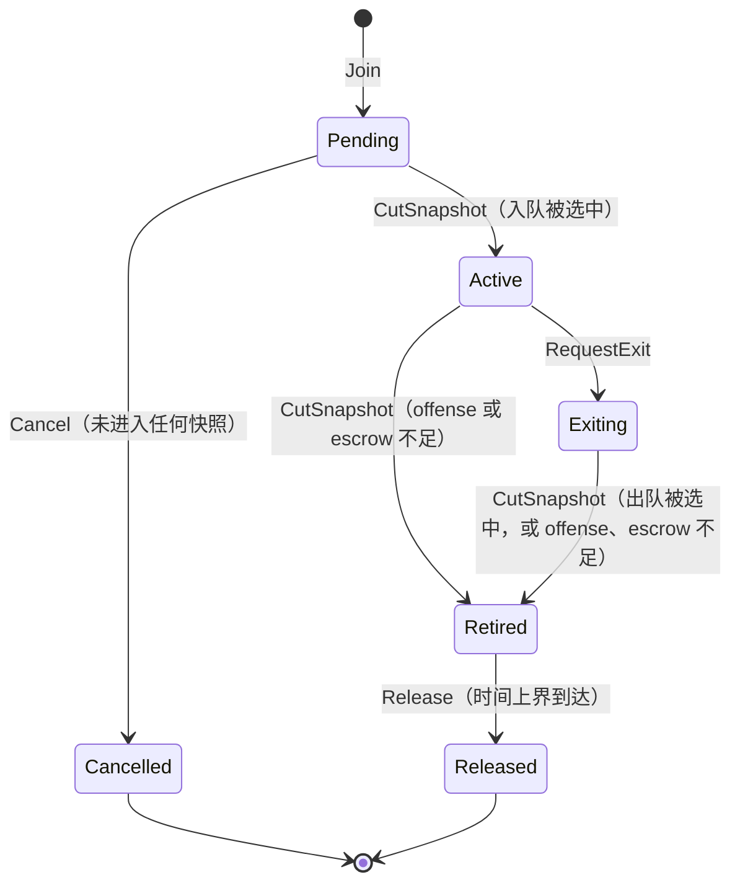

# MegaETH Sequencer Rotation 技术报告 · Part 2

## L1 Authority 协议（中文工作稿 v0.1）

日期：2026-10-26。
状态：草稿。

本稿实现 [Part 1 v0.3](part1_module_interfaces_zh_v0_3.md) §4.2 的 L1 Authority（AUTH）：先复述它的职责、接口与保证，再给出合约状态、每笔交易的处理过程、纯函数的精确算法，以及各条保证的证明。

前置文档：

- [Part 0 v0.8](part0_model_goals_zh_v0_8.md)：模型、假设与设计目标；
- [Part 1 v0.3](part1_module_interfaces_zh_v0_3.md)：模块与接口；
- [协议修订记录](protocol_revisions_zh.md)：R4、R13、R17、R22、R23、R29、R30；
- Part III v6（`formalization_v3/sync_hotstuff_rr_part3_staking_v6.tex`）：质押、快照、plan、leader、追责的基线。

**本稿对 Part 1 v0.3 的补充**（实现时发现，待确认）

1. **SubmitResume 增加一条时间窗检查：** $\mathit{ts}(b)<t(h)\le\mathit{ts}(b)+D_{\rm drift}$，其中 $b$ 是收录这笔交易的 L1 块（§6.2 的 C-RES-5）。
   - 上界使 S6（质押安全）不再依赖 A-GOV：没有它，一个违规的 $h$ 可以让新 session 的时间戳远在释放时刻之后（§8.7）。
   - 下界使 RESUME 写入的 cursor 可以取 $L$ 为 origin（§6.2）。
   - $\mathsf M$ 的操作规程（$T_{\rm prep}$ 与余量 $\epsilon$）比这条更严，诚实的 $\mathsf M$ 永远不会触发它。
2. **释放按 L1 高度检查。** 释放公式要用 $\mathit{ts}(a_{e_x})$，而合约读不到历史块的时间戳。以太坊相邻块的时间戳至少相差一个 slot（12 s），所以合约改为检查“当前高度不低于 $a_{e_x}$ 加上相应的块数”，不需要任何人事先记录时间戳（§4.5）。
3. **区域总权重 $W_{e,i}$ 在切快照时记下**，供追责时相对验证 context（§4.4、§5.1）。
4. **读快照不需要交易。** 快照 $\mathcal C_e$ 是 $c_e$ 之前已最终化历史的确定函数，读取方（Plan 等）直接算出，不等任何交易。合约在 $c_e$ 之后第一笔改变状态的调用开始时自动物化它，只供链上追责使用（§3.3、§4.4、§7.2）。
5. **offense 不需要准入材料。** 诚实 key 在同一 cid、同一槽位从不签两份冲突消息，所以两条冲突签名本身就足以处罚；准入材料只用于 quit 证据（§5.2）。
6. **恢复代的禁任集取** $\mathsf{Ban}(\max\{\ell(\Pi),\ell_{\rm rec}\})$。在 A-BYZ 下它就等于 Part 1 的 $\mathsf{Ban}(\ell_{\rm rec})$；取最大值使 G-AUTH-4 的单调性不依赖 A-BYZ（§7.3）。

---

## 0. 定位与写法

**本稿负责什么。** L1 Authority 是一个 L1 合约。它保管质押与快照，计算委员会与 leader，处理 offense 与 quit 证据，记录治理方的 Force 与 RESUME，充当 Batch Inbox 的 admin，并按时间上界释放质押。

**本稿不负责什么。**

- 它不读 Espresso，也不判断某个 session 是否真的开过、是否进入了 $G$：这些由 GFR 决定（Part 5）。
- 它不判断是否处于紧急状态，也不选 $h_{\rm res}$：这由诚实的 $\mathsf M$ 按操作规程决定（A-GOV）。
- 它不执行 L2 交易，也不派生 L1 链：这由 Derivation Rule 与状态结算负责。

**写法。** 交易处理写成伪代码；`require` 失败即交易回滚、状态不变（Part 1 §0.4 的 `REJECT`）。纯函数写成数学定义加算法步骤。每一步后面用〔〕标出它服务的保证。

---

## 1. 复述：职责、接口与保证

本节复述 Part 1 v0.3 §4.2，供后文引用；措辞以 Part 1 为准。

### 1.1 接口

| 编号 | 接口 | 类别 | 调用者 | 作用 |
| --- | --- | --- | --- | --- |
| 1 | `Join(i, pk, owner, b, pop, ownerAuth)` | L1 交易 | 质押者 | 转入 escrow，登记入队 |
| 2 | `Cancel(o, ownerAuth)` | L1 交易 | owner | 未进入任何快照前取消并退款 |
| 3 | `RequestExit(o, ownerAuth)` | L1 交易 | owner | 申请从未来快照中移除 |
| 4 | `CutSnapshot(e)` | 合约内部例程 | 由 Tick 自动执行 | 物化 epoch $e$ 的快照，供链上追责；读取方不需要它 |
| 5 | `Release(o, ownerAuth)` | L1 交易 | owner | 时间上界到达后释放剩余 escrow |
| 6 | `SubmitOffense(C, o, ev)` | L1 交易 | 任何人 | 处罚冲突签名 |
| 7 | `SubmitQuit(C, g, Q)` | L1 交易 | 任何人（通常是 Manager） | 记录恢复记录 REC |
| 8 | `SubmitForce(U, Σ_M)` | L1 交易 | 治理方 | 记录 Force |
| 9 | `SubmitResume(c, P_new, h, Σ_M)` | L1 交易 | 治理方 | 记录 RESUME，并在同一交易内 override cursor |
| 10 | `ReadAuthority(ℓ, query)` | 只读 | 任何人 | 读取某个 L1 高度上的状态 |
| 11 | `Plan(P_β, β, r, E, i_src)` | 纯函数 | GFR、MGR、PROG | 选区与委员会 |
| 12 | `Auth(C, g)` | 纯函数 | MGR、PROG、AUTH 自身 | 恢复代的授权 |
| 13 | `Leader(AUTH_{s,g}, t)` | 纯函数 | PROG、AUTH 自身 | term 的 leader |

### 1.2 保证

| 保证 | 内容（简述） | 依赖 |
| --- | --- | --- |
| G-AUTH-1 确定性 | Plan、Auth、Leader 是已最终化 L1 前缀的确定函数；缺记录时返回 `WAIT` | L1-S |
| G-AUTH-2 不可变 | 快照只确定一次；同一组输入的 plan 不变；每个 $(\mathrm{cid},g)$ 至多一条 REC | L1-S |
| G-AUTH-3 委员会与门槛 | 委员会与权重对所有 $g,t$ 相同；$w_o$ 为正整数；$F_s<W_s/2$；slash 不改权重 | — |
| G-AUTH-4 禁任单调 | Ban 只增；leader 不在禁任集中；$\mathsf{Ban}_{s,g}\subseteq\mathsf{Ban}_{s,g+1}$ | — |
| G-AUTH-5 控制纪律 | 被记录的 Force、RESUME 都通过合约检查 | L1-S4 |
| G-AUTH-6 问责 | 从未冲突签名的 key 不被 slash；同一违规至多处罚一次；证据只在所绑定的 cid 下有效 | A-CRYPTO、A-PKI；G-PROG-5 |
| G-AUTH-7 质押安全 | 被释放的 position 满足 S6 | A-TS、E-S；G-GFR-5 |
| G-AUTH-8 退出隔离 | 在 $e_x$ 被移出的 position 不在读取高度 $\ell\ge a_{e_x}$ 的任何 plan 中 | — |
| G-AUTH-9 唯一 override 入口 | cursor override 只经由 SubmitResume，目标为记录中的 $h$ | G-BIN-2 |
| G-AUTH-10 活性 | 准入的调用在 $T_{\rm L1}$ 内最终化；有效 quit 证据在 $T_{\rm L1}$ 内产生 REC | L1-L |

---

## 2. 合约状态

### 2.1 genesis 常数

以下常数在部署时固定，此后不变。

| 组 | 常数 |
| --- | --- |
| 链与规则 | $\mathit{chain}$、ruleVersion、本合约地址、Batch Inbox 地址 |
| 区域 | 区域集合 $\mathcal R$、genesis 循环顺序 $\mathcal L_R$；每个区域的 $\Delta_i$ 与 $\varphi_i=\mathit{num}_i/\mathit{den}_i<1/2$ |
| 质押 | 最低额 $B_{\min}$；权重单位 $u_w\le B_{\min}$；每个区域每次切快照的入队预算（金额 $A^{\rm in}$、个数 $N^{\rm in}$）与出队预算（权重 $A^{\rm out}$、个数 $N^{\rm out}$）；入队与出队的成熟延迟 $d^{\rm in},d^{\rm out}$（L1 块数）；处罚比例 $\rho_{\rm slash}$；罚没去向 |
| 快照时间 | $a_0$、epoch 长度 $M$、提前量 $N$（$0<N<M$）；$a_e=a_0+eM$，$c_e=a_e-N$ |
| session | DATA 配额 $\mathrm{TB}$、term 位置上限 $K$ |
| 时间 | $t_{\rm gen},h_{\rm gen},b_t$；$D_{\rm drift}$；$W_{\rm exp}$；$\Delta_{\rm ts}$；$T_{\rm ev}$；$M_a$；L1 相邻块的最小时间间隔 $\delta_{\min}$（以太坊按 slot 出块，时间戳 = genesis 时间 + 12·slot，所以 $\delta_{\min}=12$ s） |
| 治理 | $\mathit{pk}_{\mathsf M}$ |
| genesis 检查点 | $\mathcal C_0$、$\mathcal P_0$、$A_0$（满足 $\lambda(A_0)\ge a_0$ 与 $t(h(A_0))\le\mathit{ts}(a_0)+D_{\rm drift}$） |

高度与时间戳的对应 $t(h)=t_{\rm gen}+(h-h_{\rm gen})\cdot b_t$ 由这些常数直接算出（N1）。

### 2.2 可变状态

| 状态 | 字段 | 谁能改 |
| --- | --- | --- |
| $\mathsf{Pos}[o]$ | 区域 $i_o$、公钥 $\mathit{pk}_o$、owner、escrow $B_o$、阶段 $\mathit{phase}_o$、入队位置 $p^{\rm join}_o$、出队请求位置 $p^{\rm exit}_o$、退役 epoch $e_x(o)$、首次 offense 高度 $\ell^{\rm off}_o$ | Join、Cancel、RequestExit、CutSnapshot、Release、Slash |
| `nextId` | 下一个 position 编号，只增 | Join |
| $\mathsf{KeyPosition}[\mathit{pk}]$ | 尚未解除责任的 key 到 position | Join、Cancel、Release |
| $Q^{\rm in}_i$、$Q^{\rm out}_i$ | 每个区域的入队、出队 FIFO，元素为 $(o,p)$ | Join、RequestExit、CutSnapshot |
| $\mathsf{Snap}[e]$ | $(\mathit{root}_e,\ \{W_{e,i}\}_{i\in\mathcal R},\ n_e)$：快照的物化结果，供链上追责 | CutSnapshot（只写一次） |
| `lastCut` | 已物化的最大 epoch | CutSnapshot |
| $\mathit{banHeight}[\mathit{pk}]$ | key 被禁任的 L1 高度；$\mathsf{Ban}(\ell)=\{\mathit{pk}:\mathit{banHeight}[\mathit{pk}]\le\ell\}$ | Slash（只写一次） |
| `Flagged` | 已有 offense、等待下次切快照移除的 position 集合 | Slash、CutSnapshot |
| $\mathsf{REC}[(\mathrm{cid},g)]$ | 恢复记录的 L1 高度 $\ell_{\rm rec}$ | SubmitQuit（只写一次） |
| `SeenOffenses` | 已处理的 $(o,\mathit{kind},\mathit{slot})$ | Slash |
| $\Lambda$、`lastSeq` | 控制日志与已用的最大序号 | SubmitForce、SubmitResume |
| `ReqResults` | $(\mathit{caller},\mathit{rid})\mapsto(\mathsf H(\mathit{content}),\mathit{result})$ | 所有改变状态的调用 |

$\mathit{phase}_o\in\{\mathsf{Pending},\mathsf{Active},\mathsf{Exiting},\mathsf{Retired},\mathsf{Released},\mathsf{Cancelled}\}$。
$B_o(\ell^-)$ 表示 L1 高度 $\ell$ 之前的 escrow。

Part III v6 的 Clearance 列表与 `Cleared` 阶段已删除（R13）。

### 2.3 position 的生命周期



Retired 的 position 仍可被 slash，直到 Release；Released 之后 escrow 为 0，但禁任仍然有效。

### 2.4 控制日志的条目

$\Lambda$ 中的每条记录为

$$
(\mathit{kind},c,\mathit{payload},p,\mathit{ts}),\qquad \mathit{kind}\in\{\mathsf{FORCE},\mathsf{RESUME}\},
$$

其中 $p=(\ell,\mathit{txIndex},\mathit{logIndex})$ 是记录事件的 L1 位置，$\mathit{ts}$ 是所在块的时间戳。
FORCE 的 payload 为 $(\theta_a,\beta_{\rm target},\mathcal P_{\rm new})$；RESUME 的 payload 为 $(\mathcal P_{\rm new},h_{\rm res})$。

---

## 3. 通用机制

### 3.1 请求去重

每个改变状态的调用都带请求标识 $(\mathit{caller},\mathit{rid})$（Part 1 §0.4）：

```text
Dedup(caller, rid, content):
  if ReqResults[(caller, rid)] exists as (hc, res):
      require hc == H(content)        # 同标识、不同内容：REJECT
      return res                      # 同标识、同内容：返回原结果
  # 否则执行调用，结束时记 ReqResults[(caller, rid)] := (H(content), result)
```

Tick 天然幂等，不需要标识。

### 3.2 签名与证明

- **治理方签名** $\Sigma_{\mathsf M}$ 覆盖 $\mathsf H(\texttt{"MEGA-DRS-CTRL"},\mathit{chain},\text{本合约地址},\mathit{kind},c,\mathit{payload})$。绑定链与合约地址，防止跨链或跨部署重放；序号 $c$ 防止同一部署内重放。$\mathsf M$ 可以是多签，这里只用验证谓词 `VerifyM`。
- **区域签名** 按 Part 1 §2.5 覆盖 $(\mathit{domain},\mathit{chain},\mathit{version},\mathit{type},\mathrm{cid},\mathit{slot},\mathit{payload})$。合约只验证签名与字段，不重放共识。
- **快照成员证明**：叶子为 $(o,i_o,\mathit{pk}_o,w_o)$，按 $o$ 升序构成 Merkle 树，根为 $\mathit{root}_e$。合约用 Merkle 证明核对成员身份与权重；需要整个区域委员会时（计算 leader），用覆盖该区域全部叶子的多重证明。

### 3.3 Tick：快照的自动物化

**读快照不需要交易。** 快照 $\mathcal C_e$ 的内容是 $c_e$ 之前已最终化历史的确定函数（§4.4 的算法）。Plan、Manager、Program 与观察者都直接从这段历史算出它，不等任何人发交易（§7.2）。

**合约自己也要用快照**：链上追责时核对签名者的权重（§5）。EVM 读不到历史状态，所以合约在每个改变状态的调用开始时，先把 cutoff 已过的快照按顺序物化：

```text
Tick():                                   # 每个改变状态的调用最先执行
  while c_{lastCut+1} <= block.number:
      CutSnapshot(lastCut + 1)            # §4.4
```

**为什么物化结果与读取方算出的相同。** Tick 在 $c_e$ 之后的**第一笔**改变状态的调用开始时执行，此前没有任何调用改动过合约状态，所以此刻的状态正是 $c_e$ 之前的状态。连续几个 epoch 都未物化时，按顺序逐个物化，中间只有更早的快照的效果，与每个快照都在自己的 cutoff 处物化相同。

物化的代价由碰巧第一个调用的人承担；它有界（§8.9）。任何人也可以单独调用一次只含 Tick 的空操作，但这不是任何读取方的前提。

---

## 4. 质押交易

质押部分沿用 Part III v6，只把释放改成时间上界（R13），并把切快照改成合约内部的自动物化（§3.3）。

### 4.1 `Join(i, pk, owner, b, pop, ownerAuth)`

```text
Join(i, pk, owner, b, pop, ownerAuth):
  Tick()
  require i ∈ R
  require b >= B_min 且本交易随附的资金 == b
  require VerifyPoP(pk, pop, (chain, 本合约, rid, i, owner, b))
  require VerifyOwner(owner, ownerAuth, 本请求)
  require KeyPosition[pk] 不存在 且 banHeight[pk] 不存在
  o := nextId; nextId := nextId + 1
  Pos[o] := (i, pk, owner, B=b, Pending, p_join=当前事件位置, ⊥, ⊥, ⊥)
  KeyPosition[pk] := o
  Q_in[i].append((o, p_join))
  emit Joined(o, i, pk, owner, b)
```

一个 key 同时至多对应一个未解除责任的 position；被禁任过的 key 不能再注册。position 编号不复用。Join 不改变任何已冻结的快照。

### 4.2 `Cancel(o, ownerAuth)`

```text
Cancel(o, ownerAuth):
  Tick()
  require Pos[o].phase == Pending 且 VerifyOwner(Pos[o].owner, ownerAuth)
  从 Q_in[i_o] 中移除 o
  refund := B_o; B_o := 0; phase := Cancelled; 删除 KeyPosition[pk_o]
  转账 refund 给 owner
  emit Cancelled(o, refund)
```

Pending 意味着 $o$ 没有进入过任何快照，因此没有任何 session 职责。
Cancel 也先执行 Tick：若 $o$ 已在某个 cutoff 已过的快照中被选中，此刻它已变为 Active，Cancel 被拒绝。所以合约状态始终与读取方从历史算出的快照一致。

### 4.3 `RequestExit(o, ownerAuth)`

```text
RequestExit(o, ownerAuth):
  Tick()
  require Pos[o].phase == Active 且 VerifyOwner(...)
  p_exit := 当前事件位置; phase := Exiting
  Q_out[i_o].append((o, p_exit))
  emit ExitRequested(o, p_exit)
```

请求不可撤回。它不改变当前或历史权重，不退款，也不解除已分配的 session 职责。

### 4.4 快照的算法：`CutSnapshot(e)`（内部例程，不是交易）

**谁用这个算法。** 读取方用它从 $c_e$ 之前的历史直接算出 $\mathcal C_e$；合约在 Tick 中用它物化 $\mathcal C_e$（§3.3）。两者结果相同。

**输入的时间切面。** 结果只取决于严格早于 $c_e$ 的 L1 前缀：escrow 取 $B_o(c_e^-)$，offense 取 $\ell^{\rm off}_o<c_e$，队列元素按位置 $p$ 判断成熟。合约在 Tick 中执行时，此刻的状态就是 $c_e$ 之前的状态，所以 $B_o(c_e^-)$ 就是当前的 $B_o$。

**算法**（沿用 Part III v6 的四步）：

```text
CutSnapshot(e):                                       # 前提：e == lastCut + 1，c_e <= 当前高度
  M_prev := C_{e-1} 的成员集合
  # 1. 强制移除
  Removed := { o ∈ M_prev : B_o(c_e^-) < B_min  或  ℓ_off_o < c_e }
  对每个 o ∈ Removed：清除 o 在 Q_in、Q_out 中的元素
  # 2. 按预算取队列的最长成熟前缀（每个区域分别做）
  for i ∈ R:
      Joined_i := Q_in[i] 的最长前缀，满足：
          每个元素 (o, p) 有 p.ℓ + d_in <= c_e
          且 Σ B_o(c_e^-) <= A_in，个数 <= N_in
      Exited_i := Q_out[i] 中跳过 Removed 之后的最长前缀，满足：
          每个元素 (o, p) 有 p.ℓ + d_out <= c_e
          且 Σ w_{e-1,o} <= A_out，个数 <= N_out
      从队列中弹出这两个前缀
  # 3. 冻结权重
  Members := (M_prev \ Removed \ ∪_i Exited_i) ∪ (∪_i Joined_i)
  对每个 o ∈ Members：w_{e,o} := floor(B_o(c_e^-) / u_w)
  root_e := MerkleRoot(按 o 升序的叶子 (o, i_o, pk_o, w_{e,o}))
  对每个 i：W_{e,i} := Σ_{o ∈ Members, i_o = i} w_{e,o}
  Snap[e] := (root_e, {W_{e,i}}, |Members|)
  # 4. 状态更新
  对 o ∈ ∪_i Joined_i：phase := Active
  对 o ∈ M_prev \ Members：e_x(o) := e; phase := Retired; 从 Flagged 中移除
  lastCut := e
  emit SnapshotCut(e, root_e, {W_{e,i}}, 全部叶子)
```

**说明。**

- 第 1 步只需遍历 `Flagged` 与 escrow 跌破最低额的 position。escrow 只会因 slash 下降，而 slash 总会把 position 加入 `Flagged`，所以第 1 步的代价与上个 epoch 内的 offense 数成正比。
- 第 2 步的预算限定了弹出的元素个数，所以一次切快照的代价有界。
- 入队与出队分开计数，即使净变化为零；强制移除不占自愿出队的预算。
- $u_w\le B_{\min}$ 保证每个成员的权重是正整数〔G-AUTH-3〕。
- 没有人需要“发布”快照：$c_e$ 一过，内容就已确定，任何读取方都能算出；合约什么时候物化，不影响任何读取方。

### 4.5 `Release(o, ownerAuth)`

```text
Release(o, ownerAuth):
  Tick()
  require Pos[o].phase == Retired 且 VerifyOwner(...)
  X := D_drift + 2·TB·b_t + W_exp + 2·Δ_ts + T_ev
  require block.number >= a_{e_x(o)} + ceil(X / δ_min)
  amount := B_o; B_o := 0; phase := Released; 删除 KeyPosition[pk_o]
  转账 amount 给 owner
  emit Released(o, amount)
```

**释放公式**（R13，按 R30 第一项为 $D_{\rm drift}$）：

$$
\mathit{ts}\ \ge\ \mathit{ts}(a_{e_x})+D_{\rm drift}+2\mathrm{TB}\cdot b_t+W_{\rm exp}+2\Delta_{\rm ts}+T_{\rm ev}.
$$

**合约怎样检查它。** 合约读不到 $a_{e_x}$ 那个块的时间戳，所以按高度检查：相邻 L1 块的时间戳至少相差 $\delta_{\min}$，高度差 $\lceil X/\delta_{\min}\rceil$ 就保证时间戳差不小于 $X$。错过的 slot 只会让同样的高度差对应更长的时间，所以这个检查只会更保守。不需要任何人事先记录时间戳。证明见 §8.7。

**数字例子。** 取 $D_{\rm drift}=30$ min，$\mathrm{TB}\cdot b_t=1$ h，$W_{\rm exp}=10$ h，$\Delta_{\rm ts}=1$ min，$T_{\rm ev}=7$ d，则 $X=$ 7 d 12 h 32 min $=649{,}920$ s，合约要求当前高度不低于 $a_{e_x}+54{,}160$。

---

## 5. 追责

### 5.1 相对验证 context

L1 不判断哪个 session 真的存在：常规交接不产生 L1 交易，session 也可以领先于 $G$。所以每份证据都**相对一个被声称的 context** $C=(\Pi,A)$ 验证。

```text
VerifyContext(C = (Π, A)):
  e := Π.epoch; i := Π.region
  require i != ⊥ 且 c_e <= block.number               # Tick 已物化 Snap[e]
  require Π.root == root_e 且 Π.W == W_{e,i}
  require Π.F 由 (φ_i, Π.W) 按定义算出；Π.TB == TB，Π.K == K，Π.Δ == Δ_i
  cid := H(id(Π), H(A))           # id(Π) 按 §7.2 的定义由 Π 的字段计算
  return (cid, e, i, Π.W)
```

合约**不**检查 $\Pi$ 的选区逻辑（$E$、$\beta$、$r$、policy 是否真实），这些字段只进入 $\mathrm{id}(\Pi)$。伪造的 context 只会得到一个没有任何真实 session 使用的 cid；诚实 key 只在真实 context 下签名，所以伪造的 context 无法牵连诚实 key〔G-AUTH-6〕。

### 5.2 冲突的定义

offense 是同一把 key 在同一 cid、同一槽位签了两份冲突的消息：

| kind | 消息类型 | 槽位 $\mathit{slot}$ | 冲突条件 |
| --- | --- | --- | --- |
| PROPOSE | PROPOSE | $(\mathrm{cid},g,t,j)$ | 块哈希不同 |
| FRESH_VOTE | DATA-VOTE 或 DRAIN-VOTE（共用槽位） | $(\mathrm{cid},g,t,j)$ | 所投块的哈希不同 |
| NEWVIEW | NEWVIEW | $(\mathrm{cid},g,0)$ | 选择的开口身份不同（即使一个是另一个的祖先） |
| ANCHOR_VOTE | ANCHOR-VOTE | $(\mathrm{cid},g,0)$ | 开口身份不同 |
| FINAL | FINAL | $(\mathrm{cid},h)$ | 块哈希不同 |

timeout、BLAME、区域 OFF、转发他人消息、同一开口的不同 QC，都不构成 offense。新分支可以合法地重用一个 DATA 高度：不同分支的 session 有不同的 cid。

```text
Conflict(kind, m1, m2, pk, cid):
  require m1 与 m2 都是 pk 在 cid 下的有效签名
  require m1、m2 的类型属于 kind 的类型组，且 slot(m1) == slot(m2)
  require 按上表，m1 与 m2 的冲突字段不同
  return slot(m1)
```

**不需要准入材料。** 诚实成员在每次签名前持久化槽位记录（G-PROG-5），所以在任何 cid、任何槽位都不会签两份冲突消息，无论这个视图是否真的被准入。因此两条冲突签名本身就证明这把 key 违规。

### 5.3 `Slash`：内部例程

```text
Slash(o, w, kind, slot):                     # w 取自所声称 context 的快照
  if (o, kind, slot) ∈ SeenOffenses: return AlreadyProcessed
  amount := min(ρ_slash · w, B_o)
  B_o := B_o - amount
  if banHeight[pk_o] 不存在: banHeight[pk_o] := block.number
  if ℓ_off_o 不存在: ℓ_off_o := block.number
  Flagged.add(o)
  SeenOffenses.add((o, kind, slot))
  转账 amount 到罚没去向
  emit Slashed(o, kind, slot, amount, B_o)
```

Slash 只改 escrow 与禁任，不改任何已冻结的权重〔G-AUTH-3〕。下次切快照时，$o$ 因 offense 被移除。

### 5.4 `SubmitOffense(C, o, ev)`

```text
SubmitOffense(C, o, ev = (kind, m1, m2, admission)):
  Tick()
  (cid, e, i, W) := VerifyContext(C)
  require 叶子 (o, i, pk_o, w_{e,o}) 对 root_e 的 Merkle 证明有效
  slot := Conflict(kind, m1, m2, pk_o, cid)       # admission 字段被忽略
  return Slash(o, w_{e,o}, kind, slot)
```

处罚额以所声称 context 的快照权重计。同一 $(o,\mathit{kind},\mathit{slot})$ 只处罚一次；不同 cid 下的违规是不同的违规实例〔G-AUTH-6〕。

### 5.5 `SubmitQuit(C, g, Q)`

quit 证据要冻结一个恢复代，并在 L1 上留下唯一的 REC，所以它需要准入材料：证明它所涉及的视图确实被准入了。

**准入检查。**

```text
GenAdmitted(cid, g):
  return g == 0 或 REC[(cid, g)] 存在          # 第 g 代的入口证明就是合约自己的 REC

TermAdmission(C, g, t, wit):                  # t > 0 时证明 term t 已被准入
  h_0 := 第 g 代开口的高度:
         g == 0：h(A)（来自 C）
         g > 0：wit 中第 g 代的 ANCHOR QC 所绑定的开口高度（权重 > F）
  H := h(A) + TB
  for t' = 0 .. t-1:
      m := min(K, H - h_{t'})                  # h_{t'} 是 term t' 的锚点高度，h_{0} = h_0
      require m >= 1
      require wit 含 term t' 的终端 QC：位置 j = m-1、高度 h_{t'} + m 的 DATA 块，权重 > F
      h_{t'+1} := h_{t'} + m
  require h_t < H                              # 否则不存在 term t
```

**算法。**

```text
SubmitQuit(C, g, Q = (kind, coords, msgs, admission)):
  Tick()
  (cid, e, i, W) := VerifyContext(C)
  require GenAdmitted(cid, g)
  switch kind:
    BLAME:            # (g, t) 上权重 > F 的 BLAME 证书
      require msgs 是不同成员在 cid 下对 BLAME(g, t) 的有效签名，各附成员证明
      require Σ w > F
      if t > 0: TermAdmission(C, g, t, admission)
    LEADER_EQUIV:     # term leader 在同一 (g, t, j) 上的两份 proposal
      L := Leader(Auth(C, g), t)，由委员会多重证明在链上计算
      slot := Conflict(PROPOSE, m1, m2, pk_L, cid)，且 slot 的 (g, t) 与 coords 一致
      require j < m_{g,t}（由 admission 给出的高度推出）
      if t > 0: TermAdmission(C, g, t, admission)
      Slash(L, w_{e,L}, PROPOSE, slot)
    NEWVIEW_EQUIV:    # g > 0 时恢复 leader 的两份不同 NEWVIEW
      require g > 0
      L := Leader(Auth(C, g), 0)
      slot := Conflict(NEWVIEW, m1, m2, pk_L, cid)
      Slash(L, w_{e,L}, NEWVIEW, slot)
  if REC[(cid, g+1)] 不存在:
      REC[(cid, g+1)] := block.number
  emit RecoveryRecorded(cid, g+1, REC[(cid, g+1)])
```

**说明。**

- REC 的键是 $(\mathrm{cid},g+1)$，不是裸的 $(\beta,r,g+1)$，所以任何伪造的 context 都无法抢占真实 session 的恢复槽。
- 无效证据回滚整笔交易，不创建 REC，也不预留任何东西；没有“计数器”可以被抢占。
- REC 已存在时，交易仍会处理其中的 offense（去重），然后返回已有的 REC。
- leader 的计算与 Program 用的完全相同（§7.4）；合约用委员会的多重证明取得全部成员，再按 $\mathsf{Ban}$ 过滤〔G-AUTH-1〕。

---

## 6. 治理控制

### 6.1 `SubmitForce(U, Σ_M)`

```text
SubmitForce(U = (c, θ_a, β_target, P_new), Σ_M):
  Tick()
  require VerifyM(Σ_M, ("FORCE", c, θ_a, β_target, P_new))       # C-F-1
  require c > lastSeq                                             # C-F-2
  require θ_a >= block.timestamp + M_a                            # C-F-3（R4）
  require WellFormed(P_new)                                       # C-F-4
  lastSeq := c
  Λ.append((FORCE, c, (θ_a, β_target, P_new), p, block.timestamp))
  emit ForceRecorded(c, p, block.timestamp)

WellFormed(P = (S, L)):
  require S 给 R 中每个区域恰好一个 ON/OFF 标记
  require L 是 R 的一个排列（每个区域恰好出现一次）
```

合约只记录意图。实际生效位置与效果由 GFR 决定（Part 5 §5.3）：在 $\theta\ge\theta_a$ 的第一个 Espresso 块处生效；届时目标分支已关闭或已不是当前分支，整条记录无效。
C-F-3 使 Force 生效时，所有诚实观察者都已能读到这条记录：生效键 $\theta_a$ 不小于记录块的时间戳加 $M_a$，而 GFR 的 R-WAIT 在处理键 $\theta_a$ 之前要求 L1 日志已推进到时间戳 $\theta_a-M_a$（Part 5 §4.2）。

### 6.2 `SubmitResume(c, P_new, h, Σ_M)`

```text
SubmitResume(c, P_new, h, Σ_M):
  Tick()
  require VerifyM(Σ_M, ("RESUME", c, P_new, h))                   # C-RES-1
  require c > lastSeq                                             # C-RES-2
  require WellFormed(P_new)                                       # C-RES-3
  cur := BIN.ReadCursor()
  require h > cur.l2Height                                        # C-RES-4
  require block.timestamp < t(h) <= block.timestamp + D_drift     # C-RES-5（本稿补充）
  lastSeq := c
  Λ.append((RESUME, c, (P_new, h), p, block.timestamp))
  next := (l2Height = h, frameDigest = 0, epochNum = block.number, gfrPos = ("RESUME", c))
  BIN.Override(next)                                               # 同一交易；失败则整笔回滚
  emit ResumeRecorded(c, P_new, h, p, block.timestamp)
```

**每条检查的作用。**

| 检查 | 作用 |
| --- | --- |
| C-RES-1、C-RES-2 | 只有治理方能发起；不可重放 |
| C-RES-3 | 新 policy 完整，GFR 安装时不会遇到缺项 |
| C-RES-4 | override 只能前进（`BIN.Override` 自己也检查，G-BIN-2） |
| C-RES-5 上界 | 新分支锚点的时间戳不超过 $\mathit{ts}(L)+D_{\rm drift}$；S6 的推导用到它（§8.7），从而 S6 不依赖 A-GOV |
| C-RES-5 下界 | $t(h)>\mathit{ts}(L)$，所以 $h$ 处的填充块可以取 $L$ 为 origin，cursor 的 `epochNum` 取 $L$ 的高度 |

**cursor 的字段。** `epochNum` 取 $L$ 的高度，`gfrPos` 指向这条 RESUME 的序号。这依赖 override 填充规则在 $t(h)>\mathit{ts}(L)$ 时把 $h$ 处块的 origin 取为 $L$；它与字段的精确编码一起，列为 Part 6 的核对项（§10）。

**合约不检查的事。** 是否处于紧急状态（Part 0 定义 4.3）；Espresso 与批次层是否已恢复；$h$ 是否高于旧全局链的末端；$t(h)\ge\mathit{ts}(L)+T_{\rm prep}$ 与余量 $\epsilon$。这些是 $\mathsf M$ 的操作规程（Part 1 §4.2.9，A-GOV）。违反它们不影响安全：

- 过早发出：撤销本可结算的全局链内容（只影响 L2-L1 的“非紧急”前提）；
- $h$ 不高于派生末端：新 session 被 Kill 判死，需要再发一次 RESUME（Part 1 §5.5）；
- $t(h)$ 太近：新 session 来不及准备，第一块可能晚于 $t(h+1)$，由追赶规则补上。

**新分支的锚点** 由 GFR 在处理这条记录时确定为 $D_L[h]$（Part 5 §5.4）；合约不计算它。

---

## 7. 只读接口与纯函数

### 7.1 `ReadAuthority(ℓ, query)`

| query | 返回 | 来源 |
| --- | --- | --- |
| `Position(o)` | 高度 $\ell$ 上的 $\mathsf{Pos}[o]$ | 状态证明，或按事件重放到 $\ell$ |
| `Snapshot(e)` | 完整的叶子表、$\mathit{root}_e$、$W_{e,i}$、$a_e$ | $c_e\le\ell$ 时按 §4.4 从 $c_e$ 之前的历史算出（合约已物化时也可直接读 $\mathsf{Snap}[e]$，两者相同）；$c_e>\ell$ 时为 $\bot$ |
| `Ban` | $\mathsf{Ban}(\ell)$ | `Slashed` 事件中的禁任高度 |
| `Recovery(cid, g)` | $\ell_{\rm rec}$，若 $\ell_{\rm rec}\le\ell$；否则 $\bot$ | `RecoveryRecorded` 事件 |
| `Controls(c_from, c_to)` | 序号区间内的控制记录及其位置与时间戳 | `ForceRecorded`、`ResumeRecorded` 事件 |

调用者在自己已最终化的 L1 前缀上读取；高度 $\ell$ 尚未最终化时返回 `WAIT`。“没读到快照”不能解释为零权重。

### 7.2 `Plan(P_β, β, r, E, i_src)`

**算法**（沿用 Part III v6 的四步）：

1. **读取高度。** $\ell:=\max\{\lambda(E),\lambda_\beta\}$；$e:=\max\{e':a_{e'}\le\ell\}$。读取 $\mathcal C_e$（按 §4.4 从 $c_e$ 之前的历史算出，$c_e<a_e\le\ell$）与 $\mathsf{Ban}_0:=\mathsf{Ban}(\ell)$。Plan 只读高度不超过 $\ell$ 的已最终化数据；调用者还没读到高度 $\ell$ 时返回 `WAIT`，这只是读取进度，不等任何交易。
2. **选区。** 候选列表为：$\mathcal L_\beta$ 中 $i_{\rm src}$ 之后的区域，再接 $i_{\rm src}$ 本身；$i_{\rm src}=\bot$ 时为整个 $\mathcal L_\beta$。取其中第一个满足以下条件的区域 $i$：$S_\beta(i)=\mathsf{ON}$，且 $\mathcal C_e$ 中 $i$ 的未禁任成员的总权重为正。没有则 $i:=\bot$。
3. **委员会。** $\mathcal C_e$ 中区域 $i$ 的全部成员，无论是否禁任，各带权重 $w_{e,o}$。$W:=W_{e,i}$，$F:=\varphi_iW$；证书需要权重严格大于 $F$，实现为 $\mathit{den}_i\cdot\sum w>\mathit{num}_i\cdot W$。plan 同时带上 $\mathrm{TB}$、$K$、$\Delta_i$。
4. **标识与来源高度。**

$$
\mathrm{id}(\Pi)=\mathsf H\bigl(\texttt{PLAN},\mathit{chain},\beta,r,h(E),\mathsf H(E),\lambda(E),i_{\rm src},e,\mathit{root}_e,\mathsf H(\mathcal P_\beta),\ell,i,W\bigr),\qquad
\lambda(\Pi)=\ell.
$$

$\mathsf{Ban}_0$ 由 $\ell$ 唯一确定，所以 $\mathrm{id}$ 只需含 $\ell$。

**说明。**

- $\lambda(E)$ 是 $E$ 的原生 origin 的高度（R30）。$E$ 可以是 DER 块：RESUME 的锚点 $D_L[h_{\rm res}]$，或 Force 时 $\mathrm{last}(G)$ 恰为 DER 块。DER 块的 $\mathsf H(E)$ 是其信封哈希 $\mathsf H(h,\mathsf{DER},\mathit{native},\mathsf H(\mathit{parent}))$。
- floor $\lambda_\beta$ 只在高于 $\lambda(E)$ 时起作用：Force 或 RESUME 之后，保留的锚点可能引用很旧的 L1，但新分支读取 L1 的高度不低于开出它的那条控制记录。
- 选区参考块的取法见 Part 1 §4.2.11：REGULAR 取前驱的初始锚点，FORCE、RESUME、GENESIS 取新锚点本身。

**确定性。** Plan 只读高度不超过 $\ell$ 的已最终化数据，所以任何读到高度 $\ell$ 的调用者都得到同一个 $\Pi$，之后也不会变（§8.1）。GFR 调用 Plan 时，$\ell$ 由锚点引用的 L1 块与开出分支的控制记录决定，观察者此时都已读过，所以 GFR 中的 Plan 不会返回 `WAIT`（Part 5 §4.4）。

### 7.3 `Auth(C, g)`

$$
\mathsf{AUTH}_{s,0}=\Pi;\qquad
\mathsf{AUTH}_{s,g}=\bigl(\Pi,\ \mathsf{REC}(\mathrm{cid},g),\ \mathsf{Ban}_{s,g}\bigr),\quad
\mathsf{Ban}_{s,g}:=\mathsf{Ban}\bigl(\max\{\ell(\Pi),\ \ell_{\rm rec}(\mathrm{cid},g)\}\bigr)\quad(g>0).
$$

其中 $\ell(\Pi)$ 是 plan 的读取高度。REC 缺失或尚未最终化时返回 `WAIT`。
$\mathsf{Ban}_{s,0}:=\mathsf{Ban}(\ell(\Pi))$。委员会、权重、配额与门槛在所有代中不变。

### 7.4 `Leader(AUTH_{s,g}, t)`

$$
L_s(g,t)=\mathsf{WeightedRand}\bigl(\mathcal W^g_s,\ \mathsf H(\texttt{LEADER},\mathit{chain},\beta,r,h(E_s),g,t)\bigr),
$$

其中 $\mathcal W^g_s$ 是委员会中公钥不在 $\mathsf{Ban}_{s,g}$ 中的成员，各带原始权重。

```text
WeightedRand(Wset, seed):
  if Wset 为空: return ⊥
  按 position 编号升序排列 Wset = [(o_1, w_1), ..., (o_n, w_n)]；W := Σ w_k
  lim := 2^256 - (2^256 mod W)
  for k = 0, 1, 2, ...:
      z := uint256(H(seed, k))
      if z < lim: x := z mod W; break             # 拒绝采样，避免取模偏差
  return 累积区间 [Σ_{m<k} w_m, Σ_{m<=k} w_m) 含 x 的成员 o_k
```

例子：权重 $(60,30,10)$，$x=73$ 选中第二个成员。
种子只取生产者无法操纵的坐标，不含 $\mathsf H(E_s)$。不同视图可以选中同一个 leader；被禁任的成员仍然投票，投票权重不变。

---

## 8. 保证的证明

### 8.1 G-AUTH-1（确定性）

Plan 只读高度不超过 $\ell$ 的已最终化数据：快照 $\mathcal C_e$（$c_e$ 之前历史的确定函数，$c_e<\ell$）、$\mathsf{Ban}(\ell)$、genesis 常数。Auth 另读 REC，Leader 只做计算。这些都是已最终化 L1 的确定函数，所以结果是确定的；调用者尚未读到所需高度时返回 `WAIT`，不会用缺省值代替。
单调性：高度 $\ell$ 已最终化之后，$\mathsf{Ban}(\ell)$ 不再变，因为之后的禁任都记在更高的高度上；$c_e$ 之前的历史同样不再变；REC 一经写入不变。所以结果一旦得出，就不会改变。〔L1-S〕

### 8.2 G-AUTH-2（不可变）

$\mathcal C_e$ 是 $c_e$ 之前历史的确定函数；$\mathsf{Snap}[e]$ 只在 `lastCut` 从 $e-1$ 变为 $e$ 时写入一次，且与读取方算出的相同（§3.3）。
plan 是其输入与 G-AUTH-1 中记录的函数，所以同一组输入的 plan 不变。
$\mathsf{REC}[(\mathrm{cid},g)]$ 只在不存在时写入。〔L1-S〕

### 8.3 G-AUTH-3（委员会与门槛）

委员会与权重全部来自 $\Pi$ 中的快照 $e$，Auth 只附加 REC 与禁任集，不改委员会。
$B_o(c_e^-)\ge B_{\min}\ge u_w$（否则在第 1 步被移除；新入队的 position 有 $b\ge B_{\min}$，且在 cutoff 之前不可能被 slash，因为它不在任何快照中），所以 $w_{e,o}\ge1$。
$\varphi_i<1/2$ 给出 $F<W/2$。Slash 只改 $B_o$。

### 8.4 G-AUTH-4（禁任单调）

$\mathit{banHeight}$ 只写一次，所以 $\mathsf{Ban}(\ell)$ 随 $\ell$ 单调不减。
$\mathsf{Ban}_{s,g}=\mathsf{Ban}(\ell_g)$，其中 $\ell_0=\ell(\Pi)$，$\ell_g=\max\{\ell(\Pi),\ell_{\rm rec}(\mathrm{cid},g)\}$。
创建 $\mathsf{REC}(\mathrm{cid},g+1)$ 要求 $\mathsf{REC}(\mathrm{cid},g)$ 已存在（$g\ge1$），所以 $\ell_{\rm rec}(g)<\ell_{\rm rec}(g+1)$；加上取最大值，$\ell_g\le\ell_{g+1}$ 对所有 $g$ 成立，从而 $\mathsf{Ban}_{s,g}\subseteq\mathsf{Ban}_{s,g+1}$。
Leader 只在 $\mathcal W^g_s$ 上取样，所以 $L_s(g,t)\notin\mathsf{Ban}_{s,g}$。

### 8.5 G-AUTH-5（控制纪律）与 G-AUTH-9（唯一 override 入口）

$\Lambda$ 只在 SubmitForce、SubmitResume 中追加，且只在全部检查通过之后。L1 交易原子执行，所以被记录的每条控制都满足 C-F-1 至 C-F-4 或 C-RES-1 至 C-RES-5，无论 $\mathsf M$ 实际签署了什么。〔L1-S4〕
本合约只在 SubmitResume 中调用 `BIN.Override`，参数中的 L2 高度就是记录中的 $h$，且与记录在同一交易内。Batch Inbox 的 admin 固定为本合约（G-BIN-2），所以 cursor override 只有这一个入口。

### 8.6 G-AUTH-6（问责）

**无错误处罚。** Slash 只在 Conflict 成功之后执行，而 Conflict 要求同一 key 在同一 cid、同一槽位的两份冲突签名。由 G-PROG-5，诚实成员从不产生这样的签名对；由 A-CRYPTO、A-PKI，没有其他人能伪造它的签名。伪造 context 得到的 cid 中不存在诚实 key 的签名。所以诚实 key 不会被 slash。
quit 证据中被 slash 的只有 term leader 的 PROPOSE 双签与恢复 leader 的 NEWVIEW 双签，同样适用上面的论证。
**不重复处罚。** SeenOffenses 以 $(o,\mathit{kind},\mathit{slot})$ 去重，槽位包含 cid。
**cid 绑定。** 签名覆盖 cid，所以一份证据只在它所绑定的 cid 下通过 Conflict。

### 8.7 G-AUTH-7（质押安全，S6）

设 position $o$ 在 epoch $e_x$ 退役，于真实时刻 $\tau_{\rm rel}$ 被释放，释放交易所在的 L1 块为 $b_{\rm rel}$。要证：对每个 $o\in V_s$ 的 session $s$，$\tau_s^{\rm close}+T_{\rm ev}\le\tau_{\rm rel}$。

**引理 A（读取高度）。** $s$ 的 plan 的读取高度 $\ell$ 满足 $\ell<a_{e_x}$。
证明：$o\in V_s$ 说明 $o$ 在快照 $e(\ell)$ 中；由 G-AUTH-8，$e(\ell)<e_x$，所以 $\ell<a_{e(\ell)+1}\le a_{e_x}$。因此 $\mathit{ts}(\ell)<\mathit{ts}(a_{e_x})$，这里 $\mathit{ts}(\ell)$ 指高度 $\ell$ 的 L1 块的时间戳。

**引理 B（选区参考块的新鲜度）。** $s$ 的选区参考块 $E_s$ 满足 $t(h(E_s))\le\mathit{ts}(\ell)+D_{\rm drift}$。
证明：按 $E_s$ 的出处分三种情况。

- **genesis：** $E_s=A_0$，由 genesis 常数的条件，$t(h(A_0))\le\mathit{ts}(a_0)+D_{\rm drift}$，而 $\ell\ge\lambda_0=a_0$。
- **普通块（ORD）：** 只需考虑 $s$ 的块可能进入 $G$ 的情形（否则 $\tau_s^{\rm close}$ 不晚于窗口开始，结论平凡）。此时 $E_s$ 在 $G$ 中，由 G-GFR-5，$E_s$ 满足 R-FRESH：$t(h(E_s))\le\mathit{ts}(o(E_s))+D_{\rm drift}$；而 $\lambda(E_s)=\mathrm{height}(o(E_s))\le\ell$。
- **DER 块：** $E_s$ 由某次 RESUME（记录在 L1 块 $L$，目标高度 $h_{\rm res}$）采纳，$h(E_s)\le h_{\rm res}$。由 C-RES-5，$t(h_{\rm res})\le\mathit{ts}(L)+D_{\rm drift}$。$s$ 所在的分支由这次 RESUME 或之后的控制开出，而 GFR 安装的 floor 单调不减且不低于 $\mathrm{height}(L)$（Part 5 §5.4），所以 $\ell\ge\lambda_\beta\ge\mathrm{height}(L)$，$\mathit{ts}(L)\le\mathit{ts}(\ell)$。

**引理 C（末块高度）。** $H_s\le h(E_s)+2\mathrm{TB}$。
证明：REGULAR 时 $E_s=A_p$、$A_s=T_p$，$h(A_s)=h(A_p)+\mathrm{TB}$；其他 cause 下 $E_s=A_s$。而 $H_s=h(A_s)+\mathrm{TB}$。

**引理 D（窗口结束）。** $\tau_s^{\rm close}\le t(H_s)+W_{\rm exp}+\Delta_{\rm ts}$。
证明：由 G-GFR-5（R-EXP），$s$ 的块 $B$ 只能经由 $\theta_q\le t(h(B))+W_{\rm exp}\le t(H_s)+W_{\rm exp}$ 的 Espresso 块 $J_q$ 进入 $G$。若 $J$ 在 $\tau>t(H_s)+W_{\rm exp}+\Delta_{\rm ts}$ 时提出，由 A-TS，$\theta(J)\ge\tau-\Delta_{\rm ts}>t(H_s)+W_{\rm exp}$，所以 $J$ 不能加入 $s$ 的块。RESUME 采纳的 DER 块不带 $s$ 的新签名（Part 0 定义 1.2）。

**合成。** 由 A-TS，$\tau_{\rm rel}\ge\tau_{\rm prop}(b_{\rm rel})\ge\mathit{ts}(b_{\rm rel})-\Delta_{\rm ts}$。由释放检查（§4.5），$b_{\rm rel}$ 比 $a_{e_x}$ 高至少 $\lceil X/\delta_{\min}\rceil$ 个块，而相邻块时间戳至少相差 $\delta_{\min}$，所以 $\mathit{ts}(b_{\rm rel})\ge\mathit{ts}(a_{e_x})+X$。于是

$$
\begin{aligned}
\tau_{\rm rel}
&\ge \mathit{ts}(a_{e_x})+D_{\rm drift}+2\mathrm{TB}\cdot b_t+W_{\rm exp}+\Delta_{\rm ts}+T_{\rm ev}\\
&> \mathit{ts}(\ell)+D_{\rm drift}+2\mathrm{TB}\cdot b_t+W_{\rm exp}+\Delta_{\rm ts}+T_{\rm ev} &&\text{（引理 A）}\\
&\ge t(h(E_s))+2\mathrm{TB}\cdot b_t+W_{\rm exp}+\Delta_{\rm ts}+T_{\rm ev} &&\text{（引理 B）}\\
&\ge t(H_s)+W_{\rm exp}+\Delta_{\rm ts}+T_{\rm ev} &&\text{（引理 C 与 N1）}\\
&\ge \tau_s^{\rm close}+T_{\rm ev}. &&\text{（引理 D）}
\end{aligned}
$$

〔A-TS、E-S；依赖 G-GFR-5、G-AUTH-8、C-RES-5〕

**C-RES-5 的必要性。** 没有它，违规的 $\mathsf M$ 可以选 $t(h_{\rm res})\gg\mathit{ts}(L)$：新分支的 plan 读取 $\ell\approx\mathrm{height}(L)$，可能用到即将退役的成员，而这些成员的块时间戳远在释放时刻之后。引理 B 的 DER 情形就会失效，S6 只能依赖 A-GOV。

### 8.8 G-AUTH-8（退出隔离）

$o$ 在 epoch $e_x$ 退役，意味着 $o\in\mathcal C_{e_x-1}$ 而 $o\notin\mathcal C_{e_x}$。
此后 $o$ 的阶段为 Retired 或 Released，不在任何队列中，key 也不能重新注册（Join 要求 key 未被映射且未被禁任；Release 解除映射之后，同一 key 的新 position 是另一个编号）。CutSnapshot 只从上一个快照的成员与入队队列中取成员，所以 $o\notin\mathcal C_e$ 对所有 $e\ge e_x$ 成立。
读取高度 $\ell\ge a_{e_x}$ 的 plan 使用 $e(\ell)\ge e_x$，因此它的委员会不含 $o$。

### 8.9 G-AUTH-10（活性）

每个准入的调用是一笔普通 L1 交易，在 $T_{\rm L1}$ 内最终化并对活跃诚实方可见。〔L1-L〕
有效的 quit 证据：SubmitQuit 只读合约自己的记录与调用者附上的证明，不等待任何外部事件，所以在 $T_{\rm L1}$ 内产生 REC。
各循环都有界：Tick 每次物化自上次调用以来 cutoff 已过的快照，正常情况下至多一个；每次物化的弹出个数受预算限制，强制移除只遍历 `Flagged`；追责的代价与委员会大小成正比。
读快照、读禁任、读 REC 都是读取已最终化的 L1，不需要任何交易，也不等待任何交易。

---

## 9. 与 Part III v6 的差异

| 项目 | Part III v6 | 本稿 |
| --- | --- | --- |
| 释放 | ProveForce 写入 Clearance，再等 $T_{\rm hold}$ | 时间上界（R13），无需证明任何 Force；按 L1 高度检查 |
| 快照 | 有人切了才能用；迟切时使用方等待 | $c_e$ 之前历史的确定函数，读取方直接算；合约在 $c_e$ 之后第一笔调用中自动物化，只供追责 |
| 生命周期 | 有 Cleared 阶段 | 删除 |
| 控制记录 | SubmitUpdate（Force），无合约检查 | SubmitForce 检查提前量与格式（R4）；新增 SubmitResume 与同交易 override（R17、R22）；不再有 STOP（R23） |
| Plan 的来源高度 $\lambda(\Pi)$ | $\max\{\ell,\ \text{快照发布高度}\}$ | $\ell$ |
| 恢复代的禁任集 | $\mathsf{Ban}(\ell_{\rm rec})$ | $\mathsf{Ban}(\max\{\ell(\Pi),\ell_{\rm rec}\})$ |
| offense | 附 admission 与 quota 证据 | 只需两条冲突签名 |
| 追责的 context 验证 | “相对 $C$ 验证” | 写出 VerifyContext：核对快照根与区域总权重 |

---

## 10. 待定问题

1. **C-RES-5 是否采纳。** 采纳则 S6 不依赖 A-GOV；不采纳则 Part 0 中“S1–S6 不依赖 $\mathsf M$”需要改成“S6 依赖 A-GOV 的 $t(h_{\rm res})$ 上界”。
2. **RESUME 写入的 cursor（Part 6）：** `epochNum` 取 $L$ 的高度，依赖 override 填充规则在 $t(h)>\mathit{ts}(L)$ 时以 $L$ 为 $h$ 处块的 origin；需要对照 mega-espresso 的 override 派生规则核对。`gfrPos` 的编码同样待定。
3. **链上验证的代价。** LEADER_EQUIV 与 NEWVIEW_EQUIV 要在链上计算 leader，BLAME 与 TermAdmission 要验证多份证书。委员会规模较大时，宜用 BLS 聚合签名与多重 Merkle 证明；具体格式在实现时确定。
4. **罚没去向与权重单位** $u_w$ 的取值，属于参数选择。
