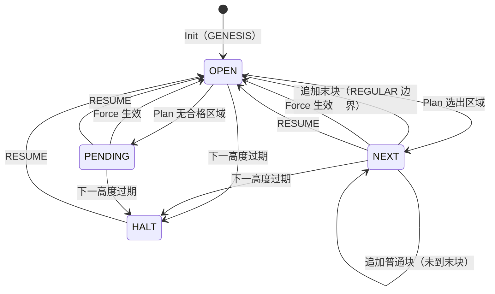

# MegaETH Sequencer Rotation 技术报告 · Part 5

## Global Finality Rule 协议，以及 Certifier 怎样运行它（中文工作稿 v0.1）

日期：2026-10-26。
状态：草稿。

本稿实现 [Part 1 v0.3](part1_module_interfaces_zh_v0_3.md) §5 的 Global Finality Rule（GFR，Part 0 中记作 $\mathsf{Replay}$）：一条确定性规则，由外部观察者、Session Manager、Certifier 与 Batcher 分别运行。§7 另给出 Certifier 的认证规则 `CertifyBatch`：它运行 GFR，并按 GFR 的输出决定能否签名。

前置文档：

- [Part 0 v0.8](part0_model_goals_zh_v0_8.md)、[Part 1 v0.3](part1_module_interfaces_zh_v0_3.md)；
- [Part 2 v0.1](part2_l1_authority_zh_v0_1.md)（控制记录与 Plan）、[Part 3 v0.1](part3_session_program_zh_v0_1.md)（区域块与 FINAL）、[Part 4 v0.1](part4_session_manager_zh_v0_1.md)（Manager 怎样调用本规则）；
- Part II v4.9 §5（全局链与 Protocol 3）。

**本稿对 Part 1 v0.3 的补充**（实现时发现，待确认）

1. **GFR 中的 Plan 不会等待。** Plan 只读高度不超过其读取高度 $\ell$ 的已最终化 L1 数据（快照是 cutoff 之前历史的确定函数，不需要任何交易，Part 2 §3.3）。$\ell$ 由锚点引用的 L1 块与开出分支的控制记录决定，观察者处理到这一步时都已读过。所以 Plan 总在当场给出结果，所有观察者在同一个 Espresso 块开出同一个 session（§4.4、§5.6）。
2. **$q^{\rm open}$ 取开出块。** FORCE 在生效的 Espresso 块开出，RESUME 在其后的下一个 Espresso 块开出，$q^{\rm open}$ 都取开出块的高度；REGULAR 与 GENESIS 的 $q^{\rm open}$ 在边界产生时就已确定（§5.6）。
3. **HALT 记下目标轮次与来源区域**，供随后的 RESUME 使用（§5.7）。
4. **同键时 `Expire` 先于 Espresso 块**，所以 Eligible (e) 在等号处实际不会被用到；效果等同严格不等式（§5.5）。
5. **Certifier 的切面规则写成：** gpos 不早于“prev 写入时最近一次 RESUME”的处理位置。prev 由 RESUME 写入时，这就是 Part 1 的规则；prev 由普通批次写入时，它不必再等待 $M_a$（§7.2）。

---

## 0. 定位

**GFR 回答的问题。** 给定已最终化的 L1 日志与 Espresso 日志（RESUME 处另加公开的 DA 数据），哪些块构成全局链 $G$，各自的出处是什么，下一块由谁负责，哪些 session 已被关闭？

**性质。**

- 纯函数：同输入同输出；输入不足时返回 `WAIT`，指明缺什么、停在哪里，已完成的输出不撤销。
- 没有自由裁量：不读任何私有输入，不看消息到达顺序。
- 不构成额外的共识层：每个使用方各自运行，结论一致（G-GFR-1）。
- 不生成也不预测 deposit-only 块：$G$ 中的 deposit-only 块只来自 RESUME 时采纳的派生链。

**谁运行它。**

| 使用方 | 用途 |
| --- | --- |
| 外部观察者 | 判断全局最终（§6） |
| Session Manager | 生命周期事件、handoff 的核对、负责性视图（Part 4 §4） |
| Certifier | 认证批次时核对内容（§7） |
| Batcher | 选择要提交的块（§7.5） |

---

## 1. 复述：接口与保证

### 1.1 接口

| 接口 | 输入 | 输出 |
| --- | --- | --- |
| `Init(checkpoint)` | genesis 检查点，或完整的 $\mathcal X$ | $\mathcal X_0$ |
| `AdvanceGlobal(X, LOG_L1, LOG_E)` | 重算状态、两本日志、派生读取接口（只在 RESUME 用） | $(\mathcal X',\Delta\mathrm{Rec},\mathit{events})$ 或 `WAIT(next key, missing)` |
| `CheckFINAL(C, B, D, Σ, π)` | 见 Part 1 §3.3 | `true`、`false`、`incomplete` |
| `Eligible_q(X, B)` | 重算状态、候选块 | `true` 或 `false` |
| `ResumeChain(X, L)` | RESUME 记录与派生读取接口 | $(D_L,h_f,A)$ 或 `WAIT` |
| 查询 | `Chain`、`Tail`、`Responsible` | — |

### 1.2 生命周期事件（Part 1 §2.7）

`Appended(B, σ)`、`SessionAssigned(ν)`、`SessionClosed(s, reason)`、`BranchClosed(β, reason)`、`Halted(ω)`、`Resumed(c, β′, h_f, A)`、`Pending(ω)`。

### 1.3 保证

| 保证 | 内容（简述） | 依赖 |
| --- | --- | --- |
| G-GFR-1 确定性与单调 | Rec 是两本日志及 RESUME 处 DA 数据的确定函数，对日志前缀单调 | L1-S、E-S、DA-S1；G-DER-1 |
| G-GFR-2 只追加 | 唯一例外是 `Resumed`；它在所有观察者记录中的同一位置发生，结果相同 | — |
| G-GFR-3 授权 | 每个被追加的普通块都满足 Eligible | — |
| G-GFR-4 派生一致 | 每个 DER 块等于采纳它的 RESUME 所用 $D_L$ 在该高度的块 | G-DER-1、3 |
| G-GFR-5 公开约束 | 每个被追加的普通块都满足 R-EXP 与 R-FRESH | — |
| G-GFR-6 锚点 | FORCE 以生效时的 $\mathrm{last}(G)$ 为锚点；RESUME 以 $D_L[h_{\rm res}]$ 为锚点；锚点在边界产生时固定 | — |
| G-GFR-7 控制定位 | 每条控制记录只有一个生效位置，不追溯生效 | G-AUTH-5 |
| G-GFR-8 RESUME 与 D 对齐 | 处理 RESUME 之后，$G$ 等于 $D_L$ 直到 $h_{\rm res}$ | G-DER-1、3 |
| G-GFR-9 活性 | L1-L 且 Espresso 可用时，事件在 $T_E+T_{\rm L1}$ 内被处理；RESUME 处另需 A-RET | L1-L、E-L、A-RET |

---

## 2. 输入

### 2.1 L1 日志

观察者已最终化的 L1 块序列，每块带时间戳 $\mathit{ts}(b)$（严格递增）。GFR 从中读取：

- L1 Authority 的控制记录（Part 2 §2.4）：每条带序号 $c$、位置 $p=(\ell,\mathit{txIndex},\mathit{logIndex})$、所在块的时间戳；
- Plan 所需的数据：切点之前的质押历史（快照由它直接算出，不需要发布）、禁任高度、genesis 常数（Part 2 §7.2）；
- R-FRESH 所需的 origin 块头（Eligible (f)）。

### 2.2 Espresso 日志

已最终化的 Espresso 块 $J_q$，带时间戳 $\theta_q$（随 $q$ 单调不减，E-S）。本链 namespace 中新增的对象集合记为 $M_q$，累积集合 $\mathcal O_q=M_1\cup\dots\cup M_q$。GFR 只使用其中的区域块体（DATA、DRAIN）与 FINAL 签名；其他对象（proposal、QC、恢复授权、EXPORT 的外层字段）被忽略，不授予也不阻止任何东西。

### 2.3 派生读取接口

只在处理 RESUME 时使用：给定 RESUME 记录 $c$（位于 L1 块 $L$），返回按 L1 顺序处理到该记录的 `CursorSet` 为止的派生链 $D_L$，或 `WAIT`。Session Manager 用派生视图的检查点实现它（Part 4 §4.2）；其他使用方可以自己运行派生规则。

### 2.4 检查点

genesis 检查点：$\mathit{chain}$、$\mathcal L_R$、$A_0$、$q_{\rm init}$、$\mathcal P_0$（floor $\lambda_0=a_0$）、初始控制前缀。之后的检查点必须给出完整的 $\mathcal X$，不能只给 $\mathrm{last}(G)$。

---

## 3. 状态

$$
\mathcal X=(G,\ \mathsf{Tail},\ \beta,\ \mathcal P_\beta,\ \mathsf{Closed},\ \kappa,\ \mathit{pc}).
$$

| 字段 | 内容 |
| --- | --- |
| $G$ | 条目序列 $G[h(A_0)],G[h(A_0)+1],\dots$；每个条目为（信封或区域块，出处 $\sigma$） |
| $\mathsf{Tail}$ | $\mathsf{NEXT}(\nu)$、$\mathsf{PENDING}(\omega)$、$\mathsf{OPEN}(\omega)$ 或 $\mathsf{HALT}(\omega)$ |
| $\beta$、$\mathcal P_\beta=(S_\beta,\mathcal L_\beta,\lambda_\beta)$ | 当前分支版本与其 policy |
| $\mathsf{Closed}$ | 已关闭的分支版本与 session；只增不减 |
| $\kappa$ | 已处理的控制序号集合 |
| $\mathit{pc}$ | 合并顺序中最后处理的位置（§4.1） |

**记号。**

- $\nu=(\beta,r,i,A,H,q^{\rm open},\mathit{cause},\Pi)$：descriptor，$\mathrm{sid}(\nu)=(\beta,r)$，$H=h(A)+\mathrm{TB}$。
- $\omega=(\mathit{cause},\beta,r',i_{\rm src},A,q^{\rm open})$：未定边界。$A$ 在边界产生时就已固定（HALT 中为 $\bot$）；$q^{\rm open}$ 对 REGULAR、GENESIS 预先确定，对 FORCE、RESUME 为 $\bot$，在开出时确定。
- $a(G,\nu)$：$G$ 中出处为 $\mathsf{ORD}(\nu)$ 的块数。
- 出处 $\sigma\in\{\mathsf{ORD}(\nu),\mathsf{DER}\}$。
- DER 条目的信封为 $(h,\mathsf{DER},\mathit{native},\mathsf H(\text{前一条目}))$。

---

## 4. 合并顺序

### 4.1 事件、键与位置

GFR 按位置从小到大处理三类事件：

| 类别 | 事件 | 键 $x$ | 类别序 | 同类内的顺序 |
| --- | --- | --- | --- | --- |
| L1 | RESUME 记录（位于块 $L$） | $\mathit{ts}(L)+M_a$ | 0 | L1 位置 $p$ |
| TIME | $\mathsf{Expire}(h)$ | $t(h)+W_{\rm exp}$ | 1 | 高度 $h$ |
| ESP | Espresso 块 $J_q$ | $\theta_q$ | 2 | 高度 $q$ |

事件的**位置**为 $(x,\text{类别序},\text{同类内的序})$，按字典序比较。键相同时：L1 事件在前，时间事件其次，Espresso 块最后。

**Force 不是单独的事件。** Force 记录在 Espresso 块的处理中执行：在第一个 $\theta_q\ge\theta_a$ 的 $J_q$ 处（§5.3 第 1 步）。C-F-3（$\theta_a\ge\mathit{ts}(b)+M_a$）与 R-WAIT 条件 1 保证此时记录已在观察者的 L1 日志中。

**时间事件只需一个。** 只有 $h=h(\mathrm{last}(G))+1$ 的 $\mathsf{Expire}(h)$ 可能起作用，其余都是无操作。所以实现只保留一个待处理的时间事件，每当 $G$ 变化就重新对准下一高度。追加之后，下一高度的键一定大于当前位置：追加高度 $h$ 的块要求 $\theta_q\le t(h)+W_{\rm exp}$，于是 $t(h+1)+W_{\rm exp}\ge\theta_q+b_t>\theta_q$；RESUME 之后，由 C-RES-5，$t(h_{\rm res}+1)+W_{\rm exp}>\mathit{ts}(L)+W_{\rm exp}>\mathit{ts}(L)+M_a$。

### 4.2 R-WAIT

处理键为 $x$ 的事件之前，观察者须满足：

1. **L1 前缀完整：** 已最终化的 L1 日志中有时间戳 $\ge x-M_a$ 的块。
2. **Espresso 前缀完整**（只对 L1 事件与时间事件）：Espresso 日志中有 $\theta\ge x$ 的块。

条件 1 使所有键不超过 $x$ 的 L1 事件与 Force 记录都已可见；条件 2 使所有 $\theta<x$ 的 Espresso 块都已可见并已处理。两者合起来，下一个要处理的事件对所有满足 R-WAIT 的观察者都相同。

### 4.3 下一个事件

```text
NextEvent(𝒳, LOG_L1, LOG_E):
  候选：
    e_L := 未处理的 RESUME 记录中位置最小者（若其块已在 LOG_L1 中）
    e_T := Expire(h(last(G)) + 1)
    e_E := 下一个 Espresso 块 J_{q}（q = 上次处理的高度 + 1，若已在 LOG_E 中）
  e := 三者中位置最小者
  若 LOG_E 尚无 J_q：e_E 的键视为“不小于 LOG_E 的最大时间戳”，只有当 e_L 或 e_T 的键
    严格小于 LOG_E 中已有块的最大时间戳时，才能确定它们在前（R-WAIT 条件 2）
  if e 不满足 R-WAIT: return WAIT(key(e), 缺 L1 或 Espresso)
  return e
```

### 4.4 GFR 从 L1 读什么

GFR 读 L1 都是读取已最终化的数据，不需要任何人为此发交易，也不等待任何交易。

| 读取 | 在哪里用 | 为什么处理到这一步时已经读得到 |
| --- | --- | --- |
| Force、RESUME 记录 | §5.3 第 1 步、§5.4 | 记录本身是治理方的交易；它进入日志之后，R-WAIT 条件 1 保证观察者在其生效位置已经读到 |
| Plan 所需的快照与禁任名单 | §5.6 | Plan 只读高度不超过 $\ell=\max\{\lambda(E),\lambda_\beta\}$ 的数据。$\lambda(E)$ 是锚点（已在 $G$ 中）引用的 L1 块，追加锚点时已经读过；$\lambda_\beta$ 是开出该分支的控制记录所在的块，执行该记录时已经读过。快照是 cutoff 之前历史的确定函数，不需要“发布” |
| 块的 origin | Eligible (f) | 已最终化的 L1 块；区域投票时就已最终化 |

所以 GFR 不会因为 Plan 而停住；同一位置上，所有观察者得到同一个 plan。

“已最终化的数据对所有诚实方立即可读”在这里不是必要的：GFR 的每一步只在观察者已持有所需数据后执行（R-WAIT），读取进度只影响何时算出结果，不影响结果。

---

## 5. 处理过程

### 5.1 `Init(checkpoint)`

```text
Init(genesis):
  G := [A_0]，σ 无（genesis）；β := 0；P_0 := (S_0, L_R, λ_0 = a_0)
  Closed := ∅；κ := 初始控制前缀的序号；pc := ⊥
  Tail := OPEN((GENESIS, 0, 0, ⊥, A_0, q_init))
```

GENESIS 的 session 在第一个 $q\ge q_{\rm init}$ 的 Espresso 块处开出（§5.3 第 2 步）。

### 5.2 `AdvanceGlobal`

```text
AdvanceGlobal(𝒳, LOG_L1, LOG_E, DerivIface):
  events := []
  loop:
    e := NextEvent(𝒳, LOG_L1, LOG_E)
    if e == WAIT: return (𝒳, events, WAIT)
    switch e:
      RESUME 记录 → r := ProcessResume(𝒳, e, DerivIface)          # §5.4
      Expire(h)   → r := ProcessExpire(𝒳, h)                      # §5.7
      J_q         → r := ProcessEspresso(𝒳, J_q, LOG_L1)           # §5.3
    if r == WAIT: return (𝒳, events, WAIT)        # 停在 e 上；已处理的部分保留
    𝒳 := r.state; 𝒳.pc := pos(e); events += r.events
    持久化 (𝒳, r.events)                            # 先持久化，后对外输出
```

**原子性。** 每处理完一个事件，就把状态变化、事件输出与处理位置一起持久化。重新执行时从持久化的位置继续，不会重复追加。处理一个事件的中途返回 `WAIT` 时，该事件的部分效果不写入。

### 5.3 Espresso 块 $J_q$

```text
ProcessEspresso(𝒳, J_q, LOG_L1):
  # 1. 执行 Force
  for U = (c, θ_a, β_target, P_new) in 控制日志，θ_a <= θ_q 且 c ∉ κ，按 c 升序:
      κ.add(c)
      if β_target != β 或 β ∈ Closed: continue                    # 整条记录无效
      (r', i_src) := NextIndex(Tail, G)                             # §5.8
      emit BranchClosed(β, FORCE); Closed.add(β)
      β := β + 1; P_β := (S_new, L_new, max{λ_{β-1}, λ_U})          # λ_U：记录所在的 L1 高度
      Tail := OPEN((FORCE(c), β, r', i_src, last(G), ⊥))
      OpenSession(Tail.ω, q)                                        # §5.6
  # 2. 完成待开的 session（GENESIS、RESUME）
  if Tail == OPEN(ω) 且 (ω.cause != GENESIS 或 q >= q_init):
      OpenSession(ω, q)
  # 3. 追加普通块
  while Tail == NEXT(ν):
      Cands := { B ∈ 𝒪_q : Eligible_q(𝒳, B) }                      # §5.5；可能 WAIT
      if Cands 为空: break
      B := Cands 中哈希最小者
      G.append((B, ORD(ν))); emit Appended(B, ORD(ν))
      if h(B) == H(ν):
          emit SessionClosed(sid(ν), COMPLETE)
          q' := max{ height(ξ(B)), q^open(ν) + 1 }
          Tail := OPEN((REGULAR, β, r(ν)+1, i(ν), B, q'))           # 另携带选区参考块 E := A(ν)
          OpenSession(Tail.ω, q)                                    # 见 §5.6
```

同一个 Espresso 块里，先执行 Force，再开出待开的 session，最后追加普通块。新开出的 FORCE 或 RESUME session 的 $q^{\rm open}=q$，而 Eligible (d) 要求引用 $q'\ge q^{\rm open}$ 且 $q'<q$，所以它的块最早在 $J_{q+1}$ 中被接纳。

### 5.4 RESUME 记录（R-RES）

```text
ProcessResume(𝒳, rec = (c, P_new, h_res) 位于 L1 块 L, DerivIface):
  (D_L, h_f, A) := ResumeChain(𝒳, L, c, DerivIface)               # WAIT 则 WAIT
  κ.add(c)
  (r', i_src) := NextIndex(Tail, G)                                 # 用替换之前的 Tail 与 G
  if β ∉ Closed: emit BranchClosed(β, RESUME); Closed.add(β)
  G := Replace(G, D_L, h_f, h_res)
  β := β + 1; P_β := (S_new, L_new, max{λ_{β-1}, height(L)})
  Tail := OPEN((RESUME(c), β, r', i_src, A, ⊥))
  emit Resumed(c, β, h_f, A)
  # 新 session 在下一个 Espresso 块的第 2 步开出
```

**`ResumeChain(X, L, c)`。**

```text
ResumeChain(𝒳, L, c, DerivIface):
  D_L := DerivIface.Get(c)                         # 派生到 L 中 RESUME c 的 CursorSet 为止
  if D_L == WAIT: return WAIT(缺 L1 或 DA)
  require tip(D_L) >= h_res                        # override 填充保证（G-DER-3）
  h_f := min{ k : G 有高度 k，且 (k > h_res 或 native(G[k]) != native(D_L[k])) }；没有则 ⊥
  A := D_L[h_res]
  return (D_L, h_f, A)
```

**`Replace(G, D_L, h_f, h_res)`。**

$$
G_{\rm new}[k]=\begin{cases}
G[k]\ \text{（原信封与出处）} & k<h_f\ \text{且}\ k\le h(\mathrm{last}(G)),\\
\bigl((k,\mathsf{DER},\mathrm{native}(D_L[k]),\mathsf H(G_{\rm new}[k-1])),\ \mathsf{DER}\bigr) & \text{其余}\ k\le h_{\rm res}.
\end{cases}
$$

$h_f=\bot$ 时把它当作 $+\infty$。替换之后 $\mathrm{last}(G)=A$。

**说明。**

- 同一交易产生的 `CursorSet` 不单独处理：它的效果已经包含在 $D_L$ 中。
- $D_L$ 只取决于 $L$ 及之前的已最终化 L1 前缀与 DA 数据，所以所有观察者在同一位置得到同一个结果；数据取不到时返回 `WAIT`，不返回别的结果（G-DER-1、DA-S1）。
- 按 $\mathsf M$ 的规程，$h_{\rm res}$ 高于派生在 $L$ 处的末端与旧 $G$ 的末端，所以 $D_L$ 的末端就是 $h_{\rm res}$，旧 $G$ 只会在 $h_f\le h(\mathrm{last}(G))$ 处被撤销（批次层故障），或完全保留（Espresso 停机，$h_f=\bot$）。
- 违反规程时（$h_{\rm res}$ 不高于派生末端），$G$ 仍被替换为 $D_L$ 直到 $h_{\rm res}$，旧 $G$ 在 $h_{\rm res}$ 之上的块也被撤销；新 session 会被 Kill 判死，只能再发一次 RESUME。安全不受影响。

### 5.5 `Eligible_q(X, B)`

当 $\mathsf{Tail}=\mathsf{NEXT}(\nu)$、$\mathrm{sid}(\nu)=(\beta,r)$，且以下各条同时成立时为 `true`：

| 条件 | 内容 | 来源 |
| --- | --- | --- |
| (a) | $B$ 是 DATA 块，字段 $(\beta,r)$ 与 $\nu$ 一致，且 $\beta\notin\mathsf{Closed}$ | v4.9 |
| (b) | $\mathrm{parent}(B)=\mathsf H(\mathrm{last}(G))$，$h(B)=h(\mathrm{last}(G))+1\le H(\nu)$ | v4.9 |
| (c) | $\mathrm{Fin}_q(\nu,B)$：存在 $D$、$\pi$，块体都在 $\mathcal O_q$ 中，取 $\Sigma$ 为 $\mathcal O_q$ 中 $D$ 上的全部 FINAL 签名，使 $\mathsf{CheckFINAL}(C_\nu,B,D,\Sigma,\pi)=$ `true` | v4.9 |
| (d) | $\xi(B)$ 指向日志中的已最终化块 $J_{q'}$（哈希一致），且 $q^{\rm open}(\nu)\le q'<q$ | v4.9 |
| (e) | **R-EXP：** $\theta_q\le t(h(B))+W_{\rm exp}$ | R24 |
| (f) | **R-FRESH：** $\mathit{ts}(o(B))\ge t(h(B))-D_{\rm drift}$，其中 $o(B)$ 是 $\rho(B)$ 所指的已最终化 L1 块 | R30 |

**每条检查的作用。**

- (a) 只有负责下一高度的 session 能扩展 $G$；被关闭的版本没有负责 session。
- (b) $G$ 没有缺口也没有分叉；DRAIN 不是 DATA，从不进入 $G$。
- (c) 由 G-PROG-2，权重 $>F$ 的 FINAL 证书说明某个诚实成员在完整验证（含 DerivOK）之后提交了 $B$。GFR 不需要 proposal 或恢复历史。
- (d) 引用不能借承载它的那个 Espresso 块来证明自己；FORCE 与 RESUME 开出的 session 的块最早在开出块的下一块被接纳。
- (e) 给出每个 session 的窗口结束上界（Part 2 §8.7 的引理 D），也是 L2-L1 的接纳时限（Part 0 §2.10）。
- (f) 给出选区参考块的新鲜度（Part 2 §8.7 的引理 B）。它与 DerivOK 的 V2 是同一个不等式；GFR 自己再检查一次，使 S6 不依赖 A-BYZ。

**(e) 与同键顺序。** $\mathsf{Expire}(h)$ 与 $\theta_q=t(h)+W_{\rm exp}$ 的 Espresso 块同键时，前者先处理并关闭分支，所以 (e) 在等号处实际不会成立；效果等同严格不等式，安全推导不受影响。

**(f) 的数据。** $o(B)$ 是已最终化的 L1 块，读取即可。

**多个合格块。** 取哈希最小者。同一 session 的诚实成员只会提交同一个块（G-PROG-1），所以良态 session 在同一高度至多有一个块带有效的 FINAL 证书；“取最小哈希”只在 A-BYZ 失效时起作用，使结果仍然确定。

### 5.6 开出 session：`OpenSession(ω, q)`

```text
OpenSession(ω = (cause, β, r', i_src, A, q_o), q):
  E := (cause == REGULAR) ? ω.E : A                # 常规后继以前驱的初始锚点为选区参考块
  Π := Plan(P_β, β, r', E, i_src)                   # Part 2 §7.2；只读已最终化数据，当场给出结果（§4.4）
  if region(Π) == ⊥:
      Tail := PENDING(ω); emit Pending(ω); return
  q^open := (cause ∈ {FORCE, RESUME}) ? q : q_o
  ν := (β, r', region(Π), A, h(A) + TB, q^open, cause(·, q^open), Π)
  Tail := NEXT(ν); emit SessionAssigned(ν)
```

REGULAR 的 $\omega$ 另携带一个字段 $\omega.E$：刚完成的前驱的初始锚点 $A(\nu_{\rm pred})$（§5.3 第 3 步）。其他 cause 的选区参考块就是锚点 $A$ 本身。cause 中的 $q$ 是开出该 session 的 Espresso 高度（Part 1 §2.7）。

**锚点固定。** $A$ 在 $\omega$ 产生时就已固定：FORCE 为生效时的 $\mathrm{last}(G)$，RESUME 为 $D_L[h_{\rm res}]$，REGULAR 为前驱的末块，GENESIS 为 $A_0$〔G-GFR-6〕。

**Plan 当场给出结果。** Plan 只读高度不超过 $\ell$ 的已最终化数据，观察者此时都已读过（§4.4），所以 FORCE 与 REGULAR 边界在产生它的同一个 Espresso 块里就变为 NEXT 或 PENDING。Manager 用自己的视图提前算出的常规后继，读的是同一份数据，所以与 GFR 得到的 plan 相同。

**PENDING。** 只有新的 Force 或 RESUME 能替换它；时间的流逝不能。PENDING 期间下一高度过期，则进入 HALT（§5.7）。

### 5.7 时间事件 $\mathsf{Expire}(h)$（R24）

```text
ProcessExpire(𝒳, h):
  if h != h(last(G)) + 1 或 Tail == HALT(·): return（无操作）
  (r', i_src) := NextIndex(Tail, G)
  if β ∉ Closed: emit BranchClosed(β, EXPIRED); Closed.add(β)
  Tail := HALT((EXPIRED, β, r', i_src, ⊥, ⊥)); emit Halted(Tail.ω)
```

关闭当前分支上的全部 session，包括提前进入的常规后继。此后 $G$ 停在 $h-1$；Force 的目标分支已关闭，所以只有 RESUME 能替换 HALT。
GFR 不补 deposit-only 块，也不自动轮换（v0.1 的 R-DEP、R-OVR 已删除）。

### 5.8 `NextIndex(Tail, G)`：目标轮次与来源区域

沿用 v4.9 的规则，供 Force、RESUME 与 HALT 共用：

| Tail | $r'$ | $i_{\rm src}$ |
| --- | --- | --- |
| $\mathsf{NEXT}(\nu)$ | $r(\nu)$，若 $a(G,\nu)=0$；否则 $r(\nu)+1$ | $i(\nu)$ |
| $\mathsf{PENDING}(\omega)$、$\mathsf{OPEN}(\omega)$、$\mathsf{HALT}(\omega)$ | $r'(\omega)$ | $i_{\rm src}(\omega)$ |

新分支的 session 标识为 $(\beta+1,r')$，它与旧分支的任何 session 都不同，因为分支版本不同；$r'$ 只影响 plan 的标识与 leader 种子。

### 5.9 Tail 的状态机



OPEN 状态下 Force 生效也转入新的 OPEN（图中省略）。FORCE 与 REGULAR 边界的 OPEN 只是瞬时的：Plan 当场给出结果，同一个 Espresso 块内就变为 NEXT 或 PENDING。停留一段时间的 OPEN 只有两种：GENESIS 等第一个 $q\ge q_{\rm init}$ 的块，RESUME 等下一个 Espresso 块。

### 5.10 生命周期事件的产生

| 触发 | 依次输出 |
| --- | --- |
| 追加普通块 | `Appended`；若为末块，再 `SessionClosed(·, COMPLETE)`，随后可能 `SessionAssigned` 或 `Pending` |
| Force 生效 | `BranchClosed(β, FORCE)`，随后可能 `SessionAssigned` 或 `Pending` |
| RESUME | 必要时 `BranchClosed(β, RESUME)`，然后 `Resumed`；下一个 Espresso 块输出 `SessionAssigned` 或 `Pending` |
| 过期 | 必要时 `BranchClosed(β, EXPIRED)`，然后 `Halted` |

---

## 6. 查询与全局最终

- `Chain(X)` → $(G,\sigma)$；`Tail(X)`；`Responsible(X)` → Tail 为 $\mathsf{NEXT}(\nu)$ 时为 $(\mathrm{sid}(\nu),i(\nu))$，否则 $\bot$。
- **全局最终**（Part 0 §3.2）：观察者 $u$ 在 $\tau$ 时把 $B$ 视为全局最终，若 $B\in G^u(\tau)$。sequencer 层的常规动作（轮换、Force、过期、区域故障）不会撤销它；只有 RESUME 能撤销它，而诚实的 $\mathsf M$ 只在紧急状态下发出 RESUME，那时被撤销的只会是没能进入派生链的块。真正不可撤销的是批次结算（进入 $D$）。

---

## 7. Certifier 运行的规则

Certifier $\mathsf C$ 是可信方（A-CERT）。它只做一件事：核对一个批次的内容与 $G$ 一致、与 DA 绑定一致，然后签名。它运行与观察者同版本的 GFR（O-1）。

### 7.1 状态

- 自己的已最终化 L1 视图、Espresso 视图、DA 读取能力；
- 一份 GFR 状态 $\mathcal X_{\mathsf C}$，处理位置只增（持久化）；
- 派生读取接口（GFR 处理 RESUME 时用）。

### 7.2 切面规则

**定义。** 对 prev（Batch Inbox 的某个 cursor），设 $p_{\rm prev}$ 是写入它的 L1 位置（`CursorAdvanced` 或 `CursorSet` 事件）。令 $R^\star$ 为 L1 位置不晚于 $p_{\rm prev}$ 的最后一条 RESUME 记录（位于块 $L^\star$）；没有则为 $\bot$。

**规则。** $\mathsf C$ 用来核对的 GFR 位置 $\mathit{gpos}$ 必须满足

$$
\mathit{gpos}\ \ge\ \mathrm{pos}(R^\star)=(\mathit{ts}(L^\star)+M_a,\ 0,\ p_{R^\star}),
$$

即 $R^\star$ 已经被处理。prev 由 RESUME 写入时，$R^\star$ 就是写入它的那条 RESUME，这正是 Part 1 §4.7.1 的规则；prev 由普通批次写入时，$\mathsf C$ 不必再等 $M_a$。

**为什么需要它。** 若 prev 是 RESUME 写入的 cursor（L2 高度 $h_{\rm res}$），而 $\mathsf C$ 的 GFR 还没处理这条 RESUME，$\mathsf C$ 看到的仍是旧 $G$。旧 $G$ 若在 $h_{\rm res}$ 之上还有块（违反规程时可能），$\mathsf C$ 会为它们签名，Batch Inbox 会接纳（prev 匹配），派生链就会出现与新 $G$ 不同的内容。切面规则排除这种情况。

### 7.3 `CertifyBatch(prev, payload, d, π_DA)`

```text
CertifyBatch(prev, payload, d, π_DA):
  # 1. prev 是当前 cursor
  在 C 的 L1 视图中找到写入 prev 的位置 p_prev；require prev == 视图中最新的 cursor，
  否则 REJECT(STALE)                                   # 已被别的批次推进，或已被 override
  R* := 位置不晚于 p_prev 的最后一条 RESUME 记录
  # 2. 推进 GFR 到满足切面规则
  运行 AdvanceGlobal，直到 pos(R*) 已被处理；WAIT 则 WAIT
  # 3. 解码与核对内容
  (frames, [a, b]) := Decode(payload, 经 DA 读取的此前 frame)
  require a == prev.l2Height + 1，且高度连续
  若 G 尚未覆盖到 b：继续运行 AdvanceGlobal；仍不够则 WAIT
  gpos := 𝒳_C.pc
  for k in [a, b]（只含已闭合 channel 覆盖的高度）:
      require G_gpos[k] 存在且 σ(G_gpos[k]) == ORD(·)       # DER 高度不认证
      require payload 中高度 k 的普通交易列表、时间戳与 origin 与 native(G_gpos[k]) 一致
  # 4. DA 与 channel
  require d 绑定 payload，π_DA 有效；channel 与 frame 连续
  # 5. 签名
  next := 按 Batch Inbox 规则计算的新 cursor（未闭合的 channel 不消耗高度）
  χ := Sign_C(chain, BIN 地址, prev, d, H(π_DA), next, [a, b], gpos)
  return χ
```

**$\mathsf C$ 不核对的东西。** DerivOK 的前缀与执行有效性：它们由区域投票保证（G-PROG-2），$\mathsf C$ 只核对普通交易列表、时间戳与 origin（Part 1 §3.2）。DER 高度：它们在派生中已经确定，不需要也不允许提交批次（R27）。

### 7.4 Certifier 的保证

- **G-CERT-1（对应）。** 带 $\chi$ 的批次解码出的每个高度，都是 $G$ 在 $\mathit{gpos}$ 处的普通块的普通交易列表、时间戳与 origin；$d$ 绑定这份 payload。
  证明：第 3、4 步，加上 A-CERT（$\mathsf C$ 按规则运行，其签名不可伪造）。
- **G-CERT-2（切面绑定）。**
  - 对任何 $\mathit{gpos}'\ge\mathit{gpos}$，若两者之间没有 RESUME，$G_{\mathit{gpos}}$ 是 $G_{\mathit{gpos}'}$ 的前缀（G-GFR-2）。
  - 若两者之间有 RESUME $R$：$R$ 在同一交易内把 cursor override 到 $h_{\rm res}$。若 $R$ 在 L1 中先于批次交易，Batch Inbox 的 cursor 已不等于 prev，批次被拒绝；若批次交易在先，批次被接纳，而 $D_L$ 先处理此前已接纳的全部输入（G-DER-3），所以这个批次的内容已包含在 $D_L$ 中，也就包含在 $R$ 之后的 $G$ 中（G-GFR-8）。
  - $R$ 之后签发、以 override 写入的 cursor 或其后继为 prev 的证书，由切面规则，$\mathit{gpos}\ge\mathrm{pos}(R)$，只覆盖新 $G$ 的内容。
  因此在两次 RESUME 之间 $G'\preceq G$，跨越 RESUME 时 $G'$ 被并入 $D_L$，进而并入新的 $G$。
- **G-CERT-3（活性）。** 在线期间，$\mathsf C$ 在 $T_{\rm cert}$ 内响应。切面规则对普通批次不增加等待；对 RESUME 之后的第一个批次，等待至多到 RESUME 的处理位置，即 $\mathit{ts}(L)+M_a$ 之后的 R-WAIT，这在 $\mathsf M$ 的规程中已经计入（新 session 的第一块不早于 $t(h_{\rm res}+1)>\mathit{ts}(L)+T_{\rm prep}\ge\mathit{ts}(L)+M_a$）。

### 7.5 Batcher 怎样使用 GFR

Batcher 用自己的 GFR 选择要提交的块：只取 $G$ 中出处为 $\mathsf{ORD}$ 的块，从当前 cursor 的下一高度开始（Part 1 §4.6.1）。RESUME 之后，它从 override 写入的 cursor（$h_{\rm res}$）接着提交新分支的块。Batcher 的正确性不依赖它的 GFR 与 $\mathsf C$ 同步：内容错了 $\mathsf C$ 会拒绝签名（G-CERT-1）。

---

## 8. 保证的证明

### 8.1 G-GFR-1（确定性与单调，S0、S1）

**合并顺序确定。** 事件的键与同类内的序只取自两本日志中的字段（时间戳、L1 位置、Espresso 高度）与 $G$ 的末端高度。R-WAIT 保证：处理位置 $x$ 的事件时，所有位置更小的事件都已可见并已处理（§4.2）。所以所有满足 R-WAIT 的观察者按同一顺序处理同一组事件。

**每个处理过程确定。** 给定状态与事件，处理过程只读：

- 控制记录与 Plan 所需的已最终化 L1 数据（§4.4）——对所有观察者相同，且此时都已读到；
- $\mathcal O_q$ 与 Espresso 日志（Eligible (a)–(e)）——对所有观察者相同；
- $o(B)$ 的时间戳（Eligible (f)）——已最终化的 L1 事实，缺失时 `WAIT`；
- $D_L$（ResumeChain）——由 G-DER-1 确定，缺失时 `WAIT`。

没有任何一步在数据缺失时用别的结果代替。所以 Rec 是两本日志及 RESUME 处 DA 数据的确定函数。

**单调。** 日志变长只会让更多事件满足 R-WAIT，被处理的事件序列只会延长；已处理的事件不会因新数据重算（每个事件处理时，其输入已完整）。〔L1-S、E-S、DA-S1；依赖 G-DER-1〕

### 8.2 G-GFR-2（只追加，S2）

$G$ 只在 §5.3 第 3 步追加，和在 §5.4 被替换。由 G-GFR-1，替换发生在所有观察者记录中的同一位置（同一条 RESUME 的位置），替换结果 $(D_L,h_f,A)$ 也相同。

### 8.3 G-GFR-3（授权，S3(b)）

§5.3 第 3 步只追加满足 Eligible 的块；(c) 使用负责 descriptor 的 context $C_\nu$。

### 8.4 G-GFR-4（派生一致，S3(c)）

DER 条目只在 Replace 中产生，其原生块是 $D_L[k]$。$h_f$ 之前保留的旧条目与 $D_L$ 同高度、同原生块（$h_f$ 的定义），所以替换之后 $G$ 的每个原生块都等于 $D_L$ 的对应块。

### 8.5 G-GFR-5（公开约束）

Eligible 的 (e)、(f)。

### 8.6 G-GFR-6（锚点）

FORCE 的 $\omega$ 在 §5.3 第 1 步以当时的 $\mathrm{last}(G)$ 构造；RESUME 的 $\omega$ 在 §5.4 以 $D_L[h_{\rm res}]$ 构造。OpenSession 只读 $\omega.A$。OPEN 期间 $G$ 不会增长（Tail 不是 NEXT 时第 3 步不追加），所以 $\omega.A$ 始终等于 $\mathrm{last}(G)$，直到 session 开出。

### 8.7 G-GFR-7（控制定位）

每条控制记录的序号进入 $\kappa$ 恰好一次：Force 在第一个 $\theta_q\ge\theta_a$ 的 Espresso 块处，RESUME 在位置 $(\mathit{ts}(L)+M_a,0,p)$ 处。这两个位置都只由日志决定。
不追溯：处理位置之前的事件都已处理完毕且不再重算；C-F-3 与 RESUME 的键定义，加上 R-WAIT 条件 1，保证记录在其生效位置时已在观察者的 L1 日志中，所以没有观察者会“已经越过”一条它还看不到的记录。〔依赖 G-AUTH-5〕

### 8.8 G-GFR-8（RESUME 与 D 对齐）

由 Replace，处理 RESUME 之后 $G$ 的原生块序列等于 $D_L$ 直到 $h_{\rm res}$（G-GFR-4）。所以此前 $G$ 与派生链之间的任何分歧，都在这次 RESUME 处消除。

### 8.9 G-GFR-9（活性）

设 L1-L 成立、Espresso 可用。Espresso 块 $J_q$ 在提出后 $T_E$ 内最终化并可见。它的 R-WAIT 只要求 L1 日志有时间戳 $\ge\theta_q-M_a$ 的块；由 A-TS，这样的块在 $\theta_q-M_a+\Delta_{\rm ts}+\delta_{\rm slot}$ 之前提出，再过 $T_{\rm L1}$ 最终化。由 $M_a\ge T_{\rm L1}+2\Delta_{\rm ts}+\delta_{\rm slot}$（Part 0 §2.10），当 $J_q$ 可见时 L1 条件通常已经满足。L1 事件与时间事件在第一个 $\theta\ge x$ 的 Espresso 块可见时满足 R-WAIT。所以键不超过最新 Espresso 块时间戳的事件都在 $T_E+T_{\rm L1}$ 内被处理。RESUME 另需 $D_L$ 所用的 DA 数据可取回（A-RET）。
在 Part 0 DG6 的条件下，负责 session 的块持续被发布（G-PUB-3）并满足 Eligible，所以 $G$ 持续增长。

---

## 9. 例子

### 9.1 Force（沿用 v4.9 的例子）

分支 7，区域 A 的 session $(7,20)$ 负责 101–110，$G$ 停在 108。Force $U=(c_f,\theta_a,7,\mathcal P_8)$ 在第一个 $\theta_q\ge\theta_a$ 的 $J_{q_f}$ 生效：

1. `BranchClosed(7, FORCE)`；$\beta:=8$；$a(G,\nu_A)=8>0$，所以 $r'=21$，$i_{\rm src}=A$。
2. $\omega=(\mathsf{FORCE}(c_f),8,21,A,108,\bot)$；Plan 选出 B；$\nu_B=(8,21,B,108,108+\mathrm{TB},q_f,\mathsf{FORCE}(c_f,q_f),\Pi_{8,21})$，`SessionAssigned(ν_B)`。
3. B 的新块 109′ 引用 $q'\ge q_f$，最早在 $J_{q_f+1}$ 被接纳。A 的旧 109 仍在 $\mathcal O_q$ 中，但不满足 (a)。

### 9.2 Espresso 长停机，然后 RESUME

$W_{\rm exp}=10$ h。session $s_B$ 负责 501–600；Espresso 在 $G$ 到 520 时停机 14 h。

| 合并位置 | 事件 | 效果 |
| --- | --- | --- |
| 停机期间 | — | R-WAIT：Espresso 日志没有 $\theta\ge t(521)+W_{\rm exp}$ 的块，`Expire(521)` 等待；GFR 暂停 |
| $t(521)+W_{\rm exp}$ | `Expire(521)`（Espresso 恢复后，第一个 $\theta$ 越过该键的块可见时处理） | `BranchClosed(β, EXPIRED)`，`Halted`；$\omega_H$ 记下 $r'$ 与 $i_{\rm src}=B$ |
| $\mathit{ts}(L)+M_a$ | RESUME $(c,\mathcal P,h_{\rm res})$ | $D_L$：520 之前与 $G$ 相同，521 起为窗口回退与 override 填充的 deposit-only，直到 $h_{\rm res}$；$h_f=\bot$；$G$ 追加 DER 条目到 $h_{\rm res}$；$\beta:=\beta+1$；`Resumed` |
| 下一个 Espresso 块 $J_q$ | 第 2 步开出 | Plan 选出区域；$\nu$ 的锚点 $D_L[h_{\rm res}]$，$q^{\rm open}=q$；`SessionAssigned` |

停机期间，各 Manager 已经用 Kill 关掉 $s_B$（Part 4 §13.1）。

### 9.3 批次层故障，然后 RESUME

$G$ 照常增长到 700，cursor 停在 640；641 的窗口结束后派生补了 deposit-only。RESUME 时：

- $D_L$：640 之前与 $G$ 相同；641 起是 deposit-only（窗口回退，以及 override 补到 $h_{\rm res}$）；
- $h_f=641$：$G$ 中 641–700 的普通块被撤销，替换为 DER 条目；
- 新分支以 $D_L[h_{\rm res}]$ 为锚点。批次层恢复后，Batcher 从 cursor $h_{\rm res}$ 接着提交；$\mathsf C$ 对第一个批次使用的 gpos 不早于这条 RESUME 的处理位置。

---

## 10. 与 Part II v4.9 的差异

| 项目 | v4.9 Protocol 3 | 本稿 |
| --- | --- | --- |
| 输入 | 每个 Espresso 块：对象集合与至多一个激活的更新 | 三类事件的合并顺序（L1、TIME、ESP）与 R-WAIT；RESUME 处另读派生链 |
| 控制 | Force（假设每块至多一个激活） | Force（同块可多个，按序号）；RESUME |
| Tail | NEXT、PENDING | NEXT、PENDING、OPEN、HALT |
| 追加条件 | (a)–(d) | 另加 (e) R-EXP、(f) R-FRESH |
| $G$ 的变化 | 只追加 | 只追加，RESUME 时替换为 $D_L$ |
| Plan 的求值 | 已认证的 L1 记录 | 只读不超过 $\ell$ 的已最终化数据；快照不需要发布，Plan 不会等待 |
| 认证 | 无 | §7：Certifier 运行同版本的 GFR，并遵守切面规则 |

---

## 11. 待定问题

1. **R-WAIT 在 Espresso 停机时使 RESUME 也等待。** 这与 $\mathsf M$ 的规程一致（Espresso 恢复后才发 RESUME）。若希望 Espresso 永久停机时也能恢复，需要另设出口；本稿不设。
2. **cursor 中 gpos 的编码（Part 6）：** $\chi$ 中的 gpos 是合并位置 $(x,\text{类别},\text{序})$；Batch Inbox 是否需要读取它，还是只作为审计字段。
3. **检查点格式：** 后来的检查点给出完整的 $\mathcal X$，包括 $\mathsf{Closed}$、$\kappa$ 与待开的 $\omega$；其认证方式（例如由 L1 上的状态结算锚定）待定。
