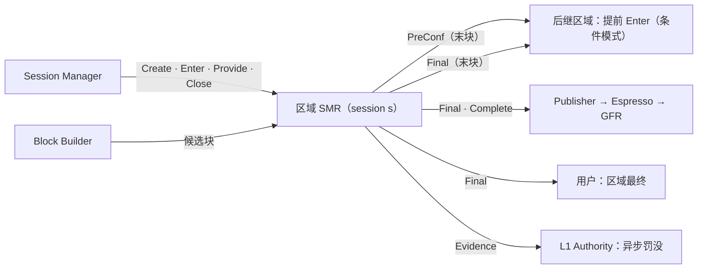

# 区域 BFT 的抽象：假设、全局构件、接口与设计目标（工作稿 v0.2）

日期：2026-10-30。
状态：草稿。本文不修改协议正文。
上一版：[v0.1](regional_bft_abstraction_zh_v0_1.md)。

**本文的写法：** 依次给出

1. 假设：三条系统假设，加一条敌手界；
2. 全局构件：区域 BFT 用到、但不由它实现的东西；
3. 接口与功能；
4. 设计目标。

本文只规定区域 BFT 对外承诺什么，不给协议。协议在 Part 3 中给出。按本文的假设，Part 3 要换成部分同步协议，例如 Simplex 一类。

**前置文档：**

- [Part 0 v0.8](part0_model_goals_zh_v0_8.md)：模型、假设与系统目标；
- [Part 1 v0.3](part1_module_interfaces_zh_v0_3.md)：模块接口，其中 §4.4 是 Session Program；
- [b_t 与轮换空档](block_time_and_rotation_gaps_zh.md)：N1、补位与时间跟随。

**相对 v0.1 的变化：**

1. **假设精简为三条加一条敌手界。** 网络由同步改为部分同步，拜占庭门槛由 1/2 改为 1/3。区域安全不再依赖任何时限：不依赖 $\Delta_i$、V-AGE、$T_{\rm L1}$、$T_E$ 或 A-TS。
2. **全局构件单列。** 签名与证书、时间函数、执行与派生一致检查、公共账本、委员会与 leader 名单、公开最终检查。
3. **新增预确认输出。** 后继区域可以凭前驱末块的预确认提前进入（条件模式），减少跨区域交接的空档。
4. **删除 Quit 输出。** 换 leader 在区域内完成，不再经过 L1 的 REC。
5. **设计目标重组为三组：** 时间绑定、安全、活性。

---

## 0. 定位与记号

**区域 BFT 是什么。** 它是一个 session 内的状态机复制（SMR）实例：

- 委员会固定；
- 从固定锚点出发，至多生产 TB 个高度；
- 对外输出预确认的块和最终的块。

**它不负责什么：**
- 委员会与 leader 名单由 Plan 决定；
- 全局最终由 GFR 决定；
- 何时创建、进入、关闭由 Session Manager 决定。

| 记号 | 含义 |
| --- | --- |
| $s$，$\mathrm{cid}_s$ | session 及其 context 标识，所有签名都绑定它（Part 1 §2.3） |
| $V_s$，$w_o$，$W_s$ | 委员会、成员权重、总权重 |
| $F_s$，$Q_s$ | 故障门槛与法定权重：$3F_s<W_s$，$Q_s:=W_s-F_s$ |
| $A_s$，$H_s$ | 锚点；本 session 的最高高度 $H_s=h(A_s)+\mathrm{TB}$ |
| $t(h)$ | 高度 $h$ 的时间戳（N1） |
| $v$ | 视图（view），即一次出块尝试的编号；每个视图有一个 leader |

**诚实成员：** 从未被腐化、按协议运行的成员。它可以崩溃后重新上线；签名之前先持久化签名记录，崩溃不会丢失这些记录（Part 0 §1.4）。

**良态：** 一次执行的谓词，不是假设。GST 之后，在线的诚实成员总权重不小于 $Q_s$；等价地，拜占庭成员与离线成员的总权重不超过 $F_s$。这与 Part 0 定义 1.4 的形式相同。

---

## 1. 假设

### A1 部分同步

存在一个未知的时刻 GST 和一个已知的上界 $\Delta$：

- 诚实成员之间于 $\tau$ 发出的消息，在 $\max\{\tau,\mathrm{GST}\}+\Delta$ 之前送达并处理完毕；
- GST 之前，消息只保证最终送达。

跨区域消息也满足这条假设，上界记为 $\Delta_{\rm cross}$。

- **用途：** 只用于活性。安全在任意消息延迟下都成立。
- **Part 0 对应：** 替换 §1.5 的区域内同步。在 Part 0 里，$\Delta_i$ 是快速确认安全的前提。

### A2 认证通信

- 点对点信道经过认证：敌手不能伪造或篡改诚实成员的消息，但可以延迟（限于 A1 的范围内）、重排或重复消息。信道不提供机密性。
- 签名不可伪造（EUF-CMA），哈希抗碰撞。
- 成员公钥经 L1 Authority 注册，并附 proof of possession。

**Part 0 对应：** A-CRYPTO、A-PKI，以及 §1.5 的认证信道。

### A3 全局时钟

所有成员读同一个全局时钟 $\tau$；任一成员的本地读数 $\mathit{now}$ 与 $\tau$ 相差不超过 $\epsilon$，$\epsilon$ 已知。

- **用途：**
  - 只用于"时间戳与真实时间"的关系，即 G1.2、G1.3；
  - 以及超时计时。
  - 安全目标 G2 不用它。
- **Part 0 对应：** §1.2 的全局时钟。Part 0 把时钟误差并入 $\Delta$，这里单列为 $\epsilon$。
- **说明：** 时钟同步（例如 NTP 或 GPS）与消息延迟是两件事。GST 之前消息可以很慢，时钟照样同步。这条假设失效时，受影响的只有 G1.2 和 G1.3。

### A4 敌手界（小于 1/3）

- 敌手可以自适应地腐化成员。
- 对每个 session $s$，在 $s$ 关闭之前被腐化过的成员（拜占庭成员）总权重不超过 $F_s$，且 $3F_s<W_s$。
- 腐化按累计计算。

**Part 0 对应：** A-BYZ，门槛由 $F_s<W_s/2$ 改为 $F_s<W_s/3$。

### 不需要的假设

| 不需要 | 说明 |
| --- | --- |
| 同步网络 | 安全不依赖任何时限 |
| session 内的 L1 活性 | 换 leader 不等 L1；证据异步提交 |
| Espresso 可用 | 只用于取引用；停机只影响活性 |
| 固定的出块速度 | N1 只约束时间戳（G1.1），出块快慢不受约束 |
| 诚实 leader 的频率 | 由 A4 加上按权重随机的 leader 名单推出：长期看，拜占庭成员主持的视图占比约等于其权重占比，小于 1/3。自适应敌手可以专门腐化即将当 leader 的成员，但腐化的总权重仍受 A4 限制 |

---

## 2. 全局构件

以下构件由区域 BFT 使用，但不由它实现。它们的保证来自 Part 0 与 Part 1，不是本层的假设。

| 编号 | 构件 | 内容 | 保证与出处 |
| --- | --- | --- | --- |
| B1 | 签名与证书 | 每条签名绑定 $(\mathit{domain},\mathit{chain},\mathrm{cid}_s,\mathit{type},\mathit{slot})$。**证书**：来自 $V_s$ 中不同成员、对同一内容的签名，总权重不小于 $Q_s$ | A2 |
| B2 | 时间函数 | $t(h)=t_{\rm gen}+(h-h_{\rm gen})\,b_t$（N1）；$\mathrm{slot}(\tau):=h_{\rm gen}+\lfloor(\tau-t_{\rm gen})/b_t\rfloor$，即时间戳不晚于 $\tau$ 的最高高度 | 定义 |
| B3 | 原生执行 Exec | 输入前一状态与一个原生块，输出新状态、原生块与状态根，或"无效" | 确定性（Part 1 §3.1） |
| B4 | 派生一致检查 DerivOK | origin 连续、drift、前缀等于 deposit 规则构造的前缀、执行有效 | 确定性，且对 L1 视图的扩展稳健（Part 1 §3.2） |
| B5 | 公共账本视图 | 已最终化的 L1 与 Espresso：origin、deposit、Espresso 引用 | L1-S、E-S（Part 0 §2.4）。可见延迟 $T_{\rm L1}$、$T_E$ 只影响活性 |
| B6 | 委员会与 leader 名单 | Plan 给出 $V_s$、权重、$F_s$、TB；$\mathrm{Leader}(s,v)$ 对每个视图确定，整个 session 内不变 | Part 2 G-AUTH-1、2 |
| B7 | 公开最终检查 CheckFINAL | 任何人用 B1 检查一份最终证书及其到目标块的路径 | 确定性（Part 1 §3.3；门槛改为 $Q_s$） |

**证书的两条基本事实**（由 A4 与 B1 直接推出）：

- **含诚实签名：** 任何证书都含有诚实成员的签名，因为 $Q_s-F_s=W_s-2F_s>0$。
- **两两相交于诚实成员：** 任意两份证书至少共有一个诚实签名者，因为两者交集的权重不小于 $2Q_s-W_s=W_s-2F_s>F_s$。

### 2.1 块的有效性

**块：** 一个块对应一个原生 L2 块：高度 $h$，时间戳，L1 origin，前缀（L1 attributes、deposit、系统交易），普通交易，以及 Espresso 引用 $\xi$。

**补位块：** 普通交易为空、只含前缀的块。它不是新的块类型。

**公开有效性 $\mathrm{Valid}_s(P,B)$：** 只凭 B2、B4、B5 就能检查，结论确定且不随时间改变。

| 条件 | 内容 |
| --- | --- |
| V0 结构 | $h(B)=h(P)+1\le H_s$；父链接正确；签名绑定 $\mathrm{cid}_s$ |
| V1 时间戳（N1） | $B$ 的时间戳等于 $t(h(B))$ |
| V2 派生一致 | $\mathrm{DerivOK}(P,B)=$ OK |
| V3 引用下界 | $\xi(B)$ 指向已最终化的 Espresso 块，沿祖先不减；本 session 的第一块不低于开出位置 $q^{\rm open}$ |

与 Part 1 不同，这里没有块级的 L1 地板。原因见[恢复稿](recovery_timing_assumptions_zh.md)问题 1：块级 L1 地板与原生 origin 规则冲突。

**本地可接受性：** 成员投票时，除 $\mathrm{Valid}_s$ 之外还要检查

- **W1 不超前：** $t(h(B))\le\mathit{now}+\epsilon$。

W1 只会随时间从不满足变为满足，所以可以放进投票。Part 3 的 V-AGE 在部分同步下不再是安全条件：暂时验证不了的成员只是暂不投票，只影响活性。

---

## 3. 接口与功能

**两类接口：**
- **核心接口：** 输入 Create、Enter；输出 PreConf、Final。
- **辅助接口：** 输入 Provide、Close；输出 Complete、Evidence。

调用语义沿用 Part 1 §0.4：
- 节点内接口先持久化、后对外发送，重复调用返回原结果；
- 输出携带完整对象。

### 3.1 输入接口

#### `Create(s, handoff)`

- **输入：** session $s$；Manager 已验证的 handoff（Part 1 §2.7）。
- **输出：** `Assigned(s)`；或 `REJECT`（handoff 冲突，或目标已关闭）。
- **功能：**
  - 固定实例参数：$\mathrm{cid}_s$、$V_s$、权重、$F_s$、$Q_s$、TB、$H_s$、$q^{\rm open}$、leader 名单。
  - 不授予签名权，不启动计时器。
  - 幂等。

#### `Enter(s, A, π_A, st(A))`

- **输入：** 锚点块 $A$ 的完整字节；它的证明 $\pi_A$；执行到 $A$ 之后的状态 $\mathit{st}(A)$。
  - $\pi_A$ 有两种：
    - **FINAL：** 前驱末块的最终证书（常规交接），或 GFR 固定的锚点（Force 与 RESUME 的锚点按定义已最终）。
    - **PRECONF：** 前驱末块的预确认证书，只用于常规交接。
- **输出：** `Entered(s, τ_entry, mode)`，$\mathit{mode}\in\{\mathsf{NORMAL},\mathsf{CONDITIONAL}\}$；或 `WAIT`、`REJECT`。
- **功能：**
  - 从视图 0、以 $A$ 为父块开始运行；
  - 每个实例至多进入一次；
  - $\pi_A$ 为 PRECONF 时进入**条件模式**：可以提议、投票、预确认，但诚实成员在拿到锚点的最终证书之前，不为任何块签最终票。

#### `Provide(s, input)`

| 输入 | 来源 | 效果 |
| --- | --- | --- |
| `Candidate(parent, x)` | Block Builder（G-BLD-1、2、3） | 供 leader 提议 |
| `References(R_L1, R_E)` | Manager 转来的已最终化 L1、Espresso 视图 | 供 V2、V3 检查 |
| `AnchorFinal(π)` | Manager：锚点的最终证书 | 条件模式转为正常模式 |
| `AnchorLost(π')` | Manager：锚点高度上另一块的最终证书 | 实例停止，等同 Close(ANCHOR_LOST) |

#### `Close(s, reason)`

- **输入：** $\mathit{reason}\in\{\mathsf{COMPLETE},\mathsf{FORCE},\mathsf{EXPIRED},\mathsf{RESUME},\mathsf{KILL},\mathsf{ANCHOR\_LOST}\}$。
- **功能：**
  - 立即停止该实例的一切签名，包括已排队的回调；
  - 保留已有的块、证书与证据；
  - 重复关闭返回同一结果。

### 3.2 输出接口

#### `PreConf(s, B, π_pre)`：预确认

- **何时输出：** 本成员持有 $B$ 的预确认证书，以及从 $A_s$ 到 $B$ 的完整块体。
- **含义：** 由 G2.4 与 G3.1 规定。在同一视图、同一高度，只有这一个块可能被预确认，正常情况下它很快就会最终。
- **用途：**
  1. 后继区域以前驱末块的 PreConf 提前 Enter（条件模式），不必等末块最终；
  2. 可选：作为给用户的"软确认"，必须标明可被撤销；
  3. GFR 不使用它。
- **条件模式下：** 输出要标明"以锚点 $A_s$ 最终为条件"。

#### `Final(s, B, π_fin)`：区域最终

- **何时输出：** 本成员持有覆盖 $B$ 的最终证书，以及证书所在块到 $B$ 的路径（即 Part 1 §2.6 的 kernel）。
- **用途：**
  1. 交给 Publisher，发布到 Espresso，由 GFR 用 CheckFINAL 接纳；
  2. 给用户的区域最终，对应 Part 0 的快速确认 $\mathsf{Conf}$；
  3. 前驱末块的 Final 就是后继的 `AnchorFinal`。

#### `Complete(s, T_s, π_fin)`

末块 $T_s$（高度 $H_s$）已最终，实例正常结束。

#### `Evidence(s, ev)`

- **何时输出：** 同一密钥在同一槽位签了两份冲突的消息。
- **用途：** 证据异步提交 L1 罚没，任何步骤都不等它。

### 3.3 内部行为的最低要求

以下几条不是接口，但实现必须满足，设计目标依赖它们。

1. **出块与补位。**
   - 视图 $v$ 的诚实 leader 以它所知最高的预确认块 $P$ 为父块，目标高度取 $h^*=\min\{\mathrm{slot}(\mathit{now}-\epsilon),\ H_s\}$。
   - 若 $h^*>h(P)$：一次提议一个片段——高度 $h(P)+1$ 到 $h^*-1$ 为补位块，$h^*$ 为普通块。片段中的每一块都满足 $\mathrm{Valid}_s$。
   - 否则：等到 slot 前进。
2. **补位块不带用户交易。** 诚实 leader 只把普通交易放进当前 slot 的块。这一条约束 leader，不进入投票。
3. **投票。**
   - 诚实成员只为满足 $\mathrm{Valid}_s$ 与 W1 的片段投票；
   - 每个视图、每个高度至多为一个块签预确认票；
   - 签名之前先持久化。
4. **超时与换 leader。**
   - 视图超时从 $\max\{\text{进入视图的时刻},\ t(h(P)+1)+2\epsilon\}$ 起算，不把等待节奏的时间算作 leader 失职。
   - 超时之后，在区域内用证书切换到下一个视图，不经过 L1。
5. **leader 名单整个 session 不变。**
   - 证明双签过的成员，从下一个 session 起由 Plan 的禁任集合排除，即延迟排除。
6. **条件模式。** 在 `AnchorFinal` 到达之前，不签最终票。

---

## 4. 设计目标

**记号：**
- 前提"**活性条件**"指同时满足：GST 之后；$s$ 良态；权重不小于 $Q_s$ 的诚实成员已经 Enter；输入可得（候选、引用、锚点状态）；实例未关闭。
- $\tau_{\rm cert}(B)$ 指 $B$ 的预确认或最终证书形成的时刻。

### G1 高度与时间绑定

| 编号 | 目标 | 类型 | 依赖 |
| --- | --- | --- | --- |
| G1.1 N1 | 每个被预确认或最终的块 $B$，时间戳等于 $t(h(B))$ | 安全 | A2、A4 |
| G1.2 不超前 | 每个被预确认或最终的块 $B$ 满足 $t(h(B))\le\tau_{\rm cert}(B)+2\epsilon$ | 安全 | A2、A3、A4 |
| G1.3 时间跟随 | 在活性条件下：(a) 稳态时，已最终链末端的时间戳不早于 $\tau-\Lambda$，其中 $\Lambda=b_t+2\epsilon+T_{\rm fin}$；(b) 换 leader、晚进入等中断结束后，$T_{\rm catch}$ 内回到 (a)。$T_{\rm catch}$ 只含常数轮共识，加上执行补位块的时间，与空档长短无关 | 活性 | A1、A3 |

**说明：**
- N1 约束的是输出，不是速度。出块快慢不受约束，慢了用补位块填满（§3.3 第 1 条）。
- G1.2 的推导：证书中有诚实投票者，它投票时检查过 W1。
- G1.3 的推导：诚实 leader 的普通块落在 $\mathrm{slot}(\mathit{now}-\epsilon)$。

### G2 安全

| 编号 | 目标 | 依赖 |
| --- | --- | --- |
| G2.1 最终一致 | 同一高度不会有两个不同的块都有最终证书 | A2、A4 |
| G2.2 前缀闭合 | 若 $B$ 最终，则从 $A_s$ 到 $B$ 的每个祖先都最终；最终证书证明的是一条链 | A2、A4 |
| G2.3 外部有效 | 每个被预确认或最终的块，及其同 session 祖先，满足 $\mathrm{Valid}_s$。特别地，满足 N1 与 deposit 规则 | A2、A4 |
| G2.4 预确认唯一 | 同一视图、同一高度，至多一个块被预确认 | A2、A4 |
| G2.5 条件最终 | 以 PRECONF 锚点进入的 session，其块只在锚点最终之后才可能最终；若锚点高度上另一块已最终，本 session 的块永远不会最终 | A2、A4（本 session 与前驱 session） |
| G2.6 关闭与隔离 | Close 之后诚实成员不再为 $s$ 签名；签名绑定 $\mathrm{cid}_s$，不能跨 session 重放 | A2 |
| G2.7 诚实不留证据 | 不存在针对诚实密钥的有效 Evidence | 诚实成员先持久化后签名 |

**说明：**
- **G2.1、G2.4 不需要良态，也不需要同步。** 两份证书交于一个诚实成员，而诚实成员在同一槽位不签两份冲突的票。这是比 Part 0 S4(a) 更强的结论：S4(a) 要求 session 良态，而且网络同步。
- **G2.5 的推导：** 最终证书含有诚实的最终票，而诚实成员只在验证过锚点的最终证书之后才投最终票；再由前驱 session 的 G2.1，锚点高度不会有两个最终块。

### G3 活性（都在活性条件下）

| 编号 | 目标 |
| --- | --- |
| G3.1 出块 | 每个高度在可以生产之后 $T_{\rm pre}$ 内被预确认，$T_{\rm fin}$ 内最终。"可以生产"指它的时间戳加 $2\epsilon$ 已到 |
| G3.2 区域内换 leader | 失职的 leader 在 $T_{\rm vc}$ 内被替换。$T_{\rm vc}$ 只由 $\Delta$ 与超时参数构成，不含 L1 或 Espresso 的时延。拜占庭成员主持的视图，长期占比小于 1/3 |
| G3.3 末块 | $T_s$ 在可以生产之后 $T_{\rm fin}$ 内最终，并输出 Complete |
| G3.4 条件模式转正 | `AnchorFinal` 在 $\tau_{\rm af}$ 到达后，本 session 已预确认的块在 $\max\{\tau_{\rm af},\tau_{\rm cert}\}+T_{\rm fin}$ 之前最终 |
| G3.5 交易包含 | 诚实 leader 在容量之内，包含待处理集合中持续有效的交易（与 Builder 的 G-BLD-3 一起） |

**跨区域交接的空档（由 G3.1 与 G3.4 推出）：**
- 后继凭前驱末块的 PreConf 进入，常规交接的空档从约 $T_{\rm fin}+\Delta_{\rm cross}$ 降到约 $T_{\rm pre}+\Delta_{\rm cross}$。
- 后继的块最终，仍要等前驱末块的 Final 到达，约 $T_{\rm fin}+\Delta_{\rm cross}$。
- 收益多大取决于协议：
  - Simplex 一类协议中，$T_{\rm fin}-T_{\rm pre}$ 约为区域内一轮消息；
  - 最终化较慢的协议（例如要等计时器，或要另行聚合签名）收益更大。

---

## 5. 与 Part 0 的对应

| 本文 | Part 0 |
| --- | --- |
| A1 部分同步 | 替换 §1.5 的区域内同步 $\Delta_i$ |
| A2 认证通信 | A-CRYPTO、A-PKI、§1.5 的认证信道 |
| A3 全局时钟 | §1.2；时钟误差单列为 $\epsilon$ |
| A4 敌手界 | A-BYZ，门槛由 1/2 改为 1/3 |
| 良态 | 定义 1.4，形式不变 |
| G1.1 | N1；S3(a) 原生有效 |
| G1.2、G1.3 | 新性质"时间跟随"，Part 0 待补 |
| G2.1 | S4(a)，且不再需要良态与同步 |
| G2.2、G2.3 | S3(a)、S3(b)；L2-L1 的前提（派生一致投票） |
| G2.5 | 新增：预确认交接 |
| G2.6 | S6 的前提（关闭后不再产生签名） |
| G2.7 | S5(a) |
| G3 | DG6 的 $T_{\rm live}$；DG7 的区域内部分 |

**连带要改的地方（不在本文内改）：**

- **Part 0：**
  - §1.5 改为部分同步；
  - A-BYZ 的门槛改为 1/3；
  - 补上时间跟随性质与 $\epsilon$；
  - DG3 不再依赖 A-TS、L1-L3 与 Espresso 的 X-L2。
- **Part 1：**
  - §2.5 的证书门槛改为 $Q_s$；
  - §2.6 增加预确认；
  - §2.7 的 handoff 允许 PRECONF 证据；
  - §4.4 改为本文的接口；
  - 删除 Quit、REC 相关的输入输出。
- **Part 2：** `SubmitQuit` 与 REC 不再是换 leader 的前提；Auth 的禁任集合在 session 内固定。
- **Part 3：** 换成满足 A1、A4 的部分同步协议，并实现 §3.3 的六条最低要求。

---

## 6. 待定问题

1. **共识的单位。** 本文以 EVM 块为单位。若改为按 mini-block 确认：
   - G2、G3 作用于 mini-block；
   - G1 与补位作用于 EVM 块；
   - 需要另加 EVM 块的封口规则，以及"同一 EVM 块的 mini-block 由同一身份签名"的处理（MegaETH 的 sequencer 密钥规则）。
2. **条件模式能领先多远。** 后继在锚点最终之前最多出多少块，以限制锚点失效时白做的工作。
3. **预确认是否对用户开放。** 若开放，要写明它的撤销条件：同一高度另一块被最终。
4. **常数。** $T_{\rm pre}$、$T_{\rm fin}$、$T_{\rm vc}$、$T_{\rm catch}$ 与 $\epsilon$ 的具体值，由所选协议与部署推出。
5. **延迟排除的代价。** 同一 session 内，被证明双签的成员可能再次被抽为 leader。需要估算一个 session 内最多损失多少个视图。
