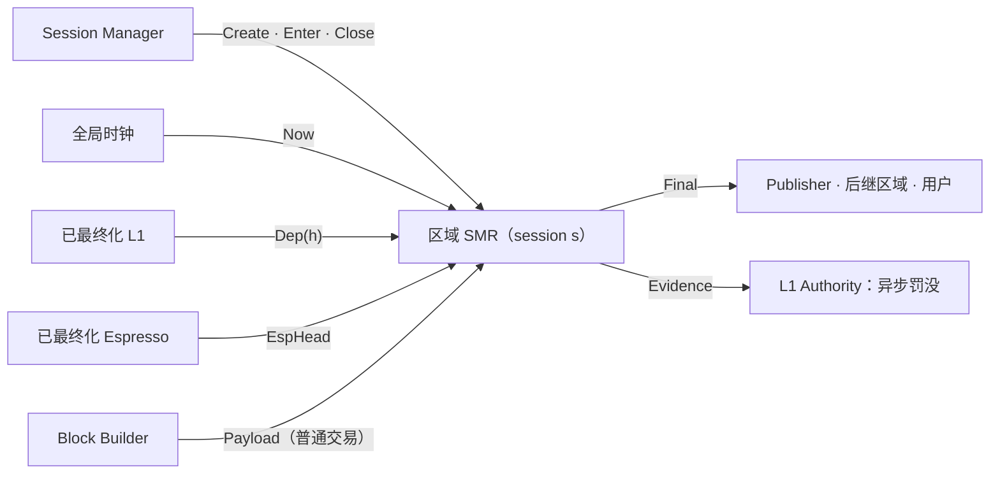

# 区域 BFT 的抽象（工作稿 v0.3）

日期：2026-10-31。
状态：草稿。本文不修改协议正文。
上一版：[v0.2](regional_bft_abstraction_zh_v0_2.md)。

**相对 v0.2 的变化：**

1. **删除预确认。** 它不改变任何块的时间戳，收益约为每个 session 一次、一轮区域内消息，却要引入条件模式（§6.1）。
2. **加入区域内 leader 轮换。** 每个视图（任期）的 leader 至多提议 $K$ 个片段；常规轮换不需要超时（§3.2、§6.2）。
3. **deposit 成为显式输入 $\mathrm{Dep}_s(h)$。** 为此要固定 origin 规则：今天的 origin 由 leader 选，deposit 还不是高度的函数（§2.1、§6.3）。
4. **输入输出重新划分。** 控制输入只有 `Create`、`Enter`、`Close`；只读输入只有 `Now`、`Dep`、`EspHead`、`Payload`；输出只有 `Final`、`Evidence`（§4）。

---

## 0. 一页概览

区域 BFT 是一个 session 内的状态机复制（SMR）实例：委员会固定，从固定锚点出发，至多生产 TB 个高度。

| 类别 | 接口 | 含义 |
| --- | --- | --- |
| 控制输入 | `Create`、`Enter`、`Close` | Manager 决定实例的生命周期 |
| 只读输入 | `Now`、`Dep`、`EspHead`、`Payload` | 实例向外读取，不改变外部状态 |
| 输出 | `Final`、`Evidence` | 区域最终的块；罚没证据 |

成员之间的共识消息是实例内部的事，不属于接口。

**设计目标一句话：** 输出的每个块，时间戳由高度决定，deposit 由 $\mathrm{Dep}_s(h)$ 决定；最终的块不冲突；每个 leader 至多提议 $K$ 个片段；网络稳定后，链上时间跟随全局时钟。

---

## 1. 假设

| 编号 | 假设 | 内容 | 用途 | Part 0 对应 |
| --- | --- | --- | --- | --- |
| A1 | 部分同步 | 存在未知的 GST 与已知的 $\Delta$：诚实成员之间于 $\tau$ 发出的消息，在 $\max\{\tau,\mathrm{GST}\}+\Delta$ 之前送达并处理完毕；跨区域的上界为 $\Delta_{\rm cross}$ | 只用于活性 | 替换 §1.5 的同步假设 |
| A2 | 认证通信 | 信道经过认证；签名不可伪造，哈希抗碰撞；公钥经 L1 Authority 注册 | 全部目标 | A-CRYPTO、A-PKI |
| A3 | 全局时钟 | 所有成员读同一全局时钟 $\tau$，本地读数 $\mathit{now}$ 与 $\tau$ 相差不超过已知的 $\epsilon$ | 只用于时间目标与超时；最终一致不依赖它 | §1.2 |
| A4 | 敌手界 | 敌手可以自适应腐化；在 $s$ 关闭之前被腐化过的成员，总权重不超过 $F_s$，且 $3F_s<W_s$ | 全部安全目标 | A-BYZ，门槛由 1/2 改为 1/3 |

**诚实成员：** 从未被腐化、按协议运行；可以崩溃后重新上线；先持久化签名记录，再签名。

**良态：** 这是一次执行的谓词，不是假设。GST 之后，在线诚实成员的总权重不小于 $Q_s:=W_s-F_s$。形式与 Part 0 定义 1.4 相同。

---

## 2. 全局构件

以下构件被区域 BFT 使用，但不由它实现。

| 编号 | 构件 | 内容 | 依据 |
| --- | --- | --- | --- |
| B1 | 证书 | 每条签名绑定 $\mathrm{cid}_s$ 与槽位。证书是不同成员对同一内容的签名，总权重不小于 $Q_s$。任何证书都含诚实签名，任意两份证书至少共有一个诚实签名者 | A2、A4 |
| B2 | 时间函数 | $t(h)=t_{\rm gen}+(h-h_{\rm gen})\,b_t$（N1）；$\mathrm{slot}(\tau):=h_{\rm gen}+\lfloor(\tau-t_{\rm gen})/b_t\rfloor$ | 定义 |
| B3 | 原生执行 Exec | 输入状态与一个原生块，输出新状态与状态根，或"无效" | Part 1 §3.1 |
| B4 | 公共账本 | 已最终化的 L1 与 Espresso 日志；两个诚实方读到的日志互为前缀 | Part 0 L1-S、E-S |
| B5 | 委员会与名单 | Plan 给出 $V_s$、权重、$F_s$、TB、$K$；$\mathrm{Leader}(s,v)$ 对每个视图确定，整个 session 内不变 | Part 2 Plan、Leader |
| B6 | 公开最终检查 CheckFINAL | 任何人检查最终证书及其到目标块的路径 | Part 1 §3.3，门槛改为 $Q_s$ |
| B7 | deposit 函数 $\mathrm{Dep}_s(h)$ | 见 §2.1 | §6.3 |

### 2.1 deposit 函数

**固定 origin 规则。** 设新常数 $T_{\rm dep}$（deposit 滞后）。给定父块的 origin $e$ 与高度 $h$：

$$
\mathrm{Next}(e,h)=
\begin{cases}
e+1 & \mathit{ts}(e+1)\le t(h)-T_{\rm dep},\\
e & \text{否则.}
\end{cases}
$$

令 $o_s(h(A_s)):=o(A_s)$，$o_s(h):=\mathrm{Next}(o_s(h-1),h)$。这里的 $e+1$ 指 L1 高度加一。

**定义。** 对 $h(A_s)<h\le H_s$：

$$
\mathrm{Dep}_s(h):=\bigl(o_s(h),\ \mathrm{Prefix}_s(h)\bigr).
$$

$\mathrm{Prefix}_s(h)$ 是派生在这个 origin 上构造的前缀：
- L1 attributes；
- 若 origin 在 $h$ 处前进，则包含该 L1 块记录的全部 deposit；否则不含 deposit；
- 适用的系统交易与升级交易。

计算 $\mathrm{Dep}_s(h)$ 所需的 L1 块尚未最终化时，返回 `WAIT`。

**常数约束：**

| 约束 | 作用 |
| --- | --- |
| $b_t<\delta_{\min}$（L1 相邻块的最小时间间隔，12 秒） | origin 跟得上 L2 时间 |
| $T_{\rm dep}+\delta_{\rm slot}\le D_{\rm drift}$ | 满足 drift（§6.3 引理 2） |
| $T_{\rm L1}+\delta_{\rm slot}+\Delta_{\rm ts}\le T_{\rm dep}$ | 按节奏出块时 $\mathrm{Dep}_s(h)$ 已可得；只影响活性 |

锚点还要满足 $t(h(A_s))\le\mathit{ts}(o(A_s))+D_{\rm drift}$。普通块由 R-FRESH 保证，RESUME 锚点由 C-RES-5 保证。

**三条性质**（证明见 §6.3）：

- **一致：** 两个诚实成员都读到 $\mathrm{Dep}_s(h)$ 时，结果相同，而且不随时间改变。
- **与分支和 leader 无关：** 结果只取决于 $s$ 的锚点、$h$ 与 L1 日志，不取决于普通交易、leader，也不取决于 session 内走的是哪条分支。
- **派生一致：** 用它组装的块，满足 Part 1 §3.2 DerivOK 的 V1、V2、V3。

---

## 3. 块、片段与视图

### 3.1 块与片段

**块：** 高度 $h$ 的块由 $t(h)$、$\mathrm{Dep}_s(h)$、普通交易和 Espresso 引用 $\xi$ 组成。

**补位块 $\mathrm{Pad}_s(h)$：** 普通交易为空的块。它的原生内容是 $(s,h)$ 与 L1 日志的纯函数，所以 leader 不用传输，成员可以自己算出。

**片段（segment）：** 一次提议的内容，形如 $(P,h_e,\mathit{txs},\xi)$：
- 高度 $h(P)+1$ 到 $h_e-1$ 都是补位块；
- 高度 $h_e$ 的块（末块）携带 $\mathit{txs}$，可以为空；
- 所有块使用同一个 $\xi$。

只有末块能带用户交易。链上时间没有落后时，$h_e=h(P)+1$，片段就是一个块。

### 3.2 视图与 $K$

**视图（任期）** $v=0,1,2,\dots$：
- 每个视图的 leader 是 $\mathrm{Leader}(s,v)$，整个 session 内固定；
- 每个视图有 $K$ 个位置 $j=0,\dots,K-1$，每个位置至多一个片段；
- 补位块不占位置。

**位置 $(v,j)$ 是签名槽位。** 同一 leader 在同一位置签两个不同片段，构成 Evidence。

**视图有两种结束方式，都在区域内完成：**

| 方式 | 触发条件 | 代价 |
| --- | --- | --- |
| 常规轮换 | 位置 $K-1$ 的片段取得证书（terminal 证书） | 没有超时，也不等最终化；代价与一次普通提议相同 |
| 故障轮换 | 超时：某位置在可以提议之后 $T_{\rm to}$ 内没有进展 | 约 $T_{\rm to}$ 加几轮消息；不经过 L1 |

**"可以提议"的时刻：** 父块为 $P$ 时，超时从 $\max\{\text{进入视图的时刻},\ t(h(P)+1)+2\epsilon\}$ 起算。等待节奏的时间不算 leader 失职。

片段到达高度 $H_s$ 时配额用完，不再有后续位置。

**与 Sync HotStuff 的对应：** Part I 的 $(g,t,j)$ 对应这里的 $(v,j)$。$g$ 与 $t$ 的区别是具体协议的实现，对外只需要"常规"与"故障"两种结束方式。

### 3.3 例子

设 $K=3$、$b_t=1$ 秒、$T_{\rm to}=0.8$ 秒。

| 视图 | leader | 发生了什么 | 高度 |
| --- | --- | --- | --- |
| 7 | A | 按节奏提议 3 个片段，terminal 证书直接进入视图 8 | 101、102、103 |
| 8 | B | 沉默；$t(104)+0.8$ 秒超时 | — |
| 9 | C | 也沉默；再过 0.8 秒超时 | — |
| 10 | D | 在 $t(104)+1.65$ 秒提议，当前 slot 是 105，所以片段为"补位 104，末块 105"（$j=0$）；之后按节奏提议 106（$j=1$）、107（$j=2$） | 104–107 |

时间戳全部符合 N1，链上时间没有落后。D 一次提议就补上了空档。

### 3.4 有效性

**公开有效性 $\mathrm{Valid}_s(P,S)$：** 任何成员只凭构件就能检查。

| 条件 | 内容 |
| --- | --- |
| V0 结构 | 父链接正确；$h_e\le H_s$；$j<K$；签名绑定 $\mathrm{cid}_s$，leader 正确 |
| V1 时间戳（N1） | 每块的时间戳等于 $t(h)$ |
| V2 deposit | 每块的 origin 与前缀等于 $\mathrm{Dep}_s(h)$ |
| V3 补位 | 除末块外，普通交易都为空 |
| V4 执行 | Exec 不返回"无效"；普通交易中没有 deposit 类型的交易 |
| V5 Espresso 引用 | $\xi$ 指向已最终化的 Espresso 块，沿祖先不减，第一块不低于 $q^{\rm open}$ |

**投票条件：** 诚实成员只为满足 $\mathrm{Valid}_s$ 且 $t(h_e)\le\mathit{now}+\epsilon$（W1）的片段投票，每个位置至多投一次。

---

## 4. 接口与功能

调用语义沿用 Part 1 §0.4：先持久化，后对外发送；重复调用返回原结果；缺输入返回 `WAIT`；无效返回 `REJECT`。

### 4.1 控制输入

#### `Create(params)`

- **输入：** Manager 验证过的固定参数：$\mathrm{cid}_s$、$V_s$、权重、$F_s$、$Q_s$、TB、$K$、$T_{\rm to}$、$H_s$、$q^{\rm open}$，以及 leader 名单所需的种子。
- **输出：** `Assigned(s)`；或 `REJECT`（参数冲突，或实例已关闭）。
- **功能：** 建立实例并固定参数。不授予签名权，不启动计时器。

#### `Enter(A, π_A, st(A))`

- **输入：** 锚点块 $A$ 的完整字节；它已最终的证明 $\pi_A$（前驱末块的最终证书，或 GFR 固定锚点的重算位置）；执行到 $A$ 之后的状态。
- **输出：** `Entered(s, τ_entry)`；或 `WAIT`、`REJECT`。
- **功能：** 从视图 0、以 $A$ 为父块开始运行。每个实例至多进入一次。

#### `Close(reason)`

- **输入：** $\mathit{reason}\in\{\mathsf{COMPLETE},\mathsf{FORCE},\mathsf{EXPIRED},\mathsf{RESUME},\mathsf{KILL}\}$。
- **输出：** `Terminated(s, reason)`。
- **功能：** 立即停止一切签名，包括已排队的回调；保留已有的块、证书与证据。

### 4.2 只读输入

| 接口 | 输入 | 输出 | 调用者与功能 |
| --- | --- | --- | --- |
| `Now()` | — | $\mathit{now}$ | 所有成员；用于节奏、W1 与超时（A3） |
| `Dep(h)` | 高度 $h$ | $\mathrm{Dep}_s(h)$ 或 `WAIT` | 所有成员；leader 组块、投票者验证都用它（§2.1） |
| `EspHead()` | — | 已最终化的 Espresso 头 $(q,\mathsf H(J_q))$ | leader 选 $\xi$；投票者只需核对 $\xi$ 指向的块已在本地日志中，否则等待 |
| `Payload(h, st_pre, limits)` | 高度、执行完 $\mathrm{Prefix}_s(h)$ 之后的状态、容量限制 | 有序的普通交易列表，可以为空 | 只有 leader 调用；来自 Block Builder |

**Block Builder 从此只负责普通交易：** 它不接触 L1、不选 origin、不构造前缀。没有待处理交易时返回空列表，所以 leader 不会因为 Builder 而停下。

### 4.3 输出

#### `Final(B, π_fin)`

- **何时输出：** 本成员持有覆盖 $B$ 的最终证书，以及从证书所在块到 $B$ 的路径。
- **内容：** 块的完整字节与证明。$\pi_{\rm fin}$ 通过 CheckFINAL（B6）。
- **用途：** 交给 Publisher，再由 GFR 接纳；作为给用户的快速确认（Part 0 的 $\mathsf{Conf}$）；高度 $H_s$ 的 Final 是后继 session 的锚点证明。
- 高度 $H_s$ 的 Final 表示实例完成。

#### `Evidence(ev)`

- **何时输出：** 观察到同一密钥在同一槽位签了两份冲突的消息。
- **用途：** 异步提交 L1 罚没，任何步骤都不等它。

### 4.4 诚实 leader 的规则

1. **目标高度：** $h^*=\min\{\mathrm{slot}(\mathit{now}-\epsilon),\ H_s\}$。
2. **提议：** 若 $h^*>h(P)$，提议片段 $(P,h^*,\mathit{txs},\xi)$，其中 $P$ 是它所知的最高已认证块；否则等 slot 前进。
3. **任期上限：** 每个视图至多提议 $K$ 个片段。

### 4.5 与 Part 1 §4.4 的对照

| Part 1 | v0.3 |
| --- | --- |
| `Create`、`Enter`、`Close` | 不变；Enter 只接受已最终的锚点 |
| `Provide(Candidate)` | 改为只读的 `Payload`，只含普通交易 |
| `Provide(References)` | 拆成 `Dep`（L1）与 `EspHead`（Espresso） |
| `Provide(Authority)` | 删除：名单在 session 内固定 |
| `Step` | 内部行为，不算接口 |
| `Conf`、`Result` | 合并为 `Final` |
| `Complete` | 高度 $H_s$ 的 `Final` |
| `Offense` | `Evidence` |
| `Quit` | 删除：换 leader 在区域内完成，不经过 L1 |

---

## 5. 设计目标

**活性条件：** GST 之后；$s$ 良态；权重不小于 $Q_s$ 的诚实成员已经 Enter；只读输入可得；实例未关闭。

### G1 高度与时间绑定

| 编号 | 目标 | 类型 | 依赖 |
| --- | --- | --- | --- |
| G1.1 N1 | 每个带证书的块，时间戳等于 $t(h)$ | 安全 | A2、A4 |
| G1.2 不超前 | 每个带证书的片段，$t(h_e)\le\tau_{\rm cert}+2\epsilon$ | 安全 | A2、A3、A4 |
| G1.3 时间跟随 | 活性条件下：(a) 稳态时，已最终链末端的时间戳不早于 $\tau-\Lambda$，$\Lambda=b_t+2\epsilon+T_{\rm fin}$；(b) 中断结束、出现诚实 leader 后，下一次提议就补齐空档；恢复时间只含一轮共识与补位块的执行时间，不含与空档成正比的共识轮数 | 活性 | A1、A3 |

N1 约束的是输出，不是速度。出块慢了用补位块填满。

### G2 安全

| 编号 | 目标 | 依赖 |
| --- | --- | --- |
| G2.1 最终一致 | 同一高度不会有两个不同的块都有最终证书 | A2、A4 |
| G2.2 前缀闭合 | 若 $B$ 最终，则从 $A_s$ 到 $B$ 的每个祖先都最终 | A2、A4 |
| G2.3 外部有效 | 每个带证书的片段都满足 $\mathrm{Valid}_s$。特别地，每块的前缀等于 $\mathrm{Dep}_s(h)$，因此必含应有的 deposit | A2、A4、B4 |
| G2.4 任期上限 | 任何带证书的链上，同一视图至多贡献 $K$ 个片段，所以至多 $K$ 个块带用户交易 | A2、A4 |
| G2.5 关闭与隔离 | Close 之后诚实成员不再为 $s$ 签名；签名不能跨 session 或跨槽位重放 | A2 |
| G2.6 诚实不留证据 | 不存在针对诚实密钥的有效 Evidence | 诚实成员先持久化后签名 |

G2.1、G2.3、G2.4 不需要良态，也不需要同步。

### G3 活性（都在活性条件下）

| 编号 | 目标 |
| --- | --- |
| G3.1 出块 | 每个高度在 $t(h)+2\epsilon$ 之后 $T_{\rm fin}$ 内最终（当前视图的 leader 诚实时） |
| G3.2 常规轮换无额外代价 | 从 terminal 证书形成到下一个 leader 提议，不需要超时、L1 或 Espresso；$b_t\ge2\Delta+2\epsilon$ 时不造成任何滞后 |
| G3.3 故障轮换 | 失职的 leader 在 $T_{\rm vc}$ 内被替换；$T_{\rm vc}$ 只由 $T_{\rm to}$ 与 $\Delta$ 构成，不含 L1 或 Espresso 的时延。诚实 leader 不会被判失职 |
| G3.4 末块 | 高度 $H_s$ 的块无需任何后继块也能最终。末块没有同 session 的子块，所以依赖子块才能提交的协议，要另加收尾步骤 |
| G3.5 交易包含 | 诚实成员 $o$ 待处理集合中持续有效的交易，在 $o$ 下一次任 leader 时、容量之内被包含 |
| G3.6 跨区域交接 | $T_{\rm fin}+\Delta_{\rm cross}+T_{\rm enter}\le b_t$ 时，常规交接不产生滞后；否则滞后 $g-b_t$，由下一次提议补齐 |

---

## 6. 三个决定的论证

### 6.1 删除预确认

**收益。** 设交接空档为 $g$。按 [b_t 文档](block_time_and_rotation_gaps_zh.md) §3，滞后是 $\max\{0,g-b_t\}$。

| | 空档 $g$（$\delta=20$ ms，$\Delta_{\rm cross}=150$ ms） | $b_t=1$ 秒时的滞后 |
| --- | --- | --- |
| 等最终（约 $3\delta+\Delta_{\rm cross}$） | 约 210 ms | 0 |
| 等预确认（约 $2\delta+\Delta_{\rm cross}$） | 约 190 ms | 0 |

后继无论如何都要等到 $t(H_p+1)$ 才提议，所以两者的块时间戳与 G 的进度**完全相同**。

即使按 mini-block 流式确认，收益也只是每个 session 少停顿一轮区域内消息（约 20 ms，每小时一次）。

**故障时也没有帮助。** 前驱在末块预确认之后、最终之前失效时，后继的块无法最终，只能走 Force，而 Force 的锚点是 $\mathrm{last}(G)$，后继已做的工作作废。

**代价。** 条件模式、`AnchorFinal`、`AnchorLost`、`ANCHOR_LOST`、锚点失效后换 $\mathrm{cid}$ 重开、一条额外的安全目标，以及一份给用户的、可撤销的语义。

**结论：删除。** 以下任一情况出现时再考虑加回来：
- $b_t<T_{\rm fin}+\Delta_{\rm cross}$；
- 所选协议的 $T_{\rm fin}-T_{\rm pre}$ 明显大于一轮消息。

### 6.2 怎样抽象 $K$

**$K$ 限制的是什么。** 一个 leader 连续掌握排序权的范围：至多 $K$ 次选择交易和排序。Part I 的设计要求是：leader 按固定计划更换，而且一次计划内的更换"不比一次普通提议更贵"。

**核心问题：补位块算不算进 $K$。** 比较三种做法，以空档 20 分钟（1200 个高度）、$K=10$、$b_t=1$ 秒、$\delta=20$ ms、$T_{\rm to}=0.8$ 秒、拜占庭 leader 占比 $\rho=1/3$ 且都沉默为例：

| 做法 | 含义 | 补齐 20 分钟空档 | 问题 |
| --- | --- | --- | --- |
| A 补位块也占位置 | 保留 Part I"高度到位置"的固定映射 | 要经过 120 个视图，约 $120\times(2\delta+\rho T_{\rm to})\approx37$ 秒；10 小时空档约 18 分钟 | 恢复时间与空档成正比，违反 G1.3 |
| **B 补位块不占位置（采用）** | 位置只数片段 | 第一个诚实 leader 一次提议补齐；平均多等约 $\frac{\rho}{1-\rho}T_{\rm to}=0.4$ 秒 | 高度不再固定映射到位置；用片段里的高度字段解决 |
| C 按时间分配 | 每个 leader 拥有固定的 $K$ 个 slot | 不需要专门补位 | leader 沉默要等到时间窗结束，每次损失最多 $K\,b_t=10$ 秒；要缩短就得超时换人，映射又不成立了 |

**为什么 B 不削弱 $K$ 的作用：**

1. **带用户交易的块有上限。** 片段只有末块能带交易（V3），每个视图至多 $K$ 个片段（G2.4），所以同一视图至多 $K$ 个块带用户交易。
2. **补位块不给 leader 任何选择权。** 原生内容是 $(s,h)$ 与 L1 日志的纯函数（§2.1）。
3. **leader 只能决定补到哪里，而且补不到未来。** W1 限制 $t(h_e)\le\mathit{now}+\epsilon$。
4. **任期的时长也有界。** 按节奏时一个任期约 $K\,b_t$。leader 拖延时，每个位置最多拖到 $T_{\rm to}$，所以 $T_{\rm to}<b_t$ 时任期仍约为 $K\,b_t$，不会被拉长。
5. **配额不受影响。** 补位块仍占 TB 个高度，session 覆盖的时间跨度不变，S6 不受影响。

没有空档时，B 与 Part I 的固定长度任期完全一致。

**$K$ 怎么取，是一个取舍：**

| 因素 | $K$ 小 | $K$ 大 |
| --- | --- | --- |
| 沉默 leader 损失的时间比例，$\frac{\rho T_{\rm to}}{(1-\rho)K b_t+\rho T_{\rm to}}$ | $K=1$：约 29% | $K=10$：约 3.8% |
| 拜占庭 leader 单次可以审查的时长，$K\,b_t$ | $K=1$：1 秒 | $K=10$：10 秒 |
| 跨 leader 的消息开销 | 高 | 低 |

**一处相关缺口：** 按现在的 Part 1，Builder 不做区域内转发时，一笔交易要等接收它的成员当 leader，平均约 $\frac{W_s}{w_o}K\,b_t$（20 个等权成员、$K=10$ 时约 200 秒）。要让延迟与 $K$ 无关，需要在区域内转发交易。这属于 Builder 的设计（§8 第 3 条）。

**名单在 session 内固定的安全性。** Part I 的反例 C 表明：在 Sync HotStuff 中，一个仍有资格的 leader 反复双签，可以不断取消提交计时器，使块永远提交不了，所以那里需要永久排除。部分同步协议靠法定权重提交，没有可被取消的计时器：拜占庭 leader 只能浪费自己的视图，诚实 leader 的视图照常最终。所以在 A1、A4 下，排除可以延迟到下一个 session。

### 6.3 $\mathrm{Dep}_s(h)$ 为什么要固定 origin

**问题。** 今天的规则只要求 $o(x)\in\{e,e+1\}$，由 leader 选择（Part 1 §3.2 V1）。而 deposit 跟随 origin 前进进入块中。所以"高度 $h$ 应含哪些 deposit"取决于这条分支上 leader 们的选择，不是 $h$ 的函数。要让 $\mathrm{Dep}(h)$ 成为明确的输入，必须先把这个自由度去掉。

**做法。** 用 §2.1 的 $\mathrm{Next}$。这只是把派生允许的选择缩小为一个，**派生规则不用改**。

**引理 1（一致）。** 若两个诚实成员都读到 $\mathrm{Dep}_s(h)$，结果相同。

证明：对 $h$ 归纳。锚点属于 session 参数，所以 $o_s(h(A_s))$ 相同。$\mathrm{Next}$ 只读 $t(h)$ 与 L1 块 $e+1$ 的时间戳，前缀只读已最终化的 L1。由 B4（L1-S），两人读到的是同一个块。∎

**引理 2（派生一致）。** 在 §2.1 的约束下，$o_s(h)$ 满足 DerivOK 的 V1、V2。

证明：
- **origin 连续：** 由定义，每块不动或前进一个。
- **不晚于块时间：** 前进时 $\mathit{ts}(e+1)\le t(h)-T_{\rm dep}$；不动时由归纳，$\mathit{ts}(e)\le t(h-1)<t(h)$。
- **drift：** 记 $\mathrm{lag}(h)=t(h)-\mathit{ts}(o_s(h))$，分两种情况。
  - **前进：** $\mathrm{lag}(h)\le\mathrm{lag}(h-1)+b_t-\delta_{\min}<\mathrm{lag}(h-1)$，由归纳不超过 $D_{\rm drift}$。
  - **不动：** 此时 $\mathit{ts}(e+1)>t(h)-T_{\rm dep}$，所以 $\mathrm{lag}(h)<T_{\rm dep}+\bigl(\mathit{ts}(e+1)-\mathit{ts}(e)\bigr)\le T_{\rm dep}+\delta_{\rm slot}\le D_{\rm drift}$。
- 归纳起点是锚点满足 drift（§2.1）。∎

前缀由定义等于派生构造的前缀（V3），执行由投票检查（V4）。所以 G2.3 蕴含 DerivOK，L2-L1 的前提照旧成立。

**推论：**

1. **稳态下与锚点无关。** origin 追上之后，$o_s(h)=\max\{\ell:\mathit{ts}(\ell)\le t(h)-T_{\rm dep}\}$。
2. **deposit 落在确定的高度。** L1 块 $\ell$ 的 deposit，进入第一个满足 $t(h)\ge\mathit{ts}(\ell)+T_{\rm dep}$ 的高度（追赶中可能再晚几块）。leader 不能拖延，抗审查比现在更强。
3. **L1 引用不再受 leader 影响。** Plan 读取的 $\lambda(E)$ 由规则决定。
4. **补位块是纯函数。** §3.1 的片段不需要传输补位块。
5. **旧问题一并解决。** Force 与 RESUME 之后的第一块都由 $\mathrm{Next}$ 决定，不再有块级 L1 地板（[恢复稿](recovery_timing_assumptions_zh.md)问题 1），也不需要 V-AGE。

**代价：对 L1 最终化停滞更敏感。**

- **现在：** origin 可以一直用旧块，直到 drift 用完。
- **固定规则：** $\mathrm{Dep}_s(h)$ 要求 L1 最终化覆盖到约 $t(h)-T_{\rm dep}$，所以最终化比平时多滞后约 $T_{\rm dep}-T_{\rm L1}$，区域就要等待。
- **$T_{\rm dep}$ 的取舍：**
  - 取大（接近 $D_{\rm drift}-\delta_{\rm slot}$）：更能容忍最终化停滞，但区域内的 deposit 更晚；
  - 取小（接近 $T_{\rm L1}$）：deposit 更快，但更容易等待。
- 例如 $T_{\rm L1}=19$ 分钟、$D_{\rm drift}=30$ 分钟时，可取 $T_{\rm dep}=25$ 分钟。这只影响活性。

**一处更正。** 之前说"空块与派生的 deposit-only 块内容相同"不准确：派生用 $T_{\rm dep}=0$ 的规则选 origin（能前进就前进），而这里有滞后，所以同一高度的 origin 可能不同。这不影响安全：每条链各自满足规则，RESUME 也只采纳 $D_L$。

---

## 7. 对其他文档的影响（不在本文内改）

| 文档 | 改动 |
| --- | --- |
| Part 0 | §1.5 改为部分同步；A-BYZ 门槛改为 1/3；补上 $\epsilon$、$T_{\rm dep}$ 与"时间跟随"；DG3 不再依赖 A-TS、L1-L3 与 Espresso 的 X-L2 |
| Part 1 | §2.5 证书门槛改为 $Q_s$；§3.2 增加 origin 规则；§4.1 Builder 只出普通交易；§2.7 删除块级 L1 地板 $\lambda^{\rm open}$；§4.4 换成本文接口；删除 Quit、REC、`Provide(Authority)` |
| Part 2 | `SubmitQuit`、REC 不再是换 leader 的前提；禁任集合在 session 内固定 |
| Part 3 | 换成满足 A1、A4 的部分同步协议，实现片段、$K$ 与 §4.4 的规则 |
| Part 5 | CheckFINAL 门槛改为 $Q_s$；Eligible 其余条件不变 |

---

## 8. 待定问题

1. **共识的单位。** 本文以 EVM 块为单位。若按 mini-block 确认：G2、G3 作用于 mini-block，G1 与片段作用于 EVM 块，还要加上 EVM 块的封口规则，并处理"同一 EVM 块的 mini-block 由同一身份签名"的规定。
2. **时间戳的下界。** 部分同步下安全不依赖投票条件的单调性，所以可以再加一条：新片段须满足 $t(h_e)\ge\mathit{now}-X$（$h_e=H_s$ 时除外），其中 $X\ge b_t+\Delta+3\epsilon$。这样带用户交易的块，时间戳就有了双向界，也能杜绝"时间戳在过去的块带用户交易"。要注意：恢复时重新提议已带证书的块，不能再检查这一条，否则可能死锁。
3. **区域内交易转发。** 是否放进 Builder，以及它对 G3.5 的影响（§6.2）。
4. **$K$ 与 $T_{\rm to}$ 的取值。** 按实测的 $\Delta$ 与故障率确定。
5. **$T_{\rm dep}$ 的取值。** 需要以太坊 finality 分布的实测数据（§6.3）。
6. **名单是否避免同一 leader 连续当选。** 按权重随机时，相邻视图可能选中同一成员，它就会连续超过 $K$ 个片段。如果要严格限制，名单规则要跳过这种情况。
