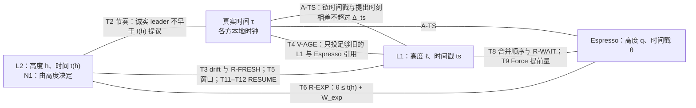

# 时间依赖：Espresso、L1、L2 的同步关系，以及区域共识换成部分同步之后

日期：2026-10-30。
状态：分析稿。本文不修改协议正文；需要落到 Part 0、Part 1 的改动列在 §3.7 与 §6，讨论后进入 v6 的下一版。

基线：本目录的 [Part 0 v0.8](part0_model_goals_zh_v0_8.md)、[Part 1 v0.3](part1_module_interfaces_zh_v0_3.md)，以及 [2026-10-27 meetup](../meetup_record/261027.md)。
协议细节引用 v5 的 [Part 2](../formalization_v5/part2_l1_authority_zh_v0_1.md)、[Part 3](../formalization_v5/part3_session_program_zh_v0_1.md)、[Part 4](../formalization_v5/part4_session_manager_zh_v0_1.md)、[Part 5](../formalization_v5/part5_global_finality_rule_zh_v0_1.md) 与 `megaeth_specs`。
Simplex 家族的协议比较见 [Simplex 学习笔记](../learning/zh-CN/16_simplex_and_regional_bft.md)；本文不重复共识细节，只回答两个问题：

1. 把区域内的通信假设从同步换成部分同步（以 Simplex 为例），Part 0 的假设与目标怎样变？
2. 现设计依赖 Espresso、L1、L2 之间的哪些时间关系？Espresso 失去活性、或者 RESUME 恢复时，这些关系还成立吗？怎样重新成立？会带来哪些安全问题？

---

## 0. 结论先行

1. **时间依赖分三组。**
   - L2 时间与 L1 时间：固定节奏 N1、drift N2、sequencing window N3、R-FRESH、override 填充。派生规则强制它们，只要 L1 在推进就一直成立。
   - L2 时间与 Espresso 时间：R-EXP、过期 HALT、合并顺序与 R-WAIT。它们只在 Espresso 出块时“走表”。
   - 链时间戳与真实时间：A-TS、节奏规则、V-AGE 与各种计时器。它们由账本时间戳的精度和各方本地时钟提供。
2. **safety 中真正依赖时间的只有三处。** S4 快速确认一致（经 $\Delta_i$ 与 V-AGE，连带依赖 $T_{\rm L1}$、$T_E$、A-TS）；S6 质押安全（A-TS 与 R-EXP）；L2-L1“全局最终的块进入派生链”（交付预算）。S1、S2、S3、S5 与 L2-S1、L2-S2 都不依赖时间：现设计只用链上记录的时间戳，再加确定性的等待（`WAIT`、R-WAIT），把时间变成了日志的函数。
3. **Espresso 停机时，第一组照样成立，第二组停表。** $D$ 以 deposit-only 继续推进，跟 L1 同节奏，但比真实时间落后约 $W_{\rm seq}$。GFR 处理不了 Expire 与 RESUME，只能等待；只读 L1 的本地 Kill 是这段时间唯一起作用的关闭依据。安全不坏，代价是活性。
4. **有两处隐藏的时间假设会在停机中失效。**
   - 停机瞬间在途、恢复后才最终化的 Espresso 块，时间戳仍是提出时的值。它可以在恢复后把一个已经错过派生截止的块加入 $G$，随后被 RESUME 撤销。这与“Espresso 停机不撤销 $G$”（Part 0 §5.1、Part 5 §5.4、meetup 例 A）矛盾；Part 0 的 L2-L1 缺一个“Espresso 最终化延迟不超过 $M_a$”的前提（§4.5）。
   - 在 Sync HotStuff 下，Espresso 读取分裂或以太坊 finality 迟于 $T_{\rm L1}$，会让 V-AGE 的论证失效，从而危及 S4（§3.2、§4.7；前者已列为 Part 3 §10 的待定问题）。
5. **RESUME 能重建全部对齐，Force 追赶却建不起来。** 逐条核对后，RESUME 之后 N1、origin 进度、drift、R-FRESH、V-AGE、L1 地板与 Expire 键都成立；关键是 override 填充“origin 能前进就前进、封顶 $L$”，使 $o(D_L[h_{\rm res}])=L$（§5.2）。Force 追赶有一个新发现的冲突：R30 把授权 L1 引用改成原生 origin 之后，“新分支第一块的 origin 不低于 Force 所在的 L1 高度”与原生规则“origin 每块至多前进一个、且时间戳不晚于 $t(h)$”不能同时满足。区域故障后补发 Force 的典型场景里，新 session 的第一块不存在合法 origin，DG7 的“$W_{\rm exp}$ 内 Force 无损恢复”实际失效（§5.3）。
6. **可以去掉 HALT 之后的“死区”。** $G$ 的下一高度过期之后、窗口到期之前（约 $W_{\rm seq}-W_{\rm exp}$），现规程既不能 Force，也不能 RESUME。若此时 $G\preceq D$，RESUME 不撤销任何 $G$，填出的块也与等窗口回退得到的相同。建议把 RESUME 前提放宽为“紧急状态，或 HALT 且 $G\preceq D$”（§5.5）。
7. **没有 Espresso 就没有普通恢复。** 处理 RESUME、开出新 session、新块进入 $G$ 都要 Espresso。Espresso 永久失效时只剩 deposit-only 逃生口；DG8 应把“Espresso 最终恢复”写成显式前提（§4.2）。
8. **参数比示例更紧。** 以太坊 finality 通常约 13 分钟、最坏约 19 分钟；$M_a$ 若小于它，$G$ 的延迟会被 L1 finality 拖住，RESUME 的准备时间也会被吃掉。$T_{\rm prep}\le D_{\rm drift}-\epsilon$，而 $D_{\rm drift}$ 是 OP Stack 固定的 30 分钟，留给“状态准备、填充执行、Espresso 引用等待”的只有约 10 分钟（§5.4）。
9. **换成部分同步 BFT，区域安全完全离开时间轴。** $\Delta_i$、V-AGE、$T_{\rm L1}$、$T_E$、A-TS 都不再是 S4 的前提，第 4 条中的 S4 风险随之消失；离线成员不再损害安全；leader 故障在区域内用 skip 证书换 view，不再经过 L1 上的 REC，省下约 $T_{\rm L1}$。代价是拜占庭门槛从 $<1/2$ 降到 $<1/3$，活性需要约 2/3 以上的权重在线；签名冲突、区域证书、末块收尾与计时器都要重写（§3）。
10. **换共识不消除系统层的时间依赖。** $W_{\rm exp}$、$W_{\rm seq}$、$M_a$、$T_{\rm prep}$、R-EXP、R-WAIT、C-RES-5 与释放公式都是挂在 L1、Espresso 时间上的墙钟期限，与区域协议无关。区域异步超过 $W_{\rm exp}$，结果与区域故障相同：HALT，然后 RESUME（§3.5）。
11. **还有两类语义风险。** 停机期间区域仍会发出注定作废的快速确认：Espresso 完全停机时，Espresso 引用地板把领先量限制在约两个 session；Espresso 照常出块、只是我们的结果发不上去时，领先量可达 $W_{\rm exp}$（§4.4）。恢复之后，应用看到的区块时间会跳变或滞后，首个新块集中 MEV（§5.6）。
12. **节奏规则与区域计时器尚未对齐。** Part 3 的进度检查从 term 进入时刻起算 $(2p+4)\Delta_i$，诚实 leader 却要等到 $t(h)$ 才提议。$\Delta_i<b_t/2$ 时（例如 50 ms 对 1 s），按节奏出块的诚实 leader 会被 BLAME，并经 L1 换代。换成 Simplex 后，view 超时同样要从 $t(h)$ 起算（§3.4）。

---

## 1. 基线、记号与示例参数

记号沿用 Part 0：$\tau$ 是真实时间；$\mathit{ts}_\ell$、$\theta_q$、$t(h)$ 分别是 L1、Espresso、L2 的时间；$o(B)$ 是块的原生 L1 origin。
四条链为 $R$（区域生产分支）、$G$（全局链）、$G'$（Batch Inbox 已接纳的高度前缀）、$D$（L1 派生链）；RESUME 处的派生链记作 $D_L$。

下文的数字例子统一使用下表。它们是工作稿参数与估计，不是测量值。

| 参数 | 含义 | 示例值 | 出处 |
| --- | --- | --- | --- |
| $b_t$ | L2 出块间隔 | 1 s | meetup §5 |
| $D_{\rm drift}$ | sequencer drift，原生常数（OP Stack 自 Fjord 起固定为 1800 s） | 30 min | Part 0 N2 |
| $W_{\rm seq}$ | sequencing window，即 `seq_window_size` 个 L1 块 | 约 12 h（3600 块） | meetup §5 |
| $W_{\rm exp}$ | 普通块进入 $G$ 的接纳时限 | 10 h | meetup §5 |
| $M_a$ | 公告提前量；L1 事件的键偏移 | 15 min | meetup §8 |
| $T_{\rm batch}$ | 批次交付预算 | 1 h | meetup §5 |
| $T_{\rm prep}$ | RESUME 的准备预算 | 20 min | meetup §7 |
| $\mathrm{TB}\cdot b_t$ | 一个 session 覆盖的 L2 时间 | 1 h | Part 2 §4.5 |
| $T_{\rm L1}$ | L1 最终化并对诚实方可见 | 约 13–19 min（以太坊 finality，待实测） | 本文估计 |
| $T_E$ | Espresso 最终化并可见 | 秒级（待实测） | 本文估计 |

---

## 2. 先把依赖讲清楚

### 2.1 四种时钟，各由谁读

**L2 时间不是一只钟，而是由高度决定的标签。** 它要靠两件事才与“时间”挂钩：诚实 leader 不早于 $t(h)$ 出块（节奏规则），以及 drift 把它拴在 L1 origin 的时间戳上。

| 时钟 | 谁产生 | 谁读 | 用来做什么 |
| --- | --- | --- | --- |
| 真实时间 $\tau$（本地时钟） | 各节点 | Session Program：节奏、V-AGE、提交与进度计时器；$\mathsf M$：判断时机 | 不进入任何公共判决：GFR 与派生都不读本地时钟 |
| L1 高度 $\ell$、时间戳 $\mathit{ts}_\ell$ | Ethereum | 派生（窗口按 L1 高度计）；Authority（Force 提前量、C-RES-5、释放公式按高度换算）；Manager 的 Kill（cursor 超窗）；GFR（L1 事件的键、R-WAIT 条件 1） | 派生的推进；控制与质押；紧急状态 |
| Espresso 时间戳 $\theta_q$ | Espresso | GFR（Espresso 块的键、R-EXP、Expire 与 RESUME 的 R-WAIT 条件 2）；Program（引用 $\xi$） | 全局链的接纳与过期 |
| L2 时间 $t(h)$ | 高度的函数（N1） | 所有模块 | drift、窗口、R-EXP、R-FRESH 的计时起点 |

### 2.2 十五条时间耦合

**下表就是“依赖”的完整清单。** 最后两列说明它保护什么、靠什么假设成立；§4、§5 逐条检查它们在停机与恢复时的状态。

| 编号 | 关系 | 耦合 | 谁强制 | 保护什么 | 依赖 |
| --- | --- | --- | --- | --- | --- |
| T1 | N1 固定节奏：$t(h)=t_{\rm gen}+(h-h_{\rm gen})\,b_t$ | 高度 ↔ L2 时间 | 派生；Certifier 把时间戳绑定到高度 | 高度与时间一一对应 | 无（定义） |
| T2 | 节奏：诚实 leader 不早于 $\tau=t(h)$ 提议 $h$；落后时可以快于 $b_t$ 追赶 | L2 ↔ 真实时间 | Program（只约束诚实 leader） | 稳态下 $t(R\text{ 末端})\approx\tau$ | 本地时钟 |
| T3 | drift 与 origin 进度：$\mathit{ts}(o)\le t(h)\le\mathit{ts}(o)+D_{\rm drift}$；$o(x)\in\{o(P),o(P)+1\}$ | L2 ↔ L1 | 派生（N2）；DerivOK V1、V2；GFR 的 Eligible (f)（R-FRESH） | 派生一致；S6；强制包含随时间推进 | L1-S |
| T4 | V-AGE：$\mathit{ts}(o)\le\tau-(T_{\rm L1}+\Delta_{\rm ts})$；$\xi$ 已在本地出现至少 $T_E$ | L1、Espresso 的可见性 ↔ 本地时间 | Program 的投票条件 | Sync HotStuff 下的 S4 | L1-L3、Espresso 的 X-L2、A-TS |
| T5 | N3 窗口：高度 $h$ 的批次须在 L1 高度 $o(h)+\texttt{seq\_window\_size}$ 之前被接纳，否则 deposit-only；时间上约为 $\mathit{ts}(o(h))+W_{\rm seq}$ | L2 ↔ L1 | 派生 | 逃生口的推进（L2-L2）；也是 $G$ 中块的交付截止 | L1-L |
| T6 | R-EXP：普通块只能经 $\theta\le t(h)+W_{\rm exp}$ 的 Espresso 块进入 $G$；下一高度过期即 HALT | L2 ↔ Espresso | GFR | 交付预算；S6 的 $\tau^{\rm close}$ 上界 | E-S、A-TS |
| T7 | 交付预算：$W_{\rm exp}+M_a+T_{\rm batch}+D_{\rm drift}\le W_{\rm seq}$ | 组合 T3、T5、T6 | 参数约束（Part 0 §2.10） | L2-L1：$G$ 中的块原样进入 $D$ | A-DELIVER；以及隐含的 Espresso 最终化延迟（§4.5） |
| T8 | 合并顺序与 R-WAIT：Espresso 块键 $\theta_q$，RESUME 键 $\mathit{ts}(L)+M_a$，Expire 键 $t(h)+W_{\rm exp}$；处理前 L1 须已到 $x-M_a$，Espresso 须已到 $x$ | L1 ↔ Espresso ↔ L2 | GFR | 所有观察者得到同一顺序（S1） | L1-S、E-S；活性另需 L1-L、E-L |
| T9 | Force 提前量：$\theta_a\ge\mathit{ts}(b)+M_a$ | L1 ↔ Espresso | Authority（C-F-3） | Force 记录在生效前对所有人可见 | A-TS |
| T10 | 紧急状态与 Kill：$\ell>\texttt{cursor.epoch\_num}+\texttt{seq\_window\_size}+1$ | 只有 L1 | $\mathsf M$ 的规程；Manager 的 Kill | 及时停掉注定作废的生产；RESUME 的时机 | L1-S |
| T11 | RESUME 时机：$\mathit{ts}(L)<t(h_{\rm res})\le\mathit{ts}(L)+D_{\rm drift}$（合约 C-RES-5）；$t(h_{\rm res})\ge\mathit{ts}(L)+T_{\rm prep}$（规程） | L2 ↔ L1 | Authority；A-GOV | 新锚点的时间与 L1 对齐；S6 | A-GOV（下界） |
| T12 | override 填充：立即填到 $h_{\rm res}$；每块的 origin 能前进就前进，封顶 $L$ | L2 ↔ L1 | 派生（[activation fill](../megaeth_specs/specs/block-certification/activation.md#activation-deposit-only-fill)，经 [override](../megaeth_specs/specs/rollup/derivation.md#emergency-cursor-overrides) 引用） | $o(D_L[h_{\rm res}])=L$，新 session 的第一块满足 T3 | L1-S、A-RET |
| T13 | Espresso 引用地板：常规后继 $q^{\rm open}=\max\{\mathrm{height}(\xi(T_s)),\,q^{\rm open}_s+1\}$；FORCE、RESUME 取开出它的 Espresso 高度 | session 序列 ↔ Espresso 高度 | Program；GFR 的 Eligible (d) | 引用不倒退；附带限制 Espresso 停机时 $R$ 的领先量（§4.4） | E-S |
| T14 | L1 地板：Plan 的读取高度不低于 $\lambda_\beta$；第一块 origin 不低于 $\lambda^{\rm open}=\max\{\lambda(A),\lambda(\Pi)\}$ | session ↔ L1 高度 | Plan；Program 的 V-REF | 让 Force 之后旧快照退役 | L1-S（与 T3 冲突，§5.3） |
| T15 | 释放公式：$\mathit{ts}\ge\mathit{ts}(a_{e_x})+D_{\rm drift}+2\mathrm{TB}\cdot b_t+W_{\rm exp}+2\Delta_{\rm ts}+T_{\rm ev}$，按 L1 高度换算 | L1 ↔ Espresso ↔ L2 | Authority | S6 | A-TS；T3、T6 与 T11 的上界 |

### 2.3 正常运行时的同步图景

**服务都正常时，四条链只是同一条流水线上的不同进度。** 各链末端的 L2 时间满足

$$
t(D\text{ 末端})\ \le\ t(G'\text{ 末端})\ \le\ t(G\text{ 末端})\ \le\ t(R\text{ 末端})\ \lesssim\ \tau .
$$

相邻两项之差依次约为：派生只读已最终化的 L1，滞后约 $T_{\rm L1}$；批次积累、DA 与 L1 纳入，几分钟到 $T_{\rm batch}$；发布与 Espresso 最终化，秒级；区域出块与确认，一个 $b_t$ 加几次消息延迟。
与此同时，$\theta(\text{最新 Espresso 块})\approx\tau$，$\mathit{ts}(\text{最新已最终化 L1 块})\approx\tau-T_{\rm L1}$。

单个块的时间预算沿用 meetup §5 的例子：块 $B$ 的时间戳为 10:00，origin 为 09:30。

- R-EXP 的过期键是 20:00，从 $t(B)$ 起算；
- 原生窗口截止约在 21:30，从 origin 起算；
- 两者之差扣掉 origin 的落后，只剩约 1.5 小时，要容纳事件处理余量 $M_a$ 与交付预算 $T_{\rm batch}$。这就是 T7。

**这张图里，没有一条对齐靠节点之间的消息同步来维持。** L2 时间由高度决定、由 origin 约束；L1 与 Espresso 的时间由各自的账本给出。同步假设只出现在两处：链时间戳近似真实时间（A-TS），以及各方能在有限时间内看到已最终化的数据（$T_{\rm L1}$、$T_E$、$T_{\rm batch}$ 等）。

### 2.4 “L2 跟上 L1”的三层含义

1. **逐块：** drift（T3）。每个块的时间夹在 origin 时间与它加 $D_{\rm drift}$ 之间，origin 每块至多前进一个 L1 块。这条在任何故障下都由派生强制。
2. **整链：** 只有 $D$ 有下界。L1 推进时，窗口回退保证 $D$ 末端的 L2 时间不会比真实时间落后超过约 $W_{\rm seq}+T_{\rm L1}$；$G$ 与 $R$ 没有这样的下界，Espresso 停机时 $G$ 可以无限期停住。
3. **不超前：** 诚实生产不超前于真实时间（T2），origin 不超前于 L2 时间（$\mathit{ts}(o)\le t(h)$），$D$ 中的块也不会超前其纳入 L1 块的时间加 $D_{\rm drift}$。

所以，“L2 跟上 L1”在故障期间指的是 **$D$ 以 L1 的节奏、落后约一个窗口地推进**，不是 $G$ 或 $R$ 跟上。

### 2.5 deposit-only 何时产生、带什么时间

| 来源 | 何时在 $D$ 中产生 | 块的 L2 时间 | origin | 说明 |
| --- | --- | --- | --- | --- |
| 窗口回退（N3） | 该高度所在 epoch 的窗口到期，即 L1 到达 $o+\texttt{seq\_window\_size}$，真实时间约 $\mathit{ts}(o)+W_{\rm seq}$ | N1 给出的固定时间；产生时已比真实时间落后约 $W_{\rm seq}$ | 能前进就前进（OP Stack batch queue） | 停机期间 $D$ 的推进方式；强制包含延迟约 $W_{\rm seq}+T_{\rm L1}$ |
| override 填充（RESUME） | `CursorSet` 所在 L1 块被处理时，立即填到 $h_{\rm res}$ | 从派生末端一直到 $t(h_{\rm res})$，略晚于 $\mathit{ts}(L)$ | 能前进就前进，封顶 $L$ | 一次可能填约 $(W_{\rm seq}+T_{\rm prep})/b_t$ 个块，约 4.4 万块（§4.3） |
| 同高度替换（Δ5、Δ6） | 批次无效或执行失败时立即 | 该高度的固定时间 | Δ5 按规则重选；Δ6 保留原 origin | 正常路径由 DerivOK 避免 |

GFR 从不自己生成或预测 deposit-only 块（R-RES）。所以停机期间 $G$ 不跟随 $D$，只在 RESUME 时一次对齐。

### 2.6 $W_{\rm seq}$ 一个参数的六个角色

| 角色 | 体现在 |
| --- | --- |
| 普通块的交付截止 | T5、T7 |
| 逃生口的延迟 | L2-L2：约 $W_{\rm seq}+T_{\rm L1}$ |
| 紧急状态的判据 | T10：cursor 超窗停滞 |
| 现规程下最早可 RESUME 的时刻 | 约为停机开始加 $W_{\rm seq}$（Part 0 DG8） |
| override 填充的长度 | 约 $W_{\rm seq}+T_{\rm prep}$ 的 L2 时间 |
| $W_{\rm exp}$ 的上限 | T7 |

$W_{\rm seq}$ 越大，$W_{\rm exp}$ 可以越大，更长的停机可以无损继续；代价是逃生口更慢、紧急状态来得更晚、长停机的恢复更晚。
$W_{\rm seq}$ 按 L1 块数计：L1 缺块时，窗口在时间上只会变长。这对交付预算是安全方向，对紧急状态的到来则是变慢。

### 2.7 哪些性质依赖时间

| 性质 | 依赖时间吗 | 依赖哪几条 | 说明 |
| --- | --- | --- | --- |
| S1、S2 | 否 | — | 合并顺序是两本日志的函数；R-WAIT 只影响何时算出 |
| S3 | 否 | — | 证书中至少一个诚实签名者（A-BYZ） |
| S4 | **是**（Sync HotStuff） | $\Delta_i$、T4（连带 $T_{\rm L1}$、$T_E$、A-TS） | Part 3 §8.1 的锁引理 |
| S5 | 否 | — | |
| S6 | **是** | T3、T6、T11、T15 与 A-TS | 用到 Espresso 时间戳的下界与 L1 时间戳的上界（§4.6） |
| L2-S1、L2-S2 | 否 | — | |
| L2-S3、L2-L1 | **是** | T3、T5、T6、T7，以及 Espresso 最终化延迟 | §4.5 |
| 全部活性性质 | 是 | 全部 | |

### 2.8 现设计怎样处理时间依赖

现设计用四个手段把时间依赖关在 safety 之外：

1. **只用链上记录的时间。** 计时一律用 L1 块时间、Espresso 块时间和由高度决定的 L2 时间，不用节点收到消息的时刻（meetup §8.1）。
2. **合并顺序。** 三类事件排成唯一序列，同键优先级固定：RESUME、Expire、Espresso。
3. **缺输入就等，不猜。** R-WAIT 要求排在前面的输入都已读到；派生缺 DA 数据就停在原处。停机只会让结果晚到，不会让结果不同。
4. **以 $D$ 为准恢复。** $D$ 只依赖 L1 与已接纳的 DA，不依赖 Espresso；RESUME 把 $G$ 拉回 $D$，并用 C-RES-5 把新起点的 L2 时间重新钉在 L1 时间上。

**所以，“停机时这些同步关系还成立吗”要分层回答。** 作为规则，它们永远成立，都是日志的确定函数。作为进度关系（谁领先谁多少），只有 L2 ↔ L1 这一组在 Espresso 停机时仍然成立；L2 ↔ Espresso 这一组停表，直到 Espresso 恢复。
例外是三处把真实时间带进 safety 的地方：S4 的 V-AGE、S6 的 A-TS，以及 L2-L1 的交付预算。§3–§5 分别讨论。

---

## 3. 区域 BFT 换成部分同步

**一句话：区域安全与时间脱钩；活性仍然要时间；系统层的期限一个都不变。**

### 3.1 假设逐条对照

| 项目 | 现状（Sync HotStuff） | 换成部分同步（Simplex 类） | 影响 |
| --- | --- | --- | --- |
| 区域通信（Part 0 §1.5） | 区域内同步：消息始终在 $\Delta_i$ 内送达，S4 依赖它 | 部分同步：存在未知的 $\mathrm{GST}_i$，之后诚实成员之间的消息在 $\delta_i$ 内送达，之前任意 | $\Delta_i$ 退出安全，只用于活性 |
| 拜占庭门槛（A-BYZ、定义 1.1） | $F_s<W_s/2$；证书权重 $>F_s$ | $F_s<W_s/3$；决定证书权重 $\ge Q$，$Q$ 满足 $2Q-W_s>F_s$ 且 $Q\le W_s-F_s$，常取 $Q>2W_s/3$ | 容忍同样的 $f$，委员会要从 $2f+1$ 增到 $3f+1$；同一委员会的容错下降 |
| 诚实与良态（定义 1.3、1.4） | 诚实要求整个窗口在线并同步；离线成员计入 $F_s$；S4 需要良态 | 安全只需 A-BYZ；离线或掉队不影响安全；活性需要 GST 之后在线诚实权重 $\ge Q$ | 良态从安全前提降为活性前提 |
| V-AGE（T4） | 安全前提（Part 3 §5.3、§8.1） | 只是 leader 挑引用的策略，保证大家尽快能验证 | $T_{\rm L1}$、$T_E$、A-TS 退出 S4 |
| 投票条件的单调性 | 只能用“由不满足变为满足”的条件（Part 3 §7.1） | 不再需要 | 可以把时效、$R$ 领先 $G$ 的上界放进投票条件（§4.4） |
| leader 故障恢复 | BLAME、Quit、L1 上的 $\mathsf{REC}(\mathrm{cid},g+1)$，然后进入新恢复代；$T_{\rm lead}$ 含约 $T_{\rm L1}$ | 区域内用 skip 证书换 view，不经过 L1 | 恢复从十几分钟降到几个 $\Delta$；SubmitQuit、REC 与恢复代可以删除 |
| 区域最终证据（FINAL、CheckFINAL） | 提交后另签 FINAL，权重 $>F_s$，按高度 | 直接用决定证书 DC，权重 $\ge Q$，按 view；或保留提交后的 FINAL，多一轮 | CheckFINAL 改为验证 DC；快速确认变成客户端可以自己验证的对象 |
| 签名冲突（offense） | 按槽位：PROPOSE、FRESH_VOTE、NEWVIEW、ANCHOR_VOTE；FINAL 按高度 | 按 view：双提议、双 notarize、同一 view 内既 finalize 又 skip；不同 view 对同一高度投不同块可能合法 | Part 2 §5.2 的冲突定义要重写 |
| 同步进入（G-PROG-6） | 所有诚实成员须在 $\Delta_i$ 内进入 | 不需要 | ReadyBundle 只影响活性 |
| 末块收尾（DRAIN） | 恢复代开口在 $H_s$ 时用 DRAIN | 末块所在 view 被 skip 时，仍需一个不增加高度的收尾块或等价规则 | DRAIN 要保留并重新论证 |
| 计时器与节奏 | $2\Delta_i$ 提交计时器；进度检查 $e_v+(2p+4)\Delta_i$ | view 超时只决定何时投 skip | 两者都必须感知节奏（§3.4） |
| 问责 | accountable safety 是非目标（Part 0 §5.2） | 冲突的决定证书可以指认至少约 $W/3$ 权重的违规签名（须按具体变体证明） | 可以考虑把 accountable safety 加为目标 |

### 3.2 S4 离开时间轴

**Sync HotStuff 的提交靠计时器，不靠 quorum。** 成员在投票后 $2\Delta_i$ 提交，安全依赖一条锁引理：一个诚实成员投的块，其他诚实成员在 $\Delta_i$ 内也收到并投票，于是恢复时没人能绕过它（Part 3 §8.1）。
这要求所有诚实成员对同一个 proposal 的有效性结论一致，而且一致得足够快。V-AGE 正是为此设的，代价是把 $T_{\rm L1}$、$T_E$ 与 A-TS 拉进了 S4。于是，L1 或 Espresso 的活性故障可以变成快速确认的安全故障：

- **Espresso 读取分裂。** 成员 A 的读取节点正常，B 的故障。A 看到引用 $\xi$ 已在本地出现超过 $T_E$，验证通过并投票；B 读不到 $\xi$，按缺依赖处理，不投票。A 在 $2\Delta_i$ 后提交，但证书可能因此没有形成；之后的恢复代从更低的 QC 开出，同一高度可以换成另一个块，与 A 的提交冲突。
- **以太坊 finality 迟到。** $T_{\rm L1}$ 低估了实际 finality 时，origin 在“足够旧”之后才最终化。A 先看到，B 的 L1 节点晚几秒；只要这几秒超过 $\Delta_i$，结果同上。

**换成 Simplex 后，这两个例子都只影响活性。** 决定需要权重 $\ge Q$ 的 finalize 票；读不到数据的成员不投票，这一 view 最多走 skip。两个冲突的决定证书需要两个 quorum 交于一个诚实成员，与谁读得快无关。Part 3 §10 的待定问题 1（Espresso 读取不可用）随之消失。

### 3.3 门槛与良态

以 7 个等权成员为例：

| | Sync HotStuff（$F<W/2$） | Simplex（$F<W/3$） |
| --- | --- | --- |
| 安全：最多几个拜占庭 | 3 | 2 |
| 安全：拜占庭加离线 | 合计不超过 3 | 拜占庭不超过 2，离线任意 |
| 活性：拜占庭加离线 | 合计不超过 3 | 合计不超过 2 |
| 区域内网络分区 | 安全可能被破坏 | 安全保持，活性等到 GST |

**取舍：** Sync HotStuff 在网络守约时多容忍一个拜占庭；Simplex 在网络失约、成员掉线时仍然安全，但需要约 2/3 的权重在线才能出块。
区域委员会往往集中在少数几个数据中心，失去一个就可能超过 1/3 的权重。这要按实际部署评估。

### 3.4 模块层的改动

- **Session Program（Part 1 §4.4、Part 3）：** 保留 session 的固定字段（$\mathrm{cid}$、TB、$H_s$、锚点）、DerivOK、引用下界与配额；投票、提交、恢复换成 Simplex 的 view、VC、DC、SC；快速确认 Conf 改为持有 DC；保留 DRAIN 的收尾作用；持久化记录改为“同一 view 不能既 finalize 又 skip”。
- **节奏与计时器（现有问题，换共识后同样需要处理）：** 按 Part 3 §6.3、§6.5 推算，term 内第 $p$ 个位置最早在约 $e_v+p\,b_t$ 才能被投票，因为 leader 要等到 $t(h_p)$；进度检查却在 $e_v+(2p+4)\Delta_i$ 进行。要不误伤诚实 leader，需要对所有 $p\le m_{g,t}$ 满足 $(2p+4)\Delta_i\ \gtrsim\ p\,b_t$：每 term 只有一个位置时约 $\Delta_i\ge b_t/6$，位置多时约 $\Delta_i\ge b_t/2$。$\Delta_i=50$ ms、$b_t=1$ s 时不成立：诚实 leader 被 BLAME，经 L1 的 REC 换代，每次约 $T_{\rm L1}$。修法是让第 $p$ 次检查从 $\max\{e_v,\ t(h_p)-\Delta_{\rm ts}\}$ 起算。Simplex 的 view 超时同理，否则 leader 合法地等 $t(h)$ 时，其他成员已经投 skip。
- **L1 Authority（Part 1 §4.2、Part 2）：** 删除或停用 SubmitQuit、REC 与恢复代的 Auth；按新的冲突类型重写 SubmitOffense；Plan 中 $\varphi_i<1/3$，并写出 $Q$；Leader 的种子改为按 view。
- **GFR（Part 1 §5）：** CheckFINAL 在 $\mathrm{cid}$ 下验证 DC；Eligible 的其他条件、R-EXP、R-FRESH 与 $\tau^{\rm close}$ 都不变。DC 决定整个前缀，所以 kernel $(D,\Sigma,\pi)$ 的结构可以沿用。
- **Session Manager、Publisher：** 不再处理 REC；交付与发布的对象换成 DC 与路径。
- **不变：** Block Builder、Batcher、Batch Inbox、Certifier、Derivation Rule、Deposit Portal。

### 3.5 不变的部分：系统层的时间依赖

T1、T3 与 T5–T15 都与区域协议无关，换共识后一条不少：

- S6 仍然依赖 A-TS，L2-L1 仍然依赖交付预算，§4.5 的反例照样存在；
- GFR 仍以 Espresso 为钟，Espresso 停机时照样停表；
- 区域异步超过 $W_{\rm exp}$ 减去追赶时间，就按区域故障处理：HALT，然后 RESUME。

**对系统来说，GST“迟早会到”不够：它必须在 $W_{\rm exp}$ 减去追赶时间之内到来。** 部分同步把区域的异步期从安全问题变成了活性问题，但活性仍受墙钟期限约束。

### 3.6 新的代价与风险

1. 同样的绝对容错需要更大的委员会；同一委员会的拜占庭容错从 $<1/2$ 降到 $<1/3$。
2. 活性需要约 2/3 的权重在线，单个数据中心故障更容易停住一个区域，Force 会用得更多。
3. Concurrent 的两轮快路需要全部权重投票，一个慢成员就走不通；慢路照常完成。
4. 证书更大：至少 $Q$ 权重的签名，宜用 BLS 聚合。
5. 停机后的追赶需要补齐中间的 skip 证书（学习笔记 §11.2），证书要持久化并可补取。
6. 新的冲突证据要能在链上验证：view 编号、leader 推导、哪些动作互斥。

### 3.7 对 Part 0、Part 1 的修改清单（建议）

| 位置 | 现文 | 建议 |
| --- | --- | --- |
| Part 0 §1.5 | 区域内同步 $\Delta_i$，也是 S4 的前提 | 区域内部分同步：$\mathrm{GST}_i$ 与 $\delta_i$，只用于活性 |
| Part 0 定义 1.1、§2.3 | $F_s<W_s/2$，证书权重 $>F_s$ | $F_s<W_s/3$；决定证书权重 $\ge Q$；A-BYZ 的累计腐化计数不变 |
| Part 0 定义 1.3、1.4 | 诚实要求整个窗口在线同步；良态含离线 | 诚实只要求未腐化且按协议运行；良态只用于活性：拜占庭加离线权重不超过 $W_s-Q$ |
| Part 0 §2.10 参数表 | $\Delta_i$、$T_{\rm L1}$、$T_E$ 标为用于 S4 | 三者都改为“否”；$\Delta_{\rm ts}$ 只用于 S6 |
| Part 0 DG3 | DG2 + 良态（含 $\Delta_i$）+ A-TS、L1-L3、Espresso X-L2 | DG2 + A-BYZ（$F_s<W_s/3$）；“不需要”一栏加入网络同步、A-TS、Espresso 可用 |
| Part 0 §3.3 结论 4 | S4 是唯一依赖 $\Delta_i$ 的 safety 目标 | 没有任何 safety 目标依赖网络同步；只有 S6 依赖 A-TS |
| Part 0 A-LEAD | $T_{\rm lead}$ 含恢复代切换（约 $T_{\rm L1}$） | GST 之后每个长为 $T_{\rm lead}$ 的区间内有诚实 leader 完成一个 view；$T_{\rm lead}$ 不含 L1 |
| Part 1 §2.5、§2.6 | 按槽位的签名消息、quit 证据、REC | 按 view 的消息与证书；删除 quit 证据与 REC |
| Part 1 §3.3 | CheckFINAL 检查权重 $>F$ 的 FINAL | 检查 DC（权重 $\ge Q$、同一 view、绑定 $\mathrm{cid}$） |
| Part 1 §4.4 | G-PROG-1 依赖良态与 $\Delta_i$；G-PROG-6 同步进入 | G-PROG-1 只依赖 A-BYZ；删除 G-PROG-6；G-PROG-7 改为 GST 之后的活性 |

---

## 4. Espresso 失去活性时

### 4.1 四种形态

| 形态 | 现象 | GFR 的钟 |
| --- | --- | --- |
| E1 完全停机 | 排序不可用，没有新的已最终化块 | 停在最后一个 $\theta$ |
| E2 读取不可用 | 部分节点读不到已最终化的块 | 读得到的节点照常 |
| E3 正常出块，我们的结果发不上去 | Espresso 审查本链 namespace，或所有 publisher 失效、费用耗尽 | 照常前进 |
| E4 在途块迟到最终化（E1 的子情形） | 停机瞬间已提出、未最终化的块在恢复后才最终化，时间戳仍是提出时 | 恢复后才看到这些块 |

### 4.2 逐条检查

| 编号 | E1 下 | E3 下 | 后果 |
| --- | --- | --- | --- |
| T1 | 成立 | 成立 | — |
| T2 | $R$ 最多再跑约两个 session 后停（§4.4）；$G$ 冻结；$D$ 以 L1 节奏前进，但落后约 $W_{\rm seq}$ | $R$ 照节奏生产，直到过期关闭分支（不超过 $W_{\rm exp}$） | “跟上 L1”只对 $D$ 成立 |
| T3 | 成立：窗口回退沿用 origin 与 drift 规则；$R$ 的生产仍满足 | 成立 | — |
| T4 | L1 部分成立；Espresso 引用可以沿用已经足够旧的 $\xi$ | 成立 | E2 下失效：Sync HotStuff 的 S4 有风险（§3.2） |
| T5 | 成立，而且正是它推动 $D$ 前进、让 $G$ 之后的高度错过截止 | 成立 | — |
| T6 | 规则成立，但 GFR 无法得知时间已过：Expire 因 R-WAIT 等待 | 照常在 $t(h)+W_{\rm exp}$ 处 HALT | E1 中 HALT 要等 Espresso 恢复后才出现在公共记录里 |
| T7 | 一般成立；E4 中失效（§4.5） | 成立 | — |
| T8 | GFR 整体停在下一事件 | 成立 | — |
| T9 | Force 无法生效：它在 Espresso 块中执行 | 可以生效 | — |
| T10 | 成立（只读 L1）；Kill 约在 $\mathit{ts}(o(\text{cursor 末块}))+W_{\rm seq}$ 触发 | 成立 | — |
| T11 | RESUME 可以记录，GFR 却无法处理（R-WAIT 条件 2） | 可以处理 | 没有 Espresso 就没有普通恢复 |
| T12 | 填充在 $D$ 中立即发生（派生只读 L1）；$G$ 要等 GFR | 立即发生 | — |
| T13 | 限制 $R$ 领先不超过约两个 session | 不起作用 | §4.4 |
| T14 | 成立 | 成立 | — |
| T15 | 成立，前提是恢复后的 Espresso 时间戳满足 A-TS 的下界 | 成立 | §4.6 |

**最硬的依赖是 T11：没有 Espresso 就没有普通恢复。** 处理 RESUME 需要 Espresso 日志中有 $\theta\ge\mathit{ts}(L)+M_a$ 的块；新 session 在 RESUME 之后的下一个 Espresso 块开出；新块也只能经 Espresso 进入 $G$。Espresso 永久失效时，系统只剩 deposit-only 的逃生口（与 mega-espresso 的 [S9](../megaeth_specs/specs/block-certification/recovery.md#s9-espresso-liveness-failure) 一致）。
建议在 DG8 中把“Espresso 最终恢复”写成显式前提，并把“GFR 以 L1 为钟、区域结果改发 L1”的回退模式列为后续设计选项（Part 5 §11 待定问题 1 已提到需要另设出口）。

### 4.3 时间线：Espresso 停机 14 小时

参数取 §1 的表。Espresso 在 10:00:00 停机，最后一个已最终化块的高度为 $Q^*$。$G$ 停在 $h_G$，$t(h_G)=$ 09:59:58；$o(h_G)$ 的时间戳约 09:40。本节假设停机瞬间没有在途块；有在途块的情形见 §4.5。

| 时间 | L1 与 $D$ | Espresso 与 $G$ | 区域 $R$ |
| --- | --- | --- | --- |
| 10:00 | L1 照常；batcher 继续交付到 $h_G$ | 停机，$G$ 停在 $h_G$ | $s_B$ 继续按节奏出块 |
| 约 10:30 | $D$ 追到 $h_G$ | — | $s_B$ 用完配额；常规后继 $s_C$ 以 $q^{\rm open}=Q^*$ 开出并生产 |
| 约 11:30 | — | — | $s_C$ 用完配额；它的后继需要 $Q^*+1$，无法开始 |
| 19:59:59 | — | Expire($h_G+1$) 的键已到，但 GFR 停表，无法处理 | — |
| 约 21:40 | $o(h_G)$ 所在 epoch 的窗口到期，$D$ 开始以 deposit-only 推进，落后真实时间约 12 h；cursor 超窗停滞，紧急状态成立 | — | 各 Manager 判 $s_B$、$s_C$ 为 $\mathsf{DEAD\_D}$，Kill |
| 次日 00:00 | — | Espresso 恢复，首块 $\theta\approx$ 00:00；GFR 先处理 Expire($h_G+1$)，HALT | — |
| 00:05 | $\mathsf M$ 提交 RESUME，$L$ 的时间戳 00:05:12；取 $t(h_{\rm res})=$ 00:25:12 | — | — |
| 约 00:18–00:24 | $L$ 最终化；派生把约 12:05 至 00:25:12 的约 4.4 万个高度立即填成 deposit-only，$o(D_L[h_{\rm res}])=L$ | RESUME 的键为 00:20:12；$L$ 最终化、$D_L$ 算出后处理：$G:=D_L$，$h_f=\bot$；下一个 Espresso 块开出新 session | 新区域准备 $\mathit{st}(D_L[h_{\rm res}])$ |
| 00:25:13 | — | — | 新 session 提出 $h_{\rm res}+1$，origin 取 $L$ |

结果：

- 原 $G$ 全部保留；
- $R$ 中 10:00–11:30 的块已有快速确认，全部作废；
- 10:00–约 12:05 的 L1 deposit 经窗口回退进入 $D$，各晚约 12 小时；约 12:05 之后到 $L$ 的 deposit 在 RESUME 填充时进入；$L$ 之后的 deposit 由新 session 按 origin 包含。

### 4.4 停机期间区域能领先多远

**E1 下，Espresso 引用地板（T13）天然限制了 $R$ 的领先量。** 常规后继的第一块要引用高度不低于 $q^{\rm open}$ 的 Espresso 块，而 $q^{\rm open}$ 每次常规交接至少加一。Espresso 停在 $Q^*$ 时，当前 session 之后至多再开出一个后继，其后的后继需要 $Q^*+1$，开不出来。所以 $R$ 最多领先 $G$ 约 $2\,\mathrm{TB}\cdot b_t$，示例中约 2 小时。

**E3 下没有这个限制。** Espresso 照常出块，$q^{\rm open}$ 可以一直增长；常规交接只需前驱末块的区域结果，不需要它进入 $G$。$R$ 会一直生产，直到 GFR 在 $t(h_G+1)+W_{\rm exp}$ 处过期并关闭分支，也就是约 10 小时的快速确认最终全部作废。

快速确认按定义可被撤销，这不是 safety 问题，但暴露量太大。建议增加 **$R$ 领先 $G$ 的上界 $\Lambda$**：本地观察到的 $G$ 末端低于 $h-\Lambda$ 时，诚实成员不为高度 $h$ 提议。

- 在 Sync HotStuff 下，它只能是提议条件：投票条件必须单调（Part 3 §7.1），所以拜占庭 leader 仍能让区域继续出块。
- 在 Simplex 下，它也可以是投票条件：诚实成员不投票，就不会有 DC，也就没有快速确认。
- 代价：停机较短时，区域要等 Espresso 恢复再追赶，最终结果相同；停机较长时，作废的快速确认从几小时降到 $\Lambda$。

### 4.5 在途块的迟到最终化：L2-L1 的隐藏假设

**例子。** 沿用 §4.3，但 10:00:01 提出的 Espresso 块 $J_{Q^*+1}$ 中带有高度 $h_G+1$ 的区域结果，$t(h_G+1)=$ 09:59:59，origin 约 09:40。停机时它已被认证、尚未提交；Espresso 恢复后，它在次日 00:00 被提交，时间戳仍是 10:00:01。

1. GFR 按键 10:00:01 处理 $J_{Q^*+1}$，排在 Expire($h_G+1$) 的键 19:59:59 之前。R-EXP 检查 $10\!:\!00\!:\!01\le$ 19:59:59，通过，$h_G+1$ 于真实时间 00:00 进入 $G$。
2. 它的派生截止约在 21:40，早已过去：$D[h_G+1]$ 已经是 deposit-only。
3. 随后 Expire($h_G+2$) 让 $G$ 停在 $h_G+1$。RESUME 时 $h_f=h_G+1$，这个块被撤销。

观察者先在 00:00 看到它成为全局最终，约 20 分钟后又看到它被撤销。batcher 甚至可能让它的批次被 Batch Inbox 接纳：Inbox 接受已过窗口的批次，cursor 前进，派生却把它当作过期丢弃（[batch-inbox.md](../megaeth_specs/specs/block-certification/batch-inbox.md#security-considerations)）。所以“cursor 已到 $G$ 末端”不等于“$G\preceq D$”。

**为什么交付预算挡不住。** T7 的论证需要块在真实时间 $t(h)+W_{\rm exp}+M_a$ 之前进入 $G$。R-EXP 检查的是 Espresso 块的提出时间 $\theta$，不是它最终化、被 GFR 处理的时间；Part 0 §2.4 又明确允许“停机前提出的块在停机后才最终化”。
因此 Part 0 的 L2-L1 在这个执行中不成立：条件 1–4 都满足，结论 $D[h]=\mathrm{native}(B)$ 却失败。这种情况需要停机超过约 $W_{\rm seq}-D_{\rm drift}-T_{\rm batch}$（示例中约 10.5 小时），且停机瞬间恰有在途块。我们每个 L2 块都要发布，后一个条件几乎总是满足。

**两种修法：**

- **F1（推荐）：以最终化见证的时间戳接纳。** HotStuff 系的链式提交中，$J_q$ 被提交的证据出现在其后若干块里。记 $J_{w(q)}$ 为能确定地证明 $J_q$ 已最终化的第一个后继块（两链规则下约为 $J_{q+2}$，须与 HotShot 核对），令 R-EXP′ 为 $\theta_{w(q)}\le t(h)+W_{\rm exp}$，并在合并顺序中按键 $\theta_{w(q)}$ 处理 $J_q$ 的内容。在途块的见证块在恢复后才提出，时间戳晚于过期键，$h_G+1$ 就不会进入 $G$。需要新增一条 Espresso 假设：见证块不早于 $J_q$ 最终化之前若干 $\Delta$ 提出。因为 $\theta_q\le\theta_{w(q)}$，S6 的 $\tau^{\rm close}$ 界只会更紧。
- **F2（最小改动）：接受，改写说法。** 规则不变。在 L2-L1 中补一个前提：承载 $B$ 的 Espresso 块在 $\theta+M_a-\Delta_{\rm ts}$ 之前最终化并可读。$M_a$ 的约束改为 $M_a\ge\max\{T_{\rm L1}+2\Delta_{\rm ts}+\delta_{\rm slot},\ T_E+\Delta_{\rm ts}\}$。Part 0 DG8 与 §5.1、Part 5 §5.4、meetup 例 A 改为“Espresso 长停机时，停机瞬间在途的少量块可能在恢复后进入 $G$，并在 RESUME 时被撤销”。

### 4.6 A-TS 与 S6：停机恢复是压力点

S6 的证明（Part 2 §8.7）用到 A-TS 的两个方向：Espresso 时间戳的下界 $\theta\ge\tau_{\rm prop}-\Delta_{\rm ts}$，用来给 $\tau^{\rm close}$ 定上界；L1 时间戳的上界，用来把释放块的时间换成真实时间。

前者是对 Espresso 的信任假设，L1 检查不了。长停机之后的第一批块是它最容易出问题的地方：如果 Espresso 的头部时间戳规则允许取“父块时间加一点”，恢复后的块就会比真实时间小得多。旧 session 的块于是可以在释放公式以为它已关闭之后，仍以小的 $\theta$ 进入 $G$；已经释放质押的成员，其旧密钥仍可能影响 $G$。
建议核对 HotShot 校验提议时间戳的规则，特别是是否拒绝明显落后于本地时钟的时间戳。必要时，把 A-TS 拆成上界与下界两条，分别标注用途。

### 4.7 以太坊 finality 停滞：另一种活性故障

A-L1 假设 L1 始终可用、在 $T_{\rm L1}$ 内最终化。以太坊有过失去 finality 的事件（2023 年 5 月两次，约 25 分钟与约 1 小时），inactivity leak 下还可能更久。由于本设计处处只读已最终化的 L1：

1. **$G$ 先停。** R-WAIT 条件 1 对每个事件都要求 L1 已最终化到 $x-M_a$。finality 比平时多滞后约 $M_a-T_{\rm L1}$，GFR 就开始等待；按示例参数只有几分钟余量。
2. **区域随后停。** 没有新的已最终化 origin。约 $D_{\rm drift}-T_{\rm L1}$ 之后，任何 origin 都满足不了 R-FRESH；DerivOK 的 V2 对空块也不例外，所以连空块也出不了。
3. **逃生口也停。** 派生只读已最终化的 L1，$D$ 与强制包含随之停住。
4. **安全：** 在 Sync HotStuff 下，V-AGE 的论证依赖 L1-L3，finality 迟到会危及 S4（§3.2）；换成部分同步后只影响活性。

finality 恢复之后，停滞期间产生的 L1 块陆续最终化，origin 重新可用；只要停滞短于 $W_{\rm exp}$ 减去追赶时间，区域可以无损追上。
建议把 L1 finality 的时限写成显式假设，标明它在 Sync HotStuff 下同时是 S4 的安全前提；$T_{\rm L1}$ 按最坏的正常 finality（约 19 分钟）取值，$M_a$ 相应调整（§5.4）。

---

## 5. RESUME 时同步关系怎样重新建立

### 5.1 RESUME 重建的对齐

| 对齐 | 怎样建立 | 依据 | 失败时 |
| --- | --- | --- | --- |
| L2 时间 ↔ L1 时间 | $\mathit{ts}(L)<t(h_{\rm res})\le\mathit{ts}(L)+D_{\rm drift}$ | C-RES-5（合约检查） | 合约拒绝，$\mathsf M$ 重新签署 |
| L2 时间 ↔ 真实时间 | $t(h_{\rm res})\ge\mathit{ts}(L)+T_{\rm prep}$；新 session 从 $t(h_{\rm res}+1)$ 起按节奏出块 | $\mathsf M$ 的规程 | 太近：新 session 晚启动后追赶，只影响活性 |
| origin ↔ L1 | 填充的 origin 能前进就前进、封顶 $L$；$b_t$ 小于 L1 slot 时间，所以 $o(D_L[h_{\rm res}])=L$ | spec 的 fill 规则（T12） | origin 若落后超过 $D_{\rm drift}$，新 session 没有合法的第一块 |
| $G$ ↔ $D$ | $G:=D_L$ 直到 $h_{\rm res}$ | GFR 的 R-RES | — |
| $G'$ ↔ $G$ | cursor 置为 $h_{\rm res}$；Certifier 的 gpos 不早于这次 RESUME | O-5 | 旧证书不再被接纳 |
| Espresso ↔ session | 新 session 在 RESUME 之后的下一个 Espresso 块开出，$q^{\rm open}$ 取该高度 | GFR | — |
| 时间事件 | 下一高度的 Expire 键 $t(h_{\rm res}+1)+W_{\rm exp}>\mathit{ts}(L)+M_a$，不会立即过期 | C-RES-5（Part 5 §4.1） | — |
| 旧工作 | BranchClosed(RESUME)；Kill 已在停机期间生效 | GFR、Manager | — |

### 5.2 逐条核对：RESUME 锚点跳转之后

meetup 后续工作第 1 条要求检查固定的 L2 时间戳间隔、L1 origin 与 drift，在 Force 追赶与 RESUME 锚点跳转之后是否仍然成立。先看 RESUME：

- **N1：** $D_L$ 的高度连续，时间戳按 N1 给出；填充不跳过任何高度。✓
- **V1（origin 进度）：** 第一块的 origin 可取 $L$，属于 $\{o(D_L[h_{\rm res}]),\,o(D_L[h_{\rm res}])+1\}$；$\mathit{ts}(L)\le t(h_{\rm res}+1)$，由 C-RES-5 的下界。✓
- **V2、R-FRESH：** $t(h_{\rm res}+1)\le\mathit{ts}(L)+D_{\rm drift}$，由规程的余量 $\epsilon\ge b_t$。若恰好取到 C-RES-5 的上界，第一块改用 $L+1$ 即可。✓
- **V-AGE：** 第一块在 $t(h_{\rm res}+1)\ge\mathit{ts}(L)+T_{\rm prep}$ 之后提出，而 $T_{\rm prep}\ge M_a\ge T_{\rm L1}+2\Delta_{\rm ts}+\delta_{\rm slot}$，所以 $L$ 已经足够旧。✓
- **L1 地板：** RESUME 安装 $\lambda_\beta=\max\{\lambda_{\beta-1},\mathrm{height}(L)\}$，第一块的 origin 为 $L$，满足。✓
- **Espresso 引用：** 第一块要引用高度不低于开出位置、且已在本地出现至少 $T_E$ 的块，只增加延迟。✓
- **Expire 键：** 见 §5.1。✓

两个边界情形：

- $\mathsf M$ 选的 $t(h_{\rm res})$ 只比 $\mathit{ts}(L)$ 晚一点（C-RES-5 允许）时，第一块要等到 V-AGE 满足再追赶，只影响活性；
- $h_{\rm res}$ 不高于派生末端（违反规程）时，新 session 被判 $\mathsf{DEAD\_D}$，需要再发一次 RESUME（Part 1 §5.5）。

**依赖：** 以上 V1 的论证依赖 fill 规则“能前进就前进、封顶 $L$”与 $b_t$ 小于 L1 slot 时间。Part 2 §10 待定问题 2 把“$h$ 处的 origin 取 $L$”列为 Part 6 的核对项；按 spec 的 [activation fill](../megaeth_specs/specs/block-certification/activation.md#activation-deposit-only-fill) 条文，它成立。

### 5.3 Force 追赶：L1 地板与原生 origin 进度冲突

**规则链：**

1. Force 生效时，GFR 安装 $\lambda_\beta:=\max\{\lambda_{\beta-1},\lambda_U\}$，$\lambda_U$ 是 Force 记录所在的 L1 高度（Part 1 §2.8，Part 5 §5.3 第 1 步）。
2. 新 session 的 Plan 取 $\ell=\max\{\lambda(E),\lambda_\beta\}$，$E=A=\mathrm{last}(G)$；handoff 的 $\lambda^{\rm open}=\max\{\lambda(A),\lambda(\Pi)\}\ge\lambda_U$（Part 1 §2.7、§4.2.11）。
3. 本 session 第一个 DATA 必须 $\lambda\ge\lambda^{\rm open}$（Part 3 V-REF；Part 1 §4.4 的生产约束）。
4. R30：$\lambda(B)$ 就是原生 origin $o(B)$ 的高度。
5. DerivOK V1：$o(x)\in\{o(A),o(A)+1\}$，且 $\mathit{ts}(o(x))\le t(h)$。

**例子。** 沿用 meetup 的高度：区域 A 在 10:00 失效，$G$ 停在 108，$t(109)=$ 10:00:00，$o(108)$ 的时间戳约 09:40。$\mathsf M$ 在 10:30 把 Force 记入 L1（高度 $\lambda_U$），$\theta_a=$ 10:45。

新 session $(8,21)$ 的第一块是 109，它的 origin 必须同时满足：高度不低于 $\lambda_U$，即时间戳不早于 10:30；时间戳不晚于 $t(109)=$ 10:00:00；属于 $\{o(108),o(108)+1\}$。三者不可能同时成立。
所有诚实成员都不会提议或投票；20:00 时 Expire(109) 使 $G$ 停住，之后只能等紧急状态与 RESUME。这次 Force 没有起任何作用，停机从约 1 小时变成约 12 小时。同一分支中，第一块时间早于 $\mathit{ts}(\lambda_U)$ 的后继 session 也都开不出第一块。

即使 $G$ 是最新的、Force 按计划执行，也只有在 $\lambda_U\le o(A)+1$ 时可行，取决于 leader 选 origin 的习惯，很脆弱。RESUME 不受影响：填充使 $o(D_L[h_{\rm res}])=L$，而 $\lambda_\beta=\mathrm{height}(L)$。

**冲突的来源。** Part II v4.9 的 L1 引用 $\rho$ 独立于原生 origin，可以一次跳到任意已最终化的高度，所以地板无害。R30 把它绑到原生 origin 之后，它每块至多前进一个 L1 块，也不能超过 $t(h)$。

**修法（推荐）：** 删除块级的 L1 地板，即 Part 3 V-REF 的“第一个 DATA 有 $\lambda\ge\lambda^{\rm open}$”与 Part 1 §4.4 的“$\lambda(B)\ge\lambda^{\rm open}$”；$\lambda_\beta$ 只作为 Plan 的读取高度保留。v4.9 中地板的作用是“Force 让旧快照退役”，作用在选委员会上，不在块的 origin 上。
S6 的证明（Part 2 §8.7 引理 A、B）只用到 Plan 的读取高度 $\ell\ge\lambda(E)$ 与 $\ell\ge\lambda_\beta$，不用块级地板，因此不受影响。origin 沿祖先不减由 V1 自动保证，$\lambda(A)$ 那一项本来就多余。

**修复之后追赶是否可行：**

- origin 按普通 OP Stack sequencer 当时会选的方式选：L1 历史固定，$b_t$ 小于 L1 slot 时间，origin 跟得上；
- V-AGE 自动满足，因为这些 origin 都已足够旧；R-FRESH 逐块成立；
- 每个块只要在 $t(h)+W_{\rm exp}$ 之前进入 $G$，窗口截止就由 T7 保证；
- 追赶速度必须快于真实时间，且 Force 生效时的缺口 $\theta_a-t(h_G+1)$ 要小于 $W_{\rm exp}$ 减去发布与 $T_E$ 的余量。

### 5.4 恢复耗时与参数挤压

**$T_{\rm prep}$ 实际要覆盖四段，部分可以并行：**

1. $L$ 最终化：约 $T_{\rm L1}$。RESUME 的处理位置是 $\mathit{ts}(L)+M_a$，但 R-WAIT 条件 1 要求 $L$ 已最终化，所以实际在 $\max\{M_a,\,T_{\rm L1}\}$ 之后。
2. 下一个 Espresso 块到来、开出新 session：约一个 Espresso 出块间隔 $\delta_E$。
3. 第一块的 Espresso 引用不低于开出位置，且已在本地出现至少 $T_E$（V-AGE）。
4. 准备 $\mathit{st}(D_L[h_{\rm res}])$：长停机时要派生并执行约 $(W_{\rm seq}+T_{\rm prep})/b_t\approx$ 4.4 万个填充块。这一段可以从 $L$ 最终化时开始，与 1–3 并行。GFR 处理 RESUME 本身也要等 $D_L$ 算出；Part 0 §1.6 把这类计算视为瞬时，实际上应计入 $T_{\rm ready}$。

因此 $T_{\rm prep}\ \gtrsim\ \max\{\max\{M_a,T_{\rm L1}\}+\delta_E+T_E,\ \ T_{\rm L1}+T_{\rm ready}(\text{填充})\}$。现约束 $M_a+T_{\rm ready}\le T_{\rm prep}$ 漏了 $\delta_E$ 与 $T_E$，也没有把 $T_{\rm ready}$ 与填充长度联系起来。

**上界是硬的：** $T_{\rm prep}\le D_{\rm drift}-\epsilon$，$D_{\rm drift}$ 是 OP Stack 固定的 30 分钟。若 $T_{\rm L1}$ 按最坏的正常 finality 取约 19 分钟，则 $M_a\ge T_{\rm L1}+2\Delta_{\rm ts}+\delta_{\rm slot}\approx 21$ 分钟。留给填充执行与 Espresso 引用等待的只有约 9 分钟减 $\epsilon$。§4.3 的例子里，$L$ 若在 00:24 才最终化，离 $t(h_{\rm res}+1)=$ 00:25:13 只剩约一分钟。

错过预算只影响活性：新 session 晚启动，然后追赶。但两个参数确实需要按实测重新校准：

- $M_a$ 应覆盖最坏的正常 finality，否则 R-WAIT 条件 1 会让每个 Espresso 块都等 L1，$G$ 的延迟被拖到分钟级（D1 的快速全局确认失效）；
- $T_{\rm prep}$ 的下界应写成上式，并单独测量填充执行时间。

### 5.5 死区与放宽 RESUME 的前提

**现状：** $G$ 的下一高度在 $t(h_G+1)+W_{\rm exp}$ 处过期，分支关闭；此后针对它的 Force 无效，而规程要等紧急状态（约 $\mathit{ts}(o(h_G))+W_{\rm seq}$）才 RESUME。
其间约 $W_{\rm seq}-W_{\rm exp}$ 减去 origin 落后，示例中约 1 小时 40 分钟，没有任何普通出块的办法。受影响的情形有两种：Espresso 正常而区域故障超过 $W_{\rm exp}$、又没来得及 Force 的；Espresso 停机时长落在 $W_{\rm exp}$ 与约 $W_{\rm seq}$ 之间的。

**提议：** RESUME 的前提改为以下二者之一：

- (a) 紧急状态（现规程）；
- (b) GFR 的 Tail 已是 HALT，且在 $\mathsf M$ 签署时 $\mathrm{native}(G)\preceq D$，即 $G$ 已全部原样进入派生链。

**(b) 为什么安全：**

1. **不撤销 $G$。** HALT 之后只有 RESUME 能改变 $G$，$D$ 又只增长，所以条件到 $L$ 时仍然成立，$h_f=\bot$。
2. **$D$ 的内容与等待窗口回退相同。** 对时间不晚于 $\mathit{ts}(L)$ 的高度，override 填充与原生窗口回退都是“origin 能前进就前进”的 deposit-only 块，包含同样的 deposit。$\mathit{ts}(L)$ 之后的高度，无论哪种做法都由新 session 覆盖。
3. **不多丢内容。** 旧 session 已被 EXPIRED 关闭；$G$ 之外的区域结果在 HALT 之后本来就不可能进入 $G$。
4. **其他性质不变。** C-RES-5 照常检查，S6 不变。A-GOV 要求“只在紧急状态下 RESUME”，目的是不撤销本可结算的 $G$；(b) 不撤销任何 $G$，这个目的照样达到。

**必须用“$G\preceq D$”，不能用“cursor 已到 $G$ 末端”。** §4.5 的情形里，cursor 可以越过一个已过窗口的批次，而派生把它丢弃。

**收益：** 上述两种情形可以在 HALT 之后（再加 $T_{\rm prep}$）恢复，不必等窗口到期。合约检查不了 HALT 与 $G\preceq D$，因为需要 Espresso 与派生，所以这仍是 $\mathsf M$ 的规程（A-GOV）。

### 5.6 恢复对应用可见的时间效应

- **时间跳变。** 用户可见的普通活动从 $t(h_G)$ 直接跳到 $t(h_{\rm res}+1)$，相差停机时长加 $T_{\rm prep}$；中间全是只含 deposit 与系统交易的块。计息、拍卖、TWAP、清算与时间锁类合约会看到一次大的跳变；积压的清算与套利集中在首个新块，由新 session 的 leader 排序。
- **追赶块的时间滞后。** 短停机或 Force 之后的追赶块 $t(h)$ 远早于真实时间，origin 也旧。leader 知道区块时间之后发生的事，有事后选择的优势；近期 L1 块中的 deposit 要等 origin 追上才被包含。
- **停机期间只有 L1 入口。** 用户只能经 Deposit Portal 操作，延迟约 $W_{\rm seq}+T_{\rm L1}$，或者等到 RESUME。

**建议：** 提供 L2 合约可读的停机与恢复信号，类似 Chainlink 的 L2 Sequencer Uptime Feed，例如一个记录“最近一次 RESUME 的高度与时间、追赶起点”的系统合约；文档中提示应用设置宽限期。是否让落后超过某个阈值的追赶块只含 deposit，属于产品取舍。

---

## 6. 问题汇总与建议

按影响排序：

| 编号 | 问题 | 类型 | 触发条件 | 影响 | 建议 | 要改的文档 |
| --- | --- | --- | --- | --- | --- | --- |
| P1 | Force 追赶与 L1 地板冲突（§5.3） | 活性；DG7 失效 | 区域故障后补发 Force | Force 无法无损恢复，只能等 HALT 与 RESUME | 删除块级 $\lambda^{\rm open}$ 地板，地板只留给 Plan | Part 1 §2.7、§4.4；Part 3 V-REF；Part 0 DG7 |
| P2 | 在途块迟到最终化（§4.5） | L2-L1 不成立；说法与事实不符 | Espresso 停机超过约 10.5 h，且有在途块 | 恢复后进入 $G$ 的块被 RESUME 撤销 | F1：R-EXP′ 以最终化见证时间戳接纳；或 F2：补前提并改写说法 | Part 0 §2.4、§2.10、§4.2、§5.1；Part 1 §5.4；Part 5 §5.4；meetup 例 A |
| P3 | Sync HotStuff 下 S4 依赖 L1 finality 与 Espresso 读取（§3.2、§4.7） | 安全（S4） | finality 迟于 $T_{\rm L1}$；Espresso 读取分裂 | 快速确认冲突 | 换成部分同步；不换则把 $T_{\rm L1}$ 写成硬上界，并在 Part 0 中明说这一风险 | Part 0 §2.4、§2.10、DG3 |
| P4 | 没有 Espresso 就没有普通恢复（§4.2） | 活性；硬依赖 | Espresso 永久失效 | 只剩 deposit-only | DG8 写明“Espresso 最终恢复”；L1 回退模式列为后续设计 | Part 0 DG8、§5.2 |
| P5 | HALT 之后的死区（§5.5） | 活性 | HALT 之后、窗口到期之前 | 约 1.5–2 h 不能普通出块 | RESUME 前提加入“HALT 且 $G\preceq D$” | Part 0 A-GOV；Part 1 §4.2.9 |
| P6 | $R$ 领先 $G$ 的快速确认暴露（§4.4） | 语义 | E1 下至多约两个 session；E3 下可达 $W_{\rm exp}$ | 大量快速确认作废 | 增加领先上界 $\Lambda$ | Part 1 §4.4；Part 3 |
| P7 | 参数挤压（§5.4） | 活性 | 实测 $T_{\rm L1}$ 较大 | $G$ 的延迟被 L1 finality 拖住；RESUME 准备不足 | $M_a$ 覆盖最坏的正常 finality；$T_{\rm prep}$ 下界补 $\delta_E$、$T_E$ 与填充执行 | Part 0 §2.10；Part 1 §4.2.9 |
| P8 | A-TS 下界与停机恢复（§4.6） | 安全（S6） | 恢复后的 Espresso 时间戳偏小 | 质押提前释放 | 核对 HotShot 的时间戳规则；A-TS 拆成上下界并分别标注 | Part 0 §1.2、DG5 |
| P9 | 节奏规则与区域计时器（§3.4） | 活性 | $\Delta_i<b_t/2$ | 诚实 leader 被 BLAME，经 L1 换代 | 进度检查从 $\max\{e_v,t(h_p)-\Delta_{\rm ts}\}$ 起算；Simplex 的 view 超时同理 | Part 3 P4 |
| P10 | 应用层的时间效应（§5.6） | 应用安全 | RESUME 与追赶 | 时间跳变；事后选择的 MEV | 停机与恢复信号；宽限期 | 文档与系统合约 |

**区域共识换成部分同步，直接解决 P3，并让 P9 的代价从“经 L1 换代”降为“一次 skip”；P1、P2、P4–P8、P10 与区域协议无关，换不换都要处理。**

---

## 7. 待确认问题

1. **HotShot 的提交深度与时间戳规则：** F1 中的见证块 $w(q)$ 怎样确定；提议时间戳是否有下界校验（P2、P8）。
2. **填充规则与窗口回退逐条一致：** §5.5 的等价性论证依赖 activation fill 与 OP Stack batch queue 的 origin 规则相同，在 Part 6 逐条核对；同时核对定义 4.3 中的“+1”。
3. **MegaETH 的实测参数：** $b_t$、`seq_window_size`、以太坊 finality 的分布（$T_{\rm L1}$）、Espresso 的 $T_E$ 与出块间隔、填充 4.4 万块的执行时间。
4. **Simplex 的链式版本：** 末块所在 view 被 skip 时的收尾规则（DRAIN）、加权 quorum、冲突证据的链上验证，需要完整论证。
5. **领先上界 $\Lambda$ 的取值：** 按 session 数还是按时间；它与常规交接提前启动的性能目标怎样平衡。
6. **是否需要 Espresso 永久失效时的出口：** 例如 GFR 改以 L1 为钟、区域结果改发 L1；若需要，它与 R-WAIT、合并顺序怎样衔接。
