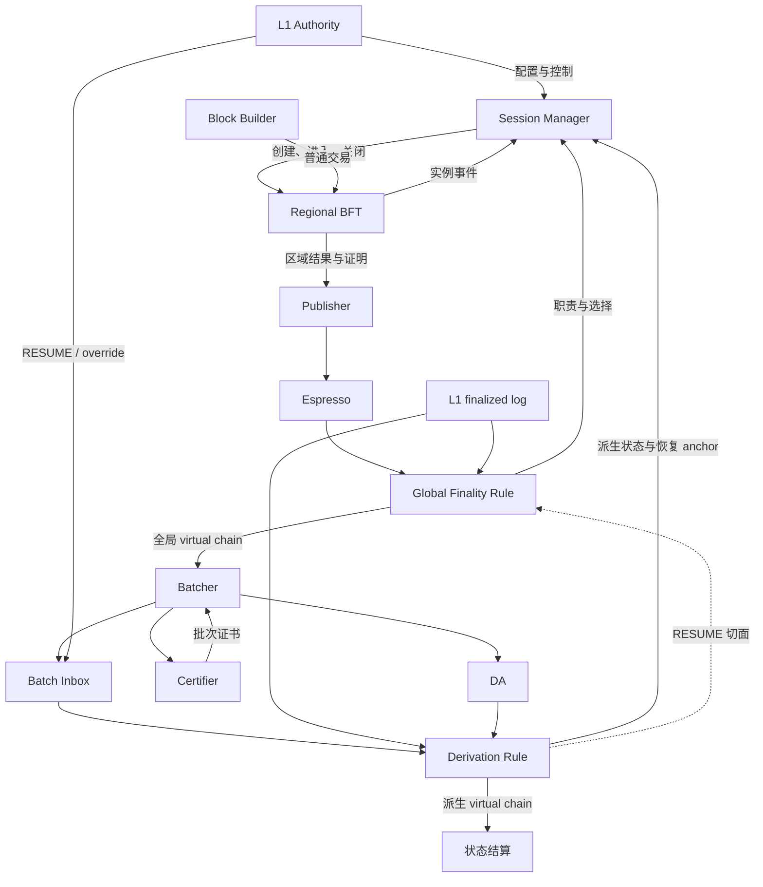

# 系统架构、模块接口与最终性规则（中文工作稿 v0.1）

日期：2026-11-02。

## 0. Overview

系统由区域生产、公开排序和 L1 派生三部分组成。区域共识决定一条链上的交易内容；Espresso 为区域结果提供公开顺序；Global Finality Rule（GFR）根据 L1 控制记录和 Espresso 日志选择全局链。随后，Batcher 编码所选内容，Certifier 认证其来源，Batch Inbox 在 L1 上接纳批次，Derivation Rule 从 L1 与数据可用性层（DA）重建 L2。

正常轮换时，后继区域可以提前准备并运行以不同 anchor 为起点的候选共识实例。Anchor 是实例采用的起始 L2 block。GFR 最终确定其中哪个实例可以贡献全局结果。提前运行的区域结果不因此自动获得全局接纳资格。



下面先给出外部 building blocks，再定义参与者和 session，随后给出 L2 数据类型、模块接口、最终性规则及实例生命周期。

## 1. External Building Blocks

真实时间记为 $\tau\in\mathbb R_{\ge0}$。它是分析执行时使用的坐标，不意味着所有读取者都有同步时钟。$\mathbb N$ 包含 0；$\{0,1\}^*$ 是有限比特串的集合。对有限序列 $X,Y$，$X\preceq Y$ 表示 $X$ 是 $Y$ 的前缀，$X\Vert Y$ 表示拼接。

本节的诚实提交者或读取者，是遵守相应外部服务规则的参与方；系统中 replica 的故障模型在 §2 给出。

本节分别说明外部服务提供什么输入、这些输入有什么保证。后面的模块通过这些输入作决定：L1 提供已经确定的历史，Espresso 提供公开消息顺序，DA 提供可取回的数据内容。

### 1.1 数字签名、hash 与编码

令 $\kappa$ 为安全参数，$\mathrm{negl}(\kappa)$ 表示可忽略函数。协议使用数字签名方案

$$
\mathsf{Sig}=(\mathsf{KeyGen},\mathsf{Sign},\mathsf{Verify}).
$$

$\mathsf{KeyGen}(1^\kappa)$ 生成密钥对 $(sk,pk)$；$\mathsf{Sign}_{sk}(x)$ 对消息 $x\in\{0,1\}^*$ 签名；$\mathsf{Verify}_{pk}(x,\mathit{sig})\in\{0,1\}$ 验证签名。公钥集合记为 $\mathcal{PK}$。方案满足正确性和 **EUF-CMA security**. 

协议另使用 hiding and binding hash function。

$$
\mathsf H:\{0,1\}^*\longrightarrow\{0,1\}^{\kappa}.
$$

签名用于验证一条消息是否获得相应密钥持有者的授权；hash 用于在消息和记录中引用具体内容。验证签名后，接收者仍要按协议检查消息的用途、所属实例和内容是否合法。

### 1.2 L1

L1 是具有公开验证依据的 finalized block 序列

$$
\mathcal L_1=(L_0,L_1,\ldots).
$$

下标 $\ell\in\mathbb N$ 是 L1 height。给定 $\tau^0_{\rm L1}\ge0$ 和 $b_{\rm L1}>0$，采用 fixed-pace 模型

$$
\mathit{ts}_{\rm L1}(\ell)=\tau^0_{\rm L1}+\ell b_{\rm L1}.
$$

L1 满足以下性质。任意两份通过验证的 finalized 日志互为前缀；读取者已取得的 finalized 前缀不回退。同一前缀中的合约调用按记录顺序原子执行，因此合约状态和事件列表由这个前缀唯一确定。

这里“互为前缀”允许两个读取者进度不同。例如，一个已经读到 $L_{10}$，另一个只读到 $L_8$，但两者读到的 $L_0,\ldots,L_8$ 必须相同。因此，引用某个 L1 位置，就是引用这份共同历史中的确定记录。

存在已知常数 $T_{\rm L1}>0$，使一笔在 $\tau$ 提交、满足 L1 准入条件的交易，在 $\tau+T_{\rm L1}$ 之前 finalized，并对持续在线的读取者公开可读。沿用区域 BFT 的 L1 输入条件，block $\ell$ 在 $\mathit{ts}_{\rm L1}(\ell)+T_{\rm L1}$ 之前 finalized 且可读；$T_{\rm L1}$ 取这些时限的共同上界。

同一 L1 block 内的记录位置为

$$
p=(\ell,j,k),
$$

其中 $j$ 是交易索引，$k$ 是该交易内的日志索引。L1 位置按字典序排列。下文的“处理到 $p$”包含该位置；“严格早于某 L1 height”不包含该 height 的任何记录。

### 1.3 L2 时间与 L1 强制交易输入

令 $\mathcal T$ 为原生 L2 交易集合，$\mathcal T^*$ 为有限有序交易列表集合。给定 genesis height $h^0$、genesis timestamp $\tau^0_{\rm L2}$ 和间隔 $b_{\rm L2}>0$，定义

$$
\mathit{ts}^*(h)=\tau^0_{\rm L2}+(h-h^0)b_{\rm L2},
\qquad h\ge h^0.
$$

height $h$ 的 slot 是 $[\mathit{ts}^*(h),\mathit{ts}^*(h+1))$。对 $\tau\ge\tau^0_{\rm L2}$，定义

$$
\mathrm{slot}(\tau)
=h^0+\left\lfloor\frac{\tau-\tau^0_{\rm L2}}{b_{\rm L2}}\right\rfloor.
$$

这两个函数从相反方向描述同一份时间安排：$\mathit{ts}^*(h)$ 给出 height $h$ 的 slot 起点，$\mathrm{slot}(\tau)$ 给出时刻 $\tau$ 所处的 slot。Slot 已经开始或结束，本身不表示该 height 一定产生了 physical block。

我们将 L1 强制交易抽象为列表输入。$\mathrm{DepLog}(\ell)\in\mathcal T^*$ 是 L1 block $\ell$ 所确定的有序 deposit 列表。

为了定义一个 L2 height 使用的强制前缀，令

$$
\omega:\{h^0,h^0+1,\ldots\}\longrightarrow\mathbb N
$$

为给定的 L1-origin 轨迹。$\omega(h)$ 表示 height $h$ 依据的 L1 block；合法轨迹相邻增量为 0 或 1。对 $h>h^0$，定义

$$
\mathrm{Deposit}_{\omega}(h)=
\begin{cases}
\mathrm{DepLog}(\omega(h)),&\omega(h)\ne\omega(h-1),\\
[],&\omega(h)=\omega(h-1).
\end{cases}
$$

例如，相邻两个 L2 heights 都使用 L1 block 20 作为 origin，后一个 height 不再重复执行 block 20 的 deposits；第一次推进到 origin 21 时，才加入 $\mathrm{DepLog}(21)$。

原生规则给出两个确定列表：$\mathrm{Attr}_{\omega}(h)$ 是把 origin 信息写入 L2 执行上下文的 attributes transaction；$\mathrm{Sys}_{\omega}(h)$ 是该 height 适用的 system／upgrade transactions。它们只读取 origin 轨迹、已 finalized 的 L1 数据、固定的原生规则版本和 genesis 上下文。定义强制前缀

$$
\mathrm{DEP}_{\omega}(h)
:=
\mathrm{Attr}_{\omega}(h)\Vert
\mathrm{Deposit}_{\omega}(h)\Vert
\mathrm{Sys}_{\omega}(h)
\in\mathcal T^*.
$$

固定 origin 轨迹和原生规则版本后，简写为 $\mathrm{DEP}(h)$。同一输入下，所有读取者得到相同列表；leader 不能删改它。它按列表顺序、在普通交易之前执行。所需 L1 前缀尚不可读时，计算等待，不返回空列表。

不同恢复起点可以对应不同的 origin 轨迹，因此 $\mathrm{DEP}(h)$ 的简写始终相对于一个已固定的轨迹使用。具体轨迹在 §3.4 定义。

### 1.4 Espresso

Espresso 是 finalized block 序列

$$
\mathcal L_E=(J_0,J_1,\ldots),\qquad
J_q=(q,\theta_q,\mathcal M_q),
$$

其中 $q\in\mathbb N$ 是 Espresso height，$\theta_q\in\mathbb R_{\ge0}$ 是 timestamp，$\mathcal M_q\in(\{0,1\}^*)^*$ 是该 block 对本协议提供的完整有序消息列表。

服务状态是公共信息

$$
\mathsf{Live}_E:\mathbb R_{\ge0}\longrightarrow\{0,1\}.
$$

所有在线参与方知道当前的 $\mathsf{Live}_E(\tau)$。值为 1 表示 live，值为 0 表示 non-live；这项公共可知性是模型假设，不由观察者的本地超时推导。外部观察者无需知道 $\tau$ 的数值。

**Safety（E-S）。** 任意两份通过验证的 Espresso finalized 日志互为前缀，已经 finalized 的前缀不回退，且

$$
\theta_q\le\theta_{q+1}.
$$

每份已知前缀的消息列表可以完整读取，包括确定某个 block 的列表为空。E-S 对所有执行成立。

给定已知服务时限 $T_E>0$ 和 timestamp 误差上界 $\Delta_{\rm ts}\ge0$。

**Liveness（E-L）。** 若消息 $x$ 在 $\tau$ 被诚实方提交，满足服务的准入条件，且

$$
\mathsf{Live}_E(t)=1
\quad\text{对所有 }t\in[\tau,\tau+T_E],
$$

则不晚于 $\tau+T_E$，一份包含 $x$ 的 Espresso block 已 finalized，并对该区间持续在线的读取者可读。在同样持续 live 的区间内，到 $\tau+T_E$ 时，还存在已 finalized 且可读的 $J_q$ 满足 $\theta_q\ge\tau-\Delta_{\rm ts}$。

**Timestamp accuracy（E-TS）。** 令 $\tau_{\rm prop}(J_q)$ 为 $J_q$ 的真实提出时刻。在 live 期间提出的 block 满足

$$
\mathsf{Live}_E(\tau_{\rm prop}(J_q))=1
\quad\Longrightarrow\quad
\bigl|\theta_q-\tau_{\rm prop}(J_q)\bigr|\le\Delta_{\rm ts}.
$$

E-L、E-TS 只在各自的 live 条件下使用。Non-live 期间不假设 timestamp 贴近真实时间；一个在 non-live 期间提出的旧 block，不因之后 finalized 而获得 E-TS 保证。

对公开键 $x$，一份完整读取且末端 timestamp 至少为 $x$ 的 finalized 前缀，证明所有 timestamp 小于 $x$ 的 block 已被覆盖。下文称这种日志进度为 **watermark**。它依赖 E-S，不要求外部观察者读取同步时钟。

例如，规则要检查 timestamp 严格小于 100 的消息，读取者只需取得一个 timestamp 至少为 100 的 finalized block，并完整读取此前日志。由于 timestamp 不递减，后续 block 不会再补入 timestamp 小于 100 的消息。E-L 和 E-TS 用来估计何时能取得这份前缀；watermark 本身说明已经覆盖了哪一段公开历史。

### 1.5 Data Availability

DA 处理 payload $y\in\{0,1\}^*$。Dispersal 返回 commitment $d$ 和证书 $\pi_{\rm DA}$，两者均以有限比特串表示；公开谓词 $\mathsf{CheckDA}(d,\pi_{\rm DA})\in\{0,1\}$ 验证该 commitment 已按 DA 规则认证。读取 $d$ 返回它对应的 payload，或在数据尚未取得时等待。

**Binding。** 除可忽略概率外，同一个已认证 $d$ 不可能被有效打开为两个不同的 payload。证书认证的是该 commitment 的可用性条件，不替代对 payload 内容的协议验证。

**Availability。** 给定 $T_{\rm DA},\Delta_{\rm DA},T_{\rm ret}>0$。在 DA 持续可用且请求满足准入条件的区间内，dispersal 在 $T_{\rm DA}$ 内完成，已认证数据的取回在 $\Delta_{\rm DA}$ 内完成；DA 保留期为认证后的 $T_{\rm ret}$。

已经被 L1 接纳的数据，在派生和恢复仍可能需要它时必须可取回。保留期之后，这项可取回性由保管者保存相同 payload 来承担。违反可取回性时，依赖它的计算等待；不能用空内容代替未知但已经接纳的数据。

直观上，commitment 标识“要取哪份数据”，DA 证书支持其可用性条件，取回的 payload 才是后续解码和执行的输入。验证证书与执行 payload 是两个步骤。

## 2. Participants, Sessions and Assumptions

### 2.1 Position、replica 与 PKI

**Position 是 L1 Authority 维护的一条质押记录**，包含五个字段：

- **region**：replica 所属区域，取自有限区域集合 $\mathcal R$。
- **pk**：replica 用于签署共识消息的公钥，取自 §1.1 的公钥集合 $\mathcal{PK}$。
- **owner**：管理这份质押的 L1 账户，按 L1 账户授权规则发起注册、退出和资金释放等操作。
- **stake**：这份 position 当前锁定的质押金额（escrow），以固定的最小代币单位计，为非负整数。
- **status**：这份 position 的当前状态，取 Pending、Active、Exiting、Retired、Released 或 Cancelled；分别表示待纳入、已激活、申请退出、已退役但资金尚未释放、资金已释放、登记已取消。状态转换由 §4.1 的 Authority 操作规定。

每份 position 使用一个唯一且不复用的 **position ID**，记为 $\mathit{pid}$。Region、pk 和 owner 在这份 position 的生命周期内固定；stake 和 status 随 L1 上的质押操作更新。读取这些字段时，以已处理的 finalized L1 历史为准。

一个 owner 可以拥有多份 position。同一公钥同时至多绑定一份尚未 Released 或 Cancelled 的 position。

每份 position 对应一个逻辑 **replica**，使用该记录的 pk 对应的私钥签署共识消息。后文用 $m$ 表示 replica，用 $m.\mathit{pid}$ 表示其 position ID。Owner 是管理质押的账户，replica 是参与共识的身份；replica 不必对应一台独立物理机器。

采用 **PKI setting**：所有参与方都能从已验证的 L1 历史查到 position 登记的公钥。


### 2.2 快照与 session

**Position 与快照的关系。** Position 是一条持续更新的质押记录；snapshot（快照）是依据这些记录生成的一份固定的共识名单。一份快照可以收录多个 position，同一个 position 也可以出现在多份不同版本的快照中。

生成快照时，Authority 根据指定截止高度之前的 position 记录，按质押规则决定哪些 position 可以纳入，以及每个 position 的投票权重。快照按 position ID 保存纳入者的 region、pk 和投票权重 weight，其中 weight 为正整数。未纳入的 position 在这份名单中没有条目。

例如，Position 7 的 stake 为 100、status 为 Active。假设生成某份快照时，按质押规则将它纳入，投票权重确定为 10。后来它被罚没，当前 stake 降为 80：position 的记录随之更新，但这份快照中的投票权重仍为 10。Stake 如何换算为 weight 由质押规则决定；已经生成的快照不会被后来的质押操作改写。

Session 使用一份选定的快照来确定委员会及其投票权重。因此，即使运行期间 position 的 stake 或 status 变化，这个 session 也继续使用已经冻结的投票权重。

**快照记号。** 快照从 0 开始依次编号，编号记为 $e$，对应快照记为 $\mathcal C_e$。它是一张有限登记表；$\mathcal C_e[\mathit{pid}]$ 表示在快照 $e$ 中查找编号为 $\mathit{pid}$ 的 position 条目。

**生成与启用。** 每份新快照先依据一段确定的 L1 历史计算，再从后续的一个 L1 height 开始使用。为此，协议预先规定两个 L1 heights：

- **cutoff（历史截取高度）**：计算该快照时，只使用严格早于这个高度的 finalized L1 历史，按固定的质押规则确定纳入的 position 及其权重；不包含 cutoff 高度本身的记录。
- **activation（激活高度）**：从这个高度开始，该快照用于授权查询，直到下一份快照激活。

同一份快照的 cutoff 必须小于 activation；后续快照的 cutoff 和 activation 分别严格增加。初始快照 $\mathcal C_0$ 及其 activation 由 genesis 配置直接给定。读取或计算快照不需要额外发布交易。

**查询使用哪份快照。** 在某个 L1 height 查询授权时，使用截至该高度已经激活的最新快照。记 $\mathsf{SnapshotAt}(\ell)$ 为这项查询返回的**快照编号**，其中 $\ell$ 是查询依据的 L1 height，不早于初始快照的 activation。“最新”指 activation 不超过 $\ell$ 的快照中编号最大的那一份。

例如，快照 1 使用 L1 height 90 之前的历史，从 height 100 激活；快照 2 使用 height 190 之前的历史，从 height 200 激活。那么，在 height 150 查询授权时使用快照 1，即 $\mathsf{SnapshotAt}(150)=1$；在 height 200 查询时使用快照 2，即 $\mathsf{SnapshotAt}(200)=2$。多个 session 可以使用同一份快照。

**Session** 的标识为 $s=(\beta,r)\in\mathbb N^2$。$\beta$ 标识一条生产分支，$r$ 标识该分支中的区域职责安排；改变分支与常规推进的具体规则见 §5。一个 session 的固定参数包括：

$$
\bigl(s,i_s,e_s,V_s,w_s,F_s,
h_{\min,s},h_{\max,s},\mathrm{Leader}_s\bigr).
$$

其中 $i_s\in\mathcal R$ 是负责区域，$e_s$ 是采用的快照编号，$V_s$ 是所选 replica 委员会。对每个 $m\in V_s$，快照条目 $\mathcal C_{e_s}[m.\mathit{pid}]$ 必须存在，且其 region 等于 $i_s$。Replica 的投票权重和委员会总权重分别为

$$
w_s(m):=\mathcal C_{e_s}[m.\mathit{pid}].\mathit{weight},
\qquad
W_s:=\sum_{m\in V_s}w_s(m).
$$

给定故障权重上界 $F_s\in\mathbb R_{\ge0}$，要求 $3F_s<W_s$。View $v\in\mathbb N_{>0}$ 是一次提议机会，$\mathrm{Leader}_s:\mathbb N_{>0}\to V_s$ 是固定的 leader 函数，没有 term 或恢复代。

$h_{\min,s},h_{\max,s}\in\mathbb N$ 分别是可提议的最低和最高 physical height，满足 $h^0<h_{\min,s}\le h_{\max,s}$。窗口宽度为公开常数 $\mathrm{TB}=h_{\max,s}-h_{\min,s}+1>0$，运行边界为

$$
\tau_s^{\rm start}:=\mathit{ts}^*(h_{\min,s}),
\qquad
\tau_s^{\rm stop}:=\mathit{ts}^*(h_{\max,s}+1).
$$

同一个 session 可以有不同起点的候选 program；这些 program 共用上述 session 参数，但各自的起点、共识状态和签名域固定。它们的标识在 §4.3 的 program 输入处定义。

因此，session 描述一段生产职责：由哪个区域、哪份委员会负责哪些 physical heights；program 是在某个具体起点上执行这份职责的共识实例。最后一个 slot 在 $\tau_s^{\rm stop}$ 结束，但这个窗口定义不承诺每个 height 都有 block。

### 2.3 故障与时钟

Honest replica 按指定协议状态转换；敌手可以读取和控制 Byzantine replica 的内部状态与签名密钥，并使其任意偏离协议。对每个 session $s$，敌手控制的集合 $\mathrm{Byz}_s\subseteq V_s$ 在其配置公开前固定，并满足

$$
\sum_{m\in\mathrm{Byz}_s}w_s(m)\le F_s.
$$


we assume static advesrary setting within every session. 

**Global clock。** 每个 honest replica 及其本地 Session Manager 在真实时刻 $\tau$ 读取的协议时钟等于 $\tau$。该假设用于 block 时间检查、窗口开始和停止；外部观察者不需要同步时钟。读取者、Publisher 和 Batcher 通过公开日志验证结果，不以自己的接收时刻改写历史顺序。

### 2.4 区域内与跨区域通信

- We assume a authenticated communication 
- Partial sync for regional communication 
- for cross-region comm: 
    - sync if espresso is live 
    - async if espresso goes offline. 

**区域内。** 对区域 $i$，存在未知 $\mathrm{GST}_i$ 和已知 $\Delta_i>0$。对于同一区域内持续在线并运行同一实例的 honest replicas，$\mathrm{GST}_i$ 之后发送的消息在 $\Delta_i$ 内送达并完成规定的有界协议处理。区域 agreement 不依赖这个延迟界；有界进展需要相应同步与参与条件。

**跨区域。** 给定已知 $\Delta_{\rm cross}\ge\max_i\Delta_i$。设 honest replica $m$ 在时刻 $\tau$ 向另一区域的 honest replica $n$ 发送消息 $x$。若 $n$ 在 $[\tau,\tau+\Delta_{\rm cross}]$ 持续在线，且

$$
\mathsf{Live}_E(t)=1
\quad\text{对所有 }t\in[\tau,\tau+\Delta_{\rm cross}],
$$

则 $\tau_{\rm del}(x,n)\le\tau+\Delta_{\rm cross}$。这是跨区域信道的同步假设，直接转发区域结果也适用，不要求该结果先在 Espresso finalized。

在 non-live 期间，跨区域信道异步：对于持续在线的接收者，已发送消息最终送达，但没有适用于所有执行的有限延迟上界。若发送后的同步区间被 non-live 状态打断，不再使用该次发送的同步上界。若在 $\tau_0$ 恢复 live 并持续至少 $\Delta_{\rm cross}$，则仍在信道中的消息向持续在线接收者的送达时间也不晚于 $\tau_0+\Delta_{\rm cross}$。这项在途消息界是本模型的恢复条件。

这使正常交接可以对跨区域结果的到达时间使用 $\Delta_{\rm cross}$；停机期间则只能等待消息，不能据此给出固定的交接完成时间。即使消息已经到达，接收者仍可能需要取得 anchor 状态才能进入对应实例。

### 2.5 治理与认证角色

治理方 $\mathsf M$ 和 Certifier $\mathsf C$ 的认证公钥 $pk_{\mathsf M},pk_{\mathsf C}$ 在协议配置中给定，对应签名密钥为 $sk_{\mathsf M},sk_{\mathsf C}$。$\mathsf M$ 向 Authority 提交授权的分支控制；恢复活性要求它在规定的紧急情形下发出适当控制。$\mathsf C$ 是按 §4.7 的规则签署批次声明的可信方，不被敌手腐化，但可以离线。其签名不能替代该规则之外的事实。

Publisher、Batcher 和证据提交者是角色。某项交付的活性保证，只在相关区间存在一个诚实在线承担者、输入可得且负载与费用满足声明条件时使用。每个交付预算在相应接口处定义，不把它们作为区域 agreement 的前提。

## 3. Virtual Chain、Physical Chain 与双向映射

Virtual chain 按 L2 height 连续描述执行内容：每个 height 包含强制前缀和普通交易。Physical chain 保存普通交易及其链连接，可以跳过一些 heights。两者之间的 merge rule 将 physical chain 与 L1 确定的 DEP 输入合并，补齐中间 heights，并计算执行状态。

本节先定义 virtual chain 应满足的性质，再定义 physical chain，最后说明两个方向的转换，以及区域生产如何固定每个 height 的 origin。

### 3.1 Virtual chain 与 VP1、VP2

**Virtual block。** 令 $\Sigma$ 为原生执行状态集合，$\sigma\in\Sigma$ 为一个状态，包含执行时使用的当前 block context。记 $\mathcal H_\kappa=\{0,1\}^{\kappa}$，$\mathrm{root}:\Sigma\to\mathcal H_\kappa$ 为 state-root 函数。Virtual block 的类型为

$$
\mathsf{VB}:=
\mathbb N\times\mathbb R_{\ge0}\times\mathbb N
\times\mathcal T^*\times\mathcal H_\kappa\times\mathcal T^*.
$$

对 $\mathit{VB}\in\mathsf{VB}$，写作

$$
\mathit{VB}=\langle\mathit{VB}.h,\mathit{VB}.\mathit{ts},\mathit{VB}.\mathit{os},
\mathit{VB}.\mathit{Dep},\mathit{VB}.\mathit{root},\mathit{VB}.\mathit{Txs}\rangle.
$$

六个字段依次为 L2 height、timestamp、L1 origin、强制执行前缀、执行本 block **之前**的 state root、普通交易列表。普通交易列表保留输入的原始顺序和条目，不保证每笔交易都能在当前状态执行。

**Virtual chain。** Virtual chain 是连续序列 $X=(X[h^0],\ldots,X[h_X])$，其中 $h_X$ 是末端 height，$X[h].h=h$。也可以讨论从一个已知前缀之后开始的连续片段。这里“连续”指已确定范围内每个 height 都有一个 virtual block，不表示未来的 blocks 已经产生。

对象字段是 actual 值，即对象实际记录的内容；带星号的值是规则计算的 should-be 值。下面的 VP 条件规定 actual 值应当满足什么。

**VP1 — Fixed pace。** 每个 height 的 timestamp 使用 §1.3 的固定时间表：

$$
X[h].\mathit{ts}=\mathit{ts}^*(h).
$$

因此，timestamp 由 height 决定，与某个节点实际何时收到或执行该 block 无关。

**VP2 — Origin 与强制前缀。** 给定 §1.3 意义下的一条 L1-origin 轨迹 $\omega$，每个非 genesis height 满足

$$
X[h].\mathit{os}=\omega(h),\qquad
X[h].\mathit{Dep}=\mathrm{DEP}_{\omega}(h).
$$

这表示 origin 一经相应生产或派生规则确定，强制前缀就由该轨迹、已 finalized 的 L1 数据和原生规则唯一确定。普通交易的提议者不能删改这部分输入。所需 L1 数据尚未取得时等待，不能将未知 DEP 当作空列表。

区域生产使用 §3.4 给出的固定 origin 轨迹；L1 派生使用原生派生规则确定的实际轨迹。给定轨迹后，满足 VP1、VP2 的链，其 timestamp、origin 和 DEP 已固定，但普通交易和执行状态仍取决于所选链。执行状态的要求 VP3 在 §3.3 定义。

### 3.2 Physical chain 与 anchor

**Physical block。** Physical block 保存普通交易、metadata 和链连接，其 payload 为

$$
B=(B.\mathit{ph},B.h,B.\mathit{ts},B.\mathit{os},B.\mathit{root},B.\mathit{Txs}).
$$

$B.\mathit{ph}\in\mathcal H_\kappa$ 是前一个 physical block 或起始 anchor 的连接标识；其余字段的类型和含义与 virtual block 的同名字段相同。Physical block 不携带 Dep 字段，因为它可以由 origin 轨迹与 L1 数据计算。区域 BFT 对这种 payload 达成决定；后面的 L1 派生也用这种数据表示组织其选定的普通交易，但不会由此获得区域 BFT 证明。

**Anchor。** Anchor $A$ 是链采用的起始 L2 block 及其执行后状态。$A.h$、$A.\mathit{os}$、$A.\sigma$ 分别表示它的 height、origin 和执行后状态；$\mathrm{id}(A)\in\mathcal H_\kappa$ 是固定的连接标识。

若 anchor 来自 physical block $B$，取 $\mathrm{id}(A)=\mathsf H(B)$。若它来自派生 virtual block $\mathit{VB}$，令 $\mathit{bh}_{\rm nat}$ 为该 block 在已确定前缀上按原生格式执行和编码得到的 block hash，取

$$
\mathrm{id}(A)=
\mathsf H(\texttt{DERIVED},\mathit{VB}.h,\mathit{bh}_{\rm nat}).
$$

Genesis 的连接标识由初始配置给定。$A.\sigma$ 必须与该 block 的实际执行后状态一致；不能任意替换状态而继续使用同一个 anchor。来源依据记为 $\pi_A$。来源可以是前驱的区域最终证明，此时 anchor 的内容已确定，但仍可能只是等待 GFR 选择的候选。

**Physical chain。** 一条链写作 $C=(A,B_1,\ldots,B_n)$，其中 $n\ge0$。当 $n>0$ 时，$B_1.\mathit{ph}=\mathrm{id}(A)$；后续 parent 指向前一个 physical block 的 hash，且

$$
A.h<B_1.h<\cdots<B_n.h.
$$

链上的前一个对象记为 parent $P$。末端 height 记为 $h_C$：非空时为 $B_n.h$，$C=(A)$ 时为 $A.h$。区域实例还要求所有 physical heights 位于该 session 的固定窗口 $[h_{\min,s},h_{\max,s}]$ 内，且 $A.h<h_{\min,s}$。

例如，anchor 位于 98，后继 physical block 可以直接位于 101。Merge rule 会给出连续的 virtual 99、100、101，其中 99、100 只执行强制前缀。View $v$ 是 BFT 的提议机会，height $h$ 是 L2 的位置；merge rule 不读取 view。

### 3.3 Merge rule、反向映射与 VP3

#### 原生执行

**执行输入。** Metadata 的类型为 $\mathsf{Meta}:=\mathbb N\times\mathbb R_{\ge0}\times\mathbb N$。一个 metadata 值记为 $\mu=(h,\mathit{ts},\mathit{os})\in\mathsf{Meta}$，依次指定当前 block 的 height、timestamp 和 L1 origin。直观上，$\mu$ 告诉执行器“现在开始的是哪一个 block”；$\mathsf{Meta}$ 是类型，$\mu$ 才是传给执行函数的具体值。

执行一个 block 时，输入还包括执行前状态 $\sigma$、强制前缀 $\mathit{Dep}\in\mathcal T^*$ 和原始普通交易列表 $\mathit{Txs}\in\mathcal T^*$。其中 $\mathit{Dep}$ 由 §1.3 的 DEP 输入确定，必须先执行；$\mathit{Txs}$ 中的交易随后按顺序检查和执行。

**原生执行函数。** 原生执行给出三个确定函数，其类型为

$$
\mathsf{Begin}:\Sigma\times\mathsf{Meta}\times\mathcal T^*\to\Sigma,
\quad
\mathsf{Valid}:\Sigma\times\mathcal T\to\{0,1\},
\quad
\mathsf{Run}:\Sigma\times\mathcal T\to\Sigma.
$$

- $\mathsf{Begin}(\sigma,\mu,\mathit{Dep})\to\sigma'$：从状态 $\sigma$ 开始 metadata 为 $\mu$ 的 block，设置当前 block context，并按顺序执行强制前缀 $\mathit{Dep}$，返回处理普通交易之前的状态 $\sigma'$。直观上，先准备好这个 block，并把必须先执行的内容执行完。这里的 $\sigma'$ 是这一调用的输出，还不是整个 block 的执行后状态。
- $\mathsf{Valid}(\sigma,x)\to b$，其中 $x\in\mathcal T$、$b\in\{0,1\}$：检查原生规则是否允许在当前状态 $\sigma$ 上执行交易 $x$，包括 nonce、余额和 block gas 等条件；允许时返回 1，否则返回 0。这个调用只作检查，不改变状态。直观上，它回答“这笔交易现在能不能执行”，而不是预先判断合约调用会不会 revert。
- $\mathsf{Run}(\sigma,x)\to\sigma'$：在 $\mathsf{Valid}(\sigma,x)=1$ 的前提下执行交易 $x$，返回原生规则规定的执行后状态 $\sigma'$。直观上，这一步才真正执行交易。即使合约调用 revert，交易仍算已执行，其状态效果按原生规则处理。

这些函数使用执行输入、适用的原生规则及 origin 对应的 L1 数据；相同输入得到相同结果。$\mathsf{Begin}$ 在本文声明范围内的合法强制前缀上有结果；本文只在 $\mathsf{Valid}=1$ 时调用 $\mathsf{Run}$。若适用原生规则在某高度禁止普通交易，$\mathsf{Valid}$ 在该高度对普通交易返回 0。

**执行一个 block。** 对合法的强制前缀，定义

$$
\mathsf{Apply}(\sigma,\mu,\mathit{Dep},\mathit{Txs})
\to(\sigma',\mathit{Kept}).
$$

它先执行强制前缀，再依次处理普通交易，返回整个 block 的执行后状态 $\sigma'$ 和实际执行的普通交易列表 $\mathit{Kept}$。$\mathit{Kept}$ 不包含强制前缀。普通交易在轮到它时未通过 $\mathsf{Valid}$，就直接跳过；通过检查的交易交给 $\mathsf{Run}$，并保留在 $\mathit{Kept}$ 中。

```text
Apply(σ, μ, Dep, Txs) → (σ', Kept):
    σ ← Begin(σ, μ, Dep)
    Kept ← []
    for tx in Txs:
        if Valid(σ, tx):
            σ ← Run(σ, tx)
            Kept ← Kept ‖ [tx]
    return (σ, Kept)
```

例如，$\mathit{Txs}=[x_1,x_2]$。若执行完强制前缀后，$x_1$ 因 nonce 错误未通过检查，则跳过 $x_1$，状态不变；接着在这个状态上检查 $x_2$。若 $x_2$ 通过检查，即使执行时 revert，也有 $\mathit{Kept}=[x_2]$。因此，原始交易列表中的 invalid transaction 不会使整个 block 执行失败，revert 的交易也不会被当作 invalid transaction 丢弃。

#### VP3 — 执行前状态一致

给定 anchor $A$ 和从 $A.h+1$ 开始的 virtual chain $X$，令 $\sigma_{A.h}=A.\sigma$，逐高度执行

$$
(\sigma_h,\mathit{Kept}_h)
:=\mathsf{Apply}\bigl(
\sigma_{h-1},(h,X[h].\mathit{ts},X[h].\mathit{os}),
X[h].\mathit{Dep},X[h].\mathit{Txs}\bigr).
$$

**VP3** 要求每个 block 记录的执行前 root 与上述执行一致：

$$
X[h].\mathit{root}=\mathrm{root}(\sigma_{h-1}).
$$

$\sigma_h$ 是执行完 height $h$ 后的状态，$\mathit{Kept}_h$ 是该高度实际执行的普通交易列表。因此，检查 height $h$ 的 root，需要执行它之前的内容；这个字段不承诺当前 block 的普通交易全部有效。

#### Physical + DEP → Virtual

输入为 physical chain $C$、其 anchor 状态、给定的 origin 轨迹 $\omega$ 和计算 DEP 所需的 L1 数据。轨迹在 anchor 处满足 $\omega(A.h)=A.\mathit{os}$，此前的轨迹由 anchor 的已验证前缀给出。定义

$$
\mathit{Txs}_C(h)=
\begin{cases}
B.\mathit{Txs},&C\text{ 中存在 }B.h=h\text{ 的 physical block},\\
[],&\text{否则}.
\end{cases}
$$

从 $\sigma_{A.h}=A.\sigma$ 开始，对 $A.h<h\le h_C$ 依次计算

$$
(\sigma_h,\mathit{Kept}_h)
:=\mathsf{Apply}\bigl(
\sigma_{h-1},(h,\mathit{ts}^*(h),\omega(h)),
\mathrm{DEP}_{\omega}(h),\mathit{Txs}_C(h)\bigr).
$$

定义合并结果

$$
\mathrm{Merge}_{\omega}(C)[h]
=\langle h,\mathit{ts}^*(h),\omega(h),\mathrm{DEP}_{\omega}(h),
\mathrm{root}(\sigma_{h-1}),\mathit{Txs}_C(h)\rangle.
$$

对输入中的每个 physical block $B$，要求其 timestamp、origin、root 等于合并结果在 $B.h$ 的对应字段。若不相等，这条 physical chain 不满足该映射的有效输入条件，不能用重新计算的字段替换它原有的字段并视为有效。所需数据不足时返回 WAIT。

这就是“physical + DEP”：在已有 physical height 使用其普通交易，在中间缺失 height 使用空普通交易列表；每个 height 都按规则加入 DEP 并推进执行状态。合并结果满足 VP1–VP3，并在 physical heights 保留原 block 的 metadata、root 和普通交易列表。没有 physical block 的 height 称为 **padding**。

映射只展开到 $h_C$。若链只有 anchor，输出片段为空；没有决定的后继时，时钟前进不会自动生成到 session 上界的 padding。

#### Virtual − DEP → Physical

反方向先从 virtual block 中去掉 Dep 字段，再按所保留的 heights 重建 physical parent 连接。输入是满足 VP1–VP3 的 virtual 片段 $X$、原 anchor $A$，以及要保留的有序 height 列表 $I=(h_1,\ldots,h_n)$。Heights 严格增加，来自 $X$ 的范围；非空片段必须保留末端 height，省略的 heights 必须具有空的普通交易列表。空片段取空列表。

记这项映射为 $\mathrm{Strip}(X;A,I)$。输出链为 $(A,B_1,\ldots,B_n)$，其中

$$
B_j=\bigl(\mathit{ph}_j,h_j,X[h_j].\mathit{ts},
X[h_j].\mathit{os},X[h_j].\mathit{root},X[h_j].\mathit{Txs}\bigr),
$$

$$
\mathit{ph}_1=\mathrm{id}(A),\qquad
\mathit{ph}_j=\mathsf H(B_{j-1})\quad(j>1).
$$

只写 $\mathrm{Strip}(X;A)$ 时，默认保留每个 height，得到逐高度的 physical 表示。因此，给定相同 origin 轨迹和 L1 输入，再加入 DEP 就恢复原 virtual 片段：

$$
\mathrm{Merge}_{\omega}\bigl(\mathrm{Strip}(X;A,I)\bigr)=X.
$$

若要恢复**原来的稀疏 physical chain**，还需要知道原本在哪些 heights 有 physical block。令 $I(C)$ 为原链的 physical height 列表，则对有效输入

$$
\mathrm{Strip}\bigl(\mathrm{Merge}_{\omega}(C);A,I(C)\bigr)=C.
$$

例如，virtual 99、100 的普通交易都为空，单看这两个字段无法判断它们原本是两个空 physical blocks，还是从 98 到 101 时补出的 padding。保留原 physical heights 后才能恢复原 parent 连接和 block hash。对区域结果，完整 publication 中的原 physical chain 已包含这些 heights；这里不新增链上字段。

Strip 是数据表示的转换，不生成区域最终证明；默认生成的逐高度链也不自动满足原区域实例的 proposal window。它保留原始普通交易，执行时的 invalid-transaction 过滤仍由 Apply 完成。

#### Native projection 与 Lift

**从 virtual 表示到 native 表示。** 给定 virtual chain $X$ 及其初始原生状态，逐高度调用 $\mathsf{Apply}$，并按原生格式编码，得到 **native projection** $\mathrm{native}(X)$。每个 native block 的普通交易列表使用该次调用返回的 $\mathit{Kept}$。直观上，virtual block 记录“提供了哪些执行输入”，native block 记录“按原生规则实际执行了什么”。原生 header 记录执行后 state root，而 virtual block 的 $\mathit{root}$ 字段记录执行前 state root。

**从 native 表示到 virtual 表示。** 反方向，$\mathrm{Lift}$ 将已经确定的 native block 和执行前状态写成 virtual tuple：height、timestamp、origin 和强制前缀取实际派生值；普通交易取实际执行列表；root 取执行前状态的 root。直观上，$\mathrm{Lift}$ 让已派生的 native block 也能用 §3.1 的统一格式表示；它不恢复此前被 $\mathsf{Apply}$ 丢弃的普通交易。

对相同高度范围，$X\equiv_{\rm nat}Y$ 表示两条 virtual chain 的 native block hash 和执行结果相同。它不要求原始普通交易列表逐字段相同。例如，在相同执行前状态和其他字段下，普通交易列表 $[x_1,x_2]$ 与 $[x_2]$ 可以得到同一个 native block：只要 $x_1$ 在轮到它时未通过检查，两个列表就都只执行 $x_2$。使用 $\preceq$ 比较两种表示时，明确写出是 virtual 前缀还是 $\mathrm{native}(X)$ 的前缀。

### 3.4 区域生产的固定 origin：要求、前提与规则

上面的 Merge 接收一条给定的 origin 轨迹。本节规定区域生产怎样从固定 anchor 和 L1 时间表确定这条轨迹，使 replicas 对每个 height 使用相同的 origin 与 DEP。它沿用 Regional BFT abstraction 的顺序：先说明原生兼容要求，再列出参数和 anchor 前提，最后给出构造规则。

**原生兼容要求。** 令 $T_{\rm drift}$ 为原生 origin 的时间滞后上界。区域生产的 origin 轨迹 $\omega$ 需要满足：

- **O1 Continuity：** $\omega(h)-\omega(h-1)\in\{0,1\}$。每个 L2 height 最多推进一个 L1 block，不跳过中间 origins。
- **O2 Not ahead：** $\mathit{ts}_{\rm L1}(\omega(h))\le\mathit{ts}^*(h)$。L2 block 不能采用 timestamp 晚于自己的 L1 origin。
- **O3 Drift：** $\mathit{ts}^*(h)\le\mathit{ts}_{\rm L1}(\omega(h))+T_{\rm drift}$。L2 block 采用的 origin 不能过旧。

这些是输出需要满足的要求。下面的参数约束和 anchor 条件是区域 schedule 使用的前提，不由 BFT 投票产生。

**参数前提。** 给定 deposit lag $T_{\rm dep}\ge0$，表示 schedule 为 L1 finalized 和读取留出的时间。要求：

- $b_{\rm L2}\le b_{\rm L1}$：相邻 L2 slots 对应的 scheduled L1 height 至多前进 1。
- $T_{\rm L1}\le T_{\rm dep}$：到达该 L2 slot 时，schedule 选中的 L1 block 已有足够时间 finalized 并可读。
- $T_{\rm dep}+b_{\rm L1}\le T_{\rm drift}$：等待余量加上 L1 block 间隔仍落在允许的 origin drift 内。

**Anchor 前提。** Session Manager 在 Enter 前确认 $A.\mathit{os}$ 对应的 L1 block 已 finalized 且可读，并准备好与 anchor 一致的 $A.\sigma$。Anchor 自身满足

$$
\mathit{ts}_{\rm L1}(A.\mathit{os})
\le\mathit{ts}^*(A.h)
\le\mathit{ts}_{\rm L1}(A.\mathit{os})+T_{\rm drift}.
$$

生产窗口仍是 §2.2 给定的固定窗口，满足 $A.h<h_{\min,s}\le h_{\max,s}$；更换候选 anchor 不重新计算窗口。

**Scheduled origin。** 对需要展开的 height $h$，定义

$$
\ell^{\rm sch}(h)
:=\max\{\ell:\mathit{ts}_{\rm L1}(\ell)+T_{\rm dep}
\le\mathit{ts}^*(h)\}.
$$

实例只使用该集合非空的 heights。$\ell^{\rm sch}(h)$ 是在 L2 timestamp 之前已经留足 $T_{\rm dep}$ 等待时间的最高 L1 height。

**从 anchor 接续。** 恢复 anchor 的实际 origin 可能偏离 schedule。先取 $\omega_A(A.h)=A.\mathit{os}$，然后对 $A.h<h\le h_{\max,s}$ 定义

$$
\omega_A(h)
:=
\min\{A.\mathit{os}+(h-A.h),
\max\{A.\mathit{os},\ell^{\rm sch}(h)\}\}.
$$

若 anchor 落后 schedule，origin 每个 L2 height 前进 1，逐步追赶；若 anchor 超前 schedule，则先保持不动，等待 schedule 追上。若两者在 anchor 处已经对齐，之后就沿 schedule 推进。这里的限制使新链从 anchor 的实际 origin 连续接续。

记

$$
\mathit{os}_A^*(h):=\omega_A(h),\qquad
\mathrm{Dep}_A^*(h):=\mathrm{DEP}_{\omega_A}(h),\qquad
\mu_A^*(h):=(h,\mathit{ts}^*(h),\mathit{os}_A^*(h)).
$$

固定 anchor 时省略下标 $A$。区域实例的 VP2 就是要求 virtual block 的 origin 和 Dep 分别等于这两个 should-be 值；满足 VP1 和这项 VP2 的链称为该 anchor 下的 **fixed virtual chain**。Fixed 表示 timestamp、origin 和 DEP 已确定，普通交易仍由 physical chain 提供。

为沿用 BFT 的记号，定义

$$
\mathrm{Virt}(C):=\mathrm{Merge}_{\omega_A}(C).
$$

因此，区域的 Virt 是通用 Merge 在固定 schedule 下的实例。GFR 对选定的区域链使用 Virt；Derivation 对 L1 上选出的内容使用实际派生 origin，不能把其 origin 强行替换为这个区域 schedule。RESUME 采用派生 anchor 后，新的区域实例再从该 anchor 的实际 origin 应用本节规则。

原生规则还给出 sequencing window。$\mathrm{ddl}(\mathit{VB})$ 是该 virtual block 按其 origin 与适用原生规则得到的 L1 接纳截止位置；$W_{\rm seq}$ 是窗口参数按时间换算并计入边界余量后的预算。满足 VP 和 origin 要求描述的是内容及执行的一致性；原样派生还需要批次在原生期限内完成交付。


## 4. Module Interfaces

本节沿数据处理过程说明每个模块维护什么、接收什么、产生什么结果。区域共识先给出带证明的结果，GFR 从公开顺序中选择全局内容，批次路径把这些内容交给 L1，Derivation 再按原生规则执行。Session Manager 根据这些模块的结果管理本地共识实例。

协议配置固定 chain 标识 $\mathit{chain}$、规则版本 $\mathit{ver}$ 和有关 L1 合约地址；它们都有公开规范编码。接口返回 `WAIT` 表示必需输入尚未取得，`REJECT` 表示已经判定输入无效，$\bot$ 表示在已验证的范围内确定不存在。改变状态的重复请求返回同一结果，不重复创建对象或重复处罚。

### 4.1 L1 Authority

Authority 的状态包括 §2.1 的登记表、§2.2 的冻结快照、禁任集合、质押请求队列和治理控制日志。令 $\mathsf{Ban}(\ell)\subseteq\mathcal{PK}$ 为处理到 L1 height $\ell$ 时已禁任的共识公钥集合。

采用的质押规则是公开固定的模块参数 $\mathcal P_{\rm stake}$：它将当前登记及队列状态、L1 位置和经授权的质押请求，映射为新状态与调用结果。下面规定该模块必须满足的身份、权重和调用语义；快照纳入预算、退出排队和资金锁定期由这份给定规则决定。本文的 Byzantine weight 界是 §2.3 的模型假设，不声称已经从质押经济机制推出它。

注册接口 `Join(i,pk,owner,b,auth)` 接收区域、公钥、owner、escrow 金额与注册授权依据。通过质押规则和 PKI 检查后，分配新 position 并置为 Pending。`Cancel(pid,auth)` 只取消尚未进入任何快照的 Pending position；`RequestExit(pid,auth)` 将 Active position 置为 Exiting。快照处理决定何时纳入 Pending position、何时将退出或被移除的 position 置为 Retired。

`SubmitOffense(params,pid,ev)` 按证据指定的历史配置验证违规，成功时修改当前 escrow 和禁任状态，不修改旧快照权重。`Release(pid,auth)` 接收 Retired position 的 owner 授权，在所采用质押规则允许释放时退还剩余 escrow，并置为 Released。资金释放期属于该质押模块的规则；本文不从 program 停止时间推导新的解锁公式，也不将停止 program 当作解除责任的证明。

**区域配置。** 分支 $\beta$ 的 policy 为

$$
\mathcal P_\beta=(S_\beta,\mathcal L_\beta,\lambda_\beta).
$$

$S_\beta:\mathcal R\to\{0,1\}$ 表示区域是否启用；$\mathcal L_\beta$ 是区域集合的循环排列；$\lambda_\beta$ 是授权读取的最低 L1 height。Policy 在分支内固定。

给定 session $s$、选区参考 block $\mathit{Ref}_s$、来源区域 $i_{\rm src}$ 以及 physical window，定义

$$
\ell_s:=\max\{\mathit{Ref}_s.\mathit{os},\lambda_\beta\},
\qquad e_s:=\mathsf{SnapshotAt}(\ell_s).
$$

`Plan(policy,s,Ref,sourceRegion,window)` 在 $\mathcal L_\beta$ 中从来源区域之后开始循环，选择第一个启用且在 $\mathcal C_{e_s}$ 中存在未禁任提议者的区域。委员会包含该区域在此快照中的 replica 身份和正权重；禁止提议不追溯删除其冻结投票权重。没有合格区域时返回 $\bot$；所需 L1 历史尚未取得时返回 WAIT。

返回的 Plan $\Pi_s$ 绑定上述输入、使用的快照、冻结禁任集合，以及 §2.2 列出的全部 session 参数。$\mathrm{Leader}_s$ 是在冻结的可提议者集合上给定的公开确定函数。它不根据当前在线人数或后来出现的禁任记录变化。`Auth(Π_s)` 返回这份冻结授权，`Leader(Π_s,v)` 返回 $\mathrm{Leader}_s(v)$。

可以将 Plan 理解为一次职责安排的完整授权：输入参考 block、来源区域和生产窗口，输出负责区域、委员会及 leader 规则。后续 program 使用这份固定授权；每个 replica 当前看见多少在线节点，不会改变它。

**控制记录。** 控制序号 $c\in\mathbb N$ 严格递增。Force 记录为

$$
U=(c,\theta_a,\beta_{\rm target},\mathcal P_{\rm new}),
$$

其中 $\theta_a$ 是 Espresso 生效阈值。给定公告提前量 $M_a>0$，`SubmitForce(U,sig)` 检查治理签名、序号、policy 格式及

$$
\theta_a\ge\mathit{ts}_{\rm L1}(\ell_U)+M_a,
$$

$\ell_U$ 为收录该记录的 L1 height。Force 的实际生效和 anchor 由 §5 决定。

RESUME 记录为 $(c,\mathcal P_{\rm new},h_{\rm res})$，其中 $h_{\rm res}$ 是目标 L2 height。`SubmitResume` 验证治理授权，要求目标高于 Inbox 当前已接纳 height，并在同一 L1 交易内调用 Inbox 的 override。它同时记录控制与 `CursorSet` 事件，不能只记录其中一个效果。

治理方使用 RESUME 时，要求 Espresso 已恢复 live、所需批次服务可用，并且派生已经越过或偏离当前生产分支等紧急情形成立。它选择高于当时全局末端、Inbox 已接纳 height 和派生末端的 $h_{\rm res}$，为状态准备留出时间，并使恢复 anchor 满足 §3.4 的 origin 条件。这些操作条件不等同于合约仅检查的授权与目标单调性。

### 4.2 Block Builder

Builder 维护本地普通交易列表。`SubmitTx(tx)` 将普通交易交给该节点；`Payload(h,σ,L_bytes)` 接收目标 height、执行完强制前缀后的状态和字节上限，返回有序普通交易列表。

返回值必须满足公开谓词 $\mathsf{BasicTx}$：每个条目非空、可解码、交易签名有效、不是 deposit 类型，且总字节数不超过 $L_{\rm bytes}$。是否能够在当前状态执行，由 Apply 的 Valid 检查决定。Builder 不选择 session、anchor 或全局结果。

因此，Builder 交付的是“准备放进 block 的普通交易列表”。即使某笔交易格式和签名正确，也可能在轮到它执行时因 nonce 或余额检查失败而被 Apply 跳过。

### 4.3 Regional BFT

令 $\mathcal K_s$ 为固定 program 配置，包含 chain、规则和 verifier 版本，以及 $\Pi_s$ 中的委员会、权重、leader 函数和窗口。对候选 anchor $A$，要求 $A.h<h_{\min,s}$，并定义

$$
\mathrm{cid}_{s,A}
:=\mathsf H(\texttt{REGIONAL},s,\mathrm{id}(A),\mathcal K_s).
$$

Context 是由这份配置和 anchor 确定的签名域；cid 是其标识。所有共识消息和证据都绑定它。Descriptor 为

$$
\nu=(\Pi_s,A,\mathrm{cid}_{s,A}).
$$

一个 program 始终使用同一个 descriptor。换 anchor 就创建另一个 program，不能改写旧实例的 anchor、view 或签名记录。

例如，同一 session 分别以 block 98 和 block 99 为 anchor，会得到两个不同 cid。两个 program 可以使用同一份委员会和窗口，但各自保留自己的投票与决定记录；一个 cid 的证明不能当作另一个 cid 的证明。

`Create(params)` 固定 descriptor 和配置，返回 Assigned。`Enter(A,π_A,A.σ)` 接收完整 anchor、来源依据和精确执行后状态，至多完成一次初次进入。它可以早于 $\tau_s^{\rm start}$，但必须早于 $\tau_s^{\rm stop}$；提前 Enter 不授权提前提议。`Close(reason)` 永久停止新共识签名，保留已有结果和证据。停止后的 program 不重新 Enter。

输出 `Final(B,π_fin)` 表示 $B$ 已在这个 context 中决定；`Evidence(ev)` 输出该 BFT 版本的违规证据。相应公开 verifier 为

$$
\mathsf{CheckFINAL}(\mathrm{cid},V_s,B,\pi_{\rm fin}),
\qquad
\mathsf{CheckEvidence}(\mathrm{cid},ev),
$$

其值为 true 或 false。有效最终证明同时覆盖同一 physical chain 上的 ancestors，但不覆盖其他 context。

**模块性质。** 同一 cid 的决定链互为前缀。有效最终证明对应的 physical payload 满足本配置的 height、timestamp、origin、执行前 root 和 BasicTx 检查；这些字段与其 Virt 展开一致。Height 在 $[h_{\min,s},h_{\max,s}]$ 外的 payload 不会产生有效最终证明。所有 honest replicas 在 $\tau\ge\tau_s^{\rm stop}$ 时停止新共识签名；这不保证 $h_{\max,s}$ 有 block，也不保证所有停止前形成的证书已被公开。

令 $Q_s:=W_s-F_s$。使用有界进展保证时，取区间 $I=[a,b)$，要求 $a\ge\mathrm{GST}_{i_s}$、$b\le\tau_s^{\rm stop}$，并存在固定集合 $U\subseteq V_s\setminus\mathrm{Byz}_s$，使

$$
\sum_{m\in U}w_s(m)\ge Q_s.
$$

$U$ 中每个 replica 在 $a$ 前已进入或恢复这个 context，并在整个 $I$ 在线、持续调度该实例；所需输入也在该区间可得。BFT 的进展时限从其 view 同步条件成立后使用，且完成时刻必须早于 $b$。只有一个 replica Enter 不构成这些前提。迟到 replica 可以验证既有 Final，不会以自己的晚接收时刻撤销已有决定。

直观上，有界进展需要足够权重的 honest replicas 在同一段时间运行同一个实例。某个 replica 提前 Enter、其他 replica 尚在准备状态时，可以暂时没有新决定；这不改变同一 cid 的 agreement 要求。

Config 使用 §3 的 physical／virtual 映射。对可扩展 parent $P$，最早提议时刻为

$$
\mathsf{NotBefore}(P)
=\max\{\tau_s^{\rm start},\mathit{ts}^*(P.h+1)\}.
$$

$P.h=h_{\max,s}$ 时不再有后继 payload；到 stop 后也不再补提议末块。Build、Accept 和 BFT 的逐项 required properties 采用 [Regional BFT v0.12](regional_bft_abstraction_zh_v0_12.md)。该文件所写的锚点连接标识 $\mathsf H(A)$，在本接口中取 $\mathrm{id}(A)$。

供其他模块使用的完整区域结果为

$$
\mathit{Res}=(\nu,B,\pi_{\rm fin},C,\pi_A).
$$

$C$ 包含验证目标与展开 virtual chain 所需的 physical ancestor bodies，$\pi_A$ 说明该 context 的起点来源。只有目标 hash 而缺少必要 bodies，不构成完整结果。

接收者使用 $\nu$ 确认“哪个实例”，使用 $B$ 和 $\pi_{\rm fin}$ 确认“决定了哪个 block”，再使用 $C$ 和 $\pi_A$ 检查它从哪里延伸、如何展开为 virtual chain。后续 Publisher 和 GFR 消费的都是这份完整结果。

### 4.4 Global Finality Rule

GFR 先按公开顺序和接纳规则，在已选定的区域 context 中确定 canonical regional-finalized physical 前缀；再将这条前缀与 L1 确定的 DEP 输入合并，得到全局 virtual 内容。Physical 链的选择由 GFR 负责，选定之后的逐高度展开使用 §3 的确定性 merge rule。

**全局 virtual chain** 记为 $G$，其末端 height 记为 $h_G$：

$$
G=(G[h^0],\ldots,G[h_G]),\qquad G[h]\in\mathsf{VB}.
$$

定义 $\mathrm{last}(G):=G[h_G]$。Genesis 给定共同的初始 virtual block 及其执行后状态。对从 anchor $A$ 出发的选定区域链 $C$，GFR 使用 $\mathrm{Virt}(C)=\mathrm{Merge}_{\omega_A}(C)$，将尚未接纳的 virtual 片段追加到 $G$。这样，所选 physical 链提供普通交易，L1 提供唯一的强制前缀，中间 heights 由相同规则补齐。RESUME 可以将当前视图替换为指定派生切面。

出处另存为 $\mathrm{src}_G(h)$，记录相应 cid 和覆盖该高度的证明，或标为派生来源 DER。原区域 physical 链及其 heights 可从相应完整 publication 取得；需要恢复原链时，使用 §3.3 中带原 height 列表的 Strip。

GFR 的本地重放状态记为 $\mathcal X$。它包含 $G$、出处、当前分支及 policy、已选定 descriptors、已关闭的分支/session、publication 对象缓存，以及已处理事件记录 $\mathrm{Rec}$ 和处理位置 $\mathit{pc}$。处理位置是按 §5.3 定义的全序排列的事件坐标。

其下一段职责状态 Tail 取以下四种值：

- $\mathsf{NEXT}(\nu)$：descriptor $\nu$ 已选定，可以继续贡献结果。
- $\mathsf{OPEN}(\zeta)$：边界已确定，正在等待规定的开出位置或来源。
- $\mathsf{PENDING}(\zeta)$：Plan 已算出，但没有合格区域。
- $\mathsf{HALT}(\zeta)$：分支因全局过期而停止，只能经 RESUME 恢复。

这里 boundary $\zeta$ 保存 cause、目标分支和 session 序号、来源区域、已确定的 anchor 及窗口输入；尚未确定的分量取 $\bot$。Cause 的取值是 GENESIS、REGULAR、FORCE、RESUME。

Tail 回答的是“下一段全局内容由谁提供”。NEXT 已经指定具体实例；OPEN 还在等规定的开出条件；PENDING 表示已经尝试安排但找不到合格区域；HALT 表示当前分支已经因过期停止。它们描述公开职责，不等于某台机器上 program 的运行状态。

`Init` 从 genesis 初始化 $\mathcal X$。使用后续 checkpoint 时，需要验证它等于给定公共前缀的重放结果；仅有末块 hash 不构成完整 checkpoint。`AdvanceGlobal` 接收当前 $\mathcal X$、已验证 L1／Espresso 前缀和恢复派生读取器，返回新状态、追加的 $\mathrm{Rec}$、生命周期事件，或必需输入不足的 WAIT。

`Chain` 返回 $G$、出处和处理位置；`Responsibility` 返回 Tail。它们都是同一重放规则的输出，不能由调用者自由选择另一条链。

直观上，AdvanceGlobal 从上次处理位置继续读取公共历史，把规则允许的结果加入 $G$，并告诉 Manager 哪些职责开始或结束。不同读取者可以进度不同；比较结果时，需要同时说明各自处理到的位置。

### 4.5 Derivation Rule 与原生状态结算

Derivation 接收 finalized L1 日志、已取回的 DA 对象和原生派生状态。它使用两类 L1 输入：已接纳批次的 commitment 及传输信息，以及记录目标 height、origin 和 L1 位置的 override 事件。Batch Inbox 在 §4.8 说明怎样产生这些输入。

令 $\mathcal D$ 包含已处理 L1 位置、原生 channel 解码状态和当前执行状态。Channel 是按原生格式编码的一段连续批次，frame 是它的传输分片。接口

$$
\mathsf{Derive}(\mathcal D,\mathcal L_1,\mathit{DAobjects})
$$

按 L1 顺序取得批次数据、解码，并在实际父状态上执行原生检查。对下一个 height，Derivation 按原生规则决定采用哪份普通交易内容、使用哪个 origin，再由该 origin 轨迹计算 DEP 并执行。窗口到期且没有可采用批次时，原生规则选用空普通交易，产生 deposit-only block；遇到 override 时，先处理此前输入，再按原生规则把未派生区间填至目标 height。已接纳但未知的 payload 导致 WAIT，不能替换为空内容。

把逐高度最终采用的 metadata、执行前 root 和实际执行的普通交易列表写成 §3.2 的 physical block，并按 physical parent hash 连接，得到以 genesis 为 anchor 的 **L1 派生 canonical physical chain**，记为 $C_D$；实际 origin 轨迹记为 $\omega_D$。这里每个已派生 height 都有一条记录，deposit-only height 的普通交易列表为空。

$C_D$ 是从 L1 输入选出的内容在本架构中的 physical 表示。L1 实际承载的仍是批次、DA commitment 和控制记录，不要求它原样存储区域 BFT 的 block headers 或最终证明。原生有效性判断与执行逐高度交错进行；$C_D$ 只记录通过这些规则后最终采用的内容。

**派生 virtual chain** 记为 $D$，其末端 height 记为 $h_D$：

$$
D=(D[h^0],\ldots,D[h_D]),\qquad
D[h]=\mathrm{Lift}(\text{该高度的实际 native block 及其执行前状态}).
$$

每个元素都属于 $\mathsf{VB}$。其 origin 和强制前缀取实际派生值，不要求始终等于区域实例的 scheduled origin。原生检查中的舍弃和替换发生在输出该高度之前；已经确定的 $D$ 前缀不回退。

对同一段已确定结果，也可以用 physical 与 virtual 的关系写成

$$
D[\,h^0+1:h_D\,]=\mathrm{Merge}_{\omega_D}(C_D).
$$

右侧输出 genesis 之后的片段，$D[h^0]$ 由初始配置给定。这个式子与逐 native block 使用 Lift 的定义表示同一个执行结果：L1 派生规则确定 canonical physical 内容和 actual origin，Merge 加入相应 DEP，得到 $D$。它不要求先独立算出整条 $C_D$，再重新执行一遍。

若 RESUME 位于 L1 block $L$ 的日志位置 $p_{\rm res}$，恢复切面严格按 $p_{\rm res}$ 索引。固定这条记录时，沿用简写 $D_L$，表示处理到其 CursorSet 为止的派生 virtual chain；同一个 L1 block 有多条记录时，不能省略具体位置来区分它们。`DeriveAtResume(position)` 返回该位置的切面或 WAIT，并只读取 L1、已接纳 DA 数据和原生状态，不读取 Espresso。

原生状态结算接收执行状态 claim 及其证明，使用相同的原生派生规则。某一段 $D$ 已可确定，与其状态 claim 已完成结算程序，是不同的事件。

### 4.6 Publisher

Publisher 的队列按 $(\mathrm{cid},\mathsf H(B))$ 索引完整 $\mathit{Res}$。`Offer(Res)` 将结果放入队列并向 Espresso 发布。`Recorded(q)` 表示完整 publication 已在 $J_q$ 的公开消息列表中 finalized；它不表示 GFR 已接纳该结果。

例如，后继候选的结果可以先由 Publisher 公开，GFR 再决定是否选择这个候选。Publisher 完成了“让所有读取者能在同一公开位置看到结果”的工作，结果是否能扩展全局链仍由接纳规则判断。

给定预算 $T_{\rm pub}$：在完整输入可得、角色诚实在线且负载允许时，从 Offer 到完成提交不超过 $T_{\rm pub}$。之后的收录与可读性使用 E-L。程序到时停止不清空发布任务；公开规则已排除或已过接纳截止的结果才停止作为新结果重试。违规证据独立保留和交付。

### 4.7 Batcher 与 Certifier

Batcher 读取自己的 GFR 状态和 Inbox cursor。Cursor 的字段包括已完成接纳的 L2 height、origin、未完成 channel 的 frame 摘要和来源位置。记其 height 为 $h_{\rm cur}$；它由 Inbox 维护，不能当作一条 block chain。

`BuildPayload(I,prev)` 接收待处理的连续高度区间 $I$ 和当前 cursor $prev$。它只编码 $G$ 中尚未接纳、且尚未由恢复派生覆盖的高度。记录格式为

```text
BlockRecord{
    block_number = h,
    epoch_num = G[h].os,
    transactions = Kept_h
}
```

这里 $\mathit{Kept}_h$ 来自 $\mathrm{native}(G)$。正常 padding height 也有记录，普通交易列表为空。少交这份记录而等待原生回退，不保证得到相同 origin 和 block。

这份 BlockRecord 是去掉可由 L1 重建的 DEP 后的传输记录。普通交易字段使用实际执行的 Kept，因此它不保留原始 virtual 输入中被丢弃的交易；它也不编码原区域链的稀疏 physical parent 连接。Derivation 依据这些记录及原生规则建立自己的 $C_D$。

`Deliver` 依次完成 DA dispersal、Certifier 认证与 Inbox 提交。角色正常且原生期限仍允许完成交付时，预算 $T_{\rm batch}$ 覆盖排队、接手、channel 完成、DA、认证和 L1 接纳；这项服务条件不能仅从存在诚实 Batcher 推出。

Certifier 维护自己的公共日志前缀、GFR 状态和请求记录。`CertifyBatch(prev,y,d,π_DA)` 先确认 $prev$ 是其 L1 视图的当前 cursor。令 $p_{\rm prev}$ 为写入它的 L1 位置；Certifier 必须已经在 GFR 中处理不晚于 $p_{\rm prev}$ 的最后一条 RESUME。

随后解码完整高度范围，逐高度核对 metadata 和保留交易与 $\mathrm{native}(G)$ 相同，检查 channel 连续性与 DA 绑定。令 $\mathit{gpos}$ 为采用的 GFR 处理位置，$next$ 为计算出的后继 cursor，$I$ 为本次完成接纳的高度范围，$\mathit{InboxAddr}$ 为配置中的 Inbox 地址。证书为

$$
\chi=\mathsf{Sign}_{sk_{\mathsf C}}\!\left(
\mathrm{enc}(\mathit{chain},\mathit{InboxAddr},
prev,next,d,\mathsf H(\pi_{\rm DA}),I,\mathit{gpos})\right).
$$

未闭合 channel 的 $I$ 可以为空，此时不增加已接纳 block height。

Certifier 成功签名保证的是上述来源对应与绑定，依赖其可信性假设。输入不足返回 WAIT，确定不符返回 REJECT；在线、输入完整时，响应上界为 $T_{\rm cert}$。

这份签名把一次具体接纳绑定在一起：从哪个 cursor 开始、接到哪个 cursor、采用哪份 DA 数据，以及该数据对应 GFR 的哪个处理位置。Batcher 编码和传输内容，Certifier 核对来源；两者完成后才向 Inbox 提交。

### 4.8 Batch Inbox 与已接纳 virtual chain

Inbox 是 L1 合约，维护 cursor、注册 Batcher、其原生接手权限、Certifier 公钥和 admin。Admin 固定为 Authority。

`SubmitBatch(prev,next,d,π_DA,χ)` 要求调用者具有提交权限、$prev$ 等于当前 cursor、DA 证书有效、$\chi$ 验证通过且绑定本次输入。成功则更新 cursor，发出 CursorAdvanced。`Override(next)` 只接受 Authority 在同一 RESUME 交易内的调用，要求目标 height 严格前进，清除未完成 channel，发出 CursorSet。`ReadCursor(ℓ)` 返回该 finalized L1 height 的状态。

**已接纳 virtual chain** 记为 $G'$，其末端 height 记为 $h_{G'}$：

$$
G'=(G'[h^0],\ldots,G'[h_{G'}]),\qquad G'[h]\in\mathsf{VB}.
$$

它是接纳记录认证的**源 virtual-chain 视图**。初始前缀为 genesis；完整 channel 被接纳时，取其证书 $\mathit{gpos}$ 指定的 $G$ 中对应 virtual blocks，接到当前 $G'$ 后面。部分 frame 不使 $G'$ 增长。

CursorSet 位于 L1 block $L$、目标为 $h_{\rm res}$ 时，将当前接纳视图置为 $D_L$ 到 $h_{\rm res}$ 的前缀，后续提交从新 cursor 接续。历史 L1 接纳记录不删除。D 的计算直接使用 L1 与 DA，不等待 $G'$ 先物化，因此这里没有循环计算依赖。

在完整物化的接纳视图中，$h_{G'}=h_{\rm cur}$。读取方若尚未取得来源，可能只持有其中一个前缀；cursor 前进不能被解释为未知 virtual blocks 已经执行。

$G'$ 的原始交易列表可由证书绑定的 GFR 来源取得；DA payload 编码的是 native projection，而非全部 virtual 字段。它与 $D$ 都是 virtual-block chains，但一个表示认证接纳的源内容，另一个表示实际原生派生结果。

例如，Inbox 的 cursor 已推进到 height 100，但某个派生节点只执行到 98。前者说明批次接纳已经完成到哪里，后者说明这个节点实际算到了哪里。读取者要构造完整 $G'$，还需取得证书所指向的源 virtual blocks；要构造 $D$，则需取得数据并完成原生派生。

### 4.9 Session Manager

每个 replica 的 Manager 管理一个按 cid 索引的部分映射 $\mathsf{Programs}$。条目保存固定 descriptor $\nu$、原 BFT 实例、已准备的 anchor 状态，以及下面两类状态。

运行状态取自

$$
\mathsf{Phase}=
\{\mathsf{Assigned},\mathsf{Preparing},\mathsf{Ready},
\mathsf{Running},\mathsf{Paused},\mathsf{Terminated}\}.
$$

它们依次表示参数已登记、正在取得状态、状态就绪、已 Enter 且运行、已 Enter 但暂停、永久终止。选择状态取自

$$
\mathsf{Selection}
=\{\mathsf{Candidate},\mathsf{Selected},\mathsf{Excluded}\},
$$

分别表示等待 GFR 选择、已经选中、已经确定失去资格。选择状态不替代运行状态；一个已因时间到期终止的 program，仍可能有先前结果随后被接纳。

条目还保存 `entered` 标志、关闭原因和待交付结果／证据。`entered` 只从 false 变为 true；Terminated 是不可复活状态。暂停保留原实例的共识状态，恢复不重新初始化 view 或投票记录。

运行状态回答“本节点正在怎样运行这个实例”，选择状态回答“这个实例是否被 GFR 选中”。例如，Running 与 Candidate 可以同时成立：节点正在提前运行候选，但其结果尚未取得全局贡献资格。Paused 与 Candidate 也可以同时成立，表示保留这个候选、暂时不调度它。

**Ready。** Manager 已实际取得 $A.\sigma$，并通过已验证的执行输入从已知原生状态重建或验证它与 anchor 的对应，才将条目置为 Ready。只有 state root 或下载地址不满足这个条件。

**生产视图。** Manager 按 cid 保存区域决定链及其 $\mathrm{Virt}$，记为 $R_{\mathrm{cid}}$；加上对应的已验证 anchor 前缀后，它是一条候选 virtual chain。$R$ 表示这些候选视图的集合，不假定所有候选共同形成一条全局链。

`ObserveRegional(Res)` 验证并保存区域结果、更新该候选视图并产生发布任务。`ObservePublic(reads)` 推进派生和 GFR，取得公开职责和选择事件。`PrepareCandidate(Π_s,A,π_A)` 创建或复用唯一 cid 并准备状态；`EnterCandidate(cid)` 在 Ready 和时间守卫满足时完成初次 Enter。`ApplyLifecycle(event)` 处理选择或关闭事件。具体转换在 §6 给出。

因此，系统的处理关系为

$$
R\xrightarrow{\text{Espresso 与 GFR}}G
\xrightarrow{\text{认证与 L1 接纳}}G'
\xrightarrow{\text{L1 选择、DEP 合并与执行}}D.
$$

$G,G',D$ 的元素均属于 $\mathsf{VB}$。这些箭头不表示所有故障情形下的前缀包含关系；普通交易被过滤时，跨层一致性使用 $\equiv_{\rm nat}$，不能无条件要求原始列表相等。

沿这条处理路径，$R$ 回答“各候选决定了什么”，$G$ 回答“公开规则选择了什么”，$G'$ 回答“哪些源内容已获 L1 接纳”，$D$ 回答“原生规则实际派生了什么”。它们记录的是不同阶段的结果，因此需要分别维护。

## 5. Regional and Global Finality Rules

本节先定义区域证明能确认什么，再说明 GFR 如何从公开日志中接纳结果、固定交接 anchor，以及处理强制切换和恢复。区域决定、发布截止和全局过期分别有自己的判据，不能用其中一个时刻替代另外两个。

### 5.1 Regional finality

固定 descriptor $\nu$，令 $\nu.\mathrm{cid}$ 表示其 cid 分量，$V_s$ 表示其 Plan 中的委员会。Block $B$ 是 **regional finalized**，当且仅当存在 $\pi_{\rm fin}$ 使

$$
\mathsf{CheckFINAL}(\nu.\mathrm{cid},V_s,B,\pi_{\rm fin})=\mathrm{true}.
$$

检查完整区域结果时，还要验证其 Plan 与来源、physical ancestry 和 anchor 依据。前驱 context 中的最终证明可以支持候选 anchor，但不能代替 GFR 对后继 context 的选择。

同 context 的后代证明覆盖其 ancestors；缺少 physical block 的高度由该决定链的 Virt 唯一展开。公开验证不重放观察者自己的 proposal 接收时间，不能因为结果晚到就否定合法的历史决定。

因此，regional finality 先回答“这个实例是否已经决定了该 block”。GFR 还要回答“这个实例是否被选中、结果是否及时公开、对应高度是否仍可接纳”。同一份有效区域证明可以通过前一个判断，却未通过后面的全局接纳条件。

### 5.2 公开接纳截止

给定发布余量 $T_{\rm grace}>0$，session $s$ 的 Espresso 截止键固定为

$$
\theta_s^{\rm end}:=\tau_s^{\rm stop}+T_{\rm grace}.
$$

令 $q_{\rm avail}(\mathit{Res})$ 为结果在 Espresso 中首次完整公开的 height：到该前缀，证明、必要 bodies 和 context 来源均已在公开对象集中。若结果尚不完整，该值未定义。包含在其他 publication 内的完整 ancestor 或 anchor 结果也计入这份对象索引。

结果只有满足

$$
\theta_{q_{\rm avail}(\mathit{Res})}<\theta_s^{\rm end}
$$

才具有该 session 的接纳资格，等号不接纳。定义

$$
q_s^{\rm end}:=\min\{q:\theta_q\ge\theta_s^{\rm end}\}.
$$

观察者取得这个 finalized block 并完整读取此前前缀后，可以确定截止前的 publication 集合。没有相应 watermark 时等待，不使用自己的时钟猜测截止已经生效。

这里有两个不同边界：$\tau_s^{\rm stop}$ 是 honest replicas 停止新共识签名的时刻，$\theta_s^{\rm end}$ 是 GFR 接受公开结果的 timestamp 截止键。中间的余量用于把已有结果发布出去。例如，截止键为 105 时，首次完整公开在 timestamp 104 的结果通过这项检查，首次完整公开在 105 的结果不通过；观察者何时收到它们不改变判断。

如果完整结果不晚于 $\tau_s^{\rm stop}$ 交给诚实 Publisher、交付区间满足 E-L、承载 block 满足 E-TS，则

$$
T_{\rm grace}>T_{\rm pub}+T_E+\Delta_{\rm ts}
$$

是一个保守的正常交付预算。Non-live 期间不使用这个真实时间保证。停止前形成但被隐藏、直到截止后才公开的有效证书，也不能再扩展该 session 的全局前缀。

### 5.3 重放顺序与 R-WAIT

给定逐高度过期时长 $W_{\rm exp}>0$。GFR 处理四类事件：L1 上的 RESUME、下一全局 height 的 Expire、session 的 SessionEnd、Espresso block。对 L1 位置 $p=(\ell,j,k)$，记其 height 分量为 $p.\ell$。事件的时间键依次定义为

$$
\begin{aligned}
\mathrm{key}(\mathsf{Resume}(p))&=\mathit{ts}_{\rm L1}(p.\ell)+M_a,\\
\mathrm{key}(\mathsf{Expire}(h))&=\mathit{ts}^*(h)+W_{\rm exp},\\
\mathrm{key}(\mathsf{SessionEnd}(s))&=\theta_s^{\rm end},\\
\mathrm{key}(\mathsf{Espresso}(q))&=\theta_q.
\end{aligned}
$$

第一式的 $p$ 是该 RESUME 的具体 L1 位置。处理位置由时间键、上述类别序和同类索引组成，按字典序比较；同类索引分别为 L1 位置、height、session 标识、Espresso height。

这些键决定重放顺序，而不是要求观察者在对应真实时刻完成处理。例如，SessionEnd 与某 Espresso block 的键相同，先处理 SessionEnd，再处理该 block，因而等于截止键的 publication 不会赶在关闭之前被接纳。读取者即使较晚才取得日志，也按同一顺序重放。

Force 不单列为时间事件。处理 $J_q$ 时，先按控制序号执行已经达到 $\theta_a$ 的有效 Force，再处理该 block 的对象。目标分支已经关闭或不再是当前分支的 Force 不生效。

处理时间键 $x$ 之前，R-WAIT 要求：L1 finalized 前缀覆盖 timestamp 至少为 $x-M_a$ 的 block；处理非 Espresso 事件时，还要求已经取得 timestamp 至少为 $x$ 的 Espresso watermark 并完整读取此前前缀。RESUME 所需的已接纳 DA 数据未知时，也停在该事件上。

R-WAIT 的作用是先确认决定当前事件所需的公开历史已经取得，再执行状态转换。否则，读取者可能把“尚未读到控制记录或 publication”误当成“截止前不存在这些记录”。缺少整段必需历史时等待，与完整读过历史后发现某份 publication 不合格，是两种不同情况。

完整读取当前前缀后，某份 publication 缺少证明或引用了其中不存在的 body，意味着它目前不合格，不阻塞其他事件。之后补齐时，首次完整公开位置按实际补齐位置重新确定。

正常服务下，采用保守的公告预算

$$
M_a\ge T_{\rm L1}+2\Delta_{\rm ts}+b_{\rm L1}.
$$

这个及时性结论需要 E-L、E-TS。它们不成立时仍执行同一个 R-WAIT，而不改变事件顺序。要声明原样结算，交付还须满足各高度的实际原生截止位置；在对应的正常服务和窗口换算条件下，采用保守预算

$$
W_{\rm exp}+M_a+T_{\rm batch}+T_{\rm drift}\le W_{\rm seq}
$$

这个预算为全局等待、公告、批次交付和 origin drift 留出总空间，使它们落在原生 sequencing window 内。它只在前述正常服务和窗口换算条件下使用；判断具体 block 时仍要检查其实际原生截止位置。

长期停机后才重放到的旧结果，不因此重新获得原生接纳窗口。

### 5.4 GFR 的接纳规则

下面的检查分成三个问题：结果是否来自当前选中的实例，证明和执行输入是否正确，以及是否还在公开接纳与全局过期边界之内。全部通过后，才把对应的 virtual 片段加入全局链。

设当前 Tail 为 $\mathsf{NEXT}(\nu)$，处理键为 $x$。一个完整区域结果可以扩展 $G$，当且仅当以下条件同时成立：

1. 其 cid 等于 $\nu.\mathrm{cid}$，当前分支与 session 未关闭。
2. 最终证明有效，physical ancestry 延续已接纳的同 context 前缀，或从选定 anchor 开始。
3. 新 physical heights 位于该 session 的固定 proposal window。
4. 首次完整公开满足 §5.2 的截止条件。
5. 对本次新增加的每个 virtual height $h$，有 $x<\mathit{ts}^*(h)+W_{\rm exp}$，且所需 L1 输入已 finalized。
6. Metadata 与强制前缀按 §3.4 计算，满足原生 origin 的 not-ahead 和 drift 条件。

接纳后，对选定 physical extension 使用 §3.3 的 Merge 和 §3.4 的固定 origin，得到其 Virt 新片段，追加到 $G$ 并记录出处。一次接纳可以增加多个 virtual heights。例如前驱末端是 98，后继第一个 physical block 在 101，则这次接纳增加 virtual 99、100、101；99、100 的来源是确定这段 padding 的后继证明。

对合格扩展按规范编码 hash 排序处理，并去除已接纳前缀的重复部分。在 Byzantine weight 假设下，同一 context 的有效决定链应当可比较；排序不代替这项 BFT 性质。

候选结果可以先被缓存。Context 被 GFR 选中后，缓存中的匹配结果按上述条件接纳，不要求再发布一轮；未选中的结果不能先进入 $G$。每次 Espresso 处理或职责选择完成后，都对当前 NEXT 重复执行此接纳步骤，直到没有新的合格扩展。

### 5.5 Regular anchor

若当前 session 的 height 为 $h_{\max,s}$ 的 physical block 已被接纳，立即关闭该 session 并固定它为末端。否则，在 SessionEnd 生效时，固定截止前最后接纳的 physical block；没有新 physical block 时，沿用该 session 的初始 anchor。

这给出了“最后一个 block”的公开判据。例如，上界为 100，但截止时最后接纳的是 98，则 regular anchor 就是 98；规则不等待一个未必会产生的 block 100。若 100 已被接纳，则 height 上界已经排除了更高的合法结果，可以提前固定末端。

末端对应 $\mathrm{last}(G)$ 的 virtual/native 内容，并保留下一条 physical chain 所需的连接身份。后继 $s^+=(\beta,r+1)$ 的窗口为

$$
h_{\min,s^+}=h_{\max,s}+1,\qquad
h_{\max,s^+}=h_{\max,s}+\mathrm{TB}.
$$

后继的选区参考 block 使用前驱的初始 anchor，因而在前驱 context 选定后就可以计算其 Plan；候选末端的变化不改变这份 Plan。本文只预备一个已选定前驱的后继，不递归运行尚未选定候选的下一代。

这里要区分两种用途：选区参考 block 用来提前固定“由谁接班”，最终末端 anchor 用来确定“从哪个 block 接着生产”。前者使后继委员会可以提前准备，后者仍由公开接纳结果确定。

GFR 输出 SessionClosed 和 SessionAssigned，后者包含确定的后继 descriptor。只有连接身份与选定 anchor 完全匹配的 cid 被选中；相同 height 不足以表示相同 anchor。

### 5.6 Force、全局过期与 RESUME

三种事件解决不同问题：Force 更换当前生产安排并保留已选全局内容；全局过期停止继续等待缺失的下一高度；RESUME 从确定的派生结果重新建立生产起点。下面分别给出它们对分支、anchor 和窗口的影响。

**Force。** 生效时关闭整个旧分支，使用生效位置的 $\mathrm{last}(G)$ 作为新 anchor，安装新的区域开关和循环顺序，并将 L1 floor 置为旧 floor 与控制记录 height 的较大者。新分支版本为 $\beta+1$。

旧 NEXT 尚未贡献新 physical block 时，新职责沿用旧序号 $r$，否则使用 $r+1$；来源区域为旧负责区域。OPEN、PENDING、HALT 中使用 boundary 已保存的目标序号和来源区域。

Force 可能从落后的 anchor 恢复。给定公开准备余量 $T_{\rm init}\ge0$，在生效 block $J_q$ 处取

$$
h_{\min,\rm new}
=\max\{A.h+1,\mathrm{slot}(\theta_q+T_{\rm init})+1\},
\qquad
h_{\max,\rm new}=h_{\min,\rm new}+\mathrm{TB}-1.
$$

它不改变 Force 的 anchor 来源。只有该 block 满足 E-TS 时，才能把这个 timestamp 余量解释为真实时间准备预算。

**全局过期。** 若 $h=h_G+1$ 已到 Expire 的键而仍未接纳，关闭当前分支并进入 HALT。SessionEnd 只推进仍有效的 NEXT 正常交接，不绕过 HALT 或 PENDING。PENDING 由后续 Force 或 RESUME 替换；HALT 只由 RESUME 恢复。

**RESUME。** 在规定的重放位置取得 $D_L$，关闭旧分支，并执行

$$
G\leftarrow D_L[\,h^0:h_{\rm res}\,],
\qquad A:=D_L[h_{\rm res}].
$$

区间包含两端。采纳的 blocks 采用 Lift 表示，当前出处记为 DER；旧 native 相同前缀的来源可以另存为历史注记，不参与新分支接纳判断。$D$ 本身不被截断或改写。

这个赋值的含义是：先按那条 RESUME 的 L1 位置重建派生切面，再让新的全局生产从其 $h_{\rm res}$ block 接续。恢复起点取决于 L1 已确定的输入和实际派生结果，因此可以不依赖旧 Espresso 上尚未结算的区域结果。

新 policy 的 floor 不低于这条 L1 控制记录的 height。新窗口从 $h_{\rm res}+1$ 开始，在规定的下一个 Espresso block 处开出新的 session。若目标已与实际派生前缀不相容，或窗口已不能启动，该安排不复活旧 program，需要后续有效恢复。

Genesis 窗口从 $h^0+1$ 开始。任何新创建安排的公开关闭键若已经早于当前处理位置，不将关闭事件插回历史，而立即判定该安排不能启动。

### 5.7 各层结果的保证

Regional finality 保证固定 cid 下的决定事实，候选仍可能不被全局选择。Global finality 表示结果已经进入公共重放得到的 $G$；其显式替换入口是 RESUME。

$G'$ 表示 L1 已接纳记录认证的源 virtual chain，不表示本地已经执行，也不绕过原生检查和期限。$D$ 表示原生规则实际确定的 virtual chain；数据未知时等待。

$G$ 与 $D$ 使用相同的“physical 内容加 DEP 得到 virtual 内容”的表示关系。两者的选择依据不同：$G$ 依据 Espresso 顺序和 GFR 选择区域结果，$D$ 依据 L1 输入和原生派生规则选择内容及 origin。因此，共用 Merge 不代表两条链无条件相等。

在同一原生父状态、原生兼容且及时交付的条件下，相应范围满足 native equality。批次故障或窗口回退可以使此前 $G$、$G'$ 与 $D$ 不同；有效 RESUME 在指定切面消除全局视图与派生视图的分歧。

## 6. Session Manager 的生命周期与 Handoff

前面的规则确定公开职责，本节说明每个 replica 如何据此管理本地实例。Manager 始终以 cid 为键找到原 program：需要状态时准备它，需要运行时调度它，永久关闭后保留历史结果但不再恢复共识。

### 6.1 状态、事件与永久关闭

Manager 的运行状态和选择状态已在 §4.9 定义。新 descriptor 通过来源检查后，以 cid 为键建立唯一条目，状态为 Assigned；开始取得 anchor 状态后为 Preparing；满足 Ready 定义后为 Ready。

永久关闭原因取自集合

$$
\mathsf{CloseReason}
=\{\mathsf{TIME},\mathsf{COMPLETE},\mathsf{FORCE},
\mathsf{RESUME},\mathsf{EXPIRED},\mathsf{EXCLUDED},
\mathsf{INCOMPATIBLE}\}.
$$

前五项分别对应时间到期、正常完成、Force、RESUME、全局过期；Excluded 表示已确定不是可选 context；Incompatible 表示与固定的派生前缀不相容。

GFR 的 SessionAssigned 事件携带选定 descriptor；SessionClosed 携带 session 与原因；BranchClosed 携带分支与原因；Resumed 还携带新 anchor 和派生切面。Manager 按事件的作用范围处理全部有关 cid，包括尚未 Enter 和已暂停的条目。

关闭操作先将条目置为 Terminated，再对原 program 调用 Close。所有后续 BFT 动作读取这个终止标记；尚未完成的 Close 调用可以幂等重试。Terminated 不转换回其他运行状态，历史结果和证据仍可读取。

例如，BranchClosed 影响的是旧分支的全部条目，不能只关闭此刻 Running 的那个实例。一个仍在下载状态的 Preparing 条目，也必须记录终止，避免下载完成后又进入已关闭分支。

### 6.2 初次进入、暂停和恢复

对某个 cid，初次 Enter 必须同时满足：条目为 Ready；本 replica 属于该 Plan 的委员会；descriptor 和状态依据已经验证；没有终止或排除标记；当前时刻小于 $\tau_s^{\rm stop}$；该节点的调度选择指向这个 cid。

Enter 成功后，`entered` 置为 true，phase 置为 Running。提前进入者由 NotBefore 等待窗口开始。重复 Enter 请求只重放原结果，不创建第二个实例。

每个 Manager 对同一逻辑 session 最多调度一个候选 program。切换时，若旧候选仍可能被 GFR 选中，将其 Running 改为 Paused，保留原 BFT 状态；新候选在 Ready 后初次 Enter 或恢复原实例。恢复 Paused 只恢复调度，不重新 Enter，不清空共识状态。

例如，先运行第一个候选，再转向第二个候选，之后 GFR 选中第一个：若它尚未终止，就从暂停时保留的状态继续。它此前签过哪些消息、停在哪个 view，都仍是同一个实例的历史；恢复不是重新运行一次初始 Enter。

无论当前为 Assigned、Preparing、Ready、Running 还是 Paused，只要到达 $\tau_s^{\rm stop}$，就以 TIME 终止。离线节点恢复后的第一个共识动作之前也执行此检查。时间到期不会自动把 selection 置为 Excluded，因为其已有结果仍可能在公开截止前被选中和接纳。

### 6.3 输入处理与本地调度

`ObservePublic` 先验证新增的 L1、Espresso 和 DA 输入，再推进派生视图，随后推进 GFR 并处理此次得到的选择与关闭事件。最后逐 cid 重查时间守卫和不相容事实。派生遇到 WAIT 不阻塞不需要它的普通 GFR 事件；需要该数据的 RESUME 则等待。

`ObserveRegional` 验证完整区域结果并更新相应候选视图，将结果交给 Publisher。如果它来自已选定前驱 context，就加入该前驱的后继 anchor 候选集合。仅收到一个更高的区域结果，不改变 GFR 的选择。

公开 anchor 尚未固定时，Manager 优先准备已知同一前驱决定链上最高的合法候选。在已就绪且未被排除的候选中，选择最高 anchor 对应的 cid 运行；更高候选未准备好时，不必销毁当前实例。GFR 选定后，只有匹配的 cid 可以继续；若它尚未 Ready，就准备并等待，不运行另一个已经被排除的候选。

下列三种事实足以永久排除一个候选：GFR 已明确选定不同 anchor；更高的前驱 physical block 已进入 $G$，使较低 anchor 不可能成为最终末端；所属 session 或分支已经公开关闭。

这也解释了暂停与永久关闭的区别：本地暂时偏好更高候选，只改变调度；公开规则已经排除旧候选，才将其永久关闭。前者仍允许回到保存的实例，后者不允许。

派生不相容的判据是：候选已有固定 virtual 前缀与 $D$ 在共同 height 上的 native block 不同。只看到 $D$ 更高、或某高度尚无 physical block，不构成这项证明，也不触发这个判据。

### 6.4 Regular handoff

给定准备提前量 $T_{\rm prep}\ge0$。前驱为 $s$，后继为 $s^+$，本地初次进入的准备触发时刻为

$$
\tau_{\rm prepare}
=\tau_{s^+}^{\rm start}-T_{\rm prep}.
$$

Manager 可以更早下载和增量执行状态；到触发时刻后，按照 §6.2 的守卫 Enter 当前已就绪候选。新 program 仍只能在后继的 physical window 内提议。

更高的 regional-finalized block 出现但尚未进入 $G$ 时，可以暂停旧候选并转向新候选。若新结果错过 Espresso 截止，GFR 可能仍选择旧 anchor；此时继续旧实例的保存状态，前提是它尚未终止。

例如前驱最高 height 为 100，后继窗口为 101–110。先在 anchor 98 上 Enter，之后收到区域最终块 99：在 99 未进入 $G$ 时保留 98 的 program；如果 99 错过截止，98 仍可被选中；如果 99 已进入 $G$，98 候选才永久失去资格。候选在 101 的结果可以提前发布，但只有正确 cid 被接纳。

低延迟交接要求最终选中的候选在开始 slot 前已由总 weight 至少为 $Q_{s^+}$ 的 honest replicas 准备并进入，满足 §4.3 的参与和同步条件，且当次 leader 正常。它不是由某个 replica 提前 Enter 单独推出的结论。若 $h_{\max,s}$ 已进入 $G$，则可使用 §5.5 的提前固定路径。

提前准备减少的是后继等待状态和进入共识的时间；提前发布还允许 GFR 在选定 cid 后直接使用缓存结果。两者都保留同一项最终检查：只有被选中的实例才能贡献全局内容。

### 6.5 Force

治理方提交 Force，Authority 验证并记录。到规定的 Espresso 生效位置，GFR 关闭旧分支，固定新 anchor、Plan 和窗口。Manager 先关闭旧分支的全部 cid，再按新 descriptor 准备状态；满足进入条件后创建或进入新分支 program。旧锁与旧投票不迁移到新 cid。

### 6.6 Espresso outage 与 RESUME

Espresso non-live 时，GFR 在缺少所需 watermark 的位置等待；若仍取得可处理的 finalized 前缀，就按同一公开顺序处理。Replica 仍按自己的固定 stop 退出。

Manager 可以只用 L1 和 DA 继续派生和准备状态。具体 RESUME 的 finalized 切面尚未确定前，只有已有派生前缀和候选状态可准备；不能把它们称为已经固定的恢复 anchor。

服务恢复后，治理方提交 RESUME，同一 L1 交易产生 CursorSet。派生节点计算 $D_L$，GFR 按公开顺序采纳至 $h_{\rm res}$，并在规定的 Espresso 位置开出新 session。Manager 永久关闭全部旧分支 cid，准备精确 $D_L[h_{\rm res}]$ 的状态，再进入新 program。

恢复 anchor 的内容只依赖 L1、已接纳的 DA 数据和原生派生，不依赖取回旧 Espresso 上尚未结算的区域结果。新 session 的启动仍等待规定的 Espresso 公开进度；未知 DA 数据不被替换为空。

因此，恢复分为两个阶段：停机期间尽量把派生数据和状态准备好；服务恢复、具体切面与公开职责确定后，再使用精确 anchor 进入新实例。前一阶段节省准备时间，不提前授予后一阶段的生产职责。

### 6.7 批次故障

批次路径短时故障且仍有原生交付窗口时，从当前 cursor 接续交付。超过原生期限后，$D$ 可能通过回退与此前 $G$ 分歧；Manager 对已经证明不相容的 program 关闭，GFR 的全局过期仍由公开事件处理。

有效 RESUME 统一选择 $D_L[h_{\rm res}]$。Certifier 切换到已经处理该 RESUME 的 GFR 来源；Batcher 从 override 的 cursor 提交新分支。恢复已经派生确定的区间不重新提交；之后的新 padding 仍提交空普通交易的 BlockRecord。
