# 系统架构、模块接口与最终性规则（中文工作稿 v0.2）

日期：2026-11-02。

上一版：[arch v0.1](arch_zh_v0_1.md)。本版重写 §4 的接口组织，采用“状态与数据结构、接口概览、输入、输出、处理”的顺序；VP 与 physical／virtual 映射沿用上一版。

## 0. Overview

系统由区域生产、公开排序和 L1 派生三部分组成。区域共识决定一条链上的交易内容；Espresso 为区域结果提供公开顺序；Global Finality Rule（GFR）根据 L1 控制记录和 Espresso 日志选择全局链。随后，Batcher 编码所选内容，Certifier 认证其来源，Batch Inbox 在 L1 上接纳批次，Derivation Rule 从 L1 与数据可用性层（DA）重建 L2。

正常轮换时，后继区域可以提前准备并运行以不同 anchor 为起点的候选共识实例。Anchor 是实例采用的起始 L2 block。GFR 最终确定其中哪个实例可以贡献全局结果。提前运行的区域结果不因此自动获得全局接纳资格。

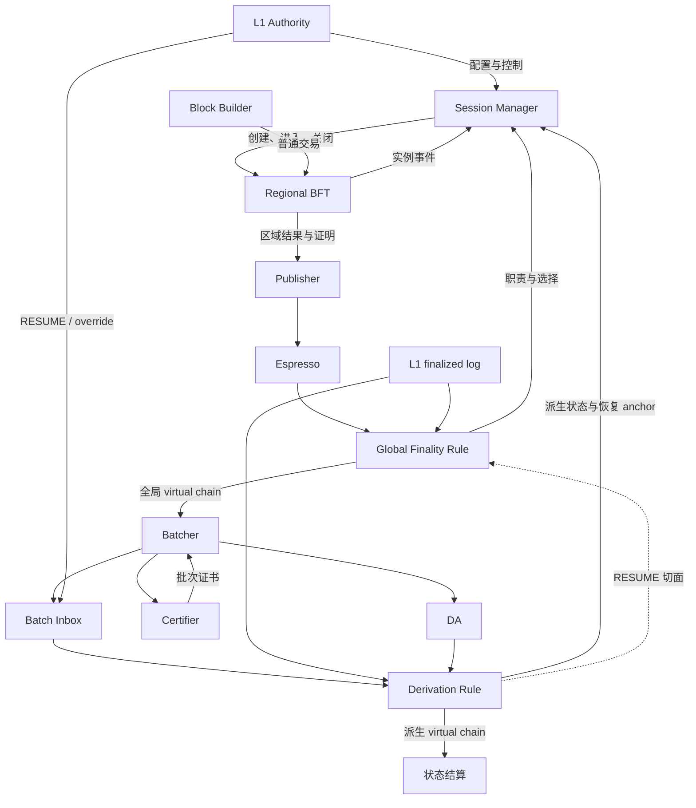

下面先给出外部 building blocks，再定义参与者和 session，随后给出 L2 数据类型、模块接口、最终性规则及实例生命周期。

## 1. External Building Blocks

真实时间记为 $\tau\in\mathbb R_{\ge0}$。它是分析执行时使用的坐标，不意味着所有读取者都有同步时钟。$\mathbb N$ 包含 0；$\{0,1\}^*$ 是有限比特串的集合。对有限序列 $X,Y$，$X\preceq Y$ 表示 $X$ 是 $Y$ 的前缀，$X\Vert Y$ 表示拼接。

本节的诚实提交者或读取者，是遵守相应外部服务规则的参与方；系统中 replica 的故障模型在 §2 给出。

本节分别说明外部服务提供什么输入、这些输入有什么保证。后面的模块通过这些输入作决定：L1 提供已经确定的历史，Espresso 提供公开消息顺序，DA 提供可取回的数据内容。

### 1.1 数字签名、hash 与编码

令 $\kappa$ 为安全参数，$\mathrm{negl}(\kappa)$ 表示可忽略函数。协议使用数字签名方案

$$
\mathsf{Sig}=(\mathsf{KeyGen},\mathsf{Sign},\mathsf{Verify}).
$$

$\mathsf{KeyGen}(1^\kappa)$ 生成密钥对 $(sk,pk)$；$\mathsf{Sign}_{sk}(x)$ 对消息 $x\in\{0,1\}^*$ 签名；$\mathsf{Verify}_{pk}(x,\mathit{sig})\in\{0,1\}$ 验证签名。公钥集合记为 $\mathcal{PK}$。方案满足正确性和 **EUF-CMA security**. 

协议另使用 hiding and binding hash function。

$$
\mathsf H:\{0,1\}^*\longrightarrow\{0,1\}^{\kappa}.
$$

签名用于验证一条消息是否获得相应密钥持有者的授权；hash 用于在消息和记录中引用具体内容。验证签名后，接收者仍要按协议检查消息的用途、所属实例和内容是否合法。

### 1.2 L1

L1 是具有公开验证依据的 finalized block 序列

$$
\mathcal L_1=(L_0,L_1,\ldots).
$$

下标 $\ell\in\mathbb N$ 是 L1 height。给定 $\tau^0_{\rm L1}\ge0$ 和 $b_{\rm L1}>0$，采用 fixed-pace 模型

$$
\mathit{ts}_{\rm L1}(\ell)=\tau^0_{\rm L1}+\ell b_{\rm L1}.
$$

L1 满足以下性质。任意两份通过验证的 finalized 日志互为前缀；读取者已取得的 finalized 前缀不回退。同一前缀中的合约调用按记录顺序原子执行，因此合约状态和事件列表由这个前缀唯一确定。

这里“互为前缀”允许两个读取者进度不同。例如，一个已经读到 $L_{10}$，另一个只读到 $L_8$，但两者读到的 $L_0,\ldots,L_8$ 必须相同。因此，引用某个 L1 位置，就是引用这份共同历史中的确定记录。

存在已知常数 $T_{\rm L1}>0$，使一笔在 $\tau$ 提交、满足 L1 准入条件的交易，在 $\tau+T_{\rm L1}$ 之前 finalized，并对持续在线的读取者公开可读。沿用区域 BFT 的 L1 输入条件，block $\ell$ 在 $\mathit{ts}_{\rm L1}(\ell)+T_{\rm L1}$ 之前 finalized 且可读；$T_{\rm L1}$ 取这些时限的共同上界。

同一 L1 block 内的记录位置为

$$
p=(\ell,j,k),
$$

其中 $j$ 是交易索引，$k$ 是该交易内的日志索引。L1 位置按字典序排列。下文的“处理到 $p$”包含该位置；“严格早于某 L1 height”不包含该 height 的任何记录。

### 1.3 L2 时间与 L1 强制交易输入

令 $\mathcal T$ 为原生 L2 交易集合，$\mathcal T^*$ 为有限有序交易列表集合。给定 genesis height $h^0$、genesis timestamp $\tau^0_{\rm L2}$ 和间隔 $b_{\rm L2}>0$，定义

$$
\mathit{ts}^*(h)=\tau^0_{\rm L2}+(h-h^0)b_{\rm L2},
\qquad h\ge h^0.
$$

height $h$ 的 slot 是 $[\mathit{ts}^*(h),\mathit{ts}^*(h+1))$。对 $\tau\ge\tau^0_{\rm L2}$，定义

$$
\mathrm{slot}(\tau)
=h^0+\left\lfloor\frac{\tau-\tau^0_{\rm L2}}{b_{\rm L2}}\right\rfloor.
$$

这两个函数从相反方向描述同一份时间安排：$\mathit{ts}^*(h)$ 给出 height $h$ 的 slot 起点，$\mathrm{slot}(\tau)$ 给出时刻 $\tau$ 所处的 slot。Slot 已经开始或结束，本身不表示该 height 一定产生了 physical block。

我们将 L1 强制交易抽象为列表输入。$\mathrm{DepLog}(\ell)\in\mathcal T^*$ 是 L1 block $\ell$ 所确定的有序 deposit 列表。

为了定义一个 L2 height 使用的强制前缀，令

$$
\omega:\{h^0,h^0+1,\ldots\}\longrightarrow\mathbb N
$$

为给定的 L1-origin 轨迹。$\omega(h)$ 表示 height $h$ 依据的 L1 block；合法轨迹相邻增量为 0 或 1。对 $h>h^0$，定义

$$
\mathrm{Deposit}_{\omega}(h)=
\begin{cases}
\mathrm{DepLog}(\omega(h)),&\omega(h)\ne\omega(h-1),\\
[],&\omega(h)=\omega(h-1).
\end{cases}
$$

例如，相邻两个 L2 heights 都使用 L1 block 20 作为 origin，后一个 height 不再重复执行 block 20 的 deposits；第一次推进到 origin 21 时，才加入 $\mathrm{DepLog}(21)$。

原生规则给出两个确定列表：$\mathrm{Attr}_{\omega}(h)$ 是把 origin 信息写入 L2 执行上下文的 attributes transaction；$\mathrm{Sys}_{\omega}(h)$ 是该 height 适用的 system／upgrade transactions。它们只读取 origin 轨迹、已 finalized 的 L1 数据、固定的原生规则版本和 genesis 上下文。定义强制前缀

$$
\mathrm{DEP}_{\omega}(h)
:=
\mathrm{Attr}_{\omega}(h)\Vert
\mathrm{Deposit}_{\omega}(h)\Vert
\mathrm{Sys}_{\omega}(h)
\in\mathcal T^*.
$$

固定 origin 轨迹和原生规则版本后，简写为 $\mathrm{DEP}(h)$。同一输入下，所有读取者得到相同列表；leader 不能删改它。它按列表顺序、在普通交易之前执行。所需 L1 前缀尚不可读时，计算等待，不返回空列表。

不同恢复起点可以对应不同的 origin 轨迹，因此 $\mathrm{DEP}(h)$ 的简写始终相对于一个已固定的轨迹使用。具体轨迹在 §3.4 定义。

### 1.4 Espresso

Espresso 是 finalized block 序列

$$
\mathcal L_E=(J_0,J_1,\ldots),\qquad
J_q=(q,\theta_q,\mathcal M_q),
$$

其中 $q\in\mathbb N$ 是 Espresso height，$\theta_q\in\mathbb R_{\ge0}$ 是 timestamp，$\mathcal M_q\in(\{0,1\}^*)^*$ 是该 block 对本协议提供的完整有序消息列表。

服务状态是公共信息

$$
\mathsf{Live}_E:\mathbb R_{\ge0}\longrightarrow\{0,1\}.
$$

所有在线参与方知道当前的 $\mathsf{Live}_E(\tau)$。值为 1 表示 live，值为 0 表示 non-live；这项公共可知性是模型假设，不由观察者的本地超时推导。外部观察者无需知道 $\tau$ 的数值。

**Safety（E-S）。** 任意两份通过验证的 Espresso finalized 日志互为前缀，已经 finalized 的前缀不回退，且

$$
\theta_q\le\theta_{q+1}.
$$

每份已知前缀的消息列表可以完整读取，包括确定某个 block 的列表为空。E-S 对所有执行成立。

给定已知服务时限 $T_E>0$ 和 timestamp 误差上界 $\Delta_{\rm ts}\ge0$。

**Liveness（E-L）。** 若消息 $x$ 在 $\tau$ 被诚实方提交，满足服务的准入条件，且

$$
\mathsf{Live}_E(t)=1
\quad\text{对所有 }t\in[\tau,\tau+T_E],
$$

则不晚于 $\tau+T_E$，一份包含 $x$ 的 Espresso block 已 finalized，并对该区间持续在线的读取者可读。在同样持续 live 的区间内，到 $\tau+T_E$ 时，还存在已 finalized 且可读的 $J_q$ 满足 $\theta_q\ge\tau-\Delta_{\rm ts}$。

**Timestamp accuracy（E-TS）。** 令 $\tau_{\rm prop}(J_q)$ 为 $J_q$ 的真实提出时刻。在 live 期间提出的 block 满足

$$
\mathsf{Live}_E(\tau_{\rm prop}(J_q))=1
\quad\Longrightarrow\quad
\bigl|\theta_q-\tau_{\rm prop}(J_q)\bigr|\le\Delta_{\rm ts}.
$$

E-L、E-TS 只在各自的 live 条件下使用。Non-live 期间不假设 timestamp 贴近真实时间；一个在 non-live 期间提出的旧 block，不因之后 finalized 而获得 E-TS 保证。

对公开键 $x$，一份完整读取且末端 timestamp 至少为 $x$ 的 finalized 前缀，证明所有 timestamp 小于 $x$ 的 block 已被覆盖。下文称这种日志进度为 **watermark**。它依赖 E-S，不要求外部观察者读取同步时钟。

例如，规则要检查 timestamp 严格小于 100 的消息，读取者只需取得一个 timestamp 至少为 100 的 finalized block，并完整读取此前日志。由于 timestamp 不递减，后续 block 不会再补入 timestamp 小于 100 的消息。E-L 和 E-TS 用来估计何时能取得这份前缀；watermark 本身说明已经覆盖了哪一段公开历史。

### 1.5 Data Availability

DA 处理 payload $y\in\{0,1\}^*$。Dispersal 返回 commitment $d$ 和证书 $\pi_{\rm DA}$，两者均以有限比特串表示；公开谓词 $\mathsf{CheckDA}(d,\pi_{\rm DA})\in\{0,1\}$ 验证该 commitment 已按 DA 规则认证。读取 $d$ 返回它对应的 payload，或在数据尚未取得时等待。

**Binding。** 除可忽略概率外，同一个已认证 $d$ 不可能被有效打开为两个不同的 payload。证书认证的是该 commitment 的可用性条件，不替代对 payload 内容的协议验证。

**Availability。** 给定 $T_{\rm DA},\Delta_{\rm DA},T_{\rm ret}>0$。在 DA 持续可用且请求满足准入条件的区间内，dispersal 在 $T_{\rm DA}$ 内完成，已认证数据的取回在 $\Delta_{\rm DA}$ 内完成；DA 保留期为认证后的 $T_{\rm ret}$。

已经被 L1 接纳的数据，在派生和恢复仍可能需要它时必须可取回。保留期之后，这项可取回性由保管者保存相同 payload 来承担。违反可取回性时，依赖它的计算等待；不能用空内容代替未知但已经接纳的数据。

直观上，commitment 标识“要取哪份数据”，DA 证书支持其可用性条件，取回的 payload 才是后续解码和执行的输入。验证证书与执行 payload 是两个步骤。

## 2. Participants, Sessions and Assumptions

### 2.1 Position、replica 与 PKI

**Position 是 L1 Authority 维护的一条质押记录**，包含五个字段：

- **region**：replica 所属区域，取自有限区域集合 $\mathcal R$。
- **pk**：replica 用于签署共识消息的公钥，取自 §1.1 的公钥集合 $\mathcal{PK}$。
- **owner**：管理这份质押的 L1 账户，按 L1 账户授权规则发起注册、退出和资金释放等操作。
- **stake**：这份 position 当前锁定的质押金额（escrow），以固定的最小代币单位计，为非负整数。
- **status**：这份 position 的当前状态，取 Pending、Active、Exiting、Retired、Released 或 Cancelled；分别表示待纳入、已激活、申请退出、已退役但资金尚未释放、资金已释放、登记已取消。状态转换由 §4.1 的 Authority 操作规定。

每份 position 使用一个唯一且不复用的 **position ID**，记为 $\mathit{pid}$。Region、pk 和 owner 在这份 position 的生命周期内固定；stake 和 status 随 L1 上的质押操作更新。读取这些字段时，以已处理的 finalized L1 历史为准。

一个 owner 可以拥有多份 position。同一公钥同时至多绑定一份尚未 Released 或 Cancelled 的 position。

每份 position 对应一个逻辑 **replica**，使用该记录的 pk 对应的私钥签署共识消息。后文用 $m$ 表示 replica，用 $m.\mathit{pid}$ 表示其 position ID。Owner 是管理质押的账户，replica 是参与共识的身份；replica 不必对应一台独立物理机器。

采用 **PKI setting**：所有参与方都能从已验证的 L1 历史查到 position 登记的公钥。


### 2.2 快照与 session

**Position 与快照的关系。** Position 是一条持续更新的质押记录；snapshot（快照）是依据这些记录生成的一份固定的共识名单。一份快照可以收录多个 position，同一个 position 也可以出现在多份不同版本的快照中。

生成快照时，Authority 根据指定截止高度之前的 position 记录，按质押规则决定哪些 position 可以纳入，以及每个 position 的投票权重。快照按 position ID 保存纳入者的 region、pk 和投票权重 weight，其中 weight 为正整数。未纳入的 position 在这份名单中没有条目。

例如，Position 7 的 stake 为 100、status 为 Active。假设生成某份快照时，按质押规则将它纳入，投票权重确定为 10。后来它被罚没，当前 stake 降为 80：position 的记录随之更新，但这份快照中的投票权重仍为 10。Stake 如何换算为 weight 由质押规则决定；已经生成的快照不会被后来的质押操作改写。

Session 使用一份选定的快照来确定委员会及其投票权重。因此，即使运行期间 position 的 stake 或 status 变化，这个 session 也继续使用已经冻结的投票权重。

**快照记号。** 快照从 0 开始依次编号，编号记为 $e$，对应快照记为 $\mathcal C_e$。它是一张有限登记表；$\mathcal C_e[\mathit{pid}]$ 表示在快照 $e$ 中查找编号为 $\mathit{pid}$ 的 position 条目。

**生成与启用。** 每份新快照先依据一段确定的 L1 历史计算，再从后续的一个 L1 height 开始使用。为此，协议预先规定两个 L1 heights：

- **cutoff（历史截取高度）**：计算该快照时，只使用严格早于这个高度的 finalized L1 历史，按固定的质押规则确定纳入的 position 及其权重；不包含 cutoff 高度本身的记录。
- **activation（激活高度）**：从这个高度开始，该快照用于授权查询，直到下一份快照激活。

同一份快照的 cutoff 必须小于 activation；后续快照的 cutoff 和 activation 分别严格增加。初始快照 $\mathcal C_0$ 及其 activation 由 genesis 配置直接给定。读取或计算快照不需要额外发布交易。

**查询使用哪份快照。** 在某个 L1 height 查询授权时，使用截至该高度已经激活的最新快照。记 $\mathsf{SnapshotAt}(\ell)$ 为这项查询返回的**快照编号**，其中 $\ell$ 是查询依据的 L1 height，不早于初始快照的 activation。“最新”指 activation 不超过 $\ell$ 的快照中编号最大的那一份。

例如，快照 1 使用 L1 height 90 之前的历史，从 height 100 激活；快照 2 使用 height 190 之前的历史，从 height 200 激活。那么，在 height 150 查询授权时使用快照 1，即 $\mathsf{SnapshotAt}(150)=1$；在 height 200 查询时使用快照 2，即 $\mathsf{SnapshotAt}(200)=2$。多个 session 可以使用同一份快照。

**Session** 的标识为 $s=(\beta,r)\in\mathbb N^2$。$\beta$ 标识一条生产分支，$r$ 标识该分支中的区域职责安排；改变分支与常规推进的具体规则见 §5。一个 session 的固定参数包括：

$$
\bigl(s,i_s,e_s,V_s,w_s,F_s,
h_{\min,s},h_{\max,s},\mathrm{Leader}_s\bigr).
$$

其中 $i_s\in\mathcal R$ 是负责区域，$e_s$ 是采用的快照编号，$V_s$ 是所选 replica 委员会。对每个 $m\in V_s$，快照条目 $\mathcal C_{e_s}[m.\mathit{pid}]$ 必须存在，且其 region 等于 $i_s$。Replica 的投票权重和委员会总权重分别为

$$
w_s(m):=\mathcal C_{e_s}[m.\mathit{pid}].\mathit{weight},
\qquad
W_s:=\sum_{m\in V_s}w_s(m).
$$

给定故障权重上界 $F_s\in\mathbb R_{\ge0}$，要求 $3F_s<W_s$。View $v\in\mathbb N_{>0}$ 是一次提议机会，$\mathrm{Leader}_s:\mathbb N_{>0}\to V_s$ 是固定的 leader 函数，没有 term 或恢复代。

$h_{\min,s},h_{\max,s}\in\mathbb N$ 分别是可提议的最低和最高 physical height，满足 $h^0<h_{\min,s}\le h_{\max,s}$。窗口宽度为公开常数 $\mathrm{TB}=h_{\max,s}-h_{\min,s}+1>0$，运行边界为

$$
\tau_s^{\rm start}:=\mathit{ts}^*(h_{\min,s}),
\qquad
\tau_s^{\rm stop}:=\mathit{ts}^*(h_{\max,s}+1).
$$

同一个 session 可以有不同起点的候选 program；这些 program 共用上述 session 参数，但各自的起点、共识状态和签名域固定。它们的标识在 §4.3 的 program 输入处定义。

因此，session 描述一段生产职责：由哪个区域、哪份委员会负责哪些 physical heights；program 是在某个具体起点上执行这份职责的共识实例。最后一个 slot 在 $\tau_s^{\rm stop}$ 结束，但这个窗口定义不承诺每个 height 都有 block。

### 2.3 故障与时钟

Honest replica 按指定协议状态转换；敌手可以读取和控制 Byzantine replica 的内部状态与签名密钥，并使其任意偏离协议。对每个 session $s$，敌手控制的集合 $\mathrm{Byz}_s\subseteq V_s$ 在其配置公开前固定，并满足

$$
\sum_{m\in\mathrm{Byz}_s}w_s(m)\le F_s.
$$


we assume static advesrary setting within every session. 

**Global clock。** 每个 honest replica 及其本地 Session Manager 在真实时刻 $\tau$ 读取的协议时钟等于 $\tau$。该假设用于 block 时间检查、窗口开始和停止；外部观察者不需要同步时钟。读取者、Publisher 和 Batcher 通过公开日志验证结果，不以自己的接收时刻改写历史顺序。

### 2.4 区域内与跨区域通信

- We assume a authenticated communication 
- Partial sync for regional communication 
- for cross-region comm: 
    - sync if espresso is live 
    - async if espresso goes offline. 

**区域内。** 对区域 $i$，存在未知 $\mathrm{GST}_i$ 和已知 $\Delta_i>0$。对于同一区域内持续在线并运行同一实例的 honest replicas，$\mathrm{GST}_i$ 之后发送的消息在 $\Delta_i$ 内送达并完成规定的有界协议处理。区域 agreement 不依赖这个延迟界；有界进展需要相应同步与参与条件。

**跨区域。** 给定已知 $\Delta_{\rm cross}\ge\max_i\Delta_i$。设 honest replica $m$ 在时刻 $\tau$ 向另一区域的 honest replica $n$ 发送消息 $x$。若 $n$ 在 $[\tau,\tau+\Delta_{\rm cross}]$ 持续在线，且

$$
\mathsf{Live}_E(t)=1
\quad\text{对所有 }t\in[\tau,\tau+\Delta_{\rm cross}],
$$

则 $\tau_{\rm del}(x,n)\le\tau+\Delta_{\rm cross}$。这是跨区域信道的同步假设，直接转发区域结果也适用，不要求该结果先在 Espresso finalized。

在 non-live 期间，跨区域信道异步：对于持续在线的接收者，已发送消息最终送达，但没有适用于所有执行的有限延迟上界。若发送后的同步区间被 non-live 状态打断，不再使用该次发送的同步上界。若在 $\tau_0$ 恢复 live 并持续至少 $\Delta_{\rm cross}$，则仍在信道中的消息向持续在线接收者的送达时间也不晚于 $\tau_0+\Delta_{\rm cross}$。这项在途消息界是本模型的恢复条件。

这使正常交接可以对跨区域结果的到达时间使用 $\Delta_{\rm cross}$；停机期间则只能等待消息，不能据此给出固定的交接完成时间。即使消息已经到达，接收者仍可能需要取得 anchor 状态才能进入对应实例。

### 2.5 治理与认证角色

治理方 $\mathsf M$ 和 Certifier $\mathsf C$ 的认证公钥 $pk_{\mathsf M},pk_{\mathsf C}$ 在协议配置中给定，对应签名密钥为 $sk_{\mathsf M},sk_{\mathsf C}$。$\mathsf M$ 向 Authority 提交授权的分支控制；恢复活性要求它在规定的紧急情形下发出适当控制。$\mathsf C$ 是按 §4.7 的规则签署批次声明的可信方，不被敌手腐化，但可以离线。其签名不能替代该规则之外的事实。

Publisher、Batcher 和证据提交者是角色。某项交付的活性保证，只在相关区间存在一个诚实在线承担者、输入可得且负载与费用满足声明条件时使用。以下服务预算用于 §5 的时序条件，不作为区域 agreement 的前提：

- $T_{\rm pub}$：完整区域结果交给诚实在线 Publisher 后，在输入可得、负载允许时，完成向 Espresso 提交的时间上界；之后的收录和可读性使用 E-L。
- $T_{\rm cert}$：Certifier 在线且请求所需输入完整时的响应上界。
- $T_{\rm batch}$：批次角色和服务正常、且原生期限仍允许完成交付时，覆盖排队、接手、channel 完成、DA、认证和 L1 接纳的交付预算。这项服务条件不单由存在诚实 Batcher 推出。

## 3. Virtual Chain、Physical Chain 与双向映射

Virtual chain 按 L2 height 连续描述执行内容：每个 height 包含强制前缀和普通交易。Physical chain 保存普通交易及其链连接，可以跳过一些 heights。两者之间的 merge rule 将 physical chain 与 L1 确定的 DEP 输入合并，补齐中间 heights，并计算执行状态。

本节先定义 virtual chain 应满足的性质，再定义 physical chain，最后说明两个方向的转换，以及区域生产如何固定每个 height 的 origin。

### 3.1 Virtual chain 与 VP1、VP2

**Virtual block。** 令 $\Sigma$ 为原生执行状态集合，$\sigma\in\Sigma$ 为一个状态，包含执行时使用的当前 block context。记 $\mathcal H_\kappa=\{0,1\}^{\kappa}$，$\mathrm{root}:\Sigma\to\mathcal H_\kappa$ 为 state-root 函数。Virtual block 的类型为

$$
\mathsf{VB}:=
\mathbb N\times\mathbb R_{\ge0}\times\mathbb N
\times\mathcal T^*\times\mathcal H_\kappa\times\mathcal T^*.
$$

对 $\mathit{VB}\in\mathsf{VB}$，写作

$$
\mathit{VB}=\langle\mathit{VB}.h,\mathit{VB}.\mathit{ts},\mathit{VB}.\mathit{os},
\mathit{VB}.\mathit{Dep},\mathit{VB}.\mathit{root},\mathit{VB}.\mathit{Txs}\rangle.
$$

六个字段依次为 L2 height、timestamp、L1 origin、强制执行前缀、执行本 block **之前**的 state root、普通交易列表。普通交易列表保留输入的原始顺序和条目，不保证每笔交易都能在当前状态执行。

**Virtual chain。** Virtual chain 是连续序列 $X=(X[h^0],\ldots,X[h_X])$，其中 $h_X$ 是末端 height，$X[h].h=h$。也可以讨论从一个已知前缀之后开始的连续片段。这里“连续”指已确定范围内每个 height 都有一个 virtual block，不表示未来的 blocks 已经产生。

对象字段是 actual 值，即对象实际记录的内容；带星号的值是规则计算的 should-be 值。下面的 VP 条件规定 actual 值应当满足什么。

**VP1 — Fixed pace。** 每个 height 的 timestamp 使用 §1.3 的固定时间表：

$$
X[h].\mathit{ts}=\mathit{ts}^*(h).
$$

因此，timestamp 由 height 决定，与某个节点实际何时收到或执行该 block 无关。

**VP2 — Origin 与强制前缀。** 给定 §1.3 意义下的一条 L1-origin 轨迹 $\omega$，每个非 genesis height 满足

$$
X[h].\mathit{os}=\omega(h),\qquad
X[h].\mathit{Dep}=\mathrm{DEP}_{\omega}(h).
$$

这表示 origin 一经相应生产或派生规则确定，强制前缀就由该轨迹、已 finalized 的 L1 数据和原生规则唯一确定。普通交易的提议者不能删改这部分输入。所需 L1 数据尚未取得时等待，不能将未知 DEP 当作空列表。

区域生产使用 §3.4 给出的固定 origin 轨迹；L1 派生使用原生派生规则确定的实际轨迹。给定轨迹后，满足 VP1、VP2 的链，其 timestamp、origin 和 DEP 已固定，但普通交易和执行状态仍取决于所选链。执行状态的要求 VP3 在 §3.3 定义。

### 3.2 Physical chain 与 anchor

**Physical block。** Physical block 保存普通交易、metadata 和链连接，其 payload 为

$$
B=(B.\mathit{ph},B.h,B.\mathit{ts},B.\mathit{os},B.\mathit{root},B.\mathit{Txs}).
$$

$B.\mathit{ph}\in\mathcal H_\kappa$ 是前一个 physical block 或起始 anchor 的连接标识；其余字段的类型和含义与 virtual block 的同名字段相同。Physical block 不携带 Dep 字段，因为它可以由 origin 轨迹与 L1 数据计算。区域 BFT 对这种 payload 达成决定；后面的 L1 派生也用这种数据表示组织其选定的普通交易，但不会由此获得区域 BFT 证明。

**Anchor。** Anchor $A$ 是链采用的起始 L2 block 及其执行后状态。$A.h$、$A.\mathit{os}$、$A.\sigma$ 分别表示它的 height、origin 和执行后状态；$\mathrm{id}(A)\in\mathcal H_\kappa$ 是固定的连接标识。

若 anchor 来自 physical block $B$，取 $\mathrm{id}(A)=\mathsf H(B)$。若它来自派生 virtual block $\mathit{VB}$，令 $\mathit{bh}_{\rm nat}$ 为该 block 在已确定前缀上按原生格式执行和编码得到的 block hash，取

$$
\mathrm{id}(A)=
\mathsf H(\texttt{DERIVED},\mathit{VB}.h,\mathit{bh}_{\rm nat}).
$$

Genesis 的连接标识由初始配置给定。$A.\sigma$ 必须与该 block 的实际执行后状态一致；不能任意替换状态而继续使用同一个 anchor。来源依据记为 $\pi_A$。来源可以是前驱的区域最终证明，此时 anchor 的内容已确定，但仍可能只是等待 GFR 选择的候选。

**Physical chain。** 一条链写作 $C=(A,B_1,\ldots,B_n)$，其中 $n\ge0$。当 $n>0$ 时，$B_1.\mathit{ph}=\mathrm{id}(A)$；后续 parent 指向前一个 physical block 的 hash，且

$$
A.h<B_1.h<\cdots<B_n.h.
$$

链上的前一个对象记为 parent $P$。末端 height 记为 $h_C$：非空时为 $B_n.h$，$C=(A)$ 时为 $A.h$。区域实例还要求所有 physical heights 位于该 session 的固定窗口 $[h_{\min,s},h_{\max,s}]$ 内，且 $A.h<h_{\min,s}$。

例如，anchor 位于 98，后继 physical block 可以直接位于 101。Merge rule 会给出连续的 virtual 99、100、101，其中 99、100 只执行强制前缀。View $v$ 是 BFT 的提议机会，height $h$ 是 L2 的位置；merge rule 不读取 view。

### 3.3 Merge rule、反向映射与 VP3

#### 原生执行

**执行输入。** Metadata 的类型为 $\mathsf{Meta}:=\mathbb N\times\mathbb R_{\ge0}\times\mathbb N$。一个 metadata 值记为 $\mu=(h,\mathit{ts},\mathit{os})\in\mathsf{Meta}$，依次指定当前 block 的 height、timestamp 和 L1 origin。直观上，$\mu$ 告诉执行器“现在开始的是哪一个 block”；$\mathsf{Meta}$ 是类型，$\mu$ 才是传给执行函数的具体值。

执行一个 block 时，输入还包括执行前状态 $\sigma$、强制前缀 $\mathit{Dep}\in\mathcal T^*$ 和原始普通交易列表 $\mathit{Txs}\in\mathcal T^*$。其中 $\mathit{Dep}$ 由 §1.3 的 DEP 输入确定，必须先执行；$\mathit{Txs}$ 中的交易随后按顺序检查和执行。

**原生执行函数。** 原生执行给出三个确定函数，其类型为

$$
\mathsf{Begin}:\Sigma\times\mathsf{Meta}\times\mathcal T^*\to\Sigma,
\quad
\mathsf{Valid}:\Sigma\times\mathcal T\to\{0,1\},
\quad
\mathsf{Run}:\Sigma\times\mathcal T\to\Sigma.
$$

- $\mathsf{Begin}(\sigma,\mu,\mathit{Dep})\to\sigma'$：从状态 $\sigma$ 开始 metadata 为 $\mu$ 的 block，设置当前 block context，并按顺序执行强制前缀 $\mathit{Dep}$，返回处理普通交易之前的状态 $\sigma'$。直观上，先准备好这个 block，并把必须先执行的内容执行完。这里的 $\sigma'$ 是这一调用的输出，还不是整个 block 的执行后状态。
- $\mathsf{Valid}(\sigma,x)\to b$，其中 $x\in\mathcal T$、$b\in\{0,1\}$：检查原生规则是否允许在当前状态 $\sigma$ 上执行交易 $x$，包括 nonce、余额和 block gas 等条件；允许时返回 1，否则返回 0。这个调用只作检查，不改变状态。直观上，它回答“这笔交易现在能不能执行”，而不是预先判断合约调用会不会 revert。
- $\mathsf{Run}(\sigma,x)\to\sigma'$：在 $\mathsf{Valid}(\sigma,x)=1$ 的前提下执行交易 $x$，返回原生规则规定的执行后状态 $\sigma'$。直观上，这一步才真正执行交易。即使合约调用 revert，交易仍算已执行，其状态效果按原生规则处理。

这些函数使用执行输入、适用的原生规则及 origin 对应的 L1 数据；相同输入得到相同结果。$\mathsf{Begin}$ 在本文声明范围内的合法强制前缀上有结果；本文只在 $\mathsf{Valid}=1$ 时调用 $\mathsf{Run}$。若适用原生规则在某高度禁止普通交易，$\mathsf{Valid}$ 在该高度对普通交易返回 0。

**执行一个 block。** 对合法的强制前缀，定义

$$
\mathsf{Apply}(\sigma,\mu,\mathit{Dep},\mathit{Txs})
\to(\sigma',\mathit{Kept}).
$$

它先执行强制前缀，再依次处理普通交易，返回整个 block 的执行后状态 $\sigma'$ 和实际执行的普通交易列表 $\mathit{Kept}$。$\mathit{Kept}$ 不包含强制前缀。普通交易在轮到它时未通过 $\mathsf{Valid}$，就直接跳过；通过检查的交易交给 $\mathsf{Run}$，并保留在 $\mathit{Kept}$ 中。

```text
Apply(σ, μ, Dep, Txs) → (σ', Kept):
    σ ← Begin(σ, μ, Dep)
    Kept ← []
    for tx in Txs:
        if Valid(σ, tx):
            σ ← Run(σ, tx)
            Kept ← Kept ‖ [tx]
    return (σ, Kept)
```

例如，$\mathit{Txs}=[x_1,x_2]$。若执行完强制前缀后，$x_1$ 因 nonce 错误未通过检查，则跳过 $x_1$，状态不变；接着在这个状态上检查 $x_2$。若 $x_2$ 通过检查，即使执行时 revert，也有 $\mathit{Kept}=[x_2]$。因此，原始交易列表中的 invalid transaction 不会使整个 block 执行失败，revert 的交易也不会被当作 invalid transaction 丢弃。


#### VP3 — 执行前状态一致

给定 anchor $A$ 和从 $A.h+1$ 开始的 virtual chain $X$，令 $\sigma_{A.h}=A.\sigma$，逐高度执行

$$
(\sigma_h,\mathit{Kept}_h)
:=\mathsf{Apply}\bigl(
\sigma_{h-1},(h,X[h].\mathit{ts},X[h].\mathit{os}),
X[h].\mathit{Dep},X[h].\mathit{Txs}\bigr).
$$

**VP3** 要求每个 block 记录的执行前 root 与上述执行一致：

$$
X[h].\mathit{root}=\mathrm{root}(\sigma_{h-1}).
$$

$\sigma_h$ 是执行完 height $h$ 后的状态，$\mathit{Kept}_h$ 是该高度实际执行的普通交易列表。因此，检查 height $h$ 的 root，需要执行它之前的内容；这个字段不承诺当前 block 的普通交易全部有效。

在已知原生父块上，按原生格式输出 height $h$ 的 block 时，交易列表使用 $X[h].\mathit{Dep}\Vert\mathit{Kept}_h$，header 的 state root 使用执行后的 $\mathrm{root}(\sigma_h)$；virtual block 的 root 字段仍记录执行前状态。比较两条链时，按各自已验证的原生前缀执行并编码，比较对应高度的原生 block hash 和执行结果，不要求未经执行过滤的普通交易列表相同。

#### Physical + DEP → Virtual

输入为 physical chain $C$、其 anchor 状态、给定的 origin 轨迹 $\omega$ 和计算 DEP 所需的 L1 数据。轨迹在 anchor 处满足 $\omega(A.h)=A.\mathit{os}$，此前的轨迹由 anchor 的已验证前缀给出。定义

$$
\mathit{Txs}_C(h)=
\begin{cases}
B.\mathit{Txs},&C\text{ 中存在 }B.h=h\text{ 的 physical block},\\
[],&\text{否则}.
\end{cases}
$$

从 $\sigma_{A.h}=A.\sigma$ 开始，对 $A.h<h\le h_C$ 依次计算

$$
(\sigma_h,\mathit{Kept}_h)
:=\mathsf{Apply}\bigl(
\sigma_{h-1},(h,\mathit{ts}^*(h),\omega(h)),
\mathrm{DEP}_{\omega}(h),\mathit{Txs}_C(h)\bigr).
$$

定义合并结果

$$
\mathrm{Merge}_{\omega}(C)[h]
=\langle h,\mathit{ts}^*(h),\omega(h),\mathrm{DEP}_{\omega}(h),
\mathrm{root}(\sigma_{h-1}),\mathit{Txs}_C(h)\rangle.
$$

对输入中的每个 physical block $B$，要求其 timestamp、origin、root 等于合并结果在 $B.h$ 的对应字段。若不相等，这条 physical chain 不满足该映射的有效输入条件，不能用重新计算的字段替换它原有的字段并视为有效。所需数据不足时返回 WAIT。

这就是“physical + DEP”：在已有 physical height 使用其普通交易，在中间缺失 height 使用空普通交易列表；每个 height 都按规则加入 DEP 并推进执行状态。合并结果满足 VP1–VP3，并在 physical heights 保留原 block 的 metadata、root 和普通交易列表。没有 physical block 的 height 称为 **padding**。

映射只展开到 $h_C$。若链只有 anchor，输出片段为空；没有决定的后继时，时钟前进不会自动生成到 session 上界的 padding。


Example: 
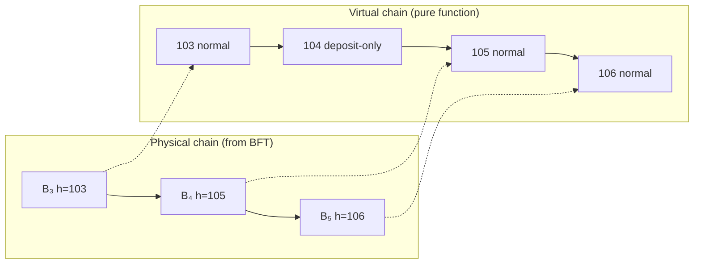


#### Virtual − DEP → Physical

反方向先从 virtual block 中去掉 Dep 字段，再按所保留的 heights 重建 physical parent 连接。输入是满足 VP1–VP3 的 virtual 片段 $X$、原 anchor $A$，以及要保留的有序 height 列表 $I=(h_1,\ldots,h_n)$。Heights 严格增加，来自 $X$ 的范围；非空片段必须保留末端 height，省略的 heights 必须具有空的普通交易列表。空片段取空列表。

记这项映射为 $\mathrm{Strip}(X;A,I)$。输出链为 $(A,B_1,\ldots,B_n)$，其中

$$
B_j=\bigl(\mathit{ph}_j,h_j,X[h_j].\mathit{ts},
X[h_j].\mathit{os},X[h_j].\mathit{root},X[h_j].\mathit{Txs}\bigr),
$$

$$
\mathit{ph}_1=\mathrm{id}(A),\qquad
\mathit{ph}_j=\mathsf H(B_{j-1})\quad(j>1).
$$

只写 $\mathrm{Strip}(X;A)$ 时，默认保留每个 height，得到逐高度的 physical 表示。因此，给定相同 origin 轨迹和 L1 输入，再加入 DEP 就恢复原 virtual 片段：

$$
\mathrm{Merge}_{\omega}\bigl(\mathrm{Strip}(X;A,I)\bigr)=X.
$$

若要恢复**原来的稀疏 physical chain**，还需要知道原本在哪些 heights 有 physical block。令 $I(C)$ 为原链的 physical height 列表，则对有效输入

$$
\mathrm{Strip}\bigl(\mathrm{Merge}_{\omega}(C);A,I(C)\bigr)=C.
$$

例如，virtual 99、100 的普通交易都为空，单看这两个字段无法判断它们原本是两个空 physical blocks，还是从 98 到 101 时补出的 padding。保留原 physical heights 后才能恢复原 parent 连接和 block hash。对区域结果，完整 publication 中的原 physical chain 已包含这些 heights；这里不新增链上字段。


### 3.4 区域生产的固定 origin：要求、前提与规则

上面的 Merge 接收一条给定的 origin 轨迹。本节规定区域生产怎样从固定 anchor 和 L1 时间表确定这条轨迹，使 replicas 对每个 height 使用相同的 origin 与 DEP。它沿用 Regional BFT abstraction 的顺序：先说明原生兼容要求，再列出参数和 anchor 前提，最后给出构造规则。

**原生兼容要求。** 令 $T_{\rm drift}$ 为原生 origin 的时间滞后上界。区域生产的 origin 轨迹 $\omega$ 需要满足：

- **O1 Continuity：** $\omega(h)-\omega(h-1)\in\{0,1\}$。每个 L2 height 最多推进一个 L1 block，不跳过中间 origins。
- **O2 Not ahead：** $\mathit{ts}_{\rm L1}(\omega(h))\le\mathit{ts}^*(h)$。L2 block 不能采用 timestamp 晚于自己的 L1 origin。
- **O3 Drift：** $\mathit{ts}^*(h)\le\mathit{ts}_{\rm L1}(\omega(h))+T_{\rm drift}$。L2 block 采用的 origin 不能过旧。

这些是输出需要满足的要求。下面的参数约束和 anchor 条件是区域 schedule 使用的前提，不由 BFT 投票产生。

**参数前提。** 给定 deposit lag $T_{\rm dep}\ge0$，表示 schedule 为 L1 finalized 和读取留出的时间。要求：

- $b_{\rm L2}\le b_{\rm L1}$：相邻 L2 slots 对应的 scheduled L1 height 至多前进 1。
- $T_{\rm L1}\le T_{\rm dep}$：到达该 L2 slot 时，schedule 选中的 L1 block 已有足够时间 finalized 并可读。
- $T_{\rm dep}+b_{\rm L1}\le T_{\rm drift}$：等待余量加上 L1 block 间隔仍落在允许的 origin drift 内。

**Anchor 前提。** Session Manager 在 Enter 前确认 $A.\mathit{os}$ 对应的 L1 block 已 finalized 且可读，并准备好与 anchor 一致的 $A.\sigma$。Anchor 自身满足

$$
\mathit{ts}_{\rm L1}(A.\mathit{os})
\le\mathit{ts}^*(A.h)
\le\mathit{ts}_{\rm L1}(A.\mathit{os})+T_{\rm drift}.
$$

生产窗口仍是 §2.2 给定的固定窗口，满足 $A.h<h_{\min,s}\le h_{\max,s}$；更换候选 anchor 不重新计算窗口。

**Scheduled origin。** 对需要展开的 height $h$，定义

$$
\ell^{\rm sch}(h)
:=\max\{\ell:\mathit{ts}_{\rm L1}(\ell)+T_{\rm dep}
\le\mathit{ts}^*(h)\}.
$$

实例只使用该集合非空的 heights。$\ell^{\rm sch}(h)$ 是在 L2 timestamp 之前已经留足 $T_{\rm dep}$ 等待时间的最高 L1 height。

**从 anchor 接续。** 恢复 anchor 的实际 origin 可能偏离 schedule。先取 $\omega_A(A.h)=A.\mathit{os}$，然后对 $A.h<h\le h_{\max,s}$ 定义

$$
\omega_A(h)
:=
\min\{A.\mathit{os}+(h-A.h),
\max\{A.\mathit{os},\ell^{\rm sch}(h)\}\}.
$$

若 anchor 落后 schedule，origin 每个 L2 height 前进 1，逐步追赶；若 anchor 超前 schedule，则先保持不动，等待 schedule 追上。若两者在 anchor 处已经对齐，之后就沿 schedule 推进。这里的限制使新链从 anchor 的实际 origin 连续接续。

记

$$
\mathit{os}_A^*(h):=\omega_A(h),\qquad
\mathrm{Dep}_A^*(h):=\mathrm{DEP}_{\omega_A}(h),\qquad
\mu_A^*(h):=(h,\mathit{ts}^*(h),\mathit{os}_A^*(h)).
$$

固定 anchor 时省略下标 $A$。区域实例的 VP2 就是要求 virtual block 的 origin 和 Dep 分别等于这两个 should-be 值；满足 VP1 和这项 VP2 的链称为该 anchor 下的 **fixed virtual chain**。Fixed 表示 timestamp、origin 和 DEP 已确定，普通交易仍由 physical chain 提供。

为沿用 BFT 的记号，定义

$$
\mathrm{Virt}(C):=\mathrm{Merge}_{\omega_A}(C).
$$

因此，区域的 Virt 是通用 Merge 在固定 schedule 下的实例。GFR 对选定的区域链使用 Virt；Derivation 对 L1 上选出的内容使用实际派生 origin，不能把其 origin 强行替换为这个区域 schedule。RESUME 采用派生 anchor 后，新的区域实例再从该 anchor 的实际 origin 应用本节规则。

原生规则还给出 sequencing window。$\mathrm{ddl}(\mathit{VB})$ 是该 virtual block 按其 origin 与适用原生规则得到的 L1 接纳截止位置；$W_{\rm seq}$ 是窗口参数按时间换算并计入边界余量后的预算。满足 VP 和 origin 要求描述的是内容及执行的一致性；原样派生还需要批次在原生期限内完成交付。


## 4. Module Interfaces

每个模块先列出所维护的状态及使用的数据结构，说明字段、身份和更新方式，再给出接口概览，最后逐个说明输入、输出和处理规则。这里沿用 [Part 1 v0.3](../formalization_v6/part1_module_interfaces_zh_v0_3.md) 的组织方式；接口内容使用本文的 modular BFT、固定窗口和候选 cid，不引入旧版的 term 或恢复代。

**通用输入与调用语义。** 协议配置给定 chain 标识 $\mathit{chain}$、规则版本 $\mathit{ver}$、规范编码 $\mathrm{enc}$、相关 L1 合约地址，以及已采用的委员会选择规则、故障权重参数和 leader 规则。下文的节点内接口绑定调用节点的模块状态，读取哪些本地状态会在输入中列明；公共重放规则显式接收重放状态。协议时刻由 §2.3 的本地协议时钟提供，不由远端请求者指定。

L1 写接口统一接收请求标识 $req=(caller,rid)$，其中 caller 是 L1 认证的调用者，rid 是该调用者分配的请求编号；L1 执行位置由执行环境提供。相同请求标识和内容的重试返回原结果，不重复执行；相同标识对应不同内容时拒绝。L1 输出表示 finalized 执行结果和事件。合约拒绝时回滚该次调用；L1 只读接口缺少历史时可以等待。

- **成功输出**按各接口列出的字段返回；列表可以为空。
- **WAIT(missing)** 表示缺少所列输入。流式重放接口同时返回已完成的状态和停止位置，不撤销已完成前缀。
- **REJECT(reason)** 表示已经判定请求无效；验证失败不成为新的有效协议输入。
- **$\bot$** 表示在已验证的输入范围内确定不存在，不用于表示未知。

输入中的 block、证明、交易和 DA payload 都指完整对象，或本地已经能解析出完整对象的标识。只有 hash、state root 或下载地址时，接口仍要等待其实际所需的数据。

图示展示主要调用与数据流，表格汇总各接口的主要输入和结果；完整参数、状态更新及 WAIT／REJECT 条件见随后规格。标为“输出事件”的项目由模块产生，不是供外部直接调用的操作。

### 4.1 L1 Authority

**状态。** Authority 在 L1 上维护：

- staking 表：以 pid 为键，条目字段采用 §2.1 的 region、pk、owner、stake、status；另保存已占用公钥、下一个不复用的 pid 和入队／退出请求。
- 快照 $\mathcal C_e$ 及其 cutoff、activation；快照读取与编号采用 §2.2。
- 禁任公钥集合和已处理违规证据记录。记 $\mathsf{Ban}(\ell)$ 为处理完 L1 height $\ell$ 后的禁任集合。
- 控制日志、已使用的最大控制序号、请求结果表，以及其管理的 Inbox 地址。

公开固定的质押规则 $\mathcal P_{\rm stake}$ 指定注册准入、快照纳入、退出排队、罚没计算和资金释放条件。它接收登记及队列状态、L1 位置和经授权的请求，返回新状态与调用结果。这里使用这份规则，不重新定义经济参数。

Authority 的选区读取使用分支 policy

$$
\mathcal P_\beta=(S_\beta,\mathcal L_\beta,\lambda_\beta).
$$

$S_\beta:\mathcal R\to\{0,1\}$ 指定区域开关，$\mathcal L_\beta$ 是各区域恰好出现一次的循环排列，$\lambda_\beta$ 是授权读取的最低 L1 height。Policy 在分支内固定。

控制记录有两类。Force 记录是 $U=(c,\theta_a,\beta_{\rm target},\mathcal P_{\rm new})$，依次为控制序号、Espresso 生效阈值、目标分支和新 policy；RESUME 记录是 $(c,\mathcal P_{\rm new},h_{\rm res})$，最后一项为目标 L2 height。两类记录共用严格递增的非负整数序号 $c$。

**数据结构。** 以下记录按字段定义逻辑内容；字段名也用于后面的接口。实际存储可以采用完整记录或可验证引用，执行接口前仍需取得它实际使用的对象。列表保留顺序，映射按键查找。记录一旦用于签名或 hash，就使用协议固定的规范编码；集合和映射也按该编码规定的键序排列。相同输入可以重算的字段，仍须核对一致，不能由提交者任意填写。

**质押登记与请求。** §2.1 的 position 就是 staking 表的一条 entry：

```text
Positions[pid] = {
    region, pk, owner, stake, status
}
StakingRequest = {
    req, kind, pid, L1_position
}
```

Positions 的键 pid 为唯一、不复用的非负整数；五个字段的类型和含义采用 §2.1。StakingRequest 的 req 是通用请求标识，kind 取 JOIN 或 EXIT，pid 指向相应登记，L1_position 是 §1.2 的位置 $p$。每个区域的请求队列保存有序 StakingRequest；队列处理条件由 $\mathcal P_{\rm stake}$ 给出。请求结果表以 req 为键，保存规范请求内容与已产生的输出，供重试核对。

已处理违规保存为 `OffenseRecord{offense_id, pid, params, evidence, result, L1_position}`。Offense_id 是 $\mathcal P_{\rm stake}$ 对同一次处罚行为使用的规范标识比特串；同一次违规的不同证明使用同一标识，不能仅靠请求编号或证明字节 hash 去重。其余字段分别保存被指控登记、核对采用的历史实例配置、证据、已产生的处罚结果和处理位置。Ban 是已生效禁任公钥的有限集合，历史读取按 L1 位置取得相应版本。

**快照条目。** 快照 $\mathcal C_e$ 中的 entry 为 `SnapshotEntry{region, pk, weight}`，以 pid 为键。Region 和 pk 来自对应质押登记，weight 是该版本中冻结的正整数。快照的 cutoff 与 activation 是两个 L1 heights，含义采用 §2.2；当前 Positions 与历史快照分别维护。

**Policy。** 数学记号 $\mathcal P_\beta$ 对应下列记录：

```text
Policy = {
    enabled_regions, region_order, L1_floor
}
Window = {
    h_min, h_max
}
```

Enabled_regions 是 $\mathcal R$ 的子集，$S_\beta(i)=1$ 当且仅当 $i$ 在其中；region_order 是 $\mathcal R$ 的循环排列，对应 $\mathcal L_\beta$；L1_floor 是非负整数，对应 $\lambda_\beta$。Window 两个字段为 L2 heights，分别对应 $h_{\min,s}$ 和 $h_{\max,s}$，满足 §2.2 的窗口约束。

**选区参考。** 输入 Ref 用来选择授权历史，记录为 `BlockRef{h, os, block_id}`。H 为 L2 height，os 为 L1-origin height，block_id 为 §3.2 的 block 连接身份；这些字段必须从已验证的来源 block 取得。Ref 在 Plan 中按这份记录绑定，完整 block 和验证材料由读取方另行保存。Regular handoff 的 Ref 是前驱的初始 anchor；后继实例实际采用的 anchor 由 GFR 另行选定。

**规则参数。** 公开协议配置具有唯一版本／内容标识 config_ref；它是按协议编码的非空比特串，指向完整的规则、参数及规范编码，同一标识下的配置不可改写。配置中的 `RuleSpec{rule_id, version, params}` 描述一条公开确定规则：rule_id 与 version 唯一指定算法，params 是该算法格式规定的固定参数字节。取不到配置或不能解析参数时不能将它当作已验证规则。

这里的 `ProtocolConfig` 包含链标识、规则和 verifier 版本、规范编码规则、合约地址表、所用质押规则、故障权重规则、leader 规则，以及 BFT 的大小和时间参数。这些是上文“公开协议配置”的具名内容；config_ref 用来引用完整配置，不以一个标识代替实际缺失的算法或参数。各 RuleSpec 的参数布局由其固定版本公开给出。

故障权重计算规则和 leader 选择规则沿用该配置。前者按所选区域与委员会计算 $F_s$，并核对 $3F_s<W_s$；后者对给定委员会、可提议者和 view 返回一个可提议 replica。本文不额外选择某个故障比例或随机 leader 算法。

**Plan 的记录定义。** $\Pi_s$ 是 Plan 接口为 session $s$ 返回的下列固定记录：

```text
PlanRecord = {
    session, policy, reference_block, source_region, window,
    L1_reference_height, snapshot_id, banned_keys,
    region, committee, total_weight, fault_bound,
    eligible_proposers, leader_rule, config_ref
}
CommitteeEntry = {
    pid, pk, weight
}
```

这些字段分别定义为：

- session、policy、reference_block、source_region、window 对应本次调用的五项选择输入。Session 为 §2.2 的 $(\beta,r)$；source_region 为区域标识，genesis 无前驱时取 $\bot$。
- L1_reference_height 为 $\ell_s=\max\{\mathit{Ref}.\mathit{os},\lambda_\beta\}$；snapshot_id 为 $e_s=\mathsf{SnapshotAt}(\ell_s)$；banned_keys 为此高度的冻结集合 $\mathsf{Ban}(\ell_s)$。这些都是本次计算采用的历史依据。
- region 为选中的区域 $i_s$。Committee 是按 pid 索引的有限 CommitteeEntry 表，恰好包含 $\mathcal C_{e_s}$ 中 region 等于 $i_s$ 的 entries；公钥和正权重逐项来自该快照。每个 entry 的 pid 对应 replica $m$ 的 $m.\mathit{pid}$，从而确定 $V_s$、$w_s(m)$。
- total_weight 为 $W_s$，必须等于 committee 权重之和；fault_bound 为 $F_s$，按 config_ref 指定的故障权重规则取得。它描述采用的故障上界，不记录敌手实际控制的身份。
- eligible_proposers 是 committee 中 pk 不属于 banned_keys 的 pid 集合；不得为空。被禁任者仍保留原冻结投票权重，但不进入提议者集合。
- leader_rule 为上述 RuleSpec，其 params 由该公开规则根据 session、选择输入和 config_ref 确定后固定；它与 committee、eligible_proposers 共同确定 $\mathrm{Leader}_s(v)$。Config_ref 同时绑定其余计算所用的公开配置版本。

Plan 返回成功时，所有字段一起固定。没有合格区域时返回 $\bot$，不构造 region 为 $\bot$ 的成功 PlanRecord。快照内容可从 snapshot_id 与指定 L1 历史重建；PlanRecord 不另外复制 owner 或当前 stake。后面的 `Auth(Π_s)` 返回 `AuthorizationView{committee, total_weight, fault_bound, eligible_proposers, leader_rule, window, config_ref}`，各字段直接取自这份记录；`Leader(Π_s,v)` 执行其中绑定的 leader_rule。

验证收到的 Plan 时，读取方从记录中的选择输入、指定 L1 历史与公开配置重新执行 Plan，并逐字段核对结果。文中的“已验证 Plan”至少包含这些内容与配置核对。在将它作为某次生产职责使用时，消费端再按 §5 的交接来源检查这些输入是否对应本次安排；常规后继可以提前计算 Plan，而不等待最终 anchor。Plan 内容有效与候选 descriptor 已被 GFR 选中是分别检查的事实。

**控制日志与查询记录。** 已接纳的控制项保存为 `ControlEntry{body, position}`，position 为收录它的 L1 位置。Body 为上文的 Force 或 RESUME 记录；其 c、policy、阈值／目标 height 均来自通过合约检查的调用。Position 对应的 timestamp 从 L1 历史读取。序号和 body 在收录后不修改。

ReadAuthority 的 query 为 `POSITION{pid}`、`SNAPSHOT{snapshot_id}`、BANS 或 CONTROLS。读取结果为 `AuthorityRead{as_of, query, value, read_evidence}`：as_of 为查询的 L1 height，value 为该位置的 position、快照、禁任集合或控制前缀，已证明相应记录不存在时为 $\bot$；read_evidence 说明该值来自哪份已验证 L1 历史。缺少读取依据时返回 WAIT。

**恢复操作使用的 Inbox 记录。** Authority 构造 Override 输入时使用与 Inbox 相同的逻辑 cursor：

```text
Cursor = {
    height, origin, frames_digest, source
}
CursorRead = {
    cursor, written_at, as_of, read_evidence
}
```

Height 是最后完成接纳的 L2 height；origin 是该接纳进度采用的 L1-origin height，均为非负整数。Frames_digest 为原生 channel 规则计算的摘要字节，零值表示没有未完成 channel。Source 是带标记的来源引用：GLOBAL(gpos) 指向用于认证的 GFR 处理位置，RESUME(control_seq) 指向 Authority 唯一控制序号标识的恢复记录，GENESIS 指向初始配置。

Gpos 是一个 `ReplayPosition{key, kind, index}` 记录：key 为非负时间键，kind 为 RESUME、EXPIRE、SESSION_END 或 ESPRESSO，index 分别为 L1 位置、L2 height、session 标识或 Espresso height。排序与时间键公式由 §5.3 给出；GFR 在 §4.4 维护这些记录。

CursorRead 是读取结果：written_at 为写入该 cursor 的 L1 位置，as_of 为查询的 finalized L1 height，read_evidence 为核对该历史值的 L1 读取依据。**Written_at 是接纳之后的历史元数据，不放进待签名 cursor，也不要求 Certifier 预知未来的 L1 收录位置。** 恢复调用在交易内用已经确定的 control_seq 绑定记录；finalized 后再从 ControlEntry 取得其精确 L1 位置。GFR 和 DeriveAtResume 仍按这个精确位置处理切面。Source 和 written_at 因而是两个不同字段。

Cursor 由 Inbox 修改；Authority、Batcher 和 Certifier 持有其读取副本。本稿使用这些逻辑字段定义签名与接口对象，具体原生传输编码由采用的 Inbox 版本给出。

**接口概览。** 质押写接口为 Join、Cancel、RequestExit、SubmitOffense、Release；治理写接口为 SubmitForce、SubmitResume；历史读取为 ReadAuthority；Plan、Auth、Leader 根据已取得的配置计算区域职责与授权。

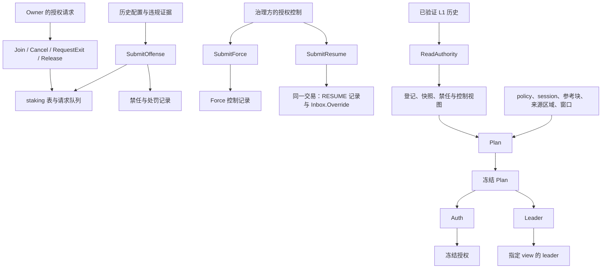

| 接口 | 主要输入 | 主要输出 | 用途 |
| --- | --- | --- | --- |
| `Join` | 区域、公钥、owner、质押金额与授权 | `Joined(pid)`、新记录 | 注册 position |
| `Cancel` | pid、owner 授权 | `Cancelled(pid, refund)` | 取消尚未纳入快照的登记 |
| `RequestExit` | pid、owner 授权 | `ExitRequested(pid, position)` | 登记退出请求 |
| `SubmitOffense` | 历史配置、pid、证据 | `Slashed(pid, amount, stakeAfter)` | 验证并处理违规 |
| `Release` | pid、owner 授权 | `Released(pid, amount)` | 满足条件后释放资金 |
| `SubmitForce` | Force 记录、治理签名 | `ForceRecorded(c, position)` | 记录强制切换意图 |
| `SubmitResume` | 序号、policy、目标 height、治理签名 | `ResumeRecorded` 与 `CursorSet` | 原子记录恢复并推进 Inbox |
| `ReadAuthority` | L1 height、查询项 | AuthorityRead，value 可为 $\bot$ | 读取确定的授权历史 |
| `Plan` | policy、session、参考块、来源区域、窗口 | PlanRecord $\Pi_s$，或无合格区域的 $\bot$ | 冻结一次区域职责安排 |
| `Auth` | $\Pi_s$ | AuthorizationView | 读取冻结授权 |
| `Leader` | $\Pi_s$、view | $\mathrm{Leader}_s(v)$ | 计算指定 view 的提议者 |

#### 4.1.1 Join(i, pk, owner, b, auth)

**输入。** 通用请求标识 req；区域 $i\in\mathcal R$、共识公钥 pk、owner 的 L1 账户、转入的质押金额 $b\ge0$；auth 包含 owner 授权和公钥对应私钥的 possession 证明。本次 L1 执行位置由合约环境提供。

**输出。** 成功返回 `Joined(pid)` 及新 position 记录；不满足准入条件时返回 REJECT。

**处理。** 检查授权、资金、区域与公钥唯一性，以及 $\mathcal P_{\rm stake}$ 的注册条件；分配新 pid，记录五个字段，status 置为 Pending，并加入相应请求队列。重复请求不分配第二个 pid。

#### 4.1.2 Cancel(pid, auth)

**输入。** req、待取消的 pid、owner 对取消操作的授权；从 staking 表和快照历史读取该 position 的状态。

**输出。** 成功返回 `Cancelled(pid, refund)`，refund 为本次按质押规则退还的金额；其他情形返回 REJECT。

**处理。** 只处理尚未进入任何快照的 Pending position。按 $\mathcal P_{\rm stake}$ 取消排队并退款，更新 stake 和 status，解除公钥占用；已经承担快照职责的 position 走退出和释放接口。

#### 4.1.3 RequestExit(pid, auth)

**输入。** req、Active position 的 pid、owner 授权；读取当前登记与退出队列。

**输出。** 成功返回 `ExitRequested(pid, position)`，position 为记录退出请求的 L1 位置；其他情形返回 REJECT。

**处理。** 将 status 置为 Exiting 并记录退出请求。何时从后续快照移除、何时置为 Retired，由 $\mathcal P_{\rm stake}$ 决定；本调用不修改旧快照权重，也不释放资金。

#### 4.1.4 SubmitOffense(params, pid, ev)

**输入。** req；被指控 position 的 pid；ev 为所用 BFT 版本的完整违规证据；params 包含该证据所属区域实例的固定配置、anchor 和验证版本，使验证者能够重算其 context 标识，并取得历史公钥及权重。

**输出。** 成功返回 `Slashed(pid, amount, stakeAfter)`，其中 amount 为处罚金额，stakeAfter 为处罚后的剩余质押；同一违规已经处理时返回原处理结果；证据或配置不符时返回 REJECT。

**处理。** 按证据对应的历史配置核对被指控公钥、签名域和该 BFT 版本的 conflict relation。验证通过后，由 $\mathcal P_{\rm stake}$ 计算处罚，更新当前 stake、禁任状态和证据去重记录；旧快照不改写。证据验证接口见 §4.3。

#### 4.1.5 Release(pid, auth)

**输入。** req、Retired position 的 pid、owner 授权；读取当前剩余 stake、退役记录和质押规则要求的 L1 历史。

**输出。** 成功返回 `Released(pid, amount)`；尚未满足释放条件或授权无效时返回 REJECT。

**处理。** 按 $\mathcal P_{\rm stake}$ 检查资金释放条件，退还允许释放的剩余 escrow，更新 stake 和 Released 状态并解除公钥占用。Program 停止不是本接口的资金释放依据。

#### 4.1.6 SubmitForce(U, sig)

**输入。** req、完整 Force 记录 $U$、治理方 $\mathsf M$ 的签名 sig；当前控制序号及收录本调用的 L1 height $\ell_U$。公告提前量 $M_a>0$ 是协议配置参数。

**输出。** 成功返回 `ForceRecorded(c, position)`，并写入控制日志；检查失败返回 REJECT。

**处理。** 验证治理签名、控制序号和 policy 格式，并要求

$$
\theta_a\ge\mathit{ts}_{\rm L1}(\ell_U)+M_a.
$$

成功后更新控制序号和日志。本接口记录控制意图；它何时作用于哪条分支、选用哪个 anchor，由 §5 的 GFR 重放处理。

#### 4.1.7 SubmitResume(c, policy, h_res, sig)

**输入。** req、新控制序号、新 policy、目标 L2 height $h_{\rm res}$ 和治理签名；合约读取 Inbox 当前接纳进度及本次 L1 执行位置。

**输出。** 成功返回 `ResumeRecorded(c, position)`，同一交易内同时产生 Inbox 的 `CursorSet`；任一检查或内部调用失败则 REJECT，整个交易回滚。

**处理。** 验证治理授权、序号和 policy，要求目标 height 严格高于 Inbox 当前已接纳 height。Authority 构造目标 cursor，以 admin 身份调用 §4.8 的 Override，并记录与其绑定的 RESUME。目标 cursor 清空未完成 channel，origin 按既有 override 格式确定且不超过收录本调用的 L1 height。

治理方的调用规程是：Espresso 已恢复 live、所需批次服务可用，且派生已经越过或偏离当前生产分支等紧急情形成立；所选目标高于当时全局末端、Inbox 已接纳 height 和派生末端，并为状态准备留出时间，使恢复 anchor 满足 §3.4。合约本身只执行上述授权、格式和目标单调性检查，不自行判断这些链外条件。

#### 4.1.8 ReadAuthority(ℓ, query)

**输入。** 已 finalized 的 L1 height $\ell$；query 指定读取某个 pid 的登记、某份快照、禁任集合或控制日志前缀；读取方提供或取得对应的已验证 L1 历史。

**输出。** AuthorityRead；其中 value 可以是经验证的 $\bot$；历史不足返回 WAIT。

**处理。** 返回处理完 height $\ell$ 后的状态。快照按固定 cutoff 历史计算，读取不等待额外发布交易。调用不改变 Authority 状态。

#### 4.1.9 Plan(policy, s, Ref, sourceRegion, window)

**输入。** 分支 policy、逻辑 session $s=(\beta,r)$、选区参考 block Ref、来源区域 sourceRegion，以及固定 physical window；genesis 尚无来源区域时 sourceRegion 为 $\bot$。同时读取公开配置，以及足以计算下式的已验证 L1 历史和快照：

$$
\ell_s:=\max\{\mathit{Ref}.\mathit{os},\lambda_\beta\},
\qquad e_s:=\mathsf{SnapshotAt}(\ell_s).
$$

**输出。** 已定义的 PlanRecord 值 $\Pi_s$，各字段按上面的记录定义填入并核对；没有合格区域时返回 $\bot$，不生成成功记录；缺少历史时返回 WAIT，输入格式或窗口无效时返回 REJECT。

**处理。** 冻结 $\mathsf{Ban}(\ell_s)$。从 sourceRegion 之后开始沿 $\mathcal L_\beta$ 循环；genesis 的 sourceRegion 为 $\bot$ 时从排列首项开始。选择第一个启用、且在 $\mathcal C_{e_s}$ 中存在未禁任提议者的区域。委员会包含该区域快照中的全部身份与正权重；禁止提议不删除冻结投票权重。故障权重上界和 leader 规则使用公开配置，在冻结的可提议者集合上确定 $\mathrm{Leader}_s$，不根据后来在线人数变化重算。

#### 4.1.10 Auth(Π_s)

**输入。** 已验证的完整 Plan $\Pi_s$。

**输出。** 上面定义的 AuthorizationView，包含该 Plan 中冻结的委员会、公钥、权重、故障上界、提议者集合、leader 规则、窗口和配置引用。

**处理。** 读取 Plan 中的授权字段，不按当前 staking 表或当前禁任集合重新选区。

#### 4.1.11 Leader(Π_s, v)

**输入。** 已验证的 Plan，以及正整数 view $v$。

**输出。** 该 view 的 leader replica $\mathrm{Leader}_s(v)$。

**处理。** 使用 Plan 固定的 leader 规则计算。本查询不改变 BFT view，也不启动一次 proposal。

### 4.2 Block Builder

**状态。** Builder 维护本地待处理普通交易，按交易标识去重，并保存本节点采用的交易编码规则。输入有效性与容量检查使用协议配置中的规则版本和字节上限。

**数据结构。** Builder 的交易池保存

```text
PendingTx[txid] = {
    tx_bytes
}
PayloadRequest = {
    height, prefix_state, byte_limit
}
```

Tx_bytes 是 $\mathcal T$ 中一笔普通交易的完整原生编码；txid 按该编码和原生交易标识规则计算，不接受与字节内容不符的键。PendingTx 按 txid 去重，池中的排列不作为协议承诺的交易顺序。

PayloadRequest 是 Payload 参数的记录形式：height 为 L2 height，prefix_state 为该高度执行完 DEP 后的 $\Sigma$ 中状态，byte_limit 为正整数字节上限。返回的 Txs 属于 $\mathcal T^*$，顺序由此次 Payload 结果确定；BasicTx 在这份列表上检查，Apply 随后逐笔判断是否执行。Builder 接收或缓存一笔交易，不使其自动属于任何已决定 block。

**接口概览。** SubmitTx 接收普通交易；Payload 为指定 height 返回有序普通交易列表。Session、anchor 和 parent 由调用者确定。

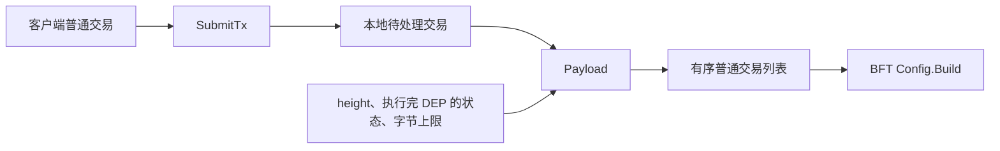

| 接口 | 主要输入 | 主要输出 | 用途 |
| --- | --- | --- | --- |
| `SubmitTx` | 完整普通交易 | `Received(txid)` | 本地接收并去重 |
| `Payload` | height、DEP 执行后状态、字节上限 | 有序 Txs，可为空 | 为 block 选择普通交易 |

#### 4.2.1 SubmitTx(tx)

**输入。** 客户端提交的一笔完整普通交易 tx。

**输出。** `Received(txid)`，其中 txid 为该交易按原生格式确定的标识；格式、签名或交易类型不符时返回 REJECT。

**处理。** 检查后将交易放入本地待处理集合；重复提交不重复登记。这里的接收结果只表示本地已收取交易。

#### 4.2.2 Payload(h, σ, L_bytes)

**输入。** 目标 L2 height $h$、执行完该 height 强制前缀后的状态 $\sigma$、普通交易编码字节上限 $L_{\rm bytes}>0$；读取本地待处理集合。

**输出。** 有序普通交易列表 Txs，可以为空；缺少执行上下文时返回 WAIT，输入限制无效时返回 REJECT。

**处理。** 选择并排序普通交易，使列表满足 $\mathsf{BasicTx}$：条目非空、可解码、交易签名有效、不是 deposit 类型，且总字节数不超过上限。该检查不要求所有交易在当前状态均可执行；逐笔原生准入检查由 Apply 完成。

### 4.3 Regional BFT

**状态。** 每个 program 绑定一个固定 Plan $\Pi_s$、anchor 身份和 program 配置 $\mathcal K_s$。$\mathcal K_s$ 由公开协议配置和 Plan 字段确定，包含 chain、规则和 verifier 版本，以及委员会、公钥、权重、$F_s$、leader 函数、固定窗口、字节上限和 metadata window $T_{\rm win}$。令 $Q_s:=W_s-F_s$，表示后文参与条件使用的权重门槛。

Context 是这份配置和 anchor 确定的签名域，其标识及 descriptor 为

$$
\mathrm{cid}_{s,A}:=\mathsf H(\texttt{REGIONAL},s,\mathrm{id}(A),\mathcal K_s),
\qquad \nu=(\Pi_s,A,\mathrm{cid}_{s,A}).
$$

同一个 program 不修改 descriptor。可变状态包括 entered／terminated 标志、当前 view、该 BFT 实现的共识状态与签名记录、已知 physical blocks 和决定前缀、执行状态缓存、L1 输入缓存，以及尚未交付的 Final／Evidence 事件。内部锁、投票和计时器格式由所选 BFT 实现规定。

**数据结构。** Program 使用以下固定配置记录：

```text
ProgramConfig = {
    chain, rule_version, verifier_version, config_ref,
    committee, fault_bound, eligible_proposers, leader_rule,
    window, byte_limit, metadata_window
}
Descriptor = {
    plan, anchor, cid
}
```

ProgramConfig 是 $\mathcal K_s$ 的具名字段形式。Chain 为链标识；三个版本／引用字段从公开配置取得。Committee、fault_bound、eligible_proposers、leader_rule 和 window 分别取 $\Pi_s$ 的同名字段，且逐项核对相等；byte_limit 对应 $L_{\rm bytes}$，metadata_window 对应 $T_{\rm win}$。Leader_rule 是 RuleSpec 的有限编码，执行后得到 $\mathrm{Leader}_s$，不将一个未指定编码的数学函数直接拿来 hash。

Descriptor 对应原来的三元组记号 $\nu=(\Pi_s,A,\mathrm{cid}_{s,A})$：$\nu.\mathit{plan}=\Pi_s$、$\nu.\mathit{anchor}=A$、$\nu.\mathrm{cid}=\mathrm{cid}_{s,A}$。Cid 必须等于上式对 session、$\mathrm{id}(A)$ 和 ProgramConfig 规范编码计算的值，不能由调用者另选。

Anchor 的 block 身份和 metadata 在 Create 时固定，精确状态在 Enter 前补齐并验证。执行状态不作为可随准备进度改变的 descriptor 身份字段重新编码；其值由固定 anchor 的实际执行结果确定。来源与状态材料采用

```text
AnchorEvidence = {
    kind, source_ref, source_objects
}
BFTInstance = {
    descriptor, entered, terminated, entry_time, close_reason,
    view, kernel_state, signature_records,
    first_received, blocks, final_proofs, evidence_store, decided_tip,
    execution_cache, L1_cache, output_queue
}
```

AnchorEvidence 即 $\pi_A$。Kind 为 GENESIS、REGIONAL、FORCE 或 RESUME；source_ref 分别指向初始配置、前驱区域结果、Force 的公开重放位置或 RESUME 的 L1 位置。Source_objects 是核对该来源与 anchor 对应所需的完整日志、blocks 和证明。区域来源允许只是前驱的有效区域决定；是否已被 GFR 选中另行核对。

BFTInstance 的 descriptor 固定；entered、terminated 为布尔值；entry_time 为协议时刻或 $\bot$；close_reason 为 §6 的原因标签或 $\bot$；view 为正整数，未进入时尚不启动它。Kernel_state 是由 verifier_version 对应 BFT 版本规定的内部共识状态，其编码和恢复过程由该实现定义；外部模块只保管实例句柄，不改写内部锁和投票。

Signature_records 保存 `{message_type, view, signed_bytes}`，其中 message_type 和 signed_bytes 按该 BFT 版本解析；first_received 以该版本的 proposal 标识为键保存首次接收协议时刻，重试不能覆写。Blocks 以 physical hash 为键保存完整 block；final_proofs 以目标 hash 保存最终证明；evidence_store 保存已经核对的违规证据。Decided_tip 指向该表中的决定末端，尚无新决定时指向 anchor。

Execution_cache 按已验证的 parent 链身份和 height 关联执行状态，不单凭 height 复用其他链的状态；L1_cache 保存已验证的 L1 对象。Output_queue 保存未交付事件；交付完成不删除随后仍需核对的 blocks、证明和证据。

**区域结果与证据。** 向消费者交付的 Res 是

```text
RegionalResult = {
    descriptor, block, final_proof, chain, anchor_evidence
}
```

它与 $\mathit{Res}=(\nu,B,\pi_{\rm fin},C,\pi_A)$ 一一对应。Block 为目标 physical block；chain 是从 descriptor.anchor 到该 block 的完整、hash 相连的 physical chain，末端必须等于 block。Final_proof 是固定 BFT verifier 格式的完整比特串，验证的 subject 必须为该 cid 与 block；anchor_evidence 必须指向相同 anchor。

输出事件分别为 `FinalEvent{cid, block, final_proof}` 和 `EvidenceEvent{cid, evidence}`。Evidence 的具体编码由固定 verifier 版本定义；必须能够核对被指控的登记公钥、消息类型、view／签名坐标、相互冲突的签名内容及 context。架构不统一规定某种 BFT 的 QC 或签名聚合格式，Authority 采用该版本的公开证据解析与验证规则。

**接口概览。** Create、Enter、Close 管理实例；Config 提供 Build、Accept、NotBefore；CheckFINAL、CheckEvidence 是公开验证函数；Final 和 Evidence 是输出事件。暂停仅停止调度，恢复继续原 program 的状态，不调用第二次 Enter。

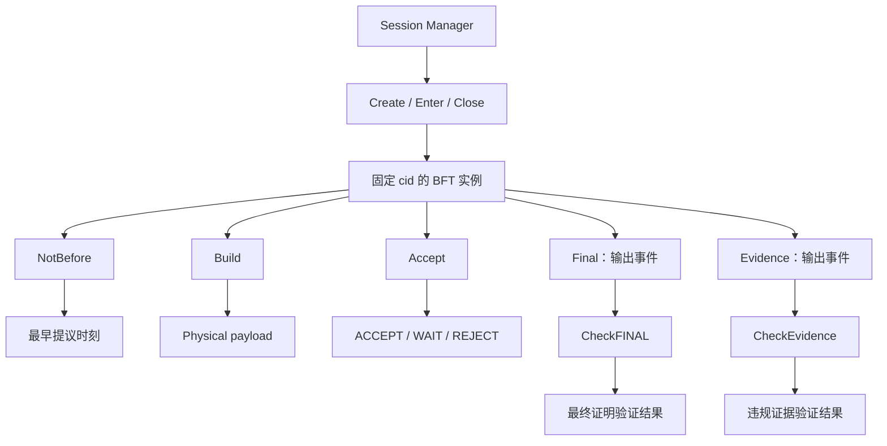

| 接口 | 主要输入 | 主要输出 | 用途 |
| --- | --- | --- | --- |
| `Create` | Plan、anchor 身份与 metadata | `Assigned(cid)`、descriptor | 创建或复用固定实例 |
| `Enter` | anchor、来源依据、精确执行后状态 | `Entered(cid, τ_entry)` | 完成一次初次进入 |
| `Close` | 关闭原因 | `Terminated(cid, reason)` | 永久停止新共识签名 |
| `Build` | parent、当前协议时刻、可用执行输入 | Physical block | 构造 proposal payload |
| `Accept` | parent、payload、首次接收时刻 | ACCEPT／WAIT／REJECT | 检查应用有效性 |
| `NotBefore` | 合法 parent、固定窗口 | 最早时刻或 $+\infty$ | 计算提议时间边界 |
| `CheckFINAL` | descriptor、block、最终证明 | true／false | 公开验证区域最终证明 |
| `CheckEvidence` | descriptor、违规证据 | true／false | 公开验证违规关系 |
| `Final`（输出事件） | 实例形成的 block 决定与证明 | `Final(B, π_fin)` | 交付区域结果 |
| `Evidence`（输出事件） | 实例取得的有效违规证据 | `Evidence(ev)` | 交付追责任务 |

本节与 [Regional BFT v0.13](regional_bft_abstraction_zh_v0_13.md) 使用相同的 descriptor、Config 和 verifier 接口；BFT 实现所需满足的性质及安全目标见该文 §2–§3。验证函数显式接收完整 descriptor，依据其中的 Plan 和公开配置核对历史公钥、权重及验证版本；anchor 连接标识统一使用 $\mathrm{id}(A)$。

#### 4.3.1 Create(Π_s, A)

**输入。** 已验证 Plan，以及 anchor 的 block 身份和 metadata；创建时尚可未取得执行状态 $A.\sigma$。

**输出。** `Assigned(cid)` 和固定 descriptor；相同 cid 已存在时返回原实例标识及当前状态，不改变已有的终止标记；配置、anchor 身份或窗口不符时返回 REJECT。

**处理。** 检查 $A.h<h_{\min,s}$，固定配置与签名域并创建独立实例。此时不启动共识，也不要求把前驱实例的锁或投票复制过来。

#### 4.3.2 Enter(A, π_A, σ_A)

**输入。** 对已创建实例提供完整 anchor、来源依据 $\pi_A$ 和精确执行后状态 $\sigma_A=A.\sigma$；读取固定 descriptor、本 replica 身份、L1 输入和当前协议时刻。

**输出。** `Entered(cid, τ_entry)`；来源或状态材料不完整时返回 WAIT；anchor 不匹配、非委员会 replica、实例终止或时间已到 stop 时返回 REJECT。

**处理。** 核对 anchor 的来源、连接身份与执行状态，复查 §3.4 的 anchor 条件。第一次进入时设置 entered、初始化该 BFT 的入口状态和 view 1；重复进入请求返回第一次结果，不重新初始化。可以早于 start 进入，提议仍须等待 NotBefore。

#### 4.3.3 Close(reason)

**输入。** 当前实例及关闭原因标签：TIME、COMPLETE、FORCE、RESUME、EXPIRED、EXCLUDED 或 INCOMPATIBLE，具体触发条件见 §6。

**输出。** `Terminated(cid, reason)`；重复关闭返回原终止记录。

**处理。** 设置不可撤销的终止标记，停止该实例的新共识签名，保留已有 blocks、签名记录和输出。即使没有收到本调用，到达 $\tau_s^{\rm stop}$ 时也执行相同停止动作；暂停实例恢复调度前先检查这一条件。

#### 4.3.4 Build(P, τ)

**输入。** 同一 context 上可扩展的 parent $P$ 和当前协议时刻 $\tau$；读取固定配置、ancestor bodies、执行状态、L1 数据，以及本地 Builder 的 Payload 接口。

**输出。** Physical block $B$；未到最早时刻或缺输入时返回 WAIT；实例关闭、时间达到 stop 或 parent／高度无效时返回 REJECT。

**处理。** 取 $h=\mathrm{slot}(\tau)$，检查窗口和 $P.h<h$。执行 parent 后的必要 padding，计算 height $h$ 的执行前 root；执行该 height 的强制前缀后调用 Payload。按 §3.4 填入 timestamp、origin，按 §3.2 填入 parent 标识；发送前再次检查未终止且当前时刻小于 stop。此操作只构造 payload，parent 的共识选择由 BFT 完成。

#### 4.3.5 Accept(P, B, τ_recv)

**输入。** Parent $P$、完整 proposal payload $B$、本 replica 首次收到该 proposal 的协议时刻 $\tau_{\rm recv}$；读取固定配置及检查 parent、root 和 origin 所需的本地输入。

**输出。** ACCEPT、WAIT(missing) 或 REJECT(reason)。

**处理。** 检查 parent 连接、递增 height 和 proposal window，检查 timestamp、origin 与 §3.4 一致、root 与 parent 及中间 padding 的执行一致，并检查 BasicTx。时间条件为

$$
\mathit{ts}^*(B.h)\le\tau_{\rm recv}
<\mathit{ts}^*(B.h+1)+T_{\rm win},
\qquad \tau_{\rm recv}<\tau_s^{\rm stop}.
$$

缺输入后的重试保留原首次接收时刻。ACCEPT 表示应用层检查通过；实际签名还要经过 BFT 自身规则及当时的停止守卫。

#### 4.3.6 NotBefore(P)

**输入。** 当前实例的合法 parent $P$；读取固定窗口。

**输出。** 若 $P.h<h_{\max,s}$，返回 $\max\{\tau_s^{\rm start},\mathit{ts}^*(P.h+1)\}$；否则返回 $+\infty$。

**处理。** 计算允许构造后继 payload 的最早时刻，不修改实例状态。

#### 4.3.7 CheckFINAL(ν, B, π_fin)

**输入。** 完整 descriptor $\nu$、目标 physical block $B$ 和最终证明 $\pi_{\rm fin}$；验证者读取用于重建 $\mathcal K_s$ 的公开协议配置。

**输出。** true 或 false。

**处理。** 重建 $\mathcal K_s$ 并核对 cid，使用该配置中的历史公钥、权重和 verifier 版本验证证明是否绑定该 block 与 context。输入无法解析或证明不成立时返回 false。该函数检查区域最终证明；Plan 的公开来源、完整 ancestry 与全局接纳资格由消费该结果的模块另行检查。

#### 4.3.8 CheckEvidence(ν, ev)

**输入。** 完整 descriptor、用于重建 $\mathcal K_s$ 的公开协议配置，以及该 BFT 版本定义的违规证据 ev，包含识别被指控公钥与核对违规关系所需的签名材料。

**输出。** true 或 false。

**处理。** 使用固定签名域和历史配置验证证据，按该 verifier 版本的 conflict relation 判断。此函数不修改 escrow，也不执行链上处罚。

#### 4.3.9 输出事件 Final(B, π_fin)

**输入／触发。** BFT 实现在当前 context 中形成目标 block 的决定及其最终证明。

**输出。** `Final(B, π_fin)`；实例同时提供消费者取得完整决定链所需的已存 blocks。

**处理。** 交给 Manager 组装完整区域结果

$$
\mathit{Res}=(\nu,B,\pi_{\rm fin},C,\pi_A).
$$

$C$ 为从 anchor 到目标 block 的 physical chain，包含验证 ancestry 和执行 Merge 所需的 bodies；$\pi_A$ 为 anchor 来源依据。只有目标 hash 时尚不能组装完整 Res。

#### 4.3.10 输出事件 Evidence(ev)

**输入／触发。** 实例取得通过 CheckEvidence 的完整证据。

**输出。** `Evidence(ev)`，连同所属 cid 交给 Manager。

**处理。** 保存证据并产生交付任务，不等待链上处罚完成；program 后续关闭不删除该任务。

### 4.4 Global Finality Rule

**状态。** 每个读取者维护自己的重放状态 $\mathcal X$，其中包括：

- 全局 virtual chain $G=(G[h^0],\ldots,G[h_G])$，其元素属于 $\mathsf{VB}$；定义 $\mathrm{last}(G):=G[h_G]$。
- 出处 $\mathrm{src}_G(h)$：区域来源记录对应 cid 和覆盖该高度的证明，派生来源标为 DER；完整区域链可从相应 publication 取得。
- 当前分支、policy、已经选定的 descriptors，以及已关闭的分支和 session。
- 已取得的 L1／Espresso 前缀、完整 publication 索引和待补齐对象。
- 已处理事件记录 Rec，以及处理位置 pc。Pc 标识最后处理完的事件，其时间键、类别和同类索引的排序见 §5.3。
- 下一段职责 Tail。

Tail 取以下四种值：

- $\mathsf{NEXT}(\nu)$：已选定 descriptor，可以接纳该实例的后续结果。
- $\mathsf{OPEN}(\zeta)$：已记录交接边界，等待规定的开出位置或来源。
- $\mathsf{PENDING}(\zeta)$：已经计算 Plan，但没有合格区域。
- $\mathsf{HALT}(\zeta)$：分支因全局过期停止，等待 RESUME。

Boundary $\zeta$ 保存 cause、目标分支与 session 序号、来源区域、anchor 和窗口输入；尚未确定的分量为 $\bot$。Cause 为 GENESIS、REGULAR、FORCE 或 RESUME。Tail 描述公开职责，与某个本地 program 的运行状态分开。

**数据结构。** ReplayPosition 的字段采用 §4.1 的定义。GFR 另外维护下列对象：

```text
Boundary = {
    cause, target_session, source_region,
    reference_block, anchor, window
}
PublicationEntry = {
    result_key, available_objects, locations, first_complete_q
}
GlobalSource = REGIONAL(result_key) | DER(resume_position, height)
ReplayRecord = {
    position, input_ref, effects, events
}
ReplayState = {
    G, sources, branch, policy, selected,
    closed_branches, closed_sessions, publications,
    L1_prefix, Espresso_prefix, Rec, pc, Tail
}
```

Boundary 就是 $\zeta$：cause 采用上文四种原因；target_session 是目标 $(\beta,r)$；source_region 是来源区域或 $\bot$；reference_block 是选区用的 BlockRef；anchor 是拟接续的 Anchor；window 是 Window。尚未确定的分量为 $\bot$。Reference_block 用于计算 Plan，anchor 用于连接新链，两者分别保存。取值由 §5 的对应事件确定，不能由调用者补猜。

区域结果的 result_key 统一为 $(\mathrm{cid},\mathsf H(B))$。PublicationEntry 以此为键：available_objects 保存已验证公开的结果组成部分；locations 保存这些对象所在的 `(Espresso height, message index)`，索引从 0 开始；first_complete_q 为全体必需组成部分首次在公开前缀中齐备的 height，尚不完整时为 $\bot$。它根据已完整读取的公开历史计算，不使用本地接收时间。完整后，这些对象可以组装为 RegionalResult。

Sources 是以 virtual height 为键的 GlobalSource 表。REGIONAL 指向决定该片段的完整区域结果，padding 也可以引用覆盖它的后继证明；DER 指向采用的 RESUME L1 位置及派生 height。出处描述证明来源，不另造该高度上的 physical block。

ReplayRecord 的 position 是当前事件的 ReplayPosition。Input_ref 按事件类型指向 L1 控制位置、Espresso block、SessionEnd 的 session 或 Expire 的 height。Effects 为有序变更列表，元素取 `APPEND{first, last, source}`、`RESET{resume_position, target_height}` 或 `DUTY{before, after}`：分别记录追加的连续 virtual heights 及其 GlobalSource、采用的恢复目标、变化前后的 Tail，列表可以为空。Events 为下列 LifecycleEvent 的有序列表。

ReplayState 对应 $\mathcal X$。G 是连续 virtual chain，sources 与 G 中 genesis 之后的已记录高度对应，genesis 直接由初始配置确定；branch 是当前非负整数分支版本；policy 为 Policy；selected 以 session 标识关联已选 Descriptor；两个 closed 表保存已关闭的标识。Publications 是 PublicationEntry 表，两个 prefix 为实际已验证日志，Rec 为 ReplayRecord 序列，pc 为最后完成事件的位置或初始化值，Tail 为前述带标记的职责状态。

**生命周期事件。** 统一的事件包是 `LifecycleEvent{position, kind, body}`，position 为产生它的 ReplayPosition；kind 与 body 的对应关系为：

- `SessionAssigned{descriptor}`：body 为已选 Descriptor。
- `SessionClosed{session, reason}`：session 为 $(\beta,r)$，reason 为关闭原因标签。
- `BranchClosed{branch, reason}`：branch 为分支版本，reason 为关闭原因标签。
- `Resumed{control_seq, branch, anchor, derived_prefix}`：control_seq 为 RESUME 序号，branch 为新分支，anchor 为目标高度处的 Anchor，derived_prefix 为本次采用的派生 virtual 前缀。

这些是公开重放的输出记录。Manager 通过 position 关联事件来源，并结合 kind 与 body 识别同一事件，不将相同 pc 下的不同事件合并掉。

**Checkpoint 与接口输出。** `GlobalCheckpoint{state, L1_cut, Espresso_cut}` 保存完整 ReplayState 和支持该状态的两份公共日志切面；L1_cut 为 L1 位置，Espresso_cut 为 Espresso height，初始配置可以使用协议约定的初始位置。验证时必须重建或核对相应状态，单独的末块 hash 不构成 GlobalCheckpoint。

AdvanceGlobal 返回的四元组是 `ReplayResult{state, added_records, events, status}`：state 为更新后的 ReplayState，added_records 与 events 为本次新增列表，status 为 READY 或 `WAIT{next_position, missing}`。Next_position 指向尚不能处理的事件，missing 列出缺少的日志、对象或恢复状态；它们均不抹去已经完成的进度。

**接口概览。** Init 建立重放状态；AdvanceGlobal 处理新的公共输入；Chain 读取当前全局链及其来源；Responsibility 读取 Tail。输出的生命周期事件交给 Manager。

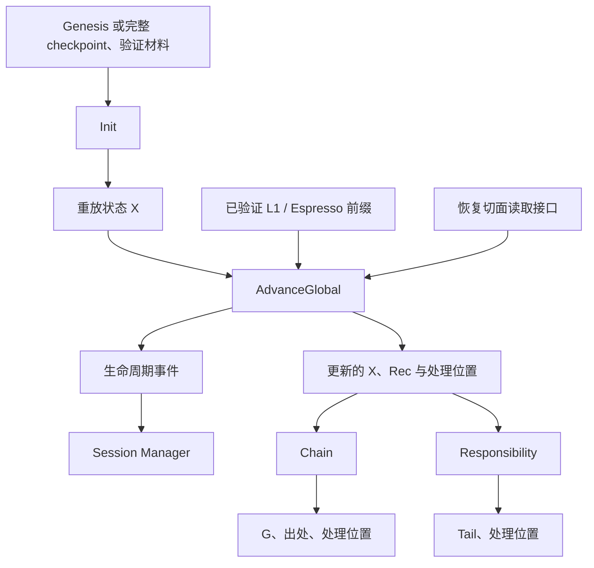

| 接口 | 主要输入 | 主要输出 | 用途 |
| --- | --- | --- | --- |
| `Init` | Genesis／checkpoint、验证材料 | $\mathcal X_0$ | 建立或恢复重放状态 |
| `AdvanceGlobal` | $\mathcal X$、L1／Espresso 前缀、恢复读取器 | $\mathcal X'$、新增 Rec、事件、处理状态 | 推进公开选择与接纳 |
| `Chain` | $\mathcal X$ | $G$、出处、pc | 读取同一位置的全局链 |
| `Responsibility` | $\mathcal X$ | Tail、pc | 读取下一段公开职责 |

#### 4.4.1 Init(checkpoint, reads)

**输入。** Genesis 配置或完整 checkpoint；reads 为验证该 checkpoint 所需的 L1／Espresso 前缀及恢复派生材料。Genesis 配置给出初始 virtual block、执行后状态、policy 和初始职责边界；后续 checkpoint 包含完整 $\mathcal X$ 及对应公共处理位置。

**输出。** 初始重放状态 $\mathcal X_0$；缺验证材料时返回 WAIT；checkpoint 与公共重放结果不符时返回 REJECT。

**处理。** 从 genesis 初始化，或验证后续 checkpoint 与指定公共前缀的重放结果一致。只有末块 hash 或 Tail 不足以恢复完整状态。

#### 4.4.2 AdvanceGlobal(X, L1, E, resumeReader)

**输入。** 当前状态 $\mathcal X$；已验证的 finalized L1 与 Espresso 日志前缀；resumeReader 为 §4.5 的恢复切面读取接口，按具体 RESUME 的 L1 位置返回派生 virtual 前缀及 anchor 状态，或报告缺失数据。

**输出。** $(\mathcal X',\Delta\mathrm{Rec},events,status)$。其中 $\mathcal X'$ 是处理后的状态，$\Delta\mathrm{Rec}$ 是新增重放记录，events 是本次生命周期事件列表；status 为 READY，或 `WAIT(nextPosition, missing)`。READY 表示当前已提供的可处理输入已处理完。输入日志不通过验证或不延续既有前缀时返回 REJECT。

**处理。** 按 §5 的事件全序逐项处理，只处理满足 R-WAIT 的事件。在当前选定 context 中选取合格的 canonical regional-finalized physical 前缀，对该链使用 $\mathrm{Virt}(C)=\mathrm{Merge}_{\omega_A}(C)$，追加未接纳的 virtual 片段并记录出处。Force、SessionEnd、Expire 和 RESUME 按各自规则改变职责；RESUME 可以将 $G$ 替换为指定派生切面。

每处理完一个事件，一起保存状态、Rec 和 pc；遇到 WAIT 时返回已经完成的进度。未完整公开的单份 publication 暂不合格，不据此阻塞其他可处理事件。

Events 的种类和内容为：SessionAssigned 携带选定 descriptor；SessionClosed 携带 session 与原因；BranchClosed 携带分支与原因；Resumed 携带控制序号、新分支、anchor 及采用的派生切面。每个事件附其重放位置，供调用者关联和去重。

#### 4.4.3 Chain(X)

**输入。** 已初始化的重放状态 $\mathcal X$。

**输出。** $(G,\mathrm{src}_G,pc)$。

**处理。** 只读返回同一处理位置上的链与出处，不推进日志，也不替调用者选择另一条链。

#### 4.4.4 Responsibility(X)

**输入。** 已初始化的重放状态 $\mathcal X$。

**输出。** $(Tail,pc)$。

**处理。** 返回该重放位置上的公开职责。读取者根据 NEXT 或 boundary 中的具体数据准备实例，不将尚未确定的分量视为已经选定。

### 4.5 Derivation Rule

**状态。** 派生节点维护状态 $\mathcal D$：

- 已验证 L1 前缀和处理位置；已取得并核对 commitment 的 DA 数据。
- 原生 channel 解码状态。Channel 是按原生格式编码的一段连续批次，frame 是其传输分片；尚未完成的 channel 与已确定的 block 分开保存。
- 当前原生父块及其执行后状态、已派生 blocks，以及通过 Merge 得到的派生 virtual chain $D$。
- 可重放的 checkpoints，以及按具体 RESUME L1 位置索引的恢复切面。

记 $h_D$ 为派生末端 height，则

$$
D=(D[h^0],\ldots,D[h_D]),\qquad
D[h]\in\mathsf{VB}.
$$

将逐高度最终采用的 metadata、执行前 root 和实际执行的普通交易写成 physical block 并连接，得到以 genesis 为 anchor 的派生 canonical physical chain $C_D$；实际 origin 轨迹记为 $\omega_D$。这是 L1 输入经过原生选择与执行后的内容表示，不要求 L1 存储区域 BFT 的 headers 或证明。每个已派生 height 都有一条记录，deposit-only height 的普通交易为空，并有

$$
D[\,h^0+1:h_D\,]=\mathrm{Merge}_{\omega_D}(C_D).
$$

$D[h^0]$ 由 genesis 配置给定。后续 blocks 的 metadata、DEP 和普通交易采用实际派生值，root 记录该 height 执行前的状态；普通交易列表已经是原生规则最终采用并执行的列表。

若一条 RESUME 位于 L1 block $L$ 的具体日志位置 $p_{\rm res}$，用 $D_L$ 简写处理到其 CursorSet 为止的派生 virtual chain。这个简写始终绑定该具体记录，不能将同一 L1 block 内不同 RESUME 的切面混用。

**数据结构。** 派生模块接收的 DA 对象和 channel 分片按下列逻辑字段记录：

```text
DAObject = {
    commitment, payload, certificate
}
Frame = {
    channel_id, number, frame_data, is_last
}
ChannelAssembly = {
    channel_id, frames, next_number, closed,
    first_input, last_input, decoder_state
}
```

DAObject 三个字段均为完整比特串，对应 $d,y,\pi_{\rm DA}$；证书按 §1.5 核对，payload 必须能按该 DA 方案的绑定验证关系打开 commitment。DAObject 是已取得的数据，不用空 payload 表示尚未下载。

Frame 采用既有原生 frame 编码的逻辑字段：channel_id 是该编码规定的 channel 标识，number 为从 0 开始的非负整数，frame_data 为分片字节，is_last 为布尔值。编解码采用固定原生版本；具体字节宽度和限制沿用该版本。该字段结构与 [原生 certifier 的 frame 解码](../megaeth_specs/specs/block-certification/certifier.md#verification-procedure) 一致；本文的认证来源仍是 GFR。

ChannelAssembly 保存同一 channel 的已接纳 frames，按 number 排序；next_number 是待续接序号；closed 表示已接纳最后一个 frame；first_input、last_input 是该 channel 已处理输入的 L1 位置。Decoder_state 是这些已取得字节在固定原生解码器中的状态，可以从同一输入重建，不能由提交者任意指定解码结果。尚未闭合的输入与完整 block 的采用仍按原生解码规则区分。

**派生输入与输出记录。** 从 Inbox 交易和事件中读取的对象为

```text
AcceptedBatchInput = {
    L1_position, prev, next, DA_commitment
}
OverrideInput = {
    L1_position, resume_position, old, next
}
DerivedItem = {
    virtual_block, native_block_bytes, post_state_root
}
ResumeCut = {
    resume_position, target_height,
    derived_prefix, anchor, anchor_state
}
```

前两类输入的位置为 finalized L1 位置；prev、old、next 均为 Cursor。AcceptedBatchInput 指向实际成功接纳的 DA commitment；OverrideInput 将 CursorSet 与同一 RESUME 记录关联。完整签名字段可以从相应已验证交易取得，Derivation 按 Inbox 的成功接纳事实读取这些输入。

DerivedItem 的 virtual_block 属于 $\mathsf{VB}$；native_block_bytes 是该高度按原生格式输出的完整 block；post_state_root 是执行后的 root。三者必须对应同一执行过程，virtual_block.root 则是执行前 root。NewBlocks 是本次新增 DerivedItem 的有序列表。

ResumeCut 按精确 resume_position 索引。Target_height 为 $h_{\rm res}$；derived_prefix 是处理到相应 CursorSet 的 $D_L$，并包含该目标 height；anchor 为该前缀在目标处的 block 及其 §3.2 身份，anchor_state 为执行到该 anchor 后的完整 $\Sigma$ 中状态。它不是本地最新派生末端的别名。

**派生状态。** $\mathcal D$ 的记录形式为

```text
DerivationState = {
    L1_prefix, position, DA_objects, channels,
    parent_block, execution_state, physical_prefix, virtual_prefix,
    checkpoints, resume_cuts
}
```

Position 为最后完成处理的 L1 输入位置；DA_objects 按 commitment 索引 DAObject；channels 按 channel_id 保存 ChannelAssembly，并按原生规则维护待处理次序。Parent_block 和 execution_state 对应当前实际原生末端；physical_prefix 为 $C_D$，virtual_prefix 为 $D$，两者关系采用上面的 Merge 等式。Checkpoints 保存可验证且可继续重放的状态，resume_cuts 是 ResumeCut 表。

一个 `DerivationCheckpoint` 保存该时点的 position、channel 处理状态、parent、精确执行状态、$C_D$、$D$ 和 config_ref；它不递归包含其他 checkpoints 或 resume_cuts 表。所需 L1／DA 输入按引用取得后核对。恢复或验证 checkpoint 必须覆盖这些状态之间的对应，不能只用一个 root 初始化任意 channel 状态。

后续结算 claim 使用 `DerivationInputRef{L1_cut, DA_commitments, config_ref}` 引用派生输入：L1_cut 固定日志前缀，DA_commitments 是该前缀中相关接纳输入的 commitment 列表，config_ref 固定采用的原生规则版本。它引用的是确定输入，不能由 claim 提交者另选普通交易。

**接口概览。** Derive 推进本地派生状态；DeriveAtResume 读取某条 RESUME 的精确恢复切面。两者都只使用 L1、已接纳 DA 数据和原生执行输入。

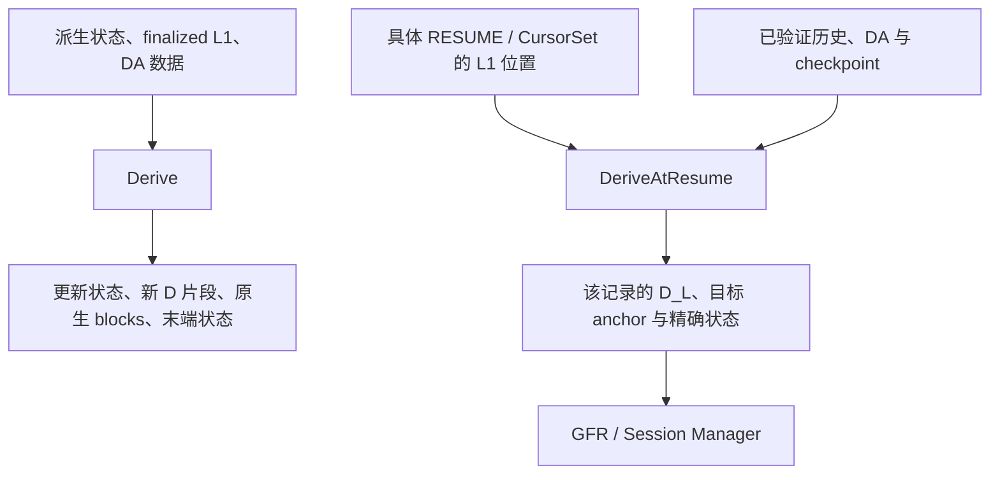

| 接口 | 主要输入 | 主要输出 | 用途 |
| --- | --- | --- | --- |
| `Derive` | $\mathcal D$、L1 日志、DA 对象 | $\mathcal D'$、newBlocks、末端状态、处理状态 | 按原生规则推进派生 |
| `DeriveAtResume` | 精确 RESUME 位置、本地历史与数据 | ResumeCut 中的 $D_L$、anchor 和状态 | 取得历史恢复切面 |

#### 4.5.1 Derive(Dstate, L1, DAobjects)

**输入。** 前一次派生状态 $\mathcal D$ 或已验证 checkpoint；finalized L1 日志，包含 Inbox 接纳记录、override、DEP 所需输入及原生配置；DAobjects 为按已接纳 commitment 取回并验证的完整 payload。

**输出。** $(\mathcal D',newBlocks,\sigma',status)$。NewBlocks 包含本次新确定的 $D$ 片段及相应原生 blocks，$\sigma'$ 为更新后末端状态；status 为 READY，或 `WAIT(position, missing)`。输入与声明的日志或 commitment 不符时返回 REJECT，不将其纳入派生状态。

**处理。** 按 L1 顺序解码批次，在实际父状态上逐高度检查并执行。原生规则确定普通交易内容和实际 origin，然后合入该轨迹的 DEP。窗口到期且没有可采用批次时采用空普通交易，产生 deposit-only block；已接纳但尚未取回的数据导致 WAIT。

遇到 override 时先处理此前输入，再按原生规则将尚未派生的区间推进至目标，并重置相应 channel 状态。无效内容的舍弃或替换发生在输出该 height 之前；已输出的前缀不改写。检查、选择和执行逐高度交错，$C_D$ 与 $D$ 是这一过程的两种记录形式。

#### 4.5.2 DeriveAtResume(position)

**输入。** 某条 finalized RESUME 及其 CursorSet 的具体 L1 位置；读取本地已验证的 L1、DA 对象、原生配置和可重放 checkpoint。

**输出。** 该位置的派生 virtual chain $D_L$、目标 $h_{\rm res}$ 处的 anchor $A=D_L[h_{\rm res}]$ 及其精确执行后状态；缺数据时返回 `WAIT(position, missing)`；该位置不是相应恢复记录时返回 REJECT。

**处理。** 在只读重放或已验证缓存上，精确计算到该 CursorSet 的处理切面。较新的本地派生末端不能代替这个历史切面；查询不回退本地正在推进的 $\mathcal D$，也不读取 Espresso。

### 4.6 Publisher

**状态。** 发布队列以 $key=(\mathrm{cid},\mathsf H(B))$ 为键，保存 Res、验证与补齐状态、已完成的提交尝试和已验证的 Espresso 收录位置。待交付违规证据独立保存，不因某个 program 停止而删除。

**数据结构。** 队列记录为

```text
PublicationTask = {
    key, result, phase, missing, recorded_at
}
EvidenceTask = {
    descriptor, evidence, phase, L1_result
}
```

Key 为 §4.4 的 result_key；result 是 RegionalResult，验证来源未齐时还保存已取得的组成部分，不能按完整结果发布。Phase 取 VERIFYING、QUEUED、SUBMITTED、RECORDED 或 STOPPED，分别表示校验中、待提交、已经提交、已核对 finalized 收录、公开规则已终止新结果重试。Missing 列出待补数据，完整后为空；recorded_at 在核对之前为 $\bot$，之后保存 `{q, message_index}` 及相应读取依据。

Offer 的排队输出是 `Queued{key}`；收录事件是 `Recorded{key, q}`。一次提交尝试不自动把 phase 置为 RECORDED，只有实际公开日志的验证结果才能填入 recorded_at。

EvidenceTask 的 descriptor 与 evidence 采用 §4.3 的类型；phase 取 QUEUED、SUBMITTED 或 RECORDED；L1_result 在尚未处罚时为空，成功后记录 Authority 的处理结果和 L1 位置。任务的身份由所属 cid 与完整证据的规范内容确定，重复观察不重复安排同一交付。这里的 RECORDED 表示 L1 处理，和 PublicationTask 的 Espresso 收录分开使用。

**接口概览。** Offer 接收完整区域结果并启动发布；Recorded 是从已验证 Espresso 收录产生的完成事件。

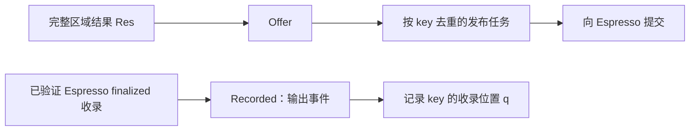

| 接口 | 主要输入 | 主要输出 | 用途 |
| --- | --- | --- | --- |
| `Offer` | 完整 Res 及验证来源 | `Queued(key)` | 保存并提交区域结果 |
| `Recorded`（输出事件） | 完整 publication 的 finalized 收录依据 | `Recorded(key, q)` | 标记任务已经收录 |

#### 4.6.1 Offer(Res)

**输入。** §4.3 定义的完整区域结果 Res，包括 descriptor、目标 block、最终证明、physical ancestry 和 anchor 依据；读取验证这些材料所需的已验证配置与 L1 数据。

**输出。** `Queued(key)`；缺验证来源时返回 WAIT 并保留待补齐任务；已判定结果无效时返回 REJECT。

**处理。** 验证后按 key 去重，保存结果并提交到 Espresso。服务暂不可用时保留任务供重试；program 到时停止不清空队列。只有公开规则已排除或已过接纳截止的结果，才停止作为新结果重试。

#### 4.6.2 输出事件 Recorded(key, q)

**输入／触发。** 已验证的 Espresso finalized 前缀及完整消息内容，能够确认队列中该 key 的完整 publication 已收录于 $J_q$。

**输出。** `Recorded(key, q)`，并在队列条目中记录该收录位置。

**处理。** 标记对应发布任务已收录。同一收录的重复观察不产生新的发布任务；GFR 是否接纳该结果仍按 §5 判定。

### 4.7 Batcher 与 Certifier

#### Batcher

**状态。** Batcher 维护自己运行 GFR 得到的 $\mathcal X$、从 L1 读到的 Inbox cursor、channel 构造状态、待交付 payload，以及每个交付任务的 DA、认证和 L1 提交进度。

Cursor 是 Inbox 的接纳进度记录，字段包括已完成接纳的 L2 height、origin、未完成 channel 的 frame 摘要和来源位置。记其 height 为 $h_{\rm cur}$。Batcher 持有读取副本，不能自行修改合约中的 cursor；cursor 也不是一条 block chain。

**数据结构。** Batcher 使用 §4.1 的 CursorRead 作为 L1 进度视图、§4.4 的 ReplayState 作为全局来源视图。实际编码的每个高度记录为

```text
BlockRecord = {
    block_number, epoch_num, transactions
}
SubmissionPayload = {
    derivation_version, frames
}
ChannelBuilderState = {
    channel_id, records, encoding_options, encoder_state,
    encoded_channel, frames, next_frame, closed
}
```

Block_number 为 L2 height；epoch_num 为该 block 的 L1-origin height，名字中的 epoch 不指质押快照。Transactions 属于 $\mathcal T^*$，取按 G 前缀执行 Apply 得到的 Kept，不包含 DEP。三个字段的原生编码沿用 BlockRecord 版本；普通交易为空时仍有一份记录。

SubmissionPayload 是 y 的解析形式：derivation_version 指定原生解码版本；frames 是来自同一 channel、连续编号的一份或多份新 Frame，不重复包含 prev.frames_digest 已绑定的前缀。Y 是这一结构的完整编码字节，不能在取得 DA commitment 后再改分组或改字节。

ChannelBuilderState 的 records 是有序 BlockRecord 列表，block_number 连续；encoding_options 保存该原生版本允许的压缩等构造选项，encoder_state 为构造中的原生编码器状态，encoded_channel 为当前已产生的 channel 字节。Frames 是已生成分片，next_frame 指向下一份待交付 frame，closed 为是否已结束该 channel。闭合后的完整字节解码必须得到 records；编码器内部状态随固定版本定义，不作为对链内容的另一份选择。

**交付任务。** 对连续高度区间，使用 `HeightRange = EMPTY | {first, last}`；非空时 first、last 为非负整数且 first 不大于 last。BuildPayload 的输入 I 必须非空；认证输出的完成范围可以为 EMPTY。

```text
BatchDeliveryTask = {
    job_id, prev, payload, source_range, channel_id, phase,
    DA_result, certified_result, L1_result
}
```

Prev 是构造时采用的 Cursor；payload 是固定 y；source_range 是本次构造选择的 HeightRange，和 channel_id 一起说明本地来源。Job_id 是以 prev 和 y 的规范内容区分任务的本地标识；同一任务重试复用原记录，重建不同 y 时建立新任务。

Phase 取 BUILT、DA_READY、CERTIFIED 或 ACCEPTED。DA_result 为 $\bot$ 或 `{d, π_DA}`；certified_result 为 $\bot$ 或下方 Certifier 的 CertifiedResult；L1_result 为 $\bot$ 或 `{position, transaction_ref, event}`，其中 position 为 finalized 接纳位置，transaction_ref 标识对应 L1 交易，event 为 CursorAdvanced。等待状态保留已完成阶段；prev 失效后按新的 cursor 重建。

**接口概览。** BuildPayload 从 $G$ 构造待交付记录；Deliver 完成 DA、认证和 Inbox 提交。

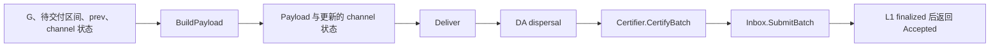

| 接口 | 主要输入 | 主要输出 | 用途 |
| --- | --- | --- | --- |
| `BuildPayload` | 连续区间 $I$、prev、GFR 与 channel 状态 | `Payload(y, channelState)` | 编码尚待交付的 block records |
| `Deliver` | payload、channel 信息、prev | `Accepted(prev, next, d, position)` | 完成 DA、认证与 L1 提交 |

##### 4.7.1 BuildPayload(I, prev)

**输入。** 待编码的连续 L2 height 区间 $I$、已验证的当前 cursor prev；读取本地 GFR 状态、来源数据、原生执行状态和 channel 构造状态。

**输出。** `Payload(y, channelState)`，y 为一个或多个连续 frame 的完整字节，channelState 为更新后的本地构造状态；来源或执行数据不足时返回 WAIT，区间或 cursor 不符时返回 REJECT。

**处理。** 只编码 $G$ 中尚未被接纳、且未由恢复派生覆盖的 heights。按 §3.3 从已验证的父状态逐高度执行 $G$，记 $\mathit{Kept}_h$ 为 Apply 在 height $h$ 返回的实际执行普通交易列表。对每个 height 使用原生记录格式

```text
BlockRecord{
    block_number = h,
    epoch_num = G[h].os,
    transactions = Kept_h
}
```

正常 padding height 也写入一份普通交易列表为空的记录。记录不携带可由 L1 重建的 DEP，也不保留已被 Apply 丢弃的普通交易或原稀疏 physical parent 连接。生成本地 payload 不推进 Inbox cursor。

##### 4.7.2 Deliver(y)

**输入。** BuildPayload 生成的 payload y、其 channel 信息及采用的 prev；读取本地交付任务、注册 Batcher 权限和相应来源。

**输出。** `Accepted(prev, next, d, position)`，表示 Inbox 提交已经在所列 L1 位置 finalized；服务或数据暂不可用时返回 WAIT 并保留已完成的任务进度；cursor 已被推进或提交无效时返回 REJECT。

**处理。** 对 y 完成 DA dispersal，取得 commitment $d$ 和 $\pi_{\rm DA}$；调用 CertifyBatch 取得 next、高度范围 $I$、GFR 位置 gpos 和签名 $\chi$；将这些字段交给 SubmitBatch。重试复用已完成步骤；prev 失效后从新的 cursor 重新构造，不覆盖其他已接纳提交。

#### Certifier

**状态。** Certifier 维护自己的已验证 L1、Espresso 和 DA 视图、GFR 状态 $\mathcal X$、当前 Inbox cursor、延续 channel 所需的已接纳 frames、请求结果记录，以及 §2.5 给定的签名密钥。它使用与读取者相同的规则版本。

**数据结构。** Certifier 核对的是一次固定 cursor 转换。记录形式为

```text
CertificationRequest = {
    prev, payload, commitment, DA_certificate, prefix_frames
}
BatchAttestation = {
    chain, Inbox_address, prev, next,
    commitment, DA_certificate_hash, completed_range, gpos
}
CertifiedResult = {
    next, completed_range, gpos, signature
}
```

CertificationRequest 对应输入 prev、y、d、$\pi_{\rm DA}$，prefix_frames 是从已接纳数据取得、供延续 channel 使用的 Frame 前缀；必须与 prev.frames_digest 相符。Payload 是新 SubmissionPayload 的完整字节。请求者不能用另一个 channel 的同编号 frames 代替此前已接纳前缀。

BatchAttestation 是待签名消息的具名字段：chain、Inbox_address 固定签名用途；prev 与 next 为完整 Cursor；commitment 对应 d；DA_certificate_hash 为 $\mathsf H(\pi_{\rm DA})$；completed_range 为本次完成接纳的 HeightRange，即接口中的 I；gpos 为来源 GFR 的 ReplayPosition。其编码顺序采用下方签名公式，不包含未来的 L1 写入位置。

CertifiedResult 对应 `Certified(next,I,gpos,χ)`，其中 signature 就是 $\chi$，是对完整 BatchAttestation 的签名；$\chi$ 本身不被重新定义为一份含其他字段的记录。未闭合 channel 的 completed_range 为 EMPTY，next.height 和 next.origin 保持原已完成进度，只按原生规则更新 frame 摘要；闭合时再核对完整完成范围。

**来源视图与请求记录。** Certifier 的来源视图为 `{GFR_state, Inbox_read, accepted_prefix_frames}`，分别采用 ReplayState、CursorRead 和 Frame 列表。请求结果表按完整请求内容及实际采用的 gpos 关联 BatchAttestation 与 CertifiedResult。即使已有缓存，仍要检查 prev 是否符合当前调用所使用的 L1 cursor 和 RESUME 处理条件；缓存不授予跳过来源检查的权限。

**接口概览。** CertifyBatch 核对一次提交的内容与来源，返回后继 cursor 和绑定这些字段的签名。

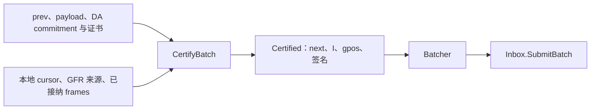

| 接口 | 主要输入 | 主要输出 | 用途 |
| --- | --- | --- | --- |
| `CertifyBatch` | prev、y、d、$\pi_{\rm DA}$ 及本地来源 | `Certified(next, I, gpos, χ)` | 核对内容、连续性及 DA 绑定后签名 |

##### 4.7.3 CertifyBatch(prev, y, d, π_DA)

**输入。** 起始 cursor prev、完整提交字节 y、对应 DA commitment $d$ 和证书 $\pi_{\rm DA}$；从自身状态读取当前 L1 cursor、GFR 来源和延续 channel 所需的已接纳 frame 数据。

**输出。** `Certified(next, I, gpos, χ)`。Next 是计算出的后继 cursor，$I$ 是本次完成接纳的连续高度范围，gpos 是采用的 GFR 处理位置，$\chi$ 是下面定义的签名；缺输入时返回 WAIT，绑定、连续性或内容不符时返回 REJECT。

**处理。** 先确认 prev 等于其 L1 视图中的当前 cursor。令 $p_{\rm prev}$ 为写入 prev 的 L1 位置；自身 GFR 必须已处理不晚于 $p_{\rm prev}$ 的最后一条 RESUME。取得必要的已接纳 frames，检查 channel 连续性及 y 与 DA commitment 的绑定；对本次可完整确定的 block records，逐高度核对 metadata 与 $G[h]$ 相同，普通交易列表与按该 $G$ 前缀执行 Apply 得到的 $\mathit{Kept}_h$ 相同，并确认这些 heights 未由恢复派生覆盖。

计算 next 和 $I$ 后，令 gpos 为本次核对采用的 GFR 处理位置，$\mathit{InboxAddr}$ 为配置中的 Inbox 地址，签署

$$
\chi=\mathsf{Sign}_{sk_{\mathsf C}}\!\left(
\mathrm{enc}(\mathit{chain},\mathit{InboxAddr},
prev,next,d,\mathsf H(\pi_{\rm DA}),I,\mathit{gpos})\right).
$$

未闭合 channel 不增加已接纳 block height，此时 $I$ 为空；闭合时必须检查整个完成范围。缺少已经接纳的 frame 与尚未提交未来 frame 分开处理：前者等待取得，后者不被当作已完成的高度。请求内容及采用来源相同的重试返回已有认证结果。

### 4.8 Batch Inbox 与已接纳 virtual chain

**状态。** Inbox 合约维护 cursor、注册 Batcher 及其原生提交／接手权限、Certifier 公钥、请求结果和接纳事件。Admin 固定为 Authority。只有成功的 SubmitBatch 或同一 RESUME 交易内的 Override 修改 cursor。

读取者根据 finalized 接纳记录物化已接纳 virtual chain

$$
G'=(G'[h^0],\ldots,G'[h_{G'}]),\qquad G'[h]\in\mathsf{VB}.
$$

$G'$ 是接纳记录认证的源 virtual-chain 视图，不是合约逐块执行出来的链。初始前缀为 genesis；完整 channel 接纳后，读取者取证书 gpos 指定的 $G$ 中对应 virtual blocks，接到当前 $G'$ 后面。部分 frame 不使 $G'$ 增长。

CursorSet 的目标为 $h_{\rm res}$ 时，读取者将当前接纳视图置为相应 $D_L$ 到该 height 的前缀，历史 L1 事件保留。完整物化时 $h_{G'}=h_{\rm cur}$；来源数据尚未取得时，本地只能报告已取得的前缀。Derivation 直接使用 L1 与 DA，不等待 $G'$ 先物化。

**数据结构。** 合约使用 §4.1 定义的 Cursor，读取时返回 CursorRead；来源 source 与记录该状态的 written_at 分别处理。其余对象为

```text
BatchSubmission = {
    prev, next, commitment, DA_certificate,
    completed_range, gpos, signature
}
BatcherPermissions = {
    primary, alternatives, exclusive_window
}
InboxState = {
    cursor, cursor_written_at, permissions,
    certifier_pk, admin, request_results, acceptance_log
}
```

BatchSubmission 对应 SubmitBatch 的七项内容参数，顺序和含义与接口一致；completed_range 为 I，signature 为 $\chi$。这些字段连同配置中的 chain 与 Inbox 地址重建完整 BatchAttestation，不能只传一个无法确定签名消息的裸签名。

BatcherPermissions 的 primary 为当前主 Batcher 的 L1 账户，alternatives 为备选账户集合，exclusive_window 为原生权限规则使用的 L1 block 数参数。具体准入判断使用既有 Inbox 规则。Certifier_pk 为注册的认证公钥，admin 为 Authority 的 L1 账户或合约身份。

InboxState 的 cursor 是唯一当前接纳记录，cursor_written_at 为写入它的 finalized L1 位置；request_results 为通用请求去重表。Acceptance_log 按 L1 顺序保存两类事件：

- `CursorAdvanced{prev, next, commitment, position, transaction_ref}`：前三项为合约事件内容，position 和 transaction_ref 为其已验证 L1 收据元数据；完整 BatchSubmission 从对应交易取得。
- `CursorSet{old, next, position, resume_position}`：old／next 为事件内容，position 为事件位置，resume_position 为同一交易中的恢复控制记录位置。

这些收据元数据不改写原生事件字节格式。Derivation 据此构造 AcceptedBatchInput 或 OverrideInput；GFR 处理同一条 RESUME 时取得其切面。

**读取者的接纳视图。** 合约外的 `AcceptedView{cursor_read, virtual_prefix, missing_sources}` 记录 $G'$ 的物化进度。Virtual_prefix 是已经按接纳来源核对的连续 virtual 前缀；missing_sources 保存尚需取得的 GFR 来源或恢复切面引用。完整时其末端 height 等于 cursor_read.cursor.height；来源未齐时不以 cursor height 宣称已经取得未知 blocks。

CursorSet 之后，该视图的目标来源为相应派生切面。旧接纳内容可以保留在历史缓存中；对当前 $G'$ 只报告与新来源已经核对的前缀。

**接口概览。** SubmitBatch 接纳认证提交；Override 执行 Authority 的恢复指令；ReadCursor 读取 finalized 接纳进度。原生 Batcher 注册和权限管理沿用既有 Inbox。

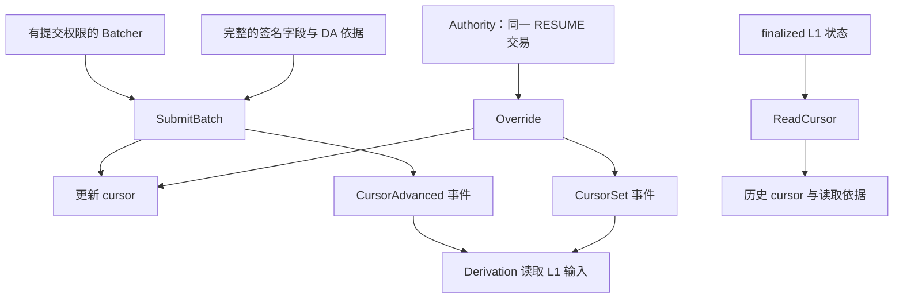

| 接口 | 主要输入 | 主要输出 | 用途 |
| --- | --- | --- | --- |
| `SubmitBatch` | prev、next、d、$\pi_{\rm DA}$、$I$、gpos、$\chi$ | `CursorAdvanced` 及 L1 位置 | 接纳权限、签名和连续性检查通过的提交 |
| `Override` | Authority 同交易调用、目标 cursor | `CursorSet(old, next)` | 推进恢复目标并清空未完成 channel |
| `ReadCursor` | Finalized L1 height、读取材料 | CursorRead | 读取确定的接纳进度 |

#### 4.8.1 SubmitBatch(prev, next, d, π_DA, I, gpos, χ)

**输入。** req、起始与后继 cursor、DA commitment 和证书、完成的高度范围 $I$、来源 GFR 位置 gpos、Certifier 签名 $\chi$；caller 必须具有当前提交权限。签名覆盖的每个字段都显式包含在提交中。

**输出。** 成功产生 `CursorAdvanced(prev, next, d)` 及 finalized L1 位置，签名绑定的其余字段可从对应交易读取；检查失败返回 REJECT。

**处理。** 核对提交权限、prev 等于当前 cursor、DA 证书、Certifier 公钥和完整签名消息。通过后原子更新 cursor 并记录事件。部分 frame 按原生 cursor 规则更新 frame 进度，不额外增加 block height。

#### 4.8.2 Override(next)

**输入。** req 的同交易执行上下文、目标 cursor next；caller 必须是 Authority。Next 的 height 为该 RESUME 的目标，未完成 channel 为空，origin 与来源位置采用该控制记录的原生 override 编码。

**输出。** `CursorSet(old, next)` 及其 L1 位置；调用者、目标或控制绑定不符时返回 REJECT。

**处理。** 检查这是 SubmitResume 的同交易内部调用，要求目标 height 严格前进，清除未完成 channel 并更新 cursor。调用与 RESUME 记录共同成功或共同回滚；本接口不读取 Espresso，也不计算恢复 anchor。

#### 4.8.3 ReadCursor(ℓ)

**输入。** 已 finalized 的 L1 height $\ell$ 及其可验证状态读取材料。

**输出。** CursorRead，包含处理完该 height 后的 cursor、写入它的 L1 位置及读取依据；缺少历史时返回 WAIT。

**处理。** 只读取得确定历史位置的接纳进度。这个返回值不表示读取者已取得或执行对应的完整 virtual chain。

### 4.9 Session Manager

**状态。** 每个 replica 的 Manager 维护本地公共输入、GFR 状态 $\mathcal X$、派生状态 $\mathcal D$、候选 anchor 及其来源、当前调度选择和待交付任务。它以 cid 为键维护 Programs 表，每个条目保存固定 descriptor、原 BFT 实例、状态准备进度、entered 标志、关闭原因，以及运行和选择两种状态。

运行状态为 Assigned、Preparing、Ready、Running、Paused、Terminated，依次表示已登记参数、正在取得状态、状态就绪、已进入并运行、已进入但暂停、永久终止。选择状态为 Candidate、Selected、Excluded，分别表示待 GFR 选择、已选中、已确定失去资格。

Ready 要求已实际取得 $A.\sigma$，并从已验证的原生前缀重建或验证它与 anchor 的对应；只有 root 或下载地址不够。Entered 只从 false 变为 true。暂停保留原共识状态，Terminated 不复活；一个到时停止的实例仍可保留尚待公开接纳的历史结果。

Manager 按 cid 保存区域决定链及其 Virt，记为 $R_{\rm cid}$；加上对应的已验证 anchor 前缀后，得到一条候选 virtual chain。$R$ 表示这些候选视图的集合。

**数据结构。** Programs 是 `cid → ProgramEntry` 的表：

```text
ProgramEntry = {
    descriptor, program_handle, phase, selection, entered,
    state_material, ready_state, close_reason,
    regional_chain, regional_view, pending_tasks
}
ReadyState = {
    anchor_id, anchor_height, state, execution_evidence
}
```

Descriptor 是固定 $\nu$，program_handle 指向原 BFTInstance；表键必须等于 descriptor.cid。Phase、selection 和 entered 的取值及转换采用上文定义。State_material 保存已取得的准备材料；ready_state 在未核对完成时为 $\bot$；close_reason 在未终止时为 $\bot$，之后为 §6 的原因标签。Regional_chain 是该 cid 的 physical 决定前缀，regional_view 是其 Virt 与已验证 anchor 前缀组成的候选视图；pending_tasks 指向已有发布或证据任务。

ReadyState 的 anchor_id 和 anchor_height 必须与 descriptor.anchor 对应；state 是完整 $\Sigma$ 中状态。Execution_evidence 为从一个已验证原生 checkpoint 到该 anchor 的有序执行输入，或已采用的原生状态验证机制给出的完整验证依据；用它核对 state 确为执行完 anchor 的结果。仅有 state root 相等或下载地址，不构成完整 ReadyState。

StateMaterial 可以是完整状态及验证依据，也可以是等待续接的 checkpoint、blocks、L1／DA 输入的部分集合。它只记录已取得的数据，不携带一个未经验证的 Ready 标记。Manager 完成相应验证后才建立 ReadyState。

**Manager 的输入事件。** 本地 BFT 事件采用 §4.3 的 FinalEvent 或 EvidenceEvent；公开生命周期事件采用 §4.4 的 LifecycleEvent。此外，本地生命周期输入还包括

```text
ClockEvent = {
    protocol_time
}
IncompatibilityFact = {
    cid, height, candidate_hash, derived_hash, input_ref
}
```

Protocol_time 是本机协议时钟值；不能使用远端声明时间代替。IncompatibilityFact 的两个 hash 为同一 height 上，分别按候选已验证前缀和 D 执行、编码得到的原生 block hash；它们必须不同。Input_ref 标明取得候选前缀与派生输入的已验证依据。单纯“D 更高”不产生此结构。

Manager 的完整状态为 `ManagerState{self, public_inputs, GFR_state, derivation_state, Programs, candidates, scheduled, tasks}`。Self 为本 replica 身份；public_inputs 是已验证日志及对象缓存；GFR_state 和 derivation_state 分别为 ReplayState 与 DerivationState；candidates 按前驱 cid 关联可用候选 anchor 及其 AnchorEvidence；scheduled 按逻辑 session 记录当前调度 cid 或 $\bot$；tasks 保存 PublicationTask／EvidenceTask 的本地记录或引用。一个条目的关闭不删除独立交付任务。

**接口概览。** ObservePublic 和 ObserveRegional 接收外部输入；HandleProgramEvent 接收本地 BFT 事件；PrepareCandidate 准备实例，EnterCandidate 完成初次进入，ScheduleCandidate 管理候选调度；ApplyLifecycle 执行公开选择、关闭及本地停止事件。具体调度与 handoff 顺序见 §6。

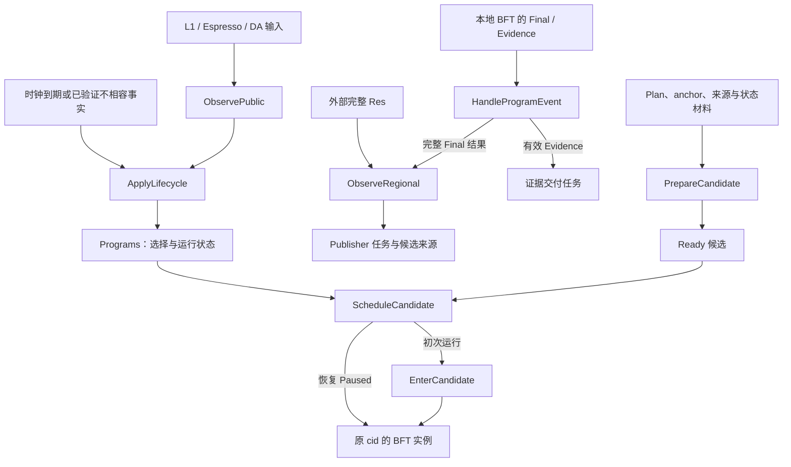

| 接口 | 主要输入 | 主要输出 | 用途 |
| --- | --- | --- | --- |
| `ObservePublic` | 公共日志、DA 数据及验证依据 | 处理位置、生命周期事件、受影响 cid、路径状态 | 推进派生和 GFR |
| `ObserveRegional` | 完整 Res 及验证材料 | 区域末端、发布任务、后继候选 | 接收区域结果 |
| `HandleProgramEvent` | cid、Final／Evidence | 区域结果处理输出或证据任务 | 对接本地 BFT 输出 |
| `PrepareCandidate` | Plan、anchor、来源依据、状态材料 | `Prepared(cid, Ready)` 或 `Preparing` | 创建或复用实例并准备状态 |
| `EnterCandidate` | cid 及本地进入条件 | `Entered(cid, τ_entry)` | 完成首次 Enter |
| `ScheduleCandidate` | 按规则选出的 cid、当前候选状态 | `Running(cid)` | 暂停、切换或恢复调度 |
| `ApplyLifecycle` | 公共生命周期事件或本地停止事实 | 更新后的状态、受影响 cid 列表 | 执行选择与永久关闭 |

#### 4.9.1 ObservePublic(reads)

**输入。** 新的 L1／Espresso finalized 前缀、DA 对象及各自验证依据；读取当前 $\mathcal X$、$\mathcal D$ 和 Programs。

**输出。** 更新后的 GFR／派生处理位置、本次生命周期事件、发生变化的 cid 列表，以及两条处理路径各自的 READY 或 WAIT 状态；输入验证失败返回 REJECT。

**处理。** 先验证并保存公共输入，再推进 Derive，然后推进 AdvanceGlobal，处理其选择与关闭事件，最后逐 cid 重查时间守卫和派生不相容事实。Derive 的 WAIT 不阻塞不依赖该数据的 GFR 事件；需要该恢复数据的 RESUME 则等待。

#### 4.9.2 ObserveRegional(Res)

**输入。** 完整区域结果 Res；读取验证 Plan、anchor、ancestry 和执行所需的本地材料。

**输出。** 已更新的 cid 与区域末端、Publisher 任务，以及新增的后继 anchor 候选，可以为空；缺来源返回 WAIT，证明或内容无效返回 REJECT。

**处理。** 使用 CheckFINAL 验证证明，检查配置来源、physical ancestry 和 Merge 输入，再更新该 cid 的区域视图并调用 Offer。若结果来自已选定前驱，将其作为后继候选来源；收到更高区域结果本身不改变 GFR 的选择。

#### 4.9.3 HandleProgramEvent(cid, event)

**输入。** 已登记实例输出的 Final 或 Evidence 事件；读取其固定 descriptor、已存 blocks 和 anchor 依据。

**输出。** 对 Final 返回组装 Res 后的 ObserveRegional 结果；对 Evidence 返回证据交付任务标识；缺少组装材料时返回 WAIT，context 或事件不符时返回 REJECT。

**处理。** Final 先补齐从 anchor 到目标的 physical chain，再交给 ObserveRegional。Evidence 经公开 verifier 检查后独立保存并安排向 Authority 的交付。停止旧实例不删除这些已有结果或证据。

#### 4.9.4 PrepareCandidate(Π_s, A, π_A, stateMaterial)

**输入。** 固定 Plan、候选 anchor、来源依据，以及已取得的状态材料 stateMaterial；材料可为空，也可包含可验证 checkpoint、执行输入或完整状态。

**输出。** `Prepared(cid, Ready)`；材料不足时返回 `Preparing(cid, missing)`；来源、身份或状态不符时返回 REJECT。

**处理。** 重算唯一 cid，创建或复用原条目，保存准备进度。状态材料按 anchor 的已验证原生前缀核对，满足 Ready 条件后更新状态。重复提供材料推进同一条目，不创建第二个实例；已终止或已排除的 cid 不重新准备为可运行状态。

#### 4.9.5 EnterCandidate(cid)

**输入。** 已登记 cid；读取 Ready 状态、本 replica 的委员会身份、当前选择与调度、关闭标记和协议时刻。

**输出。** `Entered(cid, τ_entry)`；状态未就绪或尚未被本地调度时返回 WAIT；资格失效、已终止或时间到 stop 时返回 REJECT。

**处理。** 按 §6.2 复查守卫，首次进入时调用原 BFT 实例的 Enter，设置 entered 和 Running。未终止实例的重复请求返回原进入结果；暂停恢复由 ScheduleCandidate 完成，不再次调用 Enter。

#### 4.9.6 ScheduleCandidate(cid)

**输入。** 本地调度规则选出的 cid；读取同一逻辑 session 的候选状态、GFR 选择和当前时刻。

**输出。** `Running(cid)`；所选实例还需准备时返回 WAIT；候选已被排除、终止或不符合 §6.3 的调度规则时返回 REJECT。

**处理。** 同一逻辑 session 最多调度一个候选。若切换，暂停仍可能被选中的旧实例并保留状态；对新候选完成初次 Enter，或从 Paused 恢复原实例。更高候选尚未 Ready 时，不必终止当前实例；公开选择后只调度匹配 cid。

#### 4.9.7 ApplyLifecycle(event)

**输入。** 由本地已验证 GFR 重放产生的生命周期事件及其处理位置，或本地时钟到期／已验证派生不相容事实；读取受影响的 Programs 条目。

**输出。** 更新后的运行／选择状态和受影响 cid 列表；材料不足返回 WAIT，来源无法核对或与已验证事实矛盾时返回 REJECT。

**处理。** SessionAssigned 标记匹配 cid 为 Selected，并排除已经确定不匹配的候选；SessionClosed、BranchClosed 和 Resumed 按其作用范围处理全部有关条目。到 stop 或确认永久排除／不相容时，先设置 Terminated，再对原实例调用 Close，保留已有结果与证据。重复事件不重复创建或恢复实例。具体关闭原因与判据见 §6。

系统的处理关系仍为

$$
R\xrightarrow{\text{Espresso 与 GFR}}G
\xrightarrow{\text{认证与 L1 接纳}}G'
\xrightarrow{\text{L1 选择、DEP 合并与执行}}D.
$$

$G,G',D$ 的元素均属于 $\mathsf{VB}$。$R$ 保存候选决定，$G$ 保存公开选择，$G'$ 保存认证接纳的源内容，$D$ 保存实际派生结果。箭头描述处理关系；跨层比较按 §3.3 检查实际执行形成的原生 blocks 和执行结果。

### 4.10 原生状态结算

**状态。** 原生结算组件维护已提交的 state claims、前置 claim 关系、输入引用及各 claim 的争议／证明处理状态。沿用已有原生结算机制；本节只描述它与架构交换的对象。

**数据结构。** 结算组件维护

```text
StateClaim = {
    claim_id, first_height, last_height, parent_claim,
    input_ref, state_root, status, resolution
}
ClaimResolution = {
    decision, evidence, L1_position
}
```

Claim_id 为原生结算系统分配或计算的唯一声明标识；first_height、last_height 为连续声明区间的两端，满足 first_height 不大于 last_height。Parent_claim 引用原生流程规定的前置 claim，初始声明引用其 genesis 依据；input_ref 采用 §4.5 的 DerivationInputRef，固定该区间使用的 L1／DA 输入和规则版本。

State_root 属于 $\mathcal H_\kappa$，声明的是执行到 last_height 之后的 root。Status 为 PENDING、ACCEPTED 或 REJECTED；resolution 在未完成时为 $\bot$，终局时为 ClaimResolution。Decision 为 accepted 或 rejected，evidence 为该原生证明／争议程序的完整验证材料，L1_position 指向记录该结果的位置。证明格式及裁决过程使用原生结算版本，不在此另定义一种证明系统。

SubmitStateClaim 登记的参数构成 StateClaim 中的内容字段，原生流程生成 claim_id 与处理状态；输出事件 `Resolved{claim_id, decision}` 引用同一条记录。已有 $D$ 内容与已登记 claim 都不能代替 ClaimResolution。

**接口概览。** SubmitStateClaim 登记一个连续 L2 区间的执行状态声明；Resolved 是原生结算程序完成该声明处理后的输出事件。

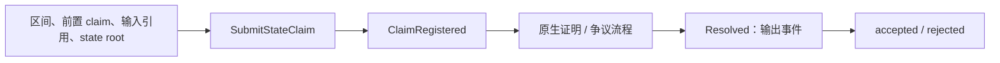

| 接口 | 主要输入 | 主要输出 | 用途 |
| --- | --- | --- | --- |
| `SubmitStateClaim` | 区间、parentClaim、inputRef、stateRoot | `ClaimRegistered(claimId)` | 登记原生执行状态声明 |
| `Resolved`（输出事件） | 原生流程的终局结果及验证依据 | `Resolved(claimId, decision)` | 记录接受或拒绝结果 |

#### 4.10.1 SubmitStateClaim(a, b, parentClaim, inputRef, stateRoot)

**输入。** 连续 L2 区间 $[a,b]$、前置 claim 标识、§4.5 定义的 DerivationInputRef（参数 inputRef），以及声称在 height $b$ 执行后的 stateRoot；调用者和授权采用原生结算入口的规则。

**输出。** `ClaimRegistered(claimId)`，并进入原生处理流程；入口检查失败返回 REJECT。

**处理。** 登记区间、前置关系、输入来源和状态根，交由既有证明／争议程序处理。该程序采用与 Derivation 相同的原生规则；提交 claim 不修改 $D$，也不表示 claim 已经完成结算。

#### 4.10.2 输出事件 Resolved(claimId, decision)

**输入／触发。** 既有原生证明或争议程序对已登记 claim 作出终局处理结果，并附其原生验证依据。

**输出。** `Resolved(claimId, accepted/rejected)`；未完成处理时，该 claim 的状态仍为 PENDING。

**处理。** 更新该 claim 的结算状态并输出原生事件，不将“已经可以派生某段 $D$”当作已经通过结算程序。


## 5. Regional and Global Finality Rules

本节先定义区域证明能确认什么，再说明 GFR 如何从公开日志中接纳结果、固定交接 anchor，以及处理强制切换和恢复。区域决定、发布截止和全局过期分别有自己的判据，不能用其中一个时刻替代另外两个。

### 5.1 Regional finality

固定 descriptor $\nu$，令 $\nu.\mathrm{cid}$ 表示其 cid 分量，$V_s$ 表示其 Plan 中的委员会。Block $B$ 是 **regional finalized**，当且仅当存在 $\pi_{\rm fin}$ 使

$$
\mathsf{CheckFINAL}(\nu,B,\pi_{\rm fin})=\mathrm{true}.
$$

检查完整区域结果时，还要验证其 Plan 与来源、physical ancestry 和 anchor 依据。前驱 context 中的最终证明可以支持候选 anchor，但不能代替 GFR 对后继 context 的选择。

同 context 的后代证明覆盖其 ancestors；缺少 physical block 的高度由该决定链的 Virt 唯一展开。公开验证不重放观察者自己的 proposal 接收时间，不能因为结果晚到就否定合法的历史决定。

因此，regional finality 先回答“这个实例是否已经决定了该 block”。GFR 还要回答“这个实例是否被选中、结果是否及时公开、对应高度是否仍可接纳”。同一份有效区域证明可以通过前一个判断，却未通过后面的全局接纳条件。

**区域 BFT 的适用性质与进展条件。** 同一 cid 的决定链互为前缀。有效最终证明对应的 physical payload 满足本配置的 height、timestamp、origin、执行前 root 和 BasicTx 检查；这些字段与其 Virt 展开一致。Height 在 $[h_{\min,s},h_{\max,s}]$ 外的 payload 不会产生有效最终证明。所有 honest replicas 在 $\tau\ge\tau_s^{\rm stop}$ 时停止新共识签名；这不保证 $h_{\max,s}$ 有 block，也不保证所有停止前形成的证书已被公开。

使用有界进展保证时，取区间 $I=[a,b)$，要求 $a\ge\mathrm{GST}_{i_s}$、$b\le\tau_s^{\rm stop}$，并存在固定集合 $U\subseteq V_s\setminus\mathrm{Byz}_s$，使

$$
\sum_{m\in U}w_s(m)\ge Q_s.
$$

$U$ 中每个 replica 在 $a$ 前已进入或恢复这个 context，并在整个 $I$ 在线、持续调度该实例；所需输入也在该区间可得。BFT 的进展时限从其 view 同步条件成立后使用，且完成时刻必须早于 $b$。只有一个 replica Enter 不构成这些前提。迟到 replica 可以验证既有 Final，不会以自己的晚接收时刻撤销已有决定。

直观上，有界进展需要足够权重的 honest replicas 在同一段时间运行同一个实例。某个 replica 提前 Enter、其他 replica 尚在准备状态时，可以暂时没有新决定；这不改变同一 cid 的 agreement 要求。

### 5.2 公开接纳截止

给定发布余量 $T_{\rm grace}>0$，session $s$ 的 Espresso 截止键固定为

$$
\theta_s^{\rm end}:=\tau_s^{\rm stop}+T_{\rm grace}.
$$

令 $q_{\rm avail}(\mathit{Res})$ 为结果在 Espresso 中首次完整公开的 height：到该前缀，证明、必要 bodies 和 context 来源均已在公开对象集中。若结果尚不完整，该值未定义。包含在其他 publication 内的完整 ancestor 或 anchor 结果也计入这份对象索引。

结果只有满足

$$
\theta_{q_{\rm avail}(\mathit{Res})}<\theta_s^{\rm end}
$$

才具有该 session 的接纳资格，等号不接纳。定义

$$
q_s^{\rm end}:=\min\{q:\theta_q\ge\theta_s^{\rm end}\}.
$$

观察者取得这个 finalized block 并完整读取此前前缀后，可以确定截止前的 publication 集合。没有相应 watermark 时等待，不使用自己的时钟猜测截止已经生效。

这里有两个不同边界：$\tau_s^{\rm stop}$ 是 honest replicas 停止新共识签名的时刻，$\theta_s^{\rm end}$ 是 GFR 接受公开结果的 timestamp 截止键。中间的余量用于把已有结果发布出去。例如，截止键为 105 时，首次完整公开在 timestamp 104 的结果通过这项检查，首次完整公开在 105 的结果不通过；观察者何时收到它们不改变判断。

如果完整结果不晚于 $\tau_s^{\rm stop}$ 交给诚实 Publisher、交付区间满足 E-L、承载 block 满足 E-TS，则

$$
T_{\rm grace}>T_{\rm pub}+T_E+\Delta_{\rm ts}
$$

是一个保守的正常交付预算。Non-live 期间不使用这个真实时间保证。停止前形成但被隐藏、直到截止后才公开的有效证书，也不能再扩展该 session 的全局前缀。

### 5.3 重放顺序与 R-WAIT

给定逐高度过期时长 $W_{\rm exp}>0$。GFR 处理四类事件：L1 上的 RESUME、下一全局 height 的 Expire、session 的 SessionEnd、Espresso block。对 L1 位置 $p=(\ell,j,k)$，记其 height 分量为 $p.\ell$。事件的时间键依次定义为

$$
\begin{aligned}
\mathrm{key}(\mathsf{Resume}(p))&=\mathit{ts}_{\rm L1}(p.\ell)+M_a,\\
\mathrm{key}(\mathsf{Expire}(h))&=\mathit{ts}^*(h)+W_{\rm exp},\\
\mathrm{key}(\mathsf{SessionEnd}(s))&=\theta_s^{\rm end},\\
\mathrm{key}(\mathsf{Espresso}(q))&=\theta_q.
\end{aligned}
$$

第一式的 $p$ 是该 RESUME 的具体 L1 位置。处理位置由时间键、上述类别序和同类索引组成，按字典序比较；同类索引分别为 L1 位置、height、session 标识、Espresso height。

这些键决定重放顺序，而不是要求观察者在对应真实时刻完成处理。例如，SessionEnd 与某 Espresso block 的键相同，先处理 SessionEnd，再处理该 block，因而等于截止键的 publication 不会赶在关闭之前被接纳。读取者即使较晚才取得日志，也按同一顺序重放。

Force 不单列为时间事件。处理 $J_q$ 时，先按控制序号执行已经达到 $\theta_a$ 的有效 Force，再处理该 block 的对象。目标分支已经关闭或不再是当前分支的 Force 不生效。

处理时间键 $x$ 之前，R-WAIT 要求：L1 finalized 前缀覆盖 timestamp 至少为 $x-M_a$ 的 block；处理非 Espresso 事件时，还要求已经取得 timestamp 至少为 $x$ 的 Espresso watermark 并完整读取此前前缀。RESUME 所需的已接纳 DA 数据未知时，也停在该事件上。

R-WAIT 的作用是先确认决定当前事件所需的公开历史已经取得，再执行状态转换。否则，读取者可能把“尚未读到控制记录或 publication”误当成“截止前不存在这些记录”。缺少整段必需历史时等待，与完整读过历史后发现某份 publication 不合格，是两种不同情况。

完整读取当前前缀后，某份 publication 缺少证明或引用了其中不存在的 body，意味着它目前不合格，不阻塞其他事件。之后补齐时，首次完整公开位置按实际补齐位置重新确定。

正常服务下，采用保守的公告预算

$$
M_a\ge T_{\rm L1}+2\Delta_{\rm ts}+b_{\rm L1}.
$$

这个及时性结论需要 E-L、E-TS。它们不成立时仍执行同一个 R-WAIT，而不改变事件顺序。要声明原样结算，交付还须满足各高度的实际原生截止位置；在对应的正常服务和窗口换算条件下，采用保守预算

$$
W_{\rm exp}+M_a+T_{\rm batch}+T_{\rm drift}\le W_{\rm seq}
$$

这个预算为全局等待、公告、批次交付和 origin drift 留出总空间，使它们落在原生 sequencing window 内。它只在前述正常服务和窗口换算条件下使用；判断具体 block 时仍要检查其实际原生截止位置。

长期停机后才重放到的旧结果，不因此重新获得原生接纳窗口。

### 5.4 GFR 的接纳规则

下面的检查分成三个问题：结果是否来自当前选中的实例，证明和执行输入是否正确，以及是否还在公开接纳与全局过期边界之内。全部通过后，才把对应的 virtual 片段加入全局链。

设当前 Tail 为 $\mathsf{NEXT}(\nu)$，处理键为 $x$。一个完整区域结果可以扩展 $G$，当且仅当以下条件同时成立：

1. 其 cid 等于 $\nu.\mathrm{cid}$，当前分支与 session 未关闭。
2. 最终证明有效，physical ancestry 延续已接纳的同 context 前缀，或从选定 anchor 开始。
3. 新 physical heights 位于该 session 的固定 proposal window。
4. 首次完整公开满足 §5.2 的截止条件。
5. 对本次新增加的每个 virtual height $h$，有 $x<\mathit{ts}^*(h)+W_{\rm exp}$，且所需 L1 输入已 finalized。
6. Metadata 与强制前缀按 §3.4 计算，满足原生 origin 的 not-ahead 和 drift 条件。

接纳后，对选定 physical extension 使用 §3.3 的 Merge 和 §3.4 的固定 origin，得到其 Virt 新片段，追加到 $G$ 并记录出处。一次接纳可以增加多个 virtual heights。例如前驱末端是 98，后继第一个 physical block 在 101，则这次接纳增加 virtual 99、100、101；99、100 的来源是确定这段 padding 的后继证明。

对合格扩展按规范编码 hash 排序处理，并去除已接纳前缀的重复部分。在 Byzantine weight 假设下，同一 context 的有效决定链应当可比较；排序不代替这项 BFT 性质。

候选结果可以先被缓存。Context 被 GFR 选中后，缓存中的匹配结果按上述条件接纳，不要求再发布一轮；未选中的结果不能先进入 $G$。每次 Espresso 处理或职责选择完成后，都对当前 NEXT 重复执行此接纳步骤，直到没有新的合格扩展。

### 5.5 Regular anchor

若当前 session 的 height 为 $h_{\max,s}$ 的 physical block 已被接纳，立即关闭该 session 并固定它为末端。否则，在 SessionEnd 生效时，固定截止前最后接纳的 physical block；没有新 physical block 时，沿用该 session 的初始 anchor。

这给出了“最后一个 block”的公开判据。例如，上界为 100，但截止时最后接纳的是 98，则 regular anchor 就是 98；规则不等待一个未必会产生的 block 100。若 100 已被接纳，则 height 上界已经排除了更高的合法结果，可以提前固定末端。

末端的 virtual 记录对应 $\mathrm{last}(G)$，并保留下一条 physical chain 所需的连接身份。后继 $s^+=(\beta,r+1)$ 的窗口为

$$
h_{\min,s^+}=h_{\max,s}+1,\qquad
h_{\max,s^+}=h_{\max,s}+\mathrm{TB}.
$$

后继的选区参考 block 使用前驱的初始 anchor，因而在前驱 context 选定后就可以计算其 Plan；候选末端的变化不改变这份 Plan。本文只预备一个已选定前驱的后继，不递归运行尚未选定候选的下一代。

这里要区分两种用途：选区参考 block 用来提前固定“由谁接班”，最终末端 anchor 用来确定“从哪个 block 接着生产”。前者使后继委员会可以提前准备，后者仍由公开接纳结果确定。

GFR 输出 SessionClosed 和 SessionAssigned，后者包含确定的后继 descriptor。只有连接身份与选定 anchor 完全匹配的 cid 被选中；相同 height 不足以表示相同 anchor。

### 5.6 Force、全局过期与 RESUME

三种事件解决不同问题：Force 更换当前生产安排并保留已选全局内容；全局过期停止继续等待缺失的下一高度；RESUME 从确定的派生结果重新建立生产起点。下面分别给出它们对分支、anchor 和窗口的影响。

**Force。** 生效时关闭整个旧分支，使用生效位置的 $\mathrm{last}(G)$ 作为新 anchor，安装新的区域开关和循环顺序，并将 L1 floor 置为旧 floor 与控制记录 height 的较大者。新分支版本为 $\beta+1$。

旧 NEXT 尚未贡献新 physical block 时，新职责沿用旧序号 $r$，否则使用 $r+1$；来源区域为旧负责区域。OPEN、PENDING、HALT 中使用 boundary 已保存的目标序号和来源区域。

Force 可能从落后的 anchor 恢复。给定公开准备余量 $T_{\rm init}\ge0$，在生效 block $J_q$ 处取

$$
h_{\min,\rm new}
=\max\{A.h+1,\mathrm{slot}(\theta_q+T_{\rm init})+1\},
\qquad
h_{\max,\rm new}=h_{\min,\rm new}+\mathrm{TB}-1.
$$

它不改变 Force 的 anchor 来源。只有该 block 满足 E-TS 时，才能把这个 timestamp 余量解释为真实时间准备预算。

**全局过期。** 若 $h=h_G+1$ 已到 Expire 的键而仍未接纳，关闭当前分支并进入 HALT。SessionEnd 只推进仍有效的 NEXT 正常交接，不绕过 HALT 或 PENDING。PENDING 由后续 Force 或 RESUME 替换；HALT 只由 RESUME 恢复。

**RESUME。** 在规定的重放位置取得 $D_L$，关闭旧分支，并执行

$$
G\leftarrow D_L[\,h^0:h_{\rm res}\,],
\qquad A:=D_L[h_{\rm res}].
$$

区间包含两端。直接采纳 $D_L$ 中的 virtual blocks，当前出处记为 DER；与派生结果对应同一原生 block 前缀的旧来源可以另存为历史注记，不参与新分支接纳判断。$D$ 本身不被截断或改写。

这个赋值的含义是：先按那条 RESUME 的 L1 位置重建派生切面，再让新的全局生产从其 $h_{\rm res}$ block 接续。恢复起点取决于 L1 已确定的输入和实际派生结果，因此可以不依赖旧 Espresso 上尚未结算的区域结果。

新 policy 的 floor 不低于这条 L1 控制记录的 height。新窗口从 $h_{\rm res}+1$ 开始，在规定的下一个 Espresso block 处开出新的 session。若目标已与实际派生前缀不相容，或窗口已不能启动，该安排不复活旧 program，需要后续有效恢复。

Genesis 窗口从 $h^0+1$ 开始。任何新创建安排的公开关闭键若已经早于当前处理位置，不将关闭事件插回历史，而立即判定该安排不能启动。

### 5.7 各层结果的保证

Regional finality 保证固定 cid 下的决定事实，候选仍可能不被全局选择。Global finality 表示结果已经进入公共重放得到的 $G$；其显式替换入口是 RESUME。

$G'$ 表示 L1 已接纳记录认证的源 virtual chain，不表示本地已经执行，也不绕过原生检查和期限。$D$ 表示原生规则实际确定的 virtual chain；数据未知时等待。

$G$ 与 $D$ 使用相同的“physical 内容加 DEP 得到 virtual 内容”的表示关系。两者的选择依据不同：$G$ 依据 Espresso 顺序和 GFR 选择区域结果，$D$ 依据 L1 输入和原生派生规则选择内容及 origin。因此，共用 Merge 不代表两条链无条件相等。

在同一原生父状态、原生兼容且及时交付的条件下，相应范围得到相同的原生 blocks 和执行结果。批次故障或窗口回退可以使此前 $G$、$G'$ 与 $D$ 不同；有效 RESUME 在指定切面消除全局视图与派生视图的分歧。

## 6. Session Manager 的生命周期与 Handoff

前面的规则确定公开职责，本节说明每个 replica 如何据此管理本地实例。Manager 始终以 cid 为键找到原 program：需要状态时准备它，需要运行时调度它，永久关闭后保留历史结果但不再恢复共识。

### 6.1 状态、事件与永久关闭

Manager 的运行状态和选择状态已在 §4.9 定义。新 descriptor 通过来源检查后，以 cid 为键建立唯一条目，状态为 Assigned；开始取得 anchor 状态后为 Preparing；满足 Ready 定义后为 Ready。

永久关闭原因取自集合

$$
\mathsf{CloseReason}
=\{\mathsf{TIME},\mathsf{COMPLETE},\mathsf{FORCE},
\mathsf{RESUME},\mathsf{EXPIRED},\mathsf{EXCLUDED},
\mathsf{INCOMPATIBLE}\}.
$$

前五项分别对应时间到期、正常完成、Force、RESUME、全局过期；Excluded 表示已确定不是可选 context；Incompatible 表示与固定的派生前缀不相容。

GFR 的 SessionAssigned 事件携带选定 descriptor；SessionClosed 携带 session 与原因；BranchClosed 携带分支与原因；Resumed 还携带新 anchor 和派生切面。Manager 按事件的作用范围处理全部有关 cid，包括尚未 Enter 和已暂停的条目。

关闭操作先将条目置为 Terminated，再对原 program 调用 Close。所有后续 BFT 动作读取这个终止标记；尚未完成的 Close 调用可以幂等重试。Terminated 不转换回其他运行状态，历史结果和证据仍可读取。

例如，BranchClosed 影响的是旧分支的全部条目，不能只关闭此刻 Running 的那个实例。一个仍在下载状态的 Preparing 条目，也必须记录终止，避免下载完成后又进入已关闭分支。

### 6.2 初次进入、暂停和恢复

对某个 cid，初次 Enter 必须同时满足：条目为 Ready；本 replica 属于该 Plan 的委员会；descriptor 和状态依据已经验证；没有终止或排除标记；当前时刻小于 $\tau_s^{\rm stop}$；该节点的调度选择指向这个 cid。

Enter 成功后，`entered` 置为 true，phase 置为 Running。提前进入者由 NotBefore 等待窗口开始。重复 Enter 请求只重放原结果，不创建第二个实例。

每个 Manager 对同一逻辑 session 最多调度一个候选 program。切换时，若旧候选仍可能被 GFR 选中，将其 Running 改为 Paused，保留原 BFT 状态；新候选在 Ready 后初次 Enter 或恢复原实例。恢复 Paused 只恢复调度，不重新 Enter，不清空共识状态。

例如，先运行第一个候选，再转向第二个候选，之后 GFR 选中第一个：若它尚未终止，就从暂停时保留的状态继续。它此前签过哪些消息、停在哪个 view，都仍是同一个实例的历史；恢复不是重新运行一次初始 Enter。

无论当前为 Assigned、Preparing、Ready、Running 还是 Paused，只要到达 $\tau_s^{\rm stop}$，就以 TIME 终止。离线节点恢复后的第一个共识动作之前也执行此检查。时间到期不会自动把 selection 置为 Excluded，因为其已有结果仍可能在公开截止前被选中和接纳。

### 6.3 输入处理与本地调度

`ObservePublic` 先验证新增的 L1、Espresso 和 DA 输入，再推进派生视图，随后推进 GFR 并处理此次得到的选择与关闭事件。最后逐 cid 重查时间守卫和不相容事实。派生遇到 WAIT 不阻塞不需要它的普通 GFR 事件；需要该数据的 RESUME 则等待。

`ObserveRegional` 验证完整区域结果并更新相应候选视图，将结果交给 Publisher。如果它来自已选定前驱 context，就加入该前驱的后继 anchor 候选集合。仅收到一个更高的区域结果，不改变 GFR 的选择。

公开 anchor 尚未固定时，Manager 优先准备已知同一前驱决定链上最高的合法候选。在已就绪且未被排除的候选中，选择最高 anchor 对应的 cid 运行；更高候选未准备好时，不必销毁当前实例。GFR 选定后，只有匹配的 cid 可以继续；若它尚未 Ready，就准备并等待，不运行另一个已经被排除的候选。

下列三种事实足以永久排除一个候选：GFR 已明确选定不同 anchor；更高的前驱 physical block 已进入 $G$，使较低 anchor 不可能成为最终末端；所属 session 或分支已经公开关闭。

这也解释了暂停与永久关闭的区别：本地暂时偏好更高候选，只改变调度；公开规则已经排除旧候选，才将其永久关闭。前者仍允许回到保存的实例，后者不允许。

派生不相容的判据是：候选已有固定 virtual 前缀与 $D$ 按 §3.3 执行并编码后，在共同 height 上的原生 block hash 不同。只看到 $D$ 更高、或某高度尚无 physical block，不构成这项证明，也不触发这个判据。

### 6.4 Regular handoff

给定准备提前量 $T_{\rm prep}\ge0$。前驱为 $s$，后继为 $s^+$，本地初次进入的准备触发时刻为

$$
\tau_{\rm prepare}
=\tau_{s^+}^{\rm start}-T_{\rm prep}.
$$

Manager 可以更早下载和增量执行状态；到触发时刻后，按照 §6.2 的守卫 Enter 当前已就绪候选。新 program 仍只能在后继的 physical window 内提议。

更高的 regional-finalized block 出现但尚未进入 $G$ 时，可以暂停旧候选并转向新候选。若新结果错过 Espresso 截止，GFR 可能仍选择旧 anchor；此时继续旧实例的保存状态，前提是它尚未终止。

例如前驱最高 height 为 100，后继窗口为 101–110。先在 anchor 98 上 Enter，之后收到区域最终块 99：在 99 未进入 $G$ 时保留 98 的 program；如果 99 错过截止，98 仍可被选中；如果 99 已进入 $G$，98 候选才永久失去资格。候选在 101 的结果可以提前发布，但只有正确 cid 被接纳。

低延迟交接要求最终选中的候选在开始 slot 前已由总 weight 至少为 $Q_{s^+}$ 的 honest replicas 准备并进入，满足 §5.1 的参与和同步条件，且当次 leader 正常。它不是由某个 replica 提前 Enter 单独推出的结论。若 $h_{\max,s}$ 已进入 $G$，则可使用 §5.5 的提前固定路径。

提前准备减少的是后继等待状态和进入共识的时间；提前发布还允许 GFR 在选定 cid 后直接使用缓存结果。两者都保留同一项最终检查：只有被选中的实例才能贡献全局内容。

### 6.5 Force

治理方提交 Force，Authority 验证并记录。到规定的 Espresso 生效位置，GFR 关闭旧分支，固定新 anchor、Plan 和窗口。Manager 先关闭旧分支的全部 cid，再按新 descriptor 准备状态；满足进入条件后创建或进入新分支 program。旧锁与旧投票不迁移到新 cid。

### 6.6 Espresso outage 与 RESUME

Espresso non-live 时，GFR 在缺少所需 watermark 的位置等待；若仍取得可处理的 finalized 前缀，就按同一公开顺序处理。Replica 仍按自己的固定 stop 退出。

Manager 可以只用 L1 和 DA 继续派生和准备状态。具体 RESUME 的 finalized 切面尚未确定前，只有已有派生前缀和候选状态可准备；不能把它们称为已经固定的恢复 anchor。

服务恢复后，治理方提交 RESUME，同一 L1 交易产生 CursorSet。派生节点计算 $D_L$，GFR 按公开顺序采纳至 $h_{\rm res}$，并在规定的 Espresso 位置开出新 session。Manager 永久关闭全部旧分支 cid，准备精确 $D_L[h_{\rm res}]$ 的状态，再进入新 program。

恢复 anchor 的内容只依赖 L1、已接纳的 DA 数据和原生派生，不依赖取回旧 Espresso 上尚未结算的区域结果。新 session 的启动仍等待规定的 Espresso 公开进度；未知 DA 数据不被替换为空。

因此，恢复分为两个阶段：停机期间尽量把派生数据和状态准备好；服务恢复、具体切面与公开职责确定后，再使用精确 anchor 进入新实例。前一阶段节省准备时间，不提前授予后一阶段的生产职责。

### 6.7 批次故障

批次路径短时故障且仍有原生交付窗口时，从当前 cursor 接续交付。超过原生期限后，$D$ 可能通过回退与此前 $G$ 分歧；Manager 对已经证明不相容的 program 关闭，GFR 的全局过期仍由公开事件处理。

有效 RESUME 统一选择 $D_L[h_{\rm res}]$。Certifier 切换到已经处理该 RESUME 的 GFR 来源；Batcher 从 override 的 cursor 提交新分支。恢复已经派生确定的区间不重新提交；之后的新 padding 仍提交空普通交易的 BlockRecord。
