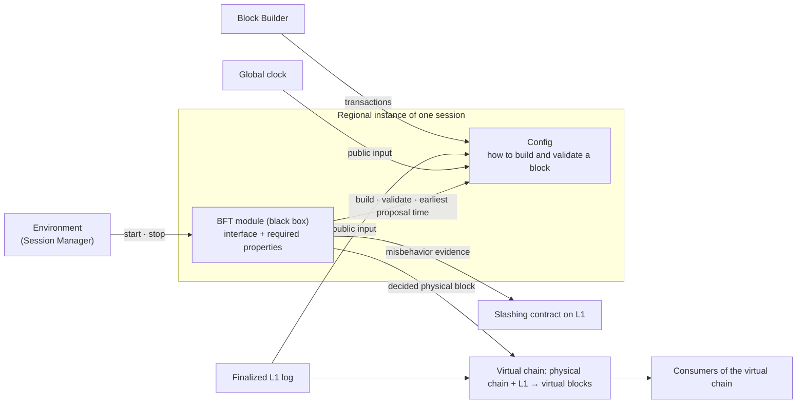
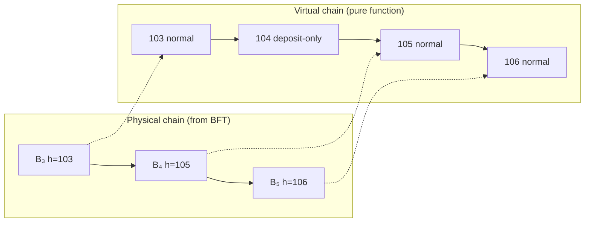

# Regional BFT 的抽象（工作稿 v0.11）

日期：2026-11-01。
状态：草稿。

**本文自成一体：** 每个 term 与 symbol 都定义在正文第一次用到它之前，读正文不需要其他文档。外部链接只是出处。与提纲、v0.3、v0.4、v0.5、v0.6、v0.7、v0.8、v0.9、v0.10、旧记号的对应放在附录 A，不属于正文。

**斜体的"直观"句子** 只帮助理解，不属于形式定义。两者不一致时，以形式定义为准。

---

## 0. Overview

Regional BFT 是一个 session 内的 state machine replication 实例：一个固定的成员集合（committee）从一个已经确定的 L2 block（anchor）出发，产生连续一段 L2 height 上的 block。

本文区分两种 block：

- **physical block**：BFT 达成共识的对象。一个 L2 height 上可能没有。
- **virtual block**：对外的 L2 block，每个 L2 height 一个，由共识决定的 physical block 与 L1 log 算出。



| Layer | 内容 | 是否可替换 |
| --- | --- | --- |
| BFT | 黑盒模块，只规定接口与性质（§4）。只看见 physical block 的 hash chain | 可替换 |
| Config | physical block 怎样构造、怎样验证（§4.2–§4.5） | 固定 |
| Virtual chain | 把共识决定的 physical chain 与 L1 log 映射成 virtual block 的纯函数（§3.3） | 固定 |

**核心事实：** L2 height 到 timestamp、到 L1 origin（L2 block 依据的 L1 block）、到 deposit 的对应，都在 BFT 之外固定，与 leader 和 fork 无关。BFT 只决定一件事：哪些 height 带哪些由 leader 选的交易。

这里只给轮廓，上面的词在正文中逐个定义。

---

## 1. Assumptions

**参与者。** 本文固定一个 session，所有参数都属于它，所以省略 session 下标。下面的参数由 environment 给出。

- **Committee** $V$：session 的成员集合。每个 **member**（也称 replica）$m\in V$ 有 weight $w_m$。对 $Z\subseteq V$，$w(Z):=\sum_{m\in Z}w_m$；总 weight 是 $W:=w(V)$。 *直观：这个 session 里负责出块和投票的一组成员，weight 决定每个人的分量。*
- **Fault threshold** $F$：常数，满足 $3F<W$。 *直观：系统最多能容忍多少 weight 的成员作恶。*
- **$\mathrm{Byz}\subseteq V$**：Byzantine member 的集合。不属于 $\mathrm{Byz}$、按协议运行的 member 叫 **honest member**；它可以崩溃后重新上线；先持久化签名记录，再签名。 *直观：Byzantine member 可以任意作恶，honest member 照协议走，最多只是掉线。*
- **View** $v\in\mathbb N_{>0}$：一次 proposal 机会，leader 是 $\mathrm{Leader}(v)$。$\mathrm{Leader}:\mathbb N_{>0}\to V$ 是确定函数，整个 session 内不变。没有 term。 *直观：一次轮到某个 leader 出块的机会。*

| 编号 | 名称 | 内容 | 用途 |
| --- | --- | --- | --- |
| A1 | Partial synchrony | 存在未知的时刻 $\mathrm{GST}$ 与已知的时长 $\Delta$：honest member 之间于 $\tau$ 发出的消息，在 $\max\{\tau,\mathrm{GST}\}+\Delta$ 之前送达并处理完毕；不同 region 之间的上界为 $\Delta_{\rm cross}$ *直观：网络可以坏一阵子，但 GST 之后消息一定在已知时限内到达。* | 只用于 liveness |
| A2 | Authenticated communication | 信道经过认证；签名不可伪造；hash 函数 $\mathsf H$ 抗碰撞；所有 member 的公钥公开已知 *直观：消息是谁发的、内容有没有被改，都可以验证。* | 全部目标 |
| A3 | Global clock | 所有 member 读同一个 global clock $\tau\in\mathbb R_{\ge0}$，没有 drift *直观：所有成员看的是同一个准确的时钟。* | 只用于时间目标与 timeout；agreement 不依赖它 |
| A4 | Static adversary | 存在集合 $\mathrm{Byz}\subseteq V$，在 session 开始、$\mathrm{Leader}$ 的 seed 揭晓之前固定，$w(\mathrm{Byz})\le F$，且 $3F<W$ *直观：作恶的成员在 session 开始前就定了，并且不超过容忍上限。* | 全部 safety 目标；liveness 的时间界 |

**A3 的说明。** clock drift 由 clock 模块内部处理，这里不建模。读数误差的影响见 §5 的 G1。

**A4 的说明。** safety 只用到"累计被 corrupt 的 weight 不超过 $F$"，不用 static。static 只用于 §5 中最长连续 Byzantine view 数的最坏值。

---

## 2. Building Blocks

本节只定义外部给定的 building block：L1 与它的 deposit log。

### 2.1 L1：safe、live、fixed pace

*直观：L1 是一本只增长、不回退的公共账本。*

L1 是 finalized block 的序列，$\ell\in\mathbb N$ 是 height。L1 block $\ell$ 的 timestamp 记 $\mathit{ts}_{\rm L1}(\ell)$。

- **Fixed pace：** $\mathit{ts}_{\rm L1}(\ell)=\tau^0_{\rm L1}+\ell\,b_{\rm L1}$，每个 slot 都有 block。$\tau^0_{\rm L1}$ 是 L1 的起点，$b_{\rm L1}$ 是 L1 slot 长度。 *直观：L1 每隔固定时间出一个 block。*
- **Safety：** 两个 honest member 读到的 finalized log 互为前缀，finalized block 不回退。 *直观：大家读到的 L1 历史不会互相矛盾。*
- **Liveness 与可读：** 每个 L1 block $\ell$ 在 $\mathit{ts}_{\rm L1}(\ell)+T_{\rm L1}$ 之前已经 finalized，并对所有 honest member 可读。$T_{\rm L1}$ 是从 timestamp 到 finalized 且可读的上界。 *直观：每个 L1 block 最晚在固定时间之后，所有人都能读到。*

这组假设只影响 liveness：读不到 L1 时 member 等待，不会投错票。

*直观：数据还没到就等，等到的结果不会变。*

**读取约定：** 任何读 L1 log 的函数，在所需 L1 block 还不可读时返回 `WAIT`。`WAIT` 只推迟结果，不改变结果。

### 2.2 Deposit Log

*直观：用户在这个 L1 block 上发起、要带进 L2 的交易。*

$\mathrm{DepLog}(\ell)$ 是 L1 block $\ell$ 记录的 deposit 交易列表，由 finalized log 唯一确定。

---

## 3. Virtual Chain、Physical Chain 与 Merge Rule

本节依次定义：fixed virtual L2 chain 与它的 property；BFT 达成共识的 physical chain；把 physical chain 与 L1 合成 virtual chain 的 merge rule。

### 3.1 Fixed Virtual L2 Chain

本节的目标是 fixed virtual chain：每个 height 的 timestamp、origin、prefix 都在任何 block 产生之前固定。

#### Virtual Block

*直观：用户最终看到的 L2 block，每个 height 都有一个，不管 BFT 在这个 height 上有没有出块。*

**virtual block** 是对外的 L2 block，是下面的六元组：

$$
\mathit{VB}=\bigl\langle\,\mathit{VB}.h,\ \mathit{VB}.\mathit{ts},\ \mathit{VB}.\mathit{os},\ \mathit{VB}.\mathit{Dep},\ \mathit{VB}.\mathit{root},\ \mathit{VB}.\mathit{Txs}\,\bigr\rangle.
$$

| 字段 | 含义 |
| --- | --- |
| $\mathit{VB}.h$ | L2 height |
| $\mathit{VB}.\mathit{ts}$ | timestamp |
| $\mathit{VB}.\mathit{os}$ | **origin**：这个 block 依据的 L1 block *直观：这个 L2 block 能看到 L1 的哪个位置。* |
| $\mathit{VB}.\mathit{Dep}$ | **prefix**：执行时排在最前面的交易列表，含 deposit *直观：不由 leader 决定、必须最先执行的交易。* |
| $\mathit{VB}.\mathit{root}$ | 执行这个 block **之前**的 state root *直观：这个 block 开始之前的状态指纹。* |
| $\mathit{VB}.\mathit{Txs}$ | 排在 prefix 之后、由 leader 选的交易列表 |

*直观：actual 是块上实际写的值，should-be 是规则算出来应该写的值，验证就是比较两者。*

对象的字段一律写成 $X.\mathit{field}$。这些字段都是 **actual 值**：对象上实际带着的值，可能由 leader 填写，也可能来自外部。下面的 property 规定字段应该等于什么；规定的目标值带 star，称为 **should-be 值**，任何人都能从公开输入重算。

*直观：anchor 是 session 的起跑点，这个 session 负责它之后固定数量的 height。*

**Anchor。** session 从 **anchor** $A$ 出发：一个已经确定的 L2 block。它的 height 是 $A.h$，origin 是 $A.\mathit{os}$，执行到它之后的状态是 $A.\sigma$，hash 记 $\mathsf H(A)$。session 覆盖 $\mathrm{TB}\in\mathbb N_{>0}$ 个 height，最高 height 是 $h_{\max}:=A.h+\mathrm{TB}$。$A$ 由 environment（Session Manager）给出，怎样选择不在本文范围内。

*直观：从起跑点开始，每个 height 一个 block，中间不留空。*

**Virtual chain：** 序列 $\mathcal L=(\mathit{VB}_{A.h+1},\dots,\mathit{VB}_n)$，$n\le h_{\max}$，满足 $\mathit{VB}_i.h=i$：从 anchor 之后开始，每个 height 恰好一个 block。

#### VP1 Fixed Pace

*直观：每个 height 的时间由公式算出，与实际何时出块无关。*

$\tau^0_{\rm L2}$ 是 L2 genesis 时刻，$h^0$ 是 genesis height，$b_{\rm L2}$ 是 L2 block 间隔。$\mathit{ts}^*(h)$ 是 height $h$ 应有的 timestamp：

$$
\mathit{ts}^*(h):=\tau^0_{\rm L2}+(h-h^0)\,b_{\rm L2}.
$$

*直观：height 和时间一一绑定。*

**VP1 Fixed pace：** virtual chain 上每个 block 满足 $\mathit{VB}.\mathit{ts}=\mathit{ts}^*(\mathit{VB}.h)$。

**这条只约束 virtual block。** physical block 不必每个 height 都有，也不必准时产生。

#### VP2 L1 Synchrony

每个 height 有固定的 origin 和固定的 prefix，都只由 height、anchor 与 L1 log 决定。下面先定义这两个目标值，再给出 property。

*直观：native 规则是 L2 现有、不能破坏的规则，它要求 origin 按顺序走，并且和 L2 时间保持接近。*

**Native origin 规则。** **native** 指 L2 现有的规则，本文不改变。一条 L2 chain 要被 L1 derivation（从 L1 重建 L2 chain 的规则）原样接受，它每个 height 实际的 origin $\mathit{os}(h)$ 必须满足：

- **O1 Continuity：** $\mathit{os}(h)-\mathit{os}(h-1)\in\{0,1\}$； *直观：origin 不能跳，每个 height 最多前进一个 L1 block。*
- **O2 Not ahead：** $\mathit{ts}_{\rm L1}(\mathit{os}(h))\le\mathit{ts}^*(h)$； *直观：L2 block 不能依据未来的 L1 block。*
- **O3 Drift：** $\mathit{ts}^*(h)\le\mathit{ts}_{\rm L1}(\mathit{os}(h))+T_{\rm drift}$。 *直观：L2 block 依据的 L1 block 不能太旧。*

$T_{\rm drift}$ 是 native 常数：drift 的上界。

*直观：每个 height 都依据当前时间往前退一段固定时间的 L1 block，所以这个 L1 block 已经可以读到。*

**Scheduled origin。** 设常数 $T_{\rm dep}$（deposit lag）。height $h$ 按 schedule 的 origin 是 $\ell^{\rm sch}(h)$：

$$
\ell^{\rm sch}(h):=\max\{\ell:\ \mathit{ts}_{\rm L1}(\ell)+T_{\rm dep}\le\mathit{ts}^*(h)\}
=\Bigl\lfloor\frac{\mathit{ts}^*(h)-T_{\rm dep}-\tau^0_{\rm L1}}{b_{\rm L1}}\Bigr\rfloor.
$$

*直观：目标是 schedule，但要从 anchor 的 origin 出发，一步步靠过去，不能跳。*

**Should-be origin。** height $h$ 应有的 origin 记 $\mathit{os}^*(h)$。anchor 的 actual origin $A.\mathit{os}$ 可能不在 schedule 上（例如紧急恢复时 anchor 来自 L1 derivation）。所以从 anchor 算起：$\mathit{os}^*(A.h):=A.\mathit{os}$，并且

$$
\mathit{os}^*(h):=\min\bigl\{\,A.\mathit{os}+(h-A.h),\ \max\{A.\mathit{os},\ \ell^{\rm sch}(h)\}\,\bigr\},\qquad A.h<h\le h_{\max}.
$$

三者的关系：

- anchor 超前 schedule 时，$\mathit{os}^*$ 冻结，等 schedule 追上来；
- anchor 落后 schedule 时，$\mathit{os}^*$ 每个 height 前进 1，直到追上；
- $A.\mathit{os}=\ell^{\rm sch}(A.h)$ 时，$\mathit{os}^*(h)=\ell^{\rm sch}(h)$：origin 是 height 的纯函数。这就是 L1 与 L2 的同步。

*直观：这三个约束保证 schedule 走得通：origin 不跳、L1 数据已可读、origin 不会太旧。*

**Constant constraints：**

| 约束 | 作用 |
| --- | --- |
| c1：$b_{\rm L2}\le b_{\rm L1}$ | 相邻 height 的 $\ell^{\rm sch}$ 至多差 1，所以 O1 成立，每个 L1 block 都有第一个使用它的 height |
| c2：$T_{\rm L1}\le T_{\rm dep}$ | 时间到 $\mathit{ts}^*(h)$ 时，L1 block $\mathit{os}^*(h)$ 已可读（下面的 prefix 要读它） |
| c3：$T_{\rm dep}+b_{\rm L1}\le T_{\rm drift}$ | O3 成立 |

*直观：anchor 自身的 origin 要已经确定，并且和它的时间相符。*

**Anchor 条件：** $A.\mathit{os}$ 在 session 开始前已 finalized，且 $\mathit{ts}_{\rm L1}(A.\mathit{os})\le\mathit{ts}^*(A.h)\le\mathit{ts}_{\rm L1}(A.\mathit{os})+T_{\rm drift}$。environment 保证这个条件，本文把它作为前提。

**例子。** $b_{\rm L2}=1$ 秒，$b_{\rm L1}=12$ 秒，$T_{\rm L1}=19$ 分钟，$T_{\rm dep}=25$ 分钟，$T_{\rm drift}=30$ 分钟。timestamp 10:00:00 的 L1 block，第一个以它为 origin 的 L2 block 的 timestamp 是 10:25:00；接下来 11 个 height origin 不动；timestamp 10:25:12 的 L2 block 换成下一个 L1 block。

*直观：每个 height 开头必须执行的交易，完全由 L1 决定，leader 碰不到。*

**Should-be prefix。** 对 $A.h<h\le h_{\max}$，height $h$ 应有的 prefix 是 $\mathrm{Dep}^*(h)$。$\Vert$ 是列表拼接，$\varnothing$ 是空列表。

$$
\mathrm{Dep}^*(h):=\mathrm{Attr}^*(h)\ \Vert\ \mathrm{Deposit}^*(h)\ \Vert\ \mathrm{Sys}^*(h).
$$

- $\mathrm{Attr}^*(h)$：L1 attributes transaction，是 $(h,\mathit{os}^*(h),A)$ 与 L1 log 的公开确定函数； *直观：把 L1 的信息告诉 L2 的系统交易。*
- $\mathrm{Deposit}^*(h):=\mathrm{DepLog}(\mathit{os}^*(h))$ 若 $\mathit{os}^*(h)\ne\mathit{os}^*(h-1)$，否则为 $\varnothing$； *直观：L1 block 的 deposit 只进入第一个以它为 origin 的 height。*
- $\mathrm{Sys}^*(h)$：适用的 system 与 upgrade transaction，是 $(h,\mathit{ts}^*(h),\mathit{os}^*(h))$ 的公开确定函数。 *直观：到了特定 height 必须执行的系统与升级交易。*

$\mathrm{Attr}^*(h)$ 每个 height 都有，所以 $\mathrm{Dep}^*(h)$ 从不为空。

*直观：这是 height 里唯一由 leader 决定的内容。*

排在 prefix 之后的是 **ordinary transaction**：由 leader 选的交易，不属于任何 $\mathrm{Dep}^*(h)$。

*直观：L2 和 L1 的对应关系事先算好，leader 改不了。*

**VP2 L1 synchrony：** virtual chain 上每个 block 满足：

- (a) origin：$\mathit{VB}.\mathit{os}=\mathit{os}^*(\mathit{VB}.h)$；
- (b) prefix：$\mathit{VB}.\mathit{Dep}=\mathrm{Dep}^*(\mathit{VB}.h)$。

**性质（证明见 §6.1）：**

- **Native origin（Lemma 1）：** $\mathit{os}^*$ 满足 O1–O3。
- **Consistent：** 两个 honest member 都读到 $\mathrm{Dep}^*(h)$ 时结果相同，不随时间改变。
- **Leader-independent：** 结果只取决于 $A$、$h$ 与 L1 log。
- **Exactly once：** 每个 L1 block 的 deposit 恰好进入一个 height。

#### Fixed Virtual Chain

*直观：整条链的骨架（时间、origin、prefix）事先固定，只有 root 和 leader 选的交易还没定。*

**定义。** 同时满足 VP1 与 VP2 的 virtual chain 称为 **fixed virtual chain**。它的 timestamp、origin、prefix 只取决于 height、anchor 与 L1 log，与 leader 和 fork 无关。$\mathit{VB}.\mathit{root}$ 与 $\mathit{VB}.\mathit{Txs}$ 不受这两条约束，由 §3.3 的 merge rule 给出。

### 3.2 Physical Chain

BFT 只对 physical block 达成共识。

*直观：BFT 真正投票的对象，prefix 不用带，因为谁都能算出来。*

physical block 是下面的六元组（payload），字段都是 actual 值：

$$
B=\bigl(B.\mathit{ph},\ B.h,\ B.\mathit{ts},\ B.\mathit{os},\ B.\mathit{root},\ B.\mathit{Txs}\bigr).
$$

| 字段 | 含义 | 应等于 |
| --- | --- | --- |
| $B.\mathit{ph}$ | parent $P$ 的 hash。$P$ 是 chain 上的前一个 physical block，或 anchor $A$ | $\mathsf H(P)$ |
| $B.h$ | virtual height，满足 $B.h>P.h$ | 由时刻决定（§4.3） |
| $B.\mathit{ts}$ | timestamp | $\mathit{ts}^*(B.h)$（VP1） |
| $B.\mathit{os}$ | origin | $\mathit{os}^*(B.h)$（VP2） |
| $B.\mathit{root}$ | height $B.h$ **执行之前**的 state root | 由 parent 与 L1 log 算出（§3.3） |
| $B.\mathit{Txs}$ | ordinary transaction 的有序列表，可以为空 | 没有，由 leader 选 |

physical block 不带 prefix，因为 $\mathrm{Dep}^*(B.h)$ 是公开可算的。vote 时检查 actual 值是否等于上表的值（§4.4）。

*直观：BFT 的 block 靠 hash 连成链，height 可以跳，但 hash 不能断。*

**Physical chain：** 序列 $C=(A,B_1,\dots,B_n)$，满足 $B_1.\mathit{ph}=\mathsf H(A)$，$B_{i+1}.\mathit{ph}=\mathsf H(B_i)$。

*直观：view 是出块的机会，physical block 是机会的结果，height 是时间。*

**三个坐标。** view 只属于 BFT。state 与 virtual block 只用后两个坐标。

| 坐标 | 含义 | 怎样增长 |
| --- | --- | --- |
| view $v$ | 一次 proposal 机会 | BFT 结束这个 view，就进入下一个 |
| physical block $B$ | BFT 的共识对象 | 每个 view 至多一个 |
| virtual height $h$ | L2 height，与时间绑定 | 相邻 physical block 之间可以跳过若干 height |

### 3.3 Merge Rule

*直观：BFT 的结果加上 L1 的数据，算出用户看到的链。*

merge rule 把 physical chain 与 L1 log 合成 virtual chain：prefix 来自 L1，交易列表来自 physical chain，state root 由逐个 height 执行得到。

*直观：这个 height 有 physical block 就用它的交易，否则交易为空。*

**$\mathit{Txs}_C(i)$：** 若 $C$ 中有 $B.h=i$ 的 physical block，取 $B.\mathit{Txs}$；否则取 $\varnothing$。

#### State Transition

*直观：这些是描述执行要用到的基本对象，metadata 相当于块头信息。*

**Types.** $\sigma\in\Sigma$ 是 execution state，含当前 block 的 context。$x\in\mathrm{Tx}$ 是一笔交易，$\mathrm{Tx}^*$ 是交易列表。$m\in\mathrm{Meta}$ 是 block metadata $(h,\mathit{ts},\mathit{os})$，height $h$ 应有的 metadata 是 $\mathit{meta}^*(h):=(h,\mathit{ts}^*(h),\mathit{os}^*(h))$。$\mathrm{root}:\Sigma\to\{0,1\}^*$ 是抗碰撞的 state root 函数。

**Native execution.** L2 已有三个函数，本文只使用：

- $\mathsf{Begin}(\sigma,m,D)\to\sigma'$：开始 metadata 为 $m$ 的 block，执行 prefix $D\in\mathrm{Tx}^*$。 *直观：开始一个 block，先把 prefix 执行完。*
- $\mathsf{Valid}(\sigma,x)\to\{\mathrm{true},\mathrm{false}\}$：native 规则是否允许在 $\sigma$ 上执行 $x$，例如 nonce、余额、block gas。Interop 激活的 height 上恒为 false。 *直观：这笔交易现在能不能执行。*
- $\mathsf{Run}(\sigma,x)\to\sigma'$：执行 $x$。revert 也算执行过。 *直观：真正执行这笔交易。*

*直观：invalid transaction 是根本不允许执行的交易，native block 是最后实际执行的 block。*

$\mathsf{Valid}$ 为 false 的交易叫 **invalid transaction**，即 native 规则不允许执行的交易（如 nonce 错误、余额不足）。revert 不算。**native block** 是按这些规则实际执行的 L2 block（下面给出它的交易列表），它被接受，当且仅当它的交易依次都是 $\mathsf{Valid}$。这三个函数是确定的，除输入外只读 L1 block $\mathit{os}$ 的 header，与 leader 无关，因为 L1 derivation 只凭 height、origin 与交易列表就要重现 block（[BlockRecord](../megaeth_specs/specs/block-certification/block-records.md#fields)）。$\mathsf{Begin}$ 总有结果，否则 L1 derivation 自身就停在 [critical error](../megaeth_specs/specs/rollup/derivation.md#channel-retention-after-execution-rejection)。

*直观：执行一个 height 时，坏交易直接跳过，不让整块失败。*

**Apply.** 执行一个 height：先执行 prefix，再逐笔处理交易，invalid 的直接丢弃。

```text
Apply(σ, m, D, Txs) → (σ', Kept):
    σ ← Begin(σ, m, D)
    Kept ← []
    for x in Txs:
        if Valid(σ, x):
            σ ← Run(σ, x)
            Kept ← Kept ‖ [x]
    return (σ, Kept)
```

*直观：从 anchor 开始依次执行每个 height，就得到每个 height 之后的状态。*

**Should-be state.** 给定 physical chain $C$，从 anchor 开始逐个 height 推进。$\sigma^*_i$ 是 height $i$ 执行完之后应有的状态，$\mathit{Kept}^*_i$ 是 height $i$ 实际生效的 ordinary transaction：

$$
\sigma^*_{A.h}:=A.\sigma,\qquad
(\sigma^*_i,\ \mathit{Kept}^*_i):=\mathsf{Apply}\bigl(\sigma^*_{i-1},\ \mathit{meta}^*(i),\ \mathrm{Dep}^*(i),\ \mathit{Txs}_C(i)\bigr).
$$

*直观：padding 是没有 BFT block 的 height 也要执行，但只跑 prefix。*

height $i$ 上没有 physical block 时，$\mathit{Txs}_C(i)=\varnothing$，这一步只执行 $\mathrm{Dep}^*(i)$，称为 **padding**。

*直观：新 block 写的状态指纹只算到它之前，所以投票不用执行它自己的交易。*

**Should-be state root.** 设 $C$ 以 $P$ 结尾，$h>P.h$。parent 为 $P$、height 为 $h$ 的 block 应有的 state root 是：

$$
\mathit{root}^*(P,h):=\mathrm{root}(\sigma^*_{h-1}).
$$

新 block 只承诺它之前的状态：parent 的交易，加上中间的 padding。所以 vote 不用执行当前 block 的交易，这些交易的结果由下一个 block 的 root 承诺。

*直观：virtual block 的交易和 root，都要和 physical chain 的执行结果一致。*

**VP3 State consistency：** virtual chain 相对 physical chain $C$ 满足 VP3，当且仅当它的每个 block 满足 $\mathit{VB}_i.\mathit{Txs}=\mathit{Txs}_C(i)$，且 $\mathit{VB}_i.\mathit{root}=\mathrm{root}(\sigma^*_{i-1})$。

本节的函数只读 physical chain 与 L1 log，不读任何 BFT 数据。block 里只有 root，所以 member 要保留完整状态。

#### Merge

*直观：merge rule 就是把前面的结果按 height 拼起来的公式。*

设 $C$ 是 physical chain，最后一个 physical block 的 height 是 $h_C\le h_{\max}$。**merge rule** $\mathrm{Virt}(C)$ 在每个 height $i\in(A.h,h_C]$ 上给出一个 virtual block：

$$
\mathit{VB}^*_i:=\bigl\langle\, i,\ \mathit{ts}^*(i),\ \mathit{os}^*(i),\ \mathrm{Dep}^*(i),\ \mathrm{root}(\sigma^*_{i-1}),\ \mathit{Txs}_C(i)\,\bigr\rangle.
$$

**Proposition（§6.1 Lemma 5）。** $\mathrm{Virt}(C)$ 是 height 范围 $(A.h,h_C]$ 上唯一的、相对 $C$ 满足 VP3 的 fixed virtual chain。所以 state 与 virtual block 都是 physical chain 与 L1 log 的纯函数。

*直观：normal 带 leader 的交易，deposit-only 只有 prefix。*

height $i$ 有 physical block 时是 **normal virtual block**，否则是 **deposit-only virtual block**，两者用同一个公式。

*直观：virtual block 记录 leader 选的所有交易，native block 只留下真正执行的。*

**Native block：** height $i$ 实际执行的 block，交易列表是 $\mathrm{Dep}^*(i)\,\Vert\,\mathit{Kept}^*_i$。virtual block 保留 leader 选的原始列表，native block 只含留下的交易。

*直观：每个 height 都要把记录交到 L1，空的也要交，否则 L1 会自己补块，可能和这条链分叉。*

**Settlement 义务。** 这一段规定 virtual chain 怎样结算到 L1。它由 batcher（提交批次）与 Certifier（认证批次）承担，不属于 BFT。对要结算的 $\mathrm{Virt}(C)$ 的每个 height $i$，**包括 deposit-only height**，要在 sequencing window（native 规则给批次的提交期限）结束之前，按 height 顺序提交并认证批次记录：

```text
BlockRecord{ block_number = i, epoch_num = os*(i), transactions = Kept*_i }
```

deposit-only height 的 `transactions` 为空。没有这份记录时，L1 derivation 会在窗口结束后自己补块，它的 origin 可能不等于 $\mathit{os}^*(i)$。

Example: 


---

## 4. RegionalBFT Module

*直观：本文不关心 BFT 内部怎么做，只关心它对外提供什么。*

RegionalBFT 是一个黑盒模块。本文只规定它的接口（§4.1）、配置（§4.2–§4.5）与要满足的性质（§4.6）。任何满足这些规定的 BFT 都可以放入，所以 BFT 与本文的设计正交。

范围是基于 view 与 leader 的 chain-based partially synchronous BFT。本文不读它的 vote、timer 或其他内部数据。它只看见 physical block 的 parent 指针 $B.\mathit{ph}$，其余字段对它不透明。

### 4.1 Interface

调用语义：先持久化，后对外发送；重复调用返回原结果；缺输入返回 `WAIT`；无效返回 `REJECT`。

global clock $\tau$ 与 finalized L1 log 是 public input，所有 member 直接读取，不是接口。$\mathrm{Dep}^*(h)$ 是 L1 log 的纯函数，同样不需要调用。

*直观：这个 session 的唯一标识，防止签名被挪到别的 session 使用。*

**Context id：** $\mathrm{cid}:=\mathsf H$（session 标识、committee、$\mathsf H(A)$、协议版本）。

*直观：外部不用运行 BFT，也能验证它的结果。*

**公开 verifier：** BFT 提供两个公开函数，只凭公开数据就能判断，不需要 BFT 的内部状态。

- $\mathrm{CheckFINAL}(\mathrm{cid},V,B,\pi_{\rm fin})$：$\pi_{\rm fin}$ 证明 $B$ 已被决定。 *直观：验证这个 block 确实已经决定。*
- $\mathrm{CheckEvidence}(\mathrm{cid},\mathit{ev})$：$\mathit{ev}$ 证明同一把 key 违反了 BFT 规定的 **conflict relation**。conflict relation 对本文不透明。 *直观：验证有人签了不该同时签的消息。*

*直观：有证明的 block 就定了，它的祖先也随之确定。*

**Decided：** 存在 $\pi_{\rm fin}$ 使 $\mathrm{CheckFINAL}(\mathrm{cid},V,B,\pi_{\rm fin})$ 为真时，以 $B$ 结尾的 physical chain 称为 **decided chain**，这条 chain 上的 block 称为 **decided**（也称 regional finalized）。所以 $B$ 被决定时，它的所有祖先也被决定，不需要各自的证明。`Final` 不必对每个 block 都输出。

| 类别 | Interface | 功能 |
| --- | --- | --- |
| Control input | `Create(params)` | 固定 session 的参数（$V$、$w_m$、$F$、$\mathrm{Leader}$、$A$、$\mathrm{TB}$、$\mathrm{cid}$，其中 $A$ 只固定 hash）。BFT 自己的参数不在本文范围内。不授予签名权，不启动 BFT。输出 `Assigned` 或 `REJECT` *直观：登记这个 session 的参数，但还不开始。* |
| Control input | `Enter(A, π_A, A.σ)` | $A$ 是 anchor 的完整内容，$\pi_A$ 是 environment 对它已确定的证明。从 view 1 开始运行。每个实例至多进入一次。输出 `Entered(τ)`、`WAIT` 或 `REJECT` *直观：拿到 anchor 之后正式开始。* |
| Control input | `Close(reason)` | $\mathit{reason}$ 是不透明的标签，实例的行为不依赖它。立即停止一切签名；保留已有的 block 与 evidence。输出 `Terminated(reason)` *直观：让这个实例立刻停下。* |
| Output | `Final(B, π_fin)` | $B$ 是 decided physical block，$\pi_{\rm fin}$ 是它的证明。height $h_{\max}$ 的 Final 表示实例完成。消费者用 $\mathrm{Virt}$ 得到 virtual block *直观：告诉外界哪个 block 定了，并附上证明。* |
| Output | `Evidence(ev)` | $\mathrm{CheckEvidence}(\mathrm{cid},\mathit{ev})$ 为真。异步提交 L1，任何步骤都不等它 *直观：举报违规行为。* |

### 4.2 Config

*直观：Build 管怎么造块，Accept 管该不该投票，NotBefore 管最早何时可以出块。*

RegionalBFT 由下面三个函数配置，记作 $\mathrm{RegionalBFT}\langle\mathsf{Build},\mathsf{Accept},\mathsf{NotBefore}\rangle$。换 BFT 时，这三个函数不变。

| 函数 | 何时调用 | 输入 | 输出 | 定义 |
| --- | --- | --- | --- | --- |
| $\mathsf{Build}$ | honest leader 在一个 view 中 propose 时 | parent $P$，当前时刻 $\tau$ | physical block 或 `WAIT` | §4.3 |
| $\mathsf{Accept}$ | member 决定是否为 block 投票时 | parent $P$，block $B$，首次收到 $B$ 的时刻 $\tau_{\rm recv}$ | `ACCEPT`、`WAIT` 或 `REJECT` | §4.4 |
| $\mathsf{NotBefore}$ | BFT 需要知道 $P$ 之后最早何时可以 propose 时 | parent $P$ | 一个时刻 | §4.5 |

**边界。** 三个函数只读 physical chain、L1 log 与上表的输入，不读 view、leader 身份或 BFT 的其他数据。所以 block 的内容不依赖 BFT 的内部状态。

**职责。** VP1、VP2 由 merge rule 保证，对任何 physical chain 都成立（§3.3），不依赖这三个函数。这三个函数保证的是：

- $B$ 是 $P$ 的合法扩展，所以 merge rule 有定义；
- $B$ 的 timestamp、origin、state root 与 virtual chain 一致；
- block 的产生时间与它的 timestamp 相符；
- 交易列表不会让 L1 derivation 丢弃批次。

### 4.3 Build

*直观：当前时间对应哪个 height。*

$\mathrm{slot}(\tau)$ 是 timestamp 不晚于 $\tau$ 的最高 height：

$$
\mathrm{slot}(\tau):=h^0+\Bigl\lfloor\frac{\tau-\tau^0_{\rm L2}}{b_{\rm L2}}\Bigr\rfloor.
$$

所以 $\mathit{ts}^*(\mathrm{slot}(\tau))\le\tau<\mathit{ts}^*(\mathrm{slot}(\tau)+1)$。

*直观：和上面一样，但不超过这个 session 负责的最高 height。*

时刻 $\tau$ 应有的 height 是 $h^*(\tau)$：

$$
h^*(\tau):=\min\{\mathrm{slot}(\tau),\ h_{\max}\}.
$$

*直观：leader 按当前时间取 height 和对应字段，这个 slot 已经有 block 就等下一个。*

honest leader 在时刻 $\tau$、以 $P$ 为 parent 时，用 metadata mapping $\mathsf{Meta}$ 得到 block 的 metadata：

$$
\mathsf{Meta}(P,\tau):=
\begin{cases}
\mathit{meta}^*\bigl(h^*(\tau)\bigr) & P.h<h^*(\tau),\\
\texttt{WAIT} & \text{否则.}
\end{cases}
$$

`WAIT` 表示这个 slot 已经有 block，要等下一个 slot。

*直观：leader 向 Block Builder 要交易。*

leader 的交易来自 Block Builder：`Payload(h, σ, L_bytes)` 只有 leader 调用，返回有序的 ordinary transaction，可以为空。$\sigma$ 是执行完 prefix 之后的状态，$L_{\rm bytes}$ 是总字节数上限。

*直观：不看状态就能做的快速检查，挡住会让批次被 L1 丢弃的交易。*

**$\mathsf{BasicTx}$** 是一个固定的公开谓词，所有 member 相同，不读状态，每笔交易独立判断，所以可以并发。它成立，当且仅当：

- 每个条目非空、能解码、签名正确，且不是 deposit 类型；
- 所有条目的总字节数不超过常数 $L_{\rm bytes}$。

*直观：除了交易列表，所有字段都按规则填写。*

$\mathsf{Build}(P,\tau)$ 把每个字段设为它的 should-be 值：

1. $(h,\mathit{ts},\mathit{os})\gets\mathsf{Meta}(P,\tau)$；
2. $\mathit{root}\gets\mathit{root}^*(P,h)$；
3. 若 $\mathrm{slot}(\tau)>h_{\max}$，$\mathit{Txs}\gets\varnothing$；否则 $\mathit{Txs}\gets$ `Payload(h, Begin(σ*_{h-1}, meta*(h), Dep*(h)), L_bytes)`，并保证通过 $\mathsf{BasicTx}$；
4. 输出 $(\mathsf H(P),h,\mathit{ts},\mathit{os},\mathit{root},\mathit{Txs})$。

**没有 ordinary transaction 也要 propose，** 否则 virtual chain 不前进。leader 可以先模拟 $\mathit{Txs}$，去掉 invalid transaction，但 validity rule 不要求这一步。

### 4.4 Accept

*直观：造块要花时间，网络也有延迟，所以要给 block 留一段宽容时间。*

**Metadata window。** $T_{\rm build}$ 是从求 $\mathsf{Meta}$ 到发出 block 的上界：执行 parent、padding、取 Payload、算 state root。**metadata window** $T_{\rm win}$ 是常数，要求 $T_{\rm win}\ge\Delta+T_{\rm build}$，这样 honest block 能通过下面的 V1。

*直观：检查这个 block 的字段对不对、来得是否合适，不执行它的交易。*

$\mathsf{Accept}(P,B,\tau_{\rm recv})$ 在下面三条都成立时返回 `ACCEPT`。$\tau_{\rm recv}$ 是该 member **首次收到** $B$ 的时刻，这是 $\mathsf{Accept}$ 唯一的时间输入。缺 $\sigma^*$ 或 L1 数据时返回 `WAIT`，否则返回 `REJECT`。

| 条件 | 内容 |
| --- | --- |
| V1 Metadata | **Stable：** $B.\mathit{ph}=\mathsf H(P)$，$P.h<B.h\le h_{\max}$，$B.\mathit{ts}=\mathit{ts}^*(B.h)$，$B.\mathit{os}=\mathit{os}^*(B.h)$。**Timely：** $\exists\,\tau''\in[\tau_{\rm recv}-T_{\rm win},\ \tau_{\rm recv}]$，使 $B.h=h^*(\tau'')$；若 $\tau_{\rm recv}\ge\mathit{ts}^*(h_{\max}+1)+T_{\rm win}$，还要求 $B.\mathit{Txs}=\varnothing$ *直观：字段按规则填写，block 来得不早不晚。* |
| V2 State root | $B.\mathit{root}=\mathit{root}^*(P,B.h)$ *直观：状态指纹正确。* |
| V3 Basic tx check | $\mathsf{BasicTx}(B.\mathit{Txs})$ *直观：交易格式合格，不会让批次被丢弃。* |

**V1 Timely 的 closed form（§6.1 Lemma 3）：** $B.h<h_{\max}$ 时为 $\mathit{ts}^*(B.h)\le\tau_{\rm recv}<\mathit{ts}^*(B.h+1)+T_{\rm win}$；$B.h=h_{\max}$ 时为 $\mathit{ts}^*(h_{\max})\le\tau_{\rm recv}$。

**Remark。** vote 不执行 $B.\mathit{Txs}$，所以 invalid transaction 可能进入 chain。$\mathsf{Apply}$ 会丢弃它们，状态不变。safety 与 liveness 都不依赖 $B.\mathit{Txs}$ 全部有效，这类交易只浪费 block space。leader 没有动机放入这类交易，由激励机制保证，不在本文范围内。

**谁检查什么：**

| 角色 | 对 height $h$ 的 block $B$ 做什么 |
| --- | --- |
| $B$ 的 leader | 算出 $B.\mathit{root}$，选 $B.\mathit{Txs}$ |
| $B$ 的 voter | 查 V1、V2、V3，不执行 $B.\mathit{Txs}$ |
| 下一个 leader | 执行 $B.\mathit{Txs}$，丢弃 invalid transaction，算出新的 root |
| 下一个 block 的 voter | 同样执行，查新的 root |

**$\mathsf{Accept}$ 只判断当前这个 block。** 它不查 ancestor，也不读 BFT 的数据；$P$ 由 BFT 选定并传入。

### 4.5 NotBefore

*直观：一个 slot 至多一个 block，所以 parent 之后要等到下一个 slot。*

honest leader 要等到新 slot 才能 propose。$\mathsf{NotBefore}(P)$ 是 $P$ 之后的 block 应有的最早 proposal 时刻，这是 Config 告诉 BFT 的唯一时间信息：

$$
\mathsf{NotBefore}(P):=\tau^*(P):=\mathit{ts}^*\bigl(\min\{P.h+1,\ h_{\max}\}\bigr).
$$

### 4.6 Required Properties

*直观：BFT chain 是系统已经开始依赖的 block。*

**BFT chain：** 对 physical block $B$，定义两个时刻，没有发生时取 $\infty$：

- $\tau_{\rm par}(B)$：某个 honest member 的 BFT 第一次选定 $P$ 作为 parent（包括调用 $\mathsf{Build}(P,\cdot)$ 或 $\mathsf{Accept}(P,\cdot,\cdot)$），且 $B$ 等于 $P$ 或是 $P$ 的祖先的时刻； *直观：第一次有 honest member 在它上面继续工作。*
- $\tau_{\rm fin}(B)$：任何参与方（包括 Byzantine）第一次持有某个 $\pi_{\rm fin}$，使 $\mathrm{CheckFINAL}$ 对 $B$ 或 $B$ 的某个后代为真的时刻。 *直观：第一次有人能证明它已经决定。*

*直观：两者取较早的，就是系统开始依赖这个 block 的时刻。*

$\tau_{\rm in}(B):=\min\{\tau_{\rm par}(B),\tau_{\rm fin}(B)\}$ 称为 $B$ **进入 BFT chain** 的时刻，祖先的进入时刻不晚于后代。$\tau_{\rm in}(B)<\infty$ 的 block 称为在 **BFT chain** 上；以这样的 block 结尾的 physical chain 称为一条 BFT chain。

**Safety（不依赖 synchrony，也不依赖 clock）：**

| 编号 | 性质 | 内容 |
| --- | --- | --- |
| BFT-1 | Agreement | 任意两条 decided chain，一条是另一条的前缀 *直观：决定的结果不会分叉。* |
| BFT-2 | Chain validity | BFT chain 上的每个 physical block $B$，都有 at least one honest replica 在某个时刻 $\tau_{\rm recv}\le\tau_{\rm in}(B)$ 首次收到它，并让 $\mathsf{Accept}$ 返回 `ACCEPT`。特别地，block 在 regional finalized 之前、被 honest member 用作 parent 之前，都已满足这一点 *直观：系统依赖的 block，至少有一个 honest member 事先检查过。* |
| BFT-3 | One block per view | 任何 BFT session，同一 view 至多贡献一个 physical block *直观：一次机会只能出一个 block，所以每个 block 都换 leader。* |
| BFT-4 | External verifiability/(correctness and soundness) | $\mathrm{CheckFINAL}$ 与 $\mathrm{CheckEvidence}$ 只凭公开数据判断；`Final` 输出的证明都让 $\mathrm{CheckFINAL}$ 为真；不存在针对 honest key、让 $\mathrm{CheckEvidence}$ 为真的 evidence *直观：外部能验证结果，honest member 不会被诬陷。* |

**Liveness。** GST 之前，即使 leader honest，它的 block 也可能拿不到足够的票，所以下面的性质都不作保证；safety 仍由上表保证。

*直观：这些常数是 BFT 对外承诺的时间：恢复同步、决定 block、进入下一个 view、结束坏 view，各要多久。*

**常数：** $T_{\rm sync}$、$T_{\rm fin}$、$T_{\rm next}$、$T_{\rm vc}$ 是 BFT 对外给出的常数。$T_{\rm fin}$、$T_{\rm next}$ 已包含 member 运行 $\mathsf{Accept}$ 的时间。

*直观：网络稳定、足够多成员一直在线，才谈得上 liveness。quorum weight 是形成决定所需的权重。*

令 **quorum weight** $Q:=W-F$。**liveness condition** 是对一段时间 $I$ 的要求，$\tau_{\rm lc}$ 是 $I$ 的起点：

- $\tau_{\rm lc}\ge\mathrm{GST}$；
- 整段 $I$ 上一直在线、且不晚于 $\tau_{\rm lc}+T_{\rm next}$ 完成 Enter 的 honest member 称为 **active member**，它们的总 weight 不小于 $Q$。所以其余 member 的总 weight 不超过 $F$； *直观：active member 是全程在线、跟得上进度的 honest member。*
- 整段 $I$ 上，L1 与 Payload 可读，实例未 Close，也未终止。

*直观：网络恢复之后，再留一段时间让大家追上，从这时起才有时限保证。*

**同步起点：** GST 之后，落后的 member 还要时间追上 BFT 的进度，这段时间 honest leader 也可能失败。所以下表的保证从 $\tau_{\rm sync}$ 开始：

$$
\tau_{\rm sync}:=\max\{\tau_{\rm lc}+T_{\rm sync},\ \mathsf{NotBefore}(A)\}.
$$

*直观：session 开始时大家已经就绪，没有旧状态要追。*

**同步开始** 指 $I$ 正好从 $\mathsf{NotBefore}(A)$ 开始，即 $\tau_{\rm lc}=\mathsf{NotBefore}(A)$。这时还没有 view 到达起算时刻，没有进度要追，所以不用等 $T_{\rm sync}$：$\tau_{\rm sync}:=\tau_{\rm lc}$。

*直观：这个 member 开始等 leader 出块的时刻：它已经进入 view，并且已经到了可以出块的时间。*

**起算时刻：** 对 member $m$ 与 view $v$，$\tau_{\rm st}(m,v)$ 是 $m$ 进入 $v$ 的时刻与 $\mathsf{NotBefore}(P)$ 的较晚者，$P$ 是 $m$ 进入 $v$ 时按 BFT 的规则选定的 parent。

*直观：这个 view 完全在恢复之后才开始，没有旧状态的影响。*

view $v$ **在 $\tau_{\rm sync}$ 之后开始**，指 $\tau_{\rm sync}$ 之前，没有 active member 到达它的 $\tau_{\rm st}(m,v)$，也没有 active member 进入比 $v$ 更高的 view。

下表的时限都落在 $I$ 内。

| 编号 | 性质 | 内容 |
| --- | --- | --- |
| BFT-5 | Progress | **前提：** view $v$ 在 $\tau_{\rm sync}$ 之后开始；leader $m$ 是 active member；$m$ 选定的 parent $P$ 满足 $P.h<h_{\max}$。**结论：** $m$ 进入 $v$，在 $s=\tau_{\rm st}(m,v)$ 调用 $\mathsf{Build}(P,s)$ 并 propose，而且 (a) 这个 block 在 $s+T_{\rm build}+T_{\rm fin}$ 之前 decided；(b) $s+T_{\rm build}+T_{\rm next}$ 之前，所有 active member 进入下一个或更高的 view，并在下一个 view 中选定这个 block 作为 parent。这些时限已包含取回 block body 的时间 *直观：恢复之后，正常 leader 的 block 一定被决定，下一个 view 接着它继续。* |
| BFT-6 | View sync and bounded faulty view | (a) 对 $\tau\ge\tau_{\rm sync}$：某个 active member 在 $\tau$ 时已进入 view $u$，则 $\tau+T_{\rm next}$ 之前，所有 active member 进入 $u$ 或更高的 view。(b) 不满足 BFT-5 前提的 view：active member $m$ 从 $\max\{\tau_{\rm st}(m,v),\tau_{\rm sync}\}$ 起，$T_{\rm vc}$ 内离开 $v$ *直观：成员之间不会差太远，坏 view 也不会拖太久。* |
| BFT-7 | Last block termination | BFT chain 到达 $h_{\max}$ 后，BFT finalize a block at height $h_{\max}$ and all replica terminates。若 view $v$ 在 $\tau_{\rm sync}$ 之后开始，leader $m$ 是 active member，选定的 parent 在 height $h_{\max}$，这件事在 $\tau_{\rm st}(m,v)+T_{\rm build}+T_{\rm fin}$ 之前完成 *直观：末块不靠后续 block 也能决定，然后实例结束。* |

**Remark。** BFT-5 至 BFT-7 是相对 Config 的要求，证明时可以用 §6.2 的 RULE-1 至 RULE-4，比如 honest block 会被接受（RULE-3）。但 $\mathsf{Accept}$ 不单调：一个 block 过了 V1 Timely 窗口，就从 `ACCEPT` 变成 `REJECT`。证明 BFT-5 时，不能依赖 honest member 接受已过窗口的 block。

**Swappable 的含义。** $\mathrm{CheckFINAL}$ 与 $\mathrm{CheckEvidence}$ 要由外部 verifier 运行，包括 L1 上的 slashing contract。所以换 BFT 是一次协议版本升级，不是运行时切换。

---

## 5. Design Goals

下面的 Dependency 列指向 §1–§4 的假设与性质，以及 §6 证明的 RULE-n 与 Lemma。

*直观：最坏情况下，连续多少个 leader 可能都不正常。*

**$r_{\max}$：** 最长连续 Byzantine view 数的最坏值，

$$
r_{\max}:=\max\bigl\{r:\ \exists\,Z\subseteq V,\ w(Z)\le F,\ \exists\,v,\ \forall\,0\le i<r:\ \mathrm{Leader}(v+i)\in Z\bigr\}.
$$

round-robin、equal weight、$\lvert V\rvert=3f+1$ 时 $r_{\max}=f$。liveness condition 下，不是 active member 的 member 总 weight 不超过 $F$，所以 $r_{\max}$ 也是 leader 不是 active member 的连续 view 数的上界。

*直观：稳定运行时，decided 末端最多落后当前时间多少，分为全部正常和有坏 leader 两种情况。*

**Lag 上界：** 令 $b^+:=\max\{b_{\rm L2},\ T_{\rm build}+T_{\rm next}\}$，它是满足 BFT-5 前提的 view 与下一个 view 的起算时刻之差的上界。$\Lambda_0:=b^++T_{\rm build}+T_{\rm fin}$；$\Lambda:=T_{\rm build}+T_{\rm fin}+b_{\rm L2}+b^++r_{\max}(T_{\rm vc}+b_{\rm L2})$。

*直观：同步起点之后，最晚多久 lag 上界开始成立。*

**恢复时间：** 从 $\tau_{\rm sync}$ 算起，

$$
T_{\rm rec}:=T_{\rm next}+b_{\rm L2}+(r_{\max}+1)(T_{\rm vc}+b_{\rm L2})+T_{\rm build}+T_{\rm fin}.
$$

*直观：session 正常结束，下一个 session 接着它的末块继续。*

**Regular handoff：** 后继 session 的 anchor 是本 session decided 的、height $h_{\max}$ 的 physical block。$T_{\rm enter}$ 是后继 member 收到它之后完成 Enter 的上界。

### G1 Height 与时间绑定

| 编号 | 目标 | 类型 | Dependency |
| --- | --- | --- | --- |
| G1.1 Fixed timestamp | virtual chain 满足 VP1：height $h$ 的 timestamp 等于 $\mathit{ts}^*(h)$ | safety | Lemma 5 |
| G1.2 Not ahead | BFT chain 上每个 physical block：进入 BFT chain 的时刻不早于 $\mathit{ts}^*(B.h)$ | safety | A3、BFT-2、V1 |
| G1.3 Not stale | BFT chain 上每个 $B.\mathit{Txs}$ 非空的 physical block：有 honest member 在 $\mathit{ts}^*(B.h+1)+T_{\rm win}$ 之前首次收到它。所以事后选择交易的窗口不超过 $b_{\rm L2}+T_{\rm win}$ | safety | A3、BFT-2、V1 |
| G1.4 Time following | liveness condition 下：(a) $\tau\ge\tau_{\rm sync}+T_{\rm rec}$ 且末端未到 $h_{\max}$ 时，decided virtual chain 末端的 timestamp 不早于 $\tau-\Lambda$；这之后 leader 都是 active member、每个起算时刻都是 slot 起点时，不早于 $\tau-\Lambda_0$；(b) 中断结束后，第一个满足 BFT-5 前提的 view 的 block 直接落在当前 slot，空档由 padding 填满，它在 $\tau_{\rm sync}+T_{\rm rec}$ 之前 decided。空档超过 $h_{\max}$ 时封顶在 $h_{\max}$，余下的由后继 session 接着补 | liveness | A1、A3、BFT-2、BFT-5、BFT-6、BFT-7、Lemma 8 |

例：$b_{\rm L2}=1$ 秒，$T_{\rm build}=40$ ms，$T_{\rm next}=50$ ms，$T_{\rm fin}=60$ ms，$T_{\rm vc}=0.25$ 秒，$r_{\max}=2$ 时，$b^+=1$ 秒，$\Lambda_0\approx1.1$ 秒，$\Lambda\approx4.6$ 秒，$T_{\rm rec}\approx4.9$ 秒。

**Clock 误差。** 部署时若 clock 读数误差为 $\epsilon$：V1 Timely 的上界放宽为 $\mathit{ts}^*(h)\le\tau_{\rm recv}+2\epsilon$，$T_{\rm win}$ 加 $2\epsilon$，G1.2 的时间放宽 $2\epsilon$。

### G2 Safety

G2 的各条都不需要 liveness condition，也不需要 synchrony。

| 编号 | 目标 | Dependency |
| --- | --- | --- |
| G2.1 Agreement | decided physical chain 互为前缀，所以 virtual chain 也互为前缀 | BFT-1、L1 safety、Lemma 4 |
| G2.2 Prefix closure | 若 $B$ decided，则它的 ancestor 都 decided，中间的 deposit-only height 也都确定 | §4.1、$\mathrm{Virt}$ |
| G2.3 External validity | BFT chain 上的每个 block 满足 V1 Stable、V2、V3，所以 actual root 都等于 VP3 要求的 root | BFT-2、RULE-1、Lemma 6 |
| G2.4 Deposit completeness | virtual chain 满足 VP2(b)：每个 L1 block 的 deposit 恰好进入一个 height，leader 无法影响 | Lemma 2、Lemma 5 |
| G2.5 One block per view | 任何 BFT chain 上，同一 view 至多贡献一个 block，所以一个 view 的 leader 至多选定一个 block 的 ordinary transaction | BFT-3 |
| G2.6 Close and isolation | Close 之后 honest member 不再签名；其他 session 的签名不能在本 session 造出 decision 或有效 evidence | §4.1、BFT-1、BFT-4 |
| G2.7 No false evidence | 不存在针对 honest key 的有效 Evidence | BFT-4 |
| G2.8 Native compatibility | virtual chain 满足 VP2(a)，所以 origin 满足 O1–O3；满足 §3.3 的 settlement 义务时，native block 被 L1 derivation 原样接受 | Lemma 1、Lemma 7、Lemma 5 |
| G2.9 Fixed virtual chain | 对任何 physical chain $C$，$\mathrm{Virt}(C)$ 是 fixed virtual chain，并相对 $C$ 满足 VP3 | Lemma 5 |

### G3 Liveness（都在 liveness condition 下）

| 编号 | 目标 | Dependency |
| --- | --- | --- |
| G3.1 Block production | 满足 BFT-5 前提的 view：它的 block 的 height 是 $h^*(s)$，从起算时刻 $s$ 起 $T_{\rm build}+T_{\rm fin}$ 内 decided | BFT-5、RULE-3 |
| G3.2 Per-block rotation is free | 从上一 block 进入 BFT chain 到下一个 leader propose，不需要 timeout 或 L1。$\tau_{\rm sync}$ 之后开始的 view，leader 都是 active member 时：$T_{\rm build}+T_{\rm next}\le b_{\rm L2}$ 则每个 slot 都能有 physical block，否则跳过的 height 由 padding 补齐 | BFT-3、BFT-5、RULE-2、RULE-4 |
| G3.3 Faulty leader rotation | $\tau_{\rm sync}$ 之后，leader 不是 active member 的 view 在 $T_{\rm vc}$ 内结束；active leader 等待 NotBefore 与构造 block 的时间不会让它被替换。$T_{\rm vc}<b_{\rm L2}$ 且 $T_{\rm build}+T_{\rm next}\le b_{\rm L2}$ 时，孤立的 silent leader 不丢 height | BFT-5、BFT-6 |
| G3.4 Last block | $I$ 足够长时，一个 height $h_{\max}$ 的 block 总能 decided，不需要后继 session | BFT-5、BFT-6、BFT-7 |
| G3.5 Transaction inclusion | active member $m$ 待处理集合中持续有效的 ordinary transaction，在 $m$ 下一次任 leader、满足 BFT-5 前提的 view 中，容量之内被包含，并随这个 view 的 block decided | BFT-5、BFT-6、RULE-3、§4.3 |
| G3.6 Regular handoff | height $h_{\max}$ 所在 view 与后继第一个 view 的 leader 都是 active member，$h_{\max}$ 的起算时刻是 slot 起点，且 $T_{\rm build}+T_{\rm fin}+\Delta_{\rm cross}+T_{\rm enter}\le b_{\rm L2}$ 时，后继是同步开始，regular handoff 不产生 lag；否则多出的空档由 padding 填满 | BFT-5、G1.4 |

---

## 6. Proofs

### 6.1 不依赖 BFT 的引理

本节的引理都只用 §2、§3 与 Config，不引用任何 BFT-n。

**Lemma 1（origin）。** $\mathit{os}^*$ 满足 O1、O2、O3；时间到 $\mathit{ts}^*(h)$ 时 $\mathit{os}^*(h)$ 已可读。

记 $a(h)=A.\mathit{os}+(h-A.h)$，$c(h)=\max\{A.\mathit{os},\ell^{\rm sch}(h)\}$，所以 $\mathit{os}^*=\min\{a,c\}$。

- **O1：** $a$ 每步加 1；由 c1，$c$ 每步加 0 或 1。两者的 $\min$ 每步仍加 0 或 1。
- **O2：** 若 $\mathit{os}^*(h)\le\ell^{\rm sch}(h)$，则 $\mathit{ts}_{\rm L1}(\mathit{os}^*(h))\le\mathit{ts}^*(h)-T_{\rm dep}$；否则 $\mathit{os}^*(h)=A.\mathit{os}$，由 anchor 条件。
- **O3：** 记 $\mathrm{lag}(h)=\mathit{ts}^*(h)-\mathit{ts}_{\rm L1}(\mathit{os}^*(h))$，对 $h$ 归纳，起点是 anchor 条件。
  - $a(h)<c(h)$：origin 这一步前进 1，$\mathrm{lag}(h)=\mathrm{lag}(h-1)+b_{\rm L2}-b_{\rm L1}\le\mathrm{lag}(h-1)$（c1）。
  - $\mathit{os}^*(h)=\ell^{\rm sch}(h)$：由 $\max$ 的定义，$\mathit{ts}_{\rm L1}(\ell^{\rm sch}(h)+1)+T_{\rm dep}>\mathit{ts}^*(h)$，所以 $\mathrm{lag}(h)<T_{\rm dep}+b_{\rm L1}\le T_{\rm drift}$（c3）。
  - $\mathit{os}^*(h)=A.\mathit{os}>\ell^{\rm sch}(h)$：同理 $\mathrm{lag}(h)<T_{\rm dep}$。
- **可读：** $\mathit{os}^*(h)\le\ell^{\rm sch}(h)$ 时由 c2；否则 $\mathit{os}^*(h)=A.\mathit{os}$，它在 session 开始前已 finalized。∎

**Lemma 2（deposit）。** 对 $A.\mathit{os}<\ell\le\mathit{os}^*(h)$，恰有一个 height 使 origin 前进到 $\ell$，$\mathrm{DepLog}(\ell)$ 只在那里进入 $\mathrm{Dep}^*$。由 O1 直接得到。这个 height 只取决于 $A$ 与常数。$\mathrm{Dep}^*(h)$ 的 consistent 与 leader-independent 由 L1 safety 与定义得到。∎

**Lemma 3（timely 的 closed form）。** $\mathrm{slot}(x)\le h\iff x<\mathit{ts}^*(h+1)$；$h\le\mathrm{slot}(x)\iff\mathit{ts}^*(h)\le x$。$\mathrm{slot}$ 在区间上取遍中间的整数，所以 V1 Timely 的 $\exists\tau''$ 条件等价于 §4.4 的 closed form。∎

**Lemma 4（Virt monotone）。** $C\preceq C'$ 表示 $C$ 是 $C'$ 的前缀。若 $C\preceq C'$，则 $\mathrm{Virt}(C)\preceq\mathrm{Virt}(C')$。因为 physical block 的 height 严格增加，$C'$ 只会在 $C$ 的末端之后增加 height，所以 $\mathit{Txs}_C(i)$ 与 $\sigma^*_i$ 在已有 height 上不变。∎

**Lemma 5（merge）。** $\mathrm{Virt}(C)$ 是 $(A.h,h_C]$ 上唯一的、相对 $C$ 满足 VP3 的 fixed virtual chain。virtual chain 的定义确定 height，VP1 确定 timestamp，VP2 确定 origin 与 prefix，VP3 确定交易列表与 root，而 $\sigma^*$ 只取决于 $C$ 与 L1 log。所以每个字段都被唯一确定，$\mathit{VB}^*_i$ 正是这些值。∎

### 6.2 Config 的性质

**RULE-1 Deterministic。** V1 Stable、V2、V3 只取决于 $P$、$B$ 与 L1 log，结论不随时间改变；V1 Timely 只取决于 $\tau_{\rm recv}$。由定义与 $\mathsf{Apply}$ 的确定性。∎

**RULE-2 Next block exists。** 对 BFT chain 上任何 $P.h<h_{\max}$ 的 $P$，$\tau\ge\tau^*(P)$ 时 $\mathsf{Build}(P,\tau)$ 都能给出 block。ancestor 都在 BFT chain 上，取得 body 由 BFT 负责，BFT-5 的时限已包含这一步。$\mathsf{Apply}$ 是全函数，所以 $\sigma^*$ 存在。$\tau\ge\tau^*(P)$ 时，$\mathrm{slot}(\tau)>P.h$，又 $P.h<h_{\max}$，所以 $h^*(\tau)>P.h$。$\mathit{ts}^*(h)\le\tau$，由 c2 与 Lemma 1，$\mathrm{Dep}^*$ 可读。∎

**RULE-3 Honest block accepted。** honest leader 在 GST 之后发出的 block，在 $\Delta$ 内送达在线 honest member，通过全部条件；只可能因等 parent 或 L1 数据而 `WAIT`。GST 之前发出的 block 没有这个保证，它可能晚到，过了 V1 Timely 窗口。leader 在 $\tau_m$ 求 $\mathsf{Meta}$，在 $\tau_s\le\tau_m+T_{\rm build}$ 发出。GST 之后 $\tau_{\rm recv}\le\tau_s+\Delta$，所以 $\tau_m\in[\tau_{\rm recv}-T_{\rm win},\tau_{\rm recv}]$。取 $\tau''=\tau_m$，$\exists\tau''$ 条件成立。迟到末块的条件：若 $\tau_m<\mathit{ts}^*(h_{\max}+1)$，则 $\tau_{\rm recv}<\mathit{ts}^*(h_{\max}+1)+T_{\rm win}$，不触发；否则 $\mathrm{slot}(\tau_m)>h_{\max}$，leader 按 §4.3 第 3 步不带交易。V1 Stable、V2、V3 由构造保证。∎

**RULE-4 Bounded wait。** 对任何 $P$：$\tau^*(P)\le\mathit{ts}^*(P.h)+b_{\rm L2}$，由 $\tau^*$ 的定义。又由 G1.2，$P$ 进入 BFT chain 的时刻不早于 $\mathit{ts}^*(P.h)$，所以进入之后至多再等 $b_{\rm L2}$。∎

### 6.3 依赖 BFT 的引理

**Lemma 6（state root）。** BFT chain 上每个 physical block 都满足 $B.\mathit{root}=\mathit{root}^*(P,B.h)$。由 BFT-2，有 honest member 接受了它，这个 member 查过 V2，而 $\mathsf{Apply}$ 与 $\mathrm{Dep}^*$ 都是确定的。∎

**Lemma 7（native compatible）。** 对 decided chain，只要 §3.3 的 settlement 义务得到满足，L1 derivation 在每个 height 上都原样接受 timestamp $\mathit{ts}^*(i)$、origin $\mathit{os}^*(i)$、交易列表 $\mathrm{Dep}^*(i)\,\Vert\,\mathit{Kept}^*_i$ 的 block。

- **Timestamp：** 由定义，等于 native 公式。
- **Origin：** O1–O3，由 Lemma 1。
- **Prefix：** $\mathrm{Dep}^*(i)$ 由 L1 log 确定。
- **Batch 不被丢弃：** $\mathit{Kept}^*_i$ 是 $B.\mathit{Txs}$ 的子序列；由 BFT-2，$B.\mathit{Txs}$ 通过了 $\mathsf{BasicTx}$，没有空条目与 deposit 类型条目。Interop 激活的 height 上 $\mathit{Kept}^*_i$ 为空。
- **执行不被拒绝：** $\mathit{Kept}^*_i$ 的每笔交易依次通过了 $\mathsf{Valid}$。∎

**Lemma 8（parent 不超前）。** honest member 在时刻 $\tau$ 选定 physical block $P$ 作为 parent，则 $\mathit{ts}^*(P.h)\le\tau$，所以 $\mathsf{NotBefore}(P)\le\tau+b_{\rm L2}$。由定义 $\tau_{\rm in}(P)\le\tau$。由 BFT-2，有 honest member 在某个 $\tau_{\rm recv}\le\tau_{\rm in}(P)$ 首次收到它并接受，V1 Timely 给出 $\mathit{ts}^*(P.h)\le\tau_{\rm recv}$（Lemma 3）。∎

### 6.4 Composition

**Theorem。** 设 A1–A4、§2 的 building block、§3.1 的 constant constraints 与 anchor 条件成立，Config 如 §4.2–§4.5，BFT 满足 BFT-1 至 BFT-7。则 §5 的 G1、G2、G3 成立，其中 G1.4 与 G3 是对满足 liveness condition 的时间段 $I$ 而言。G2.8 关于 L1 derivation 的部分，还要 §3.3 的 settlement 义务得到满足。

每条目标用到哪些性质，写在 §5 的 Dependency 列。换 BFT 只需要证明 BFT-1 至 BFT-7。

需要说明的 sketch 如下，其余目标由 Dependency 列直接得到。

**G1.2、G1.3。** 由 BFT-2，block 进入 BFT chain 之前，有 honest member 在首次收到它时 `ACCEPT`，这个 member 查过 V1 Timely。下界给出 $\mathit{ts}^*(B.h)\le\tau_{\rm recv}$，所以得到 G1.2；上界给出 G1.3。∎

**G1.4，起算时刻的递推。** 设 view 满足 BFT-5 前提，起算时刻是 $s$。它的 block 的 height 是 $h^*(s)$，所以这个 block 的 $\mathsf{NotBefore}$ 不晚于 $s+b_{\rm L2}$。由 BFT-5(b)，下一个 view 的进入时刻不晚于 $s+T_{\rm build}+T_{\rm next}$，parent 是这个 block，所以下一个 view 的起算时刻不晚于 $s+b^+$。

下面跟踪下一个 active leader 自己的时间线。不满足前提的 view，它在 $T_{\rm vc}$ 内离开（BFT-6(b)）。进入下一个 view 时，它选定的 parent 的 $\mathsf{NotBefore}$ 至多再晚 $b_{\rm L2}$（Lemma 8；parent 是 $A$ 时不用等，因为 $\mathsf{NotBefore}(A)\le\tau_{\rm sync}$）。所以这样的 view 每个至多再加 $T_{\rm vc}+b_{\rm L2}$。$\tau_{\rm sync}$ 之后开始的 view 中，不满足前提的只有两种：leader 不是 active member，连续至多 $r_{\max}$ 个（§5）；parent 已在 $h_{\max}$，这时 BFT-7 给出同样的时限，这个 view 按满足前提计算。所以相邻两个满足前提的 view，起算时刻至多相隔 $b^++r_{\max}(T_{\rm vc}+b_{\rm L2})$。

**G1.4，第一个 view。** 设 $V$ 是 $\tau_{\rm sync}$ 时 active member 到达的最高 view，还没有人进入时取 view 1。由 BFT-6(a) 与 active member 的定义，$\tau_{\rm sync}+T_{\rm next}$ 之前，所有 active member 都到达 $V$。比 $V$ 高的 view 都在 $\tau_{\rm sync}$ 之后开始，设 $v^*$ 是其中第一个 leader 是 active member 的 view。leader 还要经过 $V$ 与至多 $r_{\max}$ 个 leader 不是 active member 的 view，每个至多 $T_{\rm vc}+b_{\rm L2}$；进入 $v^*$ 后 $\mathsf{NotBefore}$ 至多再等 $b_{\rm L2}$。所以 $v^*$ 的起算时刻不晚于 $\tau_{\rm sync}+T_{\rm next}+b_{\rm L2}+(r_{\max}+1)(T_{\rm vc}+b_{\rm L2})$。再加上 BFT-5(a) 或 BFT-7 的时限，得到 $\tau_{\rm sync}+T_{\rm rec}$。这也给出 G1.4(b)：$v^*$ 的 block 的 height 是 $h^*(s)$，直接落在当前 slot。

**G1.4(a)。** 设 $\tau\ge\tau_{\rm sync}+T_{\rm rec}$。取最晚的、满足前提且 $s+T_{\rm build}+T_{\rm fin}\le\tau$ 的起算时刻 $s$，下一个这样的起算时刻是 $s'$，所以 $\tau<s'+T_{\rm build}+T_{\rm fin}$。这时 decided chain 已到达 $h^*(s)$，末端未到 $h_{\max}$ 时 $\mathit{ts}^*(h^*(s))>s-b_{\rm L2}$。合起来，lag 小于 $T_{\rm build}+T_{\rm fin}+b_{\rm L2}+b^++r_{\max}(T_{\rm vc}+b_{\rm L2})=\Lambda$。

leader 都是 active member、每个起算时刻都是 slot 起点时，$\mathit{ts}^*(h^*(s))=s$，相邻起算时刻至多相隔 $b^+$，得到 $\Lambda_0$。$T_{\rm build}+T_{\rm next}\le b_{\rm L2}$ 时，只要第一个起算时刻是 slot 起点，后面的都是。∎

**G3.3 的 height。** 设前一个 view 满足 BFT-5 前提，$s=\mathit{ts}^*(h)$。由 $T_{\rm build}+T_{\rm next}\le b_{\rm L2}$，silent view 的起算时刻是 $\mathit{ts}^*(h+1)$。它在 $T_{\rm vc}<b_{\rm L2}$ 内结束，所以下一个 leader 在 $\mathit{ts}^*(h+2)$ 之前开始，parent 的 height 仍是 $h$，新 block 的 height 是 $h+1$。∎

**G3.4。** 时间到 $\mathit{ts}^*(h_{\max})$ 之后，满足 BFT-5 前提的 view 让 block 到达 $h_{\max}$（BFT-5(a)），或者 parent 已在 $h_{\max}$（BFT-7）。这样的 view 由 BFT-6 不断到来。∎

**G3.6。** 这个 session 的末块在 $\mathit{ts}^*(h_{\max})+T_{\rm build}+T_{\rm fin}$ 之前 decided（BFT-5(a)）。再经过 $\Delta_{\rm cross}+T_{\rm enter}$，后继 member 完成 Enter，仍不晚于 $\mathit{ts}^*(h_{\max}+1)=\mathsf{NotBefore}(A)$。所以后继的 $I$ 可以从 $\mathsf{NotBefore}(A)$ 开始，是同步开始，第一个 view 的起算时刻就是这个 slot 起点。∎

---

## 附录 A：对应关系（不属于正文）

**旧记号到新记号（审查稿仍用左列）：**

| 旧 | 新 | 旧 | 新 |
| --- | --- | --- | --- |
| $\mathit{ts}(h)$ | $\mathit{ts}^*(h)$ | $H_s$ | $h_{\max}$ |
| $\mathit{ts}^{\rm L1}(\ell)$ | $\mathit{ts}_{\rm L1}(\ell)$ | $A_s$ | $A$ |
| $\ell^*(h)$ | $\ell^{\rm sch}(h)$ | $h(B)$，$h(A_s)$ | $B.h$，$A.h$ |
| $\mathit{os}(h)$ | $\mathit{os}^*(h)$ | $o(A_s)$ | $A.\mathit{os}$ |
| $\mathrm{Dep}(h)$ | $\mathrm{Dep}^*(h)$ | $\mathit{st}(A_s)$ | $A.\sigma$ |
| $\mathsf{StateMap}(P,h)$ | $\mathit{root}^*(P,h)$ | member $o$ | member $m$ |
| $\mathsf{Exec}^{*}$ | $\mathsf{Apply}$（改为丢弃 invalid transaction，不再整块作废） | $V_s,W_s,F_s,Q_s,\mathrm{cid}_s$ | $V,W,F,Q,\mathrm{cid}$ |
| $\mathsf{Pad}$，$\mathrm{Pre}(B)$，$\mathrm{Post}(B)$ | $\sigma^*_{B.h-1}$，$\sigma^*_{B.h}$（padding 是一个步骤，不再是函数） | $b_t$ | $b_{\rm L2}$ |
| $\mathrm{NotBefore}(P)$ | $\tau^*(P)$ | $t_{\rm gen},h_{\rm gen}$ | $\tau^0_{\rm L2},h^0$ |
| $\mathrm{Gate}_{o,v}$ | BFT 内部，不在本文 | $t^{\rm L1}_0$ | $\tau^0_{\rm L1}$ |
| $\Delta_{\rm m}$ | $T_{\rm win}$ | $D_{\rm drift}$ | $T_{\rm drift}$ |

**提纲到本文：**

| 提纲 | 本文 | 说明 |
| --- | --- | --- |
| $s$（state root） | $\mathit{root}$ | |
| $B_{\rm prev}$ | $P$ | |
| $\mathit{ts}(\ell)=\mathit{ts}(\ell+1)$ | $\mathit{ts}_{\rm L1}(\ell+1)=\mathit{ts}_{\rm L1}(\ell)+b_{\rm L1}$ | 按上下文改正 |
| $\mathit{os}(s)$ | $\mathit{os}^*(h)$ | 按上下文改正 |
| $\le1/3$ adversary | $3F<W$ | 等号时两个 quorum 可能只交于 Byzantine member |
| 验证窗口 $\Delta$ | $T_{\rm win}$ | 还要算上 leader 构造 proposal 的时间 |
| partial BFT，sweepable | partially synchronous BFT，swappable | |

**提纲之外补的规则：**

| 规则 | 位置 | 审查稿 |
| --- | --- | --- |
| deposit lag $T_{\rm dep}$（沿用 v0.3） | §3.1 | |
| $\mathit{os}^*$ 从 anchor 算起 | §3.1 | H4 |
| $\mathsf{Apply}$（丢弃 invalid transaction）；Lemma 7 | §3.3；§6.3 | H2 |
| settlement 义务 | §3.3 | H3 |
| $\mathsf{BasicTx}$（V3） | §4.3 | H2 |
| height 上限 $h_{\max}$，迟到末块不带交易 | §4.3、§4.4 | U4 |
| BFT-7（取代 tail block） | §4.6 | H1 |
| NotBefore；BFT-5、BFT-6 | §4.5；§4.6 | H5 |
| BFT 的 required properties | §4.6 | H6、U14 |

**相对 v0.10 的变化（GST 前后的 liveness；safety 不变）：**

| v0.10 | v0.11 |
| --- | --- |
| liveness condition：GST 之后 | 对时间段 $I$ 的要求，新增 $\tau_{\rm lc}$ 与 active member，要求"实例未终止" |
| BFT-5、BFT-6 从 GST 起成立 | 从 $\tau_{\rm sync}$ 起成立，新增常数 $T_{\rm sync}$ 与"同步开始"的情形。$T_{\rm fin}$、$T_{\rm next}$ 写明已包含 $\mathsf{Accept}$ 的运行时间 |
| 起算时刻的 $P$：此时选定 | 进入 $v$ 时选定，所以每个 view 只有一个起算时刻 |
| BFT-5 | 前提写明 view 在 $\tau_{\rm sync}$ 之后开始、leader 是 active member、$P.h<h_{\max}$。(a) 从"decided chain 到达 $h^*(s)$"改成"这个 view 的 block decided"，G3.5 需要这一点 |
| BFT-6 | 新增 (a) view 同步；(b) 从 $\max\{\tau_{\rm st}(m,v),\tau_{\rm sync}\}$ 起算 |
| BFT-7 | "this block"改成"a block at height $h_{\max}$"，因为到达 $h_{\max}$ 的 block 可能有分叉；新增时限 |
| G1.4 | (a) 从 $\tau_{\rm sync}+T_{\rm rec}$ 起成立，新增 $T_{\rm rec}$ |
| G3.1、G3.2、G3.3、G3.4、G3.5、G3.6 | 按新的 BFT-5 至 BFT-7 改写。G3.5 的 Dependency 把 BFT-3 换成 BFT-6；G3.6 增加 leader 与 slot 起点的前提 |
| RULE-2、RULE-3 | 写明 body 由 BFT 负责；RULE-3 只对 GST 之后发出的 block 成立 |
| 无 | Lemma 8（parent 不超前），以及 G1.4、G3.3、G3.6 的 sketch |

**v0.10 相对 v0.9 的变化：**

| v0.9 | v0.10 |
| --- | --- |
| 起算时刻的 $P$：已知的 BFT chain 末端 | $m$ 按 BFT 的规则选定的 parent。parent 怎样选属于 BFT 内部 |
| $\tau_{\rm par}$：调用 $\mathsf{Build}$ 或 $\mathsf{Accept}$ | 选定 parent，包括这两种调用，所以 BFT-2 也覆盖计时用的 parent |
| BFT-5(b)：知道这个 view 的 block 在 BFT chain 上 | 选定这个 view 的 block 作为 parent。$\Lambda$ 的证明需要这一点 |
| Anchor | 写明由 environment（Session Manager）给出并保证 anchor 条件 |
| settlement 义务：未定义 | §3.3 定义，由 batcher 与 Certifier 承担。Part 1 的 R27（不为 deposit-only height 提交批次）要相应修改 |
| Lemma 7：对 BFT chain | 对 decided chain，因为要结算的是 decided chain |

**v0.9 相对 v0.8 的变化（规则与证明不变，只把定义写严格）：**

| v0.8 | v0.9 |
| --- | --- |
| "进入 BFT chain"的文字定义 | $\tau_{\rm par}$、$\tau_{\rm fin}$、$\tau_{\rm in}$（§4.6） |
| BFT-2 的两句 | 合成一句，用 $\tau_{\rm in}$ 表达；"regional finalized 之前"与"用作 parent 之前"是推论 |
| §4.1 Decided | 写明祖先随后代一起被决定，`Final` 不必逐块输出 |
| G2.2 的 Dependency | BFT-1 改成 §4.1 |

**v0.8 相对 v0.7 的变化（$T_{\rm build}$、$T_{\rm next}$ 的定义不变，仍是上界）：**

| v0.7 | v0.8 |
| --- | --- |
| 常数约束 $T_{\rm build}+T_{\rm next}\le b_{\rm L2}$ | 删除。$b_{\rm L2}$ 只受 c1 约束 |
| $\Lambda_0$、$\Lambda$ | 用 $b^+$ 表示；原约束成立时数值不变 |
| G1.4(a) | 写明末端未到 $h_{\max}$；$\Lambda_0$ 要求起算时刻是 slot 起点 |
| G3.2、G3.3 | 原约束变成这两条结论的条件 |
| BFT-2 | 增加"用作 parent 之前同样满足"，否则 Byzantine view 能选很高的 height，$\Lambda$ 不成立 |
| regional finalized、replica | 分别是 decided、member 的别名 |

**v0.7 相对 v0.6 的变化（BFT 的性质从 12 条减到 7 条）：**

| v0.6 | v0.7 |
| --- | --- |
| BFT-1 | BFT-1 |
| BFT-2 | BFT-2 |
| BFT-3 | BFT-3，只保留 chain 上的约束 |
| BFT-4、BFT-5 | BFT-4 External verifiability |
| BFT-6 | 删除：由 §4.1 的 `Close` 与 BFT-1、BFT-4 覆盖 |
| BFT-7 | BFT-5 Progress，结论改成 decided chain 到达 $h^*(s)$ |
| BFT-8 | BFT-6 |
| BFT-9 | 删除：早于 NotBefore 时 $\mathsf{Build}$ 返回 `WAIT`；等待与构造时间并入 BFT-5 的时限 |
| BFT-10、$T_{\rm fetch}$ | 删除：并入 BFT-5 的时限 |
| BFT-11 | 删除：由 BFT-5 蕴含，保留为 Remark |
| BFT-12 | BFT-7 |
| well-behaved | 并入 liveness condition |
| $2\Delta+T_{\rm build}\le b_{\rm L2}$ | $T_{\rm build}+T_{\rm next}\le b_{\rm L2}$，新增 BFT 常数 $T_{\rm next}$（§4.6） |
| $\Lambda_0$、$\Lambda$ | 各加 $T_{\rm build}$，因为 BFT-5 从起算时刻计时 |

**v0.6 相对 v0.5 的变化（BFT 编号按 v0.6；BFT 改成黑盒模块；Config 的规则不变，只在 V1 Stable 中写明 $B.\mathit{ph}=\mathsf H(P)$）：**

| v0.5 | v0.6 |
| --- | --- |
| §4.1、§4.2 | §4.3 Build |
| §4.3 | §4.4 Accept |
| §4.4 | §4.5 NotBefore |
| §5 interface | §4.1，其中 `Payload` 移到 §4.3，$Q$ 移到 §4.6 |
| §5 的 certificate、certified | 删除，由 BFT chain（§4.6）取代 |
| §6.0 proposal、gate、$T_{\rm to}$、dummy block | 删除，属于 BFT 内部 |
| §6.1 | §4.6 |
| §6.2 | §6.2 |
| §6.3 | §6.4，Swappable 的含义移到 §4.6 |
| §6.4 Instantiation | 删除 |
| §7 | §5 |
| §8 | §6 |
| Lemma 7、Lemma 5、Lemma 6 | Lemma 5、Lemma 6、Lemma 7 |

**v0.5 相对 v0.4 的变化（Lemma 编号按 v0.5；调整结构；should-be 值写成 property VP1–VP3；新增 Lemma 7、G2.8、G2.9；删去没有被引用的 certificate 交集事实；不改规则）：**

| v0.4 | v0.5 |
| --- | --- |
| §2.1 的 L1 | §2.1 |
| §2.1 的 deposit log | §2.2 |
| §2.2 L2 fixed pace | §3.1 VP1，其中 $\mathrm{slot}$ 移到 §4.1 |
| §2.3 origin，含 c1–c3 | §3.1 VP2；anchor 移到 Virtual Block 之后 |
| §2.4 $\mathrm{Dep}^*(h)$ | §3.1 VP2 |
| §3.1 的 $Q$、$\mathrm{cid}$、certificate | §5 |
| §3.1 的三个坐标 | §3.2 |
| §3.2 physical block | §3.2，其中 $\mathit{Txs}_C(i)$ 移到 §3.3，$\preceq$ 移到 §8 Lemma 4，certified 与 decided 移到 §5 |
| §3.3 state transition | §3.3 State Transition，新增 VP3 |
| §3.4 virtual block | §3.3 Merge；字段顺序改为 $h,\mathit{ts},\mathit{os},\mathit{Dep},\mathit{root},\mathit{Txs}$ |
| 无 | §7 G2.8 |

**相对 v0.3 的变化：**

1. 去掉 term、$K$、片段与位置 $(v,j)$：每个 view 至多 propose 一个 physical block，每块都可以换 leader。
2. L2 block 与 BFT block 分开：BFT 只对 physical block 达成共识，L2 block 是 virtual block。
3. BFT 可替换（§4）。
4. 假设收紧：clock 无 drift；adversary static；L1 fixed pace。
5. 不依赖 Espresso：删除 `EspHead`、$\xi$、$q^{\rm open}$。
6. state root 晚一个 height：vote 不用执行本 block 的交易。

审查（loophole、未决问题、对其他文档的影响，章节号按 v0.4）：[regional_bft_review_zh_v0_4.md](regional_bft_review_zh_v0_4.md)。
