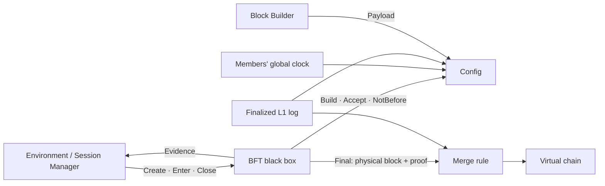

# Regional BFT 的抽象（工作稿 v0.12）

日期：2026-11-02。  
状态：接口与规则草稿。

**本文自成一体：** 正文在正式使用一个概念或符号之前定义它。Overview 只给轮廓。外部链接用于说明来源，不作为理解定义的前提。

**斜体的“直观”句子** 只帮助理解，不属于形式定义。两者不一致时，以形式定义为准。

---

## 0. Overview

Regional BFT 是一个从固定 anchor 出发、由固定 committee 运行的 state machine replication 实例。**anchor** 是该实例采用的起始 L2 block；**committee** 是有权参与该实例的成员集合。一个实例的 anchor 一旦固定，就不再改变。

本文区分两种 block：

- **physical block**：BFT 决定的对象；一个 L2 height 上可能没有。
- **virtual block**：按 L2 height 排列的对象，由 physical chain 与 L1 log 确定。

**Config** 规定怎样构造和验证 physical block，以及最早何时可以提议。**merge rule** 把 physical chain 与 L1 log 合成为 virtual chain。



| Layer | 内容 | 边界 |
| --- | --- | --- |
| BFT | 接口与 required properties | 共识实现可以替换 |
| Config | 构造、验证与提议时间 | 对所有 BFT 实现相同 |
| Virtual chain | physical chain 与 L1 的确定性映射 | 不读取 BFT 内部状态 |
| Environment | 给定 anchor、委员会和运行窗口 | 选择 anchor、跨区域交接与全局接纳不在本文中 |

*直观：BFT 在固定窗口内尽量出块。窗口结束就停止，不要求最后一个高度一定有 physical block。*

本文不使用 Espresso。若 environment 为不同候选 anchor 创建多个实例，每个实例分别遵守本文；哪个实例最终被全局规则接纳，由 environment 决定。系统层的选择与交接接口见[架构文件](arch_zh_v0_1.md)。

## 1. Assumptions

### 1.1 Members、view 与通信

本文固定一个实例，所以省略实例下标。environment 给出以下参数：

- **Committee** $V$。成员也称 **member** 或 **replica**，记为 $m\in V$。
- **Weight** $w_m>0$。对 $Z\subseteq V$，$w(Z):=\sum_{m\in Z}w_m$；总 weight 为 $W:=w(V)$。
- **Fault threshold** $F\ge0$，满足 $3F<W$。
- **View** $v\in\mathbb N_{>0}$：一次 proposal 机会。**leader** 是本次机会的提议者，由固定的确定函数 $\mathrm{Leader}:\mathbb N_{>0}\to V$ 给出。没有 term。
- **真实时间** $\tau\in\mathbb R_{\ge0}$。成员读取的协议时钟与它相同。

**Honest member** 按协议运行；可以离线或崩溃后恢复，但不丢失已经持久化的共识状态和签名记录。**Byzantine member** 可以任意偏离协议，其集合记为 $\mathrm{Byz}$。

| 编号 | 名称 | 内容 | 用途 |
| --- | --- | --- | --- |
| A1 | Partial synchrony | 存在未知时刻 $\mathrm{GST}$ 和已知时长 $\Delta$：参与通信的 honest members 持续在线并调度本实例时，于 $\tau$ 发出的消息在 $\max\{\tau,\mathrm{GST}\}+\Delta$ 之前送达并处理完毕 | 区域 liveness 的时间界 |
| A2 | Authentication and persistence | 信道经过认证；签名不可伪造；hash 函数 $\mathsf H$ 抗碰撞；公钥公开；先持久化共识状态与签名记录，再发送签名 | 结果与证据验证、agreement |
| A3 | Members' global clock | honest member 读取同一个无 drift 的 $\tau$ | 时间检查、timeout、按时停止；agreement 不依赖时钟准确性 |
| A4 | Static adversary | $\mathrm{Byz}$ 在实例配置及 leader seed 揭晓前固定，$w(\mathrm{Byz})\le F$ | 本文采用的故障模型 |

*直观：晚进入或暂时离线，不等于 Byzantine；它首先影响能否凑齐参与者。*

委员会与权重不会因部分成员未进入而缩小。本文不假设所有成员同时进入。跨区域消息、外部观察者的读取速度，以及外部观察者是否有时钟，都不属于 A1、A3。

### 1.2 调用约定

- `WAIT`：缺少输入，或提议时间尚未到。等待不改变已经确定的输入。
- `REJECT`：已经能够判断调用或对象无效。
- 改变状态的调用先持久化，再对外输出；同一请求的重复调用不重复生效。
- 暂停执行或崩溃恢复必须保留整个实例状态；不能通过重新初始化来绕过已有的锁、view 或签名记录。

## 2. Building Blocks

### 2.1 L1：safe、live、fixed pace

L1 是已最终化 block 的序列。$\ell\in\mathbb N$ 是 L1 height，$\mathit{ts}_{\rm L1}(\ell)$ 是该 block 的 timestamp。给定起点 $\tau^0_{\rm L1}$ 和 slot 长度 $b_{\rm L1}>0$：

$$
\mathit{ts}_{\rm L1}(\ell)=\tau^0_{\rm L1}+\ell b_{\rm L1}.
$$

- **Safety：** honest member 读取的 finalized log 互为前缀，已经最终化的 block 不回退。
- **Fixed pace：** 每个 L1 slot 都有 block。
- **可读时限：** 存在常数 $T_{\rm L1}$，使 block $\ell$ 在 $\mathit{ts}_{\rm L1}(\ell)+T_{\rm L1}$ 之前 finalized，且对在线读取的 honest member 可读。

L1 safety 用于保证确定性输入一致；fixed pace 与可读时限用于构造和及时取得输入。所需 L1 数据尚不可读时返回 `WAIT`，不能把它解释为空。

### 2.2 Deposit Log

$\mathrm{DepLog}(\ell)$ 是 L1 block $\ell$ 中按原生顺序排列的 deposit 交易列表，由 finalized log 唯一确定。**deposit** 是通过 L1 入口进入 L2 的交易。

*直观：同一段 L1 历史给所有成员相同的 deposit。*

## 3. Virtual Chain、Physical Chain 与 Merge Rule

Virtual chain 的 VP1–VP3 和双向映射统一定义在 [arch §3](arch_zh_v0_1.md)。本节给出它们在固定 anchor、固定 proposal window 的区域实例中的具体输入；区域使用的 $\mathrm{Virt}(C)$ 是 arch 中 $\mathrm{Merge}_{\omega_A}(C)$ 的简写。Arch 的通用 physical 表示也用于 L1 派生；本抽象只讨论其中由 Regional BFT 决定的 physical chain。

### 3.1 Fixed Virtual Chain

#### Virtual block 与字段

**Virtual block** 是六元组

$$
\mathit{VB}=\langle
\mathit{VB}.h,\mathit{VB}.\mathit{ts},\mathit{VB}.\mathit{os},
\mathit{VB}.\mathit{Dep},\mathit{VB}.\mathit{root},\mathit{VB}.\mathit{Txs}
\rangle.
$$

| 字段 | 含义 |
| --- | --- |
| $\mathit{VB}.h$ | L2 height |
| $\mathit{VB}.\mathit{ts}$ | L2 timestamp |
| $\mathit{VB}.\mathit{os}$ | L1 origin 的 height，即这个 L2 block 依据的 L1 block |
| $\mathit{VB}.\mathit{Dep}$ | 必须先执行的 prefix，含 attributes、deposit 和适用的 system transaction |
| $\mathit{VB}.\mathit{root}$ | 执行本 block **之前**的 state root |
| $\mathit{VB}.\mathit{Txs}$ | prefix 之后的普通交易列表，保留提议者给出的原始顺序与条目 |

对象字段写成 $X.\mathit{field}$，都是 **actual 值**。由规则计算的目标值带星号，称为 **should-be 值**。**普通交易**指不属于强制 prefix 的交易。

#### Anchor 与固定窗口

**Execution state** 记为 $\sigma$，其 state root 由公开确定函数 $\mathrm{root}(\sigma)$ 给出。

**Anchor** $A$ 是该实例采用的起始 L2 block 及其身份依据。它给出 height $A.h$、origin $A.\mathit{os}$、执行完它之后的状态 $A.\sigma$，以及固定的链连接标识 $\mathsf H(A)$。

$\mathsf H(A)$ 来自带类型的 anchor 身份：physical anchor 使用原 physical block 的 hash；派生或其他 virtual anchor 使用其公开规定的封装标识。状态本身不是随意加入 hash 的字段。environment 验证该身份与实际 L2 block、执行状态的对应。

*直观：一个候选 anchor 在这个实例内已经固定；这不表示它已经被全局规则选中。*

environment 还给出 **physical proposal window**

$$
A.h<h_{\min}\le h_{\max},\qquad
\mathrm{TB}:=h_{\max}-h_{\min}+1.
$$

其中 $h_{\min}$、$h_{\max}$ 是该实例可以提议的最低、最高 physical height，$\mathrm{TB}$ 是窗口的高度数。它们不由候选 anchor 的实际 height 重新计算。

**Virtual chain** 是序列

$$
\mathcal L=(\mathit{VB}_{A.h+1},\ldots,\mathit{VB}_n),
\qquad A.h\le n\le h_{\max},\qquad \mathit{VB}_i.h=i.
$$

它从 anchor 后开始连续排列。若 $A.h+1<h_{\min}$，这段高度不能由本实例放入 physical block，但可以由 merge rule 补成只有 prefix 的 virtual block。

#### VP1 Fixed pace

给定 L2 genesis height $h^0$、genesis timestamp $\tau^0_{\rm L2}$ 和 block 间隔 $b_{\rm L2}>0$，定义

$$
\mathit{ts}^*(h):=\tau^0_{\rm L2}+(h-h^0)b_{\rm L2}.
$$

Virtual block 的 timestamp 必须满足 [arch §3.1 的 VP1](arch_zh_v0_1.md)，使用上面的固定时间表。

height $h$ 的 **slot** 是 $[\mathit{ts}^*(h),\mathit{ts}^*(h+1))$。实例的开始和停止时刻固定为

$$
\tau^{\rm start}:=\mathit{ts}^*(h_{\min}),\qquad
\tau^{\rm stop}:=\mathit{ts}^*(h_{\max}+1).
$$

可以在 $\tau^{\rm start}$ 前准备状态和 Enter；在 $\tau^{\rm stop}$ 及之后不再签署本实例的共识消息。

*直观：上界是最后一个 slot 的结束，不是最后一个 slot 的开始。*

#### VP2 L1 synchrony

**Native** 指 L2 原生执行与派生规则。设 $T_{\rm drift}$ 是原生 origin 的最大时间滞后。原生 origin 沿链满足：

- **O1 Continuity：** 相邻 L2 height 的 origin 增量为 0 或 1；
- **O2 Not ahead：** $\mathit{ts}_{\rm L1}(\mathit{os}(h))\le\mathit{ts}^*(h)$；
- **O3 Drift：** $\mathit{ts}^*(h)\le\mathit{ts}_{\rm L1}(\mathit{os}(h))+T_{\rm drift}$。

这里 $\mathit{os}(h)$ 表示一条链在 height $h$ 的 actual origin。

给定 **deposit lag** $T_{\rm dep}$，定义 scheduled origin

$$
\ell^{\rm sch}(h):=
\max\{\ell:\mathit{ts}_{\rm L1}(\ell)+T_{\rm dep}\le\mathit{ts}^*(h)\}.
$$

实例只覆盖该集合非空的高度。常数和 anchor 满足

$$
b_{\rm L2}\le b_{\rm L1},\qquad
T_{\rm L1}\le T_{\rm dep},\qquad
T_{\rm dep}+b_{\rm L1}\le T_{\rm drift},
$$

$$
\mathit{ts}_{\rm L1}(A.\mathit{os})
\le\mathit{ts}^*(A.h)
\le\mathit{ts}_{\rm L1}(A.\mathit{os})+T_{\rm drift}.
$$

$A.\mathit{os}$ 对应的 L1 block 在 Enter 前已经 finalized 且可读。

从 anchor 的 actual origin 出发，定义 $\mathit{os}^*(A.h):=A.\mathit{os}$，并对 $A.h<h\le h_{\max}$ 定义

$$
\mathit{os}^*(h):=
\min\{A.\mathit{os}+(h-A.h),\ \max\{A.\mathit{os},\ell^{\rm sch}(h)\}\}.
$$

*直观：origin 落后 schedule 时逐个前进；超前时等待 schedule 追上。*

符号 $\Vert$ 表示列表拼接，$\varnothing$ 表示空列表。height $h$ 的 should-be prefix 是

$$
\mathrm{Dep}^*(h):=
\mathrm{Attr}^*(h)\Vert\mathrm{Deposit}^*(h)\Vert\mathrm{Sys}^*(h).
$$

- $\mathrm{Attr}^*(h)$ 是 native attributes transaction，即把 origin 的 L1 信息写入 L2 执行上下文的系统交易，由 height、origin、anchor 的原生上下文与 L1 log 确定。
- 若 $\mathit{os}^*(h)\ne\mathit{os}^*(h-1)$，则 $\mathrm{Deposit}^*(h)=\mathrm{DepLog}(\mathit{os}^*(h))$；否则为空。
- $\mathrm{Sys}^*(h)$ 是该 height 适用的 system／upgrade transaction，由公开的原生规则确定。

Virtual block 的 origin 和 prefix 必须满足 [arch §3.1 的 VP2](arch_zh_v0_1.md)。在本区域实例中，该性质的轨迹输入就是这里从 anchor 构造的 $\mathit{os}^*$；它与 arch §3.4 的 $\omega_A$ 相同。上面的参数约束与 anchor 条件是这一构造的前提。

同时满足 VP1、VP2 的 virtual chain 称为 **fixed virtual chain**。这里 fixed 指时间、origin 和 prefix 相对这个固定 anchor 已确定，不表示普通交易已经确定。

### 3.2 Physical Chain

**Physical block** 的 payload 是

$$
B=(B.\mathit{ph},B.h,B.\mathit{ts},B.\mathit{os},B.\mathit{root},B.\mathit{Txs}).
$$

| 字段 | 含义 |
| --- | --- |
| $B.\mathit{ph}$ | 前一个 physical block 或 anchor 的 hash |
| $B.h$ | 该 physical block 对应的 L2 height |
| $B.\mathit{ts}$、$B.\mathit{os}$ | timestamp、origin 的 actual 值 |
| $B.\mathit{root}$ | 执行 height $B.h$ 之前的 state root |
| $B.\mathit{Txs}$ | leader 给出的普通交易列表，可以为空 |

**Physical chain** 含 $n\ge0$ 个 physical blocks，写为 $C=(A,B_1,\ldots,B_n)$：每块的 parent hash 指向前一个对象，physical height 严格增加，并落在 $[h_{\min},h_{\max}]$ 内。链上的前一个对象记为 **parent** $P$。

*直观：physical height 可以跳；virtual height 由 merge rule 连续补齐。*

view $v$、physical block $B$ 和 L2 height $h$ 是三个不同坐标。view 属于 BFT；merge rule 不读取 view。不同候选 anchor 的链不在同一个实例内比较。

### 3.3 Merge Rule 与 Native Projection

#### 执行输入

设 $\mathrm{Tx}$ 是交易集合，$\mathrm{Tx}^*$ 是交易列表集合；$\Sigma$ 是执行状态集合。**Metadata** 记为 $\mu=(h,\mathit{ts},\mathit{os})$，并定义

$$
\mathit{meta}^*(h):=(h,\mathit{ts}^*(h),\mathit{os}^*(h)).
$$

原生执行提供三个确定函数：

- $\mathsf{Begin}(\sigma,\mu,\mathrm{Dep})$：开始一个 block，执行必须先执行的 prefix；
- $\mathsf{Valid}(\sigma,x)$：交易 $x$ 当前是否允许执行，包含 nonce、余额、gas 等原生检查；
- $\mathsf{Run}(\sigma,x)$：执行被允许的交易；交易 revert 也算执行过。

这些函数只使用执行输入、适用的原生规则和 origin 对应的 L1 数据。本文要求 $\mathsf{Begin}$ 对声明范围内的合法 prefix 有结果。原生协议若在某高度启用禁止普通交易的规则，$\mathsf{Valid}$ 在该高度对普通交易返回 false。

**Apply** 丢弃不能执行的普通交易，返回执行后状态和实际保留的交易列表：

```text
Apply(σ, μ, Dep, Txs) → (σ', Kept):
    σ ← Begin(σ, μ, Dep)
    Kept ← []
    for x in Txs:
        if Valid(σ, x):
            σ ← Run(σ, x)
            Kept ← Kept ‖ [x]
    return (σ, Kept)
```

#### 从 physical chain 得到状态

给定 $C$，定义 $\mathit{Txs}_C(i)$：若链上有 height 为 $i$ 的 physical block，取它的普通交易列表；否则为空。

从 $\sigma^*_{A.h}:=A.\sigma$ 开始，定义

$$
(\sigma^*_i,\mathit{Kept}^*_i)
:=\mathsf{Apply}\bigl(
\sigma^*_{i-1},\mathit{meta}^*(i),\mathrm{Dep}^*(i),\mathit{Txs}_C(i)
\bigr).
$$

height $i$ 没有 physical block 时只执行 prefix，称为 **padding**。它也适用于 $A.h<i<h_{\min}$。

若 $C$ 以 $P$ 结尾，准备构造 height 为 $h>P.h$ 的后继，定义

$$
\mathit{root}^*(P,h):=\mathrm{root}(\sigma^*_{h-1}),
$$

其中 $P.h$ 之后、$h$ 之前的高度按空普通交易列表执行。

*直观：新块的 root 覆盖 parent 及中间 padding；投票不要求执行新块自己的普通交易。*

#### Virtual chain

设 $h_C$ 是 $C$ 的末端 height；$C=(A)$ 时取 $h_C=A.h$。定义 $\mathrm{Virt}(C)$ 在每个 $i\in(A.h,h_C]$ 上的 block 为

$$
\mathit{VB}^*_i=
\langle i,\mathit{ts}^*(i),\mathit{os}^*(i),\mathrm{Dep}^*(i),
\mathrm{root}(\sigma^*_{i-1}),\mathit{Txs}_C(i)\rangle.
$$

Virtual chain 的执行前 root 满足 [arch §3.3 的 VP3](arch_zh_v0_1.md)。这里的 merge 取 $\mathit{Txs}_C(i)$ 为普通交易输入，按同一 Apply 逐高度计算状态。

$\mathrm{Virt}(C)$ 按定义满足 VP1–VP3。它只展开到 $h_C$；没有后续 physical block 时，不因时钟前进而把尾部补到 $h_{\max}$。

#### Native projection

**Native block** 是按原生格式实际执行的 block，其交易列表为

$$
\mathrm{Dep}^*(i)\Vert\mathit{Kept}^*_i.
$$

把一条 virtual chain 在给定原生父块和状态上执行并编码，称为 **native projection**，记作 $\mathrm{native}(\mathcal L)$。它包含原生 header、parent hash 和执行结果；virtual block 的执行前 root 不能误作原生 block 的执行后 state root。

virtual block 保留原始 $\mathit{Txs}_C(i)$；native block 只含 $\mathit{Kept}^*_i$。两种表示的 hash 不能混用。跨层比较“同一个原生块”时，比较 native projection。

*直观：原始提议中无效的交易可以留下记录，但不会进入原生批次。*

例如 anchor 在 98，physical window 是 101–110，第一个 decided physical block 在 101，则 $\mathrm{Virt}$ 给出 99、100 的 padding 和 101 的结果。若没有这个或其他 decided 后继，仅凭窗口到期不能得到这段 virtual chain。

结算方需要在原生期限内为待结算的每个 virtual height 提交对应记录，包括 padding height 的空普通交易记录。这是消费者的交付义务，不由 BFT 的决定性质保证。

## 4. RegionalBFT Module

### 4.1 Interface

**逻辑 session 标识**记为 $s$。**协议配置**记为 $\mathcal K$，包括 chain 标识、committee 与权重、$F$、leader 函数、窗口、Config／执行规则版本和 BFT verifier 版本。配置的规范编码是公开的。

**Context id** 定义为

$$
\mathrm{cid}:=\mathsf H(\texttt{REGIONAL},s,\mathsf H(A),\mathcal K).
$$

一个实例只对应一个 $\mathrm{cid}$。所有共识签名与证据都绑定该标识。同一个 $s$ 上不同 anchor 的实例属于不同 context。

**Anchor evidence** $\pi_A$ 是 environment 验证 anchor 的内容、身份、来源及状态对应所需的公开材料。它可以证明一个候选 anchor 已在前驱实例中决定；它不必证明该候选已被全局规则选中。

BFT 提供两个公开 verifier：

- $\mathrm{CheckFINAL}(\mathrm{cid},V,B,\pi_{\rm fin})$：验证 $\pi_{\rm fin}$ 是否为 $B$ 的最终证明。
- $\mathrm{CheckEvidence}(\mathrm{cid},\mathit{ev})$：验证 $\mathit{ev}$ 是否证明某 key 违反该 BFT 版本的 conflict relation。conflict relation 的具体消息规则由实现定义。

若存在有效最终证明，$B$ 及其 physical ancestors 称为 **decided**，也称 **regional finalized**。以它结尾的链称为 **decided chain**。祖先不需要逐块附独立最终证明。

| 类别 | Interface | 输入与效果 | 输出 |
| --- | --- | --- | --- |
| Control | `Create(params)` | 固定 $s,\mathcal K,\mathsf H(A),\mathrm{cid}$；不启动共识，不授予立即提议的权限 | `Assigned`、`REJECT` |
| Control | `Enter(A, π_A, A.σ)` | 检查 anchor 和精确执行后状态；每个实例仅一次初次进入，从 view 1 初始化；允许早于 $\tau^{\rm start}$，但必须早于 $\tau^{\rm stop}$ | `Entered(τ)`、`WAIT`、`REJECT` |
| Control | `Close(reason)` | 永久停止这个 context 的新共识签名；保留 block、证据和持久化状态；`reason` 是标签 | `Terminated(reason)` |
| Output | `Final(B, π_fin)` | 输出 decided physical block 及证明；消费者用 $\mathrm{Virt}$ 得到 virtual blocks | 可不逐祖先输出 |
| Output | `Evidence(ev)` | 输出可公开验证的违规证据 | 不等待链上处罚 |

所有输入都必须属于当前 context。对于已经 Terminated 的实例，Enter 或重新启动共识返回 `REJECT`。到 $\tau^{\rm stop}$ 时，停止规则自动生效，不等待 environment 发来 Close 消息。

**暂停与恢复。** environment 可以暂时不调度一个尚未 Terminated 的实例，视为成员暂时离线。恢复时继续原来的持久化状态，不重新 Enter，不清空投票或从 view 1 重来。离线期间跨过 $\tau^{\rm stop}$，恢复时首先终止。

**迟到读取。** 晚进入的成员可以验证既有 finality proof 并同步 decided chain；不能用自己的当前接收时刻重新否定一个已被证明的历史决定。是否为一个新的 proposal 投票仍由 Config 和 BFT 的安全投票规则共同决定。

### 4.2 Config

BFT 只把 physical parent 指针作为链结构；Config 定义 payload 的应用语义：

| 函数 | 输入 | 输出 |
| --- | --- | --- |
| $\mathsf{Build}$ | parent $P$、当前时间 $\tau$ | physical block、`WAIT` 或 `REJECT(CLOSED)` |
| $\mathsf{Accept}$ | parent $P$、block $B$、首次收到 proposal 的时间 $\tau_{\rm recv}$ | `ACCEPT`、`WAIT` 或 `REJECT` |
| $\mathsf{NotBefore}$ | parent $P$ | 最早提议时刻，或 $+\infty$ |

这些函数读取固定配置、physical chain、L1 log 和列出的输入，不读取 view、leader 身份或 BFT 的锁。parent 的安全选择属于 BFT。

**签名守卫。** 每次实际签名前，都检查当前时刻仍小于 $\tau^{\rm stop}$ 且实例未 Close。即使 proposal 早已收到、此前返回了 `WAIT`，也不能在截止后补签。

### 4.3 Build

定义当前时间对应的最高 L2 height

$$
\mathrm{slot}(\tau):=
h^0+\left\lfloor\frac{\tau-\tau^0_{\rm L2}}{b_{\rm L2}}\right\rfloor.
$$

leader 的交易来自 Block Builder。接口 `Payload(h, σ, L_bytes)` 返回有序普通交易列表；$\sigma$ 是执行完该 height 的 prefix 后的状态，$L_{\rm bytes}$ 是固定字节数上限。

**BasicTx** 是固定的无状态检查：每个条目非空、可解码、签名有效、不是 deposit 类型，且整个列表不超过 $L_{\rm bytes}$。

$T_{\rm build}$ 是在输入可得、大小与负载在声明范围内时，从开始构造到发出 proposal 的上界，包括执行 parent、padding、取得 payload 和计算 root。

```text
Build(P, τ):
    if instance is Closed or τ ≥ τ_stop: return REJECT(CLOSED)
    if τ < NotBefore(P): return WAIT
    h ← slot(τ)
    require h_min ≤ h ≤ h_max and P.h < h
    μ ← meta*(h)
    root ← root*(P, h)                     # 缺祖先、状态或 L1 时 WAIT
    Txs ← Payload(h, Begin(σ*_{h-1}, μ, Dep*(h)), L_bytes)
    require BasicTx(Txs)
    B ← (H(P), h, ts*(h), os*(h), root, Txs)
    before sending: check instance is open and current time < τ_stop
    return B
```

没有普通交易也可以提议空列表。不能在 $\tau^{\rm stop}$ 之后把 height 封顶为 $h_{\max}$ 再补提议。

### 4.4 Accept

给定 **metadata window** $T_{\rm win}\ge T_{\rm build}+\Delta$。$\tau_{\rm recv}$ 固定为该成员首次收到这个 proposal 的时刻；等待 parent 或 L1 数据不重置它。

| 条件 | 内容 |
| --- | --- |
| V1 Stable metadata | $B.\mathit{ph}=\mathsf H(P)$；$P.h<B.h$；$h_{\min}\le B.h\le h_{\max}$；$B.\mathit{ts}=\mathit{ts}^*(B.h)$；$B.\mathit{os}=\mathit{os}^*(B.h)$ |
| V1 Timely | $\mathit{ts}^*(B.h)\le\tau_{\rm recv}<\mathit{ts}^*(B.h+1)+T_{\rm win}$，且 $\tau_{\rm recv}<\tau^{\rm stop}$ |
| V2 State root | $B.\mathit{root}=\mathit{root}^*(P,B.h)$ |
| V3 Basic transactions | $\mathsf{BasicTx}(B.\mathit{Txs})$ |

能够判断无效时返回 `REJECT`；缺所需输入时返回 `WAIT`；全部满足时返回 `ACCEPT`。实际投票还必须通过 BFT 的安全规则与 §4.2 的签名守卫。

vote 不要求执行当前 block 的全部普通交易；这些交易由 $\mathsf{Apply}$ 过滤并执行。这里的“被 Accept 接受”不是“已经被 BFT 决定”。

### 4.5 NotBefore

定义

$$
\mathsf{NotBefore}(P):=
\begin{cases}
\max\{\tau^{\rm start},\mathit{ts}^*(P.h+1)\}, & P.h<h_{\max},\\
+\infty, & P.h\ge h_{\max}.
\end{cases}
$$

*直观：提前 Enter 不会提前占用前驱的 physical height；已经到达上界时，不再构造后继 payload。*

没有新 payload 可提议时，BFT 仍可以在停止时刻之前处理已有 proposal 的合法共识消息。是否能够完成决定由实际 BFT 实现和剩余时间决定，不由本函数保证。

### 4.6 Required Properties

以下是实现必须提供的接口性质，不是在本文中证明某个具体 BFT 已经实现这些性质。

#### Safety

为说明应用有效性，先定义 **进入 BFT chain**。对 physical block $B$：

- $\tau_{\rm par}(B)$：首次有 honest member 选定 $B$ 或其后代作为 physical parent 的时刻；
- $\tau_{\rm fin}(B)$：首次有任何参与方持有对 $B$ 或其后代有效的最终证明的时刻；
- 没有发生的时刻取 $+\infty$；令 $\tau_{\rm in}(B):=\min\{\tau_{\rm par}(B),\tau_{\rm fin}(B)\}$。

$\tau_{\rm in}(B)<+\infty$ 的 block 称为进入 BFT chain。这里的 parent 不包括作为外部输入的 anchor。

| 编号 | 性质 | 内容 |
| --- | --- | --- |
| BFT-1 | Agreement | 同一个 $\mathrm{cid}$ 的任意两条 decided chain 互为前缀 |
| BFT-2 | Chain validity | 每个进入 BFT chain 的 physical block，均曾被至少一个 honest member 用其真实首次接收时刻检查，且在 $\tau_{\rm in}(B)$ 之前或当时得到 `ACCEPT` |
| BFT-3 | One block per view | 同一个 context 的一条 BFT chain 上，同一 view 至多贡献一个 physical block |
| BFT-4 | External verifiability | 最终证明与证据可由公开输入验证；`Final` 输出的证明有效；不存在针对 honest key 的有效违规证据；其他 context 的签名不能在本 context 使用 |

Agreement 不要求所有成员同时 Enter，也不要求网络已经同步。BFT-2 中关于 timestamp 的部分使用 Config 的时钟假设。不同候选 context 可以有不同决定；BFT-1 不提供它们之间的全局选择。

#### Liveness condition

定义 $Q:=W-F$。这是本文用于活性前提的 honest active weight，不规定所有 BFT 版本必须使用同一种证书编码。

给定时间段 $I=[\tau_{\rm lc},\tau_{\rm end})$，其中 $\tau_{\rm lc}$、$\tau_{\rm end}$ 分别为起点与终点，要求：

- $\tau_{\rm lc}\ge\mathrm{GST}$，$\tau_{\rm end}\le\tau^{\rm stop}$；
- 整段时间内有同一组 honest member 在线、持续调度这个 context；其 weight 至少为 $Q$，并且不晚于 $\tau_{\rm lc}$ 完成 Enter 或从保存状态恢复；
- 实例未 Close，所需 L1、祖先、状态与 Payload 可得。

这组成员称为 **active members**。$\tau_{\rm lc}$ 从足够成员已经进入或恢复的时间开始选取，不从第一个成员 Enter 时开始。给定实现上界 $T_{\rm next}$、$T_{\rm sync}$、$T_{\rm fin}$、$T_{\rm vc}$，分别用于 view 同步、恢复同步、决定和离开不成功 view。$T_{\rm fin}$、$T_{\rm next}$ 包含相应验证和数据获取工作。

成员 $m$ 在 view $v$ 的 **起算时刻** $\tau_{\rm st}(m,v)$，是进入该 view 的时刻与 $\mathsf{NotBefore}(P)$ 的较晚者；$P$ 是它进入该 view 时按 BFT 规则选定的 parent。

定义

$$
\tau_{\rm sync}:=\max\{\tau_{\rm lc}+T_{\rm sync},\tau^{\rm start}\}.
$$

只有在 $\tau_{\rm lc}=\tau^{\rm start}$、所有 active members 已在该时刻前初次 Enter、此前无人到达任何 view 的起算时刻、且相关同步条件已经成立时，才称为 **同步开始**，并可取 $\tau_{\rm sync}=\tau^{\rm start}$。提前初始化 view 1 不等于提前到达它的起算时刻。不同候选之间切换、暂停后恢复，不自动满足这个例外。

view 在 $\tau_{\rm sync}$ 之后开始，指此前没有 active member 到达该 view 的起算时刻，也没有 active member 进入更高 view。

| 编号 | 性质 | 前提与内容 |
| --- | --- | --- |
| BFT-5 | Progress | view 在 $\tau_{\rm sync}$ 后开始，leader $m$ 是 active member，选定的 parent 满足 $P.h<h_{\max}$。记 $\tau_0:=\tau_{\rm st}(m,v)$。若所述完成时刻严格早于 $\tau_{\rm end}$，则 leader 在 $\tau_0$ 开始 Build 并提议；(a) 该 block 在 $\tau_0+T_{\rm build}+T_{\rm fin}$ 前决定；(b) 在 $\tau_0+T_{\rm build}+T_{\rm next}$ 前，active members 进入下一个或更高 view，在下一个 view 中选定这个 block 为 parent |
| BFT-6 | View sync and bounded unsuccessful view | 在 $I$ 内、$\tau_{\rm sync}$ 之后：(a) 一个 active member 已到达某 view，则其余 active members 在 $T_{\rm next}$ 内到达该 view 或更高 view；(b) leader 不 active 等导致不能按 BFT-5 推进、且起算时刻有限的 view，在 $T_{\rm vc}$ 内被离开。每个时限都要求完整落在 $I$ 内；先发生 Close 或 scheduled shutdown 时直接停止 |

在停止边界附近，完成所需时间不足的 view 不享有上述完成保证。没有足够成员进入同一个 context 时，也不享有上述活性保证；委员会和门槛仍然不变。

#### BFT-7：Bounded height and scheduled shutdown

在本文的配置与故障假设下：

1. **高度有界。** 若 $\mathrm{CheckFINAL}(\mathrm{cid},V,B,\pi_{\rm fin})$ 为 true，则 $B.h\le h_{\max}$。
2. **按时停止。** 所有 honest member 在 $\tau\ge\tau^{\rm stop}$ 时不再生成本实例的任何新共识签名。较早 Close 的实例也不恢复签名；离线成员恢复时先执行相同检查。

已有 block、证书和证据被保留。停止前的签名可能之后才被组合成或公开为证书，因此本性质不声明“停止后不可能再看到新的有效最终证明”。

*直观：本实例按时结束工作，但可能没能完成最后几个高度。外部如何固定最后接纳块，由架构中的公开规则决定。*

高度 $h_{\max}$ 的有效 Final 是一个可能的结果，不是每次执行必须发生的结果。换用 BFT 实现或 verifier 是协议版本选择，不能在一个已经固定的 context 中途更换。
