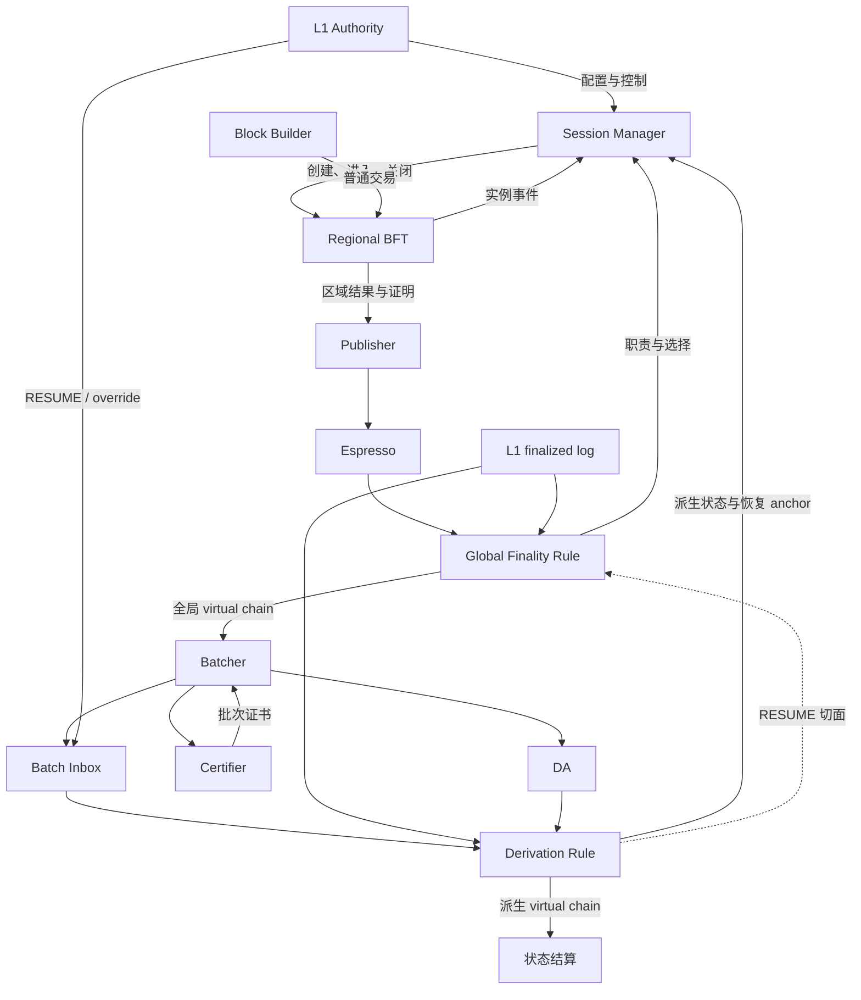
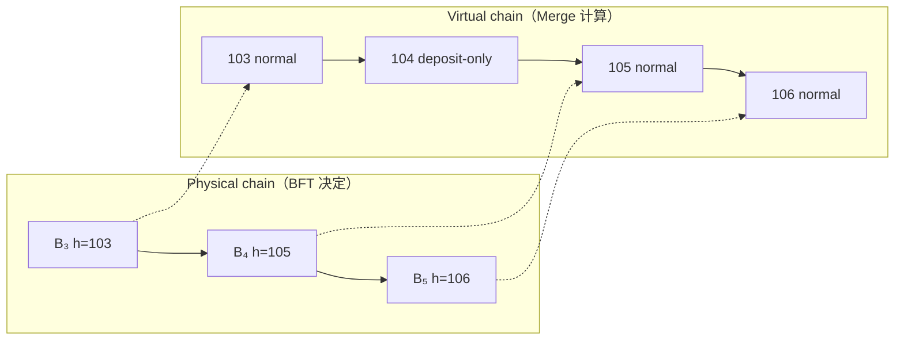
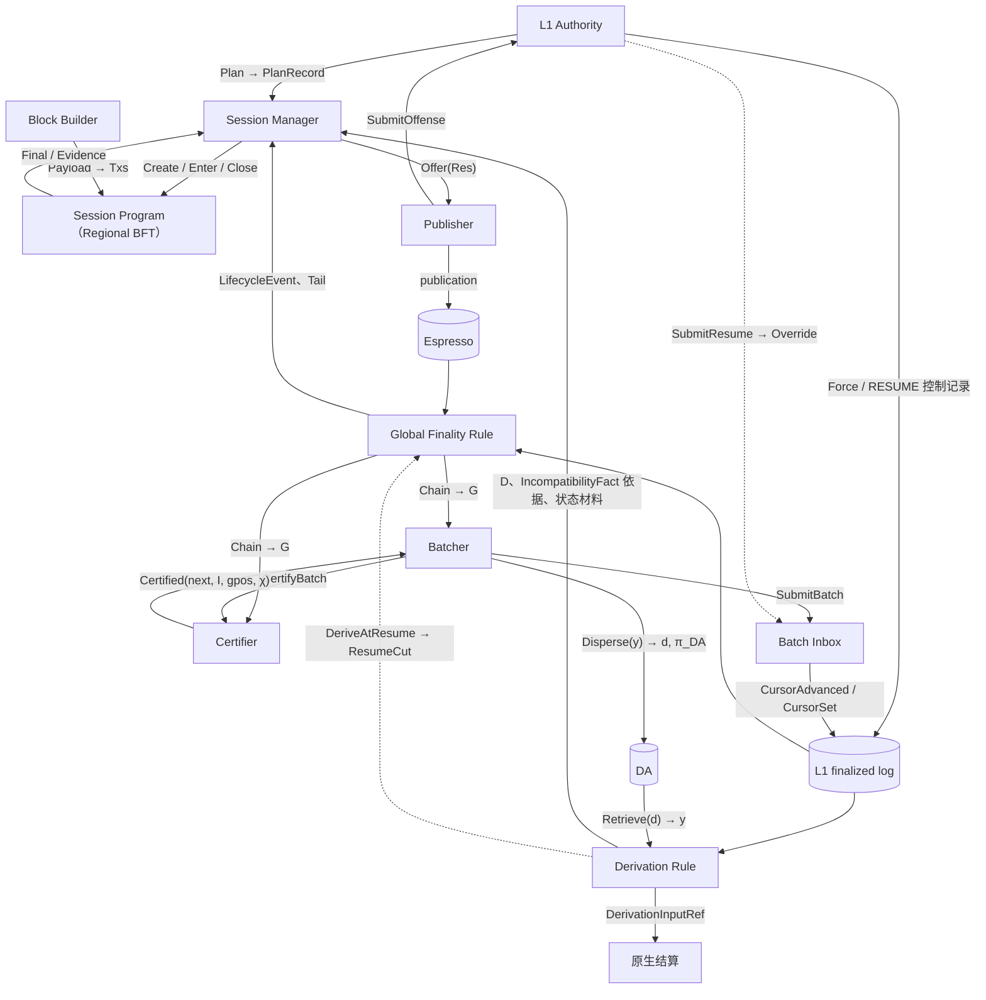

# 系统架构与模块总览（v9 工作稿 v0.1）

日期：2026-11-02。

来源：[arch v0.2](../formalization_v8/arch_zh_v0_2.md) 的 §0–§3 与 §4 引言，[Regional BFT v0.13](../formalization_v8/regional_bft_abstraction_zh_v0_13.md)，以及 [261027 meetup](../meetup_record/261027.md)。本版把原 arch 拆成一份总览和若干模块文件：本文保留模型、参与者与链数据结构（§0–§3），§4 只给出模块总览和模块之间的接口连接；每个模块的假设、完整接口和性质放在各自文件中，最终性规则和端到端流程分别成文。阅读顺序见 [README](README.md)。

## 0. Overview

系统由区域生产、公开排序和 L1 派生三部分组成。区域共识决定一条链上的交易内容；Espresso 为区域结果提供公开顺序；Global Finality Rule（GFR）根据 L1 控制记录和 Espresso 日志选择全局链。随后，Batcher 编码所选内容，Certifier 认证其来源，Batch Inbox 在 L1 上接纳批次，Derivation Rule 从 L1 与数据可用性层（DA）重建 L2。

正常轮换时，后继区域可以提前准备并运行以不同 anchor 为起点的候选共识实例。Anchor 是实例采用的起始 L2 block。GFR 最终确定其中哪个实例可以贡献全局结果。提前运行的区域结果不因此自动获得全局接纳资格。



本文先给出外部 building blocks（§1），再定义参与者和 session（§2），随后给出 L2 链数据类型及其映射（§3），最后给出模块总览和模块之间的接口连接（§4）。各模块的接口、最终性规则和端到端流程在单独的文件中给出，见 §4.1。

## 1. External Building Blocks

真实时间记为 $\tau\in\mathbb R_{\ge0}$。它是分析执行时使用的坐标，不意味着所有读取者都有同步时钟。$\mathbb N$ 包含 0；$\{0,1\}^*$ 是有限比特串的集合。对有限序列 $X,Y$，$X\preceq Y$ 表示 $X$ 是 $Y$ 的前缀，$X\Vert Y$ 表示拼接。

本节分别说明外部服务提供什么输入、这些输入有什么保证。后面的模块通过这些输入作决定：L1 提供已经确定的历史，Espresso 提供公开消息顺序，DA 提供可取回的数据内容。

本节的诚实提交者或读取者，是遵守相应外部服务规则的参与方；系统中 replica 的故障模型在 §2 给出。

### 1.1 数字签名、hash 与编码

令 $\kappa$ 为安全参数，$\mathrm{negl}(\kappa)$ 表示可忽略函数。协议使用数字签名方案

$$
\mathsf{Sig}=(\mathsf{KeyGen},\mathsf{Sign},\mathsf{Verify}).
$$

$\mathsf{KeyGen}(1^\kappa)$ 生成密钥对 $(sk,pk)$；$\mathsf{Sign}_{sk}(x)$ 对消息 $x\in\{0,1\}^*$ 签名；$\mathsf{Verify}_{pk}(x,\mathit{sig})\in\{0,1\}$ 验证签名。公钥集合记为 $\mathcal{PK}$。方案满足正确性与 **EUF-CMA 安全性**。

协议另使用具有 hiding 与 binding 性质的 hash 函数：

$$
\mathsf H:\{0,1\}^*\longrightarrow\{0,1\}^{\kappa}.
$$

签名用于验证一条消息是否获得相应密钥持有者的授权；hash 用于在消息和记录中引用具体内容。验证签名后，接收者仍要按协议检查消息的用途、所属实例和内容是否合法。

### 1.2 L1

L1 是具有公开验证依据的 finalized block 序列

$$
\mathcal L_1=(L_0,L_1,\ldots).
$$

下标 $\ell\in\mathbb N$ 是 L1 height。给定 $\tau^0_{\rm L1}\ge0$ 和 $b_{\rm L1}>0$，采用 fixed-pace 模型

$$
\mathit{ts}_{\rm L1}(\ell)=\tau^0_{\rm L1}+\ell b_{\rm L1}.
$$

L1 满足以下性质。任意两份通过验证的 finalized 日志互为前缀；读取者已取得的 finalized 前缀不回退。同一前缀中的合约调用按记录顺序原子执行。

存在已知常数 $T_{\rm L1}>0$，使一笔在 $\tau$ 提交、满足 L1 准入条件的交易，在 $\tau+T_{\rm L1}$ 之前 finalized，并对持续在线的读取者公开可读。特别地，block $\ell$ 在 $\mathit{ts}_{\rm L1}(\ell)+T_{\rm L1}$ 之前 finalized 且可读；$T_{\rm L1}$ 取这些时限的共同上界。

同一 L1 block 内的记录位置为

$$
p=(\ell,j,k),
$$

其中 $j$ 是交易索引，$k$ 是该交易内的日志索引。L1 位置按字典序排列。下文的“处理到 $p$”包含该位置；“严格早于某 L1 height”不包含该 height 的任何记录。

### 1.3 L2 时间与 L1 强制交易输入

令 $\mathcal T$ 为原生 L2 交易集合，$\mathcal T^*$ 为有限有序交易列表集合。给定 genesis height $h^0$、genesis timestamp $\tau^0_{\rm L2}$ 和间隔 $b_{\rm L2}>0$，定义

$$
\mathit{ts}^*(h)=\tau^0_{\rm L2}+(h-h^0)b_{\rm L2},
\qquad h\ge h^0.
$$

height $h$ 的 slot 是 $[\mathit{ts}^*(h),\mathit{ts}^*(h+1))$。对 $\tau\ge\tau^0_{\rm L2}$，定义

$$
\mathrm{slot}(\tau)
=h^0+\left\lfloor\frac{\tau-\tau^0_{\rm L2}}{b_{\rm L2}}\right\rfloor.
$$

这两个函数从相反方向描述同一份时间安排：$\mathit{ts}^*(h)$ 给出 height $h$ 的 slot 起点，$\mathrm{slot}(\tau)$ 给出时刻 $\tau$ 所处的 slot。Slot 已经开始或结束，本身不表示该 height 一定产生了 physical block。

我们将 L1 强制交易抽象为列表输入。$\mathrm{DepLog}(\ell)\in\mathcal T^*$ 是 L1 block $\ell$ 所确定的有序 deposit 列表。

为了定义一个 L2 height 使用的强制前缀，令

$$
\omega:\{h^0,h^0+1,\ldots\}\longrightarrow\mathbb N
$$

为给定的 L1-origin 轨迹。$\omega(h)$ 表示 height $h$ 依据的 L1 block；合法轨迹相邻增量为 0 或 1。对 $h>h^0$，定义

$$
\mathrm{Deposit}_{\omega}(h)=
\begin{cases}
\mathrm{DepLog}(\omega(h)),&\omega(h)\ne\omega(h-1),\\
[],&\omega(h)=\omega(h-1).
\end{cases}
$$

例如，相邻两个 L2 heights 都使用 L1 block 20 作为 origin，后一个 height 不再重复执行 block 20 的 deposits；第一次推进到 origin 21 时，才加入 $\mathrm{DepLog}(21)$。

原生规则给出两个确定列表：$\mathrm{Attr}_{\omega}(h)$ 是把 origin 信息写入 L2 执行上下文的 attributes transaction；$\mathrm{Sys}_{\omega}(h)$ 是该 height 适用的 system／upgrade transactions。它们只读取 origin 轨迹、已 finalized 的 L1 数据、固定的原生规则版本和 genesis 上下文。定义强制前缀

$$
\mathrm{DEP}_{\omega}(h)
:=
\mathrm{Attr}_{\omega}(h)\Vert
\mathrm{Deposit}_{\omega}(h)\Vert
\mathrm{Sys}_{\omega}(h)
\in\mathcal T^*.
$$

固定 origin 轨迹和原生规则版本后，简写为 $\mathrm{DEP}(h)$。同一输入下，所有读取者得到相同列表；leader 不能删改它。它按列表顺序、在普通交易之前执行。所需 L1 前缀尚不可读时，计算等待，不返回空列表。

不同恢复起点可以对应不同的 origin 轨迹，因此 $\mathrm{DEP}(h)$ 的简写始终相对于一个已固定的轨迹使用。具体轨迹在 §3.4 定义。

### 1.4 Espresso

Espresso 是 finalized block 序列

$$
\mathcal L_E=(J_0,J_1,\ldots),\qquad
J_q=(q,\theta_q,\mathcal M_q),
$$

其中 $q\in\mathbb N$ 是 Espresso height，$\theta_q\in\mathbb R_{\ge0}$ 是 timestamp，$\mathcal M_q\in(\{0,1\}^*)^*$ 是该 block 对本协议提供的完整有序消息列表。

服务状态是公共信息

$$
\mathsf{Live}_E:\mathbb R_{\ge0}\longrightarrow\{0,1\}.
$$

所有在线参与方知道当前的 $\mathsf{Live}_E(\tau)$。值为 1 表示 live，值为 0 表示 non-live；这项公共可知性是模型假设，不由观察者的本地超时推导。外部观察者无需知道 $\tau$ 的数值。

**Safety（E-S）。** 任意两份通过验证的 Espresso finalized 日志互为前缀，已经 finalized 的前缀不回退，且

$$
\theta_q\le\theta_{q+1}.
$$

每份已知前缀的消息列表可以完整读取，包括确定某个 block 的列表为空。E-S 对所有执行成立。

给定已知服务时限 $T_E>0$ 和 timestamp 误差上界 $\Delta_{\rm ts}\ge0$。

**Liveness（E-L）。** 若消息 $x$ 在 $\tau$ 被诚实方提交，满足服务的准入条件，且

$$
\mathsf{Live}_E(t)=1
\quad\text{对所有 }t\in[\tau,\tau+T_E],
$$

则不晚于 $\tau+T_E$，一份包含 $x$ 的 Espresso block 已 finalized，并对该区间持续在线的读取者可读。在同样持续 live 的区间内，到 $\tau+T_E$ 时，还存在已 finalized 且可读的 $J_q$ 满足 $\theta_q\ge\tau-\Delta_{\rm ts}$。

**Timestamp accuracy（E-TS）。** 令 $\tau_{\rm prop}(J_q)$ 为 $J_q$ 的真实提出时刻。在 live 期间提出的 block 满足

$$
\mathsf{Live}_E(\tau_{\rm prop}(J_q))=1
\quad\Longrightarrow\quad
\bigl|\theta_q-\tau_{\rm prop}(J_q)\bigr|\le\Delta_{\rm ts}.
$$

E-L、E-TS 只在各自的 live 条件下使用。Non-live 期间不假设 timestamp 贴近真实时间；一个在 non-live 期间提出的旧 block，不因之后 finalized 而获得 E-TS 保证。

对公开键 $x$，一份完整读取且末端 timestamp 至少为 $x$ 的 finalized 前缀，证明所有 timestamp 小于 $x$ 的 block 已被覆盖。下文称这种日志进度为 **watermark**。它依赖 E-S，不要求外部观察者读取同步时钟。

例如，规则要检查 timestamp 严格小于 100 的消息，读取者只需取得一个 timestamp 至少为 100 的 finalized block，并完整读取此前日志。由于 timestamp 不递减，后续 block 不会再补入 timestamp 小于 100 的消息。E-L 和 E-TS 用来估计何时能取得这份前缀；watermark 本身说明已经覆盖了哪一段公开历史。

### 1.5 Data Availability

DA 处理 payload $y\in\{0,1\}^*$。Dispersal 返回 commitment $d$ 和证书 $\pi_{\rm DA}$，两者均以有限比特串表示；公开谓词 $\mathsf{CheckDA}(d,\pi_{\rm DA})\in\{0,1\}$ 验证该 commitment 已按 DA 规则认证。读取 $d$ 返回它对应的 payload，或在数据尚未取得时等待。

**Binding。** 除可忽略概率外，同一个已认证 $d$ 不可能被有效打开为两个不同的 payload。证书认证的是该 commitment 的可用性条件，不替代对 payload 内容的协议验证。

**Availability。** 给定 $T_{\rm DA},\Delta_{\rm DA},T_{\rm ret}>0$。在 DA 持续可用且请求满足准入条件的区间内，dispersal 在 $T_{\rm DA}$ 内完成，已认证数据的取回在 $\Delta_{\rm DA}$ 内完成；DA 保留期为认证后的 $T_{\rm ret}$。

已经被 L1 接纳的数据，在派生和恢复仍可能需要它时必须可取回。保留期之后，这项可取回性由保管者保存相同 payload 来承担。违反可取回性时，依赖它的计算等待；不能用空内容代替未知但已经接纳的数据。

DA 的接口（Disperse、CheckDA、Retrieve）及编号性质 DA-S1、DA-S2、DA-L1、DA-L2、DA-RET 在 [08 DA](08_da_zh_v0_1.md) 中给出；本节是它们的模型概述。

## 2. Participants, Sessions and Assumptions

### 2.1 Position、replica 与 PKI

**Position 是 L1 Authority 维护的一条质押记录**，包含五个字段：

- **region**：replica 所属区域，取自有限区域集合 $\mathcal R$。
- **pk**：replica 用于签署共识消息的公钥，取自 §1.1 的公钥集合 $\mathcal{PK}$。
- **owner**：管理这份质押的 L1 账户，按 L1 账户授权规则发起注册、退出和资金释放等操作。
- **stake**：这份 position 当前锁定的质押金额（escrow），以固定的最小代币单位计，为非负整数。
- **status**：这份 position 的当前状态，取 Pending、Active、Exiting、Retired、Released 或 Cancelled；分别表示待纳入、已激活、申请退出、已退役但资金尚未释放、资金已释放、登记已取消。状态转换由 [01 Authority](01_l1_authority_zh_v0_1.md) 的质押接口规定。

每份 position 使用一个唯一且不复用的 **position ID**，记为 $\mathit{pid}$。Region、pk 和 owner 在这份 position 的生命周期内固定；stake 和 status 随 L1 上的质押操作更新。读取这些字段时，以已处理的 finalized L1 历史为准。

一个 owner 可以拥有多份 position。同一公钥同时至多绑定一份尚未 Released 或 Cancelled 的 position。

每份 position 对应一个逻辑 **replica**，使用该记录的 pk 对应的私钥签署共识消息。后文用 $m$ 表示 replica，用 $m.\mathit{pid}$ 表示其 position ID。Owner 是管理质押的账户，replica 是参与共识的身份；replica 不必对应一台独立物理机器。

采用 **PKI setting**：所有参与方都能从已验证的 L1 历史查到 position 登记的公钥。


### 2.2 快照与 session

**Position 与快照的关系。** Position 是一条持续更新的质押记录；snapshot（快照）是依据这些记录生成的一份固定的共识名单。一份快照可以收录多个 position，同一个 position 也可以出现在多份不同版本的快照中。

生成快照时，Authority 根据指定截止高度之前的 position 记录，按质押规则决定哪些 position 可以纳入，以及每个 position 的投票权重。快照按 position ID 保存纳入者的 region、pk 和投票权重 weight，其中 weight 为正整数。未纳入的 position 在这份名单中没有条目。

例如，Position 7 的 stake 为 100、status 为 Active。假设生成某份快照时，按质押规则将它纳入，投票权重确定为 10。后来它被罚没，当前 stake 降为 80：position 的记录随之更新，但这份快照中的投票权重仍为 10。Stake 如何换算为 weight 由质押规则决定；已经生成的快照不会被后来的质押操作改写。

Session 使用一份选定的快照来确定委员会及其投票权重。因此，即使运行期间 position 的 stake 或 status 变化，这个 session 也继续使用已经冻结的投票权重。

**快照记号。** 快照从 0 开始依次编号，编号记为 $e$，对应快照记为 $\mathcal C_e$。它是一张有限登记表；$\mathcal C_e[\mathit{pid}]$ 表示在快照 $e$ 中查找编号为 $\mathit{pid}$ 的 position 条目。

**生成与启用。** 每份新快照先依据一段确定的 L1 历史计算，再从后续的一个 L1 height 开始使用。为此，协议预先规定两个 L1 heights：

- **cutoff（历史截取高度）**：计算该快照时，只使用严格早于这个高度的 finalized L1 历史，按固定的质押规则确定纳入的 position 及其权重；不包含 cutoff 高度本身的记录。
- **activation（激活高度）**：从这个高度开始，该快照用于授权查询，直到下一份快照激活。

同一份快照的 cutoff 必须小于 activation；后续快照的 cutoff 和 activation 分别严格增加。初始快照 $\mathcal C_0$ 及其 activation 由 genesis 配置直接给定。读取或计算快照不需要额外发布交易。

**查询使用哪份快照。** 在某个 L1 height 查询授权时，使用截至该高度已经激活的最新快照。记 $\mathsf{SnapshotAt}(\ell)$ 为这项查询返回的**快照编号**，其中 $\ell$ 是查询依据的 L1 height，不早于初始快照的 activation。“最新”指 activation 不超过 $\ell$ 的快照中编号最大的那一份。

例如，快照 1 使用 L1 height 90 之前的历史，从 height 100 激活；快照 2 使用 height 190 之前的历史，从 height 200 激活。那么，在 height 150 查询授权时使用快照 1，即 $\mathsf{SnapshotAt}(150)=1$；在 height 200 查询时使用快照 2，即 $\mathsf{SnapshotAt}(200)=2$。多个 session 可以使用同一份快照。

**Session** 的标识为 $s=(\beta,r)\in\mathbb N^2$。$\beta$ 标识一条生产分支，$r$ 标识该分支中的区域职责安排；改变分支与常规推进的具体规则见 [09 §4](09_finality_rules_zh_v0_2.md)：常规交接使 $r$ 加 1，Force 和 RESUME 开出新分支 $\beta+1$。一个 session 的固定参数包括：

$$
\bigl(s,i_s,e_s,V_s,w_s,F_s,
h_{\min,s},h_{\max,s},\mathrm{Leader}_s\bigr).
$$

其中 $i_s\in\mathcal R$ 是负责区域，$e_s$ 是采用的快照编号，$V_s$ 是所选 replica 委员会。对每个 $m\in V_s$，快照条目 $\mathcal C_{e_s}[m.\mathit{pid}]$ 必须存在，且其 region 等于 $i_s$。Replica 的投票权重和委员会总权重分别为

$$
w_s(m):=\mathcal C_{e_s}[m.\mathit{pid}].\mathit{weight},
\qquad
W_s:=\sum_{m\in V_s}w_s(m).
$$

给定故障权重上界 $F_s\in\mathbb R_{\ge0}$，要求 $3F_s<W_s$。View $v\in\mathbb N_{>0}$ 是一次提议机会，$\mathrm{Leader}_s:\mathbb N_{>0}\to V_s$ 是固定的 leader 函数，没有 term 或恢复代。

$h_{\min,s},h_{\max,s}\in\mathbb N$ 分别是可提议的最低和最高 physical height，满足 $h^0<h_{\min,s}\le h_{\max,s}$。窗口宽度（每个 session 可使用的 height 数量）为公开常数 $\mathrm{TB}=h_{\max,s}-h_{\min,s}+1>0$，运行边界为

$$
\tau_s^{\rm start}:=\mathit{ts}^*(h_{\min,s}),
\qquad
\tau_s^{\rm stop}:=\mathit{ts}^*(h_{\max,s}+1).
$$

同一个 session 可以有不同起点的候选 program；这些 program 共用上述 session 参数，但各自的起点、共识状态和签名域固定。它们以 context 标识 cid 区分，cid 由 session、anchor 身份和 program 配置计算，定义见 [02 §3.2](02_session_program_zh_v0_1.md)。

因此，session 描述一段生产职责：由哪个区域、哪份委员会负责哪些 physical heights；program 是在某个具体起点上执行这份职责的共识实例。最后一个 slot 在 $\tau_s^{\rm stop}$ 结束，但这个窗口定义不承诺每个 height 都有 block。

### 2.3 故障与时钟

Honest replica 按指定协议状态转换；敌手可以读取和控制 Byzantine replica 的内部状态与签名密钥，并使其任意偏离协议。对每个 session $s$，敌手控制的集合 $\mathrm{Byz}_s\subseteq V_s$ 在其配置公开前固定，并满足

$$
\sum_{m\in\mathrm{Byz}_s}w_s(m)\le F_s.
$$

这是每个 session 内的**静态敌手**设定：$\mathrm{Byz}_s$ 在该 session 运行期间不变。不同 session 可以有不同的 Byzantine 集合。

**Global clock。** 每个 honest replica 及其本地 Session Manager 在真实时刻 $\tau$ 读取的协议时钟等于 $\tau$。该假设用于 block 时间检查、窗口开始和停止；外部观察者不需要同步时钟。读取者、Publisher 和 Batcher 通过公开日志验证结果，不以自己的接收时刻改写历史顺序。

### 2.4 区域内与跨区域通信

通信模型分三条：

- 所有点对点信道都是**认证信道**：接收者能确认消息的发送身份，敌手不能伪造 honest 参与方发出的消息。
- **区域内**通信为部分同步。
- **跨区域**通信在 Espresso live 期间同步，在 Espresso non-live 期间异步。

**区域内。** 对区域 $i$，存在未知 $\mathrm{GST}_i$ 和已知 $\Delta_i>0$。对于同一区域内持续在线并运行同一实例的 honest replicas，$\mathrm{GST}_i$ 之后发送的消息在 $\Delta_i$ 内送达并完成规定的有界协议处理。区域 agreement 不依赖这个延迟界；有界进展需要相应同步与参与条件。

**跨区域。** 给定已知 $\Delta_{\rm cross}\ge\max_i\Delta_i$。记 $\tau_{\rm del}(x,n)$ 为消息 $x$ 送达 replica $n$ 的真实时刻。设 honest replica $m$ 在时刻 $\tau$ 向另一区域的 honest replica $n$ 发送消息 $x$。若 $n$ 在 $[\tau,\tau+\Delta_{\rm cross}]$ 持续在线，且

$$
\mathsf{Live}_E(t)=1
\quad\text{对所有 }t\in[\tau,\tau+\Delta_{\rm cross}],
$$

则 $\tau_{\rm del}(x,n)\le\tau+\Delta_{\rm cross}$。这是跨区域信道的同步假设，直接转发区域结果也适用，不要求该结果先在 Espresso finalized。

在 non-live 期间，跨区域信道异步：对于持续在线的接收者，已发送消息最终送达，但没有适用于所有执行的有限延迟上界。若发送后的同步区间被 non-live 状态打断，不再使用该次发送的同步上界。若在 $\tau_0$ 恢复 live 并持续至少 $\Delta_{\rm cross}$，则仍在信道中的消息向持续在线接收者的送达时间也不晚于 $\tau_0+\Delta_{\rm cross}$。这项在途消息界是本模型的恢复条件。

这使正常交接可以对跨区域结果的到达时间使用 $\Delta_{\rm cross}$；停机期间则只能等待消息，不能据此给出固定的交接完成时间。即使消息已经到达，接收者仍可能需要取得 anchor 状态才能进入对应实例。

### 2.5 治理与认证角色

治理方 $\mathsf M$ 和 Certifier $\mathsf C$ 的认证公钥 $pk_{\mathsf M},pk_{\mathsf C}$ 在协议配置中给定，对应签名密钥为 $sk_{\mathsf M},sk_{\mathsf C}$。$\mathsf M$ 向 Authority 提交授权的分支控制；恢复活性要求它在规定的紧急情形下发出适当控制。$\mathsf C$ 是按 [06 Certifier](06_certifier_zh_v0_1.md) 的规则签署批次声明的可信方，不被敌手腐化，但可以离线。其签名不能替代该规则之外的事实。

Publisher、Batcher 和证据提交者是角色。某项交付的活性保证，只在相关区间存在一个诚实在线承担者、输入可得且负载与费用满足声明条件时使用。以下服务预算用于 [09 §3.5](09_finality_rules_zh_v0_2.md) 的时序条件，不作为区域 agreement 的前提：

- $T_{\rm pub}$：完整区域结果交给诚实在线 Publisher 后，在输入可得、负载允许时，完成向 Espresso 提交的时间上界；之后的收录和可读性使用 E-L。
- $T_{\rm cert}$：Certifier 在线且请求所需输入完整时的响应上界。
- $T_{\rm batch}$：批次角色和服务正常、且原生期限仍允许完成交付时，覆盖排队、接手、channel 完成、DA、认证和 L1 接纳的交付预算。这项服务条件不单由存在诚实 Batcher 推出。

## 3. Virtual Chain、Physical Chain 与双向映射

Virtual chain 按 L2 height 连续描述执行内容：每个 height 包含强制前缀和普通交易。Physical chain 保存普通交易及其链连接，可以跳过一些 heights。两者之间的 merge rule 将 physical chain 与 L1 确定的 DEP 输入合并，补齐中间 heights，并计算执行状态。

本节先定义 virtual chain 应满足的性质，再定义 physical chain，最后说明两个方向的转换，以及区域生产如何固定每个 height 的 origin。

### 3.1 Virtual chain 与 VP1、VP2

**Virtual block。** 令 $\Sigma$ 为原生执行状态集合，$\sigma\in\Sigma$ 为一个状态，包含执行时使用的当前 block context。记 $\mathcal H_\kappa=\{0,1\}^{\kappa}$，$\mathrm{root}:\Sigma\to\mathcal H_\kappa$ 为 state-root 函数。Virtual block 的类型为

$$
\mathsf{VB}:=
\mathbb N\times\mathbb R_{\ge0}\times\mathbb N
\times\mathcal T^*\times\mathcal H_\kappa\times\mathcal T^*.
$$

对 $\mathit{VB}\in\mathsf{VB}$，写作

$$
\mathit{VB}=\langle\mathit{VB}.h,\mathit{VB}.\mathit{ts},\mathit{VB}.\mathit{os},
\mathit{VB}.\mathit{Dep},\mathit{VB}.\mathit{root},\mathit{VB}.\mathit{Txs}\rangle.
$$

六个字段依次为 L2 height、timestamp、L1 origin、强制执行前缀、执行本 block **之前**的 state root、普通交易列表。普通交易列表保留输入的原始顺序和条目，不保证每笔交易都能在当前状态执行。

**Virtual chain。** Virtual chain 是连续序列 $X=(X[h^0],\ldots,X[h_X])$，其中 $h_X$ 是末端 height，$X[h].h=h$。也可以讨论从一个已知前缀之后开始的连续片段。这里“连续”指已确定范围内每个 height 都有一个 virtual block，不表示未来的 blocks 已经产生。

对象字段是 actual 值，即对象实际记录的内容；带星号的值是规则计算的 should-be 值。下面的 VP 条件规定 actual 值应当满足什么。

**VP1 — Fixed pace。** 每个 height 的 timestamp 使用 §1.3 的固定时间表：

$$
X[h].\mathit{ts}=\mathit{ts}^*(h).
$$

因此，timestamp 由 height 决定，与某个节点实际何时收到或执行该 block 无关。

**VP2 — Origin 与强制前缀。** 给定 §1.3 意义下的一条 L1-origin 轨迹 $\omega$，每个非 genesis height 满足

$$
X[h].\mathit{os}=\omega(h),\qquad
X[h].\mathit{Dep}=\mathrm{DEP}_{\omega}(h).
$$

这表示 origin 一经相应生产或派生规则确定，强制前缀就由该轨迹、已 finalized 的 L1 数据和原生规则唯一确定。普通交易的提议者不能删改这部分输入。所需 L1 数据尚未取得时等待，不能将未知 DEP 当作空列表。

区域生产使用 §3.4 给出的固定 origin 轨迹；L1 派生使用原生派生规则确定的实际轨迹。给定轨迹后，满足 VP1、VP2 的链，其 timestamp、origin 和 DEP 已固定，但普通交易和执行状态仍取决于所选链。执行状态的要求 VP3 在 §3.3 定义。

### 3.2 Physical chain 与 anchor

**Physical block。** Physical block 保存普通交易、metadata 和链连接，其 payload 为

$$
B=(B.\mathit{ph},B.h,B.\mathit{ts},B.\mathit{os},B.\mathit{root},B.\mathit{Txs}).
$$

$B.\mathit{ph}\in\mathcal H_\kappa$ 是前一个 physical block 或起始 anchor 的连接标识；其余字段的类型和含义与 virtual block 的同名字段相同。Physical block 不携带 Dep 字段，因为它可以由 origin 轨迹与 L1 数据计算。区域 BFT 对这种 payload 达成决定；后面的 L1 派生也用这种数据表示组织其选定的普通交易，但不会由此获得区域 BFT 证明。

**Anchor。** Anchor $A$ 是链采用的起始 L2 block 及其执行后状态。$A.h$、$A.\mathit{os}$、$A.\sigma$ 分别表示它的 height、origin 和执行后状态；$\mathrm{id}(A)\in\mathcal H_\kappa$ 是固定的连接标识。

若 anchor 来自 physical block $B$，取 $\mathrm{id}(A)=\mathsf H(B)$。若它来自派生 virtual block $\mathit{VB}$，令 $\mathit{bh}_{\rm nat}$ 为该 block 在已确定前缀上按原生格式执行和编码得到的 block hash，取

$$
\mathrm{id}(A)=
\mathsf H(\texttt{DERIVED},\mathit{VB}.h,\mathit{bh}_{\rm nat}).
$$

Genesis 的连接标识由初始配置给定。$A.\sigma$ 必须与该 block 的实际执行后状态一致；不能任意替换状态而继续使用同一个 anchor。来源依据记为 $\pi_A$。来源可以是前驱的区域最终证明，此时 anchor 的内容已确定，但仍可能只是等待 GFR 选择的候选。

**Physical chain。** 一条链写作 $C=(A,B_1,\ldots,B_n)$，其中 $n\ge0$。当 $n>0$ 时，$B_1.\mathit{ph}=\mathrm{id}(A)$；后续 parent 指向前一个 physical block 的 hash，且

$$
A.h<B_1.h<\cdots<B_n.h.
$$

链上的前一个对象记为 parent $P$。末端 height 记为 $h_C$：非空时为 $B_n.h$，$C=(A)$ 时为 $A.h$。区域实例还要求所有 physical heights 位于该 session 的固定窗口 $[h_{\min,s},h_{\max,s}]$ 内，且 $A.h<h_{\min,s}$。

例如，anchor 位于 98，后继 physical block 可以直接位于 101。Merge rule 会给出连续的 virtual 99、100、101，其中 99、100 只执行强制前缀。View $v$ 是 BFT 的提议机会，height $h$ 是 L2 的位置；merge rule 不读取 view。

### 3.3 Merge rule、反向映射与 VP3

#### 原生执行

**执行输入。** Metadata 的类型为 $\mathsf{Meta}:=\mathbb N\times\mathbb R_{\ge0}\times\mathbb N$。一个 metadata 值记为 $\mu=(h,\mathit{ts},\mathit{os})\in\mathsf{Meta}$，依次指定当前 block 的 height、timestamp 和 L1 origin。直观上，$\mu$ 告诉执行器“现在开始的是哪一个 block”；$\mathsf{Meta}$ 是类型，$\mu$ 才是传给执行函数的具体值。

执行一个 block 时，输入还包括执行前状态 $\sigma$、强制前缀 $\mathit{Dep}\in\mathcal T^*$ 和原始普通交易列表 $\mathit{Txs}\in\mathcal T^*$。其中 $\mathit{Dep}$ 由 §1.3 的 DEP 输入确定，必须先执行；$\mathit{Txs}$ 中的交易随后按顺序检查和执行。

**原生执行函数。** 原生执行给出三个确定函数，其类型为

$$
\mathsf{Begin}:\Sigma\times\mathsf{Meta}\times\mathcal T^*\to\Sigma,
\quad
\mathsf{Valid}:\Sigma\times\mathcal T\to\{0,1\},
\quad
\mathsf{Run}:\Sigma\times\mathcal T\to\Sigma.
$$

- $\mathsf{Begin}(\sigma,\mu,\mathit{Dep})\to\sigma'$：从状态 $\sigma$ 开始 metadata 为 $\mu$ 的 block，设置当前 block context，并按顺序执行强制前缀 $\mathit{Dep}$，返回处理普通交易之前的状态 $\sigma'$。直观上，先准备好这个 block，并把必须先执行的内容执行完。这里的 $\sigma'$ 是这一调用的输出，还不是整个 block 的执行后状态。
- $\mathsf{Valid}(\sigma,x)\to b$，其中 $x\in\mathcal T$、$b\in\{0,1\}$：检查原生规则是否允许在当前状态 $\sigma$ 上执行交易 $x$，包括 nonce、余额和 block gas 等条件；允许时返回 1，否则返回 0。这个调用只作检查，不改变状态。直观上，它回答“这笔交易现在能不能执行”，而不是预先判断合约调用会不会 revert。
- $\mathsf{Run}(\sigma,x)\to\sigma'$：在 $\mathsf{Valid}(\sigma,x)=1$ 的前提下执行交易 $x$，返回原生规则规定的执行后状态 $\sigma'$。直观上，这一步才真正执行交易。即使合约调用 revert，交易仍算已执行，其状态效果按原生规则处理。

这些函数使用执行输入、适用的原生规则及 origin 对应的 L1 数据；相同输入得到相同结果。$\mathsf{Begin}$ 在本文声明范围内的合法强制前缀上有结果；本文只在 $\mathsf{Valid}=1$ 时调用 $\mathsf{Run}$。若适用原生规则在某高度禁止普通交易，$\mathsf{Valid}$ 在该高度对普通交易返回 0。

**执行一个 block。** 对合法的强制前缀，定义

$$
\mathsf{Apply}(\sigma,\mu,\mathit{Dep},\mathit{Txs})
\to(\sigma',\mathit{Kept}).
$$

它先执行强制前缀，再依次处理普通交易，返回整个 block 的执行后状态 $\sigma'$ 和实际执行的普通交易列表 $\mathit{Kept}$。$\mathit{Kept}$ 不包含强制前缀。普通交易在轮到它时未通过 $\mathsf{Valid}$，就直接跳过；通过检查的交易交给 $\mathsf{Run}$，并保留在 $\mathit{Kept}$ 中。

```text
Apply(σ, μ, Dep, Txs) → (σ', Kept):
    σ ← Begin(σ, μ, Dep)
    Kept ← []
    for tx in Txs:
        if Valid(σ, tx):
            σ ← Run(σ, tx)
            Kept ← Kept ‖ [tx]
    return (σ, Kept)
```

例如，$\mathit{Txs}=[x_1,x_2]$。若执行完强制前缀后，$x_1$ 因 nonce 错误未通过检查，则跳过 $x_1$，状态不变；接着在这个状态上检查 $x_2$。若 $x_2$ 通过检查，即使执行时 revert，也有 $\mathit{Kept}=[x_2]$。因此，原始交易列表中的 invalid transaction 不会使整个 block 执行失败，revert 的交易也不会被当作 invalid transaction 丢弃。


#### VP3 — 执行前状态一致

给定 anchor $A$ 和从 $A.h+1$ 开始的 virtual chain $X$，令 $\sigma_{A.h}=A.\sigma$，逐高度执行

$$
(\sigma_h,\mathit{Kept}_h)
:=\mathsf{Apply}\bigl(
\sigma_{h-1},(h,X[h].\mathit{ts},X[h].\mathit{os}),
X[h].\mathit{Dep},X[h].\mathit{Txs}\bigr).
$$

**VP3** 要求每个 block 记录的执行前 root 与上述执行一致：

$$
X[h].\mathit{root}=\mathrm{root}(\sigma_{h-1}).
$$

$\sigma_h$ 是执行完 height $h$ 后的状态，$\mathit{Kept}_h$ 是该高度实际执行的普通交易列表。因此，检查 height $h$ 的 root，需要执行它之前的内容；这个字段不承诺当前 block 的普通交易全部有效。

在已知原生父块上，按原生格式输出 height $h$ 的 block 时，交易列表使用 $X[h].\mathit{Dep}\Vert\mathit{Kept}_h$，header 的 state root 使用执行后的 $\mathrm{root}(\sigma_h)$；virtual block 的 root 字段仍记录执行前状态。比较两条链时，按各自已验证的原生前缀执行并编码，比较对应高度的原生 block hash 和执行结果，不要求未经执行过滤的普通交易列表相同。

#### Physical + DEP → Virtual

输入为 physical chain $C$、其 anchor 状态、给定的 origin 轨迹 $\omega$ 和计算 DEP 所需的 L1 数据。轨迹在 anchor 处满足 $\omega(A.h)=A.\mathit{os}$，此前的轨迹由 anchor 的已验证前缀给出。定义

$$
\mathit{Txs}_C(h)=
\begin{cases}
B.\mathit{Txs},&C\text{ 中存在 }B.h=h\text{ 的 physical block},\\
[],&\text{否则}.
\end{cases}
$$

从 $\sigma_{A.h}=A.\sigma$ 开始，对 $A.h<h\le h_C$ 依次计算

$$
(\sigma_h,\mathit{Kept}_h)
:=\mathsf{Apply}\bigl(
\sigma_{h-1},(h,\mathit{ts}^*(h),\omega(h)),
\mathrm{DEP}_{\omega}(h),\mathit{Txs}_C(h)\bigr).
$$

定义合并结果

$$
\mathrm{Merge}_{\omega}(C)[h]
=\langle h,\mathit{ts}^*(h),\omega(h),\mathrm{DEP}_{\omega}(h),
\mathrm{root}(\sigma_{h-1}),\mathit{Txs}_C(h)\rangle.
$$

对输入中的每个 physical block $B$，要求其 timestamp、origin、root 等于合并结果在 $B.h$ 的对应字段。若不相等，这条 physical chain 不满足该映射的有效输入条件，不能用重新计算的字段替换它原有的字段并视为有效。所需数据不足时返回 WAIT。

这就是“physical + DEP”：在已有 physical height 使用其普通交易，在中间缺失 height 使用空普通交易列表；每个 height 都按规则加入 DEP 并推进执行状态。合并结果满足 VP1–VP3，并在 physical heights 保留原 block 的 metadata、root 和普通交易列表。没有 physical block 的 height 称为 **padding**。

映射只展开到 $h_C$。若链只有 anchor，输出片段为空；没有决定的后继时，时钟前进不会自动生成到 session 上界的 padding。


例：



#### Virtual − DEP → Physical

反方向先从 virtual block 中去掉 Dep 字段，再按所保留的 heights 重建 physical parent 连接。输入是满足 VP1–VP3 的 virtual 片段 $X$、原 anchor $A$，以及要保留的有序 height 列表 $I=(h_1,\ldots,h_n)$。Heights 严格增加，来自 $X$ 的范围；非空片段必须保留末端 height，省略的 heights 必须具有空的普通交易列表。空片段取空列表。

记这项映射为 $\mathrm{Strip}(X;A,I)$。输出链为 $(A,B_1,\ldots,B_n)$，其中

$$
B_j=\bigl(\mathit{ph}_j,h_j,X[h_j].\mathit{ts},
X[h_j].\mathit{os},X[h_j].\mathit{root},X[h_j].\mathit{Txs}\bigr),
$$

$$
\mathit{ph}_1=\mathrm{id}(A),\qquad
\mathit{ph}_j=\mathsf H(B_{j-1})\quad(j>1).
$$

只写 $\mathrm{Strip}(X;A)$ 时，默认保留每个 height，得到逐高度的 physical 表示。因此，给定相同 origin 轨迹和 L1 输入，再加入 DEP 就恢复原 virtual 片段：

$$
\mathrm{Merge}_{\omega}\bigl(\mathrm{Strip}(X;A,I)\bigr)=X.
$$

若要恢复**原来的稀疏 physical chain**，还需要知道原本在哪些 heights 有 physical block。令 $I(C)$ 为原链的 physical height 列表，则对有效输入

$$
\mathrm{Strip}\bigl(\mathrm{Merge}_{\omega}(C);A,I(C)\bigr)=C.
$$

例如，virtual 99、100 的普通交易都为空，单看这两个字段无法判断它们原本是两个空 physical blocks，还是从 98 到 101 时补出的 padding。保留原 physical heights 后才能恢复原 parent 连接和 block hash。对区域结果，完整 publication 中的原 physical chain 已包含这些 heights；这里不新增链上字段。


### 3.4 区域生产的固定 origin：要求、前提与规则

上面的 Merge 接收一条给定的 origin 轨迹。本节规定区域生产怎样从固定 anchor 和 L1 时间表确定这条轨迹，使 replicas 对每个 height 使用相同的 origin 与 DEP。下面先说明原生兼容要求，再列出参数和 anchor 前提，最后给出构造规则。

**原生兼容要求。** 令 $T_{\rm drift}$ 为原生 origin 的时间滞后上界。区域生产的 origin 轨迹 $\omega$ 需要满足：

- **O1 Continuity：** $\omega(h)-\omega(h-1)\in\{0,1\}$。每个 L2 height 最多推进一个 L1 block，不跳过中间 origins。
- **O2 Not ahead：** $\mathit{ts}_{\rm L1}(\omega(h))\le\mathit{ts}^*(h)$。L2 block 不能采用 timestamp 晚于自己的 L1 origin。
- **O3 Drift：** $\mathit{ts}^*(h)\le\mathit{ts}_{\rm L1}(\omega(h))+T_{\rm drift}$。L2 block 采用的 origin 不能过旧。

这些是输出需要满足的要求。下面的参数约束和 anchor 条件是区域 schedule 使用的前提，不由 BFT 投票产生。

**参数前提。** 给定 deposit lag $T_{\rm dep}\ge0$，表示 schedule 为 L1 finalized 和读取留出的时间。要求：

- $b_{\rm L2}\le b_{\rm L1}$：相邻 L2 slots 对应的 scheduled L1 height 至多前进 1。
- $T_{\rm L1}\le T_{\rm dep}$：到达该 L2 slot 时，schedule 选中的 L1 block 已有足够时间 finalized 并可读。
- $T_{\rm dep}+b_{\rm L1}\le T_{\rm drift}$：等待余量加上 L1 block 间隔仍落在允许的 origin drift 内。

**Anchor 前提。** Session Manager 在 Enter 前确认 $A.\mathit{os}$ 对应的 L1 block 已 finalized 且可读，并准备好与 anchor 一致的 $A.\sigma$。Anchor 自身满足

$$
\mathit{ts}_{\rm L1}(A.\mathit{os})
\le\mathit{ts}^*(A.h)
\le\mathit{ts}_{\rm L1}(A.\mathit{os})+T_{\rm drift}.
$$

生产窗口仍是 §2.2 给定的固定窗口，满足 $A.h<h_{\min,s}\le h_{\max,s}$；更换候选 anchor 不重新计算窗口。

**Scheduled origin。** 对需要展开的 height $h$，定义

$$
\ell^{\rm sch}(h)
:=\max\{\ell:\mathit{ts}_{\rm L1}(\ell)+T_{\rm dep}
\le\mathit{ts}^*(h)\}.
$$

实例只使用该集合非空的 heights。$\ell^{\rm sch}(h)$ 是在 L2 timestamp 之前已经留足 $T_{\rm dep}$ 等待时间的最高 L1 height。

**从 anchor 接续。** 恢复 anchor 的实际 origin 可能偏离 schedule。先取 $\omega_A(A.h)=A.\mathit{os}$，然后对 $A.h<h\le h_{\max,s}$ 定义

$$
\omega_A(h)
:=
\min\{A.\mathit{os}+(h-A.h),
\max\{A.\mathit{os},\ell^{\rm sch}(h)\}\}.
$$

若 anchor 落后 schedule，origin 每个 L2 height 前进 1，逐步追赶；若 anchor 超前 schedule，则先保持不动，等待 schedule 追上。若两者在 anchor 处已经对齐，之后就沿 schedule 推进。这里的限制使新链从 anchor 的实际 origin 连续接续。

记

$$
\mathit{os}_A^*(h):=\omega_A(h),\qquad
\mathrm{Dep}_A^*(h):=\mathrm{DEP}_{\omega_A}(h),\qquad
\mu_A^*(h):=(h,\mathit{ts}^*(h),\mathit{os}_A^*(h)).
$$

固定 anchor 时省略下标 $A$。区域实例的 VP2 就是要求 virtual block 的 origin 和 Dep 分别等于这两个 should-be 值；满足 VP1 和这项 VP2 的链称为该 anchor 下的 **fixed virtual chain**。Fixed 表示 timestamp、origin 和 DEP 已确定，普通交易仍由 physical chain 提供。

为沿用 BFT 的记号，定义

$$
\mathrm{Virt}(C):=\mathrm{Merge}_{\omega_A}(C).
$$

因此，区域的 Virt 是通用 Merge 在固定 schedule 下的实例。GFR 对选定的区域链使用 Virt；Derivation 对 L1 上选出的内容使用实际派生 origin，不能把其 origin 强行替换为这个区域 schedule。RESUME 采用派生 anchor 后，新的区域实例再从该 anchor 的实际 origin 应用本节规则。

**Sequencing window 与窗口回退。** 原生派生规则要求：每个 L2 block 的批次必须在其 L1 origin 之后的一段 L1 区间（sequencing window）内被 L1 接纳；否则到期后，派生规则在该 height 自行补入只含强制前缀、普通交易为空的 block，称为 **deposit-only block**，这一过程称为**窗口回退**。记 $\mathrm{ddl}(\mathit{VB})$ 为该 virtual block 按其 origin 与适用原生规则得到的 L1 接纳截止位置，$W_{\rm seq}$ 为窗口参数换算成时间、扣除边界余量后的预算。满足 VP 与 origin 要求，只说明内容及执行一致；要被派生原样采用，批次还必须在 $\mathrm{ddl}$ 之前完成交付。


## 4. 模块总览

前三节给出了所有模块共同使用的模型：外部服务提供什么（§1），参与者、session 与故障如何定义（§2），以及链数据如何在 physical 与 virtual 两种表示之间转换（§3）。本节说明系统由哪些模块组成、每个模块在哪个文件中定义，以及一个模块的输出如何成为另一个模块的输入。各模块的完整规格不在此重复。

### 4.1 模块与文件

每个模块文件采用相同结构：

1. **定位与直觉**：模块做什么、处在架构的哪个位置。
2. **最小假设**：模块依赖的本文模型条目，以及它对其他模块输出所作的假设；同时列出上游输入和下游输出所对应的具体接口与记录类型。
3. **接口**：状态、数据结构、接口概览，然后逐个给出输入、输出和处理。
4. **性质**：只对 Regional BFT、Publisher、Batcher、Certifier 和 DA 给出编号性质。其余模块的行为由接口规格直接确定，其全局效果在最终性规则和流程文件中讨论。

| 模块 | 文件 | 运行位置 | 作用 | 性质 |
| --- | --- | --- | --- | --- |
| L1 Authority | [01_l1_authority](01_l1_authority_zh_v0_1.md) | L1 合约与纯函数 | 质押登记、快照、Plan／授权、Force 与 RESUME 控制记录 | — |
| Session Program（Regional BFT）与 Block Builder | [02_session_program](02_session_program_zh_v0_1.md) | 每个 replica | 在固定 context 中决定 physical chain，输出最终证明与违规证据 | BFT-1…7，G1–G3 |
| Session Manager | [03_session_manager](03_session_manager_zh_v0_1.md) | 每个 replica | 准备、进入、调度和关闭 program；把公开职责落实为本地实例 | — |
| Publisher | [04_publisher](04_publisher_zh_v0_1.md) | 角色 | 把完整区域结果提交到 Espresso；交付违规证据 | PUB-1…5 |
| Batcher | [05_batcher](05_batcher_zh_v0_1.md) | 角色 | 把全局链编码为原生批次，完成 DA、认证与 L1 提交 | BAT-1…4 |
| Certifier | [06_certifier](06_certifier_zh_v0_1.md) | 可信方 $\mathsf C$ | 核对批次与全局链、cursor 和 DA 的对应后签名 | CERT-1…5 |
| Batch Inbox | [07_batch_inbox](07_batch_inbox_zh_v0_1.md) | L1 合约 | 维护接纳进度 cursor，接纳认证批次，执行 RESUME 的 override | — |
| DA | [08_da](08_da_zh_v0_1.md) | 外部服务 | 保存批次字节并提供 commitment 与可用性证书 | DA-S1，DA-S2，DA-L1，DA-L2，DA-RET |
| Global Finality Rule、Derivation Rule、原生结算 | [09_finality_rules](09_finality_rules_zh_v0_2.md) | 公共重放规则 | 从 L1 与 Espresso 选出全局链 $G$；从 L1 与 DA 派生 $D$ | 各层结果的保证（09 §7） |
| 端到端流程 | [10_pipelines](10_pipelines_zh_v0_2.md) | — | Regular handoff、Force handoff、两类 RESUME 恢复 | — |

Espresso 和 L1 是外部服务，其模型就是 §1.2 与 §1.4，不再单独成文。

### 4.2 通用调用语义

**协议配置。** 协议配置给定 chain 标识 $\mathit{chain}$、规则版本 $\mathit{rule\_version}$、规范编码 $\mathrm{enc}$、相关 L1 合约地址，以及委员会选择规则、故障权重规则和 leader 规则。它们的具名记录 `ProtocolConfig`、`RuleSpec` 与引用 config_ref 在 [01 §3.2](01_l1_authority_zh_v0_1.md) 定义。节点内接口绑定调用节点的模块状态，读取哪些本地状态会在输入中列明；公共重放规则显式接收重放状态。协议时刻由 §2.3 的本地协议时钟提供，不由远端请求者指定。

**L1 写接口。** L1 写接口统一接收请求标识 $req=(caller,rid)$：caller 是 L1 认证的调用者，rid 是该调用者分配的请求编号；L1 执行位置由执行环境提供。相同请求标识和内容的重试返回原结果，不重复执行；相同标识对应不同内容时拒绝。L1 输出表示 finalized 执行结果和事件。合约拒绝时回滚该次调用；L1 只读接口缺少历史时可以等待。

**返回值。** 所有接口使用四种返回形式：

- **成功输出**：按各接口列出的字段返回；列表可以为空。
- **WAIT(missing)**：缺少所列输入。流式重放接口（AdvanceGlobal、Derive、DeriveAtResume）写作 WAIT{next_position, missing}，同时返回已完成的状态和停止位置，不撤销已完成前缀。
- **REJECT(reason)**：已经判定请求无效；验证失败不成为新的有效协议输入。
- **$\bot$**：在已验证的输入范围内确定不存在，不用于表示未知。

**完整对象。** 输入中的 block、证明、交易和 DA payload 都指完整对象，或本地已经能解析出完整对象的标识。只有 hash、state root 或下载地址时，接口仍要等待其实际所需的数据。

**输出事件。** 标为“输出事件”的项目由模块产生，不是供外部直接调用的操作。图示展示主要调用与数据流，表格汇总主要输入和结果；完整参数、状态更新及 WAIT／REJECT 条件以逐接口规格为准。

### 4.3 架构图

下图在每条边上标出产生数据的接口。实线是正常路径，虚线是只在 RESUME 时使用的路径。



### 4.4 接口连接表

下表逐项列出跨模块的数据交换（W1–W28）。每一行的“产生接口”给出对象，“使用接口”消费它；两侧的记录类型相同。这张表是检查模块能否组合的依据：每个模块文件的“最小假设”一节列出的上游与下游，必须是这里的某一行。

| # | 产生接口 | 交换对象（定义位置） | 使用接口 |
| --- | --- | --- | --- |
| W1 | Authority.`Plan` | PlanRecord $\Pi_s$（01） | Manager.`PrepareCandidate`，Program.`Create`，GFR 在 `AdvanceGlobal` 中选区 |
| W2 | Authority.`Auth`／`Leader` | AuthorizationView、$\mathrm{Leader}_s(v)$（01） | Program 的 ProgramConfig 与 leader 计算 |
| W3 | Authority.`SubmitForce` | ControlEntry（Force，01）进入 L1 日志 | GFR.`AdvanceGlobal` |
| W4 | Authority.`SubmitResume` | ControlEntry（RESUME，01）与同交易的 Inbox.`Override` | Inbox 产生 CursorSet；GFR.`AdvanceGlobal` 的 RESUME 事件 |
| W5 | Inbox.`Override` | CursorSet 事件（07） | Derivation.`Derive`（OverrideInput），Derivation.`DeriveAtResume` |
| W6 | Authority.`ReadAuthority` | AuthorityRead（01） | Plan 验证、Manager、GFR |
| W7 | Builder.`Payload` | 普通交易列表 Txs（02） | Program.`Build` |
| W8 | Program 输出事件 `Final` | FinalEvent（02） | Manager.`HandleProgramEvent` |
| W9 | Manager.`HandleProgramEvent` | RegionalResult Res（02） | Manager.`ObserveRegional` → Publisher.`Offer` |
| W10 | Program 输出事件 `Evidence` | EvidenceEvent（02）→ EvidenceTask（04） | Manager.`HandleProgramEvent` → Publisher.`QueueEvidence` |
| W11 | Program.`CheckFINAL`／`CheckEvidence` | true／false | Manager.`ObserveRegional`，Publisher.`Offer`，GFR 接纳规则，Authority.`SubmitOffense` |
| W12 | Publisher 向 Espresso 提交 | publication 消息，收录于 $J_q$（§1.4） | GFR.`AdvanceGlobal`；Publisher 输出事件 `Recorded` |
| W13 | GFR.`AdvanceGlobal` | LifecycleEvent（09） | Manager.`ApplyLifecycle`；Publisher（停止对已排除结果的重试） |
| W14 | GFR.`Responsibility` | Tail（09） | Manager.`ObservePublic` → `PrepareCandidate` 的候选来源 |
| W15 | GFR.`Chain` | $(G,\mathrm{src}_G,pc)$（09） | Batcher.`BuildPayload`，Certifier.`CertifyBatch`，Manager（状态准备、G 判死），Inbox 读取者物化 $G'$ |
| W16 | Batcher.`Deliver` | 提交字节 $y$（SubmissionPayload 的编码，05） | DA.`Disperse` |
| W17 | DA.`Disperse` | $(d,\pi_{\rm DA})$（08） | Certifier.`CertifyBatch`，Inbox.`SubmitBatch` |
| W18 | Certifier.`CertifyBatch` | CertifiedResult（06） | Batcher.`Deliver` → Inbox.`SubmitBatch` |
| W19 | Inbox.`SubmitBatch` | CursorAdvanced 事件（07） | Derivation.`Derive`（AcceptedBatchInput），Batcher 交付任务 |
| W20 | Inbox.`ReadCursor` | CursorRead（07） | Batcher，Certifier（Authority.`SubmitResume` 在合约内直接读取 InboxState.cursor，不经此接口） |
| W21 | DA.`Retrieve` | DAObject（08） | Derivation.`Derive`、`DeriveAtResume`，Certifier（取得已接纳 frames） |
| W22 | Derivation.`Derive` | $D$、DerivedItem（09） | Manager（状态材料、IncompatibilityFact），原生结算 |
| W23 | Derivation.`DeriveAtResume` | ResumeCut（09） | 各处本地 GFR 的 resumeReader（Manager、Batcher、Certifier 与读取者），Manager 取得恢复 anchor 状态 |
| W24 | Manager.`PrepareCandidate`／`EnterCandidate`／`ApplyLifecycle` | 控制调用 | Program.`Create`／`Enter`／`Close` |
| W25 | Derivation.`InputRef` | DerivationInputRef（09） | 原生 claim 提交者 → 原生结算.`SubmitStateClaim` |
| W26 | Manager.`HandleProgramEvent` | RegionalResult Res（02） | 后继区域（$\Pi_{s^+}$.region）各 Manager.`ObserveRegional`（跨区域转发） |
| W27 | Batcher.`Deliver` | CertificationRequest（06） | Certifier.`CertifyBatch` |
| W28 | Publisher.`SubmitEvidence` | descriptor $\nu$、被指控 pid、证据 ev | Authority.`SubmitOffense` |

### 4.5 四条链

系统中有四份按 L2 height 组织的链视图，元素都属于 §3.1 的 $\mathsf{VB}$：

- **$R$**：Session Manager 跟踪的区域结果。对每个 cid，$R_{\rm cid}$ 是该 program 的区域决定链经 $\mathrm{Virt}$ 展开、再接上已验证 anchor 前缀得到的候选 virtual chain；$R$ 是这些候选视图的集合。定义见 [03](03_session_manager_zh_v0_1.md)。
- **$G$**：GFR 从 L1 与 Espresso 公开历史重放得到的全局链。定义见 [09 §3–§4](09_finality_rules_zh_v0_2.md)。
- **$G'$**：Batch Inbox 已接纳记录认证的源 virtual chain，即 cursor 所标记的前缀。定义见 [07](07_batch_inbox_zh_v0_1.md)。
- **$D$**：从 finalized L1 与已取回 DA 数据按原生规则派生出的链。定义见 [09 §5](09_finality_rules_zh_v0_2.md)。

它们之间的处理关系为

$$
R\xrightarrow{\text{Publisher、Espresso 与 GFR}}G
\xrightarrow{\text{Batcher、Certifier 与 Inbox}}G'
\xrightarrow{\text{L1 选择、DEP 合并与执行}}D.
$$

正常运行且交付及时时，四者可以看作同一条流水线上的不同进度：

$$
D\preceq G'\preceq G\preceq R_{\rm cid}\quad(\text{cid 为当前选定实例}).
$$

这里的前缀比较按 §3.3 检查实际执行形成的原生 blocks 和执行结果。两类故障会打断这个关系：发布／排序层故障使 $R\to G$ 停住；批次交付层故障使 $G\to G'$ 停住。错过原生 sequencing window 后，$D$ 按原生规则补入 deposit-only blocks，可能越过 $G$ 或与 $G$ 分叉。RESUME 是让 $G$ 重新与 $D$ 一致的唯一入口；恢复后，上述前缀关系在新分支上重新成立。具体流程见 [10](10_pipelines_zh_v0_2.md)。

### 4.6 共享记录的定义位置

每个具名记录只在一个文件中定义，其他文件链接到该定义。

| 定义位置 | 记录 |
| --- | --- |
| 本文 §3 | $\mathsf{VB}$、physical block、Anchor 与 $\mathrm{id}(A)$、$\mathsf{Apply}$、$\mathrm{Merge}_\omega$、$\mathrm{Strip}$、$\omega_A$、$\mathrm{Virt}$ |
| 01 Authority | Positions、StakingRequest、OffenseRecord、SnapshotEntry、Policy、Window、BlockRef、RuleSpec、ProtocolConfig、PlanRecord、CommitteeEntry、AuthorizationView、ControlEntry、AuthorityRead |
| 02 Session Program | PendingTx、PayloadRequest、$\mathsf{BasicTx}$、ProgramConfig、Descriptor、AnchorEvidence、BFTInstance、RegionalResult、FinalEvent、EvidenceEvent |
| 03 Session Manager | ProgramEntry、ReadyState、StateMaterial、CloseReason、ClockEvent、IncompatibilityFact、ManagerState |
| 04 Publisher | PublicationTask、EvidenceTask |
| 05 Batcher | HeightRange、BlockRecord、Frame、SubmissionPayload、ChannelBuilderState、BatchDeliveryTask |
| 06 Certifier | CertificationRequest、BatchAttestation、CertifiedResult |
| 07 Batch Inbox | Cursor、CursorRead、BatchSubmission、BatcherPermissions、InboxState、CursorAdvanced、CursorSet、AcceptedView |
| 08 DA | DAObject |
| 09 Finality Rules | ReplayPosition、Boundary、Tail、PublicationEntry、GlobalSource、ReplayRecord、ReplayState、LifecycleEvent、GlobalCheckpoint、ReplayResult、ChannelAssembly、AcceptedBatchInput、OverrideInput、DerivedItem、ResumeCut、DerivationState、DerivationCheckpoint、DerivationInputRef、StateClaim、ClaimResolution |
