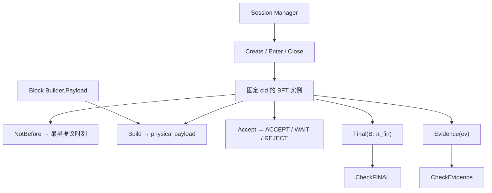

# 模块 02：Session Program（Regional BFT）与 Block Builder（v9 工作稿 v0.1）

日期：2026-11-02。总览与共享模型见 [00 arch](00_arch_zh_v0_1.md)；来源为 [arch v0.2 §4.2–§4.3、§5.1](../formalization_v8/arch_zh_v0_2.md) 与 [Regional BFT v0.13](../formalization_v8/regional_bft_abstraction_zh_v0_13.md)。

## 1. 定位与直觉

Session program 是在一个固定 context 中运行的区域 BFT 实例。它的 context 由三样东西固定：一份已验证 Plan $\Pi_s$（谁来投票、谁可以提议、窗口是哪些 heights）、一个 anchor $A$（从哪个 L2 block 接着生产），以及由二者和公开配置算出的签名域 cid。Program 在这个 context 中决定一条 physical chain，输出可以公开验证的最终证明和违规证据。

同一个 session 可以有多个候选 program：它们共用 session 参数，但 anchor 不同，因此 cid 不同、彼此签名不可转用。哪个候选最终贡献全局内容，由 GFR 选择（[09 §4.3](09_finality_rules_zh_v0_2.md)）；program 不读取 Espresso 来决定内部投票。

Program 由三部分接口组成：

- **控制接口**（Create、Enter、Close）：由 Session Manager 调用，管理实例的生命周期。
- **应用配置接口**（Build、Accept、NotBefore）：由 BFT 内核调用，构造和检查 physical payload。BFT 负责选择安全的 parent，Config 检查给定 parent 上的 payload 是否符合链规则。
- **输出与公开验证**（Final、Evidence 事件；CheckFINAL、CheckEvidence 函数）：交付结果，并让任何读取者验证。

Block Builder 是 Build 调用的本地交易来源，放在 §3.14 作为依赖接口说明。

## 2. 最小假设

**本模块依赖的模型条目。**

- 签名 EUF-CMA 与 hash binding（[00 §1.1](00_arch_zh_v0_1.md)）。
- L1 safety 及 DEP 输入（[00 §1.2–§1.3](00_arch_zh_v0_1.md)）：同一 finalized L1 前缀上，所有 replica 计算出相同的 $\mathrm{DEP}_\omega(h)$。
- Session 参数与故障模型（[00 §2.2–§2.3](00_arch_zh_v0_1.md)）：委员会 $V_s$、权重 $w_s$、$3F_s<W_s$、每个 session 内静态的 $\mathrm{Byz}_s$，以及 honest replica 的协议时钟等于真实时间。
- 区域内部分同步（[00 §2.4](00_arch_zh_v0_1.md)）：存在未知 $\mathrm{GST}_{i_s}$ 和已知 $\Delta_{i_s}$。安全性质不依赖它；有界进展使用它。
- 链数据与映射（[00 §3](00_arch_zh_v0_1.md)）：physical block、anchor 与 $\mathrm{id}(A)$、$\mathsf{Apply}$、VP1–VP3、$\mathrm{Merge}$、区域固定 origin $\omega_A$ 与 $\mathrm{Virt}(C):=\mathrm{Merge}_{\omega_A}(C)$。

**对其他模块的假设。**

- Plan 已由读取方按 [01 §3.2](01_l1_authority_zh_v0_1.md) 重算验证；program 不检查它是否被 GFR 选中。
- Enter 时 Manager 提供的 $A.\sigma$ 是执行到 anchor 的精确状态，已按 ReadyState（[03 §3.2](03_session_manager_zh_v0_1.md)）核对。
- Builder 的 Payload 只提供普通交易的候选列表；其输出是否进入 block 由 Accept 和 BFT 决定。

**上游输入与下游输出。**

| 方向 | 对方模块与接口 | 交换对象 | 连接 |
| --- | --- | --- | --- |
| 输入 | Authority.`Plan`／`Auth`／`Leader` | PlanRecord、AuthorizationView、$\mathrm{Leader}_s$ | W1、W2 |
| 输入 | Manager.`PrepareCandidate`／`EnterCandidate`／`ApplyLifecycle` | Create／Enter／Close 调用 | W24 |
| 输入 | Builder.`Payload` | 普通交易列表 Txs | W7 |
| 输出 | Manager.`HandleProgramEvent` | FinalEvent、EvidenceEvent | W8、W10 |
| 输出 | Manager、Publisher、GFR、Authority | CheckFINAL／CheckEvidence 的判定 | W11 |
| 输出 | Manager 组装后交给 Publisher | RegionalResult Res | W9 |

## 3. 接口

### 3.1 状态

每个 replica 为每个 cid 保存独立实例状态。固定部分是 descriptor $\nu$ 和 program 配置 $\mathcal K_s$（§3.2）。可变部分包括：

- entered 与 terminated 标志、进入时刻和关闭原因；
- 当前 view，以及该 BFT 实现的投票、锁、计时器等内部共识状态；
- 已生成的签名记录，以及 proposal 的首次接收时刻；
- 已知 physical blocks、决定前缀和验证所需的 ancestor bodies；
- 执行状态、L1 输入缓存，以及待交付的 Final／Evidence 事件。

内部消息和锁的格式由所选 BFT 实现规定。实例在发送签名前保存对应状态和签名记录；暂停或崩溃后恢复继续使用原状态，不能重新初始化来绕过旧投票。更换 BFT 或 verifier 是协议版本选择，不在同一 cid 内进行。

### 3.2 数据结构

**Program 配置。** $\mathcal K_s$ 由公开协议配置和 Plan 字段确定，具名形式为

```text
ProgramConfig = {
    chain, rule_version, verifier_version, config_ref,
    committee, fault_bound, eligible_proposers, leader_rule,
    window, byte_limit, metadata_window
}
```

Chain 为链标识；rule_version、verifier_version、config_ref 从公开配置取得。Committee、fault_bound、eligible_proposers、leader_rule 和 window 分别取 AuthorizationView（[01 §3.2](01_l1_authority_zh_v0_1.md)）的同名字段，且逐项核对相等。Byte_limit 是普通交易编码的字节上限 $L_{\rm bytes}>0$；metadata_window 是 proposal 接收的时间余量 $T_{\rm win}$，其下界在 §4.6 给出。Leader_rule 是 RuleSpec 的有限编码，执行后得到 $\mathrm{Leader}_s$。

令 $Q_s:=W_s-F_s$。它是后文参与条件使用的权重门槛：在线 honest 权重达到 $Q_s$ 时，BFT 才可能取得进展。

**Context 与 descriptor。** Context 是这份配置和 anchor 确定的签名域，其标识为

$$
\mathrm{cid}_{s,A}:=\mathsf H(\texttt{REGIONAL},s,\mathrm{id}(A),\mathcal K_s).
$$

Descriptor 是三元组 $\nu=(\Pi_s,A,\mathrm{cid}_{s,A})$，记录形式为

```text
Descriptor = {
    plan, anchor, cid
}
```

$\nu.\mathit{plan}=\Pi_s$、$\nu.\mathit{anchor}=A$、$\nu.\mathrm{cid}=\mathrm{cid}_{s,A}$。Cid 必须等于上式按 session、$\mathrm{id}(A)$ 和 ProgramConfig 规范编码计算的值，不能由调用者另选。下文只写 cid 时指 $\nu.\mathrm{cid}$。同一个 program 不修改 descriptor。

Anchor 的 block 身份和 metadata 在 Create 时固定，精确执行状态在 Enter 前补齐并验证。执行状态不作为 descriptor 的身份字段编码；它由固定 anchor 的实际执行结果唯一确定。

**Anchor 来源。** 来源依据 $\pi_A$ 的记录为

```text
AnchorEvidence = {
    kind, source_ref, source_objects
}
```

Kind 取 GENESIS、REGIONAL、FORCE 或 RESUME；source_ref 分别指向初始配置、前驱区域结果、Force 的公开重放位置或 RESUME 的 L1 位置。Source_objects 是核对来源与 anchor 对应所需的完整日志、blocks 和证明。区域来源允许只是前驱的有效区域决定；它是否已被 GFR 选中另行核对。

**实例记录。**

```text
BFTInstance = {
    descriptor, entered, terminated, entry_time, close_reason,
    view, kernel_state, signature_records,
    first_received, blocks, final_proofs, evidence_store, decided_tip,
    execution_cache, L1_cache, output_queue
}
```

Descriptor 固定；entered、terminated 为布尔值；entry_time 为协议时刻或 $\bot$；close_reason 为关闭原因标签（[03 §3.2](03_session_manager_zh_v0_1.md) 的 CloseReason）或 $\bot$；view 为正整数，未进入时尚不启动。Kernel_state 是 verifier_version 对应 BFT 版本规定的内部共识状态；外部模块只保管实例句柄，不改写内部锁和投票。

Signature_records 保存 `{message_type, view, signed_bytes}`，按该 BFT 版本解析；first_received 以 proposal 标识为键保存首次接收协议时刻，重试不能覆写。Blocks 以 physical hash 为键保存完整 block；final_proofs 以目标 hash 保存最终证明；evidence_store 保存已核对的违规证据。Decided_tip 指向决定末端，尚无新决定时指向 anchor。Execution_cache 按已验证 parent 链身份和 height 关联执行状态，不单凭 height 复用其他链的状态；L1_cache 保存已验证 L1 对象；output_queue 保存未交付事件。交付完成不删除随后仍需核对的 blocks、证明和证据。

**区域结果与输出事件。** 向消费者交付的完整区域结果为

```text
RegionalResult = {
    descriptor, block, final_proof, chain, anchor_evidence
}
FinalEvent = {
    cid, block, final_proof
}
EvidenceEvent = {
    cid, evidence
}
```

RegionalResult 与五元组 $\mathit{Res}=(\nu,B,\pi_{\rm fin},C,\pi_A)$ 一一对应。Block 为目标 physical block $B$；chain 是从 descriptor.anchor 到 $B$ 的完整、hash 相连的 physical chain $C$，末端必须等于 $B$；final_proof 是固定 BFT verifier 格式的比特串 $\pi_{\rm fin}$，验证的 subject 必须为该 cid 与 $B$；anchor_evidence 为 $\pi_A$，必须指向相同 anchor。

Evidence 的编码由固定 verifier 版本定义，必须能够核对被指控的登记公钥、消息类型、view／签名坐标、相互冲突的签名内容及 context。架构不统一规定某种 BFT 的 QC 或签名聚合格式。

### 3.3 接口概览

Create、Enter、Close 管理实例；Config 提供 Build、Accept、NotBefore；CheckFINAL、CheckEvidence 是公开验证函数；Final 和 Evidence 是输出事件。暂停只停止调度，恢复继续原 program 的状态，不调用第二次 Enter。



| 接口 | 主要输入 | 主要输出 | 用途 |
| --- | --- | --- | --- |
| `Create` | Plan、anchor 身份与 metadata | `Assigned(cid)`、descriptor | 创建或复用固定实例 |
| `Enter` | anchor、来源依据、精确执行后状态 | `Entered(cid, τ_entry)` | 完成一次初次进入 |
| `Close` | 关闭原因 | `Terminated(cid, reason)` | 永久停止新共识签名 |
| `Build` | parent、当前协议时刻 | Physical block | 构造 proposal payload |
| `Accept` | parent、payload、首次接收时刻 | ACCEPT／WAIT／REJECT | 检查应用有效性 |
| `NotBefore` | 合法 parent | 最早时刻或 $+\infty$ | 计算提议时间边界 |
| `CheckFINAL` | descriptor、block、最终证明 | true／false | 公开验证区域最终证明 |
| `CheckEvidence` | descriptor、违规证据 | true／false | 公开验证违规关系 |
| `Final`（输出事件） | 实例形成的决定与证明 | FinalEvent | 交付区域结果 |
| `Evidence`（输出事件） | 实例取得的有效违规证据 | EvidenceEvent | 交付追责任务 |

### 3.4 Create(Π_s, A)

**输入。** 已验证 Plan，以及 anchor 的 block 身份和 metadata；此时可以尚未取得 $A.\sigma$。

**输出。** `Assigned(cid)` 和 descriptor $\nu$；相同 cid 已存在时返回原实例标识及当前状态，不改变已有的终止标记；配置、anchor 身份或窗口不符时返回 REJECT。

**处理。** 检查 $A.h<h_{\min,s}$，固定配置与签名域并创建独立实例。创建不启动共识，也不复制前驱实例的锁或投票。已终止实例不复活。

### 3.5 Enter(A, π_A, σ_A)

**输入。** 对已创建实例提供完整 anchor、来源依据 $\pi_A$ 和精确执行后状态 $\sigma_A=A.\sigma$；读取 descriptor、本 replica 身份、L1 输入和当前协议时刻。

**输出。** `Entered(cid, τ_entry)`，$\tau_{\rm entry}$ 为首次进入的协议时刻；来源或状态材料不完整时返回 WAIT；anchor 不匹配、本 replica 不在委员会、实例已终止或时间已到 $\tau_s^{\rm stop}$ 时返回 REJECT。

**处理。** 核对 anchor 的来源、连接身份与执行状态，复查 [00 §3.4](00_arch_zh_v0_1.md) 的 anchor 前提。第一次进入时设置 entered、初始化该 BFT 的入口状态和 view 1；重复调用返回第一次结果，不重新初始化。可以早于 $\tau_s^{\rm start}$ 进入，提议仍须等待 NotBefore。

### 3.6 Close(reason)

**输入。** 关闭原因标签，取 [03 §3.2](03_session_manager_zh_v0_1.md) 的 CloseReason；或实例到达 $\tau_s^{\rm stop}$ 的本地触发。

**输出。** `Terminated(cid, reason)`；重复关闭返回原终止记录。

**处理。** 设置不可撤销的终止标记，停止新共识签名，保留已有 blocks、签名记录和输出。到达 $\tau_s^{\rm stop}$ 时，即使没有收到本调用，也执行相同停止动作；暂停实例恢复调度前先检查这一条件。

### 3.7 Build(P, τ)

**输入。** 同一 context 上可扩展的 parent $P$ 和当前协议时刻 $\tau$；读取固定配置、ancestor bodies、执行状态、L1 数据，以及 Builder 的 Payload（§3.14）。

**输出。** Physical block $B$；未到最早时刻或缺输入时返回 WAIT；实例关闭、时间达到 stop 或 parent／高度无效时返回 REJECT。

**处理。** 取 $h=\mathrm{slot}(\tau)$，检查 $h_{\min,s}\le h\le h_{\max,s}$ 和 $P.h<h$。执行 parent 之后的必要 padding，计算 height $h$ 的执行前 root；执行该 height 的强制前缀 $\mathrm{Dep}^*_A(h)$ 后调用 $\mathsf{Payload}(h,\sigma,L_{\rm bytes})$。按 [00 §3.4](00_arch_zh_v0_1.md) 填入 $\mathit{ts}^*(h)$ 与 $\mathit{os}^*_A(h)$，按 [00 §3.2](00_arch_zh_v0_1.md) 填入 parent 标识。发送前再次检查未终止且当前时刻小于 $\tau_s^{\rm stop}$；时间到期后不补提议到 $h_{\max,s}$。本接口只构造 payload，parent 的共识选择由 BFT 完成。

### 3.8 Accept(P, B, τ_recv)

**输入。** Parent $P$、完整 proposal payload $B$、本 replica 首次收到该 proposal 的协议时刻 $\tau_{\rm recv}$；读取检查所需的配置和本地输入。

**输出。** ACCEPT、WAIT(missing) 或 REJECT(reason)。

**处理。** 依次检查：

1. **连接与窗口**：$B.\mathit{ph}$ 指向 $P$，$P.h<B.h$，$h_{\min,s}\le B.h\le h_{\max,s}$。
2. **Metadata**：$B.\mathit{ts}=\mathit{ts}^*(B.h)$，$B.\mathit{os}=\mathit{os}^*_A(B.h)$。
3. **执行一致**：$B.\mathit{root}$ 等于从 $P$ 执行中间 padding 后的执行前 root（VP3）。
4. **交易格式**：$\mathsf{BasicTx}(B.\mathit{Txs},L_{\rm bytes})$ 成立（§3.14）。
5. **时间条件**：

$$
\mathit{ts}^*(B.h)\le\tau_{\rm recv}
<\mathit{ts}^*(B.h+1)+T_{\rm win},
\qquad \tau_{\rm recv}<\tau_s^{\rm stop}.
$$

缺输入后的重试保留原首次接收时刻。ACCEPT 表示应用层检查通过；实际投票还须满足 BFT 内部规则及签名时的停止守卫。验证一个已经存在的最终证明，不重新用观察者当前时间调用 Accept：历史决定的验证与新 proposal 的投票检查是两个入口。

### 3.9 NotBefore(P)

**输入。** 当前实例的合法 parent $P$；读取固定窗口。

**输出。** 若 $P.h<h_{\max,s}$，返回 $\max\{\tau_s^{\rm start},\mathit{ts}^*(P.h+1)\}$；否则返回 $+\infty$。

**处理。** 计算允许构造后继 payload 的最早时刻，不修改实例状态，不推进 view。没有可提议后继时，实例仍可在 stop 前处理已有 proposal 的合法共识消息。

### 3.10 CheckFINAL(ν, B, π_fin)

**输入。** 完整 descriptor $\nu$、目标 physical block $B$ 和最终证明 $\pi_{\rm fin}$；读取用于重建 $\mathcal K_s$ 的公开协议配置。

**输出。** true 或 false。

**处理。** 重建 $\mathcal K_s$ 并核对 cid，使用其中的历史公钥、权重和 verifier 版本验证证明是否绑定该 block 与 context。输入无法解析或证明不成立时返回 false。本函数只检查区域最终证明；Plan 的公开来源、完整 ancestry 与全局接纳资格由消费结果的模块另行检查。验证不需要同步时钟。

### 3.11 CheckEvidence(ν, ev)

**输入。** 完整 descriptor、用于重建 $\mathcal K_s$ 的公开配置，以及该 BFT 版本定义的违规证据 ev。

**输出。** true 或 false。

**处理。** 使用固定签名域和历史配置验证证据，按该 verifier 版本的 conflict relation 判断。每个 BFT 实现必须明确给出这个关系和证据编码；只给出一个未定义的“有效证据”谓词不满足该接口。本函数不修改 escrow，也不执行链上处罚。

### 3.12 输出事件 Final(B, π_fin)

**触发。** 实例在当前 context 中形成目标 block 的决定及其最终证明。

**输出。** FinalEvent，并提供消费者取得完整决定链所需的已存 blocks。

**处理。** 交给 Manager 组装完整 Res（[03 §3.6](03_session_manager_zh_v0_1.md)）。原接口不逐个为 padding heights 产生证书；消费者对决定链执行 $\mathrm{Virt}$ 得到对应 virtual 片段。只有目标 hash 时尚不能组装完整 Res。

### 3.13 输出事件 Evidence(ev)

**触发。** 实例取得通过 CheckEvidence 的完整证据。

**输出。** EvidenceEvent，交给 Manager。

**处理。** 保存证据并产生交付任务，不等待链上处罚完成；program 后续关闭不删除该任务。

### 3.14 依赖接口：Block Builder

Build 从本地 Builder 取得普通交易。Builder 不属于任何 session，只是每个 replica 本地的交易池。

**状态与数据结构。**

```text
PendingTx[txid] = {
    tx_bytes
}
PayloadRequest = {
    height, prefix_state, byte_limit
}
```

Tx_bytes 是 $\mathcal T$ 中一笔普通交易的完整原生编码；txid 按该编码和原生交易标识规则计算，不接受与字节内容不符的键。PendingTx 按 txid 去重，池中的排列不是协议承诺的交易顺序。PayloadRequest 是 Payload 参数的记录形式：height 为 L2 height，prefix_state 为该 height 执行完强制前缀后的状态（属于 $\Sigma$），byte_limit 为 $L_{\rm bytes}$。

**交易格式谓词。** 对列表 $\mathit{Txs}\in\mathcal T^*$ 和上限 $L$，$\mathsf{BasicTx}(\mathit{Txs},L)=1$ 当且仅当每个条目非空、可按原生格式解码、交易签名有效、不是 deposit 类型，且列表总字节数不超过 $L$。它只检查格式，不要求每笔交易在当前状态可执行；逐笔准入由 $\mathsf{Apply}$ 中的 $\mathsf{Valid}$ 完成（[00 §3.3](00_arch_zh_v0_1.md)）。

**SubmitTx(tx)。** 输入一笔完整普通交易。格式、签名或交易类型不符时返回 REJECT；否则放入 PendingTx 并返回 `Received(txid)`，重复提交不重复登记。接收只表示本地已收取交易，不使其属于任何已决定 block。

**Payload(h, σ, L_bytes)。** 输入目标 height $h$、执行完该 height 强制前缀后的状态 $\sigma$ 和字节上限。返回满足 $\mathsf{BasicTx}(\cdot,L_{\rm bytes})$ 的有序普通交易列表，可以为空；缺少执行上下文时返回 WAIT，上限无效时返回 REJECT。Session、anchor 和 parent 由调用者确定。

## 4. 性质

本节的性质针对 BFT 实现，固定同一个有效 descriptor $\nu$。§4.1–§4.9 是实现必须满足的 Required Properties（BFT-1…7）；§4.10 是这些性质与 Config 规则组合后达到的目标（G1–G3），以 BFT-1…7 成立为前提，不表示已证明某个具体实现满足它们。涉及签名和 hash 的结论允许可忽略失败概率。

### 4.1 观察事件与 regional finality

**Decided chain 与 regional finality。** 若 $\mathsf{CheckFINAL}(\nu,B,\pi_{\rm fin})=\mathrm{true}$，称 $B$ 及其同链 physical ancestors **已决定**，也称 **regional finalized**。从固定 anchor 到 $B$ 的链称为 decided chain。证明可以稍后才被其他读取者取得。

Regional finality 只回答“这个实例是否已经决定了该 block”。GFR 还要回答“这个实例是否被选中、结果是否及时公开、对应高度是否仍可接纳”（[09 §4.2](09_finality_rules_zh_v0_2.md)）。同一份有效区域证明可以通过前一个判断，却未通过后面的全局接纳条件；前驱 context 中的最终证明可以支持候选 anchor，但不能代替 GFR 对后继 context 的选择。

**进入 BFT chain。** 为覆盖“已经被 honest replica 用作 parent、但还没有最终证明”的块，对每个非 anchor physical block $B$ 定义：

- $\tau_{\rm par}(B)$：首次有 honest replica 选择 $B$ 或其 physical 后代作为 parent 的时刻，包括据此调用 Build 或 Accept；
- $\tau_{\rm fin}(B)$：首次有任一参与方持有对 $B$ 或其 physical 后代有效最终证明的时刻；
- 未发生的事件时间为 $+\infty$，并令 $\tau_{\rm in}(B):=\min\{\tau_{\rm par}(B),\tau_{\rm fin}(B)\}$。

$\tau_{\rm in}(B)<+\infty$ 表示 $B$ 已**进入 BFT chain**；以这样的 block 为末端的 physical chain 称为一条 **BFT chain**。Anchor 是已验证的外部输入，不作为本实例新产生的 block。Proposal 所属 view 由其签名共识消息标识，physical payload 中没有 view 字段；“view 贡献一个 block”指该 view 的 proposal 成为所讨论链上的 physical block。

### 4.2 BFT-1 — Agreement（safety）

同一 cid 的任意两条 decided chain $C,C'$ 前缀可比：$C\preceq C'$ 或 $C'\preceq C$。

该要求在异步期间、replicas 进入时间不同、部分 replicas 离线或暂停时都适用。它不比较不同候选 cid 的决定链。

### 4.3 BFT-2 — Chain validity（safety）

对每个进入 BFT chain 的 physical block $B$，存在一个 honest replica，在实际首次收到该 proposal 时记录接收时刻，对它与其 parent 调用 Accept，且该调用在 $\tau_{\rm in}(B)$ 之前或当时返回 ACCEPT。

若该 replica 先因缺数据得到 WAIT，完成检查时仍使用原首次接收时刻。仅有格式正确的签名或尚未完成的检查，不能替代这次 ACCEPT。直观上，本性质保证：任何 block 在被决定或被 honest replica 当作 parent 之前，都已经通过应用层检查。

### 4.4 BFT-3 — One block per view（safety）

同一 context 的任意一条 BFT chain 上，同一 view 至多贡献一个 physical block。

这是对链上结果的限制，不禁止 Byzantine leader 发送多个冲突 proposals。

### 4.5 BFT-4 — External verifiability（safety）

实现提供公开、确定的 CheckFINAL 与 CheckEvidence，并满足：

1. 每个 Final 输出的证明都通过 CheckFINAL，且绑定该 descriptor 与目标 block。
2. 通过 CheckFINAL 的结果适用 BFT-1、BFT-2 等决定性质；敌手不能通过另造证明绕过这些要求。
3. 按协议运行的 honest replica 不会产生针对其身份、通过 CheckEvidence 的违规证据。
4. 另一个 cid 下的签名不能被转用为本 cid 的有效决定或违规证据。

验证只使用声明的公开输入，不要求观察者有同步时钟，也不要求它在签名形成时在线。本条不要求每次违规都必然被发现。

### 4.6 有界进展的适用条件

BFT-5、BFT-6 只在下述区间内使用。取区间 $I=[\tau_{\rm lc},\tau_{\rm end})$ 和固定的 honest replica 集合 $U\subseteq V_s\setminus\mathrm{Byz}_s$，满足

$$
\tau_{\rm lc}\ge\mathrm{GST}_{i_s},\qquad
\tau_{\rm end}\le\tau_s^{\rm stop},\qquad
\sum_{m\in U}w_s(m)\ge Q_s.
$$

$U$ 中的 replicas 称为该区间的 **active replicas**：它们不晚于 $\tau_{\rm lc}$ 完成 Enter 或从原状态恢复，整个区间持续在线并调度同一个 cid，未 Close；所需 L1 输入、ancestor bodies、执行状态与 Payload 在声明的处理预算内可取得。委员会和门槛不按当前在线人数重算。$\tau_{\rm lc}$ 从足够 replicas 已就绪时选取，不从第一个 replica Enter 时起算；某些 replicas 因切换候选不再调度该 cid 时，需要重新检查是否仍存在满足条件的区间。

**时间参数。** 在声明的消息大小、状态准备和处理负载范围内，$T_{\rm build}$ 是从开始 Build 到发出 proposal 的上界。所选 BFT 实现给出四个预算：$T_{\rm sync}$（恢复 view 同步）、$T_{\rm fin}$（决定）、$T_{\rm next}$（推进到下一 view）、$T_{\rm vc}$（离开不成功 view）。$T_{\rm fin}$ 与 $T_{\rm next}$ 包含相应的验证和数据取得。Config 的 metadata window 满足

$$
T_{\rm win}\ge T_{\rm build}+\Delta_{i_s}.
$$

**View 起算时刻。** 对 replica $m$ 和 view $v$，令 $\tau_{\rm view}(m,v)$ 为 $m$ 进入该 view 的时刻，$P_{m,v}$ 为进入时按 BFT 规则选定的 parent，定义

$$
\tau_{\rm st}(m,v):=\max\{\tau_{\rm view}(m,v),\mathsf{NotBefore}(P_{m,v})\}.
$$

它表示 replica 已进入 view、且应用层已允许从该 parent 构造后继的时刻；parent 已到高度上界时可以是 $+\infty$。

**同步起点。** 直觉上，$\tau_{\rm sync}$ 是此后可以使用有界进展时限的计时起点：一般要先等 $T_{\rm sync}$，让 active replicas 的 view 对齐；只有全部 active replicas 在窗口开始前就已就绪时，才可以直接从 $\tau_s^{\rm start}$ 起算。形式上，通常取 $\tau_{\rm sync}:=\max\{\tau_{\rm lc}+T_{\rm sync},\tau_s^{\rm start}\}$。当以下四个条件同时成立时，称为**同步开始**，取 $\tau_{\rm sync}=\tau_s^{\rm start}$：

- $\tau_{\rm lc}=\tau_s^{\rm start}$；
- 全部 active replicas 已在该时刻前初次 Enter；
- 此前没有 active replica 到达任何 view 的起算时刻；
- 所需的同步条件已经成立。

候选切换或暂停恢复不自动满足这个例外。View $v$ **在 $\tau_{\rm sync}$ 后开始**，指 $\tau_{\rm sync}$ 之前没有 active replica 到达该 view 的起算时刻，也没有 active replica 进入更高 view。

### 4.7 BFT-5 — Progress（liveness）

设 view $v$ 在 $\tau_{\rm sync}$ 后开始，leader $m=\mathrm{Leader}_s(v)\in U$，且 $P_{m,v}.h<h_{\max,s}$。令 $\tau_0:=\tau_{\rm st}(m,v)$，leader 在 $\tau_0$ 开始 Build 并提议。以下每项以相应时限严格早于 $\tau_{\rm end}$ 为前提：

1. 该 view 的 block 不晚于 $\tau_0+T_{\rm build}+T_{\rm fin}$ 被决定。
2. Active replicas 不晚于 $\tau_0+T_{\rm build}+T_{\rm next}$ 进入下一 view 或更高 view。进入紧接的 view $v+1$ 时，以这个 block 为 parent；进入更高 view 时，所选 parent 延续这个 block 所在的 physical 前缀。

决定的是这个成功 view 提议的 block，而不只是同 height 的任意 block。

### 4.8 BFT-6 — View synchronization and bounded unsuccessful view（liveness）

在 §4.6 的区间内：

- **View 同步。** 若一个 active replica 在 $\tau\ge\tau_{\rm sync}$ 已进入 view $v$，且 $\tau+T_{\rm next}<\tau_{\rm end}$，则所有 active replicas 在 $\tau+T_{\rm next}$ 之前到达 $v$ 或更高 view。
- **离开不成功 view。** 对不能按 BFT-5 推进的 view（例如 leader 不在 $U$ 中），active replica $m$ 从 $\max\{\tau_{\rm st}(m,v),\tau_{\rm sync}\}$ 起，在 $T_{\rm vc}$ 内离开该 view；只在起算时刻有限、且完整时限严格早于 $\tau_{\rm end}$ 时使用。

等待 NotBefore 的时间不计入不成功 view 的时间。

### 4.9 BFT-7 — Bounded height and scheduled shutdown（safety）

- **高度有界。** 任何通过 CheckFINAL 的 block 满足 $h_{\min,s}\le B.h\le h_{\max,s}$。
- **按时停止。** 所有 honest replicas 在 $\tau\ge\tau_s^{\rm stop}=\mathit{ts}^*(h_{\max,s}+1)$ 时不再生成该 cid 的任何新共识签名；已较早 Close 的实例也不恢复签名。离线或暂停 replica 恢复时先检查这一条件。

停止前的签名可能在停止后才被组合或公开为有效证书，因此“停止新签名”不等于“停止后不再出现新的有效证明”；这类迟到结果由 GFR 的公开截止处理（[09 §3.2](09_finality_rules_zh_v0_2.md)）。本条不要求 $h_{\max,s}$ 一定被决定；窗口结束时的末端由 GFR 的 regular anchor 规则固定（[09 §4.3](09_finality_rules_zh_v0_2.md)）。

### 4.10 组合目标 G1–G3

以下目标以 [00](00_arch_zh_v0_1.md) 的模型、Config 规则和 BFT-1…7 为前提。每条注明依赖。

**G1 — Height 与时间。**

- **G1.1 Fixed timestamp。** 决定链 $C$ 的 $\mathrm{Virt}$ 展开在每个 height 使用 $\mathit{ts}^*(h)$。依赖 VP1 与 Merge；不要求每个 slot 都有 physical block。
- **G1.2 Not ahead。** 每个进入 BFT chain 的 physical block 满足 $\mathit{ts}^*(B.h)\le\tau_{\rm in}(B)$。依赖 BFT-2、Accept 的时间检查和协议时钟。
- **G1.3 Timely admission。** 存在完成检查的 honest replica，其首次接收时刻满足 $\mathit{ts}^*(B.h)\le\tau_{\rm recv}<\min\{\mathit{ts}^*(B.h+1)+T_{\rm win},\tau_s^{\rm stop}\}$。依赖 BFT-2 与 Accept；它约束首次接收，不约束证书何时向外公开。

**G2 — Safety。** 以下目标不依赖区域网络已达到 GST。

- **G2.1 Agreement。** 同一 cid 的决定 physical 前缀可比较；用相同 finalized L1 输入执行 $\mathrm{Virt}$ 后，所得 virtual 前缀也可比较。依赖 BFT-1 与确定性 Merge。
- **G2.2 Prefix closure。** 后代的最终证明确定其同链 physical ancestors；其间的 virtual heights 由 Merge 唯一确定，padding 无需单独投票。
- **G2.3 Application validity。** 进入 BFT chain 的 block 满足 Accept 的 metadata、root 和 BasicTx 检查；root 是执行该 height 之前的状态 root，普通交易仍按 Apply 过滤。依赖 BFT-2 与 VP3。
- **G2.4 Deposit completeness。** 设决定链末端为 $h_C$。对 $A.\mathit{os}<\ell\le\mathit{os}^*_A(h_C)$ 的每个 L1 height $\ell$，其 deposit 列表在该 virtual 片段中首次推进到 origin $\ell$ 的 height 执行恰好一次。Leader 不能省略、重排或重复强制前缀。依赖连续的 origin 轨迹、VP2 与 Merge。
- **G2.5 One block per view。** 依赖 BFT-3。
- **G2.6 Close and context isolation。** Honest replica 在 Close 或 stop 后不生成新共识签名；不同 cid 的签名与证据不能相互转用。依赖控制接口、BFT-4 与 BFT-7。
- **G2.7 No false evidence。** Honest replica 不会被判定为产生有效违规证据。依赖 BFT-4 与签名假设。
- **G2.8 Execution compatibility。** 在 [00 §3.4](00_arch_zh_v0_1.md) 的参数与 anchor 前提下，区域 origin 满足 O1–O3；决定链按 Apply 得到与强制前缀和普通交易一致的执行结果。要使同一内容在 L1 原样派生，还需要相同原生父状态、全局选择及原生期限内的批次交付，见 [09 §7](09_finality_rules_zh_v0_2.md)。
- **G2.9 Unique virtual expansion。** 给定同一有效决定 physical chain、anchor 状态与 finalized L1 输入，$\mathrm{Virt}$ 给出唯一满足 VP1–VP3 的 virtual 片段；扩展只到已给定 physical 末端，时钟推进本身不增加尾部。

**G3 — 停止之前的条件性进展。**

- **G3.1 Successful-view production。** 在 §4.6 的区间中，满足 BFT-5 前提且有足够完成时间的 view，其 block 在规定时限内决定，height 为 $\mathrm{slot}(\tau_0)$。依赖 Build 与 BFT-5。
- **G3.2 Catch-up by padding。** 若成功 view 的 parent 较低，决定后由 Merge 补齐中间 heights。若决定时刻为 $\tau_f$，该成功 block 满足 $\tau_f-\mathit{ts}^*(B.h)<b_{\rm L2}+T_{\rm build}+T_{\rm fin}$。这是单个成功 view 的 freshness 界，不是整个 session 的连续 lag 承诺。
- **G3.3 Unsuccessful-view rotation。** 不成功 view 在 BFT-6 的时限内被离开。要给出等待下一个 active leader 的统一上界，还需对 $\mathrm{Leader}_s$ 的选择序列作约束，不能仅由在线权重推出。
- **G3.4 Selected-transaction execution。** 若一笔普通交易已被 Payload 放入 BFT-5 所决定的 block，且在 Apply 轮到它时通过 Valid，则它保留在该 block 的 Kept 列表中。“待处理交易最终一定被选入”还需要 Builder 的选择条件，本抽象不假设公平选取。

“窗口末高度一定被决定”不是本模块的目标。Regular handoff 的 anchor 由 GFR 固定；后继的低延迟进入还取决于跨区域通信、状态准备和最终选定 cid 的参与情况，见 [10 §3](10_pipelines_zh_v0_2.md)。
