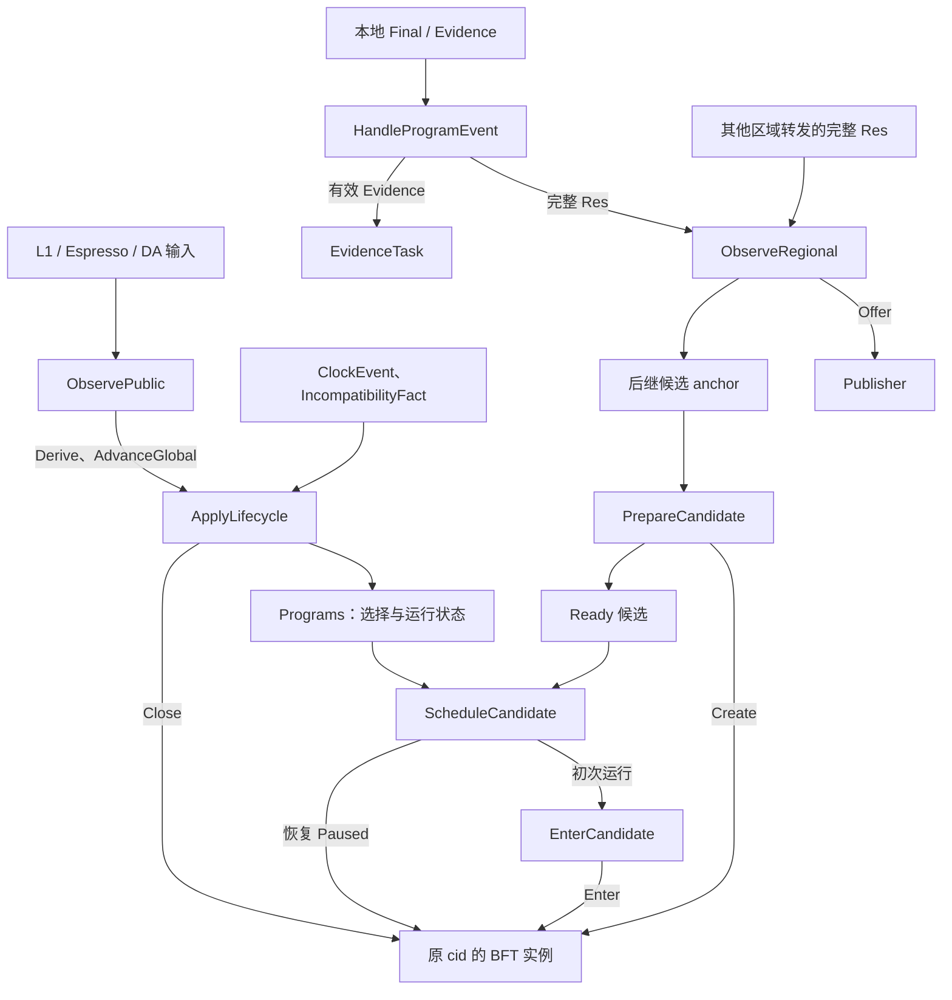

# 模块 03：Session Manager（v9 工作稿 v0.1）

日期：2026-11-02。总览与共享模型见 [00 arch](00_arch_zh_v0_1.md)；来源为 [arch v0.2 §4.9、§6.1–§6.3](../formalization_v8/arch_zh_v0_2.md) 与 [261027 §6](../meetup_record/261027.md)。

## 1. 定位与直觉

每个 replica 运行一个 Session Manager。GFR 和 Derivation 给出的是**公开事实**：哪个 session 被分配、哪个分支已关闭、派生链 $D$ 走到了哪里。Session program 是**本地实例**。Manager 把前者落实为后者：

- **准备**：为可能被选中的候选 anchor 取得并核对执行状态。
- **进入与调度**：在合适时刻对一个候选首次 Enter；同一 session 至多调度一个候选，必要时暂停旧候选、转向新候选。
- **关闭（Kill）**：一旦公开事实表明某个 program 已不可能贡献最终链，就永久关闭它。
- **转交**：把本地 program 的 Final／Evidence 组装成完整结果，交给 Publisher。

Manager 始终以 cid 为键找到原 program：需要状态时准备它，需要运行时调度它，永久关闭后保留历史结果但不再恢复共识。

## 2. 最小假设

**本模块依赖的模型条目。**

- Session、program 与窗口定义（[00 §2.2](00_arch_zh_v0_1.md)）；协议时钟（[00 §2.3](00_arch_zh_v0_1.md)）。
- 跨区域通信在 Espresso live 期间同步（[00 §2.4](00_arch_zh_v0_1.md)）：前驱的区域结果可以在 $\Delta_{\rm cross}$ 内到达后继区域。这只影响交接延迟，不影响正确性。
- 链映射与执行（[00 §3](00_arch_zh_v0_1.md)）：用于核对候选前缀与 $D$ 是否相容。

**对其他模块的假设。**

- GFR 的 LifecycleEvent 与 Tail 来自本地按公开规则重放的结果（[09 §3–§4](09_finality_rules_zh_v0_2.md)）；Manager 不接受远端声称的选择。
- Derivation 的 $D$ 与 ResumeCut 由本地按原生规则计算（[09 §5](09_finality_rules_zh_v0_2.md)）。
- Program 满足控制接口的语义：Enter 只初始化一次，Close 不可撤销（[02 §3.4–§3.6](02_session_program_zh_v0_1.md)）。

**上游输入与下游输出。**

| 方向 | 对方模块与接口 | 交换对象 | 连接 |
| --- | --- | --- | --- |
| 输入 | L1、Espresso、DA 的公开数据 | 已验证日志前缀、DAObject | — |
| 输入 | GFR.`AdvanceGlobal`、`Responsibility`、`Chain` | LifecycleEvent、Tail、$(G,\mathrm{src}_G,pc)$ | W13、W14、W15 |
| 输入 | Derivation.`Derive`、`DeriveAtResume` | $D$、DerivedItem、ResumeCut | W22、W23 |
| 输入 | Authority.`Plan`、`ReadAuthority` | PlanRecord、AuthorityRead | W1、W6 |
| 输入 | Program.`CheckFINAL`、`CheckEvidence` | 验证判定 | W11 |
| 输入 | Program 输出事件 | FinalEvent、EvidenceEvent | W8、W10 |
| 输入 | 前驱区域的 Manager.`HandleProgramEvent` | 完整 RegionalResult | W26 |
| 输出 | Program.`Create`／`Enter`／`Close` | 控制调用 | W24 |
| 输出 | Publisher.`Offer` | RegionalResult | W9 |
| 输出 | Publisher.`QueueEvidence` | EvidenceTask | W10 |
| 输出 | 后继区域的 Manager.`ObserveRegional` | 完整 RegionalResult | W26 |

## 3. 接口

### 3.1 状态

Manager 维护本地公共输入、GFR 状态 $\mathcal X$（ReplayState，[09 §4.1、§4.7](09_finality_rules_zh_v0_2.md)）、派生状态 $\mathcal D$（DerivationState，[09 §5.1](09_finality_rules_zh_v0_2.md)）、候选 anchor 及其来源、当前调度选择和待交付任务。它以 cid 为键维护 Programs 表；每个条目保存 descriptor、原 BFT 实例、状态准备进度、entered 标志、关闭原因，以及**运行状态**和**选择状态**两个分量。

**运行状态**（phase）取 Assigned、Preparing、Ready、Running、Paused、Terminated，依次表示已登记参数、正在取得状态、状态就绪、已进入并运行、已进入但暂停、永久终止。**选择状态**（selection）取 Candidate、Selected、Excluded，分别表示待 GFR 选择、已被选中、已确定失去资格。

两个分量的不变式为：

- Ready 要求已实际取得 $A.\sigma$，并从已验证的原生前缀重建或验证它与 anchor 的对应；只有 root 或下载地址不够。
- entered 只从 false 变为 true；Paused 只出现在 entered 为 true 之后。
- Terminated 不转换为其他运行状态。一个因时间到期而停止的实例仍可保留尚待公开接纳的历史结果，因此 TIME 关闭不自动把 selection 置为 Excluded。

**区域视图 $R$。** 对每个 cid，Manager 保存该 program 的区域决定链 $C$ 及其 $\mathrm{Virt}(C)$；接上已验证的 anchor 前缀后，得到一条候选 virtual chain $R_{\rm cid}$。$R$ 表示这些候选视图的集合（[00 §4.5](00_arch_zh_v0_1.md)）。

### 3.2 数据结构

**Programs 表条目。**

```text
ProgramEntry = {
    descriptor, anchor_evidence, program_handle, phase, selection, entered,
    state_material, ready_state, close_reason,
    regional_chain, regional_view, pending_tasks
}
ReadyState = {
    anchor_id, anchor_height, state, execution_evidence
}
```

Descriptor 是固定 $\nu$（[02 §3.2](02_session_program_zh_v0_1.md)），anchor_evidence 是 PrepareCandidate 收到的 $\pi_A$（AnchorEvidence），EnterCandidate 调用 Enter、HandleProgramEvent 组装 Res 时都从这里读取；program_handle 指向原 BFTInstance；表键必须等于 descriptor.cid。Phase、selection、entered 采用 §3.1 的取值。State_material 保存已取得的准备材料；ready_state 在核对完成前为 $\bot$；close_reason 在终止前为 $\bot$，之后取 CloseReason。Regional_chain 是该 cid 的 physical 决定前缀，regional_view 是 $R_{\rm cid}$；pending_tasks 指向已有发布或证据任务。

ReadyState 的 anchor_id 与 anchor_height 必须与 descriptor.anchor 的 $\mathrm{id}(A)$、$A.h$ 对应；state 是完整的 $\Sigma$ 中状态。Execution_evidence 是从一个已验证原生 checkpoint 到该 anchor 的有序执行输入，或已采用的原生状态验证机制给出的完整依据，用来核对 state 确为执行完 anchor 的结果。仅有 state root 相等或下载地址不构成完整 ReadyState。

**StateMaterial** 可以是完整状态及验证依据，也可以是等待续接的 checkpoint、blocks、L1／DA 输入的部分集合。它只记录已取得的数据，不携带未经验证的 Ready 标记。Manager 完成验证后才建立 ReadyState。

**关闭原因。**

$$
\mathsf{CloseReason}
=\{\mathsf{TIME},\mathsf{COMPLETE},\mathsf{FORCE},
\mathsf{RESUME},\mathsf{EXPIRED},\mathsf{EXCLUDED},
\mathsf{INCOMPATIBLE}\}.
$$

前五项分别对应：本地协议时钟到达 $\tau_s^{\rm stop}$；GFR 公开完成该 session（$h_{\max,s}$ 已被接纳，或 SessionEnd 已固定其末端，[09 §4.3](09_finality_rules_zh_v0_2.md)）；Force 关闭分支；RESUME 关闭分支；全局过期关闭分支，或新开出的安排已不能启动；EXCLUDED 表示已确定不是可选 context；INCOMPATIBLE 表示与固定的派生前缀不相容（§4.4）。

**本地输入事件。** 除 Program 的 FinalEvent／EvidenceEvent（[02 §3.2](02_session_program_zh_v0_1.md)）和 GFR 的 LifecycleEvent（[09 §4.7](09_finality_rules_zh_v0_2.md)）外，Manager 还接收：

```text
ClockEvent = {
    protocol_time
}
IncompatibilityFact = {
    cid, height, candidate_hash, derived_hash, input_ref
}
```

Protocol_time 是本机协议时钟值，不能用远端声明的时间代替。IncompatibilityFact 的两个 hash 是同一 height 上，分别按候选的已验证前缀和按 $D$ 执行并编码得到的原生 block hash，二者必须不同；input_ref 标明取得候选前缀与派生输入的已验证依据。单纯“$D$ 更高”不产生此结构。

**Manager 完整状态。**

```text
ManagerState = {
    self, public_inputs, GFR_state, derivation_state,
    Programs, candidates, scheduled, tasks
}
```

Self 为本 replica 身份；public_inputs 是已验证日志及对象缓存；GFR_state 与 derivation_state 分别为 ReplayState 与 DerivationState；candidates 按前驱 cid 关联可用候选 anchor 及其 AnchorEvidence；scheduled 按逻辑 session 记录当前调度的 cid 或 $\bot$；tasks 保存 PublicationTask／EvidenceTask（[04 §3.2](04_publisher_zh_v0_1.md)）的本地记录或引用。一个条目的关闭不删除独立交付任务。

### 3.3 接口概览

ObservePublic 和 ObserveRegional 接收外部输入；HandleProgramEvent 接收本地 BFT 事件；PrepareCandidate 准备实例，EnterCandidate 完成初次进入，ScheduleCandidate 管理候选调度；ApplyLifecycle 执行公开选择、关闭及本地停止事件。



| 接口 | 主要输入 | 主要输出 | 用途 |
| --- | --- | --- | --- |
| `ObservePublic` | 公共日志、DA 数据及验证依据 | 处理位置、生命周期事件、受影响 cid、路径状态 | 推进派生和 GFR |
| `ObserveRegional` | 完整 Res 及验证材料 | 区域末端、发布任务、后继候选 | 接收区域结果 |
| `HandleProgramEvent` | cid、Final／Evidence | 区域结果处理输出或证据任务 | 对接本地 BFT 输出 |
| `PrepareCandidate` | Plan、anchor、来源依据、状态材料 | `Prepared(cid, Ready)` 或 `Preparing(cid, missing)` | 创建或复用实例并准备状态 |
| `EnterCandidate` | cid | `Entered(cid, τ_entry)` | 完成首次 Enter |
| `ScheduleCandidate` | cid | `Running(cid)` | 暂停、切换或恢复调度 |
| `ApplyLifecycle` | LifecycleEvent、ClockEvent 或 IncompatibilityFact | 更新后的状态、受影响 cid 列表 | 执行选择与永久关闭 |

### 3.4 ObservePublic(reads)

**输入。** 新的 L1／Espresso finalized 前缀、DA 对象及各自验证依据；读取当前 $\mathcal X$、$\mathcal D$ 和 Programs。

**输出。** 更新后的 GFR 与派生处理位置、本次生命周期事件、发生变化的 cid 列表，以及两条处理路径各自的 READY 或 WAIT 状态；输入验证失败返回 REJECT。

**处理。** 依次执行：

1. 验证并保存公共输入。
2. 调用 Derivation.`Derive`（[09 §5.4](09_finality_rules_zh_v0_2.md)）推进 $\mathcal D$。
3. 调用 GFR.`AdvanceGlobal`（[09 §4.8](09_finality_rules_zh_v0_2.md)），其 resumeReader 为本地 `DeriveAtResume`。
4. 对返回的每个 LifecycleEvent 调用 `ApplyLifecycle`。
5. 调用 GFR.`Responsibility`；若 Tail 为 $\mathsf{NEXT}(\nu)$ 且 $\nu$ 的 Plan 指定本 replica 所在区域，或 Tail 中的 boundary 已确定 anchor，对相应 anchor 调用 `PrepareCandidate`。调用 GFR.`Chain` 取得 $G$，用于状态准备与 §4.4 的 G 判死。
6. 逐 cid 重查时间守卫，并检查是否出现 IncompatibilityFact 或 §4.4 的其他判死事实；出现时调用 `ApplyLifecycle`。

Derive 的 WAIT 不阻塞不依赖该数据的 GFR 事件；需要该恢复数据的 RESUME 事件则等待。

### 3.5 ObserveRegional(Res)

**输入。** 完整区域结果 Res（RegionalResult）；读取验证 Plan、anchor、ancestry 和执行所需的本地材料。

**输出。** 已更新的 cid 与区域末端、Publisher 任务，以及新增的后继 anchor 候选（可以为空）；缺来源返回 WAIT，证明或内容无效返回 REJECT。

**处理。** 使用 $\mathsf{CheckFINAL}(\nu,B,\pi_{\rm fin})$ 验证证明，检查 Plan 来源、physical ancestry 和 Merge 输入，更新该 cid 的区域视图，再调用 Publisher.`Offer`（[04 §3.4](04_publisher_zh_v0_1.md)）。若结果来自已被 GFR 选定的前驱 context，就把其决定的 physical block 加入后继 anchor 候选集合，来源依据为 `AnchorEvidence{kind: REGIONAL, ...}`。收到一个更高的区域结果本身不改变 GFR 的选择。

### 3.6 HandleProgramEvent(cid, event)

**输入。** 已登记实例输出的 FinalEvent 或 EvidenceEvent；读取其 descriptor、已存 blocks 和 anchor 依据。

**输出。** 对 Final 返回组装 Res 后的 ObserveRegional 结果；对 Evidence 返回证据交付任务标识；缺少组装材料时返回 WAIT，context 或事件不符时返回 REJECT。

**处理。** Final：补齐从 anchor 到目标 block 的 physical chain $C$，从条目的 anchor_evidence 取得 $\pi_A$，组装 $\mathit{Res}=(\nu,B,\pi_{\rm fin},C,\pi_A)$，交给 ObserveRegional；同时把 Res 转发给后继 session 负责区域（$\Pi_{s^+}$.region，见 §3.10）的各 Manager（W26）。后继区域的 Manager 也可以从本地 GFR 的 publication 索引（ReplayState.publications）组装同一个 Res，因此转发只影响交接延迟。Evidence：经 CheckEvidence 检查后，建立 EvidenceTask 并调用 Publisher.`QueueEvidence`（[04 §3.6](04_publisher_zh_v0_1.md)）。停止旧实例不删除这些结果或证据。

### 3.7 PrepareCandidate(Π_s, A, π_A, stateMaterial)

**输入。** 已验证 Plan、候选 anchor、来源依据 $\pi_A$，以及已取得的状态材料；材料可为空，也可包含可验证 checkpoint、执行输入或完整状态。候选来源有三种：ObserveRegional 给出的前驱区域结果、GFR Tail 中 boundary 的 anchor（Force），以及 ResumeCut 的 anchor（RESUME）。

**输出。** `Prepared(cid, Ready)`；材料不足时返回 `Preparing(cid, missing)`；来源、身份或状态不符时返回 REJECT。

**状态材料的来源。** StateMaterial 从 $D$ 的已验证末端 checkpoint（W22）起，按以下前缀逐高度 Apply 到 $A.h$：REGIONAL 来源使用 $G$（W15）接上候选 Res.chain 的 $\mathrm{Virt}$；FORCE 来源使用 $G$，其 $\pi_A$.source_objects 取自 $\mathrm{src}_G$ 指向的公开结果；RESUME 来源直接使用 ResumeCut.anchor_state（W23）。

**处理。** 重算唯一 cid；若条目不存在，调用 Program.`Create`（[02 §3.4](02_session_program_zh_v0_1.md)）并以 Assigned 登记，否则复用原条目。保存准备进度；状态材料按 anchor 的已验证原生前缀核对，满足 Ready 条件后建立 ReadyState 并置为 Ready。重复提供材料推进同一条目，不创建第二个实例；已 Terminated 或 Excluded 的 cid 不重新准备为可运行状态。

### 3.8 EnterCandidate(cid)

**输入。** 已登记 cid；读取 ReadyState、本 replica 的委员会身份、当前选择与调度、关闭标记和协议时刻。

**输出。** `Entered(cid, τ_entry)`；状态未就绪或尚未被本地调度时返回 WAIT；资格失效、已终止或时间到 stop 时返回 REJECT。

**处理。** 按 §4.2 复查进入守卫，首次进入时调用 Program.`Enter`（[02 §3.5](02_session_program_zh_v0_1.md)），设置 entered 和 Running。未终止实例的重复请求返回原进入结果；暂停后的恢复由 ScheduleCandidate 完成，不再次调用 Enter。

### 3.9 ScheduleCandidate(cid)

**输入。** 按 §4.3 的调度规则选出的 cid；读取同一逻辑 session 的候选状态、GFR 选择和当前时刻。

**输出。** `Running(cid)`；所选实例还需准备时返回 WAIT；候选已被排除、终止或不符合调度规则时返回 REJECT。

**处理。** 同一逻辑 session 最多调度一个候选。若切换，把仍可能被选中的旧实例从 Running 改为 Paused 并保留状态；对新候选调用 EnterCandidate 完成初次进入，或从 Paused 恢复原实例。更高候选尚未 Ready 时，不必终止当前实例；公开选择之后只调度匹配的 cid。

### 3.10 ApplyLifecycle(event)

**输入。** 由本地 GFR 重放产生的 LifecycleEvent 及其处理位置，或本地 ClockEvent、IncompatibilityFact；读取受影响的 Programs 条目。

**输出。** 更新后的运行／选择状态和受影响 cid 列表；材料不足返回 WAIT；来源无法核对或与已验证事实矛盾时返回 REJECT。

**处理。** 按事件种类：

- `SessionAssigned{descriptor}`：将匹配 cid 置为 Selected，将同一 session 中 anchor 不匹配的候选置为 Excluded 并以 EXCLUDED 关闭。若匹配 cid 尚无条目且本 replica 属于其委员会，调用 PrepareCandidate。随后按 [09 §4.3](09_finality_rules_zh_v0_2.md) 计算后继 Plan：$\mathsf{Plan}(\mathcal P_\beta,(\beta,r+1),\mathrm{BlockRef}(\nu.\mathit{anchor}),\nu.\mathit{plan}.\mathit{region},\mathrm{Window}\{h_{\max,s}+1,h_{\max,s}+\mathrm{TB}\})$。若其 region 为本 replica 所在区域，登记为待准备的后继，等待前驱结果（W26）提供候选 anchor。
- `SessionClosed{session, reason}`、`BranchClosed{branch, reason}`：对作用范围内的全部条目（包括尚未 Enter、Preparing 和 Paused 的条目）以对应原因关闭。
- `Resumed{control_seq, branch, anchor, derived_prefix}`：以 RESUME 关闭旧分支的全部条目；以事件 position 中的 L1 位置为 $p_{\rm res}$ 调用 Derivation.`DeriveAtResume`($p_{\rm res}$)，核对 ResumeCut.anchor 等于事件中的 anchor，把 anchor_state 与 derived_prefix 存为该 anchor 的 StateMaterial。新 session 的 Plan 在随后的 SessionAssigned 中给出，届时再调用 PrepareCandidate。
- ClockEvent 到达某条目的 $\tau_s^{\rm stop}$：以 TIME 关闭。
- IncompatibilityFact：以 INCOMPATIBLE 关闭该 cid，以及以它的决定链为 anchor 来源的后继条目。

关闭操作先将条目置为 Terminated 并持久化，再对原 program 调用 Close（[02 §3.6](02_session_program_zh_v0_1.md)），保留已有结果与证据。重复事件不重复创建或恢复实例。

## 4. 生命周期规则

本节给出 §3 各接口共同遵守的状态转换规则。它们是 Manager 规格的一部分；GFR 侧的对应规则见 [09 §4](09_finality_rules_zh_v0_2.md)，端到端流程见 [10](10_pipelines_zh_v0_2.md)。

### 4.1 登记、准备与永久关闭

新 descriptor 通过来源检查后，以 cid 为键建立唯一条目，状态为 Assigned；开始取得 anchor 状态后为 Preparing；满足 Ready 定义后为 Ready。

关闭先置 Terminated，再调用 Close。所有后续 BFT 动作读取这个终止标记；尚未完成的 Close 调用可以幂等重试。Terminated 不转换回其他运行状态，历史结果和证据仍可读取。

关闭事件按作用范围处理全部有关 cid，不能只关闭当前 Running 的实例。例如 BranchClosed 影响旧分支的全部条目；一个仍在下载状态的 Preparing 条目也必须记录终止，避免下载完成后又进入已关闭分支。

### 4.2 初次进入、暂停和恢复

对某个 cid，初次 Enter 必须同时满足：

1. 条目为 Ready；
2. 本 replica 属于该 Plan 的委员会；
3. descriptor 和状态依据已经验证；
4. 没有终止或排除标记；
5. 当前协议时刻小于 $\tau_s^{\rm stop}$；
6. 本节点的调度选择指向这个 cid。

Enter 成功后，entered 置为 true，phase 置为 Running。提前进入者由 NotBefore 等待窗口开始。重复 Enter 请求只重放原结果。

每个 Manager 对同一逻辑 session 最多调度一个候选 program。切换时，若旧候选仍可能被 GFR 选中，将其改为 Paused 并保留原 BFT 状态；新候选在 Ready 后初次 Enter，或恢复原实例。恢复 Paused 只恢复调度，不重新 Enter，不清空共识状态。例如先运行第一个候选、再转向第二个、之后 GFR 选中第一个：若它尚未终止，就从暂停时保留的状态继续；它此前签过的消息、停在的 view 都仍是同一实例的历史。

无论当前为 Assigned、Preparing、Ready、Running 还是 Paused，只要到达 $\tau_s^{\rm stop}$，就以 TIME 终止。离线节点恢复后的第一个共识动作之前也执行此检查。

### 4.3 候选调度

公开 anchor 尚未固定时，Manager 优先准备同一前驱决定链上已知的最高合法候选。在已 Ready 且未被排除的候选中，调度最高 anchor 对应的 cid；更高候选未准备好时，不必销毁当前实例。GFR 选定后，只有匹配的 cid 可以继续；若它尚未 Ready，就准备并等待，不运行另一个已被排除的候选。

暂停与永久关闭的区别是：本地暂时偏好更高候选，只改变调度，之后仍可回到保存的实例；公开规则已经排除旧候选时，才将其永久关闭。

### 4.4 排除与 Kill 判据

Kill 回答“这个 program 还有没有可能接到最终链上”，而不是“它多久没响应”。以下事实足以永久关闭一个条目，它们分为两组（[261027 §6](../meetup_record/261027.md)）。

**G 判死（来自 GFR 的公开事件）。**

- GFR 已明确选定不同 anchor（SessionAssigned 的 descriptor 不匹配）：EXCLUDED。
- 更高的前驱 physical block 已进入 $G$（由 GFR.`Chain` 读出），使较低 anchor 不可能成为最终末端：EXCLUDED。
- 所属 session 或分支已公开关闭（SessionClosed、BranchClosed、Resumed）：按事件原因关闭；全局过期使下一高度不可能再被接纳时，原因为 EXPIRED。

**D 判死（来自派生链的不相容事实）。** 候选已有固定 virtual 前缀与 $D$ 按 [00 §3.3](00_arch_zh_v0_1.md) 执行并编码后，在某个共同 height 上的原生 block hash 不同，即存在 IncompatibilityFact：INCOMPATIBLE。不相容向后传递：以该候选决定链中某个 block 为 anchor 的后继候选也随之关闭。

**不构成判据的情形。** 只看到 $D$ 更高，或某高度尚无 physical block，不构成不相容；必须确认同一 height 上的原生 block hash 不同。典型情形是该高度已被窗口回退（[00 §3.4](00_arch_zh_v0_1.md)）或 override 的 deposit-only block 占据。

Kill 是本地生命周期动作：它不修改 $G$、不撤销 $G$，也不提交 L1 交易。在 Espresso 停机期间，GFR 可能因缺少 Espresso watermark 而等待，但 $D$ 仍按 L1 推进；Manager 可以依据 D 判死及时停止旧生产，不必等 Espresso 恢复。
