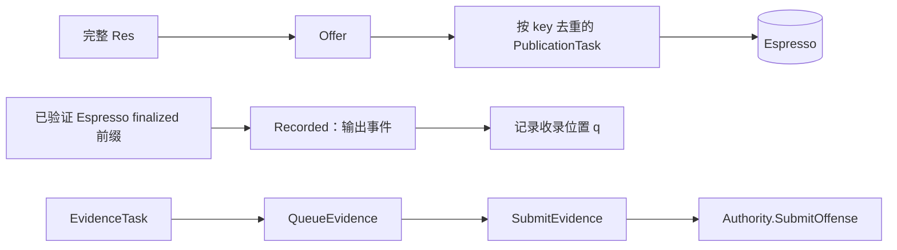

# 模块 04：Publisher（v9 工作稿 v0.1）

日期：2026-11-02。总览与共享模型见 [00 arch](00_arch_zh_v0_1.md)；来源为 [arch v0.2 §4.6、§2.5、§5.2](../formalization_v8/arch_zh_v0_2.md) 与 [Part 0 v0.8 §2.8](../formalization_v6/part0_model_goals_zh_v0_8.md)。

## 1. 定位与直觉

Publisher 是连接区域生产与全局排序的角色：它把完整区域结果写进 Espresso，使 GFR 能按公开顺序读到它。Publisher 还承担把违规证据送到 L1 Authority 的交付任务。

Publisher 不参与任何正确性判断。GFR 对每份 publication 重新执行 CheckFINAL、ancestry 和截止检查（[09 §4.2](09_finality_rules_zh_v0_2.md)），Authority 对每份证据重新执行 CheckEvidence；因此恶意 Publisher 只能拖延或不发布，不能让无效结果进入 $G$。任何持有完整结果的参与方都可以充当 Publisher，session 的诚实成员通常承担这项职责。

## 2. 最小假设

**本模块依赖的模型条目。**

- Espresso 的 E-S、E-L、E-TS（[00 §1.4](00_arch_zh_v0_1.md)）：E-S 保证收录不回退、可完整读取；E-L、E-TS 只用于本模块的时限性质。
- 服务预算 $T_{\rm pub}$（[00 §2.5](00_arch_zh_v0_1.md)）：完整结果交给诚实在线 Publisher 后，在输入可得、负载允许时，完成向 Espresso 提交的时间上界。
- L1 的 $T_{\rm L1}$（[00 §1.2](00_arch_zh_v0_1.md)）：用于证据交付的时限。

**A-RELAY（中继职责，仅用于活性）。** 对每项中继职责——向 Espresso 发布完整区域结果、向 L1 提交证据——在相关时间区间内至少有一个在线诚实方承担。Session 的诚实成员可以承担这些职责。

**对其他模块的假设。**

- Offer 收到的 Res 由 Manager 组装（[03 §3.6](03_session_manager_zh_v0_1.md)）；Publisher 自行验证，不信任组装者。
- 截止键 $\theta_s^{\rm end}$ 与“首次完整公开” $q_{\rm avail}$ 由 GFR 定义（[09 §3.2](09_finality_rules_zh_v0_2.md)）；Publisher 用它们判断何时停止重试。

**上游输入与下游输出。**

| 方向 | 对方模块与接口 | 交换对象 | 连接 |
| --- | --- | --- | --- |
| 输入 | Manager.`ObserveRegional` | RegionalResult Res | W9 |
| 输入 | Manager.`HandleProgramEvent` → `QueueEvidence` | EvidenceTask | W10 |
| 输入 | GFR.`AdvanceGlobal` | LifecycleEvent（判断结果是否已被排除） | W13 |
| 输入 | Program.`CheckFINAL`、`CheckEvidence` | 验证判定 | W11 |
| 输出 | Espresso → GFR.`AdvanceGlobal` | publication 消息 | W12 |
| 输出 | Authority.`SubmitOffense` | descriptor $\nu$、被指控 pid、证据 ev | W28 |

## 3. 接口

### 3.1 状态

发布队列以 $key=(\mathrm{cid},\mathsf H(B))$ 为键，保存 Res、验证与补齐状态、已完成的提交尝试和已验证的 Espresso 收录位置。这个 key 与 GFR 的 publication 索引键 result_key 相同（[09 §4.7](09_finality_rules_zh_v0_2.md)）。待交付违规证据独立保存，不因某个 program 停止而删除。

### 3.2 数据结构

```text
PublicationTask = {
    key, result, phase, missing, recorded_at
}
EvidenceTask = {
    descriptor, evidence, accused_pid, phase, L1_result
}
```

**PublicationTask。** Key 如上；result 是 RegionalResult（[02 §3.2](02_session_program_zh_v0_1.md)），验证来源未齐时还保存已取得的组成部分，不能按完整结果发布。Phase 取：

- VERIFYING：校验中；
- QUEUED：待提交；
- SUBMITTED：已经提交，尚未核对收录；
- RECORDED：已核对 finalized 收录；
- STOPPED：公开规则已排除该结果，或已过该 session 的截止键，停止作为新结果重试。

Missing 列出待补数据，完整后为空；recorded_at 在核对之前为 $\bot$，之后保存 `{q, message_index}` 及读取依据。一次提交尝试不自动把 phase 置为 RECORDED；只有实际公开日志的验证结果才能填入 recorded_at。

**Publication 消息。** 提交到 Espresso 的消息是 RegionalResult 的规范编码。若同一 cid 的 ancestor blocks 或 anchor 来源已在其他 publication 中完整公开，可以按引用省略；GFR 在其 publication 索引中合并这些对象（[09 §4.7](09_finality_rules_zh_v0_2.md)）。

**EvidenceTask。** Descriptor 与 evidence 采用 [02 §3.2](02_session_program_zh_v0_1.md) 的类型；accused_pid 是 descriptor 的 Plan committee 中、公钥等于证据所指控公钥的 pid；phase 取 QUEUED、SUBMITTED 或 RECORDED；L1_result 在尚未处罚时为空，成功后记录 Authority 的处理结果和 L1 位置。任务身份由 cid 与证据的规范内容确定，重复观察不重复安排同一交付。这里的 RECORDED 表示 L1 处理完成，和 PublicationTask 的 Espresso 收录分开。

### 3.3 接口概览

Offer 接收完整区域结果并启动发布；Recorded 是从已验证 Espresso 收录产生的完成事件；QueueEvidence 登记证据任务，SubmitEvidence 把它提交给 Authority。



| 接口 | 主要输入 | 主要输出 | 用途 |
| --- | --- | --- | --- |
| `Offer` | 完整 Res | `Queued(key)` | 验证、保存并提交区域结果 |
| `Recorded`（输出事件） | Espresso finalized 收录依据 | `Recorded(key, q)` | 标记任务已经收录 |
| `QueueEvidence` | EvidenceTask | `EvidenceQueued(task)` | 验证并登记证据任务 |
| `SubmitEvidence` | QUEUED 的 EvidenceTask | `Submitted(task)`，之后 L1_result | 把证据交给 Authority |

### 3.4 Offer(Res)

**输入。** 完整区域结果 $\mathit{Res}=(\nu,B,\pi_{\rm fin},C,\pi_A)$；读取验证所需的已验证配置与 L1 数据。

**输出。** `Queued(key)`；缺验证来源时返回 WAIT 并保留待补齐任务；已判定结果无效时返回 REJECT。

**处理。** 执行 $\mathsf{CheckFINAL}(\nu,B,\pi_{\rm fin})$，核对 $C$ 从 $\nu.\mathit{anchor}$ hash 相连到 $B$、$\pi_A$ 指向同一 anchor。通过后按 key 去重，保存结果并提交到 Espresso。服务暂不可用时保留任务供重试；program 到时停止不清空队列。只有公开规则已排除该结果（本地 GFR 的 SessionClosed、BranchClosed 或 SessionAssigned 选定了其他 cid，W13），或已有 watermark 证明 $\theta_q\ge\theta_s^{\rm end}$，才置为 STOPPED。

### 3.5 输出事件 Recorded(key, q)

**触发。** 已验证的 Espresso finalized 前缀及完整消息内容，能够确认该 key 的完整 publication 已收录于 $J_q$。

**输出。** `Recorded(key, q)`，并在任务中记录收录位置。

**处理。** 标记任务已收录。同一收录的重复观察不产生新任务。GFR 是否接纳该结果仍按 [09 §4.2](09_finality_rules_zh_v0_2.md) 判定。

### 3.6 QueueEvidence(task)

**输入。** Manager 建立的 EvidenceTask（[03 §3.6](03_session_manager_zh_v0_1.md)）。

**输出。** `EvidenceQueued(task)`；证据不通过 CheckEvidence 或 accused_pid 不符时返回 REJECT。

**处理。** 执行 $\mathsf{CheckEvidence}(\nu,\mathit{ev})$，核对 accused_pid，按 (cid, 证据内容) 去重后以 QUEUED 保存。每个 QUEUED 任务随后交给 SubmitEvidence。

### 3.7 SubmitEvidence(task)

**输入。** 一个 QUEUED 的 EvidenceTask；读取 descriptor 所需的公开配置。

**输出。** `Submitted(task)`；L1 finalized 后在 L1_result 中记录 Authority 的输出（`Slashed` 或原处理结果）；证据不通过 CheckEvidence 时返回 REJECT。

**处理。** 以 Publisher 自己的 L1 账户为 caller 分配请求标识 req，调用 Authority.`SubmitOffense`($\nu$, accused_pid, ev)（[01 §3.7](01_l1_authority_zh_v0_1.md)）。L1 未纳入时重试同一请求标识；Authority 的去重保证同一违规不被重复处罚。

## 4. 性质

PUB-1 至 PUB-3 是关于任务状态的安全性质，任何按本规格运行的 Publisher 都满足；PUB-4、PUB-5 是活性性质，依赖 A-RELAY 与外部服务条件。恶意 Publisher 不满足这些性质时，后果只限于活性：GFR 与 Authority 的公开检查保证无效内容不被接纳。

**PUB-1 — Verified queue（safety）。** 队列中 phase 为 QUEUED、SUBMITTED 或 RECORDED 的任务，其 result 是完整 RegionalResult，且 CheckFINAL、ancestry 与 anchor 来源检查均已通过。

*直觉：* Publisher 不会把它自己都无法验证的对象当作完整结果提交。

**PUB-2 — Key uniqueness and idempotence（safety）。** 每个 key 至多对应一个 PublicationTask，每个 (cid, 证据内容) 至多对应一个 EvidenceTask。对同一 Res 重复调用 Offer，或重复观察同一收录，不产生新任务；phase 为 RECORDED 当且仅当 recorded_at 已由已验证的 Espresso finalized 前缀填入。

**PUB-3 — Persistence（safety）。** 一个 PublicationTask 只在两种情况下停止重试：已经 RECORDED，或已被置为 STOPPED（公开规则已排除，或已有 watermark 证明截止键已过）。Program 的 Close、Manager 的切换和本地重启都不删除未完成的发布任务或证据任务。

*直觉：* 停止前形成的有效结果，在截止之前始终有人继续尝试发布。

**PUB-4 — Timely publication（liveness）。** 设完整 Res 在时刻 $\tau$ 交给一个诚实在线 Publisher，且在 $[\tau,\tau+T_{\rm pub}+T_E]$ 内 Publisher 持续在线、输入可得、负载满足声明条件、$\mathsf{Live}_E\equiv1$。则不晚于 $\tau+T_{\rm pub}+T_E$，存在 finalized 的 $J_q$ 使该 publication 完整收录；若 $J_q$ 满足 E-TS，则

$$
\theta_q\le\tau+T_{\rm pub}+T_E+\Delta_{\rm ts}.
$$

依赖：$T_{\rm pub}$ 的服务预算、E-L、E-TS。

*推论（与公开截止的衔接）。* 若 $\tau\le\tau_s^{\rm stop}$，且 GFR 的发布余量满足

$$
T_{\rm grace}>T_{\rm pub}+T_E+\Delta_{\rm ts},
$$

则 $\theta_q<\tau_s^{\rm stop}+T_{\rm grace}=\theta_s^{\rm end}$，该结果满足 [09 §4.2](09_finality_rules_zh_v0_2.md) 的截止条件。这是正常交付预算；non-live 期间不使用这个真实时间保证。

**PUB-5 — Evidence delivery（liveness）。** 设 EvidenceTask 在时刻 $\tau$ 由诚实 Publisher 持有，该 Publisher 在 $[\tau,\tau+T_{\rm L1}]$ 持续在线，L1 正常推进，费用条件满足。则不晚于 $\tau+T_{\rm L1}$，Authority 已对该证据产生 finalized 处理结果（`Slashed` 或同一违规的原处理结果）。依赖：A-RELAY、L1 的 $T_{\rm L1}$、CheckEvidence 的确定性。本条不保证每次违规都被发现，只保证已取得的有效证据被送达。
