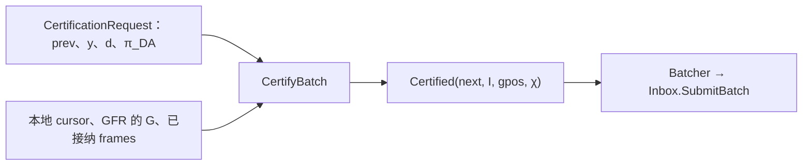

# 模块 06：Certifier（v9 工作稿 v0.1）

日期：2026-11-02。总览与共享模型见 [00 arch](00_arch_zh_v0_1.md)；来源为 [arch v0.2 §4.7](../formalization_v8/arch_zh_v0_2.md)、[Part 0 v0.8 §2.7](../formalization_v6/part0_model_goals_zh_v0_8.md) 与 [261027 §2、§7](../meetup_record/261027.md)。

## 1. 定位与直觉

L1 合约无法自己运行 GFR，也无法读取 DA。Certifier $\mathsf C$ 替 Inbox 回答一个问题：**这份提交是否恰好把 $G$ 的下一段，从当前 cursor 接上去？** 它核对四件事后签名：

1. **cursor 连续**：提交的起点 prev 就是 L1 上的当前 cursor；
2. **来源一致**：编码的每个 block record 与 $G$ 对应 height 的 metadata 和实际执行交易一致；
3. **恢复对齐**：本地 GFR 已处理位置不晚于 prev 写入位置的最后一条 RESUME，因此不会把旧分支内容接到新 cursor 上；
4. **DA 绑定**：提交字节能打开 DA commitment，DA 证书有效。

Inbox 只需验证 $\mathsf C$ 的签名和 cursor 连续性。批次层的安全性因此依赖 $\mathsf C$ 可信（261027 中所说的“CFT only”）；$\mathsf C$ 离线只影响活性。

## 2. 最小假设

**本模块依赖的模型条目。**

- 签名方案 EUF-CMA（[00 §1.1](00_arch_zh_v0_1.md)）；$pk_{\mathsf C}$ 在配置中给定（[00 §2.5](00_arch_zh_v0_1.md)）。
- 链执行（[00 §3.3](00_arch_zh_v0_1.md)）：用于重算 $\mathit{Kept}_h$。
- 服务预算 $T_{\rm cert}$（[00 §2.5](00_arch_zh_v0_1.md)）。

**A-CERT（可信 Certifier）。** $\mathsf C$ 从不被腐化，按本文件 §3 的规则运行。由签名假设，任何带有 $\mathsf C$ 有效签名的消息都是 $\mathsf C$ 按规则实际产生的。$\mathsf C$ 可能离线；离线只影响活性。Regional BFT 与 GFR 的安全性不依赖 $\mathsf C$；$G'$ 与 $D$ 的内容来源依赖 $\mathsf C$。

**对其他模块的假设。**

- $\mathsf C$ 本地运行的 GFR 与公开规则一致（[09 §3–§4](09_finality_rules_zh_v0_2.md)）。
- DA 满足 DA-S1，CheckDA 公开确定（[08 §4](08_da_zh_v0_1.md)）。
- Inbox 在接纳时检查 prev 等于当前 cursor，并验证完整签名消息（[07 §3.4](07_batch_inbox_zh_v0_1.md)）。

**上游输入与下游输出。**

| 方向 | 对方模块与接口 | 交换对象 | 连接 |
| --- | --- | --- | --- |
| 输入 | Batcher.`Deliver` | CertificationRequest | W27 |
| 输入 | GFR.`Chain` | $(G,\mathrm{src}_G,pc)$ | W15 |
| 输入 | Inbox.`ReadCursor` | CursorRead | W20 |
| 输入 | DA.`Disperse` 的结果、DA.`Retrieve` | $(d,\pi_{\rm DA})$、已接纳 frames 的字节 | W17、W21 |
| 输入 | Inbox 接纳事件 | CursorAdvanced（定位已接纳 frames） | W19 |
| 输入 | Derivation.`DeriveAtResume`（本地 GFR 的 resumeReader） | ResumeCut | W23 |
| 输出 | Batcher → Inbox.`SubmitBatch` | CertifiedResult | W18 |

## 3. 接口

### 3.1 状态

$\mathsf C$ 维护自己的已验证 L1、Espresso 和 DA 视图，GFR 状态 $\mathcal X$，当前 Inbox cursor，延续 channel 所需的已接纳 frames，请求结果记录，以及签名密钥 $sk_{\mathsf C}$。它使用与读取者相同的规则版本。来源视图记为 `{GFR_state, Inbox_read, accepted_prefix_frames}`，分别是 ReplayState（[09 §4.7](09_finality_rules_zh_v0_2.md)）、CursorRead（[07 §3.2](07_batch_inbox_zh_v0_1.md)）和 Frame 列表（[05 §3.2](05_batcher_zh_v0_1.md)）。

### 3.2 数据结构

$\mathsf C$ 核对的是一次固定的 cursor 转换：

```text
CertificationRequest = {
    prev, payload, commitment, DA_certificate
}
BatchAttestation = {
    chain, Inbox_address, prev, next,
    commitment, DA_certificate_hash, completed_range, gpos
}
CertifiedResult = {
    next, completed_range, gpos, signature
}
```

**CertificationRequest** 对应 `CertifyBatch` 的四项输入：prev 为 Cursor，payload 为提交字节 $y$（SubmissionPayload 的编码），commitment 与 DA_certificate 为 $d$ 与 $\pi_{\rm DA}$。延续 channel 所需的已接纳 Frame 前缀不由请求者提供：$\mathsf C$ 从 L1 接纳事件（W19）与 DA（W21）自行取得，并核对它与 prev.frames_digest 相符。因此请求者不能用另一个 channel 的同编号 frames 代替此前已接纳的前缀。

**BatchAttestation** 是待签名消息的具名字段：chain 与 Inbox_address 固定签名用途；prev 与 next 为完整 Cursor；commitment 为 $d$；DA_certificate_hash 为 $\mathsf H(\pi_{\rm DA})$；completed_range 为本次完成接纳的 HeightRange $I$（[05 §3.2](05_batcher_zh_v0_1.md)）；gpos 为来源 GFR 的 ReplayPosition（[09 §4.7](09_finality_rules_zh_v0_2.md)）。它不包含未来的 L1 写入位置。

**CertifiedResult** 对应输出 `Certified(next, I, gpos, χ)`：signature 即 $\chi$，是对完整 BatchAttestation 的签名。未闭合 channel 的 completed_range 为 EMPTY，next.height 与 next.origin 保持不变，只按原生规则更新 frames_digest；channel 闭合时核对完整完成范围。

请求结果表按完整请求内容及实际采用的 gpos 关联 BatchAttestation 与 CertifiedResult。即使已有缓存，仍要检查 prev 是否符合当前 L1 cursor 和 RESUME 处理条件；缓存不授予跳过来源检查的权限。

### 3.3 接口概览



| 接口 | 主要输入 | 主要输出 | 用途 |
| --- | --- | --- | --- |
| `CertifyBatch` | prev、$y$、$d$、$\pi_{\rm DA}$ | `Certified(next, I, gpos, χ)` | 核对内容、连续性及 DA 绑定后签名 |

### 3.4 CertifyBatch(prev, y, d, π_DA)

**输入。** 起始 cursor prev、完整提交字节 $y$、DA commitment $d$ 和证书 $\pi_{\rm DA}$；从自身状态读取当前 L1 cursor、GFR 来源和延续 channel 所需的已接纳 frames。

**输出。** `Certified(next, I, gpos, χ)`：next 是计算出的后继 cursor，$I$ 是本次完成接纳的连续高度范围，gpos 是采用的 GFR 处理位置，$\chi$ 是下式定义的签名。缺输入时返回 WAIT；绑定、连续性或内容不符时返回 REJECT。

**处理。**

1. **Cursor 连续。** 确认 prev 等于自身 L1 视图中的当前 cursor。令 $p_{\rm prev}$ 为写入 prev 的 L1 位置（CursorRead.written_at）。
2. **恢复对齐。** 自身 GFR 必须已处理位置不晚于 $p_{\rm prev}$ 的最后一条 RESUME。否则 WAIT，直到 GFR 处理完它。
3. **DA 绑定。** 检查 $\mathsf{CheckDA}(d,\pi_{\rm DA})=1$，且 $y$ 按 DA 方案的绑定关系打开 $d$。
4. **Channel 连续。** 取得 prev.frames_digest 绑定的已接纳 frames，检查 $y$ 中的 frames 与其属于同一 channel 且编号连续。缺少已接纳 frame 时等待取得；尚未提交的未来 frame 不被当作已完成高度。
5. **来源一致。** 对本次可完整解码的 block records，逐高度核对：block_number 连续地从 prev.height $+1$ 开始；epoch_num 等于 $G[h].\mathit{os}$；transactions 等于按该 $G$ 前缀执行 Apply 得到的 $\mathit{Kept}_h$；这些 heights 未由恢复派生覆盖。
6. **签名。** 计算 next 与 $I$，令 gpos 为本次核对采用的 GFR 处理位置，$\mathit{InboxAddr}$ 为配置中的 Inbox 地址，签署

$$
\chi=\mathsf{Sign}_{sk_{\mathsf C}}\!\left(
\mathrm{enc}(\mathit{chain},\mathit{InboxAddr},
prev,next,d,\mathsf H(\pi_{\rm DA}),I,\mathit{gpos})\right).
$$

请求内容及采用来源相同的重试返回已有结果。

## 4. 性质

CERT-1 至 CERT-4 是安全性质，在 A-CERT 与签名假设下对所有执行成立；CERT-5 是活性性质。下文“有效证书”指签名 $\chi$ 在 $pk_{\mathsf C}$ 下对某个 BatchAttestation 验证通过。

**CERT-1 — Soundness（safety）。** 对任一有效证书及其 BatchAttestation $(\mathit{chain},\mathit{InboxAddr},prev,next,d,\mathsf H(\pi_{\rm DA}),I,\mathit{gpos})$，存在 $\mathsf C$ 在签名时的视图，使得：

1. prev 是该视图中 L1 上的当前 cursor；
2. 该视图的 GFR 已处理不晚于 $p_{\rm prev}$ 的最后一条 RESUME，且 gpos 是其处理位置；
3. $\mathsf{CheckDA}(d,\pi_{\rm DA})=1$，存在唯一 $y$ 打开 $d$；
4. 对每个 $h\in I$，$y$ 连同 prev 绑定的 frame 前缀解码出的记录满足 epoch_num $=G_{\mathit{gpos}}[h].\mathit{os}$、transactions $=\mathit{Kept}_h$，其中 $G_{\mathit{gpos}}$ 是 gpos 处的全局链；
5. next 按原生规则由 prev 与 $y$ 计算，$I$ 从 prev.height $+1$ 连续到 next.height（或为 EMPTY）。

*直觉：* 一份有效证书是一个关于“$G$ 的哪一段接在哪个 cursor 之后”的可信陈述。

**CERT-2 — Binding（safety）。** 签名覆盖 BatchAttestation 的全部字段。一个有效证书不能被用于不同的 chain、Inbox、cursor 转换、DA commitment、DA 证书、高度范围或来源位置。依赖：签名 EUF-CMA 与 hash binding。

**CERT-3 — RESUME isolation（safety）。** 设 RESUME 的 CursorSet 在 L1 位置 $p$ 写入新 cursor。则：(a) 在 $p$ 之前签发、以旧 cursor 为 prev 的证书，在 $p$ 之后不会被 Inbox 接纳，因为 prev 不再等于当前 cursor；(b) 以 $p$ 处 cursor（或其后继）为 prev 的证书，其 gpos 对应的 GFR 状态已经处理该 RESUME，因此只覆盖新分支的 $G$。依赖：CERT-1 第 1、2 项与 Inbox 的 prev 检查。

**CERT-4 — Accepted prefix（safety）。** 固定两次相邻 CursorSet（或 genesis 与第一次 CursorSet）之间的一段 L1 历史，记读取者在这段历史内物化的接纳视图为 $G'$（[07 §3.7](07_batch_inbox_zh_v0_1.md)），记 $G_x$ 为 GFR 处理位置 $x$ 处的全局链。对任一处理位置 $x$：若 $x$ 不早于该段每个已接纳证书的 gpos，且在这些 gpos 与 $x$ 之间没有处理新的 RESUME，则

$$
G'\preceq G_x.
$$

*依据：* 由 CERT-1，每次接纳追加的是 $G_{\mathit{gpos}}$ 在 prev 之后的连续一段；GFR 在两次 RESUME 之间只追加不撤销（[09 §7](09_finality_rules_zh_v0_2.md)），因此较早 gpos 处的前缀仍是较晚位置的前缀。这就是 261027 所说“批次层保证 $G'\preceq G$”，它只在 $\mathsf C$ 可信时成立。

**CERT-5 — Responsiveness（liveness）。** 若 $\mathsf C$ 在 $[\tau,\tau+T_{\rm cert}]$ 内在线，请求在 $\tau$ 到达，且其所需输入（L1 cursor、GFR 来源、已接纳 frames、DA 证书）在 $\tau$ 时已可得并通过检查，则 $\mathsf C$ 在 $\tau+T_{\rm cert}$ 之前返回 CertifiedResult。依赖：§2 的服务预算 $T_{\rm cert}$。
