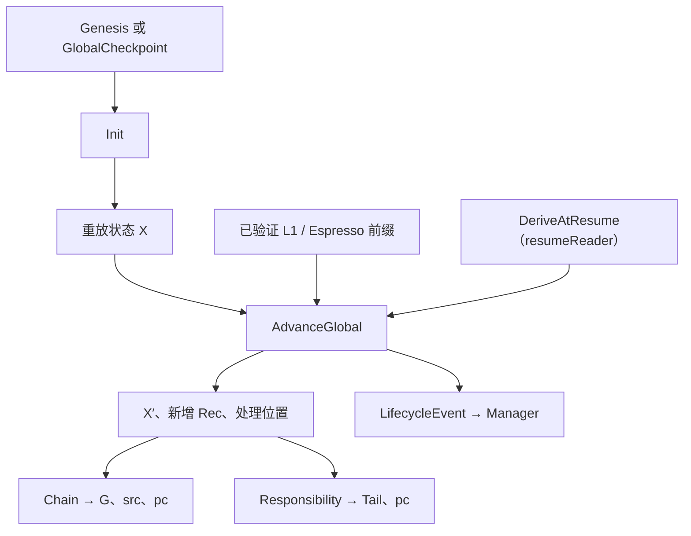
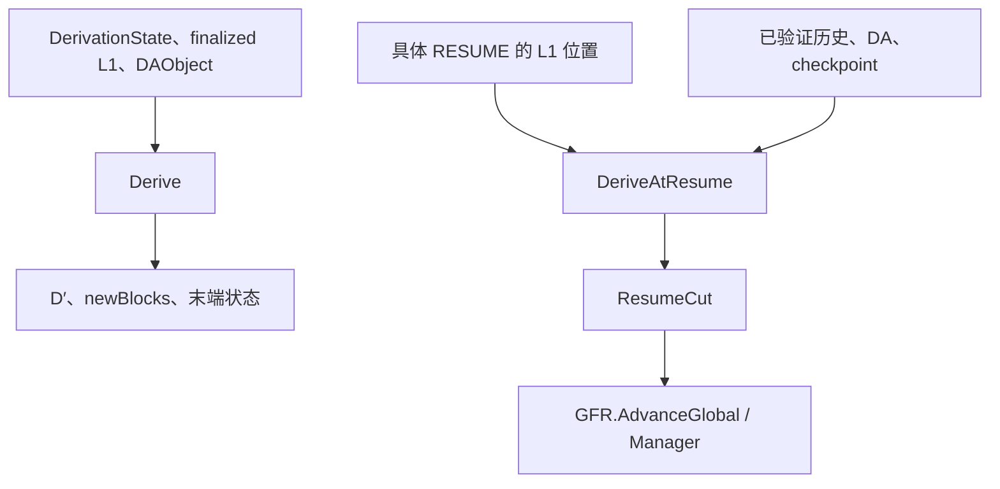

# 模块 09：最终性规则——Global Finality Rule、Derivation Rule 与原生结算（v9 工作稿 v0.1）

日期：2026-11-02。总览与共享模型见 [00 arch](00_arch_zh_v0_1.md)；来源为 [arch v0.2 §4.4、§4.5、§4.10、§5](../formalization_v8/arch_zh_v0_2.md) 与 [261027 §8](../meetup_record/261027.md)。

## 1. 定位与直觉

系统有两条由公开规则确定的链，各自回答一个不同的问题：

- **全局链 $G$**（Global Finality Rule，GFR，§3–§4）：在 L1 控制记录和 Espresso 公开顺序下，哪些区域结果被选为全局内容？任何读取者重放同一份 L1 与 Espresso 历史，都得到同一条 $G$。
- **派生链 $D$**（Derivation Rule，§5）：L1 上接纳的批次与 L1 deposits，按原生规则执行后得到什么 L2 链？任何派生节点用同一份 L1 与 DA 数据，都得到同一条 $D$。

两者使用相同的“physical 内容加 DEP 得到 virtual 内容”的表示（[00 §3.3](00_arch_zh_v0_1.md) 的 Merge），但选择依据不同：$G$ 依据 Espresso 顺序选择区域结果，$D$ 依据 L1 输入与原生期限选择内容和 origin。正常时 $D$ 跟在 $G$ 后面；批次没有在原生期限内送达时，$D$ 自行补入 deposit-only blocks，与 $G$ 不再一致。RESUME 是让 $G$ 重新对齐 $D$ 的唯一入口。

原生结算（§6）在 $D$ 之上登记状态声明，沿用既有机制。

## 2. 最小假设

**本模块依赖的模型条目。**

- L1 safety 与 fixed-pace（[00 §1.2](00_arch_zh_v0_1.md)）；L2 时间表 $\mathit{ts}^*$ 与 DEP（[00 §1.3](00_arch_zh_v0_1.md)）。
- Espresso 的 E-S（对所有执行成立），以及只在 live 条件下使用的 E-L、E-TS；watermark（[00 §1.4](00_arch_zh_v0_1.md)）。
- 链数据、Merge、区域固定 origin 与 $\mathrm{Virt}$、原生 sequencing window $\mathrm{ddl}$ 与 $W_{\rm seq}$（[00 §3](00_arch_zh_v0_1.md)）。
- 服务预算 $T_{\rm pub}$、$T_{\rm batch}$（[00 §2.5](00_arch_zh_v0_1.md)），只用于时序结论。

**对其他模块的假设。**

- 区域结果用 CheckFINAL 验证，满足 BFT-1、BFT-7（[02 §4](02_session_program_zh_v0_1.md)）。
- Plan 是纯函数（[01 §3.12](01_l1_authority_zh_v0_1.md)），GFR 可以在重放中计算后继职责。
- Inbox 的接纳事件与 Certifier 签名满足 CERT-1（[06 §4](06_certifier_zh_v0_1.md)）；Derivation 采用的是 L1 接纳事实，内容来源依赖 $\mathsf C$ 可信。
- 已接纳数据满足 DA-S1 与 DA-RET（[08 §4](08_da_zh_v0_1.md)，其中保留期后的部分依赖 A-CUSTODY）；取不到时等待。

**上游输入与下游输出。**

| 方向 | 对方模块与接口 | 交换对象 | 连接 |
| --- | --- | --- | --- |
| 输入（GFR） | L1 日志 | ControlEntry（Force／RESUME），Authority 状态 | W3、W4、W6 |
| 输入（GFR） | Espresso 日志 | Publisher 提交的 publication | W12 |
| 输入（GFR） | Derivation.`DeriveAtResume` | ResumeCut | W23 |
| 输入（Derivation） | Inbox 事件 | CursorAdvanced、CursorSet | W5、W19 |
| 输入（Derivation） | DA.`Retrieve` | DAObject | W21 |
| 输出（GFR） | Manager.`ApplyLifecycle`，`PrepareCandidate` | LifecycleEvent、Tail | W13、W14 |
| 输出（GFR） | Batcher、Certifier、Inbox 读取者 | $(G,\mathrm{src}_G,pc)$ | W15 |
| 输入（GFR） | Authority.`Plan`、Program.`CheckFINAL` | PlanRecord、验证判定 | W1、W11 |
| 输出（Derivation） | Manager，各处本地 GFR，原生结算 | $D$、DerivedItem、ResumeCut、DerivationInputRef | W22、W23、W25 |

## 3. GFR：状态与接口

GFR 是一个确定的重放器：它按 §4.3 的全序处理 RESUME、Expire、SessionEnd 与 Espresso block 四类事件，每处理一个事件就更新全局链 $G$ 与下一段公开职责 Tail。本节先给出它维护的状态和记录，§4 再给出每类事件的处理规则。

### 3.1 状态

每个读取者维护自己的重放状态 $\mathcal X$，包括：

- 全局 virtual chain $G=(G[h^0],\ldots,G[h_G])$，元素属于 $\mathsf{VB}$；定义 $\mathrm{last}(G):=G[h_G]$。
- 出处 $\mathrm{src}_G(h)$：区域来源记录对应 cid 和覆盖该高度的证明；派生来源标为 DER。
- 当前分支 $\beta$、policy、已选定的 descriptors，以及已关闭的分支和 session。
- 已取得的 L1／Espresso 前缀、完整 publication 索引和待补齐对象。
- 已处理事件记录 Rec，以及处理位置 pc（最后处理完的事件位置，排序见 §4.3）。
- 下一段公开职责 Tail。

**Tail** 取四种值：

- $\mathsf{NEXT}(\nu)$：已选定 descriptor $\nu$，可以接纳该实例的后续结果。
- $\mathsf{OPEN}(\zeta)$：已记录交接边界 $\zeta$，等待规定的开出位置或来源（§4.5、§4.6）。
- $\mathsf{PENDING}(\zeta)$：已经计算 Plan，但没有合格区域。
- $\mathsf{HALT}(\zeta)$：分支因全局过期（§4.6 的 Expire）停止，等待 RESUME。

Tail 描述公开职责，与某个本地 program 的运行状态分开。

### 3.2 数据结构

**重放位置。**

```text
ReplayPosition = {
    key, kind, index
}
```

Key 为非负时间键；kind 取 RESUME、EXPIRE、SESSION_END 或 ESPRESSO；index 分别为 L1 位置、L2 height、session 标识或 Espresso height。时间键公式与比较规则在 §4.3 给出。Cursor 的 `GLOBAL(gpos)` 与证书的 gpos 都使用这个类型（[07 §3.2](07_batch_inbox_zh_v0_1.md)、[06 §3.2](06_certifier_zh_v0_1.md)）。

**交接边界。** Boundary 就是 $\zeta$：

```text
Boundary = {
    cause, target_session, source_region,
    reference_block, anchor, window
}
```

Cause 取 GENESIS、HANDOFF（常规交接）、FORCE 或 RESUME；target_session 是目标 $(\beta,r)$；source_region 是来源区域或 $\bot$；reference_block 是选区用的 BlockRef；anchor 是拟接续的 Anchor；window 是 Window（后三者见 [01 §3.2](01_l1_authority_zh_v0_1.md) 与 [00 §3.2](00_arch_zh_v0_1.md)）。尚未确定的分量为 $\bot$。Reference_block 用于计算 Plan，anchor 用于连接新链，两者分别保存，取值由 §4 的对应事件确定。

**Publication 索引与出处。**

```text
PublicationEntry = {
    result_key, available_objects, locations, first_complete_q
}
GlobalSource = REGIONAL(result_key) | DER(resume_position, height)
```

区域结果的 result_key 为 $(\mathrm{cid},\mathsf H(B))$，与 Publisher 的任务键相同（[04 §3.1](04_publisher_zh_v0_1.md)）。Available_objects 保存已验证公开的结果组成部分；locations 保存这些对象所在的 (Espresso height, message index)，索引从 0 开始；first_complete_q 为全体必需组成部分首次在公开前缀中齐备的 Espresso height，尚不完整时为 $\bot$。它只根据已完整读取的公开历史计算，不使用本地接收时间。完整后，这些对象可以组装为 RegionalResult。

Sources 是以 virtual height 为键的 GlobalSource 表。REGIONAL 指向决定该片段的完整区域结果，padding 也可以引用覆盖它的后继证明；DER 指向采用的 RESUME L1 位置及派生 height。

**重放记录、状态与事件。**

```text
ReplayRecord = {
    position, input_ref, effects, events
}
ReplayState = {
    G, sources, branch, policy, selected,
    closed_branches, closed_sessions, publications,
    L1_prefix, Espresso_prefix, Rec, pc, Tail
}
LifecycleEvent = {
    position, kind, body
}
```

ReplayRecord 的 position 是当前事件的 ReplayPosition；input_ref 按事件类型指向 L1 控制位置、Espresso block、SessionEnd 的 session 或 Expire 的 height。Effects 为有序变更列表，元素取 `APPEND{first, last, source}`（追加的连续 virtual heights 及其 GlobalSource）、`RESET{resume_position, target_height}`（采用的恢复目标）或 `DUTY{before, after}`（变化前后的 Tail）；events 为本事件产生的 LifecycleEvent 列表。

ReplayState 对应 $\mathcal X$：G 是连续 virtual chain；sources 与 G 中 genesis 之后的高度对应；branch 是当前分支 $\beta$；policy 为 Policy；selected 以 session 关联已选 Descriptor；两个 closed 表保存已关闭的标识；publications 是 PublicationEntry 表；两个 prefix 为已验证日志；Rec 为 ReplayRecord 序列；pc 与 Tail 如 §3.1。

LifecycleEvent 的 position 为产生它的 ReplayPosition，kind 与 body 的对应为：

- `SessionAssigned{descriptor}`：已选定的 Descriptor。
- `SessionClosed{session, reason}`：session 与关闭原因（[03 §3.2](03_session_manager_zh_v0_1.md) 的 CloseReason）。
- `BranchClosed{branch, reason}`：分支版本与关闭原因。
- `Resumed{control_seq, branch, anchor, derived_prefix}`：RESUME 序号、新分支、目标 height 处的 Anchor，以及采用的派生 virtual 前缀。

Manager 通过 position、kind 与 body 识别同一事件，不把相同 pc 下的不同事件合并。

**Checkpoint 与返回值。**

```text
GlobalCheckpoint = {
    state, L1_cut, Espresso_cut
}
ReplayResult = {
    state, added_records, events, status
}
```

GlobalCheckpoint 保存完整 ReplayState 和支持它的两份公共日志切面（L1 位置、Espresso height）。验证时必须重建或核对相应状态；单独的末块 hash 不构成 checkpoint。ReplayResult 是 AdvanceGlobal 的返回：status 为 READY 或 `WAIT{next_position, missing}`，next_position 指向尚不能处理的事件，missing 列出缺少的日志、对象或恢复状态；WAIT 不抹去已完成的进度。

### 3.3 接口概览



| 接口 | 主要输入 | 主要输出 | 用途 |
| --- | --- | --- | --- |
| `Init` | Genesis／checkpoint、验证材料 | $\mathcal X_0$ | 建立或恢复重放状态 |
| `AdvanceGlobal` | $\mathcal X$、L1／Espresso 前缀、resumeReader | ReplayResult | 推进公开选择与接纳 |
| `Chain` | $\mathcal X$ | $(G,\mathrm{src}_G,pc)$ | 读取同一位置的全局链 |
| `Responsibility` | $\mathcal X$ | $(\mathit{Tail},pc)$ | 读取下一段公开职责 |

### 3.4 Init(checkpoint, reads)

**输入。** Genesis 配置或 GlobalCheckpoint；reads 为验证 checkpoint 所需的 L1／Espresso 前缀及恢复派生材料。Genesis 配置给出初始 virtual block、执行后状态、policy 和初始 Boundary（cause 为 GENESIS，窗口从 $h^0+1$ 开始）。

**输出。** 初始重放状态 $\mathcal X_0$；缺验证材料时返回 WAIT；checkpoint 与公共重放结果不符时返回 REJECT。

**处理。** 从 genesis 初始化，或验证 checkpoint 与指定公共前缀的重放结果一致。

### 3.5 AdvanceGlobal(X, L1, E, resumeReader)

**输入。** 当前状态 $\mathcal X$；已验证的 finalized L1 与 Espresso 日志前缀；resumeReader 为 Derivation 的 `DeriveAtResume`（§5.5），按具体 RESUME 位置返回 ResumeCut 或报告缺失数据。

**输出。** ReplayResult $(\mathcal X',\Delta\mathrm{Rec},\mathit{events},\mathit{status})$。READY 表示已提供的可处理输入已处理完。输入日志不通过验证或不延续既有前缀时返回 REJECT。

**处理。** 按 §4.3 的全序逐个处理事件，每个事件先检查 R-WAIT。区域结果按 §4.4 接纳；Force、SessionEnd、Expire 和 RESUME 按 §4.5–§4.6 改变职责；RESUME 可以将 $G$ 替换为指定派生切面。每处理完一个事件，一起保存状态、Rec 和 pc；遇到 WAIT 时返回已完成的进度。若在 RESUME 中途发现缺数据，保留处理前的状态，不做一半替换。未完整公开的单份 publication 暂不合格，不阻塞其他事件。

### 3.6 Chain(X)

**输入。** 已初始化的 $\mathcal X$。**输出。** $(G,\mathrm{src}_G,pc)$。**处理。** 只读返回同一处理位置上的链与出处，不推进日志。

### 3.7 Responsibility(X)

**输入。** 已初始化的 $\mathcal X$。**输出。** $(\mathit{Tail},pc)$。**处理。** 返回该处理位置上的公开职责。读取者根据 NEXT 或 boundary 中已确定的数据准备实例，不把 $\bot$ 分量视为已选定。

## 4. GFR：规则

下面先说明 GFR 从区域证明中使用什么（§4.1），再给出公开截止（§4.2）、事件顺序（§4.3）、接纳条件（§4.4），最后给出三种改变职责的规则（§4.5–§4.6）。区域决定、发布截止和全局过期各有自己的判据，不能用其中一个时刻替代另外两个。

### 4.1 区域最终性的使用

GFR 使用 [02 §4.1](02_session_program_zh_v0_1.md) 的 regional finality：$B$ regional finalized 当且仅当存在 $\pi_{\rm fin}$ 使 $\mathsf{CheckFINAL}(\nu,B,\pi_{\rm fin})=\mathrm{true}$。同 context 的后代证明覆盖其 ancestors；缺少 physical block 的高度由决定链的 $\mathrm{Virt}$ 唯一展开。公开验证不重放观察者自己的接收时间，不能因为结果晚到就否定合法的历史决定；结果是否“晚”只由 §4.2 的公开截止判断。

### 4.2 公开接纳截止

给定发布余量 $T_{\rm grace}>0$，session $s$ 的 Espresso 截止键为

$$
\theta_s^{\rm end}:=\tau_s^{\rm stop}+T_{\rm grace}.
$$

令 $q_{\rm avail}(\mathit{Res})$ 为结果在 Espresso 中首次完整公开的 height，即该结果的 PublicationEntry.first_complete_q：到该前缀，证明、必要 bodies 和 context 来源均已在公开对象集中，包括包含在其他 publication 中的完整 ancestor 或 anchor 结果。结果只有满足

$$
\theta_{q_{\rm avail}(\mathit{Res})}<\theta_s^{\rm end}
$$

才有该 session 的接纳资格，等号不接纳。定义 $q_s^{\rm end}:=\min\{q:\theta_q\ge\theta_s^{\rm end}\}$，即截止键之后的第一个 Espresso block。观察者取得 $J_{q_s^{\rm end}}$ 并完整读取此前前缀后，即可确定截止前的 publication 集合；没有相应 watermark 时等待，不用本地时钟猜测截止已生效。

这里有两个不同边界：$\tau_s^{\rm stop}$ 是 honest replicas 停止新共识签名的时刻（BFT-7），$\theta_s^{\rm end}$ 是 GFR 接受公开结果的截止键，中间的余量用于把已有结果发布出去。例如截止键为 105 时，首次完整公开在 timestamp 104 的结果通过，在 105 的不通过；观察者何时收到它们不改变判断。在正常服务下，$T_{\rm grace}>T_{\rm pub}+T_E+\Delta_{\rm ts}$ 保证停止前交给诚实 Publisher 的结果赶上截止（[04 §4](04_publisher_zh_v0_1.md) PUB-4 的推论）。停止前形成但被隐藏、截止后才公开的有效证书，不能再扩展该 session 的全局前缀。

### 4.3 重放顺序与 R-WAIT

**事件与时间键。** 给定逐高度过期时长 $W_{\rm exp}>0$ 与公告提前量 $M_a$（[01 §3.9](01_l1_authority_zh_v0_1.md)）。GFR 处理四类事件，时间键为

$$
\begin{aligned}
\mathrm{key}(\mathsf{Resume}(p))&=\mathit{ts}_{\rm L1}(p.\ell)+M_a,\\
\mathrm{key}(\mathsf{Expire}(h))&=\mathit{ts}^*(h)+W_{\rm exp},\\
\mathrm{key}(\mathsf{SessionEnd}(s))&=\theta_s^{\rm end},\\
\mathrm{key}(\mathsf{Espresso}(q))&=\theta_q.
\end{aligned}
$$

$p=(\ell,j,k)$ 是 RESUME 的具体 L1 位置，$p.\ell$ 为其 height 分量。Expire 只针对 $G$ 的下一缺失高度 $h=h_G+1$。处理位置即 ReplayPosition：先比较时间键；同键时按类别序 RESUME $\prec$ EXPIRE $\prec$ SESSION_END $\prec$ ESPRESSO；同类再按 index（L1 位置、height、session 标识、Espresso height）比较。

这些键决定重放顺序，不要求观察者在对应真实时刻完成处理。读取者即使较晚取得日志，也按同一顺序重放。例如 SessionEnd 与某 Espresso block 同键时先处理 SessionEnd，因此等于截止键的 publication 不会赶在关闭之前被接纳。

**Espresso block 内部的顺序。** 处理 $J_q$ 时依次执行：

1. **Force**：按控制序号执行已达到阈值（$\theta_a\le\theta_q$）且尚未处理的有效 Force（§4.6）。
2. **开出待开 session**：若 Tail 为 OPEN 且等待的是“下一个 Espresso block”，在此完成 Plan 与 SessionAssigned。
3. **接纳区域结果**：对当前 NEXT 重复 §4.4，直到没有新的合格扩展。

由 Force 或 RESUME 在 $J_q$ 中新开出的 session，其结果最早在下一个 Espresso block 中被接纳。

**R-WAIT。** 处理时间键为 $x$ 的事件之前，要求：

- L1 finalized 前缀覆盖 timestamp 至少为 $x-M_a$ 的 block；
- 若事件不是 Espresso block，还要求已取得 timestamp 至少为 $x$ 的 Espresso watermark 并完整读取此前前缀；
- 若事件是 RESUME，还要求 resumeReader 能取得其 ResumeCut（所需 DA 数据可得）。

R-WAIT 先确认决定当前事件所需的公开历史已经取得，再执行状态转换；否则读取者可能把“尚未读到”误当成“不存在”。缺少整段必需历史时等待，与完整读过历史后发现某份 publication 不合格，是两种情况：后者不阻塞其他事件，补齐后按实际补齐位置重新确定首次完整公开位置。

**预算条件。** 正常服务下，采用公告预算 $M_a\ge T_{\rm L1}+2\Delta_{\rm ts}+b_{\rm L1}$；它使 Force 与 RESUME 记录在其时间键之前对所有读取者可读。要声明“按时进入 $G$ 的 block 被原样派生”，还需

$$
W_{\rm exp}+M_a+T_{\rm batch}+T_{\rm drift}\le W_{\rm seq},
$$

为全局等待、公告、批次交付和 origin 滞后在原生 sequencing window 内留出总空间。四项的含义是：$W_{\rm exp}$ 界定 block 最晚何时进入 $G$（从 $\mathit{ts}^*(h)$ 起算）；$M_a$ 覆盖 Espresso 时间键与 L1 读取进度之间的差；$T_{\rm batch}$ 是进入 $G$ 之后的交付时间；$T_{\rm drift}$ 把 $\mathit{ts}^*(h)$ 换回 origin 时间，因为原生截止从 L1 origin 起算。这两个条件只在 E-L、E-TS 与正常交付服务下使用；不成立时仍执行同一个 R-WAIT，事件顺序不变。长期停机后才重放到的旧结果，不因此重新获得原生接纳窗口。

### 4.4 接纳规则

设当前 Tail 为 $\mathsf{NEXT}(\nu)$，处理键为 $x$。一个完整区域结果可以扩展 $G$，当且仅当以下条件同时成立：

1. **负责性**：其 cid 等于 $\nu.\mathrm{cid}$，当前分支与 session 未关闭。
2. **证明与连续**：最终证明有效，physical ancestry 延续已接纳的同 context 前缀，或从选定 anchor 开始。
3. **窗口**：新 physical heights 位于该 session 的固定窗口 $[h_{\min,s},h_{\max,s}]$。
4. **公开截止**：首次完整公开满足 §4.2。
5. **未过期**：对本次新增的每个 virtual height $h$，有 $x<\mathit{ts}^*(h)+W_{\rm exp}$，且所需 L1 输入已 finalized。
6. **原生兼容**：metadata 与强制前缀按 [00 §3.4](00_arch_zh_v0_1.md) 计算，满足 origin 的 not-ahead 与 drift 条件。

接纳后，对选定的 physical extension 计算 $\mathrm{Virt}$ 新片段，追加到 $G$ 并记录出处。一次接纳可以增加多个 virtual heights：前驱末端为 98、后继第一个 physical block 在 101 时，一次增加 99、100、101，其中 99、100 的来源是确定这段 padding 的后继证明。

合格扩展按规范编码 hash 排序处理，并去除与已接纳前缀重复的部分；在 Byzantine 权重假设下，同一 context 的有效决定链可比较（BFT-1），排序不代替这项性质。候选结果可以先被缓存；context 被选中后，缓存中的匹配结果按上述条件接纳，不需要再发布一轮。未选中的结果不能进入 $G$。

### 4.5 Regular anchor 与常规交接

**末端判据。** 若当前 session 在 $h_{\max,s}$ 的 physical block 已被接纳，立即关闭该 session（原因 COMPLETE），以它为末端。否则在 SessionEnd 生效时关闭该 session（原因 COMPLETE），以截止前最后接纳的 physical block 为末端；没有新 physical block 时，沿用该 session 的初始 anchor。例如上界为 100、截止时最后接纳的是 98，regular anchor 就是 98；规则不等待一个未必会产生的 block 100。

**后继职责。** 后继 $s^+=(\beta,r+1)$ 的窗口为

$$
h_{\min,s^+}=h_{\max,s}+1,\qquad
h_{\max,s^+}=h_{\max,s}+\mathrm{TB}.
$$

后继的选区参考 block 使用前驱的初始 anchor，来源区域为 $i_s$。因此前驱 context 选定后，就可以计算后继的 Plan；候选末端的变化不改变这份 Plan。选区参考 block 固定“由谁接班”，最终末端 anchor 固定“从哪个 block 接着生产”。本文只预备一个已选定前驱的后继，不递归运行尚未选定候选的下一代。

**输出。** 后继的 Boundary 为 $\{$cause: HANDOFF, target_session: $(\beta,r+1)$, source_region: $i_s$, reference_block: 前驱初始 anchor 的 BlockRef, anchor: 上述末端, window: 上式$\}$。GFR 输出 SessionClosed 和 SessionAssigned，后者包含后继 descriptor：其 anchor 为上述末端，其 Plan 为上述后继 Plan。只有连接身份与选定 anchor 完全匹配的 cid 被选中；相同 height 不足以表示相同 anchor。Plan 返回 $\bot$ 时 Tail 置为 PENDING。

### 4.6 Force、全局过期与 RESUME

三种事件解决不同问题：Force 更换生产安排并保留已选全局内容；全局过期停止继续等待缺失的下一高度；RESUME 从确定的派生结果重新建立生产起点。

**Force。** 在 $J_q$ 开头处理控制记录 $U=(c,\theta_a,\beta_{\rm target},\mathcal P_{\rm new})$：

1. 若 $\beta_{\rm target}$ 已关闭或不是当前分支，整条记录失效，不安装新 policy。
2. 否则关闭旧分支（BranchClosed，原因 FORCE），覆盖其上所有 session，包括提前准备的常规后继；$G$ 保持不变。
3. 新分支为 $\beta+1$；新 anchor $A$ 为 $\mathrm{last}(G)$ 对应的 Anchor（连接标识按 [00 §3.2](00_arch_zh_v0_1.md) 取，执行状态为执行到该 block 后的状态），选区参考 block 为 $\mathrm{BlockRef}(A)$；安装新的区域开关和循环顺序，L1 floor 置为旧 floor 与控制记录 L1 height 的较大者。
4. 旧 NEXT 尚未贡献新 physical block 时，新职责沿用旧序号 $r$，否则使用 $r+1$；来源区域为旧负责区域。旧 Tail 为 OPEN、PENDING 时，使用 boundary 已保存的序号和来源区域。
5. 新窗口：给定公开准备余量 $T_{\rm init}\ge0$，

$$
h_{\min,\rm new}=\max\{A.h+1,\mathrm{slot}(\theta_q+T_{\rm init})+1\},
\qquad
h_{\max,\rm new}=h_{\min,\rm new}+\mathrm{TB}-1.
$$

只有 $J_q$ 满足 E-TS 时，才能把 $T_{\rm init}$ 解释为真实时间准备预算。
6. 记 Boundary $\zeta=\{$cause: FORCE, target_session: $(\beta+1,r')$, source_region: 第 4 步的来源区域, reference_block: $\mathrm{BlockRef}(A)$, anchor: $A$, window: 第 5 步的窗口$\}$，其中 $r'$ 为第 4 步的序号。立即以 $\zeta$ 调用 `Plan`：结果非 $\bot$ 时输出 SessionAssigned 并置 Tail $=\mathsf{NEXT}(\nu)$，否则置 Tail $=\mathsf{PENDING}(\zeta)$。该 session 的结果最早从 $J_{q+1}$ 起接纳。

同一 block 中的下一条 Force 看到前一条产生的新状态，因此重新核对目标。所有 Force 先于该 block 的结果接纳，旧分支的迟到结果不能借同一个 block 抢在 Force 前进入 $G$。已因全局过期而 HALT 的分支，Force 无效。

**全局过期（Expire）。** 处理 $\mathsf{Expire}(h)$ 时：若 $h$ 已不是 $G$ 的下一高度，或已处于 HALT，事件没有效果；否则关闭当前分支（BranchClosed，原因 EXPIRED），记录恢复所需的序号信息，Tail 置为 HALT，$G$ 保留到 $h-1$。Expire 不撤销已进入 $G$ 的块，也不生成替代块：$G$ 不能跳过缺失高度，而补位内容只能由 $D$ 确定。SessionEnd 只推进仍为 NEXT 的正常交接，不绕过 HALT 或 PENDING；PENDING 由后续 Force 或 RESUME 替换，HALT 只由 RESUME 恢复。

**RESUME。** 处理位于 L1 位置 $p_{\rm res}$、目标为 $h_{\rm res}$ 的 RESUME 时：

1. 记收录该 RESUME 的 L1 block 为 $L$。以 $p_{\rm res}$ 调用 resumeReader 取得 ResumeCut（§5.5），其中 $D_L$ 是按 L1 顺序处理到这条 RESUME 的 CursorSet 为止的派生链（§5.1；它绑定具体位置 $p_{\rm res}$，不只绑定 block $L$）。缺 L1 或 DA 数据时在此等待。
2. 关闭旧分支（BranchClosed，原因 RESUME）。
3. 执行

$$
G\leftarrow D_L[\,h^0:h_{\rm res}\,],
$$

区间包含两端；新 anchor $A$ 为 ResumeCut.anchor，即 $D_L[h_{\rm res}]$ 对应的 Anchor（连接标识按 [00 §3.2](00_arch_zh_v0_1.md) 的派生 anchor 公式计算）。$G$ 与 $D_L$ 的共同原生前缀保留；从第一个不同的原生 block 起，旧 $G$ 后缀被撤销；新采纳部分的出处记为 DER。若旧 $G$ 本身是 $D_L$ 的前缀，则不撤销任何块，只接上后续部分。$D$ 本身不被截断或改写。
4. 安装新分支 $\beta+1$ 与新 policy，L1 floor 不低于这条记录的 L1 height。记 Boundary $\zeta=\{$cause: RESUME, target_session: $(\beta+1,0)$, source_region: $\bot$, reference_block: $\mathrm{BlockRef}(A)$, anchor: $A$, window: $\{h_{\rm res}+1,h_{\rm res}+\mathrm{TB}\}\}$；source_region 为 $\bot$ 表示按新 policy 的循环排列从首项选区。Tail 置为 $\mathsf{OPEN}(\zeta)$；在随后的第一个 Espresso block 上以 $\zeta$ 调用 `Plan`，非 $\bot$ 时输出 SessionAssigned 并置 Tail $=\mathsf{NEXT}(\nu)$，否则置 $\mathsf{PENDING}(\zeta)$。若该 block 与 RESUME 同键，它仍排在 RESUME 之后。
5. 输出 Resumed 事件，携带 control_seq、新分支、$A$ 与 $D_L$ 的引用。

恢复起点只依赖 L1、已接纳的 DA 数据和原生派生，不依赖旧 Espresso 上未结算的区域结果。若目标已与实际派生前缀不相容，或窗口已不能启动，该安排不复活旧 program，需要后续有效恢复。“$G$ 已对齐 $D$”“新 session 已分配”“新普通块已进入 $G$”是三个不同步骤。

**统一规则。** Genesis 窗口从 $h^0+1$ 开始。若一个新开出的安排在开出时，其 SessionEnd 键已经早于当前处理位置（例如长期停机后才处理到的 RESUME），GFR 不把关闭事件插回已处理的历史，而直接判定该安排不能启动，并输出 SessionClosed（原因 EXPIRED），使 Manager 关闭已为它准备的条目。

## 5. Derivation Rule

Derivation Rule 抽象原生 L2 派生：它只读 L1 与 DA，按 L1 顺序解码已接纳的批次，合入 DEP 并执行；某个 height 在原生期限前没有可采用的批次，就补入 deposit-only block（[00 §3.4](00_arch_zh_v0_1.md) 的窗口回退）。它不读 Espresso，因此 Espresso 停机时仍随 L1 推进。这正是 Manager 的 D 判死（[03 §4.4](03_session_manager_zh_v0_1.md)）与 RESUME 的依据。

### 5.1 状态

派生节点维护状态 $\mathcal D$：已验证 L1 前缀和处理位置；已取得并核对 commitment 的 DA 数据；原生 channel 解码状态；当前原生父块及其执行后状态；已派生 blocks；可重放的 checkpoints；按具体 RESUME 位置索引的恢复切面。

**派生链。** 记 $h_D$ 为派生末端 height，则

$$
D=(D[h^0],\ldots,D[h_D]),\qquad D[h]\in\mathsf{VB}.
$$

将逐高度最终采用的 metadata、执行前 root 和实际执行的普通交易写成 physical block 并连接，得到以 genesis 为 anchor 的派生 physical chain $C_D$；实际 origin 轨迹记为 $\omega_D$。每个已派生 height 都有一条记录，deposit-only height 的普通交易为空，并有

$$
D[\,h^0+1:h_D\,]=\mathrm{Merge}_{\omega_D}(C_D).
$$

$D[h^0]$ 由 genesis 配置给定。$\omega_D$ 由原生派生规则确定，不能被替换为区域生产的 $\omega_A$。

**恢复切面。** 若一条 RESUME 位于 L1 block $L$ 的具体日志位置 $p_{\rm res}$，用 $D_L$ 简写处理到其 CursorSet 为止的派生链。这个简写始终绑定该具体记录；同一 L1 block 内不同 RESUME 的切面不混用。

### 5.2 数据结构

DA 对象采用 DAObject（[08 §3.2](08_da_zh_v0_1.md)），channel 分片采用 Frame（[05 §3.2](05_batcher_zh_v0_1.md)）。派生另维护：

```text
ChannelAssembly = {
    channel_id, frames, next_number, closed,
    first_input, last_input, decoder_state
}
AcceptedBatchInput = {
    L1_position, prev, next, DA_commitment
}
OverrideInput = {
    L1_position, resume_position, old, next
}
DerivedItem = {
    virtual_block, native_block_bytes, post_state_root
}
ResumeCut = {
    resume_position, target_height,
    derived_prefix, anchor, anchor_state
}
```

**ChannelAssembly** 保存同一 channel 的已接纳 frames，按 number 排序；next_number 为待续接序号；closed 表示已接纳最后一个 frame；first_input、last_input 为该 channel 已处理输入的 L1 位置；decoder_state 是固定原生解码器在这些字节上的状态，可以从同一输入重建，不能由提交者指定。

**AcceptedBatchInput** 来自 CursorAdvanced，**OverrideInput** 来自 CursorSet（[07 §3.2](07_batch_inbox_zh_v0_1.md)）；位置为 finalized L1 位置，prev、old、next 为 Cursor。AcceptedBatchInput 指向实际成功接纳的 DA commitment；OverrideInput 将 CursorSet 与同一 RESUME 记录关联。

**DerivedItem** 的 virtual_block 属于 $\mathsf{VB}$（root 为执行前 root），native_block_bytes 是该高度按原生格式输出的完整 block，post_state_root 是执行后的 root；三者对应同一执行过程。

**ResumeCut** 按精确 resume_position 索引：target_height 为 $h_{\rm res}$；derived_prefix 为 $D_L$，包含目标 height；anchor 为 $D_L[h_{\rm res}]$ 对应的 Anchor，其连接标识按 [00 §3.2](00_arch_zh_v0_1.md) 的派生 anchor 公式计算；anchor_state 为执行到该 anchor 后的完整状态。它不是本地最新派生末端的别名。

**派生状态、checkpoint 与输入引用。**

```text
DerivationState = {
    L1_prefix, position, DA_objects, channels,
    parent_block, execution_state, physical_prefix, virtual_prefix,
    checkpoints, resume_cuts
}
DerivationCheckpoint = {
    position, channels, parent_block, execution_state,
    physical_prefix, virtual_prefix, config_ref
}
DerivationInputRef = {
    L1_cut, DA_commitments, config_ref
}
```

DerivationState 对应 $\mathcal D$：position 为最后完成处理的 L1 输入位置；DA_objects 按 commitment 索引；channels 按 channel_id 保存 ChannelAssembly；parent_block 与 execution_state 对应当前原生末端；physical_prefix 为 $C_D$，virtual_prefix 为 $D$；resume_cuts 是 ResumeCut 表。DerivationCheckpoint 保存某时点的可继续重放状态，不递归包含其他 checkpoints 或 resume_cuts；恢复它必须覆盖这些字段之间的对应。DerivationInputRef 供原生结算引用确定输入：L1_cut 固定日志前缀，DA_commitments 列出该前缀中相关接纳输入的 commitment，config_ref 固定原生规则版本。

### 5.3 接口概览



| 接口 | 主要输入 | 主要输出 | 用途 |
| --- | --- | --- | --- |
| `Derive` | $\mathcal D$、L1 日志、DAObject | $\mathcal D'$、newBlocks、末端状态、处理状态 | 按原生规则推进派生 |
| `DeriveAtResume` | RESUME 的精确 L1 位置 $p_{\rm res}$ | ResumeCut | 取得历史恢复切面 |
| `InputRef` | $\mathcal D$、区间 $[a,b]$ | DerivationInputRef | 为原生结算引用确定输入 |

### 5.4 Derive(Dstate, L1, DAobjects)

**输入。** 前一次 $\mathcal D$ 或已验证 checkpoint；finalized L1 日志，包含 Inbox 接纳事件、override、DEP 所需输入及原生配置；按已接纳 commitment 取回并验证的 DAObject。

**输出。** $(\mathcal D',\mathit{newBlocks},\sigma',\mathit{status})$：newBlocks 是本次新增 DerivedItem 的有序列表，$\sigma'$ 为更新后末端状态，status 为 READY 或 `WAIT{next_position, missing}`。输入与声明的日志或 commitment 不符时返回 REJECT。

**处理。** 按 L1 顺序处理输入，逐高度检查、选择和执行：

| 遇到的输入 | 处理 |
| --- | --- |
| 已接纳且数据可取回的批次 | 解码 channel，在实际父状态上检查；原生规则确定普通交易与 origin，再合入该轨迹的 DEP 并执行 |
| 某高度在原生期限前没有可采用的批次 | 期限到达后采用空普通交易，产生 deposit-only block |
| 批次不满足原生转换或执行条件 | 沿用原生的同高度替换规则；正常路径中 Accept 的检查避免走到这里 |
| RESUME 的 CursorSet（目标 $h_{\rm res}$） | 先处理此前已接纳输入，再把尚未派生的 heights 立即填成 deposit-only 直到 $h_{\rm res}$，并重置 channel 状态 |
| 已接纳但 DA 数据暂时取不回 | 停在明确位置 WAIT，保留已派生前缀，不当作空内容 |

无效内容的舍弃或替换发生在输出该 height 之前；已输出的前缀不改写。Deposit-only block 仍包含该 height 的 L1 attributes、deposits 和系统交易。

### 5.5 DeriveAtResume(p_res)

**输入。** 某条 finalized RESUME 控制记录的 L1 位置 $p_{\rm res}$（ControlEntry.L1_position）；对应的 CursorSet 是 resume_position 等于 $p_{\rm res}$ 的那条事件。读取本地已验证的 L1、DA 对象、原生配置和可重放 checkpoint。

**输出。** ResumeCut；缺数据时返回 `WAIT{next_position, missing}`；该位置不是恢复记录时返回 REJECT。

**处理。** 在只读重放或已验证缓存上，精确计算到该 CursorSet 的处理切面。较新的本地派生末端不能代替这个历史切面；查询不回退正在推进的 $\mathcal D$，也不读取 Espresso。

### 5.6 InputRef(Dstate, a, b)

**输入。** 派生状态 $\mathcal D$ 与已派生的连续区间 $[a,b]$。

**输出。** DerivationInputRef：L1_cut 为派生到 $b$ 所需的最短 L1 前缀，DA_commitments 为其中相关接纳输入的 commitment 列表，config_ref 为采用的原生规则版本；$b>h_D$ 时返回 WAIT。

**处理。** 只读计算，不修改 $\mathcal D$。原生 claim 提交者（原生结算机制规定的外部角色）用它构造 SubmitStateClaim 的 inputRef。

## 6. 原生结算

原生结算组件沿用已有机制，维护已提交的 state claims 及其争议／证明处理状态。本节只描述它与派生交换的对象。

```text
StateClaim = {
    claim_id, first_height, last_height, parent_claim,
    input_ref, state_root, status, resolution
}
ClaimResolution = {
    decision, evidence, L1_position
}
```

Claim_id 为原生结算分配的唯一标识；first_height $\le$ last_height 为声明区间；parent_claim 引用原生流程规定的前置 claim；input_ref 为 DerivationInputRef（§5.2）。State_root 属于 $\mathcal H_\kappa$，声明执行到 last_height 之后的 root。Status 为 PENDING、ACCEPTED 或 REJECTED；resolution 在终局前为 $\bot$。Decision 为 accepted 或 rejected，evidence 为原生证明／争议程序的完整验证材料，L1_position 指向记录结果的位置。

**SubmitStateClaim(a, b, parentClaim, inputRef, stateRoot)。** 输入连续区间 $[a,b]$、前置 claim、DerivationInputRef 与声称的 stateRoot；调用者和授权采用原生入口规则。成功返回 `ClaimRegistered(claimId)` 并进入原生处理流程，入口检查失败返回 REJECT。提交 claim 不修改 $D$，也不表示 claim 已经完成结算。

**输出事件 Resolved(claimId, decision)。** 原生证明或争议程序对已登记 claim 作出终局处理时输出，更新 status 与 resolution。“已经可以派生某段 $D$”不等于已经通过结算。

## 7. 各层结果的保证

四条链（[00 §4.5](00_arch_zh_v0_1.md)）各自承诺不同的范围：

| 层级 | 含义 | 可以被什么撤销 |
| --- | --- | --- |
| Regional finality（$R$） | 固定 cid 下的决定事实（BFT-1） | 候选可能不被 GFR 选择；可能因 Force、过期、Kill 或 RESUME 被放弃 |
| Global finality（$G$） | 结果已进入公共重放得到的 $G$ | 常规交接、Force、Expire 都不撤销已有 $G$；**RESUME 可以撤销 $G$ 中未进入 $D$ 的后缀** |
| L1 接纳（$G'$） | L1 接纳记录认证的源 virtual chain | RESUME 的 CursorSet 把当前视图置为 $D_L$ 的前缀 |
| 派生（$D$） | 原生规则实际确定的链 | 在 L1 最终性、派生确定性与 DA binding 下不再改变 |

**$G$ 的单调性。** 在两次 RESUME 之间，$G$ 只追加不撤销：接纳只追加（§4.4），常规交接、Force 与 Expire 不修改已有 $G$（§4.5–§4.6）。这是 CERT-4 使用的事实。

**$G$ 与 $D$ 的一致条件。** 在同一原生父状态、原生兼容（[00 §3.4](00_arch_zh_v0_1.md)）且及时交付（BAT-4）的条件下，相应范围的 $G$ 与 $D$ 得到相同的原生 blocks 和执行结果。批次故障或窗口回退可以使此前的 $G$、$G'$ 与 $D$ 不同；有效 RESUME 在指定切面消除全局视图与派生视图的分歧。
