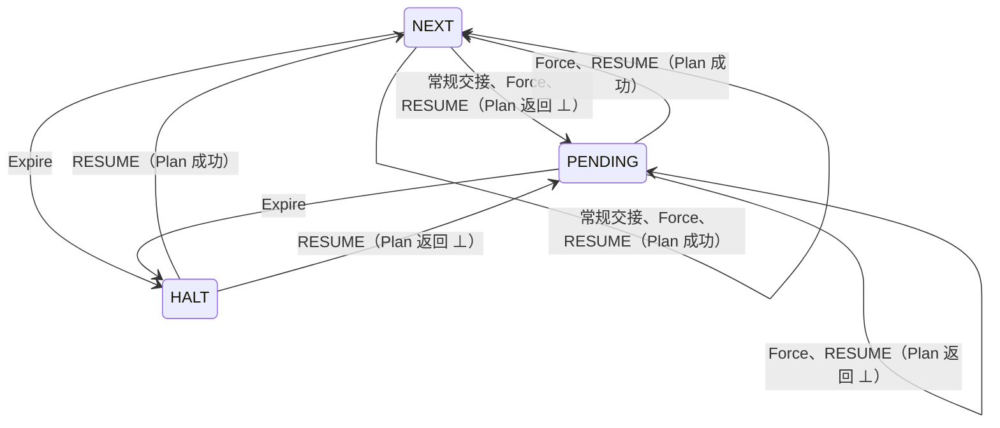
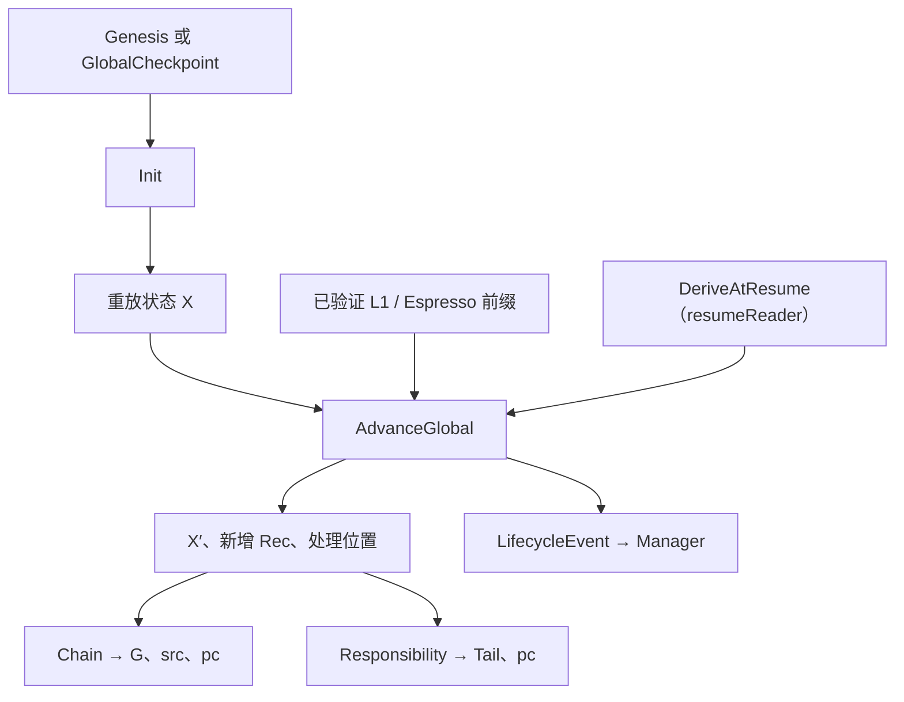
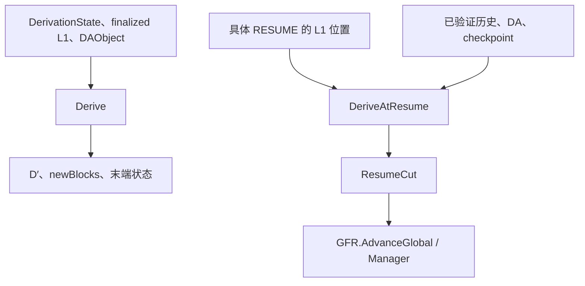

# 模块 09：最终性规则——Global Finality Rule、Derivation Rule 与原生结算（v9 工作稿 v0.2）

日期：2026-11-03。上一版：[v0.1](09_finality_rules_zh_v0_1.md)。总览与共享模型见 [00 arch](00_arch_zh_v0_1.md)；来源为 [arch v0.2 §4.4、§4.5、§4.10、§5](../formalization_v8/arch_zh_v0_2.md) 与 [261027 §8](../meetup_record/261027.md)。

本版改动如下，v0.1 与本版的小节对应见附录 A：

- Force 记录不再携带 Espresso 生效阈值 $\theta_a$。Force 与 RESUME 都以“收录该调用的 L1 block 的 timestamp 加 $M_a$”为激活时刻，并按激活时刻排序（[01 §3.1](01_l1_authority_zh_v0_1.md)）。
- GFR 按“事件 → 排序 → 状态机”重写：§3 列出事件并给出全序，§4 给出状态和每类事件的处理；记录与接口移到 §4.7–§4.8。
- Force 成为独立事件；Espresso block 事件只负责接纳区域结果。Force 的新窗口改由激活时刻计算，不再依赖所在 Espresso block 的 timestamp。
- RESUME 在激活时立即计算新 session 的 Plan，与 Force 一致；Tail 不再有 OPEN 状态。这一项是本版补充，不是 261027 的原设计：261027 把 RESUME 后的 Plan 推迟到下一个 Espresso block。2026-11-03 已确认采用。

§5–§7 与 v0.1 相同，只更新了内部引用。

## 1. 定位与直觉

系统有两条由公开规则确定的链，各自回答一个不同的问题：

- **全局链 $G$**（Global Finality Rule，GFR，§3–§4）：在 L1 控制记录和 Espresso 公开顺序下，哪些区域结果被选为全局内容？任何读取者重放同一份 L1 与 Espresso 历史，都得到同一条 $G$。
- **派生链 $D$**（Derivation Rule，§5）：L1 上接纳的批次与 L1 deposits，按原生规则执行后得到什么 L2 链？任何派生节点用同一份 L1 与 DA 数据，都得到同一条 $D$。

两者使用相同的“physical 内容加 DEP 得到 virtual 内容”的表示（[00 §3.3](00_arch_zh_v0_1.md) 的 Merge），但选择依据不同：$G$ 依据 Espresso 顺序选择区域结果，$D$ 依据 L1 输入与原生期限选择内容和 origin。正常时 $D$ 跟在 $G$ 后面；批次没有在原生期限内送达时，$D$ 自行补入 deposit-only blocks，与 $G$ 不再一致。RESUME 是让 $G$ 重新对齐 $D$ 的唯一入口。

GFR 的规则可以用一句话概括：**$G$ 只接纳当前负责实例的、还来得及进入 $D$ 的结果；负责实例按时间交接或由 L1 控制记录更换；等不下去时停止，由 RESUME 从 $D$ 重新开始。**

原生结算（§6）在 $D$ 之上登记状态声明，沿用既有机制。

## 2. 最小假设

**本模块依赖的模型条目。**

- L1 safety 与 fixed-pace（[00 §1.2](00_arch_zh_v0_1.md)）；L2 时间表 $\mathit{ts}^*$ 与 DEP（[00 §1.3](00_arch_zh_v0_1.md)）。
- Espresso 的 E-S（对所有执行成立），以及只在 live 条件下使用的 E-L、E-TS；watermark（[00 §1.4](00_arch_zh_v0_1.md)）。
- 链数据、Merge、区域固定 origin 与 $\mathrm{Virt}$、原生 sequencing window $\mathrm{ddl}$ 与 $W_{\rm seq}$（[00 §3](00_arch_zh_v0_1.md)）。
- 服务预算 $T_{\rm pub}$、$T_{\rm batch}$（[00 §2.5](00_arch_zh_v0_1.md)），只用于时序结论。

**对其他模块的假设。**

- 区域结果用 CheckFINAL 验证，满足 BFT-1、BFT-7（[02 §4](02_session_program_zh_v0_1.md)）。
- Plan 是纯函数（[01 §3.12](01_l1_authority_zh_v0_1.md)），GFR 可以在重放中计算后继职责。
- 控制记录的激活时刻按 [01 §3.1](01_l1_authority_zh_v0_1.md) 由收录 block 确定。
- Inbox 的接纳事件与 Certifier 签名满足 CERT-1（[06 §4](06_certifier_zh_v0_1.md)）；Derivation 采用的是 L1 接纳事实，内容来源依赖 $\mathsf C$ 可信。
- 已接纳数据满足 DA-S1 与 DA-RET（[08 §4](08_da_zh_v0_1.md)，其中保留期后的部分依赖 A-CUSTODY）；取不到时等待。

**上游输入与下游输出。**

| 方向 | 对方模块与接口 | 交换对象 | 连接 |
| --- | --- | --- | --- |
| 输入（GFR） | L1 日志 | ControlEntry（Force／RESUME），Authority 状态 | W3、W4、W6 |
| 输入（GFR） | Espresso 日志 | Publisher 提交的 publication | W12 |
| 输入（GFR） | Derivation.`DeriveAtResume` | ResumeCut | W23 |
| 输入（Derivation） | Inbox 事件 | CursorAdvanced、CursorSet | W5、W19 |
| 输入（Derivation） | DA.`Retrieve` | DAObject | W21 |
| 输出（GFR） | Manager.`ApplyLifecycle`，`PrepareCandidate` | LifecycleEvent、Tail | W13、W14 |
| 输出（GFR） | Batcher、Certifier、Inbox 读取者 | $(G,\mathrm{src}_G,pc)$ | W15 |
| 输入（GFR） | Authority.`Plan`、Program.`CheckFINAL` | PlanRecord、验证判定 | W1、W11 |
| 输出（Derivation） | Manager，各处本地 GFR，原生结算 | $D$、DerivedItem、ResumeCut、DerivationInputRef | W22、W23、W25 |

## 3. GFR：事件与排序

GFR 是一个确定的重放器：它把 L1 与 Espresso 两份 finalized 日志合并成一条全序的事件流，再用 §4 的状态机逐个处理。取得相同日志前缀的读取者，得到相同的事件流和相同的结果。本节回答两个问题：有哪些事件（§3.1–§3.2），按什么顺序处理（§3.3–§3.4）。§3.5 的预算只用于时序结论。

### 3.1 两份日志与时间键

GFR 读取两份日志：

- **L1 finalized 日志**（[00 §1.2](00_arch_zh_v0_1.md)）：其中的控制记录（Force、RESUME，[01 §3.1](01_l1_authority_zh_v0_1.md)）改变生产安排。
- **Espresso finalized 日志**（[00 §1.4](00_arch_zh_v0_1.md)）：其中的 publication 携带区域结果，即 physical blocks 和它们的区域最终证明。

每个事件有一个非负实数**时间键**，所有键使用同一坐标。Espresso block $J_q$ 的键是它的 timestamp $\theta_q$。L1 上的控制记录以收录它的 L1 block 的 timestamp 加公告提前量 $M_a$ 为键，也就是 [01 §3.1](01_l1_authority_zh_v0_1.md) 的激活时刻。因此，读取者处理到键 $x$ 时，需要的公开历史是：Espresso 中 timestamp 小于 $x$ 的 blocks，以及 L1 中 timestamp 不超过 $x-M_a$ 的 blocks（§3.4）。

键只决定重放顺序，不要求读取者在对应的真实时刻完成处理。较晚取得日志的读取者按同一顺序重放，得到同样的结果。

### 3.2 事件

GFR 处理五类事件：两类来自 L1，一类来自 Espresso，另外两类是**定时器**。定时器在任何日志中都没有记录，它的键由当前重放状态和公开参数确定。

| 来源 | 事件 | 内容 | 时间键 |
| --- | --- | --- | --- |
| L1 | $\mathsf{Force}(U)$ | 控制序号、目标分支、新 policy | $\mathrm{act}(U)=\mathit{ts}_{\rm L1}(\ell_U)+M_a$ |
| L1 | $\mathsf{Resume}(p)$ | 控制序号、新 policy、目标 height $h_{\rm res}$；同一交易的 CursorSet | $\mathrm{act}(p)=\mathit{ts}_{\rm L1}(p.\ell)+M_a$ |
| 定时器 | $\mathsf{Expire}(h)$ | $G$ 的下一缺失高度 $h=h_G+1$ | $\mathit{ts}^*(h)+W_{\rm exp}$ |
| 定时器 | $\mathsf{SessionEnd}(s)$ | 当前负责的 session $s$ | $\theta_s^{\rm end}$ |
| Espresso | $\mathsf{Espresso}(q)$ | block $J_q$ 中首次完整公开的区域结果 | $\theta_q$ |

**Force 与 RESUME。** Force 记录 $U=(c,\beta_{\rm target},\mathcal P_{\rm new})$ 收录于 L1 block $\ell_U$；RESUME 记录 $(c,\mathcal P_{\rm new},h_{\rm res})$ 位于 L1 位置 $p=(\ell,j,k)$，$p.\ell$ 为其 height 分量。两者的激活时刻都只由收录 block 决定。由于 $\mathit{ts}_{\rm L1}$ 严格递增，两条控制记录同键，当且仅当它们在同一个 L1 block 中。

**Expire。** 给定逐高度过期时长 $W_{\rm exp}>0$。Expire 只针对 $G$ 的下一缺失高度 $h=h_G+1$，表示“$G$ 不再等待高度 $h$”：到这个键仍没有结果覆盖 $h$，$h$ 就已来不及按时进入派生链（§3.5）。$G$ 增长后，待处理的 Expire 随之换成新的下一高度，所以任何时刻至多有一个 Expire 待处理。

**SessionEnd。** 给定发布余量 $T_{\rm grace}>0$，session $s$ 的公开截止键为

$$
\theta_s^{\rm end}:=\tau_s^{\rm stop}+T_{\rm grace}.
$$

$\tau_s^{\rm stop}$ 是 honest replicas 停止新共识签名的时刻（BFT-7）；$\theta_s^{\rm end}$ 之后，GFR 不再接受 $s$ 的结果；两者之间的余量用于把已有结果发布出去。停止前形成、但被隐藏到截止后才公开的有效证书，不能再扩展该 session 的全局前缀。只有当前持有 NEXT 的 session 才有待处理的 SessionEnd（§4.3）。

**Espresso block。** $J_q$ 中的 publication 携带区域结果的组成部分：区域最终证明、必要 bodies 和 context 来源（包括 ancestor 或 anchor 结果）。一份结果 $\mathit{Res}$ 的**首次完整公开高度** $q_{\rm avail}(\mathit{Res})$，是它的全部组成部分首次在 Espresso 前缀中齐备的 height；这些部分可以分布在多份 publication 中。$q_{\rm avail}$ 只根据已完整读取的公开历史计算，不使用本地接收时间。$\mathit{Res}$ 在 $\mathsf{Espresso}(q_{\rm avail})$ 中参加接纳（§4.2），$\theta_{q_{\rm avail}}$ 就是它的公开时刻。

### 3.3 全序

事件位置用 ReplayPosition（§4.7）表示，按以下规则比较：

1. 先比时间键；
2. 同键时比类别：L1 控制（Force 与 RESUME）$\prec$ EXPIRE $\prec$ SESSION_END $\prec$ ESPRESSO；
3. 同类时比 index：L1 控制按 L1 位置（Force 与 RESUME 混合排序），EXPIRE 按 height，SESSION_END 按 session 标识，ESPRESSO 按 Espresso height。

由第 1、3 条，全部控制记录按 L1 位置依次处理：同键意味着在同一个 L1 block 中，block 内再按位置排序。后收录的控制记录不会先于先收录的生效；控制记录之间的冲突，由各自处理时的有效性检查解决（§4.4、§4.6）。

这个顺序有三个直接结果：

- **同键时截止先于接纳。** 截止键为 105 时，公开时刻为 104 的结果在 SessionEnd 之前处理，可以接纳；公开时刻为 105 的结果排在 SessionEnd 之后，不被接纳。观察者何时收到它们，不改变判断。
- **控制记录先于同键的 Espresso block。** 旧分支的迟到结果不能借同一个键，抢在 Force 或 RESUME 之前进入 $G$。
- **控制记录开出的 session，只能在激活之后的 Espresso block 中被接纳。**

**Force 对应的 Espresso 高度。** 记

$$
q^*(t):=\min\{\,q:\theta_q\ge t\,\}.
$$

Force 激活时，GFR 已经处理的 Espresso blocks 恰好是 $J_0,\dots,J_{q^*-1}$，其中 $q^*=q^*(\mathrm{act}(U))$。读取者一旦取得一份末端 timestamp 至少为 $\mathrm{act}(U)$ 的 watermark，就能确定 $q^*$，而且这个值不会再变：由 E-S，任意两份 finalized 前缀互为前缀，且 $\theta_q$ 不递减。因此 Force 的快照（§4.4）只依赖 E-S，不依赖 E-L 或 E-TS。RESUME 的快照 $D_L$ 只依赖 L1 与 DA（§4.6）。

### 3.4 R-WAIT

处理时间键为 $x$ 的事件之前，要求：

- L1 finalized 前缀覆盖 timestamp 至少为 $x-M_a$ 的 block；
- 若事件不是 Espresso block，已取得 timestamp 至少为 $x$ 的 Espresso watermark，并完整读取此前前缀；
- 若事件是 RESUME，resumeReader 能取得其 ResumeCut（所需 DA 数据可得）。

第一条保证键不大于 $x$ 的控制记录都已读到，因为这样的记录收录于 timestamp 不超过 $x-M_a$ 的 L1 block。第二条保证键小于 $x$ 的 Espresso blocks 都已读到。两条合起来，下一个事件是什么由已读历史唯一确定；否则读取者可能把“尚未读到”误当成“不存在”。

缺少整段必需历史时等待，与完整读过历史后发现某份 publication 不完整，是两种情况。后者不阻塞其他事件；补齐后，按实际补齐的位置重新确定 $q_{\rm avail}$。

### 3.5 时序预算

本节的条件只用于“多快”的结论，不改变事件和顺序；不成立时仍执行同一个 R-WAIT。

- **公告。** 采用 $M_a\ge T_{\rm L1}+2\Delta_{\rm ts}+b_{\rm L1}$。正常服务下，它使控制记录所在的 L1 block 在激活时刻之前 finalized 且可读，L1 不拖慢 R-WAIT。
- **Espresso 进度。** 若 $[x+\Delta_{\rm ts},\,x+\Delta_{\rm ts}+T_E]$ 内 Espresso 一直 live，由 E-L，到 $x+\Delta_{\rm ts}+T_E$ 时已有 timestamp 至少为 $x$ 的 finalized block，R-WAIT 的第二条成立。Non-live 期间只是等待；$q^*$ 仍然唯一。
- **发布余量。** $T_{\rm grace}>T_{\rm pub}+T_E+\Delta_{\rm ts}$ 保证停止前交给诚实 Publisher 的结果赶上截止（[04 §4](04_publisher_zh_v0_1.md) PUB-4 的推论）。
- **原生窗口。** 要声明“按时进入 $G$ 的 block 被原样派生”，还需

$$
W_{\rm exp}+M_a+T_{\rm batch}+T_{\rm drift}\le W_{\rm seq},
$$

为全局等待、公告、批次交付和 origin 滞后在原生 sequencing window 内留出总空间。四项的含义是：$W_{\rm exp}$ 界定 block 最晚何时进入 $G$（从 $\mathit{ts}^*(h)$ 起算）；$M_a$ 覆盖 Espresso 时间键与 L1 读取进度之间的差；$T_{\rm batch}$ 是进入 $G$ 之后的交付时间；$T_{\rm drift}$ 把 $\mathit{ts}^*(h)$ 换回 origin 时间，因为原生截止从 L1 origin 起算。这些条件只在 E-L、E-TS 与正常交付服务下使用。长期停机后才重放到的旧结果，不因此重新获得原生接纳窗口。

## 4. GFR：状态机

本节先给出状态（§4.1），再逐类给出 §3.2 五种事件的处理（§4.2–§4.6），最后是实现所需的记录与接口（§4.7–§4.8）。

### 4.1 状态

每个读取者维护自己的重放状态 $\mathcal X$，包括：

- 全局 virtual chain $G=(G[h^0],\ldots,G[h_G])$，元素属于 $\mathsf{VB}$；定义 $\mathrm{last}(G):=G[h_G]$。
- 出处 $\mathrm{src}_G(h)$：区域来源记录对应 cid 和覆盖该高度的证明；派生来源标为 DER。
- 当前分支 $\beta$、policy、已选定的 descriptors，以及已关闭的分支和 session。
- 已取得的 L1／Espresso 前缀、完整 publication 索引和待补齐对象。
- 已处理事件记录 Rec，以及处理位置 pc（最后处理完的事件位置，排序见 §3.3）。
- 下一段公开职责 Tail。

**Tail** 取三种值：

- $\mathsf{NEXT}(\nu)$：已选定 descriptor $\nu$，接纳该实例的后续结果。
- $\mathsf{PENDING}(\zeta)$：已按交接边界 $\zeta$ 计算 Plan，但没有合格区域；等待 Force 或 RESUME。
- $\mathsf{HALT}(\zeta)$：分支因 Expire 停止；只有 RESUME 能恢复。

交接边界 $\zeta$ 是 Boundary（§4.7），记录目标 session、选区参考 block、拟接续的 anchor 和窗口。Tail 描述公开职责，与某个本地 program 的运行状态分开。



**转移总表。** 下表是 §4.2–§4.6 的摘要。

| 事件 | Tail 为 NEXT(ν) | Tail 为 PENDING(ζ) | Tail 为 HALT(ζ) | 对 $G$ |
| --- | --- | --- | --- | --- |
| $\mathsf{Espresso}(q)$ | 接纳 ν 的合格扩展；接纳到 $h_{\max}$ 时常规交接（§4.2） | 无 | 无 | 追加 |
| $\mathsf{SessionEnd}(s)$ | ν 属于 $s$ 时常规交接（§4.3） | 无 | 无 | 不变 |
| $\mathsf{Force}(U)$ | 有效时开新分支（§4.4） | 同左 | 无效 | 不变 |
| $\mathsf{Expire}(h)$ | 关闭分支 → HALT（§4.5） | 同左 | 无 | 不变 |
| $\mathsf{Resume}(p)$ | 开新分支（§4.6） | 同左 | 同左 | 替换为 $D_L$ 的前缀 |

$G$ 只在两处改变：Espresso block 中的接纳只追加，RESUME 替换。每处理完一个事件，状态、Rec 与 pc 一起保存。

### 4.2 Espresso block：接纳区域结果

**区域最终性的使用。** GFR 使用 [02 §4.1](02_session_program_zh_v0_1.md) 的 regional finality：$B$ regional finalized，当且仅当存在 $\pi_{\rm fin}$ 使 $\mathsf{CheckFINAL}(\nu,B,\pi_{\rm fin})=\mathrm{true}$。同 context 的后代证明覆盖其 ancestors；缺少 physical block 的高度，由决定链的 $\mathrm{Virt}$ 唯一展开。公开验证不重放观察者自己的接收时间，不能因为结果晚到就否定合法的历史决定；结果是否“晚”只由公开截止判断。

**接纳条件。** 设 Tail 为 $\mathsf{NEXT}(\nu)$，当前处理键为 $x$。一个完整区域结果可以扩展 $G$，当且仅当以下条件同时成立：

1. **负责性**：其 cid 等于 $\nu.\mathrm{cid}$，当前分支与 session 未关闭。
2. **证明与连续**：最终证明有效，physical ancestry 延续已接纳的同 context 前缀，或从选定 anchor 开始。
3. **窗口**：新 physical heights 位于该 session 的固定窗口 $[h_{\min,s},h_{\max,s}]$。
4. **原生兼容**：metadata 与强制前缀按 [00 §3.4](00_arch_zh_v0_1.md) 计算，满足 origin 的 not-ahead 与 drift 条件，所需 L1 输入已 finalized。
5. **公开截止**：$\theta_{q_{\rm avail}(\mathit{Res})}<\theta_s^{\rm end}$，等号不接纳。
6. **未过期**：对本次新增的每个 virtual height $h$，有 $x<\mathit{ts}^*(h)+W_{\rm exp}$。

在 §3.3 的顺序下，条件 5、6 已经由先处理的定时器保证：键不大于 $x$ 的 Expire 若有效，已使 Tail 成为 HALT，而更高 heights 的过期键只会更晚；键不大于 $x$ 的 SessionEnd 已关闭 $s$，被条件 1 挡住。这里仍然列出它们，使单条接纳判断可以独立核对。

**接纳。** 对选定的 physical extension 计算 $\mathrm{Virt}$ 的新片段，追加到 $G$，并记录出处。一次接纳可以增加多个 virtual heights。例如前驱末端为 98、后继第一个 physical block 在 101，一次增加 99、100、101，其中 99、100 的来源是确定这段 padding 的后继证明。

合格扩展按规范编码 hash 排序处理，并去掉与已接纳前缀重复的部分。在 Byzantine 权重假设下，同一 context 的有效决定链可比较（BFT-1），排序不能替代这项性质。候选结果可以先被缓存；context 被选中后，缓存中的匹配结果按上述条件接纳，不需要再发布一轮。未选中的结果不能进入 $G$。

**接纳到上界。** 若本次接纳包含 $h_{\max,s}$ 的 physical block，立即按 §4.3 完成常规交接。新的 $\mathsf{NEXT}$ 产生后，在同一个 Espresso block 内对它重复本节，直到没有新的合格扩展。

### 4.3 SessionEnd：常规交接

常规交接有两个触发点：接纳到 $h_{\max,s}$（§4.2），或 Tail 仍为 $s$ 的 $\mathsf{NEXT}$ 时处理到 $\mathsf{SessionEnd}(s)$。SessionEnd 只推进仍为 NEXT 的正常交接，不绕过 PENDING 或 HALT；session 已因接纳到上界关闭时，SessionEnd 没有效果。

**末端判据。** 若 $h_{\max,s}$ 的 physical block 已被接纳，以它为末端。否则以截止前最后接纳的 physical block 为末端；没有新 physical block 时，沿用该 session 的初始 anchor。两种情况下 session 都以 COMPLETE 关闭。例如上界为 100、截止时最后接纳的是 98，regular anchor 就是 98；规则不等待一个未必会产生的 block 100。

**后继职责。** 后继 $s^+=(\beta,r+1)$ 的窗口为

$$
h_{\min,s^+}=h_{\max,s}+1,\qquad
h_{\max,s^+}=h_{\max,s}+\mathrm{TB}.
$$

后继的选区参考 block 使用前驱的初始 anchor，来源区域为 $i_s$。因此前驱 context 一被选定，就可以计算后继的 Plan，候选末端的变化不改变这份 Plan。选区参考 block 固定“由谁接班”，最终末端 anchor 固定“从哪个 block 接着生产”。本文只预备一个已选定前驱的后继，不递归运行尚未选定候选的下一代。

**输出。** 后继的 Boundary 为 $\{$cause: HANDOFF, target_session: $(\beta,r+1)$, source_region: $i_s$, reference_block: 前驱初始 anchor 的 BlockRef, anchor: 上述末端, window: 上式$\}$。GFR 输出 SessionClosed，并以该 Boundary 调用 `Plan`：结果非 $\bot$ 时输出 SessionAssigned（descriptor 的 anchor 为上述末端，Plan 为后继 Plan），Tail 置为 $\mathsf{NEXT}$；结果为 $\bot$ 时 Tail 置为 $\mathsf{PENDING}$。只有连接身份与选定 anchor 完全匹配的 cid 被选中；相同 height 不足以表示相同 anchor。

### 4.4 Force

Force 更换生产安排，保留已选定的全局内容。处理收录于 L1 block $\ell_U$、激活时刻为 $\mathrm{act}(U)$ 的控制记录 $U=(c,\beta_{\rm target},\mathcal P_{\rm new})$：

1. **有效性。** 若 $\beta_{\rm target}$ 已关闭或不是当前分支，或 Tail 为 HALT，整条记录无效，不安装新 policy，只在 Rec 中记录。HALT 时禁止 Force，是因为 $G$ 的下一高度已经来不及进入 $D$，在 $\mathrm{last}(G)$ 上继续生产只会产出无法派生的内容。
2. **关闭旧分支。** 输出 BranchClosed（原因 FORCE），覆盖其上所有 session，包括提前准备的常规后继；$G$ 保持不变。
3. **新 anchor。** 新分支为 $\beta+1$。新 anchor $A$ 为 $\mathrm{last}(G)$ 对应的 Anchor，这里的 $G$ 是处理完所有排在本事件之前的事件后的链，即已处理 $J_0,\dots,J_{q^*-1}$（$q^*=q^*(\mathrm{act}(U))$，§3.3）。连接标识按 [00 §3.2](00_arch_zh_v0_1.md) 取，执行状态为执行到该 block 后的状态。选区参考 block 为 $\mathrm{BlockRef}(A)$。安装新的区域开关和循环顺序，L1 floor 置为旧 floor 与 $\ell_U$ 的较大者。
4. **序号与来源区域。** 旧 NEXT 尚未贡献新 physical block 时，新职责沿用旧序号 $r$，否则使用 $r+1$；来源区域为旧负责区域。旧 Tail 为 PENDING 时，使用 boundary 已保存的序号和来源区域。
5. **新窗口。** 给定公开准备余量 $T_{\rm init}\ge0$，

$$
h_{\min,\rm new}=\max\{A.h+1,\ \mathrm{slot}(\mathrm{act}(U)+T_{\rm init})+1\},
\qquad
h_{\max,\rm new}=h_{\min,\rm new}+\mathrm{TB}-1.
$$

窗口只由 L1 记录和公开参数确定，不依赖 Espresso block 落在哪里。只有在 E-TS 成立的区间内，才能把 $T_{\rm init}$ 解释为真实时间的准备预算。
6. **开出。** 记 Boundary $\zeta=\{$cause: FORCE, target_session: $(\beta+1,r')$, source_region: 第 4 步的来源区域, reference_block: $\mathrm{BlockRef}(A)$, anchor: $A$, window: 第 5 步的窗口$\}$，其中 $r'$ 为第 4 步的序号。立即以 $\zeta$ 调用 `Plan`：结果非 $\bot$ 时输出 SessionAssigned，Tail 置为 $\mathsf{NEXT}(\nu)$；否则 Tail 置为 $\mathsf{PENDING}(\zeta)$。

同一 L1 block 中的下一条控制记录看到本条产生的新状态，因此重新核对目标。

**Espresso non-live 期间。** 读取者要等到 watermark 越过 $\mathrm{act}(U)$ 才能处理 Force；处理时，它的新窗口在真实时间里可能已经过去。之后的 SessionEnd 照常按 §4.3 交接，anchor 不变，直到某个 session 的窗口覆盖恢复时刻；缺口超过 $W_{\rm exp}$ 时，Expire 使分支 HALT，只能走 RESUME。因此 Force 只在 Espresso live 时有实际作用，规则本身不需要为停机另设特例。

### 4.5 Expire：全局过期

处理 $\mathsf{Expire}(h)$ 时：若 $h$ 已不是 $G$ 的下一高度，或 Tail 已为 HALT，事件没有效果。否则关闭当前分支（BranchClosed，原因 EXPIRED），记录恢复所需的序号信息，Tail 置为 HALT，$G$ 保留到 $h-1$。

Expire 不撤销已进入 $G$ 的块，也不生成替代块：$G$ 不能跳过缺失高度，补位内容只能由 $D$ 确定。PENDING 可以由后续 Force 或 RESUME 替换，HALT 只能由 RESUME 恢复。

### 4.6 RESUME

RESUME 从确定的派生结果重新建立生产起点。处理位于 L1 位置 $p_{\rm res}$、目标为 $h_{\rm res}$ 的 RESUME 时，记收录它的 L1 block 为 $L$，激活时刻为 $\mathit{ts}_{\rm L1}(L)+M_a$：

1. **取得切面。** 以 $p_{\rm res}$ 调用 resumeReader，取得 ResumeCut（§5.5）。其中 $D_L$ 是按 L1 顺序处理到这条 RESUME 的 CursorSet 为止的派生链（§5.1）；它绑定具体位置 $p_{\rm res}$，不只绑定 block $L$。缺 L1 或 DA 数据时在此等待，保留处理前的状态，不做一半替换。
2. **关闭旧分支。** 输出 BranchClosed（原因 RESUME）。RESUME 总是有效：它已经在同一笔 L1 交易中改写了 Inbox cursor，派生已经跟随它；GFR 若判它无效，$G$ 与 $D$ 将永久不一致。
3. **对齐 $G$。** 执行

$$
G\leftarrow D_L[\,h^0:h_{\rm res}\,],
$$

区间包含两端。新 anchor $A$ 为 ResumeCut.anchor，即 $D_L[h_{\rm res}]$ 对应的 Anchor，连接标识按 [00 §3.2](00_arch_zh_v0_1.md) 的派生 anchor 公式计算。$G$ 与 $D_L$ 的共同原生前缀保留；从第一个不同的原生 block 起，旧 $G$ 的后缀被撤销；新采纳部分的出处记为 DER。若旧 $G$ 本身是 $D_L$ 的前缀，则不撤销任何块，只接上后续部分。$D$ 本身不被截断或改写。
4. **开出。** 安装新分支 $\beta+1$ 与新 policy，L1 floor 不低于 $L$。记 Boundary $\zeta=\{$cause: RESUME, target_session: $(\beta+1,0)$, source_region: $\bot$, reference_block: $\mathrm{BlockRef}(A)$, anchor: $A$, window: $\{h_{\rm res}+1,h_{\rm res}+\mathrm{TB}\}\}$；source_region 为 $\bot$ 表示按新 policy 的循环排列从首项选区。立即以 $\zeta$ 调用 `Plan`：结果非 $\bot$ 时输出 SessionAssigned，Tail 置为 $\mathsf{NEXT}(\nu)$；否则 Tail 置为 $\mathsf{PENDING}(\zeta)$。Plan 只读 L1 历史与配置，激活时它所需的 L1 前缀已由 R-WAIT 保证。
5. **输出。** 输出 Resumed 事件，携带 control_seq、新分支、$A$ 与 $D_L$ 的引用。

**不能启动的安排。** 合约只要求 $h_{\rm res}$ 高于 Inbox cursor；若 $h_{\rm res}$ 取得过低，使新 session 的 SessionEnd 键已早于激活时刻，GFR 不把关闭事件插回已处理的历史，而是直接判定该安排不能启动：输出 SessionClosed（原因 EXPIRED），Tail 置为 $\mathsf{HALT}(\zeta)$，需要后续有效的 RESUME。Force 与常规交接开出的窗口都晚于其开出位置，不会出现这种情况。

恢复起点只依赖 L1、已接纳的 DA 数据和原生派生，不依赖旧 Espresso 上未结算的区域结果。“$G$ 已对齐 $D$”“新 session 已分配”“新普通块已进入 $G$”是三个不同步骤。

### 4.7 记录

**重放位置。**

```text
ReplayPosition = {
    key, kind, index
}
```

Key 为非负时间键；kind 取 FORCE、RESUME、EXPIRE、SESSION_END 或 ESPRESSO；index 分别为 L1 位置、L1 位置、L2 height、session 标识或 Espresso height。比较规则见 §3.3，其中 FORCE 与 RESUME 属于同一类别。Cursor 的 `GLOBAL(gpos)` 与证书的 gpos 都使用这个类型（[07 §3.2](07_batch_inbox_zh_v0_1.md)、[06 §3.2](06_certifier_zh_v0_1.md)）。

**交接边界。** Boundary 就是 $\zeta$：

```text
Boundary = {
    cause, target_session, source_region,
    reference_block, anchor, window
}
```

Cause 取 GENESIS、HANDOFF（常规交接）、FORCE 或 RESUME；target_session 是目标 $(\beta,r)$；source_region 是来源区域或 $\bot$；reference_block 是选区用的 BlockRef；anchor 是拟接续的 Anchor；window 是 Window（后三者见 [01 §3.2](01_l1_authority_zh_v0_1.md) 与 [00 §3.2](00_arch_zh_v0_1.md)）。尚未确定的分量为 $\bot$。Reference_block 用于计算 Plan，anchor 用于连接新链，两者分别保存，取值由 §4.3、§4.4、§4.6 确定。

**Publication 索引与出处。**

```text
PublicationEntry = {
    result_key, available_objects, locations, first_complete_q
}
GlobalSource = REGIONAL(result_key) | DER(resume_position, height)
```

区域结果的 result_key 为 $(\mathrm{cid},\mathsf H(B))$，与 Publisher 的任务键相同（[04 §3.1](04_publisher_zh_v0_1.md)）。Available_objects 保存已验证公开的结果组成部分；locations 保存这些对象所在的 (Espresso height, message index)，索引从 0 开始；first_complete_q 即 §3.2 的 $q_{\rm avail}$，尚不完整时为 $\bot$。完整后，这些对象可以组装为 RegionalResult。

Sources 是以 virtual height 为键的 GlobalSource 表。REGIONAL 指向决定该片段的完整区域结果，padding 也可以引用覆盖它的后继证明；DER 指向采用的 RESUME L1 位置及派生 height。

**重放记录、状态与事件。**

```text
ReplayRecord = {
    position, input_ref, effects, events
}
ReplayState = {
    G, sources, branch, policy, selected,
    closed_branches, closed_sessions, publications,
    L1_prefix, Espresso_prefix, Rec, pc, Tail
}
LifecycleEvent = {
    position, kind, body
}
```

ReplayRecord 的 position 是当前事件的 ReplayPosition；input_ref 按事件类型指向 L1 控制位置、Espresso block、SessionEnd 的 session 或 Expire 的 height。Effects 为有序变更列表，元素取 `APPEND{first, last, source}`（追加的连续 virtual heights 及其 GlobalSource）、`RESET{resume_position, target_height}`（采用的恢复目标）或 `DUTY{before, after}`（变化前后的 Tail）；events 为本事件产生的 LifecycleEvent 列表。无效的 Force 只产生一条 effects 为空的 ReplayRecord。

ReplayState 对应 $\mathcal X$：G 是连续 virtual chain；sources 与 G 中 genesis 之后的高度对应；branch 是当前分支 $\beta$；policy 为 Policy；selected 以 session 关联已选 Descriptor；两个 closed 表保存已关闭的标识；publications 是 PublicationEntry 表；两个 prefix 为已验证日志；Rec 为 ReplayRecord 序列；pc 与 Tail 如 §4.1。

LifecycleEvent 的 position 为产生它的 ReplayPosition，kind 与 body 的对应为：

- `SessionAssigned{descriptor}`：已选定的 Descriptor。
- `SessionClosed{session, reason}`：session 与关闭原因（[03 §3.2](03_session_manager_zh_v0_1.md) 的 CloseReason）。
- `BranchClosed{branch, reason}`：分支版本与关闭原因。
- `Resumed{control_seq, branch, anchor, derived_prefix}`：RESUME 序号、新分支、目标 height 处的 Anchor，以及采用的派生 virtual 前缀。

Manager 通过 position、kind 与 body 识别同一事件，不把相同 pc 下的不同事件合并。

**Checkpoint 与返回值。**

```text
GlobalCheckpoint = {
    state, L1_cut, Espresso_cut
}
ReplayResult = {
    state, added_records, events, status
}
```

GlobalCheckpoint 保存完整 ReplayState 和支持它的两份公共日志切面（L1 位置、Espresso height）。验证时必须重建或核对相应状态；单独的末块 hash 不构成 checkpoint。ReplayResult 是 AdvanceGlobal 的返回：status 为 READY 或 `WAIT{next_position, missing}`，next_position 指向尚不能处理的事件，missing 列出缺少的日志、对象或恢复状态；WAIT 不抹去已完成的进度。

### 4.8 接口



| 接口 | 主要输入 | 主要输出 | 用途 |
| --- | --- | --- | --- |
| `Init` | Genesis／checkpoint、验证材料 | $\mathcal X_0$ | 建立或恢复重放状态 |
| `AdvanceGlobal` | $\mathcal X$、L1／Espresso 前缀、resumeReader | ReplayResult | 按 §3 的事件流推进 §4 的状态机 |
| `Chain` | $\mathcal X$ | $(G,\mathrm{src}_G,pc)$ | 读取同一位置的全局链 |
| `Responsibility` | $\mathcal X$ | $(\mathit{Tail},pc)$ | 读取下一段公开职责 |

**Init(checkpoint, reads)。** 输入为 Genesis 配置或 GlobalCheckpoint；reads 为验证 checkpoint 所需的 L1／Espresso 前缀及恢复派生材料。Genesis 配置给出初始 virtual block、执行后状态、policy 和初始 Boundary（cause 为 GENESIS，窗口从 $h^0+1$ 开始）。从 genesis 初始化时，以初始 Boundary 调用 `Plan`，Tail 置为 NEXT 或 PENDING；从 checkpoint 恢复时，验证它与指定公共前缀的重放结果一致。输出初始重放状态 $\mathcal X_0$；缺验证材料时返回 WAIT；checkpoint 与公共重放结果不符时返回 REJECT。

**AdvanceGlobal(X, L1, E, resumeReader)。** 输入为当前状态 $\mathcal X$、已验证的 finalized L1 与 Espresso 日志前缀，以及 resumeReader，即 Derivation 的 `DeriveAtResume`（§5.5），它按具体 RESUME 位置返回 ResumeCut 或报告缺失数据。输出 ReplayResult $(\mathcal X',\Delta\mathrm{Rec},\mathit{events},\mathit{status})$；READY 表示已提供的可处理输入已处理完；输入日志不通过验证或不延续既有前缀时返回 REJECT。处理时按 §3.3 的全序逐个取下一事件，先检查 §3.4 的 R-WAIT，再按 §4.2–§4.6 处理。遇到 WAIT 时返回已完成的进度。未完整公开的单份 publication 暂不合格，不阻塞其他事件。

**Chain(X)。** 只读返回同一处理位置上的 $(G,\mathrm{src}_G,pc)$，不推进日志。

**Responsibility(X)。** 只读返回该处理位置上的 $(\mathit{Tail},pc)$。读取者根据 NEXT 或 boundary 中已确定的数据准备实例，不把 $\bot$ 分量视为已选定。

## 5. Derivation Rule

Derivation Rule 抽象原生 L2 派生：它只读 L1 与 DA，按 L1 顺序解码已接纳的批次，合入 DEP 并执行；某个 height 在原生期限前没有可采用的批次，就补入 deposit-only block（[00 §3.4](00_arch_zh_v0_1.md) 的窗口回退）。它不读 Espresso，因此 Espresso 停机时仍随 L1 推进。这正是 Manager 的 D 判死（[03 §4.4](03_session_manager_zh_v0_1.md)）与 RESUME 的依据。

### 5.1 状态

派生节点维护状态 $\mathcal D$：已验证 L1 前缀和处理位置；已取得并核对 commitment 的 DA 数据；原生 channel 解码状态；当前原生父块及其执行后状态；已派生 blocks；可重放的 checkpoints；按具体 RESUME 位置索引的恢复切面。

**派生链。** 记 $h_D$ 为派生末端 height，则

$$
D=(D[h^0],\ldots,D[h_D]),\qquad D[h]\in\mathsf{VB}.
$$

将逐高度最终采用的 metadata、执行前 root 和实际执行的普通交易写成 physical block 并连接，得到以 genesis 为 anchor 的派生 physical chain $C_D$；实际 origin 轨迹记为 $\omega_D$。每个已派生 height 都有一条记录，deposit-only height 的普通交易为空，并有

$$
D[\,h^0+1:h_D\,]=\mathrm{Merge}_{\omega_D}(C_D).
$$

$D[h^0]$ 由 genesis 配置给定。$\omega_D$ 由原生派生规则确定，不能被替换为区域生产的 $\omega_A$。

**恢复切面。** 若一条 RESUME 位于 L1 block $L$ 的具体日志位置 $p_{\rm res}$，用 $D_L$ 简写处理到其 CursorSet 为止的派生链。这个简写始终绑定该具体记录；同一 L1 block 内不同 RESUME 的切面不混用。

### 5.2 数据结构

DA 对象采用 DAObject（[08 §3.2](08_da_zh_v0_1.md)），channel 分片采用 Frame（[05 §3.2](05_batcher_zh_v0_1.md)）。派生另维护：

```text
ChannelAssembly = {
    channel_id, frames, next_number, closed,
    first_input, last_input, decoder_state
}
AcceptedBatchInput = {
    L1_position, prev, next, DA_commitment
}
OverrideInput = {
    L1_position, resume_position, old, next
}
DerivedItem = {
    virtual_block, native_block_bytes, post_state_root
}
ResumeCut = {
    resume_position, target_height,
    derived_prefix, anchor, anchor_state
}
```

**ChannelAssembly** 保存同一 channel 的已接纳 frames，按 number 排序；next_number 为待续接序号；closed 表示已接纳最后一个 frame；first_input、last_input 为该 channel 已处理输入的 L1 位置；decoder_state 是固定原生解码器在这些字节上的状态，可以从同一输入重建，不能由提交者指定。

**AcceptedBatchInput** 来自 CursorAdvanced，**OverrideInput** 来自 CursorSet（[07 §3.2](07_batch_inbox_zh_v0_1.md)）；位置为 finalized L1 位置，prev、old、next 为 Cursor。AcceptedBatchInput 指向实际成功接纳的 DA commitment；OverrideInput 将 CursorSet 与同一 RESUME 记录关联。

**DerivedItem** 的 virtual_block 属于 $\mathsf{VB}$（root 为执行前 root），native_block_bytes 是该高度按原生格式输出的完整 block，post_state_root 是执行后的 root；三者对应同一执行过程。

**ResumeCut** 按精确 resume_position 索引：target_height 为 $h_{\rm res}$；derived_prefix 为 $D_L$，包含目标 height；anchor 为 $D_L[h_{\rm res}]$ 对应的 Anchor，其连接标识按 [00 §3.2](00_arch_zh_v0_1.md) 的派生 anchor 公式计算；anchor_state 为执行到该 anchor 后的完整状态。它不是本地最新派生末端的别名。

**派生状态、checkpoint 与输入引用。**

```text
DerivationState = {
    L1_prefix, position, DA_objects, channels,
    parent_block, execution_state, physical_prefix, virtual_prefix,
    checkpoints, resume_cuts
}
DerivationCheckpoint = {
    position, channels, parent_block, execution_state,
    physical_prefix, virtual_prefix, config_ref
}
DerivationInputRef = {
    L1_cut, DA_commitments, config_ref
}
```

DerivationState 对应 $\mathcal D$：position 为最后完成处理的 L1 输入位置；DA_objects 按 commitment 索引；channels 按 channel_id 保存 ChannelAssembly；parent_block 与 execution_state 对应当前原生末端；physical_prefix 为 $C_D$，virtual_prefix 为 $D$；resume_cuts 是 ResumeCut 表。DerivationCheckpoint 保存某时点的可继续重放状态，不递归包含其他 checkpoints 或 resume_cuts；恢复它必须覆盖这些字段之间的对应。DerivationInputRef 供原生结算引用确定输入：L1_cut 固定日志前缀，DA_commitments 列出该前缀中相关接纳输入的 commitment，config_ref 固定原生规则版本。

### 5.3 接口概览



| 接口 | 主要输入 | 主要输出 | 用途 |
| --- | --- | --- | --- |
| `Derive` | $\mathcal D$、L1 日志、DAObject | $\mathcal D'$、newBlocks、末端状态、处理状态 | 按原生规则推进派生 |
| `DeriveAtResume` | RESUME 的精确 L1 位置 $p_{\rm res}$ | ResumeCut | 取得历史恢复切面 |
| `InputRef` | $\mathcal D$、区间 $[a,b]$ | DerivationInputRef | 为原生结算引用确定输入 |

### 5.4 Derive(Dstate, L1, DAobjects)

**输入。** 前一次 $\mathcal D$ 或已验证 checkpoint；finalized L1 日志，包含 Inbox 接纳事件、override、DEP 所需输入及原生配置；按已接纳 commitment 取回并验证的 DAObject。

**输出。** $(\mathcal D',\mathit{newBlocks},\sigma',\mathit{status})$：newBlocks 是本次新增 DerivedItem 的有序列表，$\sigma'$ 为更新后末端状态，status 为 READY 或 `WAIT{next_position, missing}`。输入与声明的日志或 commitment 不符时返回 REJECT。

**处理。** 按 L1 顺序处理输入，逐高度检查、选择和执行：

| 遇到的输入 | 处理 |
| --- | --- |
| 已接纳且数据可取回的批次 | 解码 channel，在实际父状态上检查；原生规则确定普通交易与 origin，再合入该轨迹的 DEP 并执行 |
| 某高度在原生期限前没有可采用的批次 | 期限到达后采用空普通交易，产生 deposit-only block |
| 批次不满足原生转换或执行条件 | 沿用原生的同高度替换规则；正常路径中 Accept 的检查避免走到这里 |
| RESUME 的 CursorSet（目标 $h_{\rm res}$） | 先处理此前已接纳输入，再把尚未派生的 heights 立即填成 deposit-only 直到 $h_{\rm res}$，并重置 channel 状态 |
| 已接纳但 DA 数据暂时取不回 | 停在明确位置 WAIT，保留已派生前缀，不当作空内容 |

无效内容的舍弃或替换发生在输出该 height 之前；已输出的前缀不改写。Deposit-only block 仍包含该 height 的 L1 attributes、deposits 和系统交易。

### 5.5 DeriveAtResume(p_res)

**输入。** 某条 finalized RESUME 控制记录的 L1 位置 $p_{\rm res}$（ControlEntry.L1_position）；对应的 CursorSet 是 resume_position 等于 $p_{\rm res}$ 的那条事件。读取本地已验证的 L1、DA 对象、原生配置和可重放 checkpoint。

**输出。** ResumeCut；缺数据时返回 `WAIT{next_position, missing}`；该位置不是恢复记录时返回 REJECT。

**处理。** 在只读重放或已验证缓存上，精确计算到该 CursorSet 的处理切面。较新的本地派生末端不能代替这个历史切面；查询不回退正在推进的 $\mathcal D$，也不读取 Espresso。

### 5.6 InputRef(Dstate, a, b)

**输入。** 派生状态 $\mathcal D$ 与已派生的连续区间 $[a,b]$。

**输出。** DerivationInputRef：L1_cut 为派生到 $b$ 所需的最短 L1 前缀，DA_commitments 为其中相关接纳输入的 commitment 列表，config_ref 为采用的原生规则版本；$b>h_D$ 时返回 WAIT。

**处理。** 只读计算，不修改 $\mathcal D$。原生 claim 提交者（原生结算机制规定的外部角色）用它构造 SubmitStateClaim 的 inputRef。

## 6. 原生结算

原生结算组件沿用已有机制，维护已提交的 state claims 及其争议／证明处理状态。本节只描述它与派生交换的对象。

```text
StateClaim = {
    claim_id, first_height, last_height, parent_claim,
    input_ref, state_root, status, resolution
}
ClaimResolution = {
    decision, evidence, L1_position
}
```

Claim_id 为原生结算分配的唯一标识；first_height $\le$ last_height 为声明区间；parent_claim 引用原生流程规定的前置 claim；input_ref 为 DerivationInputRef（§5.2）。State_root 属于 $\mathcal H_\kappa$，声明执行到 last_height 之后的 root。Status 为 PENDING、ACCEPTED 或 REJECTED；resolution 在终局前为 $\bot$。Decision 为 accepted 或 rejected，evidence 为原生证明／争议程序的完整验证材料，L1_position 指向记录结果的位置。

**SubmitStateClaim(a, b, parentClaim, inputRef, stateRoot)。** 输入连续区间 $[a,b]$、前置 claim、DerivationInputRef 与声称的 stateRoot；调用者和授权采用原生入口规则。成功返回 `ClaimRegistered(claimId)` 并进入原生处理流程，入口检查失败返回 REJECT。提交 claim 不修改 $D$，也不表示 claim 已经完成结算。

**输出事件 Resolved(claimId, decision)。** 原生证明或争议程序对已登记 claim 作出终局处理时输出，更新 status 与 resolution。“已经可以派生某段 $D$”不等于已经通过结算。

## 7. 各层结果的保证

四条链（[00 §4.5](00_arch_zh_v0_1.md)）各自承诺不同的范围：

| 层级 | 含义 | 可以被什么撤销 |
| --- | --- | --- |
| Regional finality（$R$） | 固定 cid 下的决定事实（BFT-1） | 候选可能不被 GFR 选择；可能因 Force、过期、Kill 或 RESUME 被放弃 |
| Global finality（$G$） | 结果已进入公共重放得到的 $G$ | 常规交接、Force、Expire 都不撤销已有 $G$；**RESUME 可以撤销 $G$ 中未进入 $D$ 的后缀** |
| L1 接纳（$G'$） | L1 接纳记录认证的源 virtual chain | RESUME 的 CursorSet 把当前视图置为 $D_L$ 的前缀 |
| 派生（$D$） | 原生规则实际确定的链 | 在 L1 最终性、派生确定性与 DA binding 下不再改变 |

**$G$ 的单调性。** 在两次 RESUME 之间，$G$ 只追加不撤销：接纳只追加（§4.2），常规交接、Force 与 Expire 不修改已有 $G$（§4.3–§4.5）。这是 CERT-4 使用的事实。

**$G$ 与 $D$ 的一致条件。** 在同一原生父状态、原生兼容（[00 §3.4](00_arch_zh_v0_1.md)）且及时交付（BAT-4）的条件下，相应范围的 $G$ 与 $D$ 得到相同的原生 blocks 和执行结果。批次故障或窗口回退可以使此前的 $G$、$G'$ 与 $D$ 不同；有效 RESUME 在指定切面消除全局视图与派生视图的分歧。

## 附录 A：与 v0.1 的小节对应

| v0.1 | v0.2 | 说明 |
| --- | --- | --- |
| §1、§2 | §1、§2 | §1 增加一句话概括；§2 增加激活时刻的依赖 |
| §3.1 状态 | §4.1 | Tail 去掉 OPEN；增加转移总表 |
| §3.2 数据结构 | §4.7 | ReplayPosition 增加 kind FORCE |
| §3.3–§3.7 接口 | §4.8 | Init 从 genesis Boundary 直接计算 Plan |
| §4.1 区域最终性的使用 | §4.2 开头 | — |
| §4.2 公开接纳截止 | §3.2 SessionEnd、Espresso block；§3.5 发布余量 | — |
| §4.3 重放顺序与 R-WAIT | §3.1–§3.5 | Force 成为独立事件，与 RESUME 同属 L1 控制类别；Espresso block 内部不再分步 |
| §4.4 接纳规则 | §4.2 | 说明条件 5、6 由排序蕴含 |
| §4.5 Regular anchor 与常规交接 | §4.3 | — |
| §4.6 Force | §4.4 | 去掉 $\theta_a$；激活时刻为 $\mathit{ts}_{\rm L1}(\ell_U)+M_a$；新窗口由激活时刻计算 |
| §4.6 全局过期 | §4.5 | — |
| §4.6 RESUME | §4.6 | 激活时立即计算 Plan，不再经过 OPEN |
| §4.6 统一规则 | §4.6“不能启动的安排”、§4.8 Init | 只剩 RESUME 目标过低一种情形；Tail 明确置为 HALT |
| §5–§7 | §5–§7 | 只更新内部引用 |
