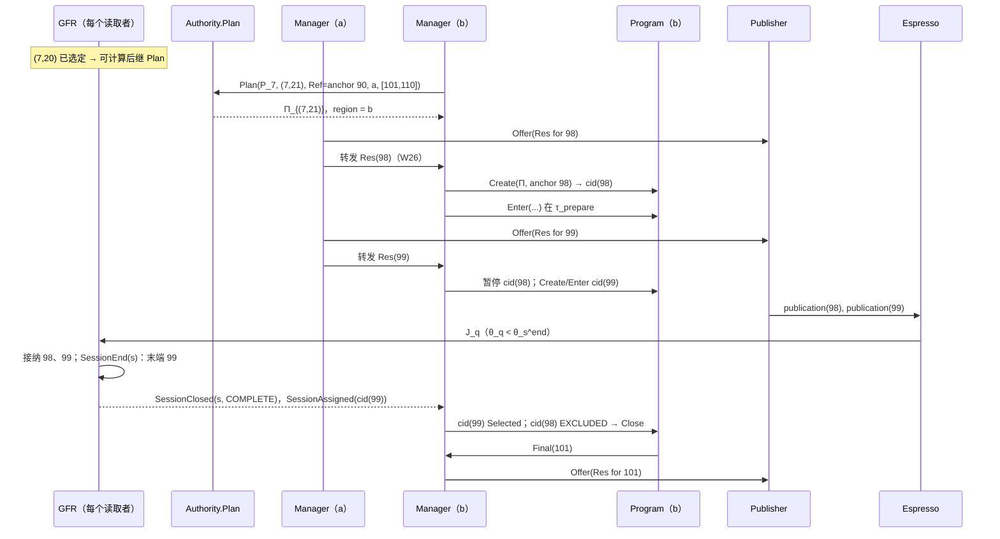
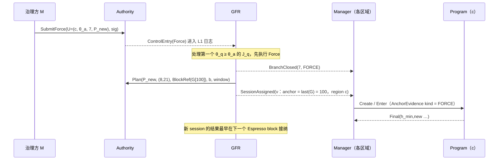
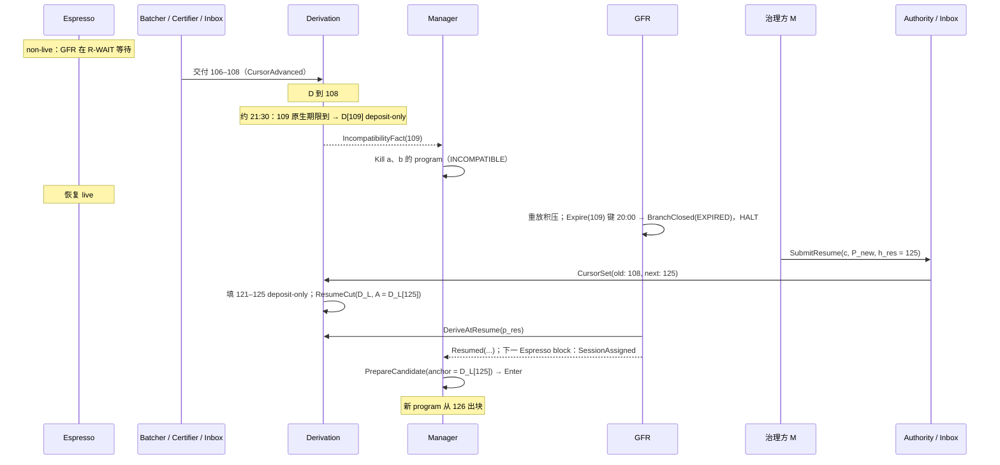
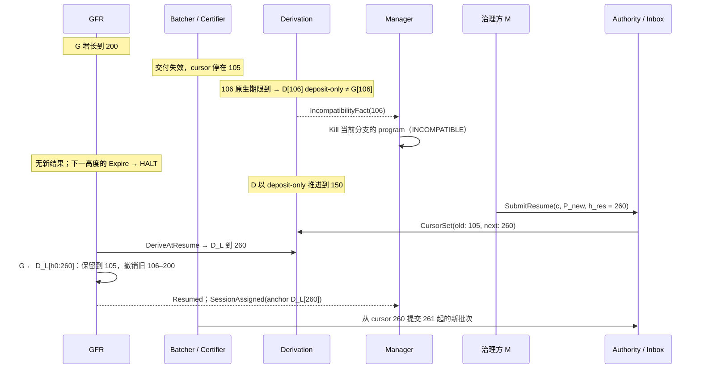

# 端到端流程：常规交接、Force 交接与两类 RESUME 恢复（v9 工作稿 v0.1）

日期：2026-11-02。总览与共享模型见 [00 arch](00_arch_zh_v0_1.md)；来源为 [arch v0.2 §6.4–§6.7](../formalization_v8/arch_zh_v0_2.md) 与 [261027 §2–§9](../meetup_record/261027.md)。

## 1. 本文结构

本文把各模块文件中的接口串成四条完整流程，用来检查模块之间能否组合：每一步的输出必须是下一步的输入，且类型与模块规格一致。

每条流程包括：

- **场景**：初始状态与触发条件；
- **时序图**：参与模块之间的调用；
- **步骤表**：每行写“调用者 → 被调接口(输入) → 输出 → 下一位使用者”，并标注 [00 §4.4](00_arch_zh_v0_1.md) 中的连接编号；
- **结束时成立的事实**：流程结束时四条链 $R,G,G',D$ 的关系及各模块状态。

下文用 $\mathrm{cid}(X)$ 表示以 block $X$ 为 anchor 的候选 program 的 cid，session 记为 $(\beta,r)$。高度数值是压缩示意，不表示真实时间长度。

## 2. 流程一：Regular handoff

### 2.1 场景

分支 7 的 session $s=(7,20)$ 由区域 a 负责，窗口为 $[91,100]$，初始 anchor 为 90。后继 $s^+=(7,21)$ 的窗口为 $[101,110]$（[09 §4.5](09_finality_rules_zh_v0_1.md)）。a 已经决定了 98，随后又决定了 99；100 没有产生。

问题是：后继区域在前驱结束之前就要准备，但前驱的最终末端要到截止键 $\theta_s^{\rm end}$ 才公开确定。本流程展示“提前准备多个候选、公开选定其中一个”的做法。

### 2.2 时序图

### 2.3 步骤

| # | 调用者 → 接口(输入) | 输出 | 下一位使用者 | 连接 |
| --- | --- | --- | --- | --- |
| 1 | GFR 选定 $s$ 的 descriptor 后，各 Manager 在 `ApplyLifecycle`(SessionAssigned) 中调用 Authority.`Plan`($\mathcal P_7$, (7,21), Ref = anchor 90, sourceRegion = a, [101,110]) | $\Pi_{(7,21)}$，region = b | Manager b 的 PrepareCandidate；GFR 在 [09 §4.5](09_finality_rules_zh_v0_1.md) 重算同一记录 | W1 |
| 2 | Program a 输出 `Final`(98) → Manager a.`HandleProgramEvent` | Res(98) | Manager a.`ObserveRegional` | W8、W9 |
| 3 | Manager a.`HandleProgramEvent` 组装 Res(98) 后，调用本地 `ObserveRegional`(Res(98))，并把 Res(98) 转发给后继区域 b 的 Manager | Publisher.`Offer`；Manager b.`ObserveRegional` | Publisher；Manager b | W9、W26 |
| 4 | Manager b.`ObserveRegional`(Res(98)) | 后继候选 anchor 98（AnchorEvidence kind = REGIONAL） | Manager b.`PrepareCandidate` | — |
| 5 | Manager b.`PrepareCandidate`($\Pi_{(7,21)}$, 98, $\pi_{98}$, 状态材料) → Program.`Create` | `Prepared(cid(98), Ready)` | ScheduleCandidate | W24 |
| 6 | 在 $\tau_{\rm prepare}=\tau_{s^+}^{\rm start}-T_{\rm lead}$（$T_{\rm lead}\ge0$ 为后继提前进入的余量），Manager b.`ScheduleCandidate`(cid(98)) → `EnterCandidate` → Program.`Enter` | `Entered(cid(98), τ)`；Program 等待 NotBefore = $\mathit{ts}^*(101)$ | Program b | W24 |
| 7 | a 决定 99；重复步骤 2–5 | `Prepared(cid(99), Ready)` | ScheduleCandidate | — |
| 8 | Manager b.`ScheduleCandidate`(cid(99)) | cid(98) 置为 Paused（保留状态）；cid(99) 初次 Enter | Program b | W24 |
| 9 | Publisher 提交 Res(98)、Res(99) → Espresso；`Recorded` | 两份 publication 收录于 $\theta<\theta_s^{\rm end}$ 的 block | GFR | W12 |
| 10 | GFR.`AdvanceGlobal` | 按 [09 §4.4](09_finality_rules_zh_v0_1.md) 接纳 98、99；SessionEnd($s$) 生效，regular anchor = 99 | — | — |
| 11 | GFR.`AdvanceGlobal` 输出 | `SessionClosed{(7,20), COMPLETE}`，`SessionAssigned{ν(cid(99))}` | Manager.`ApplyLifecycle` | W13 |
| 12 | Manager b.`ApplyLifecycle` | cid(99) Selected；cid(98) EXCLUDED 并 Close | Program b | W24 |
| 13 | Program b 决定 101 → `Final` → Manager → Publisher.`Offer` | Res(101) 进入 Espresso；GFR 按 NEXT(ν(cid(99))) 接纳 | GFR | W8、W9、W12 |

**分支情形。** 若 Res(99) 错过截止（首次完整公开的 $\theta\ge\theta_s^{\rm end}$），步骤 10 的 regular anchor 为 98，GFR 选定 cid(98)；Manager b 把 cid(99) 以 EXCLUDED 关闭，并从 Paused 恢复 cid(98)，不再次 Enter（[03 §4.2](03_session_manager_zh_v0_1.md)）。若 a 决定了 100，GFR 接纳 100 后立即关闭 $s$（原因 COMPLETE），不必等到 SessionEnd。

**提前发布。** cid(99) 在被选中之前就可以决定 101 并发布；GFR 在选定后按 [09 §4.4](09_finality_rules_zh_v0_1.md) 从缓存接纳，不要求再发布一轮。未被选中的 cid 的结果不能进入 $G$。

### 2.4 结束时成立的事实

- 前驱 session $s$ 在 $G$ 中的末端为 99（或 98），出处为 a 的证明；后继 $G$ 内容只来自被选中的 cid。
- 同一 session 至多一个 cid 被 Selected；其他候选被 EXCLUDED，且其签名不能用于选中的 cid（BFT-4 第 4 项）。
- 低延迟交接需要最终选中的候选在 $\tau_{s^+}^{\rm start}$ 前已由总权重至少 $Q_{s^+}$ 的 honest replicas 准备并进入，满足 [02 §4.6](02_session_program_zh_v0_1.md) 的条件，并依赖跨区域同步（[00 §2.4](00_arch_zh_v0_1.md)）。它不是某个 replica 提前 Enter 就能单独推出的结论。

## 3. 流程二：Force handoff

### 3.1 场景

接续流程一，但设 a 已决定 100，因此 $s$ 以 COMPLETE 关闭，$G$ 末端为 100，session (7,21) 被分配给区域 b、以 100 为 anchor。随后 b 发生区域故障，没有贡献新 block，$G$ 停在 100。下一高度 101 的 Expire 键 $\mathit{ts}^*(101)+W_{\rm exp}$ 尚未到达。治理方 $\mathsf M$ 决定换区。

### 3.2 时序图

### 3.3 步骤

| # | 调用者 → 接口(输入) | 输出 | 下一位使用者 | 连接 |
| --- | --- | --- | --- | --- |
| 1 | $\mathsf M$ → Authority.`SubmitForce`($U=(c,\theta_a,7,\mathcal P_{\rm new})$, sig)，要求 $\theta_a\ge\mathit{ts}_{\rm L1}(\ell_U)+M_a$ | `ForceRecorded(c, position)`，ControlEntry | GFR（经 L1 日志） | W3 |
| 2 | GFR.`AdvanceGlobal` 处理第一个 $\theta_q\ge\theta_a$ 的 $J_q$ 的开头（R-WAIT：L1 覆盖 $\theta_q-M_a$） | 核对目标分支 7 仍是当前分支 | — | — |
| 3 | 同上 | `BranchClosed{7, FORCE}`；新分支 8；anchor $A=\mathrm{last}(G)=G[100]$；(7,21) 未贡献 block，故新 session 为 (8,21)，来源区域 b | Manager.`ApplyLifecycle` | W13 |
| 4 | GFR 以 Force 的 Boundary 计算 Authority.`Plan`($\mathcal P_{\rm new}$, (8,21), $\mathrm{BlockRef}(G[100])$, b, window)，窗口 $h_{\min,\rm new}=\max\{101,\mathrm{slot}(\theta_q+T_{\rm init})+1\}$ | $\Pi_{(8,21)}$，region = c；`SessionAssigned{ν}`，Tail = NEXT(ν) | Manager | W1、W13 |
| 5 | Manager.`ApplyLifecycle`(BranchClosed) | 分支 7 的全部 cid（包括 b 的 Preparing 条目）以 FORCE 关闭 | Program.`Close` | W24 |
| 6 | Manager c.`PrepareCandidate`($\Pi_{(8,21)}$, $G[100]$, $\pi_A$ kind FORCE, 状态材料) → `EnterCandidate` | Program c 进入；旧锁与旧投票不迁移 | Program c | W24 |
| 7 | Program c 决定 $h_{\min,\rm new}$ 起的 blocks → Manager → Publisher | Res 进入 Espresso；GFR 从 $J_{q+1}$ 起按 [09 §4.4](09_finality_rules_zh_v0_1.md) 接纳 | GFR | W8、W9、W12 |

### 3.4 结束时成立的事实

- Force 不撤销任何 $G$ 内容；新分支从 $\mathrm{last}(G)$ 接续。
- 旧分支在 $J_q$ 中的迟到结果不能抢在 Force 前进入 $G$（[09 §4.3](09_finality_rules_zh_v0_1.md) 的 block 内部顺序）。
- **与过期的关系。** 若在 Force 生效之前，101 的 Expire 键已经被处理，分支 7 已 HALT，Force 无效；此时只能走 RESUME（流程三或四）。换区不会重置高度 101 的时限。

## 4. 流程三：Espresso 长停机后的 RESUME

### 4.1 场景

沿用 261027 的例 A。初始状态为 $h_R=115$、$h_G=108$、$h_{G'}=h_D=105$（各链的末端 height）：区域 a 的 session (7,30)（窗口 [101,110]）已生产到 110；区域 b 的 (7,31)（窗口 [111,120]）以 a 的 110 为候选 anchor 接棒、已生产到 115；106–108 已进入 $G$，但尚未被 Inbox 接纳。此后 Espresso 长时间 non-live，批次层正常。

**时间例子。** 下面的时刻只用来说明两种计时规则，与上文压缩的高度数值分开（按真实的每秒一块，10:00 与 22:21 之间相隔约 44 460 个 heights，而不是 109 与 125 之间的 16 个）。设下一缺失高度（上文记作 109）的固定时间戳为 10:00，其 L1 origin 时间戳为 09:30。取 $W_{\rm exp}=10$ 小时、原生 sequencing window 约 12 小时、$M_a=15$ 分钟：109 的 Expire 键为 20:00，原生截止约为 21:30。

### 4.2 时序图

### 4.3 步骤

| # | 调用者 → 接口(输入) | 输出 | 下一位使用者 | 连接 |
| --- | --- | --- | --- | --- |
| 1 | Espresso non-live。GFR.`AdvanceGlobal` | `WAIT{next_position, missing: Espresso watermark}`；$G$ 停在 108 | — | — |
| 2 | Publisher 对 109–115 的任务持续重试 | 任务保持 SUBMITTED（PUB-3） | — | — |
| 3 | Batcher.`BuildPayload`([106,108], prev = cursor 105) → `Deliver` → DA → Certifier → Inbox.`SubmitBatch` | CursorAdvanced(next.height = 108) | Derivation | W15–W19、W27 |
| 4 | Derivation.`Derive` | $D$ 到 108，与 $G$ 一致 | Manager | W22 |
| 5 | 109 的原生期限（约 21:30）到达，L1 继续推进；Derivation.`Derive` | $D[109]$ 为 deposit-only，$D$ 继续以 deposit-only 前进 | Manager | W22 |
| 6 | Manager.`ObservePublic` 比较候选前缀与 $D$ | IncompatibilityFact(cid(a 的 program), 109)：a 的 109 是普通块 | Manager.`ApplyLifecycle` | — |
| 7 | Manager.`ApplyLifecycle`(IncompatibilityFact) | a 的 program 与以 a 的 110 为 anchor 的 b 的 program 均以 INCOMPATIBLE 关闭（Kill） | Program.`Close` | W24 |
| 8 | Espresso 恢复。GFR.`AdvanceGlobal` 重放积压。先处理 (7,30) 的 SessionEnd（其键远早于 20:00）：截止前最后接纳的 physical block 为 108，regular anchor 为 108，因此 b 以 110 为 anchor 的候选被 EXCLUDED，GFR 为 (7,31) 选定 cid(108)；此后各后继 session 依次以 108 为 anchor 被分配，并在各自 SessionEnd 时以 COMPLETE 关闭（均无新块）。109 始终没有在 20:00 之前完整公开 | `SessionClosed{(7,30), COMPLETE}`、`SessionAssigned{ν(cid(108))}`；随后 Expire(109)：`BranchClosed{7, EXPIRED}`，Tail = HALT，$G$ 保持到 108 | Manager | W13 |
| 9 | $\mathsf M$ 按规程（[01 §3.10](01_l1_authority_zh_v0_1.md)）：$D$ 已到 120，取 $h_{\rm res}=125$ → Authority.`SubmitResume`($c$, $\mathcal P_{\rm new}$, 125, sig) | ResumeRecorded；同一交易内 Inbox.`Override` 产生 CursorSet(old.height = 108, next.height = 125) | Derivation；GFR | W4、W5 |
| 10 | Derivation.`Derive` 处理 CursorSet | 先处理此前输入，再把 121–125 填为 deposit-only | — | W5 |
| 11 | GFR.`AdvanceGlobal` 到达 RESUME 的键 $\mathit{ts}_{\rm L1}(L)+M_a$，R-WAIT 满足；调用 resumeReader = Derivation.`DeriveAtResume`($p_{\rm res}$，RESUME 的 L1 位置，[09 §4.6](09_finality_rules_zh_v0_1.md)) | ResumeCut($D_L$, $A=D_L[125]$, anchor_state) | GFR | W23 |
| 12 | GFR 执行 RESUME（[09 §4.6](09_finality_rules_zh_v0_1.md)） | $G\leftarrow D_L[h^0:125]$：保留原 $G$ 到 108，接上 $D$ 的 109–125；`Resumed{c, 8, A, D_L}`；Tail = OPEN | Manager | W13 |
| 13 | GFR 处理下一个 Espresso block，以 RESUME 的 Boundary 调用 `Plan` | `SessionAssigned{ν}`：session (8,0)，anchor $D_L[125]$，窗口 $[126,125+\mathrm{TB}]$ | Manager | W1、W13 |
| 14 | Manager 在 `ApplyLifecycle`(Resumed) 中调用 Derivation.`DeriveAtResume`($p_{\rm res}$)，把 anchor_state 存为 StateMaterial；收到第 13 步的 SessionAssigned 后调用 `PrepareCandidate`($\Pi_{(8,0)}$, $D_L[125]$, $\pi_A$ kind RESUME, StateMaterial) → `EnterCandidate` | 新 program 从 126 出块 | Program | W23、W24 |
| 15 | Batcher 读取 cursor 125；Certifier 在 GFR 处理完该 RESUME 后才认证 prev = cursor 125 的提交 | 新批次从 126 开始 | Inbox | W18–W20、W27 |

### 4.4 恢复耗时

计时从 $\mathsf M$ 提交 RESUME 开始：

| 时间（示例） | 动作 |
| --- | --- |
| 22:00 | Espresso 已恢复，紧急恢复条件成立；$\mathsf M$ 提交 RESUME |
| 22:01 | 交易被 L1 纳入；所选 $h_{\rm res}$ 的固定时间戳为 22:21，留出约 20 分钟准备预算 |
| 键 22:16 | 按 22:01 + $M_a$ 处理 RESUME；输入齐备后 $G$ 对齐 $D$，随后的 Espresso block 完成 session 分配 |
| 约 22:21:01 | 状态与引用已准备好时，新 session 产出 $h_{\rm res}+1$ |
| 随后 | 区域确认、发布、Espresso 最终化后，该块进入 $G$ |

20 分钟准备预算从收录 RESUME 的 L1 block 时间戳算起，$M_a$ 包含在其中。这是工作稿的目标预算，不是已经证明的上界。

### 4.5 结束时成立的事实

- 原 $G$ 的块全部保留；被放弃的是只有区域确认、未进入 $G$ 的旧 $R$ 后缀 109–115。其中仍需执行的交易需要按新状态重新提交。
- $G'=D$ 到 125，$G$ 是新分支上的 $D_L$ 前缀，之后 $D\preceq G'\preceq G\preceq R_{\rm cid}$ 在分支 8 上重新成立。
- 停机期间，用户仍可通过 L1 deposit 进入 $D$（deposit-only blocks 包含 L1 deposits），这是故障期间的保底活性；它依赖 L1 推进与 DA-RET。

## 5. 流程四：批次层超过原生窗口后的 RESUME

### 5.1 场景

沿用 261027 的例 B。从同一起点（$h_{G'}=h_D=105$）出发，区域与 Espresso 正常，$R$ 与 $G$ 继续增长到 200；但 Batcher／Certifier 的交付路径失效，Inbox cursor 停在 105。

### 5.2 时序图

### 5.3 步骤

| # | 调用者 → 接口(输入) | 输出 | 下一位使用者 | 连接 |
| --- | --- | --- | --- | --- |
| 1 | Batcher.`Deliver`（106 起） | DA、Certifier 或 L1 提交失败，返回 WAIT；任务保留已完成阶段（BAT-3） | — | W16–W18、W27 |
| 2 | 106 原生期限到达；Derivation.`Derive` | $D[106]$ 为 deposit-only，与 $G[106]$ 的原生 hash 不同 | Manager | W22 |
| 3 | Manager.`ObservePublic` → `ApplyLifecycle`(IncompatibilityFact(106)) | 当前分支中候选前缀覆盖 106 的 program 全部以 INCOMPATIBLE 关闭；$G$ 尚未被撤销 | Program.`Close` | W24 |
| 4 | GFR.`AdvanceGlobal` | 没有新的合格结果；下一缺失高度到达 Expire 键：`BranchClosed{7, EXPIRED}`，HALT | Manager | W13 |
| 5 | Derivation 继续以 deposit-only 推进到 150 | — | — | W22 |
| 6 | 服务恢复；$\mathsf M$ → Authority.`SubmitResume`($c$, $\mathcal P_{\rm new}$, 260, sig) | ResumeRecorded；CursorSet(old.height = 105, next.height = 260) | Derivation；GFR | W4、W5 |
| 7 | Derivation 处理 CursorSet；GFR 调用 `DeriveAtResume` | 151–260 填为 deposit-only；ResumeCut($D_L$, $A=D_L[260]$) | GFR | W23 |
| 8 | GFR 执行 RESUME | 共同原生前缀到 105；撤销旧 $G$ 的 106–200；$G\leftarrow D_L[h^0:260]$；Resumed；下一 Espresso block 上 SessionAssigned | Manager | W13 |
| 9 | Manager 准备 $D_L[260]$ 的状态，Enter 新 program | 新 program 从 261 出块 | Program | W23、W24 |
| 10 | 旧证书（prev = cursor 105）提交给 Inbox | REJECT：prev 不等于当前 cursor 260（CERT-3 (a)） | — | W19 |
| 11 | Batcher 从 cursor 260 构造；Certifier 确认 GFR 已处理该 RESUME | 新批次从 261 开始（CERT-3 (b)） | Inbox | W18–W20、W27 |

### 5.4 结束时成立的事实

- 被撤销的 106–200 曾经进入 $G$，但没有按时进入 $D$。RESUME 让 sequencer 承认 L1 已确定的结果，而不是要求 L1 回到旧区域状态。这是 $G$ 唯一的撤销入口（[09 §7](09_finality_rules_zh_v0_1.md)）。
- $D$ 只增长；deposit-only blocks 照常包含 L1 deposits。
- 恢复区间 106–260 已由派生确定，不重新提交；之后的新 padding 仍提交空交易的 BlockRecord。

## 6. 短故障：不需要治理操作的情形

故障较短时，系统通过自动重试恢复，不需要 Force 或 RESUME。能否无损取决于每个块是否仍赶得上自己的接纳期限（$W_{\rm exp}$）与原生期限（sequencing window）。

| 情形 | 恢复路径 |
| --- | --- |
| Publisher／Espresso 恢复时，积压块仍满足 [09 §4.4](09_finality_rules_zh_v0_1.md) 的未过期条件，且交付预算足够 | Publisher 重试（PUB-3），GFR 按原顺序追加 $G$，Batcher 补交；不需要 RESUME |
| 批次层恢复时，每个受影响高度仍能在原生截止前被接纳 | Batcher 从当前 cursor 继续交付；不需要重建 session |
| $G$ 的下一高度已过期，但派生窗口尚未到期 | $G$ 保持 HALT；待 $D$ 越过或分叉、服务恢复后，再按规程 RESUME |
| 派生已经越过或偏离旧链 | Manager Kill 旧生产；服务恢复后 $\mathsf M$ 发起 RESUME（流程三或四） |

两个期限的区别：$W_{\rm exp}$ 从 L2 block 的固定时间戳起算，由 GFR 依据 Espresso 时间戳判断；原生截止从 block 的 L1 origin 起算，由 Derivation 判断。二者之间的预算关系为 [09 §4.3](09_finality_rules_zh_v0_1.md) 的

$$
W_{\rm exp}+M_a+T_{\rm batch}+T_{\rm drift}\le W_{\rm seq}.
$$

在 §4.1 的时间例子中，origin 已比 109 早 30 分钟，20:00 之后到原生截止只剩约 1 小时 30 分钟，用于事件处理余量与批次交付。
