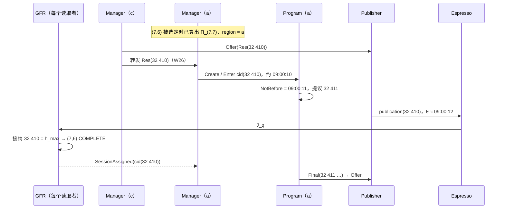
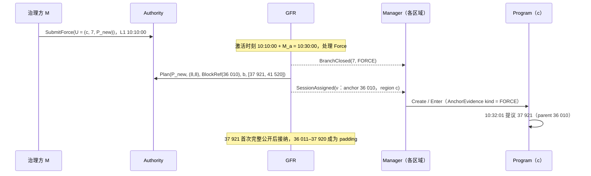
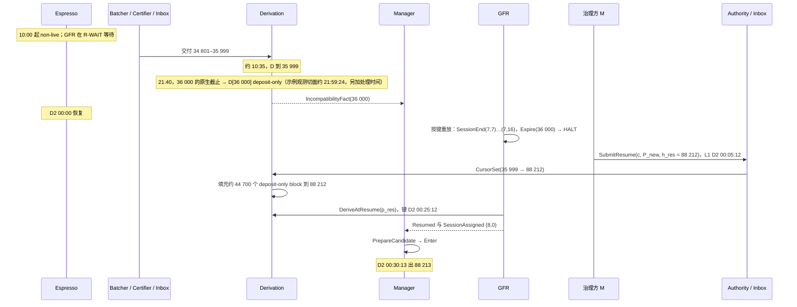
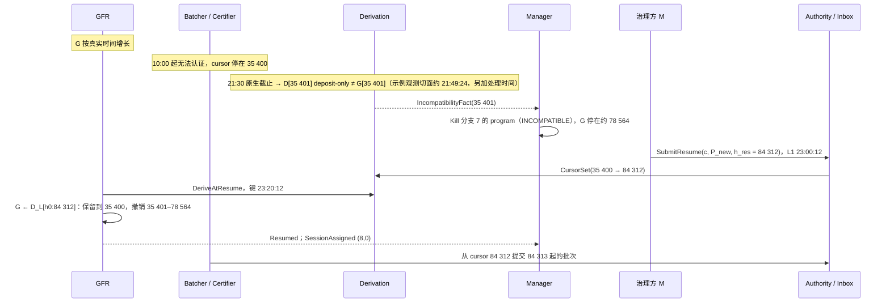

# 端到端流程：常规交接、Force 交接与两类 RESUME 恢复（v9 工作稿 v0.2）

日期：2026-11-02。上一版：[v0.1](10_pipelines_zh_v0_1.md)。总览与共享模型见 [00 arch](00_arch_zh_v0_1.md)；例子来源为 [261027](../meetup_record/261027.md)，以及 [v6 时间假设分析稿](../formalization_v6/recovery_timing_assumptions_zh.md)。

本版按一组校准参数重算全部例子。高度、时刻、L1 origin 和截止都放在同一条时间坐标上，可以逐项核对。v0.1 的高度是压缩示意，与时间例子互相矛盾；本版取消压缩。与 261027 和 v0.1 的数值差异集中列在 §8。标“本版选定”的参数是本版补充的取值，不是 261027 或 v8 给出的。

2026-11-03 更新：按 [09 v0.2](09_finality_rules_zh_v0_2.md)，Force 不再携带 $\theta_a$，与 RESUME 一样以 L1 收录时间加 $M_a$ 为激活时刻；RESUME 在激活时立即分配新 session。流程二的窗口因此由 [37 922, 41 521] 变为 [37 921, 41 520]，其余数值不变。

## 1. 本文结构

本文把各模块文件中的接口串成四条完整流程，用来检查模块之间能否组合，并给出它们在一组明确假设的示例参数下的时间表。§2 先给出参数、时间坐标和一个 height 的三条时限；§3–§6 是四条流程；§7 是不需要治理操作的短故障；§8 汇总校准结论。

每条流程包括：

- **场景**：初始状态与触发条件；
- **时序图**：参与模块之间的调用；
- **步骤表**：每行写时刻、调用与输出、下一位使用者，并标注 [00 §4.4](00_arch_zh_v0_1.md) 的连接编号；
- **结束时成立的事实**：四条链 $R,G,G',D$ 的关系、被放弃的内容和恢复耗时。

下文用 $\mathrm{cid}(X)$ 表示以 block $X$ 为 anchor 的候选 program 的 cid，session 记为 $(\beta,r)$，区域记为 a、b、c。$h_R,h_G,h_{G'},h_D$ 分别是四条链的末端 height。

## 2. 校准参数与时间坐标

### 2.1 时间坐标

为了让高度和时刻直接换算，取 L2 genesis 为第一天 00:00:00、$h^0=0$、$b_{\rm L2}=1$ s，于是

$$
\mathit{ts}^*(h)=h\ \text{秒}.
$$

例如高度 36 000 就是 10:00:00。第二天的时刻写作“D2 00:05:12”，对应高度 $86\,400+312=86\,712$。L1 取 $\mathit{ts}_{\rm L1}(\ell)=12\ell$ 秒，例如 L1 block 2 900 的时间戳是 09:40:00。这也假设每个 L1 slot 都有 block。真实 Ethereum 存在 missed slots，block height 不能始终按 12 秒线性换算；部署时还要替换实际 genesis、block time 与原生配置。

在稳态下，区域生产的 origin 按 [00 §3.4](00_arch_zh_v0_1.md) 的 schedule 取

$$
\ell^{\rm sch}(h)=\left\lfloor\frac{h-1\,200}{12}\right\rfloor,
$$

即 L2 时间 20 分钟之前的最后一个 L1 block。

### 2.2 参数

| 参数 | 取值 | 依据 | 主要用处 |
| --- | --- | --- | --- |
| $b_{\rm L2}$ | 1 s | 261027 的例子 | 高度与时刻换算 |
| $b_{\rm L1}$ | 12 s | Ethereum slot | origin 与窗口换算 |
| $T_{\rm L1}$ | 19.2 min | 本例假设的 finalized＋读取预算；不是 Ethereum 的无条件最坏上界，实际最终化可停滞 | R-WAIT、$M_a$、$T_{\rm dep}$、RESUME 准备 |
| $T_{\rm dep}$ | 20 min（本版选定） | 须满足 $T_{\rm L1}\le T_{\rm dep}$ | 稳态 origin 滞后 |
| $T_{\rm drift}$ | 30 min | 本例采用 Fjord 参数 1 800 s；须核对实际采用的原生版本 | O3；RESUME 目标的上界 |
| $W_{\rm seq}$ | 12 h | 本例取 3 600 个 L1 block；12 h 是无 missed slot 的换算，MegaETH 部署值未核验 | 原生截止 |
| $W_{\rm exp}$ | 10 h | 261027 | 缺口容忍期（Expire） |
| $M_a$ | 20 min | 由 $M_a\ge T_{\rm L1}+2\Delta_{\rm ts}+b_{\rm L1}$ 得出；261027 取 15 min | Force 与 RESUME 的激活时刻、R-WAIT |
| $T_{\rm batch}$ | 1 h | 261027 | 交付预算 |
| $\Delta_{\rm ts}$ | 15 s（本版选定） | 待核对 HotShot 的时间戳校验 | E-TS |
| $T_{\rm pub}$、$T_E$ | 各 30 s（本版选定） | 待实测 | PUB-4 |
| $T_{\rm grace}$ | 2 min（本版选定） | 须满足 $T_{\rm grace}>T_{\rm pub}+T_E+\Delta_{\rm ts}=75$ s | 公开截止 $\theta_s^{\rm end}$ |
| $\mathrm{TB}$ | 3 600 heights，即 1 h（本版选定） | — | session 窗口 |
| $T_{\rm prep}$ | 25 min | 须满足 $M_a+T_{\rm ready}\le T_{\rm prep}\le T_{\rm drift}-\epsilon$，取 $T_{\rm ready}=5$ min、$\epsilon=2$ min；261027 取 20 min | RESUME 目标高度 |
| $T_{\rm init}$ | 2 min（本版选定） | — | Force 后新窗口的准备余量 |
| $T_{\rm lead}$ | 1 s（本版选定） | — | 常规后继提前进入的余量 |
| `CHANNEL_TIMEOUT` | 50 个 L1 block（10 min） | [batch-inbox 常数](../megaeth_specs/specs/block-certification/batch-inbox.md#constants) | 未完成 channel 的失效 |

### 2.3 约束核对

| 约束 | 代入 | 余量 | 不满足时的后果 |
| --- | --- | --- | --- |
| $M_a\ge T_{\rm L1}+2\Delta_{\rm ts}+b_{\rm L1}$ | 20 min ≥ 19 min 54 s | 6 s | 部分 GFR 事件可能等待 L1 finalized。若取 261027 的 15 min，处理键为 $x$ 的事件要等到约 $x+4$ min 24 s（覆盖 $x-M_a$ 的 L1 block 最多晚 12 s 出现，再经 19.2 min finalized），$G$ 的确认约推迟 4.5 分钟；事件顺序不变 |
| $T_{\rm L1}\le T_{\rm dep}$ | 19.2 min ≤ 20 min | 48 s | 到达 slot 时 schedule 选中的 origin 可能尚未 finalized，Build 与 Accept 等待 |
| $T_{\rm dep}+b_{\rm L1}\le T_{\rm drift}$ | 20 min 12 s ≤ 30 min | 9 min 48 s | 稳态 origin 违反 drift |
| $T_{\rm grace}>T_{\rm pub}+T_E+\Delta_{\rm ts}$ | 120 s > 75 s | 45 s | 停止前形成的结果可能错过公开截止 |
| $W_{\rm exp}+M_a+T_{\rm batch}+T_{\rm drift}\le W_{\rm seq}$ | 11 h 50 min ≤ 12 h | 10 min | 按时进入 $G$ 的内容可能赶不上原生截止 |
| $M_a+T_{\rm ready}\le T_{\rm prep}\le T_{\rm drift}-\epsilon$ | 25 ≤ 25 ≤ 28（min） | 上界余 3 min | 新 session 来不及在 $h_{\rm res}+1$ 出块，或恢复 anchor 违反 drift |

在本例额外取 $T_{\rm ready}=5$ min、$\epsilon=2$ min 时，上述预算筛选得到 25–28 分钟；这不是已经证明的恢复可行区间。仍需验证 Espresso watermark、历史重放、DA 读取、填充执行与足够诚实权重的状态准备能在预算内完成。若这些工作不能受限，不能声称 25 分钟恢复。

### 2.4 一个 height 的三条时限

以 $X=36\,000$（10:00:00）为例。它属于 session (7,7)，窗口为 $[32\,411,36\,010]$（见 §2.5）。

| 时限 | 时刻 | 由谁判断 | 错过的后果 |
| --- | --- | --- | --- |
| **公开截止** $\theta_{(7,7)}^{\rm end}=\mathit{ts}^*(36\,011)+T_{\rm grace}$ | 10:02:11 | GFR，按 Espresso 时间戳 | 这份区域结果不能再进入 $G$ |
| **缺口容忍** $\mathrm{key}(\mathsf{Expire}(X))=\mathit{ts}^*(X)+W_{\rm exp}$ | 20:00:00 | GFR | 若 $X$ 仍未被任何结果覆盖（包括后继 session 的 padding），分支 HALT |
| **原生截止** | 21:40:00 | Derivation | $X$ 的 origin 是 L1 block 2 900（09:40:00），候选批次的窗口检查为 inclusion_height ≤ 6 500（等号本身不超窗，且须及时完成 channel）。缺失高度的 fallback 还由实际派生父块的 epoch 决定，不能仅由此候选 origin 推出，见下文 |

**原生截止的边界。** 按原生 Batch Queue，超窗检查是 `epoch_num + sequence_window_size < inclusion_block_number`；等号不是超窗。无批次时，fallback 要在实际父 epoch 的整个窗口已读完后才能生成。本例父块 35 999 的 origin 是 2 899，所以 fallback 可以在完整处理 L1 block 6 499（21:39:48）后确定 36 000，而不必等候选 origin 2 900 的窗口。下文以节点到 6 501 已完成读取和派生为一个保守的观测切面；21:59:24 是该切面加示例 finalized 预算的时刻，还需另加本地处理时间。

三条时限的含义不同：

- **公开截止**约束区域结果。Session 内 height $h$ 的结果最晚在其 session 的 $\theta_s^{\rm end}$ 之前公开，即 $\mathit{ts}^*(h)$ 之后最多约 1 h 2 min。
- **缺口容忍**约束 $G$ 能等多久。原结果错过公开截止后，后继 session 或 Force 仍可以用 padding 覆盖这个高度，只要在 Expire 之前被接纳。
- **原生截止**约束交付。Expire 到原生截止之间有 1 h 40 min，用来覆盖 $M_a$（20 min）与 $T_{\rm batch}$（1 h），余 20 min。按最坏 origin 滞后 30 min 计算，余量为 10 min，与 §2.3 的预算一致。

261027 的生命周期例子中，$X$ 的结果在 timestamp 19:55 的 Espresso block 中首次公开，仍被接纳。按 v9 的公开截止，这份结果已经晚于 10:02:11，不再合格。19:55 只适用于 $X$ 由后继 session 的 padding 覆盖的情形。

### 2.5 共同配置

分支 7 由此前一次 RESUME 开出，其 $h_{\rm res}=7\,210$（02:00:10）。因此 session $(7,k)$ 的窗口为

$$
[\,7\,211+3\,600k,\ 7\,210+3\,600(k+1)\,],
$$

不必对齐 genesis 的整点。区域循环排列为 c → a → b，与下表一致：

| Session | 区域 | 窗口 | 时段 | $\tau_s^{\rm stop}$ | $\theta_s^{\rm end}$ |
| --- | --- | --- | --- | --- | --- |
| (7,6) | c | [28 811, 32 410] | 08:00:11–09:00:10 | 09:00:11 | 09:02:11 |
| (7,7) | a | [32 411, 36 010] | 09:00:11–10:00:10 | 10:00:11 | 10:02:11 |
| (7,8) | b | [36 011, 39 610] | 10:00:11–11:00:10 | 11:00:11 | 11:02:11 |

### 2.6 参数敏感性

若实际 L1 finalized＋读取预算变大，不能只把恢复目标向后移；生产 origin 与恢复 anchor 同时受 drift 限制。以本稿采用的充分条件计算：

$$
T_{\rm L1}+b_{\rm L1}\le T_{\rm drift},\qquad
M_a+T_{\rm ready}+\epsilon\le T_{\rm drift}.
$$

例如 $T_{\rm L1}=25$ min 时，公告条件要求 $M_a\ge25$ min 42 s；继续保留 $T_{\rm ready}=5$ min、$\epsilon=2$ min，就超过 30 min drift，本文这组恢复预算无法同时成立。这表明该充分预算失败，不是证明任何恢复都不可能。应以实际状态准备时间与原生 anchor origin 重新计算，而不是仍承诺 25 min 恢复。

## 3. 流程一：Regular handoff

### 3.1 场景

Session (7,6) 由区域 c 负责，(7,7) 由区域 a 负责，交接发生在 09:00:10 与 09:00:11 之间。区域 a 的成员在 (7,6) 被选定后就能计算 (7,7) 的 Plan，并持续执行 c 的决定链，使状态始终接近 c 的末端。

### 3.2 时序图

### 3.3 步骤（c 决定了 $h_{\max}=32\,410$）

| # | 时刻 | 调用 → 输出 | 下一位使用者 | 连接 |
| --- | --- | --- | --- | --- |
| 1 | 约 08:00:12 | (7,6) 被选定。各 Manager 在 `ApplyLifecycle`(SessionAssigned) 中调用 Authority.`Plan`($\mathcal P_7$, (7,7), BlockRef(28 810), c, [32 411, 36 010]) → $\Pi_{(7,7)}$，region = a | Manager a | W1 |
| 2 | 08:00–09:00 | c 的每个决定经 `HandleProgramEvent` 组装为 Res，交给 Publisher 并转发给 a；a 的 Manager 逐块执行，保持状态材料 | Manager a | W8、W9、W26 |
| 3 | 约 09:00:10.5 | c 决定 32 410；Res(32 410) 到达 a | Manager a.`ObserveRegional` | W26 |
| 4 | 09:00:10.5 | Manager a.`PrepareCandidate`($\Pi_{(7,7)}$, 32 410, $\pi_A$ kind REGIONAL, 状态材料) → Ready；`EnterCandidate` | Program a | W24 |
| 5 | 09:00:11 | NotBefore = $\mathit{ts}^*(32\,411)$；Program a 提议 32 411 | — | W7 |
| 6 | 约 09:00:12 | Res(32 410) 收录于 $\theta\approx$ 09:00:12 的 Espresso block（不晚于 09:00:11 + 75 s） | GFR | W12 |
| 7 | 约 09:00:12 | GFR.`AdvanceGlobal`：接纳 32 410；它是 $h_{\max}$，立即以 COMPLETE 关闭 (7,6)，`SessionAssigned{ν(cid(32 410))}` | Manager | W13 |
| 8 | 09:00:12 起 | a 已缓存的结果可在选定后的同一 Espresso 处理循环中按 [09 §4.2](09_finality_rules_zh_v0_2.md) 接纳 | GFR | W12 |

### 3.4 变体

**1a：c 没有决定 32 410。** a 在 09:00:10 以已就绪的最高候选 32 409 进入，并从 09:00:11 起在 cid(32 409) 上出块。GFR 在 SessionEnd(7,6) 的键 09:02:11 固定 regular anchor 32 409，选定 cid(32 409)。a 在 09:00:11–09:02:11 产生的约 120 个 block 已经缓存，在随后的 Espresso block 中一并接纳。内容没有损失，但这些 block 的全局确认推迟最多约 2 分钟。

**1b：32 410 的证书迟到。** 32 410 的投票都在 09:00:11 之前签出（BFT-7 允许证书之后才组合或公开），但持有证书的一方直到 $\theta=$ 09:01:30 才公开它，仍早于 09:02:11。处理如下：

1. GFR 接纳 32 410，它是 $h_{\max}$，立即以 COMPLETE 关闭 (7,6)，选定 cid(32 410)。
2. a 在 cid(32 409) 上的 32 411–32 490 被排除（EXCLUDED）。
3. a 约在 09:01:31 进入 cid(32 410)，首个 block 位于 $\mathrm{slot}(09{:}01{:}31)=32\,491$，32 411–32 490 成为 padding。

结果是约 80 s 的快速确认作废，链上出现 80 个 deposit-only height。迟到证书的可行性取决于 BFT 实现的数据传播与证书组装；v9 未要求所有可验证证书立刻被诚实方取得。这里是符合 BFT-7 的条件性轨迹，不是对每种实现都成立的扣留攻击。

### 3.5 结束时成立的事实

- 若最终选中的候选被足够诚实权重提前准备，并满足 BFT 同步与 leader 条件，本例交接可没有生产停顿。
- 前驱没有决定 $h_{\max}$ 时，本例后继开头约 $T_{\rm grace}$ 的 block 的全局确认推迟（1a）；真实等待还取决于日志取得与重放。
- 证书迟到时，本例后继约 80 s 的工作作废并变为 padding（1b）；$T_{\rm grace}$ 不是停机后真实恢复延迟的无条件上界。
- 同一 session 至多一个 cid 被选中，其他候选的签名不能用于选中的 cid（BFT-4 第 4 项）。

## 4. 流程二：Force handoff

### 4.1 场景

(7,7) 的区域 a 决定了 36 010，(7,7) 以 COMPLETE 关闭，(7,8) 分配给区域 b、以 36 010 为 anchor。区域 b 从 10:00:11 起完全故障，没有贡献任何 block，$G$ 停在 36 010。36 011 的 Expire 键为 20:00:11，尚远。治理方 $\mathsf M$ 决定换区，新 policy 停用 b。

### 4.2 时序图

### 4.3 步骤

| # | 时刻 | 调用 → 输出 | 下一位使用者 | 连接 |
| --- | --- | --- | --- | --- |
| 1 | 约 10:05 | $\mathsf M$ 发现故障 | — | — |
| 2 | 10:10:00 | Authority.`SubmitForce`：$U=(c,7,\mathcal P_{\rm new})$ 收录于 L1 block 3 050；激活时刻 $\mathrm{act}(U)=10{:}10{:}00+M_a=10{:}30{:}00$ | GFR（经 L1） | W3 |
| 3 | ≤ 10:29:12 | 覆盖 $\mathrm{act}(U)-M_a=10{:}10{:}00$ 的 L1 block 3 050 已 finalized | — | — |
| 4 | 约 10:30:01 | 取得 timestamp 至少为 10:30:00 的 Espresso watermark（例如 $\theta=10{:}30{:}01$ 的 block），R-WAIT 满足。GFR 在键 10:30:00 处理 Force：此前已处理的 Espresso blocks 为 $J_0..J_{q^*-1}$；分支 7 仍是当前分支且未 HALT | — | — |
| 5 | 同上 | `BranchClosed{7, FORCE}`；新分支 8；$A$ 为 36 010（origin 2 900，09:40:00）；(7,8) 没有贡献 block，故新 session 为 (8,8)，来源区域 b | Manager.`ApplyLifecycle` | W13 |
| 6 | 同上 | 窗口 $h_{\min}=\max\{36\,011,\mathrm{slot}(10{:}30{:}00+T_{\rm init})+1\}=37\,921$（10:32:01），$h_{\max}=41\,520$；`Plan` 的 L1_reference_height 为 $\max\{2\,900,\lambda_8\}=3\,050$；region = c；`SessionAssigned{ν}`，Tail = NEXT(ν) | Manager | W1、W13 |
| 7 | 约 10:30:01 起 | 分支 7 的全部 cid（包括 b 的 Preparing 条目）以 FORCE 关闭 | Program.`Close` | W24 |
| 8 | 约 10:30:05 | c 的 Manager 以 $G$ 中 36 010 的状态 `PrepareCandidate` → `EnterCandidate` | Program c | W15、W24 |
| 9 | 10:32:01 | c 提议 37 921，parent 36 010；origin = $\ell^{\rm sch}(37\,921)=3\,060$（10:12:00），滞后 20 min 01 s | — | — |
| 10 | 约 10:32:04 | 37 921 的结果在其首次完整公开的 Espresso block 中接纳；$G$ 一次追加 padding 36 011–37 920（1 910 个 height，约 31 min 50 s）与 37 921 | Batcher 等 | W12、W15 |

### 4.4 结束时成立的事实

- Force 不撤销任何 $G$ 内容。故障时段 10:00:11–10:32:00 成为 deposit-only padding，padding 的 origin 沿 schedule 推进。
- 从故障到新区域出块约 32 分钟：发现约 5 min，L1 收录与公告 $M_a$ 共 20 min，$T_{\rm init}$ 2 min，另加 L1 纳入时间。
- [v6 分析稿](../formalization_v6/recovery_timing_assumptions_zh.md) 的问题 1（块级 L1 地板使 Force 开不出第一块）在 v9 中不出现：v9 没有块级地板，新窗口从 Force 生效之后开始，第一块的 origin 自然晚于地板。
- 若 Force 的激活时刻晚于 Expire(36 011) 的键 20:00:11，Expire 先被处理，分支已 HALT，Force 无效，只能走 RESUME。

## 5. 流程三：Espresso 长停机后的 RESUME（例 A）

### 5.1 场景

Espresso 从 10:00:00 之后 non-live，直到 D2 00:00:00 恢复，共 14 小时。(7,7) 由 a 以 32 410 为 anchor 运行（流程一的正常情形），其 cid 记为 cid(32 410)。本例还假设停机后跨区域转发恰好及时送达；v9 在 non-live 期间只保证最终送达，不保证 b 按时进入。停机前最后一个 Espresso block 的 timestamp 为 10:00:00，收录了 35 999 及以前的结果。10:00:00 时：

- $h_R=35\,999$：a 即将决定 36 000；
- $h_G=35\,999$；
- 已 finalized 的接纳视图 $h_{G'}=33\,900$；另有覆盖到 34 800 的交易在 L1 09:55:00 收录，此刻尚未 finalized，不能计入 $G'$；
- $h_D=33\,900$（09:25:00）：覆盖到该高度的批次在 L1 09:40:00 被接纳，09:59:12 前已 finalized。

下表的逐秒 BFT 进展是一条额外选定的成功轨迹，并非仅由 $\mathrm{TB}$ 推出。批次层一直正常；需要出现不相容事实的 36 000 含实际执行的普通交易，使其原生 block hash 与 deposit-only 结果不同。

### 5.2 时序图

### 5.3 步骤

| # | 时刻 | 调用 → 输出 | 下一位使用者 | 连接 |
| --- | --- | --- | --- | --- |
| 1 | 10:00 起 | GFR.`AdvanceGlobal` 返回 `WAIT{next_position, missing: Espresso watermark}`；$G$ 停在 35 999 | — | — |
| 2 | 10:00:00–10:00:10 | a 决定 36 000–36 010，Publisher 持续重试（PUB-3） | — | W12 |
| 3 | 10:00:11–11:00:10 | b 以候选 cid(36 010) 运行 (7,8)，产生 36 011–39 610，到 11:00:11 按 BFT-7 停止 | — | W24、W26 |
| 4 | 11:00:11 起 | 没有新的生产：(7,9) 的 Plan 要等 (7,8) 被选定，而 GFR 停在步骤 1 | — | — |
| 5 | 约 10:15 | Batcher → DA → Certifier → Inbox.`SubmitBatch`：cursor 到 35 999 | Derivation | W15–W19、W27 |
| 6 | 约 10:35 | Derivation.`Derive`：$D$ 到 35 999，与 $G$ 一致 | Manager | W22 |
| 7 | 21:40:00 | 36 000 的候选窗口附近；假设节点到 L1 block 6 501 时已完成父 epoch 的 fallback，$D[36\,000]$ 为 deposit-only | Manager | W22 |
| 8 | ≤ 21:59:24 | 上一步所依据的 L1 已 finalized。Manager 得到 IncompatibilityFact(cid(32 410), 36 000)，a 的 36 000 是普通块 | Manager.`ApplyLifecycle` | — |
| 9 | 同上 | a 的 (7,7) program 与 b 的 cid(36 010) 以 INCOMPATIBLE 关闭。两者已在 10:00:11、11:00:11 以 TIME 永久终止；重复 Close 不覆盖其原关闭原因，仅另记不相容事实 | Program.`Close` | W24 |
| 10 | 22:00 起 | $D$ 以 deposit-only 推进：origin 先追上 block 时间（依赖原生 epoch 推进，不能从当前抽象推出固定 22 min），之后 $D$ 的末端约为 L1 时间减 12 h | — | W22 |
| 11 | D2 00:00:00 | Espresso 恢复，首个新 block 的 $\theta\approx$ D2 00:00:00。GFR 按键重放 | — | — |
| 12 | 同上（键 10:02:11） | SessionEnd(7,7)：a 的 36 000–36 010 直到恢复才公开，已过截止；regular anchor 为 35 999。`SessionClosed{(7,7), COMPLETE}`、`SessionAssigned{(7,8), ν(cid(35 999))}`；b 的 cid(36 010) 被排除 | Manager | W13 |
| 13 | 同上（键 11:02:11–19:02:11） | SessionEnd(7,8)…(7,16) 依次以 COMPLETE 关闭，均无新块；每次分配下一 session，anchor 仍为 35 999。这些 session 的窗口已在真实时间中过去，Enter 被拒绝 | Manager | W13 |
| 14 | 同上（键 20:00:00） | Expire(36 000)：`BranchClosed{7, EXPIRED}`，Tail = HALT，$G$ 保持到 35 999 | Manager | W13 |
| 15 | D2 00:05:00 | $\mathsf M$ 按 [01 §3.10](01_l1_authority_zh_v0_1.md) 的规程：紧急状态自约 21:59 成立，Espresso 已恢复。Authority.`SubmitResume`($c$, $\mathcal P_{\rm new}$, $h_{\rm res}=88\,212$) | — | W4 |
| 16 | D2 00:05:12 | 收录于 L1 block $L=7\,226$。目标核对：$\mathit{ts}_{\rm L1}(L)+T_{\rm prep}=$ D2 00:30:12 $\le\mathit{ts}^*(88\,212)=$ D2 00:30:12 $\le$ D2 00:33:12；$88\,212$ 高于 cursor、$h_G$ 与 $h_D$。同一交易内 Inbox.`Override` 产生 CursorSet(old.height 35 999, next.height 88 212) | Derivation；GFR | W4、W5 |
| 17 | ≤ D2 00:24:24 | $L$ finalized。Derivation 处理 CursorSet：$D$ 的末端约为 43 512（12:05:12），若 override 前实际 $h_D^-=43\,512$，则填充 43 513–88 212，共 44 700 个 deposit-only block。该 $h_D^-$ 是示例输入，须由原生重放确认；一般填充量为 $\max\{0,h_{\rm res}-h_D^-\}$。填充 block 的 origin 跟随 L1 推进，最多到 $L$；$D_L[88\,212]$ 的 origin 为 $L$ | — | W5 |
| 18 | D2 00:25:12 | RESUME 的激活时刻 $\mathit{ts}_{\rm L1}(L)+M_a$。R-WAIT 满足，resumeReader = Derivation.`DeriveAtResume`($p_{\rm res}$) → ResumeCut | GFR | W23 |
| 19 | 同上 | GFR 执行 RESUME（[09 §4.6](09_finality_rules_zh_v0_2.md)）：$G$ 本身是 $D_L$ 的前缀，不撤销任何块；$G\leftarrow D_L[h^0:88\,212]$，接上 36 000–88 212，出处 DER；`Resumed{c, 8, A, D_L}`；Boundary 为 (8,0)、窗口 [88 213, 91 812] | Manager | W13 |
| 20 | 同上 | 同一事件中立即以 Boundary 调用 `Plan`，`SessionAssigned{ν}`，Tail = NEXT(ν)；session (8,0) 由新 policy 循环排列的首个区域负责，例如 a | Manager | W1、W13 |
| 21 | D2 00:25–00:30 | Manager 在 `ApplyLifecycle`(Resumed) 中调用 `DeriveAtResume`，把 anchor_state 存为状态材料；收到 SessionAssigned 后 `PrepareCandidate` → `EnterCandidate` | Program | W23、W24 |
| 22 | D2 00:30:13 | 新 program 提议 88 213。origin = $\min\{L+1,\ell^{\rm sch}(88\,213)\}=7\,227$（D2 00:05:24），滞后 24 min 49 s，不超过 30 min；该 L1 block 已于 D2 00:24:36 前 finalized。此后 origin 每块前进 1，于 88 239（D2 00:30:39）回到 schedule | — | — |
| 23 | GFR 已处理 RESUME 后 | Batcher 读取 cursor 88 212；Certifier 在其 GFR 处理完该 RESUME 后才认证以它为 prev 的提交；新批次从 88 213 开始；必须等该高度的新结果进入 $G$ 后才能认证 | Inbox | W18–W20、W27 |

### 5.4 恢复耗时

若表中的公共输入、重放和状态准备按时完成，提交 RESUME 到首个新块产出的示例时长为 25 min 13 s。首块进入 $G$ 还要加 $T_{\rm build}+T_{\rm fin}+T_{\rm pub}+T_E$ 及所需的 GFR 等待、处理时间；BFT 抽象未给出这些量的部署值，不能推出额外最多 1 分钟。

| 时间段 | 时长 | 内容 |
| --- | --- | --- |
| 提交到收录 | 约 12 s | L1 纳入 |
| 收录到 $L$ finalized | ≤ 19.2 min | Ethereum 最终化 |
| $L$ finalized 到 RESUME 的激活时刻 | ≥ 48 s | 派生执行约 44 700 个填充块；不能预先执行时，GFR 在 R-WAIT 等待填充完成 |
| 键到 $h_{\rm res}+1$ 的 slot | 5 min | 开出 session、准备状态、Enter |

仅计算数值：若有 44 700 个填充块，想在 finalized 后 48 s 内完成，需要约 931.25 blocks/s，尚未计 DA 读取和状态分发；若允许用完 5 min，平均为 149 blocks/s，但这会使 RESUME 晚于其时间键处理。时间键不是完成时刻。未 finalized 输入上的预执行只可作为可丢弃缓存优化，不能作为 Ready 或公共决定；v9 未声明该优化或其收益。原来的 20 min 同样必须按各阶段实际耗时验证，不能用固定 14 min 阈值判定是否够用。

### 5.5 变体 A′：停机瞬间有在途 Espresso block

此变体单独取停机开始时刻为 10:00:01。设 Espresso block $J^*$ 在 10:00:00.5（仍然 live）提出，$\theta^*=$ 10:00:01，其中包含 36 000 的完整 publication，但在停机前没有 finalized。它在 D2 00:00 恢复后才 finalized。$J^*$ 是在 live 期间提出的，满足 E-TS。

1. 重放时，$J^*$ 的键 10:00:01 早于 SessionEnd(7,7) 的 10:02:11，先被处理。接纳检查全部通过：cid 匹配、高度在窗口内、$\theta^*<\theta_{(7,7)}^{\rm end}$、$\theta^*<\mathit{ts}^*(36\,000)+W_{\rm exp}$。**36 000 在真实时间 D2 00:00 进入 $G$。**
2. SessionEnd(7,7) 以 36 000 为 regular anchor；之后 Expire(36 001)（键 20:00:01）使分支 HALT，$G$ 停在 36 000。
3. D2 00:00–00:25 之间，Certifier 可能认证 36 000：prev 为 35 999，内容与 $G$ 一致，而 CertifyBatch 不检查原生截止。Inbox 接受这份已过窗口的批次，cursor 前进到 36 000；派生丢弃它，$D[36\,000]$ 仍是 deposit-only。此时 cursor 与 $D$ 的内容含义分离；$D$ 的 height 完全可能高于 cursor，不能只比较高度。
4. D2 00:25:12 处理 RESUME：$D_L[36\,000]\ne G[36\,000]$，共同前缀到 35 999。**$G[36\,000]$ 在成为全局最终约 25 分钟后被撤销。**

因此，本例 A 保留旧 $G$ 的前提是旧 $G$ 已及时交付且没有再接纳与 $D$ 冲突的迟到结果。A′ 提供允许撤销的反例；有在途 block 本身不必然导致撤销。该现象是 v6 问题 2 的延续，v9 §7 已允许这种 RESUME 语义，并非同 cid 的 BFT agreement 被破坏。

### 5.6 变体 A″：跨越 session 截止的短停机

设 Espresso 只在 10:00:00–10:05:00 停机。这 5 分钟跨过了 $\theta_{(7,7)}^{\rm end}=$ 10:02:11。

1. 恢复后，SessionEnd(7,7) 以 35 999 为 anchor。a 的 36 000–36 010 在截止后才公开，不合格；(7,8) 选定 cid(35 999)，b 的 cid(36 010) 被排除。
2. b 约在 10:05:01 进入 cid(35 999)。首个 block 位于约 36 305，36 000–36 304 成为 padding（305 个 height）。
3. 作废的快速确认包括 a 的 11 个 block 和 b 的约 290 个 block。不需要治理操作，$G$ 不撤销。

若同样 5 分钟的停机落在 session 中间（例如 09:30–09:35），没有截止被跨过：积压结果在恢复后按原顺序进入 $G$，没有损失。

一般地，padding 的长度由最后接纳的 height 与恢复后的首个 physical height 决定，作废确认的数量只计算实际已决定的候选 blocks，两者不等于停机长度。例如 10:00–12:00 停机：若重放和准备能在 (7,9) 的 stop 12:00:11 前完成，该 session 仍可能产生末尾几块，无需等待 12:02:11；若来不及，则按 SessionEnd 选出 (7,10)，可在约 12:02:13 提议 43 333。后者的 padding 为 36 000–43 332，共 7 333 heights；实际被放弃的候选链最多到 39 610，共 3 611 heights。

### 5.7 结束时成立的事实

- 没有在途 block 时，原 $G$ 全部保留；有在途 block 时见变体 A′。
- 被放弃的是只有区域确认、没有进入 $G$ 的 36 000–39 610，即 a 的 11 s 与 b 的 1 h。其中仍需执行的交易要按新状态重新提交。
- GFR 停住后，生产最多再持续一个 session：只有已选定前驱的后继能提前计算 Plan。若故障发生在当前 session 开头，当前 session 的剩余部分加一个预备后继可接近两段窗口；本例发生在末端才约为 1 h。这也依赖各候选实际被调度。
- 在同一 RESUME 切面已被 Inbox、Derivation 和 GFR 都处理、且后续还未推进的观察点，三者对齐到 88 212。此后的前缀关系仍需要同一父状态与及时交付，不能把某个组件的最新进度与另一个组件的历史切面直接比较。
- 停机期间，L1 deposits 经 deposit-only block 进入 $D$，延迟预算还包含 L1 finalized、DA 取得和派生处理；12 h 只是本例窗口换算。

## 6. 流程四：批次层超窗后的 RESUME（例 B）

### 6.1 场景

Espresso 一直正常。从 10:00 起 Certifier 离线，批次交付路径失效。此前最后一份被接纳的批次覆盖到 35 400（09:50:00），在 L1 09:57:00 收录，此时为待 finalized 的接纳记录；按本例预算，它在 10:16:12 前 finalized。数据与执行及时完成后，cursor 的 finalized 视图和 $D$ 均到 35 400。

第一个未交付的高度是 35 401。假设 35 401 的原生块与 deposit-only 结果不同。35 401–35 411 的 origin 都是 L1 block 2 850（09:30:00），原生截止为 L1 block 6 450（21:30:00）。

### 6.2 时序图

### 6.3 步骤

| # | 时刻 | 调用 → 输出 | 下一位使用者 | 连接 |
| --- | --- | --- | --- | --- |
| 1 | 10:00 起 | Batcher.`Deliver` 在 CertifyBatch 处返回 WAIT，任务保留已完成阶段（BAT-3） | — | W16、W27 |
| 2 | 10:00–21:30 | $R$ 与 $G$ 照常增长，$G$ 只落后 $R$ 数秒 | — | — |
| 3 | 21:30:00 | 35 401 的原生截止。派生处理 L1 block 6 451 时，$D[35\,401]$ 为 deposit-only，与 $G[35\,401]$ 的原生 hash 不同 | Manager | W22 |
| 4 | ≤ 21:49:24 | 上一步所依据的 L1 已 finalized。Manager.`ObservePublic` → `ApplyLifecycle`(IncompatibilityFact(35 401))：正在运行的 (7,19)（a，窗口 [75 611, 79 210]）以及分支 7 中前缀覆盖 35 401 的全部候选以 INCOMPATIBLE 关闭 | Program.`Close` | W24 |
| 5 | 同上 | $G$ 停在约 78 564（21:49:24）。之后 GFR 仍按 SessionEnd 分配 (7,20)…，但每个候选的前缀都覆盖 35 401，在准备时即被关闭。下一缺失高度的 Expire 键为 D2 07:49:25 | — | W13 |
| 6 | 21:30–23:00 | $D$ 以 deposit-only 推进：origin 先追上 block 时间，之后末端约为 L1 时间减 12 h | — | W22 |
| 7 | 23:00:00 | 服务恢复。$\mathsf M$ → Authority.`SubmitResume`($c$, $\mathcal P_{\rm new}$, $h_{\rm res}=84\,312$)，收录于 L1 block $L=6\,901$（23:00:12）。目标核对：23:25:12 $\le\mathit{ts}^*(84\,312)=$ 23:25:12 $\le$ 23:33:12；高于 cursor 35 400、$D$ 的末端约 39 612 与 $G$ 的末端约 78 564 | Derivation；GFR | W4、W5 |
| 8 | ≤ 23:19:24 | $L$ finalized；派生若 override 前实际 $h_D^-=39\,612$，填充 39 613–84 312，共 44 700 个 deposit-only block；该切面须由原生重放确认 | — | W5 |
| 9 | 23:20:12 | RESUME 的激活时刻。GFR 调用 `DeriveAtResume` → ResumeCut | GFR | W23 |
| 10 | 同上 | 共同原生前缀到 35 400；**若停下时 $h_G=78\,564$，撤销 35 401–78 564，共 43 164 个 height，约 11 h 59 min 24 s 的高度跨度**；$G\leftarrow D_L[h^0:84\,312]$；Resumed；同一事件中为 (8,0) 输出 SessionAssigned，窗口 [84 313, 87 912] | Manager | W13 |
| 11 | 23:25:13 | 新 program 提议 84 313，origin 6 902（23:00:24） | — | W24 |
| 12 | CursorSet 生效后；新签名还等 GFR 处理 RESUME | 以旧 cursor 35 400 为 prev 的证书被 Inbox 拒绝（CERT-3 (a)）。Batcher 从 cursor 84 312 构造；Certifier 在其 GFR 处理完 RESUME 后才认证（CERT-3 (b)） | Inbox | W18–W20、W27 |

### 6.4 已过窗口的批次

设 Certifier 在 21:35 恢复，即 35 401 的原生截止之后：

1. Batcher 以 prev = 35 400 请求认证 35 401 起的内容。CertifyBatch 只核对 cursor、$G$ 与 DA，不检查原生截止，因此会签名。
2. Inbox 接受并推进 cursor，派生却丢弃这份批次，$D[35\,401]$ 仍是 deposit-only。
3. 不能据此断言后续批次全部被丢弃。[原生 Batch Parent Hash 规则](../megaeth_specs/specs/rollup/derivation.md#batch-parent-hash) 明确忽略批次 parent_hash；后续批次仍在实际 $D$ 父状态上，按各自窗口、origin 与执行条件逐项判断。
4. cursor 的接纳含义不同于派生内容；按 cursor 物化的 $G'$ 与 $D$ 可能分叉。

因此 Kill 与“是否进入紧急状态”的判断只能依据 $D$，不能依据 cursor；RESUME 的“$h_{\rm res}$ 高于 cursor”只是必要条件。这一点列入安全检查。

### 6.5 结束时成立的事实

- 被撤销的 35 401–78 564 曾经是全局最终，却没有按时进入 $D$。这是 $G$ 的设计语义（[09 §7](09_finality_rules_zh_v0_2.md)），但校准后的规模约为 12 小时。
- 35 401–84 312 全部是 deposit-only，L1 deposits 照常纳入；普通交易需要重新提交。
- Kill 比原生截止晚约 19 分钟，因为派生读取的是 finalized L1。这期间区域继续产生注定作废的 block。

## 7. 短故障与死区

能否无损，取决于每个结果是否赶上自己的公开截止，以及每个 height 是否赶上缺口容忍与原生截止。下表以第一个受影响的 height $X$ 计时，数值来自 §2 的参数。

| 情形 | 结果 | 需要治理吗 |
| --- | --- | --- |
| Espresso 停机，期间没有跨过任何 $\theta_s^{\rm end}$ | 若完整结果及时取得、仍有正确 cid 的参与条件且交付赶上实际期限，积压结果可被接纳 | 否 |
| Espresso 停机跨过某个 $\theta_s^{\rm end}$，且恢复早于 $\mathit{ts}^*(X)+10$ h | 可能丢失截止前未公开的候选结果；padding 与作废量按 §5.6 分别计数 | 否 |
| Espresso 停机超过约 10 h | 在本例缺口未被迟到结果覆盖时，恢复后 Expire 使分支 HALT；紧急状态约自 $\mathit{ts}^*(X)+12$ h 成立；没有在途 block 时 $G$ 不撤销 | RESUME（§5） |
| Publisher 全部失效，Espresso 正常，10 h 内修复 | 若后继已准备、剩余运行时间足够且新证明赶上所有边界，后继可用 padding 覆盖缺口 | 否 |
| Publisher 全部失效超过 10 h | $\mathit{ts}^*(X)+10$ h HALT；**死区**持续到 $D$ 越过 $X$ 并 finalized，约 $\mathit{ts}^*(X)+11$ h 59 min，约 2 小时；之后 RESUME 再加 25 分钟 | RESUME |
| 区域故障，Espresso 正常 | Force 约 32 分钟后恢复，故障时段成为 padding（§4） | Force |
| 批次层故障，恢复时每个未交付高度仍能在原生截止前被接纳 | 无损。以 $X$ 计，截止约为 $\mathit{ts}^*(X)+11$ h 40 min；按 1 h 交付预算，约 $\mathit{ts}^*(X)+10$ h 40 min 前恢复仍只是预算筛选，尚需实际 deadline、负载与服务条件 | 否 |
| 批次层故障超过原生截止 | $D$ 在 $X$ 分叉；约 19 分钟后 Kill；恢复后 RESUME，$G$ 从 $X$ 起被撤销（§6） | RESUME |

死区是 [v6 分析稿](../formalization_v6/recovery_timing_assumptions_zh.md) 的问题 4。按 v6 的参数（origin 滞后 30 min，不计 L1 最终化）约为 1.5 小时；校准后约为 2 小时。

## 8. 校准结论

下表把本版的数值与 261027 和 v0.1 对照。“待定”一列标出需要你决定或实测的项目。

| # | 项目 | 261027／v0.1 | 本版 | 原因 | 待定 |
| --- | --- | --- | --- | --- | --- |
| 1 | $M_a$ | 15 min | 20 min | 本例 finalized 预算取 19.2 min，未测量或证明为部署上界；15 min 时，每个 GFR 事件最多多等约 4.5 分钟 | 是否接受 20 min，或保留 15 min 并接受 $G$ 的确认延迟 |
| 2 | RESUME 准备 $T_{\rm prep}$ | 20 min | 25 min | $L$ 最终化 ≤ 19.2 min，加填充执行、开出 session 与 Enter；上界 28 min | 填充能否预先执行；实测填充速度 |
| 3 | 稳态 origin 滞后 | 30 min | 20 min | schedule 取 $T_{\rm dep}=20$ min；30 min 是 drift 上限 | — |
| 4 | 10:00:00 的 block 的原生截止 | 21:30 | 21:40 | 由第 3 项推出 | — |
| 5 | 区域结果进入 $G$ 的时限 | 块时间 + 10 h | 所在 session 的 $\theta_s^{\rm end}$，最多约块时间 + 1 h 2 min | v9 的公开截止；$W_{\rm exp}$ 只约束缺口 | $T_{\rm grace}$ 的取值：越大，跨截止的短停机损失越少，交接时的确认停顿越长 |
| 6 | 例 A 是否撤销 $G$ | 不撤销 | A 的前提下不撤销；A′ 的迟到结果导致撤销 | v6 问题 2，v9 未修复 | 见安全检查 |
| 7 | 例 A 中区域的生产 | 持续到 115 | 到 39 610 停止（一个 session） | v9 只预备已选定前驱的后继 | — |
| 8 | 例 B 撤销的 $G$ | 106–200 | 35 401–78 564，约 12 h | 本例假设分歧检测和发布滞后恰好给出此末端；不是由窗口参数唯一确定的撤销上界 | — |
| 9 | RESUME 填充规模 | 未给出 | 约 44 700 个 block | 约 $W_{\rm seq}+T_{\rm prep}$ | 实测执行时间 |
| 10 | 跨截止的短停机 | v6：2 h 停机无损 | 跨截止时有 padding 与作废确认（A″） | 公开截止按 L2 时间固定 | 同第 5 项 |
| 11 | 死区 | 约 1.5 h | 约 2 h | 第 3 项与 L1 最终化 | 是否采纳 v6 的修法：“已 HALT 且 $G\preceq D$”也允许 RESUME |
| 12 | Regular handoff | 只给逻辑 | 前驱没有决定 $h_{\max}$ 时，正常日志与状态准备条件下约 2 min 的确认等待；1b 展示 80 s 的候选工作作废 | 公开截止与 BFT-7 | 见安全检查 |
| 13 | Force 恢复 | 只给逻辑 | 约 32 min；故障时段成为 padding | $M_a$ 与 $T_{\rm init}$ | $T_{\rm init}$ 的取值 |

## 9. 校准的证据与范围

本文件的 20 min 公告、25 min 恢复与 1 h session 都是供手工检查的一组示例，没有写入协议配置。所有精确到秒的“≤”都以本例的 finalized 预算和所列数据处理条件成立为前提；事件时间键不代表实际处理完成时刻。未测量服务吞吐、BFT 延迟、历史重放速度或实际部署配置。

2026-11-02 查阅的外部依据：[Ethereum PoS](https://ethereum.org/developers/docs/consensus-mechanisms/pos/) 支持 12 s slot、32 slot epoch，最终化需要投票条件，并不保证每个 block 在固定时限内 finalized；[OP configurability](https://specs.optimism.io/protocol/configurability.html#sequencing-window-size) 给出 3 600 L1 blocks 的标准窗口；[OP derivation](https://specs.optimism.io/protocol/derivation.html#batch-queue) 给出窗口与 fallback 检查，Fjord drift 参数见其参数表。v9 与本仓库原生 certified derivation 的语义仍以所引用的本地版本为审查对象。

数字复算见 [checks/calibrate_261027.py](checks/calibrate_261027.py)。它检查时间、高度和数量运算，不模拟 BFT、完整原生派生或证明协议安全。核心待决问题见 [安全审查](security_review_zh_v0_1.md)。
