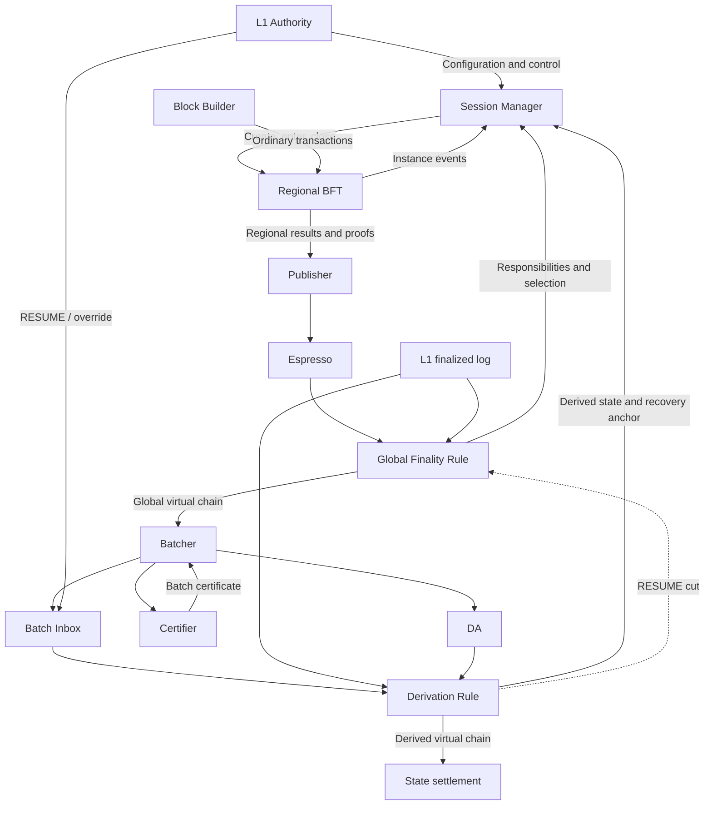
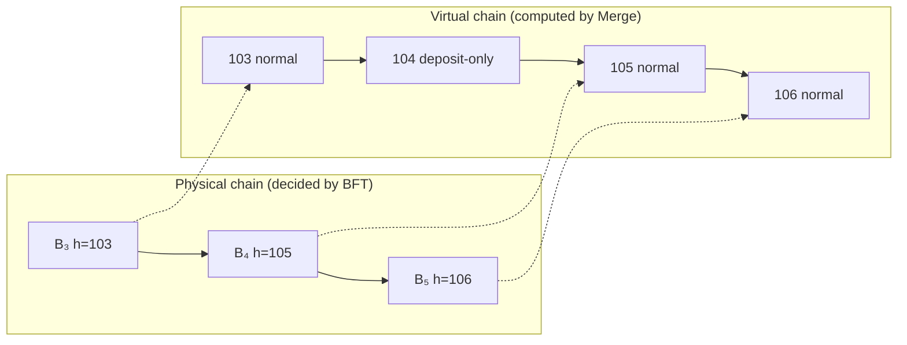
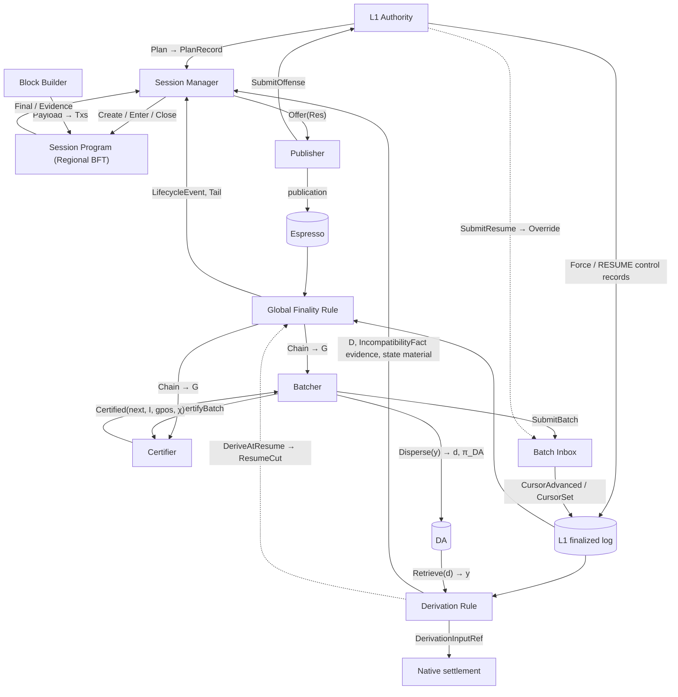

# System Architecture and Module Overview (v9 working draft v0.1)

Date: 2026-11-02.

Sources: §0–§3 and the §4 introduction of [arch v0.2](../formalization_v8/arch_zh_v0_2.md), [Regional BFT v0.13](../formalization_v8/regional_bft_abstraction_zh_v0_13.md), and the [261027 meetup](../meetup_record/261027.md). This version splits the original architecture document into an overview and module files: this document retains the model, participants, and chain data structures (§0–§3); §4 gives only an overview of the modules and their interface connections. Each module's assumptions, complete interfaces, and properties appear in its own file; the finality rules and end-to-end flows are separate documents. See the [README](README.md) for the reading order.

## 0. Overview

The system has three parts: regional production, public ordering, and L1 derivation. Regional consensus decides the transactions on a chain; Espresso provides a public order for regional results; the Global Finality Rule (GFR) selects the global chain using L1 control records and the Espresso log. The Batcher then encodes the selected content, the Certifier certifies its source, the Batch Inbox accepts batches on L1, and the Derivation Rule reconstructs L2 from L1 and the data availability layer (DA).

During normal rotation, the successor region can prepare and run candidate consensus instances starting from different anchors in advance. An anchor is the starting L2 block adopted by an instance. The GFR ultimately determines which instance may contribute global results. Regional results produced in advance do not thereby automatically become eligible for global acceptance.



This document first presents the external building blocks (§1), then defines participants and sessions (§2), gives the L2 chain data types and mappings (§3), and finally presents the modules and their interface connections (§4). Module interfaces, finality rules, and end-to-end flows appear in separate files; see §4.1.

## 1. External Building Blocks

Real time is denoted by $\tau\in\mathbb R_{\ge0}$. It is a coordinate used to analyze executions and does not imply that all readers have synchronized clocks. $\mathbb N$ includes 0; $\{0,1\}^*$ is the set of finite bit strings. For finite sequences $X,Y$, $X\preceq Y$ means that $X$ is a prefix of $Y$, and $X\Vert Y$ denotes concatenation.

This section specifies the inputs provided by external services and their guarantees. Later modules use these inputs to make decisions: L1 provides finalized history, Espresso provides the public ordering of messages, and DA provides retrievable data contents.

An honest submitter or reader in this section is a party that follows the relevant external service's rules; the system's replica fault model is given in §2.

### 1.1 Digital signatures, hash, and encoding

Let $\kappa$ be the security parameter and $\mathrm{negl}(\kappa)$ a negligible function. The protocol uses a digital signature scheme

$$
\mathsf{Sig}=(\mathsf{KeyGen},\mathsf{Sign},\mathsf{Verify}).
$$

$\mathsf{KeyGen}(1^\kappa)$ generates a key pair $(sk,pk)$; $\mathsf{Sign}_{sk}(x)$ signs a message $x\in\{0,1\}^*$; and $\mathsf{Verify}_{pk}(x,\mathit{sig})\in\{0,1\}$ verifies a signature. The public-key set is denoted by $\mathcal{PK}$. The scheme satisfies correctness and **EUF-CMA security**.

The protocol also uses a hash function with hiding and binding properties:

$$
\mathsf H:\{0,1\}^*\longrightarrow\{0,1\}^{\kappa}.
$$

Signatures verify whether a message is authorized by the holder of the corresponding key; hashes refer to specific contents in messages and records. After verifying a signature, the recipient must still check the message's purpose, instance, and content against the protocol.

### 1.2 L1

L1 is a sequence of finalized blocks with public verification evidence:

$$
\mathcal L_1=(L_0,L_1,\ldots).
$$

The index $\ell\in\mathbb N$ is the L1 height. Given $\tau^0_{\rm L1}\ge0$ and $b_{\rm L1}>0$, use the fixed-pace model

$$
\mathit{ts}_{\rm L1}(\ell)=\tau^0_{\rm L1}+\ell b_{\rm L1}.
$$

L1 satisfies the following properties. Any two verified finalized logs are prefix-comparable; a finalized prefix obtained by a reader does not revert. Contract calls in the same prefix execute atomically in recorded order.

There is a known constant $T_{\rm L1}>0$ such that a transaction submitted at $\tau$ that meets L1 admission conditions is finalized and publicly readable by continuously online readers by $\tau+T_{\rm L1}$. In particular, block $\ell$ is finalized and readable by $\mathit{ts}_{\rm L1}(\ell)+T_{\rm L1}$; $T_{\rm L1}$ is a common upper bound on these deadlines.

A record position within an L1 block is

$$
p=(\ell,j,k),
$$

where $j$ is the transaction index and $k$ is the log index within that transaction. L1 positions are ordered lexicographically. Below, “processed through $p$” includes that position; “strictly before an L1 height” excludes all records at that height.

### 1.3 L2 time and forced transaction inputs from L1

Let $\mathcal T$ be the set of native L2 transactions, and $\mathcal T^*$ the set of finite ordered transaction lists. Given genesis height $h^0$, genesis timestamp $\tau^0_{\rm L2}$, and interval $b_{\rm L2}>0$, define

$$
\mathit{ts}^*(h)=\tau^0_{\rm L2}+(h-h^0)b_{\rm L2},
\qquad h\ge h^0.
$$

The slot for height $h$ is $[\mathit{ts}^*(h),\mathit{ts}^*(h+1))$. For $\tau\ge\tau^0_{\rm L2}$, define

$$
\mathrm{slot}(\tau)
=h^0+\left\lfloor\frac{\tau-\tau^0_{\rm L2}}{b_{\rm L2}}\right\rfloor.
$$

The two functions describe the same schedule in opposite directions: $\mathit{ts}^*(h)$ gives the start of height $h$'s slot, while $\mathrm{slot}(\tau)$ gives the slot containing $\tau$. The start or end of a slot does not itself mean that a physical block was produced at that height.

We abstract L1 forced transactions as list inputs. $\mathrm{DepLog}(\ell)\in\mathcal T^*$ is the ordered deposit list determined by L1 block $\ell$.

To define the forced prefix used at an L2 height, let

$$
\omega:\{h^0,h^0+1,\ldots\}\longrightarrow\mathbb N
$$

be a given L1-origin trajectory. $\omega(h)$ denotes the L1 block on which height $h$ is based; adjacent increments in a legal trajectory are 0 or 1. For $h>h^0$, define

$$
\mathrm{Deposit}_{\omega}(h)=
\begin{cases}
\mathrm{DepLog}(\omega(h)),&\omega(h)\ne\omega(h-1),\\
[],&\omega(h)=\omega(h-1).
\end{cases}
$$

For example, if two consecutive L2 heights both use L1 block 20 as origin, the later height does not execute block 20's deposits again; $\mathrm{DepLog}(21)$ is added when the origin first advances to 21.

The native rules provide two deterministic lists: $\mathrm{Attr}_{\omega}(h)$ is the attributes transaction that writes origin information into the L2 execution context; $\mathrm{Sys}_{\omega}(h)$ consists of system/upgrade transactions applicable at that height. They read only the origin trajectory, finalized L1 data, the fixed native-rule version, and genesis context. Define the forced prefix

$$
\mathrm{DEP}_{\omega}(h)
:=
\mathrm{Attr}_{\omega}(h)\Vert
\mathrm{Deposit}_{\omega}(h)\Vert
\mathrm{Sys}_{\omega}(h)
\in\mathcal T^*.
$$

Once the origin trajectory and native-rule version are fixed, abbreviate this as $\mathrm{DEP}(h)$. All readers obtain the same list from the same inputs; the leader cannot delete or modify it. It executes in list order before ordinary transactions. If the required L1 prefix is not yet readable, the computation waits rather than returning an empty list.

Different recovery starting points may correspond to different origin trajectories, so the abbreviation $\mathrm{DEP}(h)$ is always relative to a fixed trajectory. The specific trajectory is defined in §3.4.

### 1.4 Espresso

Espresso is a sequence of finalized blocks

$$
\mathcal L_E=(J_0,J_1,\ldots),\qquad
J_q=(q,\theta_q,\mathcal M_q),
$$

where $q\in\mathbb N$ is the Espresso height, $\theta_q\in\mathbb R_{\ge0}$ is the timestamp, and $\mathcal M_q\in(\{0,1\}^*)^*$ is the complete ordered list of messages the block provides to this protocol.

The service status is public information:

$$
\mathsf{Live}_E:\mathbb R_{\ge0}\longrightarrow\{0,1\}.
$$

All online participants know the current $\mathsf{Live}_E(\tau)$. A value of 1 means live; 0 means non-live. This public knowledge is a model assumption, not derived from an observer's local timeout. External observers need not know the value of $\tau$.

**Safety (E-S).** Any two verified Espresso finalized logs are prefix-comparable; a finalized prefix does not revert; and

$$
\theta_q\le\theta_{q+1}.
$$

The message lists in every known prefix can be read in full, including determining that a block's list is empty. E-S holds for all executions.

Given a known service bound $T_E>0$ and timestamp error bound $\Delta_{\rm ts}\ge0$:

**Liveness (E-L).** If a message $x$ is submitted by an honest party at $\tau$, satisfies the service's admission conditions, and

$$
\mathsf{Live}_E(t)=1
\quad\text{for all }t\in[\tau,\tau+T_E],
$$

then by $\tau+T_E$, an Espresso block containing $x$ is finalized and readable by readers continuously online during that interval. In the same continuously live interval, by $\tau+T_E$ there also exists a finalized and readable $J_q$ with $\theta_q\ge\tau-\Delta_{\rm ts}$.

**Timestamp accuracy (E-TS).** Let $\tau_{\rm prop}(J_q)$ be the real time when $J_q$ is proposed. A block proposed while live satisfies

$$
\mathsf{Live}_E(\tau_{\rm prop}(J_q))=1
\quad\Longrightarrow\quad
\bigl|\theta_q-\tau_{\rm prop}(J_q)\bigr|\le\Delta_{\rm ts}.
$$

E-L and E-TS are used only under their respective live conditions. Timestamps are not assumed close to real time during non-live periods; an old block proposed during a non-live period does not acquire the E-TS guarantee merely by finalizing later.

For a public timestamp key $x$, a fully read finalized prefix whose final timestamp is at least $x$ proves that all blocks with timestamp less than $x$ have been covered. We call this log progress a **watermark**. It relies on E-S and does not require external observers to read a synchronized clock.

For example, if a rule checks messages with timestamp strictly less than 100, a reader only needs a finalized block with timestamp at least 100 and a complete reading of the preceding log. Because timestamps are nondecreasing, later blocks cannot add messages with timestamp below 100. E-L and E-TS estimate when that prefix can be obtained; the watermark itself states which portion of public history has already been covered.

### 1.5 Data Availability

DA handles payloads $y\in\{0,1\}^*$. Dispersal returns a commitment $d$ and certificate $\pi_{\rm DA}$, both finite bit strings; the public predicate $\mathsf{CheckDA}(d,\pi_{\rm DA})\in\{0,1\}$ verifies that the commitment was certified under DA rules. Reading $d$ returns the corresponding payload, or waits if the data has not yet been obtained.

**Binding.** Except with negligible probability, the same certified $d$ cannot be validly opened to two different payloads. The certificate attests to the commitment's availability conditions; it does not replace protocol validation of the payload contents.

**Availability.** Given $T_{\rm DA},\Delta_{\rm DA},T_{\rm ret}>0$, over an interval in which DA remains available and requests meet admission conditions, dispersal completes within $T_{\rm DA}$ and retrieval of certified data within $\Delta_{\rm DA}$; DA retains data for $T_{\rm ret}$ after certification.

Data accepted on L1 must remain retrievable while derivation and recovery may still need it. After the retention period, custodians maintain this retrievability by retaining the same payload. If retrievability is violated, computations depending on it wait; unknown but accepted data cannot be replaced with empty contents.

DA's interfaces (Disperse, CheckDA, Retrieve) and numbered properties DA-S1, DA-S2, DA-L1, DA-L2, DA-RET are given in [08 DA](08_da_en_v0_1.md); this section summarizes their model.

## 2. Participants, Sessions and Assumptions

### 2.1 Positions, replicas, and PKI

**A position is a staking record maintained by the L1 Authority**, with five fields:

- **region:** the replica's region, from the finite set of regions $\mathcal R$.
- **pk:** the replica's public key for signing consensus messages, from the public-key set $\mathcal{PK}$ in §1.1.
- **owner:** the L1 account managing this stake, which initiates registration, exit, fund release, and similar operations under L1 account authorization rules.
- **stake:** the amount currently locked in escrow for this position, a nonnegative integer in fixed minimum token units.
- **status:** the position's current status, one of Pending, Active, Exiting, Retired, Released, or Cancelled, meaning respectively awaiting inclusion, activated, exit requested, retired but funds not released, funds released, or registration cancelled. The staking interfaces of [01 Authority](01_l1_authority_en_v0_1.md) specify status transitions.

Each position has a unique, never-reused **position ID**, denoted $\mathit{pid}$. Region, pk, and owner remain fixed for its lifetime; stake and status are updated by L1 staking operations. These fields are read from the processed finalized L1 history.

An owner may own multiple positions. A public key is simultaneously bound to at most one position that is neither Released nor Cancelled.

Each position corresponds to a logical **replica** that signs consensus messages with the private key corresponding to its recorded pk. Below, $m$ denotes a replica and $m.\mathit{pid}$ its position ID. The owner is the account managing the stake; the replica is the identity participating in consensus. A replica need not correspond to a separate physical machine.

We use a **PKI setting**: every participant can look up a position's registered public key from verified L1 history.

### 2.2 Snapshots and sessions

**Positions and snapshots.** A position is a continually updated staking record; a snapshot is a fixed consensus roster generated from these records. A snapshot may include multiple positions, and the same position may occur in multiple snapshot versions.

When creating a snapshot, the Authority uses position records before a specified cutoff height and the staking rules to determine which positions to include and each one's voting weight. The snapshot stores each included position's region, pk, and voting weight weight by position ID, with weight a positive integer. A position not included has no entry in that roster.

For example, Position 7 has stake 100 and status Active. Suppose the staking rules include it in a snapshot with voting weight 10. It is later slashed and its current stake falls to 80: the position record is updated, but its voting weight in this snapshot remains 10. The staking rules determine how stake converts to weight; later staking operations do not rewrite an existing snapshot.

A session uses a selected snapshot to determine its committee and voting weights. Thus it continues using the frozen voting weights even if a position's stake or status changes during the session.

**Snapshot notation.** Snapshots are numbered sequentially from 0; the number is $e$, and the corresponding snapshot is $\mathcal C_e$. It is a finite registry; $\mathcal C_e[\mathit{pid}]$ looks up the entry for position $\mathit{pid}$ in snapshot $e$.

**Creation and activation.** Each new snapshot is first computed from a fixed L1 history and then used from a later L1 height. The protocol specifies two L1 heights in advance:

- **cutoff:** when computing the snapshot, use only finalized L1 history strictly before this height to determine included positions and weights under fixed staking rules; records at the cutoff height are excluded.
- **activation:** from this height, the snapshot is used for authorization queries until the next snapshot activates.

A snapshot's cutoff must be less than its activation; later snapshots have strictly increasing cutoffs and strictly increasing activations. The initial snapshot $\mathcal C_0$ and its activation are directly specified by genesis configuration. Reading or computing a snapshot requires no additional publication transaction.

**Which snapshot a query uses.** An authorization query at an L1 height uses the latest snapshot activated by that height. Let $\mathsf{SnapshotAt}(\ell)$ be the **snapshot number** returned by this query, where $\ell$ is the L1 height on which the query is based and is no earlier than the initial snapshot's activation. “Latest” means the largest-numbered snapshot whose activation does not exceed $\ell$.

For example, snapshot 1 uses history before L1 height 90 and activates at height 100; snapshot 2 uses history before height 190 and activates at height 200. An authorization query at height 150 uses snapshot 1, so $\mathsf{SnapshotAt}(150)=1$; a query at height 200 uses snapshot 2, so $\mathsf{SnapshotAt}(200)=2$. Multiple sessions may use the same snapshot.

A **session** is identified by $s=(\beta,r)\in\mathbb N^2$. $\beta$ identifies a production branch, and $r$ identifies the regional responsibility assignment within it. The rules for changing branches and regular advancement are in [09 §4](09_finality_rules_en_v0_2.md): a regular handoff increments $r$, while Force and RESUME open a new branch $\beta+1$. A session's fixed parameters include:

$$
\bigl(s,i_s,e_s,V_s,w_s,F_s,
h_{\min,s},h_{\max,s},\mathrm{Leader}_s\bigr).
$$

Here $i_s\in\mathcal R$ is the responsible region, $e_s$ the selected snapshot number, and $V_s$ the selected replica committee. For each $m\in V_s$, the snapshot entry $\mathcal C_{e_s}[m.\mathit{pid}]$ must exist and its region must equal $i_s$. The voting weight of a replica and total committee weight are

$$
w_s(m):=\mathcal C_{e_s}[m.\mathit{pid}].\mathit{weight},
\qquad
W_s:=\sum_{m\in V_s}w_s(m).
$$

Given a faulty-weight bound $F_s\in\mathbb R_{\ge0}$, require $3F_s<W_s$. A view $v\in\mathbb N_{>0}$ is a proposal opportunity, and $\mathrm{Leader}_s:\mathbb N_{>0}\to V_s$ is a fixed leader function, without terms or recovery generations.

$h_{\min,s},h_{\max,s}\in\mathbb N$ are the lowest and highest physical heights at which proposals may be made, with $h^0<h_{\min,s}\le h_{\max,s}$. The window width (number of heights available per session) is the public constant $\mathrm{TB}=h_{\max,s}-h_{\min,s}+1>0$, and the operating boundaries are

$$
\tau_s^{\rm start}:=\mathit{ts}^*(h_{\min,s}),
\qquad
\tau_s^{\rm stop}:=\mathit{ts}^*(h_{\max,s}+1).
$$

A session may have candidate programs with different starting points; these share the session parameters above, but each has its own fixed starting point, consensus state, and signature domain. They are distinguished by context identifier cid, computed from the session, anchor identity, and program configuration, as defined in [02 §3.2](02_session_program_en_v0_1.md).

Thus a session describes a period of production responsibility: which region and committee are responsible for which physical heights. A program is a consensus instance exercising that responsibility from a particular starting point. The last slot ends at $\tau_s^{\rm stop}$, but the window definition does not promise a block at every height.

### 2.3 Faults and clocks

An honest replica follows the specified protocol state transitions; the adversary can read and control a Byzantine replica's internal state and signing key and cause it to deviate arbitrarily from the protocol. For each session $s$, the adversary-controlled set $\mathrm{Byz}_s\subseteq V_s$ is fixed before its configuration becomes public and satisfies

$$
\sum_{m\in\mathrm{Byz}_s}w_s(m)\le F_s.
$$

This is a **static adversary** within each session: $\mathrm{Byz}_s$ does not change during that session. Different sessions may have different Byzantine sets.

**Global clock.** At real time $\tau$, the protocol clock read by every honest replica and its local Session Manager equals $\tau$. This assumption is used for block time checks and window start and stop; external observers do not need synchronized clocks. Readers, Publishers, and Batchers verify results through public logs and do not rewrite historical order using their own receipt times.

### 2.4 Intra-region and cross-region communication

The communication model has three parts:

- All point-to-point channels are **authenticated**: a recipient can verify the sender's identity, and the adversary cannot forge messages sent by honest participants.
- **Intra-region** communication is partially synchronous.
- **Cross-region** communication is synchronous while Espresso is live and asynchronous while Espresso is non-live.

**Intra-region.** For region $i$, there is an unknown $\mathrm{GST}_i$ and known $\Delta_i>0$. Messages sent after $\mathrm{GST}_i$ between honest replicas within the same region that remain online and run the same instance are delivered and receive the prescribed bounded protocol processing within $\Delta_i$. Regional agreement does not depend on this delay bound; bounded progress requires the relevant synchrony and participation conditions.

**Cross-region.** Given known $\Delta_{\rm cross}\ge\max_i\Delta_i$, let $\tau_{\rm del}(x,n)$ be the real time at which message $x$ is delivered to replica $n$. Suppose honest replica $m$ sends message $x$ at time $\tau$ to honest replica $n$ in another region. If $n$ remains online throughout $[\tau,\tau+\Delta_{\rm cross}]$ and

$$
\mathsf{Live}_E(t)=1
\quad\text{for all }t\in[\tau,\tau+\Delta_{\rm cross}],
$$

then $\tau_{\rm del}(x,n)\le\tau+\Delta_{\rm cross}$. This is a synchrony assumption on cross-region channels. It also applies to direct forwarding of regional results and does not require them to be finalized on Espresso first.

During non-live periods, cross-region channels are asynchronous: sent messages are eventually delivered to continuously online recipients, but there is no finite delay bound applicable to all executions. If the synchronous interval after sending is interrupted by non-live status, the synchronous bound is no longer used for that send. If live status resumes at $\tau_0$ and persists for at least $\Delta_{\rm cross}$, messages still in the channel are delivered to continuously online recipients by $\tau_0+\Delta_{\rm cross}$. This in-flight message bound is a recovery condition of the model.

Thus normal handoff can use $\Delta_{\rm cross}$ for the arrival of cross-region results; during downtime it can only wait for messages, without a fixed handoff completion time on that basis. Even after a message arrives, the recipient may need to obtain anchor state before entering the corresponding instance.

### 2.5 Governance and certification roles

The authenticated public keys $pk_{\mathsf M},pk_{\mathsf C}$ of governance $\mathsf M$ and Certifier $\mathsf C$ are given in the protocol configuration, with corresponding signing keys $sk_{\mathsf M},sk_{\mathsf C}$. $\mathsf M$ submits authorized branch controls to the Authority; recovery liveness requires it to issue appropriate controls in specified emergencies. $\mathsf C$ is a trusted party that signs batch statements under [06 Certifier](06_certifier_en_v0_1.md), is not corrupted by the adversary, but may go offline. Its signature cannot substitute for facts outside those rules.

Publisher, Batcher, and evidence submitter are roles. A liveness guarantee for a delivery is used only if an honest online party takes on the role during the relevant interval, the inputs are available, and load and fees meet the stated conditions. The following service budgets are used for the timing conditions in [09 §3.5](09_finality_rules_en_v0_2.md), not as premises for regional agreement:

- $T_{\rm pub}$: the upper bound on submission time to Espresso after a complete regional result is given to an honest online Publisher, when inputs are available and load permits; subsequent inclusion and readability use E-L.
- $T_{\rm cert}$: the Certifier's response bound when it is online and the inputs required by the request are complete.
- $T_{\rm batch}$: the delivery budget covering queuing, takeover, channel completion, DA, certification, and L1 acceptance when batch roles and services operate normally and native deadlines still permit delivery. This service condition does not follow solely from the existence of an honest Batcher.

## 3. Virtual Chain, Physical Chain, and Bidirectional Mapping

A virtual chain continuously describes execution content by L2 height: each height contains a forced prefix and ordinary transactions. A physical chain stores ordinary transactions and their chain links and may skip heights. The merge rule combines the physical chain with DEP inputs determined by L1, fills intermediate heights, and computes execution states.

This section first defines properties of virtual chains, then physical chains, and finally the mappings in both directions and how regional production fixes each height's origin.

### 3.1 Virtual chains and VP1, VP2

**Virtual block.** Let $\Sigma$ be the set of native execution states, with $\sigma\in\Sigma$ a state containing the current block context used in execution. Let $\mathcal H_\kappa=\{0,1\}^{\kappa}$ and $\mathrm{root}:\Sigma\to\mathcal H_\kappa$ be the state-root function. A virtual block has type

$$
\mathsf{VB}:=
\mathbb N\times\mathbb R_{\ge0}\times\mathbb N
\times\mathcal T^*\times\mathcal H_\kappa\times\mathcal T^*.
$$

Write $\mathit{VB}\in\mathsf{VB}$ as

$$
\mathit{VB}=\langle\mathit{VB}.h,\mathit{VB}.\mathit{ts},\mathit{VB}.\mathit{os},
\mathit{VB}.\mathit{Dep},\mathit{VB}.\mathit{root},\mathit{VB}.\mathit{Txs}\rangle.
$$

The six fields are L2 height, timestamp, L1 origin, forced execution prefix, state root **before** executing this block, and ordinary transaction list, respectively. The ordinary transaction list retains the original order and entries of the input; it does not guarantee that every transaction can execute in the current state.

**Virtual chain.** A virtual chain is a contiguous sequence $X=(X[h^0],\ldots,X[h_X])$, where $h_X$ is its tip height and $X[h].h=h$. A contiguous segment beginning after a known prefix can also be considered. “Contiguous” means that each height in the determined range has a virtual block, not that future blocks have already been produced.

Object fields are actual values recorded in the object; starred values are should-be values computed by the rules. The VP conditions below specify what the actual values must satisfy.

**VP1 — Fixed pace.** The timestamp at each height uses the fixed schedule in §1.3:

$$
X[h].\mathit{ts}=\mathit{ts}^*(h).
$$

Thus the timestamp is determined by height, independently of when a node actually receives or executes the block.

**VP2 — Origin and forced prefix.** Given an L1-origin trajectory $\omega$ in the sense of §1.3, every non-genesis height satisfies

$$
X[h].\mathit{os}=\omega(h),\qquad
X[h].\mathit{Dep}=\mathrm{DEP}_{\omega}(h).
$$

Thus once the applicable production or derivation rule determines the origin, the forced prefix is uniquely determined by that trajectory, finalized L1 data, and native rules. The proposer of ordinary transactions cannot delete or modify this input. When required L1 data has not been obtained, wait; unknown DEP cannot be treated as an empty list.

Regional production uses the fixed origin trajectory in §3.4; L1 derivation uses the actual trajectory determined by native derivation rules. Given the trajectory, the timestamp, origin, and DEP of a chain satisfying VP1 and VP2 are fixed, but ordinary transactions and execution states still depend on the selected chain. VP3, the requirement on execution states, is defined in §3.3.

### 3.2 Physical chains and anchors

**Physical block.** A physical block stores ordinary transactions, metadata, and chain links; its payload is

$$
B=(B.\mathit{ph},B.h,B.\mathit{ts},B.\mathit{os},B.\mathit{root},B.\mathit{Txs}).
$$

$B.\mathit{ph}\in\mathcal H_\kappa$ is the link identifier of the previous physical block or starting anchor; the other fields have the same types and meanings as the corresponding virtual block fields. A physical block does not carry a Dep field because it can be computed from the origin trajectory and L1 data. Regional BFT decides payloads of this form; later L1 derivation also uses this representation to organize its selected ordinary transactions, but does not thereby obtain a regional BFT proof.

**Anchor.** An anchor $A$ is the starting L2 block adopted by a chain and its post-execution state. $A.h$, $A.\mathit{os}$, and $A.\sigma$ denote its height, origin, and post-execution state respectively; $\mathrm{id}(A)\in\mathcal H_\kappa$ is its fixed link identifier.

If the anchor comes from physical block $B$, set $\mathrm{id}(A)=\mathsf H(B)$. If it comes from derived virtual block $\mathit{VB}$, let $\mathit{bh}_{\rm nat}$ be the block hash obtained by executing and encoding that block in native format on the determined prefix, and set

$$
\mathrm{id}(A)=
\mathsf H(\texttt{DERIVED},\mathit{VB}.h,\mathit{bh}_{\rm nat}).
$$

The genesis link identifier is given by initial configuration. $A.\sigma$ must match the block's actual post-execution state; one cannot arbitrarily replace the state and continue using the same anchor. The evidence of its source is $\pi_A$. The source may be a predecessor's regional finality proof, in which case the anchor's contents are determined, but it may still be only a candidate awaiting GFR selection.

**Physical chain.** Write a chain as $C=(A,B_1,\ldots,B_n)$, where $n\ge0$. If $n>0$, $B_1.\mathit{ph}=\mathrm{id}(A)$; each subsequent parent points to the preceding physical block's hash, and

$$
A.h<B_1.h<\cdots<B_n.h.
$$

The previous object on the chain is called parent $P$. The tip height is $h_C$: $B_n.h$ when nonempty, and $A.h$ when $C=(A)$. A regional instance further requires that all physical heights lie in the session's fixed window $[h_{\min,s},h_{\max,s}]$ and that $A.h<h_{\min,s}$.

For example, if the anchor is at 98, a succeeding physical block may be directly at 101. The merge rule produces contiguous virtual blocks 99, 100, and 101; 99 and 100 execute only the forced prefix. View $v$ is a BFT proposal opportunity, while height $h$ is an L2 position; the merge rule does not read the view.

### 3.3 Merge rule, reverse mapping, and VP3

#### Native execution

**Execution inputs.** Metadata has type $\mathsf{Meta}:=\mathbb N\times\mathbb R_{\ge0}\times\mathbb N$. A metadata value is denoted $\mu=(h,\mathit{ts},\mathit{os})\in\mathsf{Meta}$, specifying the current block's height, timestamp, and L1 origin respectively. Intuitively, $\mu$ tells the executor which block is starting; $\mathsf{Meta}$ is the type, while $\mu$ is the particular value passed to the execution function.

To execute a block, the inputs also include the pre-execution state $\sigma$, forced prefix $\mathit{Dep}\in\mathcal T^*$, and raw ordinary transaction list $\mathit{Txs}\in\mathcal T^*$. $\mathit{Dep}$ is determined by the DEP input of §1.3 and must execute first; transactions in $\mathit{Txs}$ are then checked and executed in order.

**Native execution functions.** Native execution provides three deterministic functions of type

$$
\mathsf{Begin}:\Sigma\times\mathsf{Meta}\times\mathcal T^*\to\Sigma,
\quad
\mathsf{Valid}:\Sigma\times\mathcal T\to\{0,1\},
\quad
\mathsf{Run}:\Sigma\times\mathcal T\to\Sigma.
$$

- $\mathsf{Begin}(\sigma,\mu,\mathit{Dep})\to\sigma'$: start a block with metadata $\mu$ from state $\sigma$, set the current block context, execute forced prefix $\mathit{Dep}$ in order, and return the state $\sigma'$ before ordinary transactions. Intuitively, this prepares the block and executes what must come first. Here $\sigma'$ is this call's output, not yet the post-execution state of the whole block.
- $\mathsf{Valid}(\sigma,x)\to b$, with $x\in\mathcal T$ and $b\in\{0,1\}$: check whether native rules allow transaction $x$ to execute in current state $\sigma$, including nonce, balance, block gas, and other conditions; return 1 if allowed and 0 otherwise. The call checks only and does not change state. Intuitively, it answers whether the transaction can execute now, not whether the contract call will revert.
- $\mathsf{Run}(\sigma,x)\to\sigma'$: assuming $\mathsf{Valid}(\sigma,x)=1$, execute $x$ and return the post-execution state $\sigma'$ prescribed by native rules. This step actually executes the transaction. Even if a contract call reverts, the transaction counts as executed and its state effects follow native rules.

These functions use the execution inputs, applicable native rules, and L1 data corresponding to the origin; identical inputs give identical results. $\mathsf{Begin}$ has an output on legal forced prefixes within the scope declared here; this document calls $\mathsf{Run}$ only when $\mathsf{Valid}=1$. If applicable native rules prohibit ordinary transactions at a height, $\mathsf{Valid}$ returns 0 for ordinary transactions at that height.

**Executing a block.** For a legal forced prefix, define

$$
\mathsf{Apply}(\sigma,\mu,\mathit{Dep},\mathit{Txs})
\to(\sigma',\mathit{Kept}).
$$

It executes the forced prefix first, then processes ordinary transactions in order, returning the whole block's post-execution state $\sigma'$ and list $\mathit{Kept}$ of ordinary transactions actually executed. $\mathit{Kept}$ excludes the forced prefix. An ordinary transaction that fails $\mathsf{Valid}$ when its turn arrives is skipped; a transaction that passes is given to $\mathsf{Run}$ and retained in $\mathit{Kept}$.

```text
Apply(σ, μ, Dep, Txs) → (σ', Kept):
    σ ← Begin(σ, μ, Dep)
    Kept ← []
    for tx in Txs:
        if Valid(σ, tx):
            σ ← Run(σ, tx)
            Kept ← Kept ‖ [tx]
    return (σ, Kept)
```

For example, let $\mathit{Txs}=[x_1,x_2]$. If $x_1$ fails its check because of an incorrect nonce after the forced prefix executes, skip $x_1$ without changing state, then check $x_2$ on that state. If $x_2$ passes, then $\mathit{Kept}=[x_2]$ even if its execution reverts. Thus an invalid transaction in the raw list does not fail the whole block, and a reverted transaction is not discarded as invalid.

#### VP3 — Consistency of pre-execution state

Given anchor $A$ and virtual chain $X$ starting at $A.h+1$, set $\sigma_{A.h}=A.\sigma$ and execute at each height:

$$
(\sigma_h,\mathit{Kept}_h)
:=\mathsf{Apply}\bigl(
\sigma_{h-1},(h,X[h].\mathit{ts},X[h].\mathit{os}),
X[h].\mathit{Dep},X[h].\mathit{Txs}\bigr).
$$

**VP3** requires each block's recorded pre-execution root to match this execution:

$$
X[h].\mathit{root}=\mathrm{root}(\sigma_{h-1}).
$$

$\sigma_h$ is the state after executing height $h$, and $\mathit{Kept}_h$ the ordinary transactions actually executed there. Checking the root at height $h$ therefore requires executing the preceding content; this field does not promise that every ordinary transaction in the current block is valid.

When outputting the block at height $h$ in native format on a known native parent, use transaction list $X[h].\mathit{Dep}\Vert\mathit{Kept}_h$ and post-execution state root $\mathrm{root}(\sigma_h)$ in the header; the virtual block's root field still records the pre-execution state. To compare two chains, execute and encode each on its own verified native prefix, and compare the native block hash and execution result at corresponding heights. The unfiltered ordinary transaction lists need not be identical.

#### Physical + DEP → Virtual

The inputs are physical chain $C$, its anchor state, a given origin trajectory $\omega$, and L1 data required to compute DEP. At the anchor, the trajectory satisfies $\omega(A.h)=A.\mathit{os}$; the preceding trajectory is given by the anchor's verified prefix. Define

$$
\mathit{Txs}_C(h)=
\begin{cases}
B.\mathit{Txs},&\text{if }C\text{ contains a physical block with }B.h=h,\\
[],&\text{otherwise}.
\end{cases}
$$

Starting from $\sigma_{A.h}=A.\sigma$, compute for $A.h<h\le h_C$ in order

$$
(\sigma_h,\mathit{Kept}_h)
:=\mathsf{Apply}\bigl(
\sigma_{h-1},(h,\mathit{ts}^*(h),\omega(h)),
\mathrm{DEP}_{\omega}(h),\mathit{Txs}_C(h)\bigr).
$$

Define the merged result

$$
\mathrm{Merge}_{\omega}(C)[h]
=\langle h,\mathit{ts}^*(h),\omega(h),\mathrm{DEP}_{\omega}(h),
\mathrm{root}(\sigma_{h-1}),\mathit{Txs}_C(h)\rangle.
$$

For each physical block $B$ in the input, its timestamp, origin, and root must equal the corresponding fields of the merged result at $B.h$. If they differ, the physical chain is not a valid input to this mapping; one cannot replace its original fields with recomputed fields and treat it as valid. Return WAIT if required data is unavailable.

This is “physical + DEP”: use the ordinary transactions at existing physical heights and an empty ordinary transaction list at missing intermediate heights; add DEP under the rules and advance execution state at each height. The merged result satisfies VP1–VP3 and preserves the original block's metadata, root, and ordinary transaction list at physical heights. A height without a physical block is called **padding**.

The mapping expands only through $h_C$. If the chain consists only of the anchor, the output segment is empty; without a decided successor, advancing the clock does not automatically generate padding up to the session's upper bound.

Example:


#### Virtual − DEP → Physical

In the reverse direction, first remove the Dep field from virtual blocks, then reconstruct physical parent links at the retained heights. Inputs are a virtual segment $X$ satisfying VP1–VP3, the original anchor $A$, and an ordered list of heights to retain $I=(h_1,\ldots,h_n)$. The heights strictly increase and lie within $X$; a nonempty segment must retain its tip height, and omitted heights must have empty ordinary transaction lists. Use an empty list for an empty segment.

Denote this mapping by $\mathrm{Strip}(X;A,I)$. The output chain is $(A,B_1,\ldots,B_n)$, where

$$
B_j=\bigl(\mathit{ph}_j,h_j,X[h_j].\mathit{ts},
X[h_j].\mathit{os},X[h_j].\mathit{root},X[h_j].\mathit{Txs}\bigr),
$$

$$
\mathit{ph}_1=\mathrm{id}(A),\qquad
\mathit{ph}_j=\mathsf H(B_{j-1})\quad(j>1).
$$

When written as $\mathrm{Strip}(X;A)$, it retains every height by default, giving a physical representation at every height. Thus, given the same origin trajectory and L1 input, adding DEP again recovers the original virtual segment:

$$
\mathrm{Merge}_{\omega}\bigl(\mathrm{Strip}(X;A,I)\bigr)=X.
$$

To recover the **original sparse physical chain**, one must also know which heights originally had physical blocks. Let $I(C)$ be the original chain's list of physical heights; then, for valid inputs,

$$
\mathrm{Strip}\bigl(\mathrm{Merge}_{\omega}(C);A,I(C)\bigr)=C.
$$

For example, virtual heights 99 and 100 both have empty ordinary transaction lists; those two fields alone cannot reveal whether they were originally two empty physical blocks or padding added from 98 to 101. Retaining the original physical heights is necessary to recover the original parent links and block hashes. For a regional result, the original physical chain in the complete publication already contains these heights; no new on-chain field is added here.

### 3.4 Fixed origin for regional production: requirements, premises, and rule

Merge above takes a given origin trajectory. This section specifies how regional production determines that trajectory from a fixed anchor and L1 schedule, so replicas use the same origin and DEP at each height. We first state native compatibility requirements, then list parameter and anchor premises, and finally give the construction rule.

**Native compatibility requirements.** Let $T_{\rm drift}$ be the upper bound on the native origin's time lag. Regional production's origin trajectory $\omega$ must satisfy:

- **O1 Continuity:** $\omega(h)-\omega(h-1)\in\{0,1\}$. Each L2 height advances at most one L1 block, without skipping intermediate origins.
- **O2 Not ahead:** $\mathit{ts}_{\rm L1}(\omega(h))\le\mathit{ts}^*(h)$. An L2 block cannot use an L1 origin with a later timestamp than its own.
- **O3 Drift:** $\mathit{ts}^*(h)\le\mathit{ts}_{\rm L1}(\omega(h))+T_{\rm drift}$. The origin used by an L2 block cannot be too old.

These are requirements on the output. The parameter constraints and anchor conditions below are premises of the regional schedule, not products of BFT voting.

**Parameter premises.** Given deposit lag $T_{\rm dep}\ge0$, the time the schedule allows for L1 finalization and reading, require:

- $b_{\rm L2}\le b_{\rm L1}$: scheduled L1 height advances by at most 1 between adjacent L2 slots.
- $T_{\rm L1}\le T_{\rm dep}$: by the L2 slot, the L1 block selected by the schedule has had enough time to finalize and become readable.
- $T_{\rm dep}+b_{\rm L1}\le T_{\rm drift}$: the wait margin plus the L1 block interval remains within the allowed origin drift.

**Anchor premises.** Before Enter, the Session Manager confirms that the L1 block corresponding to $A.\mathit{os}$ is finalized and readable, and prepares $A.\sigma$ consistent with the anchor. The anchor itself satisfies

$$
\mathit{ts}_{\rm L1}(A.\mathit{os})
\le\mathit{ts}^*(A.h)
\le\mathit{ts}_{\rm L1}(A.\mathit{os})+T_{\rm drift}.
$$

The production window remains the fixed window in §2.2, satisfying $A.h<h_{\min,s}\le h_{\max,s}$; changing the candidate anchor does not recompute the window.

**Scheduled origin.** For a height $h$ to be expanded, define

$$
\ell^{\rm sch}(h)
:=\max\{\ell:\mathit{ts}_{\rm L1}(\ell)+T_{\rm dep}
\le\mathit{ts}^*(h)\}.
$$

The instance uses only heights for which this set is nonempty. $\ell^{\rm sch}(h)$ is the highest L1 height allowed the full $T_{\rm dep}$ wait before the L2 timestamp.

**Continuing from the anchor.** A recovery anchor's actual origin may differ from the schedule. First set $\omega_A(A.h)=A.\mathit{os}$, then for $A.h<h\le h_{\max,s}$ define

$$
\omega_A(h)
:=
\min\{A.\mathit{os}+(h-A.h),
\max\{A.\mathit{os},\ell^{\rm sch}(h)\}\}.
$$

If the anchor is behind schedule, the origin advances by 1 per L2 height until it catches up; if the anchor is ahead, it remains unchanged until the schedule catches up. If already aligned at the anchor, it follows the schedule thereafter. These limits make the new chain continue from the anchor's actual origin without discontinuity.

Write

$$
\mathit{os}_A^*(h):=\omega_A(h),\qquad
\mathrm{Dep}_A^*(h):=\mathrm{DEP}_{\omega_A}(h),\qquad
\mu_A^*(h):=(h,\mathit{ts}^*(h),\mathit{os}_A^*(h)).
$$

For a fixed anchor, omit subscript $A$. VP2 for a regional instance requires the virtual block's origin and Dep to equal these should-be values, respectively; a chain satisfying VP1 and this VP2 is called a **fixed virtual chain** under that anchor. Fixed means timestamp, origin, and DEP are determined; ordinary transactions still come from the physical chain.

To retain BFT notation, define

$$
\mathrm{Virt}(C):=\mathrm{Merge}_{\omega_A}(C).
$$

Thus regional Virt is the general Merge instantiated with the fixed schedule. The GFR uses Virt for the selected regional chain; Derivation uses the actual derived origin for content selected on L1 and cannot forcibly replace it with this regional schedule. After RESUME adopts a derived anchor, the new regional instance applies this section's rules from that anchor's actual origin.

**Sequencing window and window fallback.** Native derivation rules require each L2 block's batch to be accepted by L1 within an L1 interval after its origin (the sequencing window). Otherwise, after expiry, the derivation rule fills that height with a block containing only the forced prefix and no ordinary transactions, called a **deposit-only block**; this process is **window fallback**. Let $\mathrm{ddl}(\mathit{VB})$ be the virtual block's L1 acceptance deadline position under its origin and applicable native rules, and $W_{\rm seq}$ the window parameter converted to time after deducting boundary margin. Satisfying VP and origin requirements establishes only content and execution consistency; for derivation to adopt the batch unchanged, delivery must also complete before $\mathrm{ddl}$.

## 4. Module Overview

The first three sections give the model shared by all modules: what external services provide (§1), how participants, sessions, and faults are defined (§2), and how chain data converts between physical and virtual representations (§3). This section identifies the system's modules, their defining files, and how one module's output becomes another's input. It does not repeat the complete module specifications.

### 4.1 Modules and files

Each module file follows the same structure:

1. **Role and intuition:** what the module does and where it sits in the architecture.
2. **Minimal assumptions:** the model items here on which the module depends, and its assumptions about other modules' outputs; also the specific interfaces and record types for upstream inputs and downstream outputs.
3. **Interfaces:** state, data structures, an interface overview, and then inputs, outputs, and processing for each interface.
4. **Properties:** numbered properties are given only for Regional BFT, Publisher, Batcher, Certifier, and DA. Other modules' behavior is determined directly by their interfaces; their global effects are discussed in the finality rules and pipeline files.

| Module | File | Runs at | Role | Properties |
| --- | --- | --- | --- | --- |
| L1 Authority | [01_l1_authority](01_l1_authority_en_v0_1.md) | L1 contract and pure functions | Staking registration, snapshots, Plan/authorization, Force and RESUME control records | — |
| Session Program (Regional BFT) and Block Builder | [02_session_program](02_session_program_en_v0_1.md) | Each replica | Decide a physical chain in a fixed context; output finality proofs and offense evidence | BFT-1…7, G1–G3 |
| Session Manager | [03_session_manager](03_session_manager_en_v0_1.md) | Each replica | Prepare, enter, schedule, and close programs; implement public responsibilities as local instances | — |
| Publisher | [04_publisher](04_publisher_en_v0_1.md) | Role | Submit complete regional results to Espresso; deliver offense evidence | PUB-1…5 |
| Batcher | [05_batcher](05_batcher_en_v0_1.md) | Role | Encode the global chain as native batches; complete DA, certification, and L1 submission | BAT-1…4 |
| Certifier | [06_certifier](06_certifier_en_v0_1.md) | Trusted party $\mathsf C$ | Sign after checking the batch against the global chain, cursor, and DA | CERT-1…5 |
| Batch Inbox | [07_batch_inbox](07_batch_inbox_en_v0_1.md) | L1 contract | Maintain acceptance progress cursor, accept certified batches, execute RESUME override | — |
| DA | [08_da](08_da_en_v0_1.md) | External service | Store batch bytes and provide commitment and availability certificate | DA-S1, DA-S2, DA-L1, DA-L2, DA-RET |
| Global Finality Rule, Derivation Rule, native settlement | [09_finality_rules](09_finality_rules_en_v0_2.md) | Public replay rules | Select global chain $G$ from L1 and Espresso; derive $D$ from L1 and DA | Guarantees for each layer (09 §7) |
| End-to-end pipelines | [10_pipelines](10_pipelines_en_v0_2.md) | — | Regular handoff, Force handoff, two kinds of RESUME recovery | — |

Espresso and L1 are external services, modeled in §1.2 and §1.4 respectively; they have no separate files.

### 4.2 Common call semantics

**Protocol configuration.** The protocol configuration specifies the chain identifier $\mathit{chain}$, rule version $\mathit{rule\_version}$, canonical encoding $\mathrm{enc}$, relevant L1 contract addresses, and committee selection, faulty-weight, and leader rules. Their named records `ProtocolConfig`, `RuleSpec`, and reference config_ref are defined in [01 §3.2](01_l1_authority_en_v0_1.md). Node-local interfaces are bound to the calling node's module state; the local state read is listed among the inputs. Public replay rules explicitly receive replay state. Protocol time comes from the local protocol clock in §2.3, not from a remote requester.

**L1 write interfaces.** L1 write interfaces uniformly receive request identifier $req=(caller,rid)$: caller is the L1-authenticated caller, and rid is a request number allocated by that caller; the execution environment supplies the L1 execution position. A retry with the same identifier and contents returns the original result without re-execution; the same identifier with different contents is rejected. L1 outputs denote finalized execution results and events. On contract rejection, that call rolls back; L1 read-only interfaces may wait for missing history.

**Return values.** All interfaces use four forms:

- **Successful output:** returns the fields listed for the interface; lists may be empty.
- **WAIT(missing):** the listed inputs are missing. Streaming replay interfaces (AdvanceGlobal, Derive, DeriveAtResume) write WAIT{next_position, missing}, also returning the completed state and stopping position without reverting the completed prefix.
- **REJECT(reason):** the request has been determined invalid; failed verification does not become a new valid protocol input.
- **$\bot$:** absence has been determined within the verified input range; it does not mean unknown.

**Complete objects.** Blocks, proofs, transactions, and DA payloads in inputs denote complete objects, or identifiers from which the complete object can already be resolved locally. When only a hash, state root, or download address is available, the interface still waits for the data it actually needs.

**Output events.** Items marked “output event” are produced by modules, not operations callable directly by external parties. Diagrams show the main calls and data flows, and tables summarize main inputs and results; the individual interface specifications govern complete parameters, state updates, and WAIT/REJECT conditions.

### 4.3 Architecture diagram

Each edge below identifies the interface producing the data. Solid edges are the normal path; dashed edges are used only for RESUME.



### 4.4 Interface connection table

The table lists each cross-module data exchange (W1–W28). The producing interface in each row provides the object, and the consuming interface uses it; the record type is the same on both sides. This table supports checking whether modules compose: the upstream and downstream connections listed under “Minimal assumptions” in each module file must correspond to rows here.

| # | Producing interface | Object exchanged (definition) | Consuming interface |
| --- | --- | --- | --- |
| W1 | Authority.`Plan` | PlanRecord $\Pi_s$ (01) | Manager.`PrepareCandidate`, Program.`Create`, GFR region selection in `AdvanceGlobal` |
| W2 | Authority.`Auth` / `Leader` | AuthorizationView, $\mathrm{Leader}_s(v)$ (01) | Program's ProgramConfig and leader calculation |
| W3 | Authority.`SubmitForce` | ControlEntry (Force, 01) in L1 log | GFR.`AdvanceGlobal` |
| W4 | Authority.`SubmitResume` | ControlEntry (RESUME, 01) and Inbox.`Override` in the same transaction | Inbox produces CursorSet; RESUME event for GFR.`AdvanceGlobal` |
| W5 | Inbox.`Override` | CursorSet event (07) | Derivation.`Derive` (OverrideInput), Derivation.`DeriveAtResume` |
| W6 | Authority.`ReadAuthority` | AuthorityRead (01) | Plan verification, Manager, GFR |
| W7 | Builder.`Payload` | Ordinary transaction list Txs (02) | Program.`Build` |
| W8 | Program output event `Final` | FinalEvent (02) | Manager.`HandleProgramEvent` |
| W9 | Manager.`HandleProgramEvent` | RegionalResult Res (02) | Manager.`ObserveRegional` → Publisher.`Offer` |
| W10 | Program output event `Evidence` | EvidenceEvent (02) → EvidenceTask (04) | Manager.`HandleProgramEvent` → Publisher.`QueueEvidence` |
| W11 | Program.`CheckFINAL` / `CheckEvidence` | true / false | Manager.`ObserveRegional`, Publisher.`Offer`, GFR acceptance rule, Authority.`SubmitOffense` |
| W12 | Publisher submission to Espresso | publication message included in $J_q$ (§1.4) | GFR.`AdvanceGlobal`; Publisher output event `Recorded` |
| W13 | GFR.`AdvanceGlobal` | LifecycleEvent (09) | Manager.`ApplyLifecycle`; Publisher (stop retries for excluded results) |
| W14 | GFR.`Responsibility` | Tail (09) | Manager.`ObservePublic` → candidate source for `PrepareCandidate` |
| W15 | GFR.`Chain` | $(G,\mathrm{src}_G,pc)$ (09) | Batcher.`BuildPayload`, Certifier.`CertifyBatch`, Manager (state preparation, $G$-based death determination), Inbox readers materializing $G'$ |
| W16 | Batcher.`Deliver` | Submission bytes $y$ (encoding of SubmissionPayload, 05) | DA.`Disperse` |
| W17 | DA.`Disperse` | $(d,\pi_{\rm DA})$ (08) | Certifier.`CertifyBatch`, Inbox.`SubmitBatch` |
| W18 | Certifier.`CertifyBatch` | CertifiedResult (06) | Batcher.`Deliver` → Inbox.`SubmitBatch` |
| W19 | Inbox.`SubmitBatch` | CursorAdvanced event (07) | Derivation.`Derive` (AcceptedBatchInput), Batcher delivery task |
| W20 | Inbox.`ReadCursor` | CursorRead (07) | Batcher, Certifier (Authority.`SubmitResume` reads InboxState.cursor directly inside the contract, not through this interface) |
| W21 | DA.`Retrieve` | DAObject (08) | Derivation.`Derive`, `DeriveAtResume`, Certifier (obtain accepted frames) |
| W22 | Derivation.`Derive` | $D$, DerivedItem (09) | Manager (state material, IncompatibilityFact), native settlement |
| W23 | Derivation.`DeriveAtResume` | ResumeCut (09) | resumeReader of each local GFR (Manager, Batcher, Certifier, and readers); Manager obtains recovery anchor state |
| W24 | Manager.`PrepareCandidate` / `EnterCandidate` / `ApplyLifecycle` | Control calls | Program.`Create` / `Enter` / `Close` |
| W25 | Derivation.`InputRef` | DerivationInputRef (09) | Native claim submitter → native settlement.`SubmitStateClaim` |
| W26 | Manager.`HandleProgramEvent` | RegionalResult Res (02) | Each Manager.`ObserveRegional` in the successor region ($\Pi_{s^+}$.region) (cross-region forwarding) |
| W27 | Batcher.`Deliver` | CertificationRequest (06) | Certifier.`CertifyBatch` |
| W28 | Publisher.`SubmitEvidence` | descriptor $\nu$, accused pid, evidence ev | Authority.`SubmitOffense` |

### 4.5 Four chains

The system has four chain views organized by L2 height, whose elements all belong to $\mathsf{VB}$ in §3.1:

- **$R$:** regional results tracked by the Session Manager. For each cid, $R_{\rm cid}$ is the candidate virtual chain obtained by expanding that program's regionally decided chain through $\mathrm{Virt}$ and attaching the verified anchor prefix; $R$ is the set of these candidate views. Defined in [03](03_session_manager_en_v0_1.md).
- **$G$:** the global chain replayed by the GFR from public L1 and Espresso history. Defined in [09 §3–§4](09_finality_rules_en_v0_2.md).
- **$G'$:** the source virtual chain certified by records accepted by the Batch Inbox, namely the prefix marked by the cursor. Defined in [07](07_batch_inbox_en_v0_1.md).
- **$D$:** the chain derived under native rules from finalized L1 and retrieved DA data. Defined in [09 §5](09_finality_rules_en_v0_2.md).

Their processing relationship is

$$
R\xrightarrow{\text{Publisher, Espresso and GFR}}G
\xrightarrow{\text{Batcher, Certifier and Inbox}}G'
\xrightarrow{\text{L1 selection, DEP merging and execution}}D.
$$

During normal operation with timely delivery, the four can be viewed as different stages of one pipeline:

$$
D\preceq G'\preceq G\preceq R_{\rm cid}\quad(\text{cid is the currently selected instance}).
$$

Prefix comparison here checks native blocks and execution results produced by actual execution as in §3.3. Two kinds of failure interrupt this relation: a publication/ordering-layer failure stops $R\to G$; a batch-delivery-layer failure stops $G\to G'$. After a native sequencing window is missed, $D$ fills in deposit-only blocks under native rules and may advance beyond $G$ or diverge from it. RESUME is the only entry point for realigning $G$ with $D$; after recovery, the prefix relation above is re-established on the new branch. See [10](10_pipelines_en_v0_2.md) for the flows.

### 4.6 Definition locations for shared records

Each named record is defined in one file only; other files link to that definition.

| Definition | Records |
| --- | --- |
| This document §3 | $\mathsf{VB}$, physical block, Anchor and $\mathrm{id}(A)$, $\mathsf{Apply}$, $\mathrm{Merge}_\omega$, $\mathrm{Strip}$, $\omega_A$, $\mathrm{Virt}$ |
| 01 Authority | Positions, StakingRequest, OffenseRecord, SnapshotEntry, Policy, Window, BlockRef, RuleSpec, ProtocolConfig, PlanRecord, CommitteeEntry, AuthorizationView, ControlEntry, AuthorityRead |
| 02 Session Program | PendingTx, PayloadRequest, $\mathsf{BasicTx}$, ProgramConfig, Descriptor, AnchorEvidence, BFTInstance, RegionalResult, FinalEvent, EvidenceEvent |
| 03 Session Manager | ProgramEntry, ReadyState, StateMaterial, CloseReason, ClockEvent, IncompatibilityFact, ManagerState |
| 04 Publisher | PublicationTask, EvidenceTask |
| 05 Batcher | HeightRange, BlockRecord, Frame, SubmissionPayload, ChannelBuilderState, BatchDeliveryTask |
| 06 Certifier | CertificationRequest, BatchAttestation, CertifiedResult |
| 07 Batch Inbox | Cursor, CursorRead, BatchSubmission, BatcherPermissions, InboxState, CursorAdvanced, CursorSet, AcceptedView |
| 08 DA | DAObject |
| 09 Finality Rules | ReplayPosition, Boundary, Tail, PublicationEntry, GlobalSource, ReplayRecord, ReplayState, LifecycleEvent, GlobalCheckpoint, ReplayResult, ChannelAssembly, AcceptedBatchInput, OverrideInput, DerivedItem, ResumeCut, DerivationState, DerivationCheckpoint, DerivationInputRef, StateClaim, ClaimResolution |
